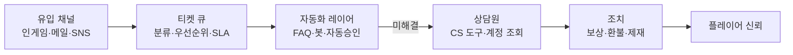
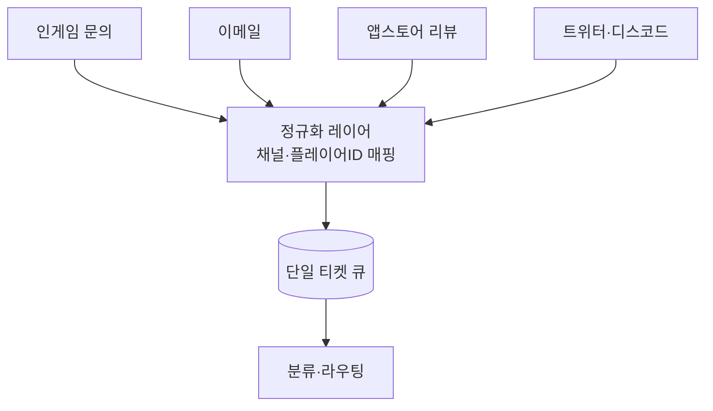
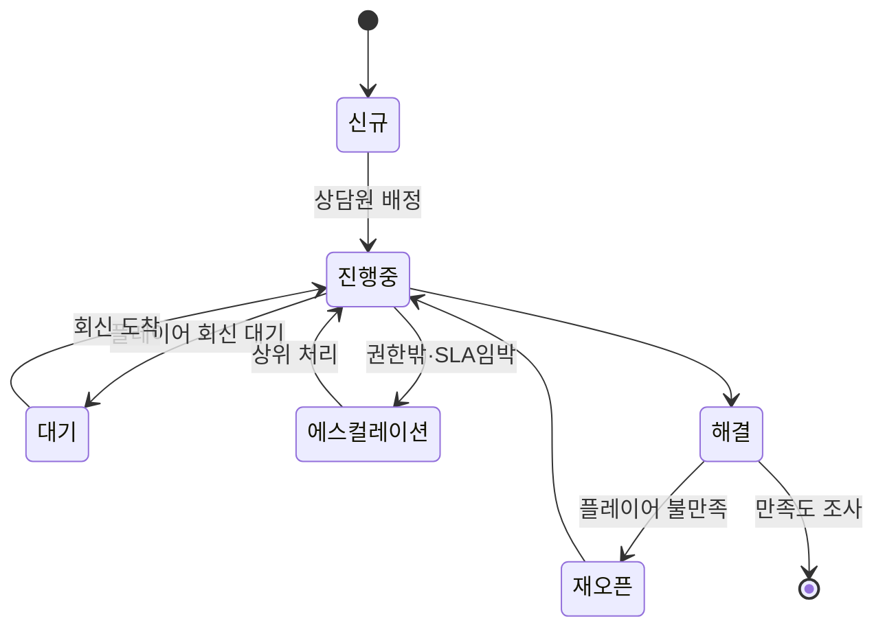
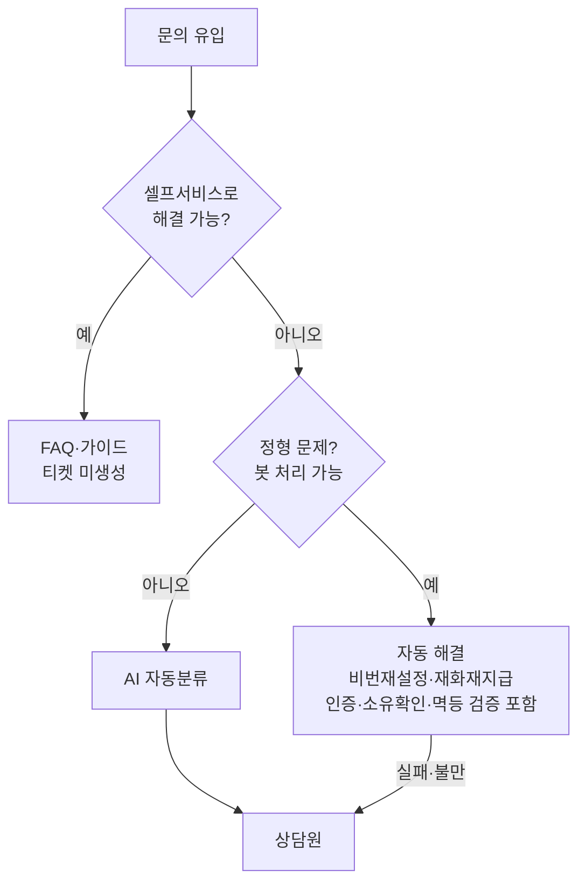
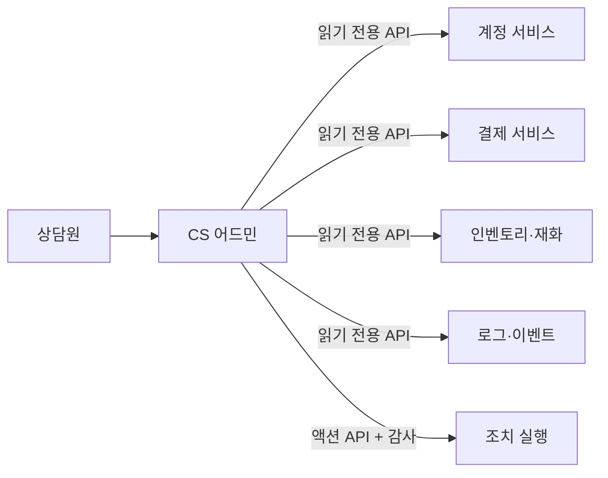
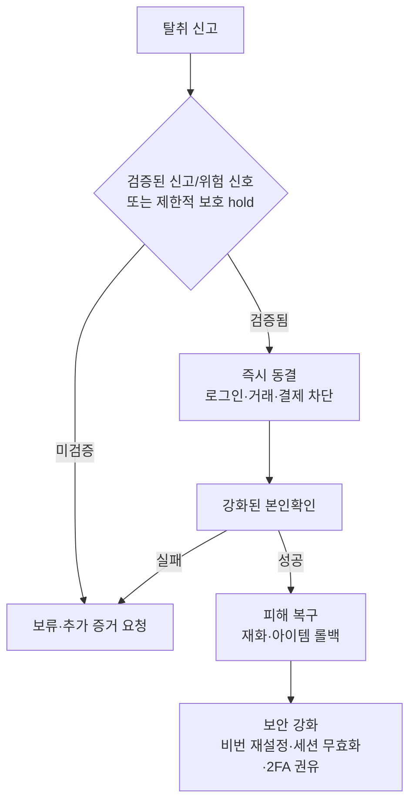
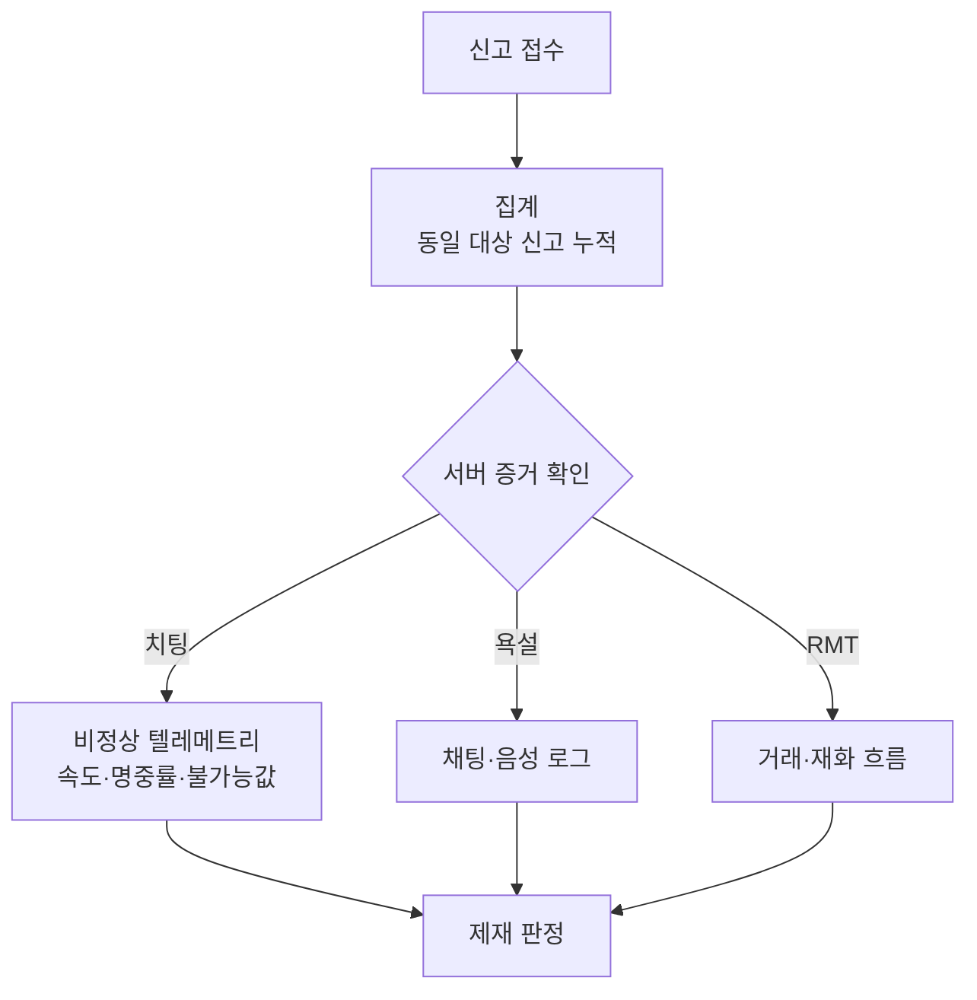
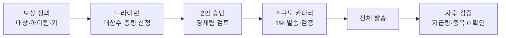

## 들어가며

라이브 서비스의 고객 지원은 *플레이어 신뢰* 와 *운영 비용* 사이의 끝없는 줄다리기다. 모든 문의에 사람이 정성껏 답하면 만족도는 오르지만 인건비가 선형으로 늘고, 모든 것을 자동화하면 비용은 줄지만 복잡한 문제와 감정적 상황에서 신뢰가 무너진다. 그래서 지원 조직의 거의 모든 결정은 *신뢰 ↔ 비용 ↔ 속도* 의 삼각 트레이드오프 위에 놓인다. 어디에 사람을 붙이고 어디를 기계에 맡길지, 어디까지 자동 승인하고 어디서 사람이 개입할지의 선택이 곧 지원 품질이다.

이 글은 그 트레이드오프를 따라 게임 라이브 서비스의 고객 지원·운영을 한 흐름으로 정리한다. 문의가 어떤 채널로 들어와 어떻게 하나의 큐로 모이는지, 티켓이 어떻게 분류·라우팅·에스컬레이션되는지, 무엇을 자동화하고 어디서 사람이 받아야 하는지, CS 도구가 계정을 어떻게 조회하고 어떤 권한 경계를 두는지, 결제·환불·어뷰징을 어떻게 다루는지, 신고·제재·이의제기 워크플로를 어떻게 설계하는지, 보상을 어떻게 안전하게 지급하는지, 그리고 이 모두를 어떻게 측정하고 운영하는지를 다룬다.



이 글의 목표.

1. **채널과 티켓 파이프라인** — 옴니채널 유입, 단일 큐, 분류·라우팅·SLA·에스컬레이션.
2. **자동화 대 수동의 경계** — 셀프서비스·봇·자동분류, 사람 개입 시점.
3. **CS 도구와 계정 조회** — 계정 타임라인, 권한·감사 로그, 액션 도구.
4. **계정 복구와 보안 지원** — 본인확인, 해킹·탈취 대응, 데이터 복구.
5. **결제·환불과 부정결제** — 환불 승인 기준, 플랫폼별 차이, 차지백·어뷰징.
6. **신고·제재·이의제기** — 검증, 제재 단계, 재심, 투명성.
7. **보상 지급** — 개별·대량 보상, 멱등성·중복 방지, 감사.
8. **품질·운영·데이터 환류** — 지표, 상담원 관리, 어뷰징 방어, 제품 개선.


---

## 목차
1. [채널과 티켓 파이프라인](#1-채널과-티켓-파이프라인)
2. [자동화 대 수동의 경계](#2-자동화-대-수동의-경계)
3. [CS 도구와 계정 조회](#3-cs-도구와-계정-조회)
4. [계정 복구와 보안 지원](#4-계정-복구와-보안-지원)
5. [결제·환불과 부정결제](#5-결제환불과-부정결제)
6. [신고·제재·이의제기](#6-신고제재이의제기)
7. [보상 지급](#7-보상-지급)
8. [품질·운영·데이터 환류](#8-품질운영데이터-환류)


---

## 1. 채널과 티켓 파이프라인

### 채널은 많고 큐는 하나여야 한다

플레이어는 편한 곳으로 온다 — 인게임 문의 버튼, 고객센터 웹폼, 이메일, 앱스토어 리뷰, 트위터/X 멘션, 디스코드, 커뮤니티 포럼. 채널마다 별도 팀이 따로 답하면 같은 플레이어가 두 채널에 같은 문제를 올렸을 때 두 상담원이 모르고 중복 대응하거나, 한쪽에서 약속한 보상을 다른 쪽이 모른 채 거절한다. *옴니채널* 의 핵심은 채널을 늘리는 것이 아니라, 들어온 모든 문의를 *하나의 티켓 큐로 정규화* 하는 것이다.



채널별로 *기대치와 비용이 다르다* 는 점이 설계를 좌우한다. 인게임 문의는 클라이언트가 *플레이어 ID·기기·버전·최근 로그* 를 자동으로 첨부할 수 있어 처리가 가장 싸다. 이메일은 본인확인이 약하고 컨텍스트가 비어 처리가 비싸다. SNS는 *공개* 라 한 건의 나쁜 대응이 수천 명에게 노출된다 — 비용이 아니라 평판 리스크 축이 붙는다.

| 채널 | 컨텍스트 자동첨부 | 본인확인 강도 | 특성 |
|---|---|---|---|
| 인게임 문의 | 강 (ID·기기·로그) | 강 (로그인 상태) | 가장 저렴, 1차 권장 |
| 이메일/웹폼 | 약 | 약 | 컨텍스트 수집 비용 큼 |
| 앱스토어 리뷰 | 없음 | 없음 | 공개·환불 연동, 익명 가능 |
| SNS (트위터/X) | 없음 | 없음 | 공개·평판 리스크 |
| 디스코드/포럼 | 없음 | 없음 | 커뮤니티 자가해결 유도 |

### 티켓 분류와 우선순위

티켓이 큐에 들어오면 *카테고리* 와 *우선순위* 가 붙어야 라우팅과 SLA가 결정된다. 카테고리는 처리 팀을, 우선순위는 처리 순서를 정한다. 둘을 섞지 않는 것이 중요하다 — "결제 문제"는 카테고리고, "긴급"은 우선순위다.

```text
카테고리: 계정 | 결제·환불 | 버그·기술 | 신고·제재 | 게임플레이 문의 | 기타
우선순위(점수가 등급을 결정): P0(50점+ — 서비스 장애·다수 영향 또는 결제·평판 복합) | P1(30~49점 — 개인 결제·계정 잠김) | P2(15~29점) | P3(0~14점 — 일반·개선 의견)
```

우선순위 산정은 *영향 범위 × 긴급도* 로 점수화하는 편이 자의적 판단보다 일관된다. "돈이 걸렸나", "플레이가 막혔나", "여러 명에게 번지나"가 세 축이다. 가중 점수 정책이 위 등급 라벨보다 우선하므로, 괄호 안 사례는 일반 등급의 보장이 아니라 대표 조건이다.

```python
def priority_score(ticket):
    score = 0
    if ticket.money_involved:        score += 40   # 결제·환불·재화 손실
    if ticket.account_locked:        score += 30   # 플레이 자체 불가
    if ticket.affects_many:          score += 50   # 장애·집단 이슈
    if ticket.public_channel:        score += 15   # 평판 리스크
    if ticket.vip_tier:              score += 10
    # 0~14: P3, 15~29: P2, 30~49: P1, 50+: P0
    return score
```

### 라우팅·SLA·에스컬레이션

라우팅은 *카테고리·언어·우선순위* 를 스킬을 가진 상담원 그룹에 매핑한다. 결제 티켓은 결제 권한이 있는 그룹으로, 일본어 티켓은 일본어 상담원으로 간다. 라우팅 규칙을 코드가 아니라 *데이터(규칙 테이블)* 로 두면 운영 중 조정이 빠르다.

SLA(Service Level Agreement)는 우선순위별 *최초 응답 시간* 과 *해결 시간* 을 약속한다. SLA는 플레이어와의 외부 약속이자 내부 알람 기준이다. 마감을 넘기기 전에 티켓이 자동으로 에스컬레이션되어야 한다.

| 우선순위 | 최초 응답 목표 | 해결 목표 | 임박 알람 |
|---|---|---|---|
| P0 | 15분 | 4시간 | 즉시 온콜 |
| P1 | 2시간 | 24시간 | 1시간 전 |
| P2 | 24시간 | 72시간 | 마감 6시간 전 |
| P3 | 72시간 | 베스트 에포트 | 없음 |

에스컬레이션은 두 방향이 있다. *시간 기반* — SLA 마감 임박 시 상위 큐로 올린다. *내용 기반* — 상담원이 권한 밖(대량 환불, 영구정지 번복)이거나 버그로 판명되면 전문 그룹·개발팀으로 넘긴다. 두 경로 모두 *티켓 하나의 이력으로 추적* 되어야 한다. 에스컬레이션할 때마다 새 티켓을 파면 플레이어는 같은 설명을 반복하고, 컨텍스트가 끊긴다.



도구는 직접 만들기보다 *티켓 시스템(Zendesk, Freshdesk, 자체)* 위에 게임 컨텍스트를 얹는 편이 표준이다. 핵심 가치는 도구 자체가 아니라, 모든 채널을 단일 큐로 모으고 SLA와 에스컬레이션을 자동으로 거는 *파이프라인* 에 있다.

### SLA와 인력은 줄 모델이 정한다 — Erlang C·제곱근 법칙·우선순위 보존

위 SLA 표의 "최초 응답 목표"는 *약속* 이고, 그 약속을 지킬 수 있는지는 *대기 행렬* 문제다. 도착 간격과 처리 시간이 확률적으로 변하는 큐의 정상 상태는 도착률, 서비스율, 상담원 수로 분석한다. 여기서는 지원 큐 고유의 결정 — 몇 명을 배치해야 SLA를 지키는가, 채널을 합치면 왜 싸지는가, 우선순위를 주면 무엇을 잃는가 — 를 정량화한다.

**도착-서비스 모델.** 단일 FCFS 큐를 동일한 처리율의 상담원 $c$명이 처리하고, 도착이 stationary Poisson, 처리 시간이 독립 exponential, 이탈·재작업·skill 차이가 없다고 가정하면 $M/M/c$로 근사할 수 있다. 도착률 $\lambda$(티켓/시간), 상담원당 처리율 $\mu = 1/\text{AHT}$, 제공 부하 $a = \lambda/\mu$(Erlang), 가동률 $\rho = a/c$다. 안정 조건은 $\rho < 1$이다. 실제 지원에서는 장애 burst, 교대, 다중 skill, 티켓 재오픈과 긴 꼬리 처리 시간이 이 가정을 깨므로 arrival와 service trace로 시뮬레이션을 함께 돌린다.

**대기 확률과 서비스 수준(Erlang C).** 정상 분포에서 "도착 순간 모든 상담원이 바쁠" 확률이 Erlang C 공식이다.

$$
C(c,a) = \frac{\dfrac{a^{c}}{c!}\dfrac{1}{1-\rho}}{\displaystyle\sum_{k=0}^{c-1}\frac{a^{k}}{k!} + \dfrac{a^{c}}{c!}\dfrac{1}{1-\rho}}
$$

평균 대기는 $W_q = \dfrac{C(c,a)}{c\mu - \lambda}$이고, FCFS 대기 시간의 꼬리는 지수 분포라 마감 $T$ 안에 응답할 비율(=서비스 수준)이 닫힌 형태로 나온다.

$$
P(W_q > t) = C(c,a)\,e^{-(c\mu-\lambda)t}
\;\Rightarrow\;
\mathrm{SL}(T) = 1 - C(c,a)\,e^{-c\mu(1-\rho)T}
$$

이 $\mathrm{SL}(T)$가 곧 SLA 표의 "최초 응답 목표 안에 받을 확률"이다. 수치 예: $a = 10$($\lambda = 30$/시간, AHT $= 20$분). $c = 11$이면 $\rho = 0.909$, $W_q = 13.6$분, $\mathrm{SL}(\le 15\text{분}) = 67.8\%$. $c = 12$로 한 명만 늘리면 $\rho = 0.833$, $W_q = 4.5$분, $\mathrm{SL}(\le 15\text{분}) = 90.0\%$. $c = 13$이면 $97.0\%$. 부하 근처의 한 명이 서비스 수준의 대부분을 산다 — SLA 표의 목표 시간은 임의의 숫자가 아니라 *인력 수의 함수* 다.

**불안정 절벽.** Erlang C 식에서 분모 $c\mu-\lambda=c\mu(1-\rho)$가 0에 가까워지고 대기 확률 $C(c,a)$도 높아지므로 $\rho\to1$에서 평균 대기가 발산한다. $c = 12$ 고정에서 위와 같은 AHT를 유지한 채 $\lambda$만 올리면 $\lambda = 30 \to W_q\,4.5$분, $\lambda = 34 \to 23.7$분, $\lambda = 35.5 \to 113$분이다. 포화 근처에서는 작은 수요 증가가 SLA를 붕괴시킨다. 필요한 여유는 평균만이 아니라 시간대별 burst와 shrinkage를 포함해 정한다.

**제곱근 인력 법칙과 규모의 경제.** 큰 부하에서 지연 확률을 비퇴화한 수준으로 유지하는 Halfin-Whitt QED 근사는 $c \approx a + \beta\sqrt{a}$ 꼴이다. 이는 유한한 작은 큐의 정확 공식이 아니라 $a,c\to\infty$인 점근 결과이므로 최종 인원은 Erlang C나 trace simulation으로 검산한다. $\beta = 1$을 올림해 예시하면 $a=2$에서 $c=4$, $a=50$에서 $c=58$, $a=200$에서 $c=215$다. 큰 pool은 같은 가정 아래 비례 여유분이 작아지는 pooling 이득을 얻는다.

구체적으로 AHT가 20분이라 $\mu=3$/시간이고, 두 채널에 각각 $\lambda=2$/시간이 들어오며 각 채널이 상담원 한 명을 독점한다고 하자. 각 $M/M/1$의 평균 큐 대기는 $\rho/(\mu-\lambda)=40$분이다. 두 도착 흐름과 상담원 둘을 한 FCFS 큐로 합친 $M/M/2$에서는 Erlang C 식으로 16분이 된다. 인원을 늘리지 않은 pooling 이득이지만, 상담원 skill이 호환되지 않거나 채널별 처리 시간이 다르면 이 수치는 성립하지 않는다.

**우선순위는 재분배일 뿐 — 보존 법칙.** 다음 식은 여러 상담원이 있는 $M/M/c$의 연장이 아니라, 단일 서버 $M/G/1$에서 독립 도착·service time과 work-conserving 비선점 우선순위를 가정한 결과다. 이 모델에서 클래스 $k$의 대기는

$$
W_q^{(k)} = \frac{R}{(1-\sigma_{k-1})(1-\sigma_k)}, \qquad \sigma_k = \sum_{i\le k}\rho_i,\quad R = \sum_i \frac{\lambda_i \overline{x_i^2}}{2}
$$

($R$은 평균 잔여 서비스 시간 기여). 수치 예($\rho$ = 0.18/0.27/0.45): P0 $W_q = 2.24$분, P1 $= 4.07$분, P2 $= 33.39$분, FCFS는 18.37분. 그런데 Kleinrock 보존 법칙이 묶는다 — 모든 작업 보존(work-conserving) 비선점 규율에서

$$
\sum_k \rho_k W_q^{(k)} = \frac{\rho R}{1-\rho} = \text{상수}
$$

(검증: 이 수치 예의 좌변·우변 모두 0.27548). 이 가정 안에서 P0 대기를 낮춘 만큼 다른 클래스의 가중 대기가 늘어난다. 다중 서버, class별 service distribution, 선점과 abandonment에서는 식이 달라지지만 우선순위가 용량 자체를 만들지는 않는다는 운영 결론은 남는다. 모두의 대기를 줄이려면 staffing, 처리 시간, 도착 부하나 자동 해결률을 바꿔야 한다.

**에스컬레이션 = 마감 기반 오버플로와 인내.** 시간 기반 에스컬레이션은 한 티켓의 누적 대기가 SLA 마감에 다가갈 때 발동하는 *오버플로 밸브* 로, 꼬리(최악 대기)를 보호한다. 유한한 평균 인내를 모델에 넣으면 $M/M/c+M$(Erlang A)이 되지만, 지수 인내시간은 유한한 평균을 가질 뿐 결정적 최댓값(hard maximum)은 없다 — 분포는 모든 유한 $t$에서 양의 꼬리를 남기므로, 평균·꼬리 완화와 hard bound를 구분해야 한다. 에스컬레이션은 시스템 이탈이 아니라 다른 큐로 옮기는 것이므로, overflow 대상 큐의 용량·시간 예산을 함께 넣어야 운영적 상한이 된다. 실패 경계 셋: (1) 포아송 가정은 장애 시 깨진다 — 한 번의 장애가 *상관된* 수천 건을 동시에 만들어 도착이 버스트가 되므로, 정상 상태 Erlang C는 장애 중 대기를 과소평가한다. 온콜·오버플로는 평균이 아니라 *버스트* 기준으로 설계한다(8절의 티켓/DAU 이상 탐지와 연결). (2) 에스컬레이션이 새 티켓을 파면 컨텍스트가 끊기고 부하가 이중 계상된다. (3) 모든 클래스를 P0로 약속하면 우선순위 재분배로 다른 클래스의 가중 대기가 늘고, 처리 용량을 늘리지 않으면 SLA를 지킬 수 없다 — SLA 선언 자체가 $\rho$를 바꾸지는 않는다.

```python
# Erlang C / 서비스 수준 / 보존 법칙 검증 (요지)
from math import factorial, exp
def erlangC(c, a):
    rho = a / c
    s = sum(a**k / factorial(k) for k in range(c))
    top = a**c / factorial(c) / (1 - rho)
    return top / (s + top)
lam, mu = 30, 3.0                      # a = 10 Erlang
for c in (11, 12, 13):
    a = lam / mu; C = erlangC(c, a)
    Wq = C / (c*mu - lam)              # 시간 단위
    SL = 1 - C*exp(-(c*mu - lam)*0.25) # T = 15분 = 0.25시간
    print(c, round(C, 3), round(Wq*60, 1), round(SL*100, 1))
# 비선점 우선순위 보존: sum_k rho_k Wq_k == rho*Wq_FCFS  (작업 보존 불변)
```

## 2. 자동화 대 수동의 경계

### 자동화는 비용을 줄이고, 사람은 신뢰를 만든다

지원 비용은 대체로 *상담원 시간 × 티켓 수* 다. 비용을 줄이는 길은 두 가지다 — 티켓 수를 줄이거나(셀프서비스로 *유입 차단*), 티켓당 시간을 줄이거나(자동분류·템플릿으로 *처리 가속*). 두 경우 모두 핵심은 *기계가 잘하는 영역과 사람이 잘하는 영역을 가르는 것* 이다. 자동화가 사람 영역을 침범하면 신뢰가 깨지고, 사람이 기계 영역에 남으면 비용이 샌다.



### 셀프서비스 — 가장 싼 티켓은 생기지 않은 티켓

FAQ·가이드·셀프서비스 포털의 목적은 *티켓 차단율(deflection rate)* 을 올리는 것이다. "비밀번호를 잊었어요", "결제했는데 재화가 안 들어와요", "계정 연동은 어떻게 하나요" 같은 *반복 정형 문의* 가 전체의 큰 비중을 차지한다. 이걸 검색 가능한 문서와 *셀프 액션* (재화 재지급 버튼, 비번 재설정 링크)으로 처리하면 그만큼 사람 큐가 비워진다.

차단율을 측정하려면 *검색·문서 조회 후 티켓 생성 여부* 를 추적해야 한다. 문서를 봤는데도 티켓을 만들었다면 그 문서는 *질문에 답하지 못한 것* 이다 — 어떤 문서가 차단에 실패하는지가 곧 FAQ 개선 우선순위다.

### 챗봇과 자동 액션

챗봇은 *대화로 셀프서비스를 안내* 하고, 가능하면 *직접 조치* 까지 한다. 봇 설계의 함정은 "무엇이든 답하려는" 봇이다 — 모르는 걸 그럴듯하게 지어내면(특히 생성형) 환불·제재 같은 영역에서 *잘못된 약속* 을 만들어 더 큰 분쟁이 된다. 봇은 *자신이 처리 가능한 의도(intent)인지 먼저 분류* 하고, 아니면 빠르게 사람에게 넘겨야 한다.

```python
def bot_handle(message, account):
    intent, confidence = classify_intent(message)
    if confidence < 0.75:
        return escalate_to_human(reason="low_confidence")
    if intent in AUTO_RESOLVABLE:           # 비번재설정·미지급재화·FAQ
        return run_auto_action(intent, account)
    if intent in SENSITIVE:                 # 환불·제재·해킹·계정삭제
        return escalate_to_human(reason="sensitive_intent")  # 봇이 절대 단독 처리 안 함
    return escalate_to_human(reason="unhandled")
```

자동 액션의 안전장치는 *되돌릴 수 있고, 한도가 있고, 기록되는* 것이다. 자동 비번 재설정은 본인확인을 통과해야 하고, 자동 재화 재지급은 *건당 한도와 일일 횟수 한도* 가 걸려야 어뷰징을 막는다(8절). 한도를 넘으면 사람 검토로 빠진다.

### AI 자동분류와 사람 개입 시점

들어온 자유 텍스트를 카테고리·우선순위·언어로 자동 분류하면 라우팅이 빨라진다. 자동분류는 *제안* 으로 쓰고 상담원이 한 번에 수정 가능하게 둔다 — 오분류된 채로 잘못된 큐에 박히면 SLA를 넘긴다. 분류기 성능은 *오분류율* 과 *상담원 수정률* 로 상시 측정한다.

사람이 받아야 하는 경계는 명확히 정의하는 편이 좋다.

| 자동화에 적합 | 사람이 받아야 함 |
|---|---|
| 반복 정형 질문 (FAQ) | 감정 격앙·항의·평판 리스크 |
| 본인확인 통과한 비번 재설정 | 계정 탈취 의심 |
| 한도 내 재화 재지급 | 고액 환불·환불 분쟁 |
| 카테고리·언어 분류 | 제재 번복·이의제기 |
| 상태 조회 (점검·장애 안내) | 신규·복합·근거 불명확 케이스 |

원칙은 단순하다 — *되돌리기 어렵거나, 돈·계정이 크게 걸리거나, 감정이 실린* 티켓은 사람이 받는다. 나머지는 자동화가 처리하고 실패 시에만 사람으로 폴백한다.

## 3. CS 도구와 계정 조회

### 상담원의 눈 — 계정 타임라인

상담원이 "재화가 안 들어왔어요"를 처리하려면, 그 플레이어의 *결제 → 지급 → 소비* 흐름을 한 화면에서 봐야 한다. 분석 DB를 직접 SQL로 뒤지게 하면 느리고 위험하다(개인정보 노출, 잘못된 쿼리). *CS 어드민 도구* 는 상담원이 알아야 할 것만, 권한 안에서, 읽기 쉽게 보여주는 *전용 백오피스* 다.



계정 화면의 핵심은 *시간순 타임라인* 이다. 가입·로그인·결제·지급·제재·문의 이력이 하나의 줄로 흐르면, "결제는 됐는데 지급 이벤트가 없다" 같은 인과를 즉시 본다. 흩어진 표 여러 개보다 단일 타임라인이 진단을 빠르게 한다.

```python
# 계정 타임라인: 여러 소스의 이벤트를 시간순 병합
def account_timeline(player_id, since):
    events = []
    events += payment_svc.events(player_id, since)    # 결제·환불·차지백
    events += inventory_svc.events(player_id, since)   # 재화 증감
    events += account_svc.events(player_id, since)     # 로그인·기기·연동
    events += moderation_svc.events(player_id, since)  # 신고·제재
    return sorted(events, key=lambda e: e.timestamp)
```

타임라인이 보여 주는 계정·연동·세션 구조 자체는 세 가지 불변식에 기대야 한다. `playerId`는 바뀌지 않고, 자격 증명은 별도 스키마로 연결되며, 토큰은 명시된 수명과 폐기 규칙을 가진다.

### 권한 경계와 감사 로그

CS 도구는 *내부자 위협* 의 최전선이다. 상담원이 임의 계정에 재화를 무한 지급하거나, 유명인 계정을 들여다보거나, 친구 계정의 제재를 풀 수 있으면 안 된다. 두 가지 통제가 기본이다.

*역할 기반 권한(RBAC)* — 상담원마다 할 수 있는 액션이 다르다. 1차 상담원은 조회와 소액 보상만, 시니어는 환불·제재, 리드는 대량 보상·제재 번복. 민감 액션은 *2인 승인(maker-checker)* 으로 한 명이 신청하고 다른 한 명이 승인한다.

*감사 로그(audit log)* — 모든 조회와 액션이 *누가·언제·어떤 계정에·무엇을·왜* 형태로 기록된다. 특히 *조회조차 로그* 로 남겨, "왜 이 상담원이 이 플레이어를 봤는가"를 사후 추적한다. 감사 로그는 상담원도 지울 수 없는 별도 저장소에 append-only로 쌓인다.

```python
@require_permission("account.read")
@audit_log(action="view_account")          # 조회도 감사 대상
def view_account(agent, player_id, reason): ...

@require_permission("grant.currency")
@rate_limit(per_agent_daily=200)           # 상담원당 일일 한도
@audit_log(action="grant_currency")
def grant_currency(agent, player_id, amount, reason, ticket_id):
    if amount > AGENT_LIMITS[agent.role]:
        raise NeedsApproval(maker=agent)   # 한도 초과 → 2인 승인
    ...
```

티켓 연결을 강제하는 것도 통제다 — 모든 보상·환불·제재 액션이 *티켓 ID를 필수로* 요구하면, 근거 없는 단독 조치가 줄고 사후 감사 시 맥락이 붙는다.

### 액션 도구와 안전장치

조회 다음은 조치다 — 재화 재지급, 환불, 계정 잠금/해제, 제재 부과/해제, 보상 발송. 액션 도구의 설계 원칙은 *명시적·가역적·기록적* 이다. 액션마다 *사유 선택* 을 강제하고(자유 입력보다 코드화된 사유가 통계에 잡힌다), 가능하면 *되돌리기(undo)* 를 제공하며, 모든 액션을 감사 로그와 티켓에 남긴다.

화면에는 *실수를 줄이는 마찰* 을 의도적으로 둔다. 영구정지·고액 환불 같은 비가역 액션은 확인 다이얼로그와 대상 계정 재입력을 요구해, 옆 탭의 다른 플레이어에게 잘못 적용하는 사고를 막는다.

## 4. 계정 복구와 보안 지원

### 본인확인 — 신뢰와 마찰의 균형

계정 지원의 근본 질문은 "지금 문의하는 사람이 *진짜 계정 주인인가* "다. 확인을 약하게 하면 *사회공학으로 남의 계정을 탈취* 당하고, 너무 강하게 하면 *진짜 주인이 복구를 못 해* 이탈한다. 이것이 보안 지원의 핵심 트레이드오프다.

본인확인은 *증거의 가중 합* 으로 다룬다. 한 가지로 확정하지 않고 여러 신호를 모아 임계치를 넘으면 통과시킨다.

| 증거 | 강도 | 비고 |
|---|---|---|
| 가입 이메일·전화 접근 | 강 | OTP로 확인 |
| 최초 결제 정보 (카드 끝 4자리·영수증) | 중 | 보조 증거 — 단독 신원증명 아님 |
| 자주 쓰는 기기·IP 일치 | 중 | 디바이스 핑거프린트 |
| 가입일·최초 캐릭터명·연동 플랫폼 | 중 | 알 만한 정보 |
| 닉네임·레벨만 진술 | 약 | 단독 불충분 |

탈취 의심 상황(평소와 다른 국가, 기기 변경 직후 고액 결제·재화 이동)에서는 *자동 통과를 막고 강한 확인* 으로 올린다. 반대로 평소 기기에서 온 단순 비번 재설정은 OTP만으로 자동 처리한다.

### 해킹·탈취 대응

계정 탈취가 신고되면 시간이 핵심이다 — 공격자가 재화를 빼돌리거나 결제를 일으키기 전에 *동결* 해야 한다. 다만 무인증 신고만으로 곧바로 전면 동결하면 타인 계정 가용성을 노린 DoS가 되므로, 먼저 *신고 신뢰도·기존 인증 상태·위험 신호* 를 평가한다. 검증된 신고·위험 신호일 때만 전면 동결하고, 그렇지 않으면 민감 거래·결제만 막는 *제한적 보호 hold* 로 시작한다. 표준 흐름은 *동결(또는 보호 hold) → 본인확인 → 피해 복구 → 재발 방지* 다.



피해 복구의 핵심은 *로그 기반 롤백* 이다. 분쟁의 진실은 상담원의 직관이 아니라 *서버 로그* 에 있다 — 탈취 의심 구간의 거래·소비를 식별해, 빼돌려진 재화를 회수하고 정당한 잔액을 복원한다. 이때 *받은 쪽(현금화 대상 계정)* 도 함께 조사해야 어뷰징 고리를 끊는다. 단순히 신고자에게 재화를 새로 지급하면 *재화가 무에서 창조* 되어 인게임 경제를 망친다 — 복구는 회수와 짝이어야 한다.

재발 방지로 세션 전체 무효화, 비번 강제 재설정, 등록 기기 재확인, 2FA 권유를 묶는다. 탈취 신고를 *2FA 미설정 계정 비율* 같은 보안 지표로 환류하면, 지원 데이터가 제품 보안 개선으로 이어진다.

### 데이터·연동 복구

기기 변경·플랫폼 연동 실수로 진행도를 잃었다는 문의는 흔하다. 게스트 계정(연동 안 한 로컬 진행도)이 앱 삭제로 사라지는 경우, 서버에 백업이 없으면 복구가 불가능하다 — 이건 지원의 한계이자 *연동 유도 UX 개선* 신호다. 서버 측 진행도가 있으면 *어떤 식별자로 어떤 진행도가 묶였는지* 를 타임라인으로 확인해 올바른 연동으로 되돌린다. 두 계정이 잘못 병합/분리된 케이스는 비가역 위험이 커 시니어·2인 승인으로 다룬다.

## 5. 결제·환불과 부정결제

### 환불 — 정책을 사람마다 다르게 적용하지 않는다

환불은 *돈* 이 걸려 신뢰·비용·어뷰징이 한꺼번에 충돌하는 영역이다. 같은 상황에 상담원마다 다르게 답하면 플레이어는 *환불 잘 해주는 상담원* 을 찾아 재문의하고("agent shopping"), 정책은 무력화된다. 환불은 *코드화된 정책* 으로 일관되게 판정하고, 예외만 사람이 본다.

```python
def refund_decision(purchase, account):
    if purchase.consumed and not purchase.faulty:
        return DENY("소비 완료된 재화")              # 이미 쓴 재화
    if account.refund_count_90d >= REFUND_ABUSE_LIMIT:
        return REVIEW("환불 빈도 과다 — 어뷰징 검토")  # 8절
    if purchase.age_days <= AUTO_REFUND_WINDOW and not purchase.consumed:
        return APPROVE_AUTO("미소비·기간 내")        # 자동 승인
    if purchase.faulty:                              # 결제 오류·중복청구
        return APPROVE_AUTO("결제 오류 확인")
    return REVIEW("정책 외 — 상담원 판단")
```

판정의 두 축은 *소비 여부* 와 *결제 정상 여부* 다. 결제 오류(이중 청구, 미지급)는 게임 측 잘못이므로 신속·자동 환불이 맞다. 정상 결제 후 *이미 소비한 재화* 의 단순 변심 환불은 거절이 기본이되, 신규·소액·평판 리스크를 고려해 *1회 선의 환불* 같은 유연성을 정책에 명시해 두면 상담원이 자의적으로 판단할 여지를 줄인다.

### 플랫폼별 환불의 현실

모바일·콘솔·스토어 결제는 *환불 권한이 게임이 아니라 플랫폼* 에 있다. iOS는 App Store가, Android는 Google Play가, 콘솔·PC 스토어는 각 플랫폼이 환불을 처리한다. 소비자가 플랫폼에 환불을 신청하는 것이 기본 경로지만, 게임도 권한·상품·주문 상태가 허용하면 플랫폼 환불 개시 API(예: Google Play `orders.refund`)로 직접 환불을 시작할 수 있다. 플랫폼이 환불하면 *영수증(트랜잭션)이 무효화* 되었다는 신호가 (검증·웹훅/RTDN·Server Notification을 통해) 게임에 도달한다.

이 구조가 어뷰징 표면을 만든다 — 플레이어가 *플랫폼에 환불을 받아 돈을 돌려받고도 게임 내 재화는 그대로 쓴다*. 그래서 게임은 환불 웹훅을 받으면 *해당 재화를 회수* 해야 한다. 웹훅은 진위 검증 없이 신뢰하지 않고, 중복·재전송은 refund/order ID 기준으로 멱등하게 처리한다. 회수 시 잔액이 음수가 되면(이미 다 썼으면) 음수 잔액 또는 제재로 다룬다.

```python
def on_platform_refund_webhook(notification):
    verify_platform_signature(notification)          # 1) 플랫폼 서명·진위 검증
    tx = requery_authoritative_order(notification)   # 2) 권위 주문 상태 재조회
    with db.transaction() as txn:                    # 3) 멱등 전이·원장 commit
        # 4) refund/order ID 기준 중복·재전송은 같은 거래로 처리
        if not txn.mark_refund_if_absent(tx.refund_id):
            pass                                     # 이미 처리됨: 커밋 후에도 ACK
        else:
            grant = find_grant_by_transaction(tx.order_id)
            inventory.revoke(grant.player, grant.items)  # 회수·마커는 같은 commit(다른 서비스면 outbox)
            if inventory.balance(grant.player) < 0:
                flag_negative_balance(grant.player)      # 다 쓴 뒤 환불 → 검토
            txn.append_audit("platform_refund_revoke", tx=tx.order_id)
    ack_platform(notification)                       # 5) durable commit 후 ACK
```

플랫폼 환불 정책·웹훅 형식은 각 플랫폼 문서를 따른다([App Store Server Notifications](https://developer.apple.com/documentation/appstoreservernotifications), [Google Play Real-time developer notifications](https://developer.android.com/google/play/billing/rtdn-reference)). 구분해야 할 비대칭은 *플랫폼 결제 환불* 과 *인게임 재화 회수* 가 서로 다른 원장이라는 점이다 — 환불 개시 API를 쓰든 소비자 신청을 받든, 게임은 후속 동기화로 주문 상태를 재조회해 재화를 회수한다.

### 부정결제(Fraud)와 차지백

도난 카드로 결제 → 재화 현금화 후 *차지백(chargeback)* — 카드사를 통한 강제 환불 — 은 게임이 *상품·수수료·페널티를 모두 잃는* 가장 비싼 어뷰징이다. 차지백률이 높으면 결제 대행사가 수수료를 올리거나 계약을 끊는다. 방어는 *결제 시점 탐지* 와 *사후 대응* 두 단계다.

| 신호 | 의미 |
|---|---|
| 신규 계정 + 즉시 고액 결제 | 도난 카드 가능성 |
| 단시간 다수 카드·다수 계정 | 카드 테스트·현금화 링 |
| 결제 후 재화 즉시 타 계정 이동 | 현금화(RMT) 흐름 |
| 지역·기기·카드 발급국 불일치 | 도용 신호 |

탐지되면 *결제 보류·재화 거래 동결·강화 인증* 으로 대응한다. 차지백이 들어오면 환불 회수와 동일하게 재화를 회수하고 계정을 제재한다. 정상 플레이어를 잘못 막으면(거짓 양성) 이탈하므로, 탐지는 *차단보다 마찰 추가(추가 인증·홀드)* 를 우선하는 편이 안전하다.

## 6. 신고·제재·이의제기

### 신고 검증 — 증거 없는 제재는 없다

플레이어 신고(치팅·욕설·괴롭힘·RMT)는 *노이즈가 많다* — 분풀이 신고, 표적 신고, 오해가 섞인다. 신고를 그대로 제재로 옮기면 무고한 플레이어가 처벌받고 신뢰가 붕괴한다. 신고는 *증거를 모으는 트리거* 일 뿐, 제재 근거는 *서버 측 증거* 여야 한다.



증거 유형이 신고 종류마다 다르다. 치팅은 *텔레메트리* (물리적으로 불가능한 이동속도·명중률·재화 획득 속도)가 신고보다 강한 증거다. 욕설·괴롭힘은 *채팅/음성 로그* 가 근거다. RMT는 *비정상 거래 패턴* 이다. 신고 집계는 *우선순위 신호* 로만 쓴다 — 신고가 많다고 곧 유죄가 아니라, *먼저 들여다볼 대상* 일 뿐이다.

### 제재 단계 — 비례성과 일관성

제재는 *위반 정도에 비례* 하고 *같은 위반에 같은 결과* 여야 한다. 단계형 제재(progressive)가 표준이다.

| 단계 | 조치 | 적용 |
|---|---|---|
| 경고 | 알림·기능 제한 없음 | 경미·초범 |
| 일시 정지 | 24h~30일 | 반복·중간 위반 |
| 기능 제한 | 채팅·거래 차단 | 행위별 표적 제재 |
| 영구 정지 | 계정 영구 차단 | 치팅·심각·반복 |
| 디바이스/결제 차단 | 재가입 방지 | 영구정지 회피 대응 |

자동 제재는 *증거가 결정적인 경우* 에 한정한다 — 명백한 치팅 텔레메트리는 자동 정지가 맞지만, 맥락이 필요한 욕설·괴롭힘은 사람이 본다. 자동 제재의 *거짓 양성 비용* 이 크므로, 임계치를 보수적으로 잡고 *이의제기로 빠르게 교정* 하는 구조가 안전하다.

### 이의제기와 투명성

자동·수동 제재 모두 *틀릴 수 있다*. 이의제기(appeal) 경로가 없으면 무고한 플레이어가 구제받지 못하고, 신뢰가 무너진다. 이의제기는 *제재한 사람이 아닌 다른 상담원* 이 재심해야 편향이 줄고, 원래 제재의 증거를 다시 검토한다.

투명성은 *비용과 신뢰* 사이의 미묘한 균형이다. 제재 사유를 자세히 알릴수록 플레이어는 납득하지만, *치팅 탐지 방법을 노출* 하면 치터가 우회법을 학습한다. 표준 절충은 *위반 카테고리는 알리되(예: "비정상 게임 데이터"), 탐지 알고리즘 세부는 비공개* 하는 것이다. 제재 이력을 본인에게 보여주고, 이의제기 결과를 통지하면, 탐지 비밀을 지키면서도 절차적 신뢰를 유지한다.

```python
def appeal_review(case, original_action, new_agent):
    if new_agent.id == original_action.agent_id:       # 운영 계약: assert 대신 명시적 거부
        raise PermissionError("재심은 다른 상담원")
    evidence = reload_evidence(case)                   # 원 증거 재검토
    if evidence.insufficient or evidence.contradicted:
        reverse_sanction(case, reason="재심 — 근거 부족")
        restore_account(case.player)                   # 피해 복구
        notify(case.player, outcome="제재 철회")
    else:
        uphold(case, reason="재심 — 증거 유지")
        notify(case.player, outcome="제재 유지", category=case.category)
    audit_log("appeal_decision", case=case.id)
```

## 7. 보상 지급

### 보상의 두 모드 — 개별과 대량

보상은 신뢰 회복의 직접 수단이다 — 버그로 손해 본 플레이어, 점검 보상, 장애 사과. 두 모드가 있다. *개별 보상* 은 상담원이 한 플레이어에게 티켓 처리 중 지급한다. *대량 보상* 은 운영팀이 *전체 또는 세그먼트* 에 일괄 지급한다(점검 보상, 장애 사과 우편).

보상 설계에서 *경제 영향* 을 먼저 본다. 보상은 *재화를 무에서 만든다* — 통화량(공급)을 늘리지만, 이것이 곧 물가 인플레이션을 뜻하지는 않는다. 물가 압력은 화폐유통속도·거래량·재화 생산량(MV=PQ)과 품목·품질을 고정한 가격지수, 유저 수를 함께 봐야 판단할 수 있다. 버그 피해 보상은 *피해 추정치에 비례* 하게, 사과 보상은 *경제를 흔들지 않는 선* 에서 정한다. 보상 기준을 사례별 직관이 아니라 *표* 로 두면 일관되고 어뷰징 표면이 준다.

| 사유 | 보상 성격 | 산정 |
|---|---|---|
| 결제 미지급 버그 | 정확 복구 | 로그 기반 정확 금액 |
| 진행도·재화 손실 버그 | 추정 복구 | 로그 추정 + 보수적 가산 |
| 서버 장애·점검 초과 | 사과 | 전체 일괄, 소액 균등 |
| 이벤트 오류 | 형평 보정 | 영향 세그먼트 한정 |

### 멱등성과 중복 지급 방지

대량 보상의 가장 흔한 사고는 *중복 지급* 이다 — 배치가 재시도되거나, 우편 수령이 두 번 처리되어 같은 보상을 여러 번 받는다. 핵심 방어는 *멱등성(idempotency)* 이다. 모든 보상에 *고유 보상 키* 를 부여하고, 수령 시 *(플레이어, 보상키)* 가 이미 처리됐는지 원자적으로 검사한다.

```python
def claim_reward(player_id, reward_key, items):
    with db.transaction() as tx:
        # UNIQUE(player_id, reward_key). 충돌한 요청은 기존 결과를 재생한다.
        claim = tx.insert_claim_if_absent(player_id, reward_key, items)
        if not claim.inserted:
            return tx.load_claim_result(player_id, reward_key)

        tx.inventory_grant(player_id, items)
        result = tx.mark_claim_granted(player_id, reward_key)
        tx.append_audit("reward_granted",
                        player=player_id, key=reward_key, items=items)
        return result
```

claim row만 먼저 commit하고 `inventory.grant`를 나중에 호출하면, 그 사이의 crash가 “처리됨으로 기록됐지만 지급되지 않음”을 만든다. 위 코드는 claim·인벤토리·감사 로그가 같은 DB transaction에 들어갈 때의 형태다. 인벤토리가 다른 서비스라면 claim transaction에 outbox를 쓰고, consumer가 `(player, reward_key)`를 멱등 키로 적용한 뒤 상태를 확정해야 한다.

지급 방식도 안전을 좌우한다. 우편함은 오프라인 플레이어에게 durable한 지급 권리를 남기고 실제 수령을 늦출 수 있다. 그러나 우편 자체가 중복을 자동으로 막지는 않는다. 생성에는 `(player, reward_key)` unique 제약, 수령에는 `unclaimed -> claimed` 조건부 상태 전이와 인벤토리 반영의 원자성 또는 outbox가 필요하다.

### 대량 보상의 운영 안전장치

전체 일괄 보상은 한 번의 실수가 *전체 경제를 파괴* 할 수 있다("0"을 하나 더 붙인 보상). 그래서 *드라이런·승인·점진 롤아웃* 을 건다.



드라이런은 *실제 지급 없이 대상 수와 총 지급량을 계산* 해 의도와 맞는지 확인한다. 경제팀 승인과 카나리(소규모 선발송) 후 전체로 확대하고, 사후에 *총 지급량·중복 건수* 를 감사한다. 보상은 비가역에 가까우므로(회수는 더 큰 분쟁) 발송 전 검증이 사후 수습보다 압도적으로 싸다.

## 8. 품질·운영·데이터 환류

### 무엇을 측정하는가

지원 품질은 *속도* 와 *만족도* 두 축으로 측정한다. 속도만 보면 상담원이 *대충 빨리 닫고*(만족도 희생), 만족도만 보면 *비용이 샌다*. 둘을 함께 본다.

| 지표 | 의미 | 위험 신호 |
|---|---|---|
| 최초 응답 시간(FRT) | 큐 대기 | SLA 초과 증가 |
| 해결 시간(TTR) | 처리 속도 | 장기 미해결 적체 |
| 최초 해결률(FCR) | 한 번에 해결 비율 | 낮으면 재문의 폭증 |
| 재오픈율 | 닫았다 다시 열림 | 성급한 종료 신호 |
| CSAT/CES | 만족도·노력도 | 하락 = 품질 문제 |
| 티켓 차단율 | 셀프서비스 효과 | 낮으면 FAQ 부실 |
| 티켓/DAU | 유입 강도 | 급증 = 제품 문제 |

핵심 결합 지표는 *티켓/DAU* 다. 지원량은 플레이어 수에 비례하지만, *특정 카테고리 티켓이 갑자기 늘면 그것은 지원 문제가 아니라 제품 문제* 다 — 결제 티켓 급증은 결제 장애, 계정 티켓 급증은 로그인 버그의 신호다. 지원 큐는 *제품의 조기경보 센서* 다.

```python
def detect_anomaly(category, window):
    rate = ticket_count(category, window) / dau(window)
    baseline = rolling_baseline(category)
    if rate > baseline * SPIKE_FACTOR:
        alert_product_team(category, rate, baseline)   # 지원 → 제품 환류
```

### 상담원 관리와 번아웃

지원은 사람이 핵심 자원이라, *상담원 품질과 지속성* 이 곧 서비스 품질이다. 온보딩에서 *게임 지식* (재화 구조·버그 패턴·제재 정책)과 *도구 사용* (CS 어드민·감사 의무)을 가르치고, *소프트 스킬* (격앙된 플레이어 응대)을 훈련한다. 성과 평가는 *처리량만으로 하지 않는다* — 처리량 단일 지표는 *대충 빨리 닫기* 를 보상한다. CSAT·재오픈율·감사 통과율을 함께 본다.

번아웃은 운영 리스크다 — 욕설·항의를 종일 받는 일은 소모적이고, 번아웃은 *응대 품질 저하 → CSAT 하락 → 더 많은 재문의* 의 악순환을 만든다. 감정노동 큐 분산(어려운 케이스를 한 사람에게 몰지 않기), 휴식 보장, 셀프서비스·자동화로 반복 부하 제거가 방어책이다. 자동화의 진짜 가치는 비용 절감만이 아니라 *상담원이 사람만 할 수 있는 일에 집중* 하게 하는 것이다.

### 지원 자체에 대한 어뷰징 방어

지원 시스템도 어뷰징 표적이다. *agent shopping*(거절당하면 채널·상담원을 바꿔 재시도), *보상 파밍*(없는 버그를 신고해 보상 수령), *대량 거짓 신고*(표적 제재 유도), *복구 사회공학*(남의 계정 탈취 시도). 방어의 공통 원리는 *플레이어 단위로 이력을 묶고 한도를 거는* 것이다.

```python
def support_abuse_check(player, request_type):
    flags = []
    h = support_history(player, window_days=90)
    if h.refund_count > REFUND_LIMIT:        flags.append("환불 빈도 과다")
    if h.goodwill_grants > GOODWILL_LIMIT:   flags.append("선의 보상 반복 수령")
    if h.appeals_filed > APPEAL_LIMIT:       flags.append("이의제기 남용")
    if h.distinct_channels_same_issue > 2:   flags.append("agent shopping 의심")
    return flags
```

같은 플레이어의 모든 채널·티켓을 *단일 ID로 통합*(1절)해야 이 방어가 작동한다. 채널이 분리돼 있으면 어뷰저가 채널 사이의 빈틈을 노린다. 동시에 *거짓 양성* 을 경계한다 — 진짜로 운이 나빠 버그를 여러 번 겪은 플레이어를 어뷰저로 몰면 신뢰를 잃는다. 플래그는 *차단이 아니라 검토 트리거* 로 쓰는 편이 안전하다.

### 데이터를 제품으로 되돌린다

지원의 마지막 가치는 *제품 개선* 이다. 티켓 카테고리 분포는 *플레이어가 실제로 겪는 문제의 순위표* 다 — 가장 많은 카테고리가 가장 큰 개선 기회다. 연동 실패 문의가 많으면 연동 UX를, 결제 미지급 문의가 많으면 결제 파이프라인을, 특정 콘텐츠 관련 신고가 많으면 그 콘텐츠 설계를 고친다. *예측적 지원* — 장애를 감지하면 *문의가 오기 전* 에 점검 안내·자동 보상으로 선제 대응 — 은 티켓 유입을 줄이는 가장 강력한 방법이다.

이 환류 고리가 닫히면 지원은 *비용 센터* 에서 *제품 신호원* 으로 바뀐다. 같은 티켓을 매번 처리하는 대신, 그 티켓이 *왜 생기는지* 를 제품팀에 돌려보내 *유입 자체를 줄인다*. 가장 좋은 지원은 결국 필요 없어지는 지원이다.


---

## 결론

고객 지원·운영의 모든 결정은 *신뢰 ↔ 비용 ↔ 속도* 의 삼각 트레이드오프 위에 놓인다. 채널 통합(흩어진 유입을 단일 큐로), 자동화 경계(되돌리기 쉬운 정형 문제는 기계, 돈·계정·감정이 걸리면 사람), CS 도구의 권한·감사(내부자 위협 통제), 환불·제재의 코드화된 정책(상담원 간 일관성), 보상의 멱등성(중복·경제 파괴 방지) — 모두 이 삼각형 위에서 어디에 무게를 둘지의 선택이다.

이 트레이드오프를 다루는 기반 구조는 일관된다. 단일 티켓 파이프라인이 모든 채널을 정규화하고, SLA와 에스컬레이션이 마감을 강제하며, 자동화 레이어가 반복 부하를 걷어내고, CS 어드민이 권한과 감사 안에서 계정을 조회·조치하며, 코드화된 환불·제재 정책이 일관성을, 멱등 보상이 안전을 보장한다. 그 바닥에는 *모든 액션이 누가·왜·무엇을 했는지 기록되고 되돌릴 수 있어야 한다* 는 운영 철칙이 깔린다.

지원의 성패는 결국 *측정 가능성과 환류* 에 달렸다. 속도와 만족도를 함께 보는 지표, 어뷰징을 플레이어 단위로 묶어 보는 이력, 그리고 티켓 분포를 제품 개선으로 되돌리는 고리가 "들리지 않는 신뢰"를 예산 안에서 지키는 도구다. 가장 좋은 지원은 자동화로 비용을 낮추는 것을 넘어, 문제의 원인을 제품으로 돌려보내 *문의 자체를 사라지게 하는* 지원이다.

## 더 읽을거리

- Apple App Store Server Notifications / Google Play Real-time Developer Notifications 문서 — 플랫폼 환불·구독 웹훅의 표준 흐름.
- PCI DSS(카드 데이터 보안)와 각 카드 네트워크의 차지백·분쟁(dispute) 가이드 — 전자는 결제 데이터 보안 기준, 후자는 부정결제 대응의 기준이다.
- OWASP Forgot Password Cheat Sheet / Authentication Cheat Sheet — 본인확인과 계정 복구의 보안 모범 사례.
- N. Gans, G. Koole, A. Mandelbaum, "Telephone Call Centers: Tutorial, Review, and Research Prospects," *Manufacturing & Service Operations Management* 5(2), 2003 — Erlang C 인력 산정과 콜센터 큐잉의 표준 리뷰.
- S. Halfin, W. Whitt, "Heavy-Traffic Limits for Queues with Many Exponential Servers," *Operations Research* 29(3), 1981 — 제곱근 인력 법칙(QED 영역)의 원전.
- L. Kleinrock, *Queueing Systems, Vol. 2: Computer Applications*, Wiley, 1976 — 우선순위 대기와 보존 법칙.
- A. Cobham, "Priority Assignment in Waiting Line Problems," *Operations Research* 2(1), 1954 — 비선점 우선순위 대기 시간 공식.
