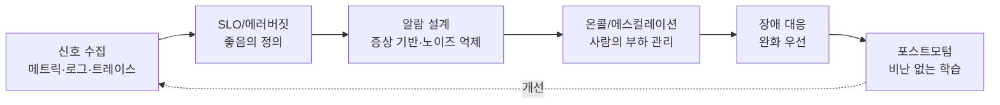
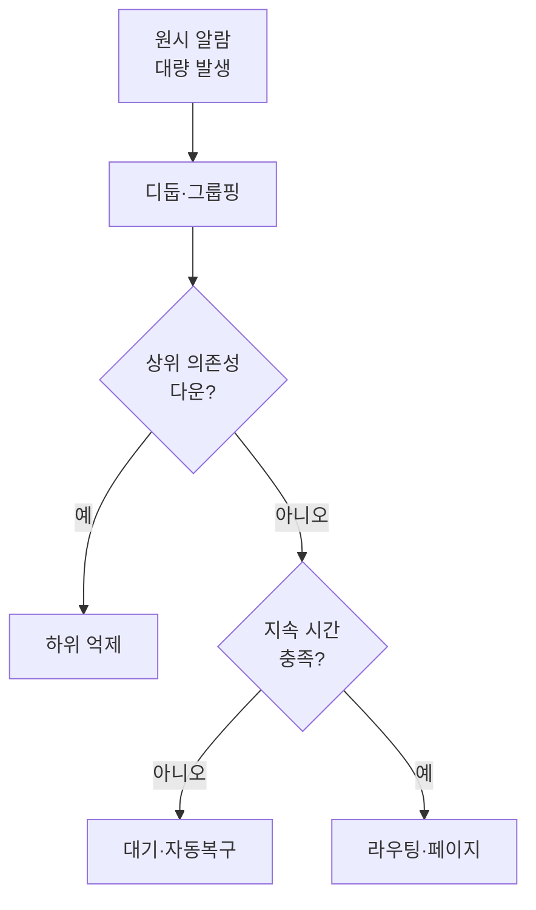
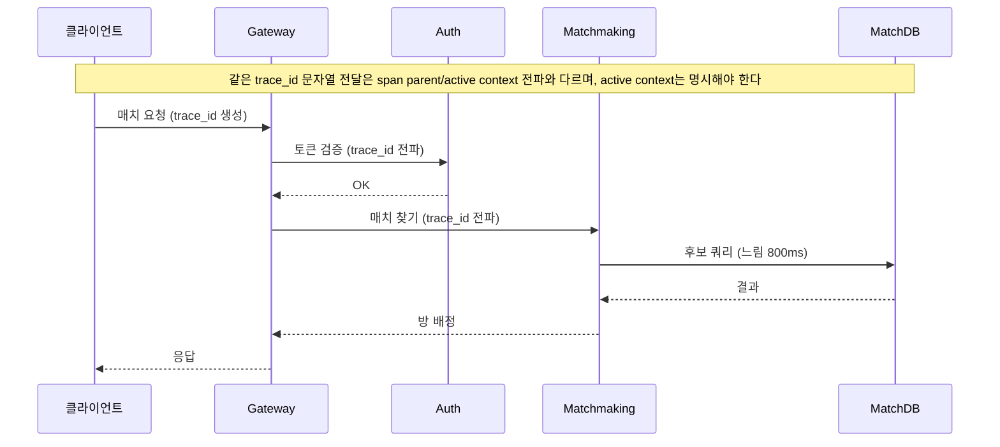

## 들어가며

운영 중인 게임 서비스에서 모니터링은 *가시성(observability)* 과 *노이즈* 사이의 줄다리기다. 더 많은 지표를 더 잘게 수집하고 더 많은 조건에 알람을 걸수록 장애를 더 빨리 본다 — 이론적으로는. 현실에서는 카디널리티가 폭발해 시계열 DB가 휘청이고, 새벽 3시에 울리는 알람의 절반이 자동 복구되는 일시적 스파이크이며, 온콜 엔지니어는 한 주 만에 알람을 무시하기 시작한다. 노이즈가 임계를 넘으면 가시성은 *오히려 줄어든다*. 진짜 장애 신호가 잡음에 묻히기 때문이다.

이 글은 그 긴장을 따라 라이브 서비스 모니터링의 구성요소를 한 흐름으로 정리한다. 무엇을 지표로 삼아야 노이즈를 최소화하면서 장애를 포착하는지, 어떤 알람이 사람을 깨울 자격이 있는지, SLO와 에러 버짓이 어떻게 "충분히 좋은가"를 수치로 정의하는지, 분산 추적이 마이크로서비스 사이에서 원인을 어떻게 좁히는지, 온콜과 에스컬레이션이 어떻게 사람의 부하를 관리하는지, 장애 대응과 포스트모텀이 어떻게 같은 실수를 반복하지 않게 하는지, 그리고 대시보드가 어떻게 이 모두를 한눈에 보이게 하는지를 다룬다.



이 글의 목표.

1. **가시성의 세 신호** — 메트릭·로그·트레이스, 골든 시그널, 카디널리티 비용.
2. **SLO와 에러 버짓** — SLI/SLO/SLA, 버짓 소진율, 출시 속도와의 거래.
3. **알람 설계** — 증상 기반 알람, 임계 대 이상 탐지, 알람 피로 억제.
4. **분산 추적** — 트레이스 전파, 스팬 설계, 샘플링 전략.
5. **온콜과 에스컬레이션** — 로테이션, 페이지 자격, 에스컬레이션 경로.
6. **장애 대응** — 심각도 분류, 지휘 체계, 완화 우선 원칙.
7. **포스트모텀** — 비난 없는 회고, 타임라인, 액션 아이템 추적.
8. **대시보드와 비용** — 계층별 대시보드, 카디널리티·보존 비용 관리.


---

## 목차

1. 가시성의 세 신호
2. SLO와 에러 버짓
3. 알람 설계
4. 분산 추적
5. 온콜과 에스컬레이션
6. 장애 대응
7. 포스트모텀
8. 대시보드와 비용
9. 시스템 계약
10. 계약·통합 테스트
11. 성능 측정 설계
12. Tail과 부하 포화
13. 장애 주입과 복구
14. Chaos와 안전장치
15. 출시와 회귀 기준

---

## 1. 가시성의 세 신호

### 메트릭·로그·트레이스의 역할 분담

가시성은 세 종류의 신호 위에 선다. 셋은 같은 사건을 다른 해상도와 다른 비용으로 본다.

| 신호 | 형태 | 강점 | 약점 | 비용 축 |
|---|---|---|---|---|
| 메트릭 | 시계열 수치 | 싸고 빠름, 추세·집계 | 개별 사건 못 봄 | 카디널리티 |
| 로그 | 타임스탬프 + 구조화 이벤트 | 개별 사건 상세 | 양 많음, 검색 비쌈 | 저장·인덱싱 |
| 트레이스 | 요청 단위 스팬 트리 | 서비스 간 인과 | 샘플링 필요 | 전파·저장 |

메트릭은 "지금 오류율이 올랐는가"를 *싸게* 답한다. 시계열 한 점은 수 바이트이고, 1초에 수백만 점도 집계해 그릴 수 있다. 그래서 알람과 대시보드의 1차 신호는 거의 항상 메트릭이다. 로그는 "그 오류가 *무엇이었는가*"를 답한다 — 스택 트레이스, 요청 파라미터, 유저 ID. 트레이스는 "그 오류가 *어디서* 시작됐는가"를 답한다 — 게이트웨이에서 인증 서비스를 거쳐 매치메이킹 DB 쿼리가 느렸다는 인과 사슬.

조사의 흐름은 보통 *메트릭 → 트레이스 → 로그* 다. 메트릭이 이상을 알리고, 트레이스가 느린/실패한 경로를 좁히고, 로그가 그 스팬의 정확한 원인을 보여준다. 세 신호를 *공통 식별자* (트레이스 ID, 요청 ID)로 묶어두면 이 흐름이 클릭 몇 번으로 이어진다. 묶지 않으면 메트릭에서 본 스파이크와 같은 시각의 로그를 *수동으로 시각 대조* 하게 되어 조사 시간이 몇 배로 는다.

### 골든 시그널 — 무엇부터 볼 것인가

신호의 종류는 무한하지만, 사용자 영향을 가장 직접 반영하는 네 가지를 *골든 시그널* 이라 부른다. 새 서비스에 계기판을 달 때 이 넷부터 단다.

```text
지연(Latency)  : 요청 처리 시간. 성공/실패를 분리해서 본다.
트래픽(Traffic): 초당 요청 수, 동시 접속, 초당 매치 생성 등 수요.
오류(Errors)   : 실패율. 명시적(5xx) + 암묵적(잘못된 응답).
포화(Saturation): 자원이 한계에 얼마나 가까운가. CPU·메모리·큐 깊이.
```

지연에서 흔한 함정은 *평균* 만 보는 것이다. 평균 지연 80ms가 멀쩡해 보여도 p99가 2초라면, 관측 구간의 요청 지연 분포에서 약 99%가 2초 이하이고 상위 꼬리는 그 경계보다 느리다는 뜻이다. 이것을 "사용자 100명 중 정확히 한 명이 항상 2초를 기다린다"로 바꾸어 말할 수는 없다. 한 사용자가 여러 요청을 만들 수 있고, 느린 요청이 특정 사용자·지역·샤드에 집중될 수도 있다. 그래서 p50, p90, p99 같은 분위수와 함께 영향 사용자 수, 요청 종류, 지역·샤드별 분포를 본다. 매칭 한 요청의 꼬리 지연이 방 전체의 시작을 막는 fan-out 구조라면 사용자 영향은 요청 비율보다 커질 수 있다.

오류는 개수와 비율을 함께 본다. 초당 100건이 100만 요청의 0.01%여도 결제·데이터 손실처럼 영향이 큰 실패라면 무시할 수 없고, 초당 1,000건 중 100건이면 10%라 즉시 드러난다. 분모, 오류 종류, 영향 사용자 수와 손실 규모를 함께 들고 다닌다. 트래픽이 거의 없을 때는 비율이 불안정하므로 최소 표본과 절대 개수 guardrail도 필요하다.

### 화이트박스와 블랙박스

신호를 *어디서* 보느냐로 두 갈래가 있다. *화이트박스* 는 서비스 내부에서 노출하는 신호다 — 코드가 직접 카운터를 올리고, 큐 길이를 노출하고, GC 시간을 잰다. 내부 상태를 자세히 보지만, *서비스가 죽으면 신호도 같이 죽는다*. *블랙박스* 는 외부에서 사용자처럼 찔러보는 신호다 — 로그인 API를 1분마다 호출해 응답이 오는지, 200을 주는지 확인한다. 내부는 못 보지만 *실제 사용자 경험에 가깝고, 서비스가 죽어도 그 죽음을 본다*.

둘은 보완 관계다. 화이트박스만 있으면 프로세스가 통째로 멈췄을 때 신호가 끊겨 *오히려 조용해지는* 위험이 있다 — "지표가 안 들어온다"를 별도로 감시해야 한다. 블랙박스(합성 모니터링, synthetic monitoring)는 그 사각을 메운다. 핵심 사용자 여정 — 로그인, 매치메이킹, 인게임 구매 — 을 외부에서 주기적으로 재현해 *전체 경로가 살아 있는가* 를 단일 신호로 확인한다.

### 실패 감지는 판정이 아니라 의심 수준이다

분산 환경에서 침묵한 노드가 죽었는지, 느린지, 네트워크에서 고립되었는지는 관찰만으로 완전히 구분할 수 없다. 하트비트를 세 번 놓쳤다는 사실은 장애의 증명이 아니라 정해진 정책이 해당 노드를 *의심*하기 시작했다는 뜻이다.

고정 타임아웃은 단순하지만 환경 변화에 취약하다.

```text
평상시 heartbeat RTT: 20ms
GC 정지 또는 네트워크 혼잡: 2s
failure timeout: 1s
결과: 살아 있는 노드를 죽었다고 오판
```

타임아웃을 늘리면 오탐은 줄지만 실제 장애 감지는 느려진다. 민감도와 감지 지연은 트레이드오프다. 최근 하트비트 간격의 분포로 의심 점수를 계산하는 accrual failure detector는 “살아 있음/죽음” 한 비트 대신 현재 침묵이 얼마나 비정상적인지를 제공한다. 서비스는 그 점수에 따라 트래픽 제외, 리더 승격, 페이지 같은 서로 다른 임계값을 사용할 수 있다.

실패 감지 결과로 소유권을 바꿀 때는 더욱 조심해야 한다. 기존 노드가 실제로 죽지 않고 잠시 멈춘 것이라면 새 노드와 동시에 작업할 수 있다. 모니터링이 노드를 비정상으로 판정했다는 사실만으로 오래된 노드의 쓰기가 차단되지는 않는다. 저장소와 작업 대상이 세대 번호나 펜싱 토큰으로 오래된 소유자를 거부해야 한다.

### liveness, readiness, 기능 건강성을 분리한다

하나의 `/health` 응답에 모든 상태를 넣으면 자동화가 잘못된 조치를 한다.

| 검사 | 질문 | 실패 시 일반적 조치 |
|---|---|---|
| liveness | 프로세스가 진행 가능한가 | 재시작 고려 |
| readiness | 새 요청을 받을 준비가 되었는가 | 로드 밸런서에서 제외 |
| dependency health | 의존성이 정상인가 | 기능 저하·우회·조사 |
| synthetic journey | 실제 사용자 흐름이 성공하는가 | 사용자 영향 알람 |

데이터베이스가 잠시 느리다는 이유로 모든 애플리케이션 인스턴스를 재시작하면 재연결 폭주와 캐시 손실로 장애가 커질 수 있다. readiness는 트래픽을 받을 수 있는지 판단하고, liveness는 프로세스 자체가 회복 불가능하게 멈췄을 때만 실패하도록 좁게 설계한다.

의존성 장애 중에도 일부 기능을 제공할 수 있다면 건강 상태도 이진값이 아니다. 예를 들어 결제 저장소가 불안정할 때 상점만 닫고 매치 플레이는 유지할 수 있다. 기능별 건강과 저하 모드를 명시해야 전체 서비스가 가장 약한 의존성 하나와 함께 쓰러지지 않는다.

### 하트비트와 멤버십의 관측 항목

노드 생존 신호를 운영할 때는 단순 현재 상태 외에 변화 과정을 남긴다.

- 마지막 성공 하트비트 시각과 관찰 위치
- 연속 실패 횟수와 의심 점수
- 멤버십 세대와 소유권 토큰
- 트래픽 제외·복귀 시각
- 자동 재시작과 리더 승격 이유
- 같은 장애 도메인에서 동시에 의심된 노드 수

한 관찰자만 노드를 보지 못하면 관찰자나 경로 문제일 수 있다. 여러 독립 위치의 관찰을 비교하고, 데이터센터·가용 영역·랙처럼 공통 장애 도메인별로 묶어 봐야 한다. 개별 노드 알람 수백 개보다 “한 가용 영역에서 하트비트 손실 급증”이라는 상위 증상이 더 행동 가능하다.

### 카디널리티 — 가시성의 숨은 비용

메트릭은 싸다고 했지만, 조건이 있다. 메트릭의 비용은 *카디널리티(cardinality)* — 서로 다른 라벨 조합의 수 — 에 비례한다. `http_requests_total{method, status}` 는 메서드 5종 × 상태 10종 = 50개 시계열이다. 여기에 `user_id` 라벨을 붙이면 동접 50만 곱하기 50 = 2,500만 시계열로 폭발한다.

```text
좋은 라벨   : method, status_code, endpoint, region, service
                → 값의 가짓수가 제한적이고 안정적
위험한 라벨 : user_id, session_id, request_id, ip, full_url(쿼리 포함)
                → 값이 무한히 늘어남 (high cardinality)
```

고카디널리티 라벨은 시계열 수와 인덱스·메모리 비용을 폭증시킨다. 유저별 식별은 메트릭 라벨이 아니라 보존·인덱스 정책을 통제한 로그나 트레이스가 맡는다. 라벨을 추가하기 전에 값의 가짓수 상한, churn, 보존 기간과 쿼리 목적을 정하고 cardinality budget과 drop 지표를 둔다.

## 2. SLO와 에러 버짓

### SLI, SLO, SLA의 구분

"서비스가 충분히 좋은가"를 감으로 판단하면 알람 임계도 감으로 정해진다. 이를 수치로 못 박는 틀이 SLI/SLO/SLA다.

```text
SLI (Indicator) : 측정값. "성공한 요청 / 전체 요청" 비율 = 99.93%
SLO (Objective) : 내부 목표. "30일 기준 가용성 99.9% 이상"
SLA (Agreement) : 외부 계약. "99.5% 미달 시 환불" — 보통 SLO보다 느슨
```

SLI는 *측정 가능한 비율* 이어야 한다. "빠르다"가 아니라 "지연 200ms 이하인 요청 수 / 전체 요청 수"처럼 분자/분모가 명확한 형태다. 요청 기반 SLI에서는 개별 요청을 임계 이하인지로 분류하므로 `count(latency≤200ms)/total`로 쓴다. p99는 윈도우 표본의 분위수 통계량이므로 요청 비율과 섞지 않는다 — percentile 대시보드는 분포를 보여 주는 별도 지표이고, 윈도우별 p99 달성률을 SLO로 삼으려면 그 측정 단위를 따로 정의한다. 게임 서비스에서 자주 쓰는 SLI는 가용성(성공 응답 비율), 지연(임계 이하 응답 비율), 그리고 *질(quality)* — 예를 들어 "매치메이킹이 60초 안에 방을 찾은 비율" 같은 도메인 지표다.

SLA를 SLO와 같게 두지 않는 것이 중요하다. SLA는 위약금이 걸린 외부 약속이고, SLO는 그보다 *엄격한 내부 경보선* 이어야 한다. SLO를 먼저 어겨야 SLA를 어기기 전에 대응할 시간이 생긴다. 게임 서비스는 명시적 SLA가 없는 경우도 많지만, 내부 SLO는 두는 편이 운영 판단을 객관화한다.

### 에러 버짓 — 100%를 목표하지 않는 이유

SLO가 99.9%라면, 정의한 good/valid event에서 허용하는 bad event 비율 0.1%가 error budget이다. **시간을 분모로 둔 binary availability SLI**라면 30일의 0.1%를 약 43분의 비가용 시간으로 환산할 수 있다. 요청 성공률 SLI라면 예산은 실패 요청 수이지 43분이 아니며, 트래픽이 몰린 1분이 한산한 10분보다 더 많은 예산을 태울 수 있다.

| 시간 기반 SLO | 허용 비가용 시간/30일 | 허용 비가용 시간/365일 |
|---:|---:|---:|
| 99% | 7시간 12분 | 3.65일 |
| 99.9% | 43분 | 8.77시간 |
| 99.95% | 21분 36초 | 4.38시간 |
| 99.99% | 4분 19초 | 52.6분 |

에러 버짓의 핵심은 신뢰성 목표와 변경 속도의 비용을 같은 단위로 연결하는 것이다. 모든 서비스에서 100%를 목표할 필요는 없지만, 안전·결제 원장처럼 오류 비용이 큰 개별 불변식에는 훨씬 강한 목표와 별도 통제가 필요할 수 있다. 버짓이 남았다고 무조건 공격적으로 배포할 권리가 생기는 것도 아니다. 팀이 사전에 합의한 정책에 따라 rollout 속도, 위험한 변경 승인, 안정화 투자 우선순위를 조절한다. 정책은 자동 적용할 수도 있고 사람이 예외를 승인할 수도 있으며, error budget은 그 결정을 위한 증거다.

### 소진율 알람

에러 버짓을 두면 알람을 *증상* 이 아니라 *버짓 소진 속도(burn rate)* 로 걸 수 있다. 소진율 1은 "이 속도면 30일 버짓을 정확히 30일에 다 쓴다"이고, 14.4는 "이 속도면 버짓을 약 2일(30/14.4 ≈ 50시간) 만에 다 쓴다 — 1시간 윈도우 기준으로는 한 시간에 한 달 버짓의 2%를 태우는 속도"이다.

```text
빠른 소진(예: 1시간 윈도우 burn rate 14.4 이상)
    → 지금 큰 사고 진행 중 → 즉시 페이지(사람 깨움)
느린 소진(예: 6시간 윈도우 burn rate 1 이상)
    → 천천히 새는 문제 → 티켓/근무 시간 대응
```

이렇게 *빠른 소진과 느린 소진* 에 다른 윈도우와 대응을 거는 것을 다중 윈도우 소진율 알람이라 한다. 짧은 윈도우는 급성 사고를 빨리 잡되 높은 소진율만 page하고, 긴 윈도우는 만성적 예산 누수를 잡는다. 알람 우선순위를 순간 오류율이 아니라 남은 error budget의 소진 속도에 연결하는 것이 핵심이다.

### 소진율의 산술 — 14.4는 어디서 오는가, 탐지 지연과 스파이크 면역

위에서 14.4와 "약 50시간"을 결과로만 적었다. 이 값들은 임의가 아니라 *버짓 예산·윈도우·임계*를 묶는 간단한 산술에서 나온다. 그 유도를 못 박으면 윈도우와 임계를 직접 설계할 수 있다.

기간 $T$(30일), SLO 허용 오류 비율 $\epsilon$($99.9\%\Rightarrow\epsilon=10^{-3}$)을 둔다. 소진율(burn rate)을 현재 오류율 $r$과 *예산을 정확히 기간 전체에 걸쳐 소진하는 오류율* $\epsilon$의 비로 정의한다.

$$
b=\frac{r}{\epsilon}
$$

소진율 $b$를 유지하면 전체 예산은 $T/b$ 만에 바닥난다. $b=1$이면 정확히 30일, $b=14.4$이면 $720\text{h}/14.4=50\text{h}=2.08\text{d}$. 이것이 "약 50시간"의 출처다.

그렇다면 *왜 14.4인가*. 임계는 "한 시간 윈도우에서 30일 예산의 2%를 태우는 속도"로 정한 것이다. 길이 $w$ 윈도우 동안 소진율 $b$가 태우는 예산 비율은 $b\,w/T$이므로, 이를 목표 비율 $f$로 두면 임계 소진율이 닫힌다.

$$
b_{\text{thresh}}=f\,\frac{T}{w}
$$

$f=2\%,\,w=1\text{h},\,T=720\text{h}$를 넣으면 $b_{\text{thresh}}=0.02\times720=14.4$. 같은 식으로 SRE 표준 표가 전부 재현된다. 빠른/느린 두 경계가 같은 한 줄에서 나온다.

| 윈도우 $w$ | 목표 소진 $f$ | 임계 $b_{\text{thresh}}=fT/w$ | 대응 |
|---:|---:|---:|---|
| 1시간 | 2% | 14.4 | 즉시 페이지 |
| 6시간 | 5% | 6 | 페이지 |
| 3일 | 10% | 1 | 티켓 |

탐지 지연도 같은 모형에서 나온다. 트레일링 윈도우 평균을 보는 알람에서, $t=0$에 시작된 소진율 $b_{\text{actual}}$의 사고는 시각 $t\le w$에서 윈도우 평균을 $b_{\text{actual}}\,t/w$로 끌어올린다. 이것이 임계 $b_{\text{thresh}}$를 넘는 순간이 발화 시점이다.

$$
T_{\text{detect}}=w\,\frac{b_{\text{thresh}}}{b_{\text{actual}}}
$$

임계에 막 닿는 사고($b_{\text{actual}}=b_{\text{thresh}}$)는 윈도우 하나를 꽉 채워야 발화하고($T_{\text{detect}}=w=60$분), 더 심한 사고는 빨리 잡힌다($b_{\text{actual}}=30\to28.8$분, $100\to8.6$분). 여기서 비직관적인 결과 하나가 떨어진다 — 발화 전까지 *태운 예산*은 사고 심각도와 무관하다.

$$
\Delta\text{budget}=b_{\text{actual}}\,\frac{T_{\text{detect}}}{T}=\frac{w\,b_{\text{thresh}}}{T}=f
$$

심각한 사고는 빨리 발화하지만 그동안 빨리 태우고, 약한 사고는 늦게 발화하지만 천천히 태워, 일정한 traffic/error 비율 아래에서 발화 시점의 누적 소비는 설계 목표 $f$(=2%)로 같다. 즉 *$f$를 고른다는 것은 이 조건에서 관찰창이 소모하는 budget을 고르는 것*이다. 이 값은 관찰창에서의 budget 소비이지 감지 후 완화까지의 최악 손실 상한이 아니므로, 관찰·감지·완화 시간을 분리해 각각의 소비를 따로 본다. request-based traffic이 변하면 같은 소진율도 태우는 budget 양이 달라진다.

마지막으로 긴 윈도우가 왜 일시적 스파이크에 둔감한지도 정량화된다. 길이 $\delta$의 스파이크가 소진율 $b_{\text{spike}}$로 발생하면 1시간 윈도우 평균을 $b_{\text{spike}}\,\delta/w$만큼 올린다. 이것이 14.4를 넘으려면 $b_{\text{spike}}\,\delta\ge14.4\times60=864$(소진율·분)이 필요하다. 2분짜리 스파이크라면 $b_{\text{spike}}\ge432$ — 99.9% SLO에서 오류율 $432\times0.001=43.2\%$에 해당한다. 임계가 높다는 사실만으로 이를 자동으로 오탐이라 단정할 수는 없다. 이것이 "오류율 1% 초과 5분 지속" 같은 단일 단기 임계가 스파이크마다 우는 것과 대비되는, 긴 윈도우의 *내장된 스파이크 면역*이다. 실무가 단기·장기 두 윈도우를 동시에 요구(AND)하는 것은 이 면역(장기 윈도우)에 더해 사고 종료 시 *빠른 리셋*(단기 윈도우)을 얻기 위함이다.

## 3. 알람 설계

### 증상 기반 알람 — 페이지의 자격

모든 이상이 사람을 깨울 자격이 있는 것은 아니다. 좋은 알람의 첫 원칙은 *원인(cause)이 아니라 증상(symptom)에 알람한다* 는 것이다.

```text
원인 기반(나쁨) : "DB 커넥션 풀 사용률 90%"
                   → 사용자가 멀쩡한데도 울림 (오탐)
                   → 자동 복구되면 헛수고
증상 기반(좋음) : "로그인 성공률 SLO 위반"
                   → 사용자가 실제로 아플 때만 울림
```

원인 지표(CPU, 메모리, 큐 깊이)는 *대시보드와 조사용* 으로 두고, *페이지(사람을 깨우는 알람)는 사용자 영향이 있을 때만* 울린다. 커넥션 풀이 90%여도 응답이 멀쩡하면 페이지할 일이 아니다 — 자동 확장이 처리하거나, 근무 시간에 조용히 손보면 된다. 이 원칙 하나가 새벽 페이지의 절반을 없앤다.

페이지 자격의 점검 기준은 세 가지다. *긴급한가* (지금 대응하지 않으면 악화되는가), *행동 가능한가* (받는 사람이 할 수 있는 조치가 있는가), *사용자 영향이 있는가*. 셋 중 하나라도 "아니오"면 페이지가 아니라 티켓이나 대시보드 항목이다.

### 임계값 대 이상 탐지

알람 조건은 두 방식으로 만든다. *고정 임계(static threshold)* 는 "오류율 1% 초과"처럼 절대선을 긋는다. 단순하고 예측 가능하지만, 트래픽이 시간대·요일·이벤트에 따라 크게 변하는 게임 서비스에서는 *한 임계가 항상 맞지 않는다*. 새벽엔 정상인 부하가 피크 시간엔 과소 임계가 된다.

*이상 탐지(anomaly detection)* 는 과거 패턴 대비 *비정상적인 편차* 를 잡는다. 매주 토요일 저녁 동접이 평일의 3배라는 *계절성* 을 학습해, 그 패턴에서 벗어날 때만 울린다. 동적 부하에 강하지만, 학습 데이터가 부족하면(신규 출시, 대형 이벤트 직후) 오탐·미탐이 늘고, *왜 울렸는지 설명하기 어렵다* 는 약점이 있다.

실무는 둘을 섞는다. 명확한 SLO 위반·하드 리밋(디스크 가득, 인증서 만료)은 고정 임계로 *확실하게* 잡고, 트래픽·지연처럼 패턴이 강한 신호는 이상 탐지나 2절의 소진율 알람으로 *적응적으로* 잡는다.

### 알람 피로를 막는 구조

가장 위험한 실패는 알람이 너무 많아 *무시되기 시작하는 것* 이다. 한 번 "이 알람은 보통 별거 아니야"가 학습되면, 그 알람이 진짜를 알릴 때도 무시된다. 알람 피로(alert fatigue)는 모니터링 시스템을 *조용히 무력화* 한다.

- *디둡(dedup)과 그룹핑*: 같은 근본 원인에서 나온 100개의 알람을 *하나로 묶는다*. 노드 하나가 죽어 그 위 서비스 30개가 동시에 우는 것은 *알람 한 건* 이어야 한다.
- *억제(suppression)*: 상위 의존성이 다운이면 하위 알람을 *억누른다*. DB가 죽었으면 그 DB를 쓰는 모든 API의 알람은 노이즈다 — 근본 알람 하나만 남긴다.
- *유지보수 윈도우(silence)*: 계획된 배포·점검 중에는 관련 알람을 *일시 음소거* 한다. 자기가 일으킨 알람으로 자기를 깨우지 않는다.
- *조정 가능한 윈도우*: "5분 지속"처럼 일시적 스파이크가 자동 복구될 시간을 준 뒤 울린다. 순간 스파이크마다 깨우지 않는다.



알람의 건강성도 *측정 대상* 이다. 페이지당 실제 조치 비율, 자동 복구 비율, 야간 페이지 수를 추적해 *오탐이 높은 알람을 정기적으로 폐기하거나 다시 튜닝* 한다. 한 번 만든 알람을 영원히 두지 않는다 — 안 쓰이거나 늘 헛도는 알람은 노이즈의 원천이다.

## 4. 분산 추적

### 왜 추적이 필요한가

게임 백엔드가 단일 모놀리스이던 시절에는 한 프로세스의 로그만 보면 됐다. 마이크로서비스로 쪼개지면 *하나의 사용자 요청이 여러 서비스를 거친다* — 게이트웨이 → 인증 → 프로필 → 매치메이킹 → 매치 DB. 매치메이킹이 느릴 때, 메트릭은 "느리다"만 알려주고 로그는 각 서비스에 *흩어져* 있다. 어느 단계가 범인인지를 *요청 단위로 꿰는* 것이 분산 추적(distributed tracing)이다.



이 그림에서 전체 지연 900ms 중 800ms가 MatchDB 쿼리였다는 사실은 *트레이스 하나* 로 즉시 드러난다. 트레이스 없이 같은 결론에 도달하려면 다섯 서비스의 로그를 시각으로 대조해야 한다.

### 트레이스 전파와 스팬 설계

추적의 뼈대는 두 가지다. *트레이스 ID* 는 요청 하나의 전 생애를 식별하고, *스팬(span)* 은 그 안의 한 작업 단위(한 서비스 호출, 한 DB 쿼리)를 나타낸다. 스팬은 부모-자식으로 트리를 이룬다.

```text
Trace: a1b2c3 (매치 요청 전체, 900ms)
 └─ Span: gateway.handle        (900ms)
     ├─ Span: auth.verify        (40ms)
     └─ Span: matchmaking.find   (840ms)
         └─ Span: matchdb.query  (800ms)  ← 병목
```

핵심은 *전파(propagation)* 다. 게이트웨이가 만든 트레이스 ID와 현재 스팬 ID를 *서비스 경계를 넘을 때 헤더에 실어 보내야* 자식 스팬이 같은 트레이스에 붙는다. 표준화된 헤더(W3C `traceparent`)와 컨텍스트 전파 라이브러리가 이 일을 한다.

```text
요청 헤더로 전파되는 컨텍스트:
  traceparent: 00-{trace_id}-{parent_span_id}-{flags}
각 서비스는 이 헤더를 받아 자식 스팬을 만들고,
다음 호출에 자신의 span_id를 parent로 실어 보낸다.
```

함정은 *전파가 끊기는 지점* 이다. 메시지 큐를 통한 비동기 처리, 배치 잡, 스레드 풀 경계에서 컨텍스트가 자동으로 따라가지 않아 트레이스가 *거기서 끊긴다*. 비동기 경계를 넘을 때 컨텍스트를 명시적으로 메시지 메타데이터에 넣고 꺼내야 한다. 이 작업을 빠뜨리면 "추적은 켰는데 큐 너머가 안 보인다"가 된다.

도구는 *OpenTelemetry* 가 사실상 표준 계측 API/SDK가 됐고, 백엔드 저장·조회는 Jaeger, Zipkin, 또는 상용 APM이 받는다. 계측을 OpenTelemetry로 통일해두면 저장 백엔드를 바꿔도 코드를 다시 안 짜도 된다.

### 샘플링 — 전수의 비용을 피한다

모든 요청을 추적해 저장하면 *트래픽과 같은 양의 트레이스 데이터* 가 쌓인다. 초당 수십만 요청 서비스에서는 비현실적이다. 그래서 *샘플링* 한다.

| 전략 | 결정 시점 | 장점 | 단점 |
|---|---|---|---|
| 헤드 기반 확률 샘플링 | 요청 진입 시 | 단순, 부하 예측 가능 | 드문 에러 놓침 |
| 테일 기반 샘플링 | 요청 완료 후 | 느린/실패 요청 보존 | 버퍼링 비용·복잡 |
| 적응 샘플링 | 동적 | 부하에 따라 비율 조정 | 구현 복잡 |

헤드 기반은 진입 시 "1%만 추적"처럼 결정을 내려 부하를 예측하기 쉽지만, 드문 오류의 trace를 놓칠 수 있다. 테일 기반은 요청이 끝난 뒤 latency·status·attribute를 보고 실패와 느린 trace를 우선 보존할 수 있다. “오류 100% 보존”은 sampling 정책과 collector 용량이 감당할 때의 목표일 뿐이다. 장애 때 오류량이 폭증하면 buffer·export queue가 넘쳐 가장 필요한 trace가 drop될 수 있으므로 memory limit, decision wait, rate limit과 dropped-trace 지표가 필요하다.

trace context는 모든 서비스에 일관되게 전파해야 한다. head sampling이면 upstream의 sampling 결정을 전파해 불필요한 부분 trace를 줄인다. tail sampling이면 각 서비스가 필요한 span을 collector까지 보내고 collector가 trace 단위로 보존 여부를 결정해야 한다. 어느 방식이든 일부 SDK가 독자적으로 span을 버리거나 context가 끊기면 tail collector가 나중에 복구할 수 없다. 완전성 비율과 orphan span도 관측 대상이다.

## 5. 온콜과 에스컬레이션

### 로테이션과 지속 가능성

알람이 사람을 깨우려면 *깨울 사람* 이 정해져 있어야 한다. 온콜(on-call) 로테이션은 정해진 기간 동안 한 사람(또는 1차/2차)이 *페이지를 받는 책임* 을 진다.


로테이션 설계의 핵심은 *지속 가능성* 이다. 온콜은 사람을 소진시킨다. 그래서 *야간 페이지 빈도* 를 온콜 건강성의 1차 지표로 본다 — 한 교대에 야간 페이지가 두 건을 넘으면 알람 위생(3절)이나 시스템 안정성에 문제가 있다는 신호다. 로테이션을 충분히 많은 사람으로 돌려 *한 사람의 온콜 주기를 띄우고*, 온콜 다음 날은 *후속 업무 부담을 줄이며*, 보상(온콜 수당·대휴)을 명시한다. 온콜을 "그냥 당연한 의무"로 두면 인력이 빠져나간다.

### 페이지 채널과 응답 SLA

알람 채널은 *긴급도에 비례* 해야 한다. 모든 알람을 같은 채널로 보내면 긴급한 것과 아닌 것이 섞여 또 다른 노이즈가 된다.

| 긴급도 | 채널 | 기대 응답 |
|---|---|---|
| 즉시 (사용자 영향 진행) | 전화·푸시 페이지 | 분 단위 |
| 주의 (악화 가능) | 채팅 멘션 | 근무 시간 내 |
| 정보 (추세·참고) | 대시보드·일일 요약 | 비동기 |

페이지에는 *응답 SLA* 가 붙는다. "1차 온콜은 5분 내 확인(ack)한다." 5분 안에 확인이 없으면 *자동으로 2차로 에스컬레이션* 된다. 이 자동 에스컬레이션이 "온콜이 잠들어 페이지를 놓치는" 단일 실패점을 없앤다. 페이지 전달 도구(PagerDuty 류)가 이 확인·재시도·에스컬레이션 사다리를 관리한다.

### 에스컬레이션 경로와 러너북

좋은 페이지는 *받는 사람이 바로 행동할 수 있게* 한다. 알람에 *러너북(runbook)* 링크를 단다 — "이 알람이 울리면 먼저 X 대시보드를 보고, Y가 높으면 Z를 재시작한다"는 단계별 안내. 러너북이 있으면 도메인 전문가가 아닌 1차 온콜도 *1차 완화* 를 할 수 있고, 없으면 매번 전문가를 깨워야 한다.

에스컬레이션 경로는 *수직(권한)* 과 *수평(전문성)* 두 방향이다. 1차가 못 풀면 2차·관리자로 *올리고(수직)*, 특정 서비스 지식이 필요하면 그 서비스 담당자로 *옆으로 넘긴다(수평)*. 이 경로가 미리 문서화되어 있어야 사고 한복판에서 "이거 누구한테 물어보지"로 시간을 낭비하지 않는다.

## 6. 장애 대응

### 심각도 분류

장애가 발생하면 가장 먼저 *심각도(severity)* 를 정한다. 심각도가 대응의 규모·속도·소통 범위를 정하기 때문이다.

| 심각도 | 정의 | 예시 | 대응 |
|---|---|---|---|
| SEV1 | 전면 장애·중대 영향 | 로그인 전체 불가, 결제 중단 | 즉시 전원 소집, 경영진 보고 |
| SEV2 | 주요 기능 손상 | 매치메이킹 지연 급증 | 온콜 + 인시던트 책임자 |
| SEV3 | 부분·열화 | 특정 리전 일부 오류 | 근무 시간 대응 |
| SEV4 | 경미 | 비핵심 기능 버그 | 백로그 |

심각도는 *고정이 아니다*. SEV3으로 시작했다가 영향이 번지면 SEV1로 격상한다. 격상은 *주저 없이* 하는 편이 낫다 — 과소 평가해 대응이 늦는 비용이, 과대 평가해 사람을 더 부른 비용보다 크다.

### 지휘 체계 — 한 사람이 조율한다

SEV1·SEV2 같은 큰 사고에서 가장 흔한 실패는 *기술적 무능이 아니라 조율의 부재* 다. 여러 사람이 각자 다른 가설로 동시에 시스템을 만지면 서로의 디버깅을 망친다. 그래서 사고에는 *역할* 을 둔다.

```text
인시던트 책임자(IC) : 전체 조율. 직접 고치지 않고 흐름을 관리한다.
                       누가 무엇을 하는지, 다음 결정이 무엇인지를 추적.
운영 담당(Ops)      : 실제 시스템 조작·완화 실행.
소통 담당(Comms)    : 상태 페이지·내부 채널·관계자에게 정기 업데이트.
서기(Scribe)        : 타임라인을 실시간 기록 (포스트모텀의 원자료).
```

작은 사고에서는 한 사람이 여러 역할을 겸한다. 핵심은 *IC가 있다* 는 것이다 — 의사결정과 소통을 한 점으로 모아, 손은 운영 담당이 움직이고 IC는 *전체 그림과 다음 행동* 만 본다. 이 구조가 "다섯 명이 동시에 같은 서버를 재시작하는" 혼란을 막는다.

### 완화가 복구보다 먼저다

사고 대응의 황금률은 *완화(mitigation)를 근본 원인 규명(root cause)보다 우선* 한다는 것이다. 사용자가 아픈 동안, "왜 이런 일이 생겼는가"는 나중 문제다. 지금은 *피를 멈추는 것* 이 먼저다.

```text
완화 우선 도구 (원인을 몰라도 쓸 수 있다):
  롤백      : 최근 배포가 의심되면 일단 되돌린다.
  페일오버  : 건강한 리전·복제본으로 트래픽을 돌린다.
  서킷브레이크: 망가진 의존성을 끊고 우아하게 열화한다.
  레이트리밋 : 과부하면 들어오는 부하를 줄인다.
  기능 끄기 : 기능 플래그로 문제 기능만 비활성화한다.
```

배포 직후 시작된 사고는 *일단 롤백* 한다 — 원인을 코드에서 찾는 것보다 빠르다. 원인 분석은 트래픽이 정상으로 돌아온 *뒤* 포스트모텀에서 한다. 이 순서를 지키려면 *빠른 롤백·기능 토글* 같은 완화 수단이 *미리 준비* 되어 있어야 한다. 사고 한복판에서 롤백 절차를 처음 짜면 이미 늦다.

소통도 완화의 일부다. *상태 페이지(status page)* 를 사고 초기에 갱신해 "인지하고 대응 중"을 알리면, 지원 채널로 몰리는 문의가 줄고 사용자 신뢰가 유지된다. 침묵이 가장 나쁜 소통이다.

## 7. 포스트모텀

### 비난 없는 회고

사고가 끝나면 *포스트모텀(postmortem)* 을 쓴다. 목적은 *책임자 색출이 아니라 시스템 개선* 이다. *비난 없는(blameless)* 원칙이 핵심이다 — 사람을 탓하기 시작하면, 다음부터 사람들이 *사고를 숨기고 정보를 축소* 해 조직이 배우지 못한다.

비난 없는 회고는 "누가 잘못된 명령을 쳤는가"가 아니라 "*왜 그 잘못된 명령이 그렇게 쉽게 큰 피해를 냈는가*"를 묻는다. 한 사람의 오타가 프로덕션을 내릴 수 있었다면, 문제는 그 사람이 아니라 *오타 하나를 막을 안전장치가 없던 시스템* 이다. 관점을 사람에서 시스템으로 옮기는 것이 비난 없음의 실질이다.

### 타임라인과 5 Whys

포스트모텀의 뼈대는 *타임라인* 이다. 6절의 서기가 기록한 원자료를 바탕으로, *언제 무슨 일이 있었고 누가 무엇을 알았는가* 를 시각순으로 재구성한다.

```text
14:02  배포 v3.4.1 시작
14:05  로그인 오류율 상승 시작 (아직 미인지)
14:11  소진율 알람 발화 → 1차 온콜 페이지
14:13  온콜 확인(ack), 조사 시작
14:20  최근 배포 의심 → 롤백 결정 (완화 우선)
14:24  롤백 완료, 오류율 정상화 시작
14:31  완전 정상화. SEV2 종료.
```

타임라인에서 *탐지 지연* (14:05 발생 → 14:11 알람, 6분)과 *완화 시간* (14:13 인지 → 14:24 해결, 11분)을 읽어낸다. 이 두 수치 — MTTD(평균 탐지 시간)와 MTTR(평균 복구 시간) — 가 모니터링·대응 체계의 *건강성 지표* 다. 탐지가 느렸다면 알람을, 완화가 느렸다면 러너북·롤백 자동화를 개선 대상으로 삼는다.

근본 원인은 표면에서 멈추지 않고 *왜* 를 반복해 파고든다. "롤백으로 해결" → "왜 배포가 오류를?" → "스키마 변경이 호환 안 됨" → "왜 테스트에서 안 잡힘?" → "스테이징에 프로덕션급 데이터가 없음". 진짜 액션 아이템은 마지막 층 — *스테이징 데이터 현실화* — 에 있다.

### 액션 아이템 — 추적되지 않으면 무의미

포스트모텀이 *문서로 끝나면 실패* 다. 회고의 산출물은 *추적 가능한 액션 아이템* 이다.

- 각 아이템에 *담당자와 기한* 을 붙인다. "개선하면 좋겠다"는 아이템이 아니다.
- *우선순위* 를 매긴다. 모든 것을 다 고칠 수는 없으니, 재발 가능성과 영향이 큰 것부터.
- *추적* 한다. 액션 아이템을 일반 백로그에 넣고 잊으면, 같은 사고가 반복된다. 완료율을 별도로 관리한다.

포스트모텀의 가치는 *반복 사고의 감소* 로 측정된다. 같은 원인의 사고가 다시 나면, 이전 포스트모텀의 액션 아이템이 실행되지 않았다는 뜻이다. 비난 없는 문화와 추적되는 액션 아이템 — 이 둘이 함께 있어야 모니터링이 *학습 루프* 로 닫힌다.

## 8. 대시보드와 비용

### 계층별 대시보드

수집한 신호는 *대시보드* 로 보여야 쓸모가 생긴다. 함정은 *모든 것을 한 대시보드에* 욱여넣는 것이다 — 지표 200개를 한 화면에 깔면 *아무것도 안 보인다*. 대시보드는 *보는 사람과 목적* 에 따라 계층화한다.

| 계층 | 대상 | 내용 | 갱신 |
|---|---|---|---|
| 임원·요약 | 경영진 | 가용성, DAU, 매출, SLO 달성률 | 시간·일 단위 |
| 서비스 개요 | 운영팀 | 골든 시그널, SLO 소진, 사고 현황 | 실시간 |
| 심층 | 개발팀 | 엔드포인트별 지연, DB 쿼리, 의존성 | 실시간 |

최상위 대시보드는 *한 화면에서 건강 여부를 즉시 판단* 할 수 있어야 한다 — 골든 시그널 네 개와 SLO 소진 상태 정도다. 거기서 이상이 보이면 *드릴다운* 으로 심층 대시보드와 트레이스(4절)로 내려간다. 대시보드 설계의 원칙은 "한 화면 = 한 질문"이다. "서비스가 건강한가?", "어느 엔드포인트가 느린가?"처럼 *그 화면이 답하는 질문* 을 분명히 하고, 그 질문에 필요한 패널만 둔다.

대시보드가 사고 중에 쓸모 있으려면 *조사 흐름을 따라 배치* 한다. 위에 증상(골든 시그널), 아래에 흔한 원인 후보(자원 포화, 의존성 지연)를 두어, 위에서 아래로 눈을 내리며 가설을 좁히게 한다. 무작위로 흩어진 패널은 사고 한복판에서 인지 부하만 키운다.

### 카디널리티·보존·샘플링의 비용 거래

1절에서 본 카디널리티는 운영 비용의 가장 큰 변수다. 가시성을 키우려는 모든 욕구가 비용을 키운다. 비용은 세 축에서 관리한다.

```text
카디널리티 : 고카디널리티 라벨 제거. 유저별은 로그/트레이스로.
보존 기간   : 고해상도는 짧게, 다운샘플한 저해상도는 길게.
샘플링      : 로그·트레이스는 전수 대신 표본. 에러는 보존율 ↑.
```

*보존 정책* 은 시간에 따라 해상도를 떨군다. 최근 1일은 초 단위, 1주는 분 단위, 1년은 시간 단위로 *다운샘플(down-sample)* 해 저장한다. 추세 분석에는 1년 전의 초 단위 데이터가 필요 없다. 로그도 마찬가지로 *핫(최근, 빠른 검색) / 웜 / 콜드(아카이브)* 계층으로 나눠, 오래된 로그는 싼 저장소로 내린다.


### 무엇을 끄는가 — 비용은 가시성을 줄이는 결정

비용 관리의 마지막 단계는 *무엇을 수집하지 않을 것인가* 를 정하는 것이다. 이것은 가시성을 *능동적으로 포기* 하는 결정이라 불편하지만 불가피하다. 거의 안 보는 대시보드의 지표, 늘 헛도는 알람, 누구도 조회하지 않는 디버그 로그는 *순수 비용* 이다.

판단 기준은 *지표·알람·로그를 ROI로 평가* 하는 것이다 — 이 신호가 *실제 조사·결정에 쓰인 적이 있는가*. 한 분기 동안 한 번도 조회되지 않은 대시보드 패널, 한 번도 행동으로 이어지지 않은 알람은 폐기 후보다. 오픈소스 스택(Prometheus, Grafana, OpenTelemetry, Jaeger)으로 운영 통제와 비용을 직접 쥘지, 상용 솔루션으로 운영 부담을 줄이고 사용량 기반 비용을 낼지도 같은 거래의 연장이다 — *엔지니어 시간 대 청구서* 의 트레이드오프다.

결국 가시성과 비용은 *영구 균형* 이 아니라 *주기적으로 다시 맞추는 것* 이다. 트래픽이 늘면 같은 수집 정책의 비용이 비선형으로 커지므로, 카디널리티·보존·샘플링을 정기적으로 재검토한다. "더 보는 것"의 한계 효용이 "더 내는 비용"보다 작아지는 지점이 그 신호의 적정선이다.


## 9. 시스템 계약

시스템 경계의 계약은 타입보다 넓다.

```text
요청·응답 스키마와 단위
순서와 중복 의미
timeout과 재시도 가능 여부
멱등성
권한과 인증
성능 상한
실패 후 상태 보장
버전 호환 범위
```

예를 들어 `CreateMatch`가 timeout되었을 때 클라이언트는 결과를 모른다. 재시도할 수 있으려면 요청 ID가 같을 때 같은 match를 반환하거나 이전 결과를 조회할 수 있어야 한다. “HTTP 200이면 성공”만 테스트해서는 중복 match 생성을 막지 못한다.

비기능 계약도 구체적이어야 한다.

```text
정상 부하:
  매치 생성 성공률 >= 99.9%
  P99 latency <= 2s

과부하:
  큐 길이 <= 10,000
  새 요청은 200ms 안에 명시적으로 거절

복구:
  worker 한 대 종료 후 60초 안에 backlog가 정상 범위로 회복
```

## 10. 계약·통합 테스트

단위 테스트는 모듈 내부 논리를 격리해 검증한다. 계약 테스트는 경계 양쪽이 같은 의미를 사용하는지 확인하고, 통합 테스트는 실제 의존성과의 상호작용을 확인한다.

### 소비자 주도 계약

소비자가 실제로 의존하는 요청과 응답 예시를 계약으로 제공하고 provider가 이를 지속 검증한다. 사용되지 않는 모든 가능성을 고정하는 대신 깨지면 안 되는 의미를 명확히 한다.

### 스키마 진화

새 필드는 이전 reader가 무시할 수 있어야 한다. 호환성은 wire compatibility / source compatibility / semantic compatibility 세 층으로 나눠 판정한다. 필드 삭제가 항상 breaking인 것은 아니다 — Protobuf binary에서 번호를 재사용하지 않고 reserved 처리한 삭제는 wire-safe이지만, 애플리케이션 필수 값이거나 해당 형식의 삭제 규칙을 위반하면 breaking이다.

```text
필드 추가: 기본값과 optional 의미 정의
필드 제거: wire/source/semantic 계약과 reserved/deprecated 규칙으로 판정
단위 변경: 새 필드 또는 새 schema version 사용
enum 추가: 알 수 없는 값 처리 정책 정의
```

FlatBuffers는 table에서 deprecated 처리한 필드 제거와 struct 필드 변경 규칙을 따로 본다. wire 호환은 직렬화 형식이 이전 reader와 맞는지만 보고, source API·required semantics·JSON 이름 호환성은 별도 계약이다.

### 실제 의존성

mock 데이터베이스가 transaction과 unique constraint를 흉내 내지 못하면 테스트는 실제 실패를 놓친다. 핵심 경로에는 실제 데이터베이스·메시지 브로커·파일 시스템을 사용하는 통합 테스트가 필요하다.

테스트 환경은 독립 데이터와 명확한 정리 정책을 가져야 한다. 테스트 순서에 따라 성공하는 상태는 신뢰할 수 없다.

## 11. 성능 측정 설계

성능 테스트의 첫 단계는 숫자를 재는 것이 아니라 workload를 정의하는 것이다.

```text
입력 크기와 분포
읽기·쓰기 비율
동시 사용자 수
burst 패턴
캐시 warm·cold 상태
플랫폼과 빌드 옵션
의존 서비스 지연
```

실제 플레이 캡처는 대표성을 제공하지만 미래의 최악 입력을 포함하지 않을 수 있다. 합성 workload는 경계를 만들기 쉽지만 현실과 다를 수 있다. 둘을 함께 사용한다.

Microbenchmark는 작은 함수와 자료구조를 비교한다. End-to-end benchmark는 실제 시스템 효과를 포함한다. Microbenchmark의 개선이 전체 프레임에 영향을 주는지는 프로파일과 end-to-end 측정으로 확인해야 한다.

컴파일러가 결과를 사용하지 않는 계산을 제거하지 못하게 하고, 워밍업·주파수 변화·백그라운드 작업·할당자 상태를 통제한다. 한 번의 평균보다 반복 분포와 신뢰 구간을 기록한다.

## 12. Tail과 부하 포화

평균 지연은 느린 일부 요청을 숨긴다. 여러 단계가 연결된 시스템에서는 각 단계의 tail이 최종 사용자 경험에 누적된다.

안정된 대기 시스템에서 Little의 법칙은 다음 관계를 준다.

$$
L = \lambda W
$$

`L`은 시스템 안의 평균 작업 수, `λ`는 처리율, `W`는 평균 체류 시간이다. 처리율이 유지되는데 체류 시간이 늘면 시스템 안에 쌓인 작업 수도 늘어야 한다. 계측값이 관계와 크게 다르면 측정 경계가 서로 다를 수 있다.

처리 용량에 가까워지면 작은 burst도 큐를 크게 만든다. 부하 테스트는 요청률을 단계적으로 올리며 다음을 함께 본다.

- 처리량
- P50·P95·P99·최대 지연
- 큐 길이와 대기 시간
- timeout·거절·재시도율
- CPU·메모리·I/O·connection pool
- 복구 시간

최대 처리량이 아니라 SLO를 유지하는 최대 안전 부하가 용량 계획의 기준이다.

## 13. 장애 주입과 복구

장애 테스트는 단순히 프로세스를 종료하는 것보다 실패 모드를 모델링해야 한다.

```text
응답이 완전히 사라짐
응답이 느려짐
일부 요청만 실패
중복·재정렬 메시지
디스크 공간 부족
clock skew
네트워크 분할
재시작 후 오래된 상태 복구
```

느린 의존성은 완전 장애보다 위험할 수 있다. 요청이 timeout까지 자원을 점유하고 재시도가 추가 부하를 만들기 때문이다.

복구 검증은 서비스가 다시 떠 있는지만 보지 않는다.

```text
중복 처리와 데이터 유실이 없는가
backlog가 유한 시간에 줄어드는가
오래된 리더와 lease 소유자가 쓰지 못하는가
부분 완료 작업이 Commit 또는 Abort로 정리되는가
사용자에게 일관된 결과가 보이는가
```

## 14. Chaos와 안전장치

Chaos 실험은 무작위 장애 생성이 아니라 복구 가설 검증이다.

```text
가설:
  한 region의 matchmaking worker 20%가 종료되어도
  P99 대기 시간은 10초 이하이고
  중복 매치는 생성되지 않는다.
```

실험 전 다음을 정한다.

- 장애 범위와 지속 시간
- 관측할 SLI
- 정상 기준과 예상 degraded 상태
- 자동 중단 조건
- 복구 책임자와 절차
- 데이터 보호와 백업

작은 canary 범위에서 시작하고, 시스템의 관측과 복구가 준비된 뒤 범위를 넓힌다. 실패가 발생했는데 원인을 관찰할 수 없다면 더 큰 실험을 할 단계가 아니다.

## 15. 출시와 회귀 기준

검증 결과가 의사결정으로 이어지려면 통과 기준이 필요하다.

```text
기능:
  핵심 계약과 회귀 테스트 통과

성능:
  기준 workload에서 P99 프레임·요청 지연 예산 충족
  메모리와 큐 길이가 장기 실행에서 단조 증가하지 않음

장애:
  정의된 단일 장애에서 데이터 불변식 유지
  degraded mode와 복구 시간 목표 충족

관측:
  실패 원인을 요청·tick 단위로 추적 가능
```

성능 테스트는 환경 노이즈 때문에 간헐 실패할 수 있다. 그렇다고 실패를 무조건 재실행해 통과시키면 회귀를 숨긴다. 자동 재측정 횟수, 통계 기준, 조사 절차를 정한다.

출시 후에도 실제 SLI와 테스트 가정의 차이를 확인해야 한다. 운영에서 발견된 새로운 입력 분포와 장애는 다음 검증 workload가 된다.

---

## 결론

라이브 서비스 모니터링의 모든 결정은 *가시성 ↔ 노이즈 ↔ 비용* 의 삼각 위에 놓인다. 더 많은 라벨은 카디널리티 비용을 키우고, 더 많은 알람은 알람 피로라는 노이즈를 키우며, 더 긴 보존은 저장 비용을 키운다. 신호를 무한히 늘리는 것이 목표가 아니라, *실제 사용자 영향에 비례하는 신호만 골라* 노이즈와 비용을 최소화하는 것이 목표다.

이 균형을 잡는 구조는 일관된다. 골든 시그널이 사용자 영향을 1차로 포착하고, SLO와 에러 버짓이 "충분히 좋은가"를 수치로 정의하며, 증상 기반 알람과 소진율 알람이 진짜 신호만 사람에게 보내고, 분산 추적이 마이크로서비스 사이에서 원인을 좁힌다. 온콜 로테이션과 자동 에스컬레이션이 사람의 부하를 관리하고, 심각도 분류와 지휘 체계와 완화 우선 원칙이 사고를 빠르게 멈추며, 비난 없는 포스트모텀과 추적되는 액션 아이템이 같은 사고의 반복을 막는다. 계층별 대시보드가 이 모두를 조사 흐름에 맞춰 보이게 한다.

어느 단계든 핵심은 *측정과 가지치기* 다. 알람의 오탐률, 야간 페이지 빈도, 탐지·복구 시간(MTTD·MTTR), 신호별 ROI를 스스로 측정해 *쓸모없는 가시성을 능동적으로 버리는 것* 이, 진짜 신호를 잡음에 묻히지 않게 지키는 마지막 도구다.

## 더 읽을거리

- Google, "Site Reliability Engineering" — SLO·에러 버짓·증상 기반 알람·포스트모텀 배경. 전체 책을 정밀 대조한 것이 아니므로 세부 주장은 해당 장에 연결한다. 무료 공개.
- Google, "The Site Reliability Workbook", "Alerting on SLOs" — SLO 설계와 다중 윈도우 소진율 알람의 실무 예제.
- OpenTelemetry 공식 문서(traces concepts) — 트레이스·메트릭·로그 계측의 벤더 중립 표준. start span과 active context/scope 전파는 SDK별 문서를 따르며, 테일 샘플링은 100% 보존을 보장하지 않는다.
- Prometheus storage 문서 / Grafana 대시보드 문서 — 시계열 저장·다운샘플링과 대시보드 구성. 보존 계층 수치는 특정 버전·옵션의 보장이 아니라 아키텍처 예시다.
