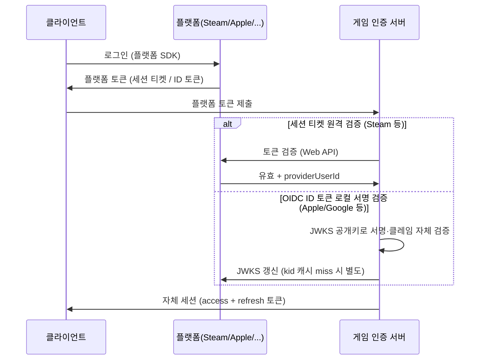

## 들어가며

라이브 서비스의 모든 것 — 진행도, 결제, 친구, 제재, 복구 — 은 "이 요청이 어느 플레이어의 것인가"라는 한 가지 판단 위에 서 있다. 그 판단을 맡는 계정·인증 계층은 게임에서 가장 먼저 만들어져야 하지만 가장 늦게 진지해지는 시스템이다. 출시 전에는 "디바이스 ID면 되지"로 미뤄지고, 출시 후에는 계정 이전 문의와 탈취 신고가 CS 큐를 채운 뒤에야 우선순위가 올라간다.

이 글은 게임 계정 시스템을 하나의 보안 프로토콜이자 데이터 수명 시스템으로 다룬다. 게스트 계정에서 플랫폼 연동, 자체 계정으로 이어지는 식별 모델, 외부 증명을 자체 세션으로 교환하는 인증 흐름, 액세스·리프레시 토큰의 수명과 폐기, 계정 연동·복구의 트랜잭션, 권한 검사와 공격 방어, 개인정보의 보존·삭제, 장애와 침해를 재현하는 검증까지가 범위다.

핵심은 인증과 계정을 분리하는 것이다. 계정은 장기간 유지되는 게임 상태의 소유자이고, 자격 증명은 그 계정을 통제한다는 증거이며, 세션은 검증된 증거로부터 제한된 시간 동안 파생된 권한이다. 이 세 층의 식별자와 수명을 섞으면 플랫폼 연동 하나를 해제했을 뿐인데 진행도가 사라지거나, 세션 하나를 탈취당했는데 계정 영구 소유권까지 넘어가는 사고가 생긴다.


---

## 목차
1. [계정·자격 증명·세션의 경계](#1-계정자격-증명세션의-경계)
2. [외부 증명을 자체 세션으로 교환하기](#2-외부-증명을-자체-세션으로-교환하기)
3. [세션과 토큰 수명](#3-세션과-토큰-수명)
4. [계정 연동·이전·복구의 트랜잭션](#4-계정-연동이전복구의-트랜잭션)
5. [공격, 인증, 권한 부여](#5-공격-인증-권한-부여)
6. [개인정보와 규제의 데이터 수명](#6-개인정보와-규제의-데이터-수명)
7. [운영과 검증](#7-운영과-검증)


---

## 1. 계정·자격 증명·세션의 경계

계정은 가입 마찰과 영속성의 트레이드오프 위에 놓인 스펙트럼이다.

| 단계 | 식별 수단 | 마찰 | 위험 |
|---|---|---|---|
| 게스트 | 디바이스 설치 ID | 0 — 첫 실행 즉시 플레이 | 기기 분실·앱 삭제 = 접근 자격증명 손실로 복구 불가 가능 |
| 플랫폼 연동 | Steam/PSN/Xbox/Game Center/Play Games 계정 | 거의 0 (이미 로그인돼 있음) | 플랫폼 밖으로 못 나감 |
| 소셜 연동 | Apple/Google/카카오 등 OAuth | 탭 두 번 | 제공자 정책 의존 |
| 자체 계정 | 이메일+비밀번호(또는 패스키) | 가장 큼 | 크리덴셜 관리 책임 전부 |

모바일에서 흔한 패턴은 *게스트로 시작해 나중에 승급* 하는 것이다. 첫 실행에서 서버가 계정과 고엔트로피 게스트 비밀을 만들고, 클라이언트는 비밀을 OS의 보호 저장소에 둔다. 설치 ID, 광고 ID, 하드웨어 시리얼은 비밀이 아니며 재설정·복제·스푸핑될 수 있으므로 인증 자격 증명으로 쓰면 안 된다. 서버에는 원문 비밀 대신 단방향 검증값을 저장하고, 전송은 인증된 TLS 채널로 제한한다.

핵심 불변식은 **playerId는 처음부터 영구 ID이며 로그인 수단과 독립적이다**라는 것이다. 게스트 승급은 새 계정 생성이 아니라 기존 playerId에 자격 증명을 추가하는 일이다. 플랫폼 연동을 해제해도 playerId와 게임 진행도는 변하지 않는다.

```text
players:
  playerId(PK) · createdAt · status(active/locked/deletion_pending/deleted)
  securityVersion · homeRegion · rowVersion

credentials:
  credentialId(PK) · playerId(FK)
  provider(device/steam/apple/...) · providerSubject
  secretVerifier(nullable) · createdAt · lastUsedAt · revokedAt
  UNIQUE(provider, providerSubject)

sessions:
  sessionId(PK) · playerId(FK) · tokenFamilyId
  deviceId · issuedAt · lastSeenAt · expiresAt · revokedAt · rotationCounter
```

`providerSubject`는 제공자가 검증 결과로 돌려준 불투명 식별자다. 이메일이나 표시 이름은 바뀌거나 재사용될 수 있으므로 외부 계정의 기본 키가 아니다. 자격 증명 해제는 감사와 재사용 탐지를 위해 행을 즉시 삭제하기보다 `revokedAt`을 기록하는 편이 안전하다. 활성 자격 증명이 하나도 남지 않게 하는 연산은 새 자격 증명 추가 또는 복구 수단 확인과 같은 트랜잭션 안에서만 허용한다.

세션을 별도 엔티티로 두면 “모든 기기에서 로그아웃”, “이 기기만 종료”, “비밀번호 변경 전 세션만 폐기”를 표현할 수 있다. `securityVersion`은 계정 전체의 보안 상태가 바뀔 때 증가시키고 토큰의 버전과 비교하는 폐기 장치로 사용할 수 있다. 단 이 비교를 매 요청마다 하려면 결국 공유 저장소나 짧은 캐시가 필요하므로, 완전한 무상태 검증과 즉시 폐기를 동시에 얻을 수는 없다.

이 모델의 신뢰 경계는 다음과 같다.

- 클라이언트가 보내는 playerId, providerSubject, 권한, 가격, 재화량은 모두 주장일 뿐이다.
- 외부 제공자의 서명 검증 결과나 검증 API 응답만 외부 신원의 증거다.
- 인증은 “누구인가”를 세우고, 권한 부여는 “이 자원에 이 행위를 해도 되는가”를 별도로 판정한다.
- 장기 자격 증명으로부터 매치·웹소켓·UDP 연결처럼 범위와 수명이 더 작은 토큰만 파생한다.
- 로그에는 토큰·비밀번호·플랫폼 티켓 원문을 남기지 않는다.

## 2. 외부 증명을 자체 세션으로 교환하기

소셜·플랫폼 로그인의 공통 구조는 *증명의 교환*이다. 클라이언트는 제공자에게서 받은 제한된 수명의 증명을 게임 서버에 내고, 서버는 발급자·대상·만료·재사용 방지 조건을 검증한 뒤 더 좁은 자체 세션을 발급한다. 외부 증명을 그대로 모든 게임 서비스의 세션으로 쓰지 않으면 제공자별 차이와 장애가 인증 경계 안에 갇힌다.



검증 방법은 제공자마다 다르다. Steam 세션 티켓처럼 제공자 API에 제출해 확인하는 증명이 있고, OpenID Connect ID 토큰처럼 발급자의 JWKS 공개키로 로컬 서명 검증하는 증명이 있다. API 검증은 네트워크 실패와 제공자 레이트 리밋을 다뤄야 하고, 로컬 검증은 키 회전과 클레임 검증을 정확히 구현해야 한다. 어느 쪽이든 **클라이언트가 주장하는 providerSubject를 믿지 않는다**. 서버가 검증 결과에서 얻은 `sub` 또는 제공자 고유 ID만 쓴다.

네이티브 게임 클라이언트는 비밀을 안전하게 내장할 수 없는 *public client*다. 일반 OAuth/OIDC 로그인을 직접 구성한다면 시스템 브라우저와 authorization code flow를 사용하고, 요청마다 새 `code_verifier`와 그 해시인 `code_challenge`를 만드는 PKCE가 필요하다. 고정된 client secret을 실행 파일에 넣는 것은 공격자가 추출할 수 있으므로 클라이언트 인증이 되지 않는다. 리디렉션의 `state`와 OIDC `nonce`도 로그인 트랜잭션에 묶어 검증한다. implicit flow나 임베디드 웹뷰에서 비밀번호를 직접 받는 흐름은 피한다.

서명 검증 경로(Apple·Google)는 외부 호출 없이 서버 단독으로 끝나 편하지만, 바로 그 점 때문에 검증을 *정확히* 해야 한다 — 막아 줄 제공자 서버가 없으니 잘못 검증해도 아무도 멈춰 주지 않는다. ID 토큰(JWT) 검증에서 빠지면 뚫리는 경계 조건들이 있다.

- **알고리즘 고정**: 토큰 헤더의 `alg` 값을 믿고 분기하면 안 된다. 두 고전적 우회가 여기서 나온다. 첫째, `alg: none` — 서명 없는 토큰을 라이브러리가 "검증 통과"로 처리한다. 둘째, RS256↔HS256 혼동 — 서버가 RS256(공개키 서명)을 기대하는데 공격자가 헤더의 `alg`만 HS256으로 바꿔, *공개된 RSA 공개키를 HMAC 비밀키로 써서* 위조 토큰을 만든다. 공개키는 누구나 가질 수 있으므로 누구나 서명할 수 있게 된다. 방어는 *검증 측이 알고리즘을 못박는* 것이다 — 기대 알고리즘을 코드가 고정하고 토큰 헤더의 `alg`는 참고용으로도 신뢰하지 않는다.
- **클레임 검증**: 서명이 맞아도 *어떤 토큰인지* 를 확인해야 한다. `iss`(발급자가 그 제공자인가), `aud`(이 토큰이 우리 클라이언트 ID를 대상으로 발급됐는가 — 빠뜨리면 다른 앱용으로 정당하게 발급된 유효 토큰을 그대로 받아들인다), `exp`/`nbf`(만료·유효 시작과 제한된 시계 오차), 그리고 리플레이 방지용 `nonce`. 시계 오차 허용치는 발급자 규약과 제품 정책으로 정하고 수명을 무력화할 만큼 넓히지 않으며, 서버 시계의 동기화 상태를 감시한다. providerUserId로는 오직 `sub` 클레임만 쓴다.

```text
ID 토큰 검증 순서
1. 허용한 alg 집합과 헤더 alg가 일치하는지 확인
2. 신뢰한 iss의 JWKS에서 kid에 해당하는 키를 찾아 서명 검증
3. iss가 정확한 발급자 식별자인지 확인
4. aud가 이 클라이언트를 포함하는지 확인하고, 다중 aud 규칙이 있으면 azp도 확인
5. exp·nbf·iat를 정책과 제한된 시계 오차 안에서 확인
6. 로그인 요청에 nonce를 사용했다면 저장한 일회성 값과 상수 시간 비교
7. providerSubject := 검증된 sub
```

`kid`가 캐시에 없다고 임의 발급자의 URL을 따라가면 안 된다. `iss`별로 고정한 JWKS URL만 사용하고, 키가 없을 때 한 번 갱신하되 공격자가 매 요청마다 원격 조회를 유발하지 못하도록 음성 캐시와 레이트 리밋을 둔다. 시계 오차 허용치도 무한히 늘리지 않고 서버 시계를 감시한다.

세션 티켓 검증 경로에서도 함정은 제공자 서버로 옮겨갈 뿐이다. 응답에서 우리 앱용 티켓인지, 만료되지 않았는지, 필요한 라이선스·소유권이 있는지를 확인한다. 제공자 장애 때 과거 성공 결과를 무기한 재사용하면 폐기된 티켓이 살아나고, 무조건 거부하면 전체 로그인이 멈춘다. 캐시 가능한 사실과 매번 신선해야 하는 사실을 나누고, 짧고 제한된 실패 정책을 명시해야 한다.

검증이 끝나면 credentials에서 playerId를 찾고(없으면 신규 가입 처리), 자체 세션 토큰을 발급한다. 이후 게임 서버·API 서버는 플랫폼과 무관하게 자체 토큰만 본다 — 인증 제공자가 N개여도 인증 이후의 세계는 하나다.

## 3. 세션과 토큰 수명

세션 토큰 설계의 대표 선택지는 *불투명 토큰*(고엔트로피 핸들, 서버가 세션 상태를 조회)과 *자기 완결 토큰*(대개 서명된 JWT, 로컬에서 클레임 검증)이다. JWT는 토큰 형식이지 세션 정책이 아니다. 같은 JWT라도 매 요청 denylist를 조회하면 상태ful하고, 불투명 토큰도 로컬 캐시를 두면 저장소 왕복을 줄일 수 있다.

| | 불투명 토큰 | JWT |
|---|---|---|
| 검증 비용 | 저장소 조회 (Redis 등) | 서명 검증만 — 저장소 불필요 |
| 즉시 무효화 | 중앙 상태를 확인하면 가능 | 순수 로컬 검증만 하면 만료까지 유효 |
| 페이로드 | 없음 | playerId·권한 동봉 가능 |

흔한 절충은 **짧은 access 토큰 + 서버 상태에 묶인 긴 refresh 토큰**이다. access 토큰을 로컬 검증하면 정상 요청의 공유 저장소 왕복을 피할 수 있다. 무효화가 필요한 사건에서는 refresh 토큰 가족을 폐기하고, 위험도가 높은 API는 `securityVersion`이나 denylist를 조회하거나 더 짧은 전용 토큰을 요구한다. 따라서 “JWT이므로 폐기할 수 없다”가 아니라 “공유 상태를 읽지 않는 검증 경로에서는 이미 발급한 권한이 만료까지 남는다”가 정확하다.

access 수명 $T$의 선택은 정량적 트레이드오프다. 공유 상태를 보지 않는 access 검증에서 무효화 사건의 발생 시점이 토큰 수명 안에 균등하다고 단순 가정하면 기대 잔여 노출은 $T/2$, 최악은 $T$다. 반대편 비용은 refresh 요청, 키·정책 배포, 재인증 실패 가능성이다. 불투명 토큰은 매 요청 원격 저장소를 반드시 왕복해야 하는 것이 아니라 검증 캐시와 지역 복제본을 사용할 수 있고, JWT 검증도 서명 연산·키 캐시·클레임 검사 비용이 0은 아니다. 수명은 관행적 숫자를 복사하지 말고 탈취 대응 목표, API 위험도, 갱신 부하, 오프라인 허용 시간을 기준으로 정한다.

public client의 refresh 토큰은 전송자 제약(sender constraint)을 걸거나 회전(rotation)해야 한다. 회전 방식은 refresh를 사용할 때 새 토큰으로 교체하고 옛것을 폐기한다. 옛 토큰이 다시 오면 탈취와 네트워크 재시도를 즉시 구분할 수 없으므로 보수적으로 토큰 가족 전체를 무효화한다. 이때 정상 응답을 잃은 클라이언트도 재로그인이 필요할 수 있다. 갱신 요청에 짧은 중복 허용창이나 멱등 키를 둘지는 재사용 탐지 강도와 가용성 사이의 명시적 정책이어야 한다.

refresh 원문은 데이터베이스에 그대로 저장하지 않고 검증 가능한 해시와 가족·부모·회전 번호를 저장한다. 클라이언트에서는 OS 키체인·Keystore·DPAPI 같은 보호 저장소를 사용한다. 공격자가 프로세스와 저장소를 모두 장악하면 bearer 토큰만으로 막을 수 없으므로, 가능한 환경에서는 하드웨어 보호 키에 묶인 proof-of-possession을 추가한다.

실시간 게임 서버 연결은 이 위의 짧은 다리다 — 매치 입장 시 access 토큰으로 *매치 전용 연결 토큰* 을 받아 UDP 연결에 쓰고, 매치가 끝나면 버린다. 세션 계층(분 단위)과 연결 계층(매치 단위)의 수명이 분리된다.

## 4. 계정 연동·이전·복구의 트랜잭션

연동의 정상 경로는 단순하다 — 로그인된 계정 A에서 "Apple 연결"을 누르면 Apple ID 토큰을 검증해 credentials에 (apple, U, A)를 추가한다. 어려움은 충돌 경로다.

**충돌**: Apple 계정 U가 이미 다른 플레이어 B에 연결돼 있다. 자동 병합은 금물이다. 현재 A에 로그인했다는 사실만으로 B를 합칠 권리는 없다. 병합하려면 서로 독립적인 두 인증 절차로 **A와 B 양쪽의 현재 통제권**을 재증명하고, 민감 작업용 단기 승인 토큰을 발급해야 한다. 계정 요약은 소유권 증명 전에는 개인정보가 새지 않도록 최소화한다.

병합은 credentials의 외래 키 몇 개를 바꾸는 연산이 아니다. 진행도, 인벤토리, 우편, 친구, 길드, 제재, 구매 영수증, 플랫폼 독점 권리에는 서로 다른 충돌 규칙이 있다.

| 데이터 | 안전한 기본 규칙 |
|---|---|
| 소모성 재화 | 단순 합산 금지, 원장 거래를 재적용하고 중복 지급 키 제거 |
| 비소모성 구매 | 검증된 영수증·entitlement의 합집합 |
| 퀘스트·업적 | 단조 진행만 최대값 또는 합집합, 되돌릴 수 있는 상태는 도메인 규칙 |
| 길드·랭크 | 자동 병합 금지, 하나를 선택하거나 별도 탈퇴 절차 |
| 제재·위험 표식 | 약한 쪽으로 소거 금지, 보안 검토 대상으로 보존 |

병합 명령에는 고유한 `mergeId`를 부여하고 상태를 `prepared -> committed -> compensated/manual_review`로 기록한다. 각 하위 서비스는 `(mergeId, operation)`을 멱등 키로 처리한다. 원본 계정을 즉시 재사용 가능한 상태로 삭제하지 않고 별칭과 병합 원장을 남겨, 늦게 도착한 이벤트와 CS 복구가 새 소유자를 찾게 한다. 부분 성공을 숨기기보다 재시도 가능한 단계와 수동 검토 상태를 데이터 모델에 둬야 한다.

**기기 이전**: 연동된 계정이 있으면 새 기기에서 다시 인증한다. 게스트 상태라면 이전 기기에서 짧은 일회용 코드를 발급하고 새 기기가 교환하게 할 수 있다. 코드는 충분한 엔트로피, 짧은 만료, 시도 횟수 제한, 사용 즉시 폐기를 가져야 하며 화면 캡처·피싱 위험을 알린다.

**계정 복구**는 인증보다 약한 우회문이 되기 쉽다. 이메일 주소, 결제 일부 정보, 구매 영수증은 보조 증거일 뿐 단독 신원 증거가 아니므로 그것만으로 소유권을 이전하지 않는다. 탈취 신고가 접수됐다는 이유만으로 본인 확인과 위험 판정 전에 계정을 전면 동결하지 않는다. 등록된 복구 수단, 과거 기기 키, 복구 코드, 최근 결제의 여러 신호를 결합하고, 실패·시도 횟수·상담원 결정을 감사한다. 복구 직후에는 모든 refresh 가족 폐기, 새 자격 증명 등록 알림, 거래·병합 같은 고위험 작업의 냉각 기간을 적용할 수 있다.

**동시 접속 정책**: 한 계정의 두 기기 동시 플레이를 허용할지는 게임 설계의 문제지만, 인증 계층은 "세션 목록 조회·개별 강제 종료"를 제공해야 한다. 이는 탈취 대응과 CS 복구의 기반 도구다.

## 5. 공격, 인증, 권한 부여

계정 시스템이 받는 공격은 게임이라서 특별하지 않다 — 웹 서비스가 받는 공격 그대로다. 다만 게임 재화가 현금화되는 순간 공격의 채산성이 확 오른다.

- **크리덴셜 스터핑**: 다른 서비스에서 유출된 이메일·비밀번호 목록의 대입. IP·계정·디바이스 축의 속도 제한, 유출·상용 비밀번호 blocklist, 위험 기반 추가 인증으로 방어한다. 비밀번호를 받는다면 메모리 경질 KDF인 Argon2id 같은 적절한 방식과 사용자별 salt로 저장하고, 작업 계수는 운영 하드웨어에서 측정해 조정한다. 새 시스템은 패스키 같은 피싱 저항 인증 수단을 우선 고려한다.
- **세션 탈취**: 멀웨어가 디바이스의 refresh 토큰을 훔친다. 방어: 이미 사용된 refresh 토큰의 재사용을 감지해 해당 토큰 가족을 폐기하고, 새 기기·새 지역 로그인 알림과 민감 행동(결제 수단 변경, 계정 이전) 전 재인증을 적용한다.
- **봇 가입**: 게스트 가입이 공짜이므로 부계정 농장이 쉽다. 방어: 가입 레이트 리밋, 디바이스 핑거프린트의 *신호적* 활용(차단 근거가 아니라 위험 점수), 그리고 경제 쪽 출구(거래 제한·신뢰 레벨)와의 연동 — 인증 계층 단독으로는 못 막고, 막으려고 인증 마찰을 올리면 정상 유저가 먼저 떠난다.
- **다중요소·step-up**: 고액 거래, 계정 이전, 자격 증명 추가·삭제에는 최근 인증 시각과 인증 강도를 확인한다. 이메일 OTP와 SMS는 없는 것보다 나을 수 있지만 피싱 저항 수단은 아니다. 같은 종류의 비밀을 두 번 묻는 것은 두 요소가 아니다.

관통 원칙은 *위험 기반 마찰*이다. 다만 위험 점수는 인증 성공을 권한 검사로 바꾸지 않는다. 플레이어가 자기 계정으로 로그인했어도 `playerId`를 바꿔 다른 사람의 우편·인벤토리를 읽을 수 없어야 한다. 모든 객체 접근은 서버가 세션의 주체와 자원의 소유권·역할을 결합해 검사한다. 운영자·CS 도구는 일반 플레이어보다 더 강한 인증, 최소 권한, 짧은 세션, 승인·감사 체계를 가져야 한다.

토큰은 최소 권한과 대상 제한을 가져야 한다. 로비 access 토큰을 게임 매치의 UDP 인증에 그대로 쓰지 않고, `aud=match-server`, 특정 matchId·playerId·만료를 가진 일회성 연결 토큰으로 교환한다. 유출된 토큰이 결제·관리 API에서 재사용되지 않도록 서비스마다 `aud`와 scope를 검증한다.

## 6. 개인정보와 규제의 데이터 수명

계정 시스템은 규제가 직접 닿는 표면이다. 설계 단계에서 넣지 않으면 소급 비용이 크다.

- **삭제권**: 삭제 요청은 법적 근거와 관할에 따라 개인정보를 삭제·익명화하는 워크플로를 시작한다. 삭제권에는 법적 의무, 청구권 방어 등 예외가 있으므로 “결제·제재 기록은 항상 보존”도 “전부 즉시 삭제”도 일반 규칙이 아니다. 익명화 여부는 매핑 테이블 삭제 같은 단일 조치가 아니라 보유자별 재식별 위험으로 판단한다. 데이터 범주별 목적·법적 근거·보존 기간·파기 방법을 정책으로 관리하고, 보존이 끝난 데이터는 자동 파기한다.
- **유예와 복구**: 취소 가능한 유예 기간은 제품 정책일 수 있지만 보편적인 30일 규칙은 아니다. 사용자에게 실제 삭제 시점과 유예 중 상태를 명확히 알리고, 법정 처리 기한과 충돌하지 않게 한다. 삭제 대기 중 로그인·결제·데이터 생성 허용 여부도 상태 기계로 고정한다.
- **아동·청소년**: 적용 연령, 보호자 동의, 데이터 최소화, 채팅·결제 제한은 국가와 서비스 대상에 따라 달라진다. 정확한 생년월일을 무조건 영구 저장하기보다 필요한 정책 구간만 파생·보존할 수 있는지 검토한다.
- **지역·플랫폼 요건**: 데이터 위치, 실명·연령 확인, 플랫폼 계정 정책은 바뀔 수 있다. 제공자를 credential 플러그인으로 분리하되, 그 결과로 생기는 데이터 보존·접근 제한을 단순한 로그인 플래그 하나로 축소하지 않는다.

규제 대응의 공통 기반은 데이터 지도와 감사 로그다. 어떤 서비스가 어떤 playerId 파생 데이터를 보유하는지 모르면 삭제 요청을 완결할 수 없다. 삭제 오케스트레이터는 각 저장소와 수탁자에 동일한 requestId로 명령을 보내고, 멱등 처리 결과와 실패를 모아 완료 증거를 만든다. 백업은 즉시 레코드 단위 삭제가 불가능할 수 있으므로 복원 시 삭제 목록을 재적용하고, 백업 자체의 보존 만료를 정책으로 둔다. 감사 로그에도 개인정보를 과도하게 복제하지 않고 무결성과 접근 통제를 보장한다.

## 7. 운영과 검증

인증 시스템은 정상 경로보다 실패 경로에서 품질이 갈린다. 다음 상태를 자동 테스트해야 한다.

| 범주 | 주입할 실패 | 확인할 불변식 |
|---|---|---|
| 외부 제공자 | 지연, 429, 5xx, 키 회전, 알 수 없는 `kid` | 임의 발급자 키를 신뢰하지 않고 장애가 전체 요청 폭주로 증폭되지 않음 |
| 토큰 | 만료 경계, 잘못된 `iss/aud/alg`, 재사용 refresh | 거부 이유가 구분되고 토큰 원문은 로그에 남지 않음 |
| 동시성 | 같은 자격 증명 동시 연결, refresh 동시 회전 | 유니크 제약과 토큰 가족 상태가 단일 결과로 수렴 |
| 병합 | 각 하위 서비스의 부분 실패·중복 전달 | `mergeId` 재시도가 중복 재화·중복 entitlement를 만들지 않음 |
| 삭제 | 서비스 타임아웃, 재시도, 백업 복원 | requestId 기준으로 완료·미완료 범위를 증명할 수 있음 |
| 공격 | credential stuffing, 코드 대입, 토큰 리플레이 | 계정·IP 한 축만 막지 않고, 미검증 신고만으로 계정을 동결하지 않으며 정상 사용자 전체를 잠그지 않음 |

보안 로그는 성공·실패 로그인, 자격 증명 추가·삭제, refresh 재사용, 모든 세션 폐기, 계정 병합·복구·삭제의 상태 전이를 기록한다. 지표는 성공률 하나로 부족하다. 제공자별 p50/p95/p99 검증 지연, 오류 코드 분포, refresh 재사용률, 계정 잠금률, 복구 승인·거절률, 삭제 워크플로 체류 시간을 봐야 한다. 경보 기준은 절대 실패 수뿐 아니라 평소 기준선과 제공자·지역별 편차를 함께 사용한다.

키 회전은 문서가 아니라 실행 가능한 프로토콜이어야 한다. 새 서명 키 공개, 두 키 동시 검증, 새 키로 발급 전환, 최대 토큰 수명 이후 구 키 제거 순서를 지킨다. 키 ID 충돌, 잘못된 키 롤백, JWKS 캐시 만료 때도 검증이 예측 가능해야 한다. 비상 폐기에는 전체 키 교체와 세션 전면 종료의 비용·절차를 미리 측정한다.

로그인 성공은 시스템 정상의 충분조건이 아니다. 서버가 권한 없는 playerId 접근을 막는지, 탈취된 refresh를 탐지하는지, 병합이 경제 원장을 보존하는지, 삭제가 파생 저장소와 백업 복원까지 따라가는지 검증해야 계정 시스템의 실제 불변식이 유지된다.


---

## 결론

계정 시스템은 장기 계정, 교체 가능한 자격 증명, 제한된 세션을 분리하는 데서 시작한다. playerId는 첫 실행부터 로그인 제공자와 독립적이고, 외부 ID는 서버가 검증한 결과만 사용하며, 토큰은 대상·권한·수명을 줄여 파생한다. 로컬 검증의 확장성과 즉시 폐기의 공유 상태는 동시에 공짜로 얻을 수 없으므로, API 위험도에 따라 명시적으로 선택한다.

계정 연동·복구·삭제는 단일 API 호출이 아니라 여러 저장소를 건너는 멱등 상태 기계다. 양쪽 소유권을 재증명하지 않은 병합, 원문 refresh 저장, 클라이언트가 보낸 playerId 신뢰, 규제 보존 기간의 하드코딩은 각각 계정 탈취·토큰 재사용·수평 권한 상승·삭제 실패로 이어진다. 정상 로그인을 구현한 뒤가 아니라 이 실패 조건까지 검증했을 때 계정 시스템이 완성된다.

## 더 읽을거리

- [OWASP Authentication Cheat Sheet](https://cheatsheetseries.owasp.org/cheatsheets/Authentication_Cheat_Sheet.html) 및 [Session Management Cheat Sheet](https://cheatsheetseries.owasp.org/cheatsheets/Session_Management_Cheat_Sheet.html) — 인증·세션 방어의 표준 점검표.
- [RFC 8252 (OAuth 2.0 for Native Apps)](https://www.rfc-editor.org/rfc/rfc8252) · [RFC 9700 (Best Current Practice for OAuth 2.0 Security)](https://www.rfc-editor.org/rfc/rfc9700) — 시스템 브라우저·PKCE와 refresh 회전·전송자 제약의 현재 BCP.
- [RFC 7519 (JWT)](https://www.rfc-editor.org/rfc/rfc7519) · [RFC 9449 (DPoP)](https://www.rfc-editor.org/rfc/rfc9449) — 자기 완결 토큰과 proof-of-possession.
- [RFC 8725 (JSON Web Token Best Current Practices)](https://www.rfc-editor.org/rfc/rfc8725) — `alg: none`·키 혼동 등 JWT 검증 함정과 알고리즘 고정 권고의 표준 원문.
- [OpenID Connect Core 1.0 §3.1.3.7 (ID Token Validation)](https://openid.net/specs/openid-connect-core-1_0.html#IDTokenValidation) — iss·aud·exp·nonce 클레임 검증의 정식 점검 순서.
- [Steamworks: User Authentication and Ownership](https://partner.steamgames.com/doc/features/auth) — 세션 티켓 검증의 공식 문서.
- [Sign in with Apple: Verifying a User](https://developer.apple.com/documentation/signinwithapple/verifying-a-user) — ID 토큰 서명 검증 흐름.
- NIST SP 800-63B-4, [Authentication and Authenticator Management](https://pages.nist.gov/800-63-4/sp800-63b.html) — 비밀번호·패스키·인증 수명 관리의 최신 지침.
- [GDPR Article 17](https://eur-lex.europa.eu/eli/reg/2016/679/art_17/oj) — 삭제권과 예외를 함께 규정하는 원문.
