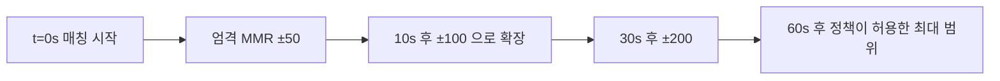
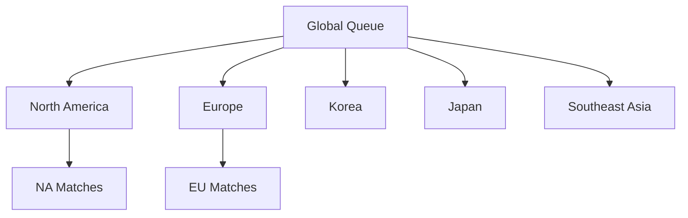
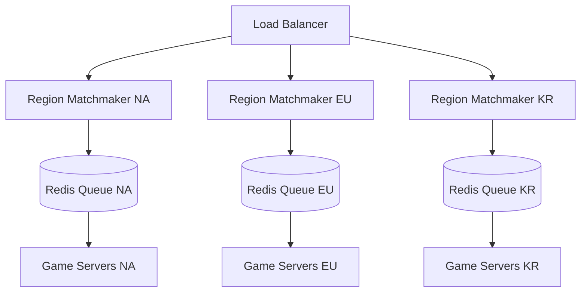
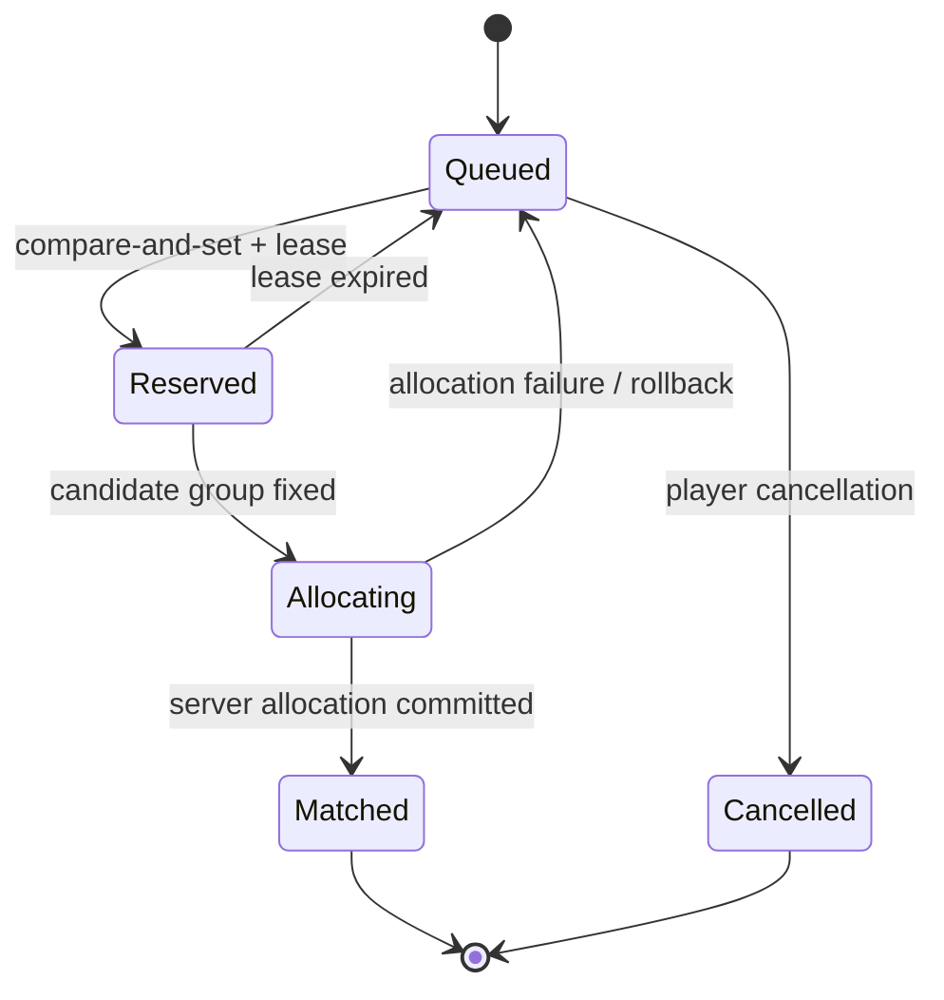

## 들어가며

매치메이킹의 *근본 트레이드오프* 는 *공정성 (균형 잡힌 매치) ↔ 대기 시간* 이다. 조건을 엄격하게 유지하면 적합한 상대가 도착할 때까지 오래 기다리고, 즉시 성사시키려 하면 실력·지연·파티 구성 차이가 큰 경기가 만들어질 수 있다. 어느 쪽도 모든 플레이어에게 항상 우월하지 않으므로 장르와 모드별 비용을 측정해야 한다.

이 트레이드오프가 까다로운 이유는 두 비용의 단위와 관측 시점이 다르기 때문이다. 대기 시간은 큐에서 바로 관측되지만, 품질은 승률 보정(calibration), 지연, 역할 구성, 중도 이탈, 재진입 같은 사후 지표를 통해서만 추정할 수 있다. 따라서 매치메이커는 하나의 고정 점수를 최대화하기보다 *하드 제약을 지키면서 여러 비용의 기대값을 낮추는 정책* 으로 보는 편이 정확하다.

이 글은 MMR 모델, 대기열 알고리즘, 지역·지연, 파티·역할 제약, 분산 큐의 원자성, 운영 지표와 실험 설계를 하나의 의사결정 문제로 연결한다. 각 수치는 보편 법칙이 아니라 측정과 정책으로 결정해야 할 매개변수로 다룬다.


---

## 목차
1. [공정성과 대기 시간의 트레이드오프](#1-공정성과-대기-시간의-트레이드오프)
2. [MMR 모델 비교](#2-mmr-모델-비교)
3. [대기열 알고리즘](#3-대기열-알고리즘)
4. [지역과 핑 분산](#4-지역과-핑-분산)
5. [파티와 역할 필터링](#5-파티와-역할-필터링)
6. [분산 매칭 서버 아키텍처](#6-분산-매칭-서버-아키텍처)
7. [매치 품질 지표와 A/B 테스트](#7-매치-품질-지표와-ab-테스트)
8. [사용자 경험 설계](#8-사용자-경험-설계)


---

## 1. 공정성과 대기 시간의 트레이드오프

### 매치 품질의 정의

승패 균형만 본 품질 성분은 예측되는 두 팀의 승률 차이가 작을수록 높다.

$$
Q_{\mathrm{balance}} = 1 - 2\left|\,P(\text{team A wins}) - \tfrac{1}{2}\,\right|
$$

$Q_{\mathrm{balance}}=1$이면 모델이 50:50으로 예측하고, 0이면 한쪽 승률을 0 또는 1로 예측한다. 이것은 *전체 매치 품질이 아니라 승패 균형 성분* 이다. 모델의 예측 확률이 실제 빈도와 보정되어 있지 않으면 이 값도 신뢰할 수 없다. 프로덕션 품질은 보통 다음처럼 여러 성분을 함께 본다.

$$
\mathbf{q} =
\left(
Q_{\mathrm{balance}},
Q_{\mathrm{latency}},
Q_{\mathrm{party}},
Q_{\mathrm{role}},
Q_{\mathrm{behavior}}
\right)
$$

각 성분에는 절대 침범할 수 없는 하드 제약과, 대기 시간에 따라 완화할 수 있는 소프트 제약이 섞여 있다. 예를 들어 패킷 왕복 시간이 플레이 가능한 한계를 넘는 서버는 점수를 낮추는 정도가 아니라 후보에서 제외해야 한다.

### 시간 vs 품질 곡선

대기 시간이 길수록 소프트 제약을 점진적으로 완화할 수 있다. 아래 숫자는 알고리즘 형태를 보여 주는 예시일 뿐 운영 기본값이 아니다.



개별 엔트리의 *대기 시간에 따른 허용 범위* 는 일반적으로 단조 증가하게 설계한다. 그래야 오래 기다린 엔트리의 우선권이 줄지 않는다. 다만 실제 후보 집합은 데이터센터 장애, 파티 상태 변경, 측정 지연 갱신에 따라 줄 수도 있다. 기아 방지는 단조 확장 하나에 맡기지 않고 큐 진입 시각, 마감 시각(deadline), 예약 실패 횟수를 포함한 명시적 우선순위로 보장한다.

### 플레이어 인내 임계

플레이어가 시간 $t$까지 큐에 남아 있을 확률을 생존 함수 $S(t)=P(T>t)$, 그 시점에 자발적으로 떠날 순간 위험을 원인별 위험률 $h_{\mathrm{cancel}}(t)$ 로 나타낼 수 있다.

$$
h_{\mathrm{cancel}}(t)=\lim_{\Delta t\to0}
\frac{P(t\le T<t+\Delta t,\ C=\mathrm{cancel}\mid T\ge t)}
{\Delta t}
$$

여기서 $C$는 큐 종료 원인이다. 취소와 매치 성사는 서로 먼저 일어날 수 있는 *경쟁 위험(competing risks)* 이다. 매치 성사를 무조건 독립적인 우측 검열로 취급한 Kaplan-Meier 추정은 매치 정책이 큐 나이·MMR에 의존할 때 편향될 수 있다. 원인별 위험률이나 누적 발생 함수로 두 종료 원인을 함께 모델링하고, 장르·모드·지역·시간대·파티 크기별로 보정한다.

대기 시간 SLO도 제품 데이터에서 정한다. 평균만으로는 얇은 MMR 대역의 장기 대기를 숨길 수 있으므로 중앙값, P90/P95/P99, 이탈 위험률을 지역·모드·MMR·파티별로 함께 본다.

### 대기 시간의 큐잉 모델

먼저 다른 제약과 서비스 비용을 제거한 장난감 모델을 보자. 하나의 균질한 대역에 적격 플레이어가 도착하고, 정확히 $m$명이 모이면 계산·서버 할당 시간 없이 즉시 빠져나간다고 가정한다. 5v5라면 $m=10$이다.

한 대역에 플레이어가 *포아송 과정* (평균 도착률 $\lambda$ 명/초) 으로 들어온다고 하자. 도착 간격은 평균 $1/\lambda$ 의 지수분포다. $t_k$ 를 $k$번째 도착 시각이라 하면, 배치는 $m$번째 도착 $t_m$ 에 매치로 빠지고 $k$번째 플레이어의 대기는 $t_m - t_k$ 다. 한 배치 $m$명의 대기 시간 총합은

$$
\sum_{k=1}^{m} (t_m - t_k) = \sum_{j=2}^{m} (j-1)\,X_j, \qquad X_j = t_j - t_{j-1} \sim \mathrm{Exp}(\lambda)
$$

($j$번째 간격 $X_j$ 는 자기보다 앞서 도착한 $j-1$명의 대기에 각각 더해지므로 $(j-1)$배로 센다.) $E[X_j] = 1/\lambda$ 이므로

$$
E\!\left[\sum_{k} (t_m - t_k)\right] = \frac{1}{\lambda}\sum_{j=2}^{m}(j-1) = \frac{m(m-1)}{2\lambda}
$$

플레이어 한 명당 평균 대기는 이를 $m$으로 나눈 값이다.

$$
W = \frac{m-1}{2\lambda}
$$

이 제한된 모델에서는 $W$가 $\lambda$에 반비례한다. 5v5($m=10$) 대역에 $\lambda=2$명/초가 들어오면 $W=2.25$초이고, $\lambda=0.2$명/초면 $W=22.5$초다. 이 계산은 대역을 좁혀 적격 도착률을 낮추는 비용을 보여 주지만, 실제 큐의 중첩 후보·파티·이탈·예약 실패를 설명하는 폐쇄형 해답은 아니다.

### Little의 법칙과 모델의 경계

큐의 평균 인구 $L$, 평균 도착률 $\lambda$, 평균 대기 $W$ 사이에는 안정 상태에서 항상 *Little의 법칙* $L = \lambda W$ 가 성립한다. 위 결과를 대입하면

$$
L = \lambda \cdot \frac{m-1}{2\lambda} = \frac{m-1}{2}
$$

평균 큐 인구가 $(m-1)/2$라는 결과도 *즉시 서비스하는 단일 배치 모델* 에서만 성립한다. Little의 법칙 자체는 안정된 시스템에 폭넓게 적용되지만 $W$의 값을 정해 주지는 않는다. 후보 탐색, 저장소 경합, 서버 할당이 병목이면 워커와 처리 용량을 늘려 서비스 대기를 줄일 수 있다. 반대로 그 비용이 충분히 작고 적격 플레이어 부족이 지배적이면 워커를 늘려도 수집 대기는 줄지 않는다. 운영에서는 수집 대기, 매처 처리, 예약, 서버 할당을 별도 구간으로 계측해야 한다.

### 평균이 아니라 꼬리를 보는 이유

$W$는 평균이다. 배치가 비워진 직후 첫 번째로 도착한 플레이어는 나머지 $m-1$명을 기다리므로 이 장난감 모델에서 대기 시간은 $\operatorname{Erlang}(m-1,\lambda)$ 분포를 따른다. 평균은 $(m-1)/\lambda$, 분산은 $(m-1)/\lambda^2$ 다. Erlang 분포의 꼬리는 지수적으로 감소하므로 통계학적 의미의 *두꺼운 꼬리(heavy tail)* 는 아니다. 그래도 $\lambda$가 작은 대역에서는 시간 척도 자체가 $1/\lambda$만큼 커져 전역 상위 분위수를 지배할 수 있다. 실제 장기 대기는 시간대가 섞인 비정상 도착률, 파티·역할 제약, 재시도 때문에 이 단순 분포보다 복잡해진다.

### 핵심 매트릭 — 효용 함수

후보를 비교하는 가장 단순한 형태는 품질 점수에서 대기 비용을 빼는 것이다.

```cpp
float MatchUtility(const Candidate& c, const Policy& p) {
    if (!p.SatisfiesHardConstraints(c)) return -INFINITY;

    const float qualityCost =
        p.balanceCost(c.predictedWinProbability) +
        p.latencyCost(c.serverRtt) +
        p.partyCost(c.partyFeatures) +
        p.roleCost(c.roleAssignment);

    return -(qualityCost + p.waitCost(c.queueAge));
}
```

`waitCost`는 선형일 필요가 없다. 생존 분석에서 특정 구간의 이탈 위험이 빠르게 증가한다면 볼록 비용으로 모델링할 수 있다. 또한 “더 기다리면 얼마나 좋은 후보가 오는가”는 확정값이 아니라 도착 과정에 대한 조건부 기대값이다. 따라서 정적 가중치 하나로 유지율을 직접 제어한다고 해석하지 않고, 오프라인 재생과 간섭을 고려한 온라인 실험으로 전체 정책을 평가한다.

## 2. MMR 모델 비교

MMR (Matchmaking Rating) 모델은 *플레이어 실력을 숫자로 추정* 하고 *경기 결과로 갱신* 한다. 매치메이커가 *기대 승률* 을 계산하는 근거 — 1절의 품질 $Q$ 가 이 모델 위에 선다.

### Elo (1960)

체스에서 출발. *간단* + *직관*. 두 플레이어의 레이팅 차이로 기대 승률을 계산하고, 실제 결과와의 차이만큼 레이팅을 옮긴다.

$$
E_A = \frac{1}{1 + 10^{(R_B - R_A)/400}}, \qquad R_A' = R_A + K\,(S_A - E_A)
$$

- $S_A$ — 실제 결과 (승 = 1, 무 = 0.5, 패 = 0).
- $E_A$ — 기대 승률. 이 식의 400은 스케일 매개변수이며, 이 관례에서는 400 차이가 10배 승산(약 91% 승률)을 뜻한다.
- $K$ — 한 결과가 레이팅에 미치는 크기. 상수가 아니라 경기 수·불확실성·시즌 정책에 따라 달리 둘 수도 있다.

```cpp
float Elo_Expected(float Ra, float Rb) {
    return 1.0f / (1.0f + std::pow(10.0f, (Rb - Ra) / 400.0f));
}

float Elo_Update(float Ra, float S, float Rb, float K = 32.0f) {
    float E = Elo_Expected(Ra, Rb);
    return Ra + K * (S - E);     // S: 실제 결과, E: 기대 승률
}
```

수치 트레이스 — $R_A = 1500$, $R_B = 1500$ (동급), $K = 32$. 기대 승률 $E_A = 0.5$. A가 이기면 ($S = 1$) → $R_A' = 1500 + 32(1 - 0.5) = 1516$. A가 지면 → $1484$. 동급끼리는 *±16점* 으로 대칭. 이번엔 $R_A = 1700$, $R_B = 1300$. $E_A = 1/(1 + 10^{-1}) \approx 0.909$. A가 이기면 $R_A' = 1700 + 32(1 - 0.909) \approx 1703$ — *고작 +3점* (이길 게 이김). A가 지면 $1700 + 32(0 - 0.909) \approx 1671$ — *-29점* (대형 이변). 약자가 강자를 잡으면 크게 오르는 구조다.

장점 — *간단*. 단점 — *불확실성 모델링 없음*. 신규 플레이어와 1000판 한 베테랑이 *같은 K* 를 쓴다 — 신규는 실제 실력이 어디인지 모르는데도 한 판에 16점밖에 안 움직여 *수렴이 느리다*.

### Glicko / Glicko-2 (1999, 2012)

Mark Glickman이 Elo에 *불확실성 (Rating Deviation, RD)* 을 추가. 레이팅을 *점이 아니라 분포* 로 본다 — $r \pm RD$. *신규 / 휴면 플레이어* 의 RD ↑ → *한 경기로 크게 조정*. 자주 하는 플레이어는 RD ↓ → 레이팅이 안정.

```cpp
struct GlickoRating {
    float r;       // rating (표시 스케일)
    float rd;      // deviation (불확실성)
    float sigma;   // volatility (Glicko-2, 실력 변동 정도)
};
```

Glicko-2는 내부적으로 *r 을 μ = (r - 1500)/173.7178, RD 를 φ = RD/173.7178* 로 스케일 변환해 계산한다. 한 평가 기간의 갱신은 다음 순서.

```cpp
// 한 평가 기간(여러 경기) 후 갱신 — 스케일 변환된 (mu, phi) 기준
float g(float phi) {                       // RD가 클수록 영향 ↓
    return 1.0f / std::sqrt(1.0f + 3.0f * phi * phi / (M_PI * M_PI));
}
float E(float mu, float mu_j, float phi_j) {   // j 상대 기대 승률
    return 1.0f / (1.0f + std::exp(-g(phi_j) * (mu - mu_j)));
}
// v: 추정 분산, delta: 추정 개선량 — 모든 상대 j에 대해 합산
//   v     = 1 / Σ_j [ g(phi_j)^2 · E·(1-E) ]
//   delta = v · Σ_j [ g(phi_j) · (s_j - E) ]
// sigma' 는 delta, phi, v, tau(시스템 상수)로 Illinois 반복법으로 해를 구한다.
// phi*  = sqrt(phi^2 + sigma'^2),  phi' = 1 / sqrt(1/phi*^2 + 1/v)
// mu'   = mu + phi'^2 · Σ_j [ g(phi_j) · (s_j - E) ]
```

핵심 직관은 상대의 RD가 크면 $g(\phi_j)$가 작아져 그 결과의 정보량이 줄고, 자신의 RD가 크면 새로운 관측이 추정치를 더 크게 움직일 수 있다는 것이다. `tau`는 변동성 $\sigma$가 얼마나 빠르게 바뀔 수 있는지를 제어하는 시스템 매개변수다. 적절한 값은 원문이 권하는 범위에서 시작하더라도 실제 결과 데이터로 민감도를 검증해야 한다.

장점은 신규·휴면 플레이어의 불확실성을 표현하고 비활동 기간에 RD를 증가시킬 수 있다는 점이다. Glicko-2는 평가 기간의 경기들을 묶어 갱신하지만, 평가 기간에 한 경기만 있어도 정의된다. 실시간처럼 보이게 하려면 한 경기를 하나의 평가 기간으로 둘 수 있으나, 원래 가정과 제품의 경기 빈도가 맞는지 검증해야 한다.

### TrueSkill (2007, Microsoft)

Glicko의 *팀 게임 확장*. 베이지안 그래프 모델 (factor graph). *각 플레이어의 mu (실력 추정), sigma (불확실성)* 를 *팀 합* 으로 묶어 매치 결과를 설명한다.

$$
\mu_{\text{team}} = \sum_i \mu_i, \qquad \sigma_{\text{team}}^2 = \sum_i \sigma_i^2
$$

팀 간 *스킬 차이의 분포* 로 승패를 예측하고, *결과를 역전파* 해 각 개인의 mu/sigma를 갱신한다. 두 팀 합 스킬이 가까운데 진 팀의 개인들은 mu가 내려가고, 이긴 팀은 올라간다 — *불확실성(sigma)이 큰 플레이어가 더 많이 움직인다*.

보수적 점수 $\mu-k\sigma$는 불확실성이 큰 플레이어를 순위표에 과대 노출하지 않는 표시·랭킹 규칙으로 사용할 수 있다. 정규분포 가정에서 $k=3$의 단측 하한은 약 99.865% 수준이지 정확히 99%가 아니다. 이 값을 매치메이킹 실력값으로 그대로 사용하면 신규를 체계적으로 낮은 방에 배치할 수 있으므로, 매칭에서는 $\mu$와 $\sigma$를 별도 특성으로 사용해 승률 분포를 계산하는 편이 낫다.

```cpp
// 1명 대 1명, 동일한 성능 분산 beta를 가정한 축약식
float MatchQualityTrueSkill1v1(float muA, float sigA, float muB, float sigB,
                               float beta) {
    float c2 = 2.0f * beta * beta + sigA * sigA + sigB * sigB;
    float dmu = muA - muB;
    // 0~1, 두 팀 스킬이 가까울수록 1에 가까움
    return std::sqrt(2.0f * beta * beta / c2)
         * std::exp(-(dmu * dmu) / (2.0f * c2));
}
```

요인 그래프는 팀전, 다인 순위, 무승부를 같은 확률 모델 안에 표현할 수 있다. 인원 수가 다른 팀도 계산 자체는 가능하지만 그것만으로 게임 규칙상 공정해지는 것은 아니다. 구현에서는 근사 메시지 전달의 수렴, 파티 상관관계, 역할별 기여도처럼 독립 정규 실력 가정에서 벗어나는 요소를 따로 검증해야 한다.

### TrueSkill 2 (2018)

TrueSkill 2는 팀 결과 외의 관측 특성과 시간에 따른 실력 변화를 모델에 추가한다. 개인 통계를 넣으면 예측력이 좋아질 수 있지만, 보상 대상이 된 통계를 플레이어가 최적화하는 표적 누출과 역할 편향이 생긴다. 특성은 승률 예측의 교차 검증, 역할별 보정, 악용 가능성 검토를 거쳐야 한다.

### 비교 표

| 모델 | 상태 | 팀 결과 표현 | 불확실성 | 주요 구현 부담 |
|---|---|---|---|---|
| Elo | 점 추정치 | 팀 레이팅으로 축약 필요 | 없음 | 스케일·K·드리프트 보정 |
| Glicko-2 | 평균·RD·변동성 | 별도 팀 확장 필요 | 있음 | 평가 기간·변동성 반복해 |
| TrueSkill | 개인별 평균·분산 | 요인 그래프로 직접 표현 | 있음 | 메시지 전달·상관관계 근사 |
| TrueSkill 2 계열 | 평균·분산과 추가 특성 | 결과와 보조 관측 결합 | 있음 | 특성 편향·악용·재학습 |

모델 선택은 경기 구조뿐 아니라 필요한 보정 성능, 설명 가능성, 운영 비용으로 결정한다. 공통 함정은 *내부 실력 추정치와 표시 랭크가 서로 다른 상태 변수* 라는 점이다. 둘을 분리했다면 시즌 초기화·감쇠·승급 보호가 어느 변수에 적용되는지도 명시해야 한다.

## 3. 대기열 알고리즘

### Progressive Widening

대기 시간이 길수록 *매칭 범위 점진 확장*. 가장 일반적 패턴. 허용 MMR 차이를 *대기 시간의 함수* 로 둔다.

```cpp
struct QueueEntry {
    PlayerId id;
    int   mmr;
    float waitSeconds;
};

bool CanMatch(const QueueEntry& a, const QueueEntry& b) {
    const int diff = std::abs(a.mmr - b.mmr);
    // AllowedDiff는 모드별 설정 또는 데이터로 보정한 단조 함수다.
    return diff <= AllowedDiff(a.waitSeconds)
        && diff <= AllowedDiff(b.waitSeconds);
}
```

오래 기다린 한쪽의 범위만 사용하면 막 들어온 상대에게 그 완화 정책을 강제로 적용한다. 위 코드는 양쪽 엔트리가 현재 차이를 받아들이는 경우만 간선을 만든다. 기아 방지는 이 조건을 비대칭으로 깨뜨리는 대신 오래된 엔트리부터 후보 그래프를 구성하고, 허용 범위의 상한과 큐 마감 정책을 명시하는 방식으로 다룬다. 위쪽·아래쪽 범위를 다르게 두려면 실제 승률 보정과 플레이어 경험 데이터가 근거가 되어야 한다.

### Backfill

진행 중 매치에 *중도 이탈 발생* → *대기열의 비슷한 MMR 플레이어로 빈자리 채움*. 인원 부족으로 인한 *매치 조기 종료* 를 회피.

```cpp
std::optional<PlayerId> FindBackfill(
    const MatchInProgress& match,
    TeamId vacantTeam,
    std::span<const QueueEntry> candidates)
{
    std::optional<PlayerId> best;
    float bestCost = INFINITY;

    for (const QueueEntry& candidate : candidates) {
        if (!BackfillEligible(match, candidate)) continue;

        PredictedState state =
            PredictWithReplacement(match, vacantTeam, candidate);
        float cost =
            BalanceCost(state.winProbability) +
            JoinInProgressCost(state.score, state.timeRemaining) +
            RoleCost(state.roles) +
            LatencyCost(state.serverRtt);

        if (cost < bestCost) {
            bestCost = cost;
            best = candidate.id;
        }
    }
    return best;
}
```

단순 팀 MMR 합은 현재 점수, 남은 시간, 역할 공백, 파티 구조를 잃어버린다. 후보를 넣은 뒤의 승률과 합류 경험을 다시 예측해야 한다. 이미 결과가 거의 정해진 경기에는 후보가 없어도 정상 종료시키는 정책이 더 나을 수 있다. 보상, 레이팅 처리, 백필 중단 조건은 모드 규칙으로 명시하고 악용 가능한 반복 이탈·합류를 함께 막는다.

### Priority Weighting

대기 시간 + MMR + 핑 + 파티 크기 등 *다중 변수* → *하나의 조합 점수*. CanMatch의 불리언 통과 후, 여러 통과 후보 중 *최저 비용* 을 고른다.

```cpp
float MatchCost(const CandidateMatch& c, const Policy& p) {
    if (!p.HardConstraintsHold(c)) return INFINITY;
    return p.balanceWeight * p.BalanceCost(c.predictedWinProbability)
         + p.latencyWeight * p.LatencyCost(c.rttByPlayer)
         + p.partyWeight  * p.PartyCost(c.partyConfiguration)
         + p.roleWeight   * p.RoleCost(c.roleAssignment)
         + p.ageWeight    * p.AgeCost(c.oldestQueueAge);
}
```

지연 비용은 두 플레이어의 핑 *차이* 만 봐서는 안 된다. 둘 다 150ms라면 차이는 0이지만 플레이 가능성은 낮을 수 있다. 각 플레이어의 후보 데이터센터별 RTT, 최댓값, 지터를 입력으로 사용한다. 가중합은 여러 목적을 한 값으로 정렬하기 위한 정책일 뿐 “완전한 품질”이 아니다. 하드 제약을 먼저 적용하고, 각 비용의 척도와 가중치는 예측 보정과 온라인 지표로 관리한다.

### 전역 최적 매칭 — 일반 그래프 매칭

위의 *greedy 매칭* (오래 기다린 순서로 최고 점수 상대를 짝지음) 은 *국소 최적* 에 그친다. 예 — A-B 점수가 가장 높아 먼저 묶으면, 남은 C-D는 최악 매치가 될 수 있다. A-D, B-C로 묶었으면 *총합* 이 더 높았을 수도 있다.

하나의 1v1 큐에서 모든 플레이어가 서로 상대 후보가 될 수 있으면 후보 그래프는 *일반 무방향 그래프* 다. 각 정점을 최대 한 번 사용하면서 간선 점수 합을 최대화하는 문제는 *최대 가중치 일반 그래프 매칭* 이며 blossom 계열 알고리즘의 대상이다. 헝가리안 알고리즘은 정점을 두 개의 서로 겹치지 않는 집합으로 나눌 수 있는 할당 문제에만 직접 적용된다. 공격자·수비자처럼 제품 규칙이 실제 이분 집합을 만든 경우에는 헝가리안 알고리즘을 사용할 수 있다.

```cpp
struct Edge {
    int u;
    int v;
    float weight;
};

// 각 정점을 최대 한 번 사용하는 최대 가중치 일반 그래프 매칭.
// 검증된 blossom 구현이나 그래프 라이브러리를 사용한다.
std::vector<Edge> MaximumWeightMatching(
    int vertexCount,
    std::span<const Edge> eligibleEdges);
```

정확 알고리즘의 비용과 메모리는 구현 및 그래프 밀도에 좌우된다. 따라서 큐 전체를 무조건 최적화하지 않고, 하드 제약으로 간선을 희소화한 뒤 오래된 엔트리를 포함하는 겹치는 창(window)에서 풀거나 greedy 결과에 교환 탐색을 적용한다. MMR 버킷 경계를 고정하면 경계 양쪽의 좋은 상대를 영구히 놓치므로 인접 버킷을 겹치게 해야 한다.

5v5 팀 빌딩은 먼저 10명을 선택하는 집합 포장 문제와, 선택한 10명을 두 팀으로 나누는 분할 문제를 구분해야 한다. 후보 10명이 이미 정해졌다면 5:5 분할은 $\binom{10}{5}/2=126$개의 고유 분할만 비교하면 된다.

```cpp
// 10명을 5:5로 나누는 균형 최적 (소규모이므로 완전 탐색 가능)
TeamSplit BestSplit(const std::array<Player,10>& p) {
    int total = 0; for (auto& x : p) total += x.mmr;
    TeamSplit best; float bestBalance = 1e30f;
    // 0번 플레이어를 A팀에 고정해 A/B 대칭 중복을 제거한다.
    for (uint32_t mask = 0; mask < (1u << 10); ++mask) {
        if ((mask & 1u) == 0) continue;
        if (std::popcount(mask) != 5) continue;
        int teamA = 0;
        for (int i = 0; i < 10; ++i) if (mask & (1u<<i)) teamA += p[i].mmr;
        float diff = std::abs(2 * teamA - total);
        if (diff < bestBalance) { bestBalance = diff; best = MakeSplit(mask); }
    }
    return best;
}
```

이 예는 MMR 합만 최소화한다. 실제 목적 함수에는 팀별 승률 분포, 역할, 파티를 갈라놓지 않는 제약, 실력 불확실성을 포함해야 한다. `std::popcount`는 C++20 `<bit>`에 정의된다.

## 4. 지역과 핑 분산

MMR이 맞아도 *핑이 나쁘면 게임이 안 된다*. 지역 분산은 *공정성-대기의 두 번째 축* — *핑-대기 트레이드오프*.

### 지역 (Region) 분리

지역 이름을 플레이어 속성으로 고정하기보다 각 데이터센터까지의 측정된 경로 품질을 보관한다. 같은 국가에서도 ISP 라우팅에 따라 다른 지역이 더 나을 수 있고, 서로 다른 지역 표기가 같은 데이터센터에서 플레이 가능한 경우도 있다.



지역을 *플레이어가 고르게* 할지 *자동 감지* 할지가 첫 결정. 자동은 *접속 지연 측정* 으로 정하되, VPN / 모바일 라우팅 때문에 *틀릴 수 있어* 수동 override를 둔다.

### 크로스 지역 활성화

*매치 부족 지역* (예: 새벽 시간대 KR) → *주변 지역과 교차 매치 허용*. 대기 시간 임계를 넘으면 점진적으로 인접 지역을 푼다.

```cpp
std::vector<DataCenter> AvailableDataCenters(
    const QueueEntry& entry,
    const Policy& policy)
{
    std::vector<DataCenter> result;
    for (DataCenter dc : policy.enabledDataCenters) {
        const PathSample& path = entry.measuredPath[dc];
        if (policy.PathIsPlayable(path) &&
            policy.RegionCost(path, entry.waitSeconds) <=
                policy.RegionBudget(entry.waitSeconds)) {
            result.push_back(dc);
        }
    }
    return result;
}
```

대기 시간에 따라 소프트 비용 예산을 늘리더라도 `PathIsPlayable` 같은 하드 상한은 완화하지 않는다. 장르의 입력·보상 구조에 따라 허용 가능한 RTT·지터·손실이 다르므로 지역 인접성이나 고정 시간 임계가 아니라 측정 경로와 모드 정책을 사용한다.

### 서버 위치 결정

매치 인원 *N명* → *N명의 평균 핑이 가장 낮은 데이터센터* 선택. 단순 평균 외에 *최대 핑 최소화* (minimax) 도 흔하다 — 평균이 좋아도 한 명만 200ms면 그 한 명이 게임을 망친다.

```cpp
ServerLocation ChooseServer(const std::vector<PlayerId>& players) {
    ServerLocation best;
    float bestCost = INFINITY;
    for (auto& loc : availableServers) {
        float sum = 0, worst = 0;
        for (auto& p : players) {
            float ping = EstimatePing(p, loc);
            sum += ping;
            worst = std::max(worst, ping);          // 최악 핑 추적
        }
        float avg = sum / players.size();
        float cost = policy.ServerCost(avg, worst);
        if (cost < bestCost) { bestCost = cost; best = loc; }
    }
    return best;
}
```

클라이언트는 큐 진입 전에 각 데이터센터의 여러 프로브를 측정할 수 있다. 그러나 자기 보고 값은 조작 가능하고 단일 표본은 지터를 놓친다. 서버가 발급한 프로브 토큰, 서버 관측 왕복 시간, 표본 시각과 분산을 함께 보관하고 오래된 측정은 폐기한다.

### 핑 차이 제한

매치 안에 *핑 30ms 와 핑 150ms* 가 섞이면 *느린 쪽이 구조적으로 불리* (지연 보상이 완벽하지 않은 한). 매치 내 *핑 편차 ≤ 임계* 를 강제한다.

```cpp
bool PathAcceptable(const std::vector<PlayerId>& players, ServerLocation loc,
                    const NetworkPolicy& policy) {
    int minRtt = INT_MAX, maxRtt = 0;
    for (auto& p : players) {
        PathSample sample = MeasuredPath(p, loc);
        if (!policy.PlayerPathIsPlayable(sample)) return false;
        minRtt = std::min(minRtt, sample.rttMs);
        maxRtt = std::max(maxRtt, sample.rttMs);
    }
    return policy.RttSpreadAcceptable(maxRtt - minRtt);
}
```

편차만 검사하면 모두 150ms인 나쁜 경로를 통과시킨다. 반대로 10ms와 60ms의 차이가 커도 모드에 따라 둘 다 충분히 플레이 가능할 수 있다. 먼저 절대 상한을 검사하고, 그 안에서 공정성 비용으로 분산을 평가한다. 대기 시간은 소프트 비용을 완화할 수 있지만 안전·플레이 가능성 상한까지 없애지는 않는다.

## 5. 파티와 역할 필터링

### 파티 크기 매칭

*솔로* + *2인 파티* + *5인 파티* 가 *같은 매치* 면 *5인 풀팀이 음성 채팅·조합으로 압도*. 파티 크기 차이를 제한한다.

허용 가능한 파티 조합은 팀 크기와 모드 규칙에 따라 달라진다. 풀 파티 대 풀 파티를 하드 제약으로 둘 수도 있고, 인구가 적은 모드에서는 파티 크기 차이를 품질 비용으로 둘 수도 있다. 보편적인 호환 표는 없다.

파티의 유효 실력도 단순 평균이나 고정 배수로 정하기 어렵다. 파티 크기, 구성원 실력 분산, 함께 플레이한 횟수, 역할 조합, 상대 파티 구성은 각각 승률에 다른 영향을 준다.

```cpp
PartyFeatures ExtractPartyFeatures(const Party& party) {
    return {
        .size = party.size(),
        .meanRating = MeanRating(party),
        .ratingVariance = RatingVariance(party),
        .gamesTogether = GamesTogether(party),
        .roleCoverage = RoleCoverage(party)
    };
}
```

이 특성으로 팀 승률을 보정한 뒤 보정 오차를 파티 크기별로 확인한다. “파티이므로 몇 퍼센트 강하다”는 상수는 시즌·모드 변화에 쉽게 드리프트한다.

### 역할 기반 매칭

팀 게임은 *역할 균형* 이 매치 품질을 크게 바꾼다. 5명이 다 딜러면 MMR이 맞아도 진다. 게임마다 역할 강제 정도가 다르다 — *큐 단계에서 역할 고정* (Overwatch 2 role queue), *주/보조 포지션 선호 수집* (LoL), *큐 단계에선 역할 자유* (Valorant).

```cpp
struct PlayerPreference {
    PlayerId id;
    Role primary;
    Role secondary;
    int  mmr;
};

// 왼쪽 정점: 플레이어, 오른쪽 정점: 실제 역할 슬롯.
// 선택 가능한 역할에만 간선을 만들고 선호·숙련도 비용을 둔다.
std::optional<RoleAssignment> AssignRoles(
    std::span<const PlayerPreference> players,
    std::span<const RoleSlot> slots);
```

주 역할부터 탐욕적으로 채우면 뒤의 플레이어 때문에 가능한 배정을 놓칠 수 있다. 플레이어-역할 슬롯 이분 그래프에서 완전 매칭을 찾고, 선호도와 역할별 레이팅을 비용으로 둔 최소 비용 매칭을 사용하면 가능성과 품질을 분리해 판단할 수 있다. 파티를 한 팀에 유지하는 제약까지 함께 풀면 팀 선택과 역할 배정이 결합되므로 작은 후보 집합에서 정수계획 또는 제약 프로그래밍을 적용할 수 있다.

### Role Queue (역할 큐)

플레이어가 *큐 진입 시 역할 선택* → *역할별 큐 분리* → 매치 시 역할 자동 배정. 장점 — *역할 균형 보장*. 단점 — *부족한 역할의 대기 시간 폭증*.

역할 $r$의 도착률을 $\lambda_r$, 매치 하나에 필요한 인원을 $n_r$라 하면 해당 역할이 허용하는 매치 생성률의 상한은 $\lambda_r/n_r$다. 따라서 전체 처리량은 이상적으로도 다음을 넘지 못한다.

$$
\mu_{\mathrm{match}}\le \min_r \frac{\lambda_r}{n_r}
$$

한 역할이 병목이면 다른 역할의 초과 도착분은 계속 누적된다. 역할별 도착률과 이탈률을 측정해 부족 역할 인센티브, 여러 역할 선택, 자동 배정 동의, 역할 요구량 변경을 평가한다. 역할 수만 맞췄다고 실력·파티·지연까지 균형 잡힌 것은 아니다.

## 6. 분산 매칭 서버 아키텍처

### 단일 vs 분산

분산 여부는 동시 접속자 수 하나가 아니라 후보 그래프 계산량, 저장소 처리량, 장애 격리, 지역 간 왕복 시간으로 결정한다. 지역은 유용한 장애·데이터 경계지만 크로스 리전 후보를 지원한다면 완전히 독립된 큐로 잘라서는 안 된다. 홈 리전에 엔트리의 단일 소유권을 두고, 다른 리전에는 버전이 붙은 후보 뷰만 복제하는 식으로 중복 매칭을 막는다.



### 큐 저장소 — Redis Sorted Set

Sorted Set은 MMR 범위 후보를 찾는 *보조 인덱스* 로 사용할 수 있다. 파티 원자성, 역할, 데이터센터별 경로, 큐 나이, 상태 버전은 별도 큐 엔트리에 저장한다. MMR 하나만 score로 둔 집합은 전체 매칭 상태가 아니다.

```text
ZADD  queue:na:ranked 1234 player:abc      # MMR 1234로 추가
ZRANGEBYSCORE queue:na:ranked 1184 1284    # ±50 범위 후보 검색
ZREM  queue:na:ranked player:abc           # 매치/취소 시 제거
```

워커 두 개가 같은 엔트리를 선택하면 한 플레이어가 두 매치에 들어갈 수 있다. 후보 조회 직후 큐에서 삭제하는 것만으로는 충분하지 않다. 게임 서버 할당이나 알림이 실패하면 플레이어를 잃어버리고, 파티 일부만 제거되면 상태가 찢어진다. 엔트리는 다음과 같은 상태 머신과 버전을 가져야 한다.



예약 연산은 모든 구성원의 `Queued` 상태와 예상 버전을 검사하고, *전부 성공할 때만* 같은 `reservation_id`와 만료 시각을 기록해야 한다. Lua나 서버 측 트랜잭션은 이 compare-and-set을 원자적으로 구현하는 수단이다. `ZRANGEBYSCORE`로 얻은 후보를 곧바로 `ZREM`으로 일괄 삭제하는 스크립트는 필요한 수보다 많이 제거하고 할당 실패 복구도 못 하므로 올바른 프로토콜이 아니다.

### 매치 워커 — 비동기 + 배치

워커가 *주기적으로 큐 스냅샷* → *매치 가능 그룹 탐색* (3절) → *게임 서버 할당*.

```cpp
void MatcherTick() {
    auto candidates = queue.ReadCandidateWindow("na:ranked");
    auto matches = FindMatches(candidates);

    for (const auto& m : matches) {
        Reservation r = queue.TryReserveAll(
            m.entriesAndVersions, LeaseDuration());
        if (!r.valid()) continue;

        auto srv = AllocateGameServer(m.dataCenter, r.id());
        if (!srv) {
            queue.Rollback(r.id());       // 멱등 연산
            continue;
        }

        CommitOutcome outcome =
            queue.CommitMatched(r.id(), srv->allocationId); // 멱등 키: r.id()
        if (outcome == CommitOutcome::Rejected) {
            ReleaseGameServer(srv->allocationId);
            continue;
        }
        if (outcome == CommitOutcome::Unknown) {
            ReconcileReservation(r.id(), srv->allocationId);
            continue; // 응답 유실만으로 서버를 해제하지 않는다.
        }
        SendMatchFound(m.players, srv->endpoint, r.id());
    }
}
```

고정 tick의 도착 위상만 균일하다고 가정하면 평균 스케줄링 지연은 tick 간격의 절반이다. 실제로는 신규 엔트리, 예약 만료, 허용 범위 변화 시각을 이벤트로 받아 디바운스한 뒤, 최대 지연 마감 시각에는 반드시 실행하는 방식이 낫다. 인구가 적다고 무조건 tick을 늦추면 오래된 엔트리의 마감만 놓친다. 후보 계산 시간, 저장소 대기, 예약 충돌률을 측정해 배치 크기와 실행 주기를 정한다. 할당 후 프로세스가 죽는 경우에는 예약과 할당 ID를 대조하는 조정자(reconciler)가 고아 서버를 회수하거나 커밋을 완료해야 한다.

### 게임 서버 할당 (Allocation)

매치 결정 후 *게임 서버 인스턴스 할당*. Kubernetes 위라면 *Agones* (게임 서버 라이프사이클 CRD), 매칭 자체는 *Open Match* 같은 오픈소스 프레임워크를 쓴다.

```yaml
# Agones GameServer 템플릿 — Ready 풀의 서버가 동적 포트를 연다
apiVersion: agones.dev/v1
kind: GameServer
spec:
  ports:
    - name: default
      portPolicy: Dynamic
      containerPort: 7777
  template:
    spec:
      containers:
        - name: gameserver
          image: my-game:1.2.3
```

라이프사이클은 Ready 서버를 `GameServerAllocation`으로 원자적으로 선택해 Allocated 상태로 바꾸고, 할당 메타데이터나 별도 세션 저장소로 `match_id`를 전달하는 흐름이다. `GameServer` 템플릿의 고정 환경 변수는 매치마다 달라지는 ID를 표현하지 못한다. 필요한 Ready 여유분은 이미지 시작 시간과 도착률 예측의 분포로 정하며, 고정된 “수십 초”를 가정하지 않는다.

### Scale-Out 트리거

워커와 게임 서버 풀은 서로 다른 신호로 확장한다. 워커는 후보 계산 시간, 예약 충돌, 이벤트 지연, CPU를 보고, 게임 서버 풀은 할당 도착률, Ready 여유분, 시작 시간 분위수를 본다. 큐 크기는 적격 플레이어 부족으로도 커질 수 있어 단독 확장 신호로 쓰기 어렵다.

```yaml
# 예시: CPU 외에 외부 메트릭을 함께 사용하는 워커 HPA
apiVersion: autoscaling/v2
kind: HorizontalPodAutoscaler
spec:
  minReplicas: 2
  maxReplicas: 50
  metrics:
    - type: Resource
      resource:
        name: cpu
        target: { type: Utilization, averageUtilization: 70 }
    - type: External
      external:
        metric:
          name: matchmaking_event_lag_seconds
        target:
          type: AverageValue
          averageValue: "0.2"
```

적격 플레이어가 없는 수집 단계에서는 워커를 늘려도 대기가 줄지 않는다. 반대로 계산·저장소·할당 단계가 도착률을 따라가지 못한다면 워커나 파티션을 늘려야 한다. Little의 법칙은 어느 단계가 병목인지 알려 주지 않으므로 구간별 대기와 처리율을 직접 측정한다.

## 7. 매치 품질 지표와 A/B 테스트

### 핵심 지표

| 지표 | 의미 | 반드시 나눌 차원 |
|---|---|---|
| Wait Quantiles | 큐 대기 P50/P90/P95/P99 | 지역·모드·MMR·파티·역할 |
| Queue Survival | 시간별 잔존·취소 위험 | 신규/복귀·시간대 |
| Calibration | 예측 승률과 실제 승률의 일치 | 예측 확률 구간·파티 구성 |
| Completion | 정상 종료와 중도 이탈 | 점수 차·지연·백필 |
| Allocation Reliability | 예약·서버 할당 성공률과 지연 | 데이터센터·빌드 버전 |
| Rating Stability | 수렴, 드리프트, 불확실성 보정 | 시즌·게임 수·실력 대역 |

목표값은 장르와 모드별 SLO로 선언한다. 재진입률도 유용하지만 단독 목적 함수로 쓰면 짧고 반복적인 매치나 중독적 UX를 과대 보상할 수 있다. 공정성, 이탈, 신고, 장기 유지, 서버 비용을 함께 보고 가드레일을 둔다.

### A/B 테스트 프레임워크

알고리즘 변경 시 *A (기존, control) vs B (신규, variant)* 로 플레이어를 *결정론적으로 분할*.

```cpp
enum Bucket { Control, Variant };

Bucket AssignBucket(PlayerId pid, const std::string& experiment) {
    uint32_t h = Hash(pid.value, experiment);   // 플레이어+실험명 해시
    return (h % 100 < 50) ? Control : Variant;   // 50/50 분할
}
```

실험 이름을 salt로 넣으면 각 실험의 배정이 결정론적이면서 서로 독립에 가깝게 된다. 그러나 여러 실험이 같은 플레이어에게 동시에 적용되는 것을 막지는 못한다. 상호작용하면 안 되는 실험은 공통 exclusion layer에서 먼저 슬롯을 배정하거나 팩토리얼 설계로 상호작용을 분석해야 한다.

함정은 *간섭(interference)* 이다. 한 플레이어에게 적용한 정책이 같은 큐와 경기에 있는 다른 플레이어의 결과를 바꾸므로 SUTVA의 독립성 가정이 깨진다. 개인 단위로 큐를 반으로 나누면 유동성 감소 자체가 처치가 된다. 가능한 설계는 큐·리전 같은 상호작용 군집 단위 무작위화, 짧은 시간 블록에서 정책을 교대하는 switchback, 또는 매치 단위 정책 배정이다. 지역 A와 B를 단순 비교하면 지역 차이가 교란하므로 동일 군집 안에서 시간 순서를 무작위화하고 시간대 효과를 모델링해야 한다.

실험 전에 분석 단위, 주 지표, 가드레일, 최소 검출 효과(MDE), 검정력, 중단 규칙을 선언한다. 표본 수는 지표 분산과 군집 내 상관에 따라 계산하며 고정된 기간이나 매치 수로 정하지 않는다. 두 집단 신뢰구간의 겹침 여부는 차이에 대한 올바른 검정이 아니다. *처치 효과의 신뢰구간* 을 직접 추정하고 반복 중간 확인에는 순차 검정 또는 오류율 보정을 적용한다.

### 라이브 대시보드

Grafana / Prometheus로 *실시간 모니터링*. 추적 항목.

- *큐 크기 (지역별 × MMR 대역별)* — 어느 대역에서 매칭이 막히는지.
- *매칭 처리량 (per minute)* — 워커가 일하고 있나.
- *지역별 평균 / P95 대기 시간*.
- *서버 가용성 / 할당 실패율* — Ready 풀이 마르면 여기 먼저 뜬다.

알람은 지역·모드별 SLO와 오류 예산에 연결한다. 단일 고정 임계보다 대기 분위수, 이벤트 지연, 예약 충돌, 할당 실패의 변화율과 지속 시간을 조합해야 순간 노이즈와 실제 장애를 구분할 수 있다.

## 8. 사용자 경험 설계

### 대기 시간 체감 감소

*실제 대기를 못 줄이면, 체감을 줄인다*. 운영의 표준 패턴.

- *매치 찾는 중* 화면에 *애니메이션 / 팁 / 미니게임*.
- *예상 시간* 표시 — 최근 데이터 기반.
- *Background Matchmaking* — 메뉴 / 로비에서도 큐 진행.

```cpp
class WaitTimeEstimator {
    WaitInterval Estimate(const QueueContext& q, float elapsedSeconds) {
        // 현재까지 매치되지 않았다는 조건을 포함한 잔여 대기 분포.
        return model_.ConditionalRemainingTime(q, elapsedSeconds);
    }
};
```

최근 완료자의 평균만 사용하면 아직 기다리는 플레이어를 제외하는 검열 편향이 생기고 현재 큐 상태를 놓친다. 현재까지 매치되지 않았다는 조건, 적격 도착률, 역할·파티·지역을 입력으로 잔여 대기 분포를 예측한다. UI에는 보정된 구간을 표시하고 큐 상태가 바뀌면 갱신한다. 의도적인 낙관·비관 편향보다 예측 구간의 실제 포함률을 관리하는 편이 신뢰를 지킨다.

### 진행 상황 표시

플레이어에게 *보여줄 것* 과 *숨길 것* 을 가른다.

| 정보 | 표시 |
|---|---|
| 큐에 들어간 시간 | "00:45 대기 중" |
| 예상 시간 | "예상: 1~2분" |
| 매칭 범위 | "비슷한 실력 검색 중" 같은 *일반화 표현* |
| 발견 직후 | "매치 발견! 5초 후 시작" |

정확한 MMR, 허용 범위, 큐 위치 공개는 제품 정책이다. 투명성은 랭크 이해를 돕지만 조작·닷지·부정확한 순번 기대를 만들 수 있다. 공개 여부와 무관하게 표시 랭크와 실제 매칭 기준이 다르면 그 차이를 설명할 수 있어야 하며, 존재하지 않는 FIFO 순번을 표시해서는 안 된다.

### 매칭 실패 처리

끝까지 매치가 안 날 수 있다 (새벽 KR에 같은 대역 0명). 단계적 대응.

```cpp
MatchResult HandleLongWait(const Player& player, const QueuePolicy& policy) {
    if (!policy.DeadlineReached(player)) return MatchResult::KeepWaiting;

    // 1순위: 범위를 최대한 넓힌 best-effort 매치
    auto best = FindBestEffortMatch(player);
    if (best.IsAcceptable()) return MatchResult::Found(best);

    // 봇이 허용되고 사용자에게 그 사실을 고지한 모드
    if (policy.AllowDisclosedBots(player.mode))
        return MatchResult::Found(CreateBotMatch(player));

    return MatchResult::NoMatchAvailable;
}
```

봇을 사람처럼 숨기는 것은 신뢰 문제를 만든다. 봇 허용 여부를 모드 규칙과 UI에 공개하고, 사람 경기와 다른 레이팅·통계 처리를 명시한다. 경쟁 모드에서도 봇을 절대 쓸 수 없다는 기술 법칙은 없지만, 사용한다면 경쟁 무결성과 악용 가능성을 별도로 입증해야 한다.

### 큐 취소 UX

큐 도중 *언제든 취소* + *MMR 변화 없음* 보장. *부담 없이 큐를 눌러보게* 만든다.

큐 취소에는 레이팅을 변경하지 않는 것이 자연스럽지만, 매치가 예약된 뒤 반복적으로 거절하는 행위는 다른 플레이어의 대기를 늘린다. `Queued`, `Reserved`, `Matched` 상태별 취소 정책을 분리하고 재시도 남용은 별도 제한한다. 품질 하한을 넘지 못하면 억지로 성사시키지 않는 선택도 정책의 정상 결과여야 한다.


---

## 결론

매치메이킹은 레이팅 차이 하나를 최소화하는 문제가 아니다. 보정된 승률, 경로 품질, 파티·역할, 큐 나이, 서버 가용성을 하드 제약과 소프트 비용으로 나누고, 후보 그래프에서 서로 충돌하지 않는 매치 집합을 선택하는 온라인 최적화 문제다. 대기 시간이 늘어도 플레이 가능성·안전·원자성 같은 하드 제약은 유지한다.

수식이 짧다고 문제가 단순한 것은 아니다. 실력은 잠재 변수이고, 대기 관측에는 검열이 있으며, 팀 구성은 조합 최적화이고, 실험에는 플레이어 간 간섭이 있다. 분산 구현은 예약-할당-커밋을 멱등하게 연결해야 한다. 각 층의 가정을 지표로 검증하지 않으면 정교한 알고리즘도 잘못된 목적을 빠르게 최적화할 뿐이다.

게임 규칙, 인구, 네트워크 경로, 플레이 방식이 변하면 보정과 정책도 드리프트한다. 지속 가능한 운영의 핵심은 가정을 명시하고, 세분화된 텔레메트리로 드리프트를 찾고, 간섭을 반영한 실험과 안전한 롤백으로 정책을 갱신하는 것이다.

## 더 읽을거리

- Arpad Elo, *The Rating of Chessplayers, Past and Present* (1978) — Elo 레이팅의 원전.
- Mark Glickman, [The Glicko-2 System](https://www.glicko.net/glicko/glicko2.pdf) — 신뢰도(RD)·변동성과 평가 기간 갱신의 원문.
- Ralf Herbrich, Tom Minka, Thore Graepel, ["TrueSkill: A Bayesian Skill Rating System"](https://www.microsoft.com/en-us/research/publication/trueskilltm-a-bayesian-skill-rating-system/) (NIPS 2006) — 팀전·다인전 베이지안 레이팅.
- Tom Minka, Ryan Cleven, Yordan Zaykov, ["TrueSkill 2: An Improved Bayesian Skill Rating System"](https://www.microsoft.com/en-us/research/publication/trueskill-2-improved-bayesian-skill-rating-system/) (2018) — 보조 관측을 포함한 확장.
- [Open Match 2 Overview](https://open-match.dev/site/v2/overview/) — 티켓 저장과 매칭 함수 호출의 책임 경계, 중복 티켓 해소 책임.
- [Agones GameServerAllocation Specification](https://agones.dev/site/docs/reference/gameserverallocation/) — Ready 서버의 원자적 할당과 할당 메타데이터.
- [Redis Transactions](https://redis.io/docs/latest/develop/using-commands/transactions/)와 [Lua Scripting](https://redis.io/docs/latest/develop/programmability/eval-intro/) — 원자적 compare-and-set 구현 수단과 실행 의미론.
- John D. C. Little, ["A Proof for the Queuing Formula: $L = \lambda W$"](https://www.jstor.org/stable/167570), *Operations Research* 9(3), 1961 — Little의 법칙 원전(대기 인구·도착률·대기 시간의 불변 관계).
- Leonard Kleinrock, *Queueing Systems, Volume 1: Theory* (Wiley, 1975) — 포아송 도착·지수 간격·Erlang 대기 분포의 표준 교재.
