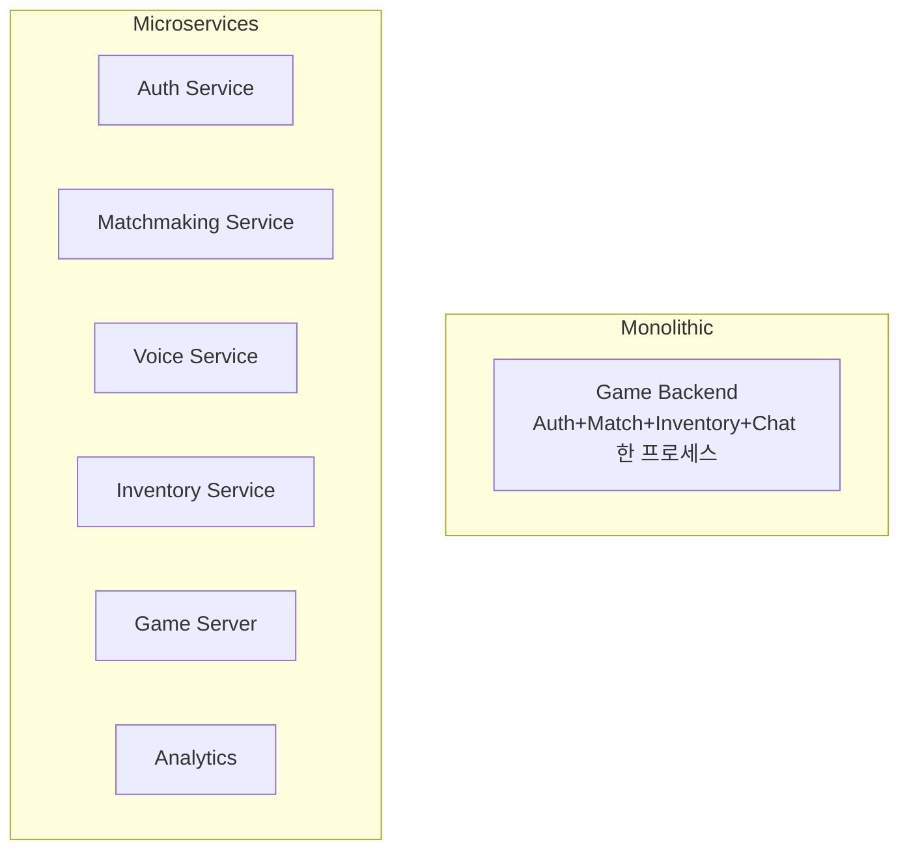
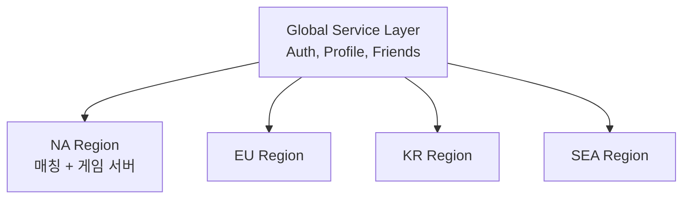
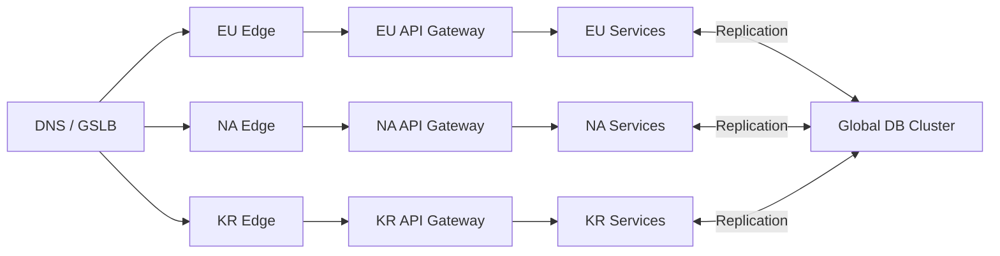
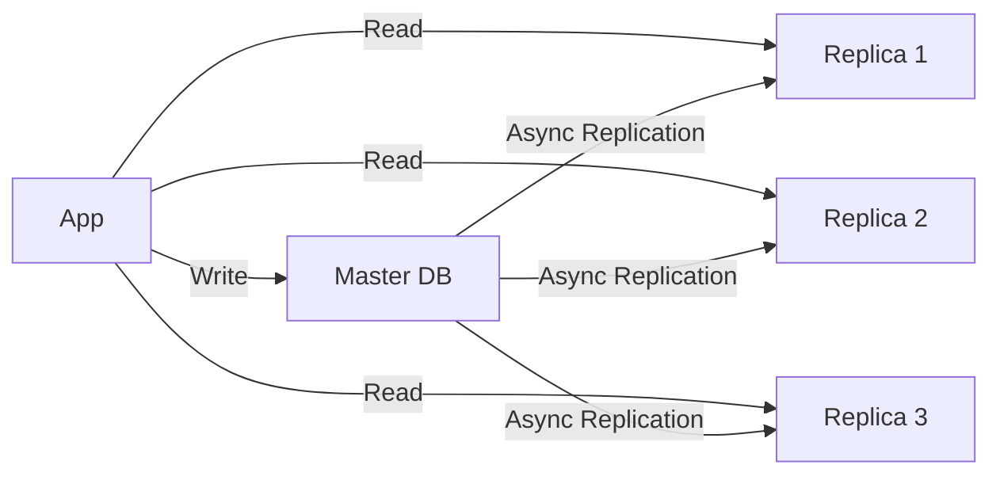
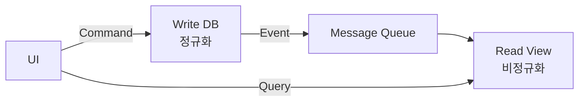
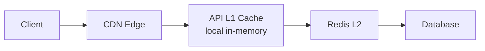
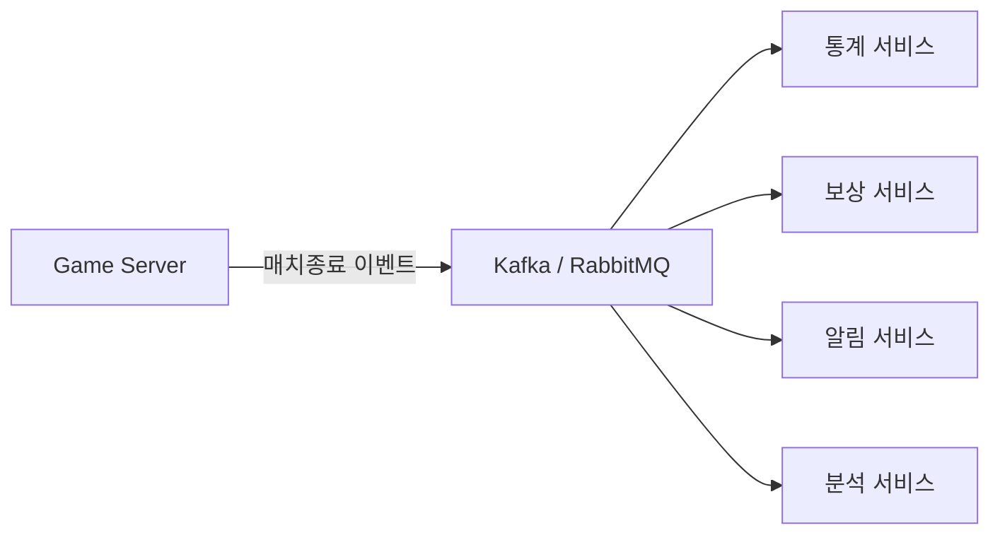
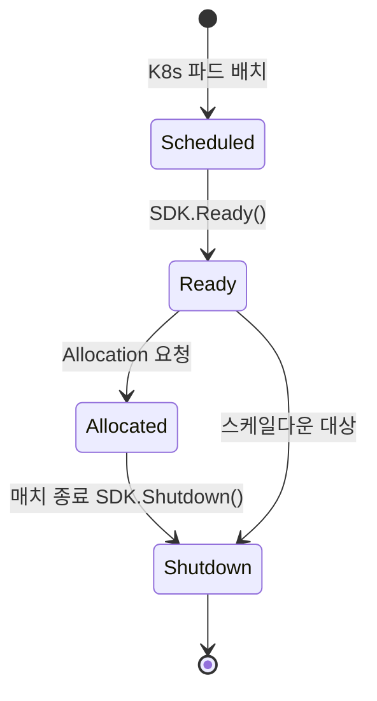
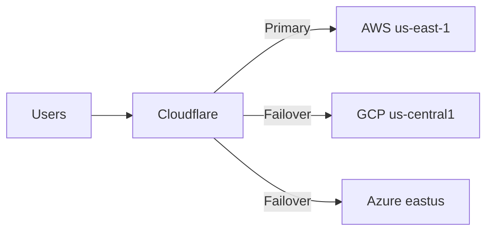

## 들어가며

대규모 동시접속의 *근본 트레이드오프* — *확장성 ↔ 비용*. *무제한 확장* 은 *클라우드 비용 폭증* — 작은 게임이 *AWS 청구서 한 줄로 망함*. *비용 절감* 만 추구하면 *피크 시간 서비스 다운* + *플레이어 이탈*. 이 둘 사이의 균형점은 *게임마다 다르고*, 한 번 정하면 끝이 아니라 *동접 곡선이 바뀔 때마다 다시 잡아야 하는 다이얼* 이다.

*Fortnite 라이브 이벤트 동시 1천만+ 명*, *Pokemon GO 출시 직후 추정 트래픽 수 배 초과*, *Among Us 수천 명 → 동시 수백만 (DAU 6천만+)* — 모두 *예측 못 한 폭증 + 인프라 한계* 의 이야기. 성공한 게임의 *공통 패턴* — *수평 확장 + 자동 스케일링 + 지역 분산 + 비용 최적화* 의 *조합*. 단일 거대 서버는 어디에도 없다.

한 매치 안의 네트워킹은 권위 서버, 클라이언트 예측, 상태 복제, 롤백 같은 문제를 다룬다. 이 글은 *그 매치 수십만 개를 동시에 띄우는 인프라* 다. 단위가 *패킷·tick* 에서 *인스턴스·리전·청구서* 로 올라간다. *수백만 동시 접속자* 를 지원하는 아키텍처와 *비용 효율* 의 균형을, *용량 계산·수치 트레이스·함정 케이스* 와 함께 정리한다.

여덟 단계.

1. 확장성 아키텍처 — 수평/수직 + 마이크로서비스.
2. 로드 밸런싱 — L4/L7 + GSLB.
3. 데이터베이스 확장 — Read Replica + 샤딩 + CQRS.
4. 캐싱 + 메시지 큐.
5. 게임 서버 관리 — K8s + Agones + 동적 프로비저닝.
6. 비용 최적화 — Reserved + Spot + Auto-scaling.
7. 피크 대응 — 대기열 + 우선순위 + 기능 플래그.
8. 모니터링 + 장애 대응.


---

## 목차
1. [확장성 아키텍처](#1-확장성-아키텍처)
2. [로드 밸런싱 전략](#2-로드-밸런싱-전략)
3. [데이터베이스 확장](#3-데이터베이스-확장)
4. [캐싱과 메시지 큐](#4-캐싱과-메시지-큐)
5. [게임 서버 관리](#5-게임-서버-관리)
6. [비용 최적화 전략](#6-비용-최적화-전략)
7. [피크 대응](#7-피크-대응)
8. [모니터링과 장애 대응](#8-모니터링과-장애-대응)


---

## 1. 확장성 아키텍처

### 용량 산정 — 동접에서 인스턴스로

설계 전에 *숫자를 못 박는다*. 목표 *동시 접속(CCU) 100만*, 매치당 *플레이어 10명*, 매치당 *게임 서버 인스턴스 1개*, 노드당 *인스턴스 40개*.

```text
동시 매치 수      = 1,000,000 / 10        = 100,000 매치
게임 서버 인스턴스 = 100,000               = 100,000 인스턴스
필요 노드 수      = 100,000 / 40           = 2,500 노드
+ 버퍼 20%        = 3,000 노드 (cold start 흡수)
```

여기에 *스테이트리스 백엔드* 가 붙는다 — Auth, Profile, Matchmaking, Voice. 백엔드 사이징은 *CCU 가 아니라 RPS* 로 한다. CCU 100만이 *평균 0.5 req/s* 를 만들면 *500,000 RPS*. 인스턴스당 *2,000 RPS* 처리면 *250 인스턴스*. *피크 RPS 는 평균의 3~5배* 로 잡는다 — 로그인 러시·이벤트 시작 순간이 평탄하지 않다.

핵심 — *모든 사이징은 CCU 하나로 끝나지 않는다*. 게임 서버는 *CCU/매치크기*, 백엔드는 *피크 RPS*, DB 는 *쓰기 QPS + 데이터 크기*, 캐시는 *작업 집합(working set) 크기* 로 따로 계산한다.

### 수평 vs 수직 확장

| 항목 | 수평 (Scale Out) | 수직 (Scale Up) |
|---|---|---|
| 방식 | 인스턴스 N 개 추가 | 한 인스턴스 사양 ↑ |
| 한계 | 거의 무제한 | 단일 머신 한계 |
| 비용 | 점진적 | 큰 점프 |
| 다운타임 | 없음 | 일반적으로 있음 |
| 상태 | 분산 어려움 | 단순 (한 곳) |
| 적용 | 게임 서버, 웹 API | DB 마스터, 인메모리 분석 |

현대 게임 인프라 — *기본은 수평*. 수직 확장은 *분산이 어려운 단일 지점* 에만 쓴다 — *DB 쓰기 마스터*, *큰 인메모리 그래프*. 수직은 *간단하지만 천장이 낮다* — 가장 큰 인스턴스에 닿으면 더 갈 곳이 없다. 그래서 *수직으로 버티는 컴포넌트는 결국 샤딩(수평)으로 넘어간다* (3절).

### 마이크로서비스 vs 모놀리식



| 항목 | 모놀리식 | 마이크로서비스 |
|---|---|---|
| 개발 단순성 | 높음 | 낮음 (배포 + 통신) |
| 확장 단위 | 전체 | 서비스별 독립 |
| 장애 격리 | 약함 (한 곳 깨지면 전체) | 강함 |
| 통신 비용 | 낮음 (in-process) | 큼 (네트워크 hop) |
| 디버깅 | 단순 (스택 추적) | 복잡 (분산 추적 필요) |
| 운영 복잡도 | 낮음 | 매우 높음 |

DAU는 architecture 경계를 결정하지 않는다. 같은 DAU라도 session 길이, 지역 수, write rate, team 구조와 availability 요구가 다르다. 독립 배포·확장이 필요한 workload, 분리된 failure domain과 명확한 데이터 소유권이 확인될 때 service를 나눈다. modular monolith가 그 요구를 만족하면 높은 DAU에서도 반드시 microservice로 전환할 이유는 없다.

함정 — *조기 분할*. 트래픽 패턴도 모르는 상태에서 서비스를 10개로 쪼개면 *네트워크 hop 지연 + 분산 트랜잭션 + 운영 부담* 이 이득을 잡아먹는다. 원칙 — *모놀리식으로 시작, 병목이 측정되는 경계를 따라 쪼갠다*. 경계는 *데이터 소유권* 으로 긋는다 — 한 서비스가 한 데이터 도메인을 소유.

### 스테이트풀 vs 스테이트리스

*스테이트리스* — 인스턴스에 *영속 상태 없음*. 어느 인스턴스가 처리해도 결과 동일 → 로드 밸런서가 *임의 분배*, 죽으면 *그냥 새로 띄움*.

*스테이트풀* — *세션/매치 상태가 메모리에*. *특정 인스턴스가 특정 사용자* 를 처리. 게임 서버가 대표.

| 서비스 | 종류 | 이유 | 죽으면 |
|---|---|---|---|
| Auth, Profile | 스테이트리스 | 모든 상태가 DB | 무손실 재시작 |
| Matchmaking | 외부화된 상태 | 큐가 Redis 에 | 큐 보존, 워커만 교체 |
| Game Server | 스테이트풀 | 매치가 메모리 | *매치 손실* |
| Voice (SFU) | 스테이트풀 | 채널이 메모리 | 통화 끊김 |

스테이트풀의 핵심 비용 — *죽으면 상태가 사라진다*. 그래서 게임 서버는 *세션 어피니티(같은 사용자 = 같은 인스턴스)* 와 *graceful shutdown* (5절) 이 필수다. 스테이트풀 컴포넌트를 *가능한 한 작게, 가능한 한 적게* 유지하고 나머지를 스테이트리스로 미는 것이 확장의 기본 방향이다.

### 지역별 샤딩



게임 매치와 음성은 지연에 민감하므로 참가자, party 정책과 capacity를 고려해 region을 선택한다. 전역 데이터(어카운트/프로필/친구)는 global ownership과 지역 cache를 조합할 수 있다. 여행자의 match를 계정 생성 지역에 고정하면 불필요한 RTT가 생길 수 있지만, 특정 수치 이상이면 모든 장르가 불가능하다고 단정하지 않는다.

### 글로벌 분산과 Active-Active



*Active-Active* — 모든 지역이 *읽기/쓰기 둘 다*. 장점 — *지역 장애 시 다른 지역이 흡수*. 비용 — *교차 리전 복제 지연(수십~수백 ms) + 쓰기 충돌*. 충돌 해결은 *Last-Write-Wins (단순, 데이터 손실 가능)* 또는 *CRDT (Conflict-free Replicated Data Type)* — 카운터·집합처럼 *수학적으로 병합 가능한 자료형* 만 무손실. 게임은 *전역 쓰기를 최소화* 해 충돌 표면을 줄인다 — 닉네임·결제처럼 강한 일관성이 필요한 것은 *단일 쓰기 리전(Active-Passive)* 으로 떨어뜨린다.

## 2. 로드 밸런싱 전략

### L4 (TCP/UDP) vs L7 (HTTP)

| 항목 | L4 | L7 |
|---|---|---|
| 프로토콜 | TCP / UDP | HTTP / gRPC |
| 처리량 | 매우 높음 | 보통 |
| 라우팅 기준 | IP / Port | URL / Header / Cookie |
| TLS 처리 | Pass-through | Termination |
| 패킷당 비용 | 낮음 | 높음 (페이로드 파싱) |
| 적용 | 게임 UDP 트래픽 | API 게이트웨이 |

게임 서버는 *L4 (UDP) + 세션 어피니티*. L7 은 *모든 패킷을 파싱* 하므로 *60Hz UDP 스트림에 부적합* — 매 패킷 HTTP 헤더 파싱 비용을 감당 못 한다. 단, 매치 접속은 보통 *직접 IP:포트* (Agones Allocation 이 IP 를 돌려줌, 5절) 라 게임 트래픽이 LB 를 우회하기도 한다. API/로비는 *L7* — URL·헤더 기반 라우팅, TLS termination, 인증 위임.

### 일관 해시(Consistent Hashing)와 어피니티

세션 어피니티를 *단순 모듈로* 로 구현하면 함정에 빠진다. 서버 N 개에 `hash % N` 으로 분배하다 한 대를 추가하면 *N → N+1* 로 거의 모든 키의 목적지가 바뀐다 — 세션 대량 이주.

```cpp
// 일관 해시 링 — 서버 추가/제거 시 1/N 키만 이동
struct HashRing {
    std::map<uint64_t, ServerId> ring;          // 정렬된 해시 위치 → 서버
    static constexpr int VNODES = 160;          // 서버당 가상 노드 (균등 분포)

    void Add(ServerId s) {
        for (int v = 0; v < VNODES; ++v)
            ring[Hash(s, v)] = s;                // 한 서버를 링에 160점 흩뿌림
    }
    ServerId Locate(SessionId sid) {
        uint64_t h = Hash(sid);
        auto it = ring.lower_bound(h);           // 시계방향 첫 서버
        if (it == ring.end()) it = ring.begin(); // 링 끝 → 처음으로 wrap
        return it->second;
    }
};
```

균등 hash와 동등 capacity라는 모델에서 서버 10대에 1대를 추가하면 modulo mapping은 약 10/11, consistent-hash ring은 기대 1/11의 key ownership이 바뀐다. virtual node는 ring 구간 합의 분산을 줄이지만 metadata와 이동 단위를 늘린다. Cassandra token과 일부 Memcached client가 이 계열을 사용한다. Redis Cluster는 고정 hash slot을 node에 할당하는 별도 방식이므로 classic consistent-hash ring과 동일시하지 않는다.

### 일관 해시의 정량 근거 — 이동량과 부하 균형

위 두 수치(91%·9%)는 휴리스틱이 아니라 유도된다. `VNODES = 160` 은 아래 $\mathrm{CV} \sim 1/\sqrt{V}$ 스케일링이 배경이지만 값 자체는 구현별 절충이다.

*모듈로의 이동 비율.* 키 $h$ 가 *제자리에 남으려면* $h \bmod N = h \bmod (N+1)$ 이어야 한다. 두 등식이 동시에 성립하면 $h$ 는 같은 잔여 $r(<N)$ 에 대해 $h \equiv r \pmod N$ 이고 $h \equiv r \pmod{N+1}$ 이다. $\gcd(N, N+1)=1$ 이므로 중국인 나머지 정리로 이는 $h \equiv r \pmod{N(N+1)}$ 과 동치다. 한 주기 $N(N+1)$ 안에서 이 조건을 만족하는 $h$ 는 $r = 0, 1, \dots, N-1$ 의 *정확히 $N$ 개* 뿐이다. 따라서 잔류 비율은

$$P_{\text{stay}} = \frac{N}{N(N+1)} = \frac{1}{N+1}, \qquad P_{\text{move}} = \frac{N}{N+1}.$$

$N=10$ 이면 $P_{\text{move}} = 10/11 \approx 90.9\%$ — 거의 모든 키가 이주한다. 노드 한 대 추가가 *전체 재배치* 를 부르는 것이 모듈로 샤딩의 본질적 결함이다.

*일관 해시의 이동 비율.* 서버 한 대(가상 노드 $V$ 개)를 $S$ 대 링에 추가하면, 새 서버의 $V$ 개 점이 가로채는 호의 키만 이동하고 *기존 서버 사이에는 재배치가 전혀 없다*. 모든 점이 위치상 교환 가능하므로 새 서버의 기대 점유율은 대칭성으로 $\frac{1}{S+1}$ 이고, 이것이 곧 이동 비율이다.

$$P_{\text{move}}^{\text{CH}} = \frac{1}{S+1}.$$

$S=10$ 이면 $1/11 \approx 9.1\%$ — 모듈로의 $N/(N+1)$ 과 정확히 뒤집힌 값이다. 이동량이 $O(1/S)$ 로 줄고, 이동 대상이 *새 서버로 들어오는 키* 에 국한된다는 점이 일관 해시의 핵심 보장이다.

*부하 균형과 가상 노드 수.* $S$ 개 서버가 각자 $V$ 개 가상 노드를 링에 균등 배치하면 링은 $k = SV$ 개 호로 쪼개진다. 한 서버의 부하는 자신의 $V$ 개 호 길이의 합이고 기댓값은 $1/S$ 다. 부하의 *상대 표준편차*(변동계수 CV)는 대략

$$\mathrm{CV} \sim \frac{1}{\sqrt{V}}$$

규모로 줄어든다($S$에 대한 보정항은 남는다). $V$를 늘리면 random ring placement의 분산은 줄지만 heterogeneous capacity, hot key와 correlated key는 이 모델 밖이다. `VNODES=160` 같은 값은 수학이 정한 보편 균형점이 아니라 특정 구현의 metadata·rebalance granularity·variance 절충이다. 실제 key distribution과 node weight로 simulation한 뒤 정한다.

### 헬스 체크와 Flapping 방지

```cpp
struct HealthCheck {
    int intervalMs        = 5000;
    int timeoutMs         = 1000;
    int unhealthyThreshold = 3;     // 3연속 실패 → 제외
    int healthyThreshold   = 2;     // 2연속 성공 → 복귀
};

void HealthCheckLoop(Server& srv) {
    bool ok = HttpGet(srv.healthEndpoint, /*timeoutMs*/ 1000);
    if (!ok) {
        srv.successRun = 0;
        if (++srv.failureRun >= 3) MarkUnhealthy(srv);   // 일시 튐에 흔들리지 않음
    } else {
        srv.failureRun = 0;
        if (++srv.successRun >= 2) MarkHealthy(srv);      // 복귀도 신중히
    }
}
```

임계를 *제외/복귀에 다르게(히스테리시스)* 두는 이유 — *flapping*. 단일 실패로 제외했다 단일 성공으로 복귀하면, 부하 경계에 걸린 서버가 *초당 수 회 라우팅에 들락날락* 하며 매번 세션을 흔든다. 비대칭 임계가 이 진동을 막는다.

함정 — *얕은(shallow) 헬스 체크*. `/health` 가 200 만 돌려주면 프로세스는 살아있지만 *DB 연결이 끊겨도 healthy* 로 보인다. *깊은(deep) 체크* 는 의존성(DB ping, 캐시 ping)까지 확인하되, *너무 깊으면 DB 장애가 전 서버를 동시에 unhealthy* 로 만들어 *연쇄 장애* 를 일으킨다. 절충 — *얕은 liveness(살아있나) + 깊은 readiness(트래픽 받을 준비됐나)* 를 분리한다.

### GSLB (Global Server Load Balancing)

DNS 레벨 글로벌 분산. *Route 53 / Cloudflare / Cloud DNS* 의 *latency-based / geolocation routing*.

```text
# Route 53 latency-based routing (의사 설정)
example.com →
  한국 사용자  → 서울 리전 IP
  미국 사용자  → 버지니아 리전 IP
  장애 시       → 헬스 체크 실패 리전 자동 제외
```

장점 — *자동 지역 라우팅 + 리전 장애 시 자동 페일오버*. 함정 — *DNS TTL 캐시*. TTL 60초로 설정해도 *일부 리졸버/브라우저는 TTL 을 무시하고 더 오래 캐시* 한다. 그래서 *DNS 페일오버는 즉각적이지 않다* — 죽은 리전으로 가는 트래픽이 *수 분간 남는다*. 진짜 빠른 페일오버가 필요하면 *Anycast IP* (BGP 레벨, DNS 캐시 무관) 를 쓴다.

## 3. 데이터베이스 확장

### Read Replica와 복제 지연

쓰기 = *마스터 1대* / 읽기 = *복제본 N대*. 게임은 *읽기 비중이 압도적* (프로필·통계·인벤토리 조회) 이라 효과가 크다.



비동기 replica는 replay가 primary commit보다 뒤처질 수 있다. lag는 정상 시의 작은 값부터 장애·backpressure 때의 긴 꼬리까지 분포하므로 고정 범위가 아니다. 플레이어가 아이템을 산 직후 stale replica를 읽으면 방금 산 항목이 보이지 않을 수 있다.

```cpp
// write 결과의 commit position을 session consistency token으로 보관한다.
ReadResult Read(PlayerId pid, Key k) {
    CommitPosition required = session[pid].lastWritePosition;

    if (ReplicaReplayedAtLeast(required))
        return ReplicaRead(k);

    return PrimaryRead(k);
}
```

시간이 충분히 지났다고 가정하는 sticky timer는 lag spike에서 read-your-writes를 보장하지 못한다. primary read, commit LSN/GTID 같은 position token, replica catch-up wait 또는 versioned cache 가운데 datastore가 제공하는 메커니즘을 사용한다. token을 매 요청마다 동기 조회하는 비용도 있으므로 session 단위 routing과 replica replay-position cache를 설계한다.

### 샤딩

읽기 복제는 *읽기* 만 분산한다. *쓰기 마스터의 천장* 에 닿으면 — *샤딩*. 데이터를 *N개 독립 DB* 에 분산하고, 키로 *어느 샤드인지* 결정.

```cpp
ShardId GetShardForPlayer(PlayerId pid) {
    return ring.Locate(pid);     // 2절의 일관 해시 링 재사용 (가상 노드 포함)
}
```

샤딩 전략.

| 전략 | 키 | 장점 | 함정 |
|---|---|---|---|
| Hash | player_id 의 hash | 균등 분포 | 범위 쿼리 불가, 리샤딩 비쌈 |
| Range | player_id 범위 | 범위 쿼리 가능 | 신규 가입이 한 샤드에 — *핫스팟* |
| Geographic | 지역 | 데이터 국지성 | 지역 인구 불균형 |
| Functional | 데이터 종류 | 격리·독립 확장 | 교차 도메인 조인 불가 |

함정 — *교차 샤드 쿼리*. "친구 목록 전체의 랭킹" 처럼 *여러 샤드에 걸친 조인* 은 *모든 샤드에 fan-out* 해야 해 느리고 비싸다. 그래서 *함께 조회되는 데이터는 같은 샤드 키* 로 둔다 — 길드원을 *길드 ID* 로 샤딩하면 길드 조회가 한 샤드에서 끝난다.

리샤딩(샤드 추가/제거)은 *가장 비싼 운영*. *일관 해시 + 가상 노드* 로 이동량을 1/N 로 줄여도, *온라인 마이그레이션(서비스 중단 없이)* 은 *복제 → 동기화 → 컷오버* 의 다단계다. 그래서 *처음부터 논리 샤드를 물리 샤드보다 많이* (예: 논리 1024개 → 물리 16대, 샤드당 64논리) 둬서, 증설 시 *논리 샤드 단위로 이주* 만 하게 설계한다.

### CQRS (Command Query Responsibility Segregation)

쓰기(Command)와 읽기(Query)의 *모델 자체를 분리*. 쓰기는 *정규화 DB*, 읽기는 *비정규화 뷰(Materialized View)*.



게임의 *리더보드/통계/분석* 에 적합. 예 — 매치 결과(쓰기)는 정규화 테이블에 들어가고, *이벤트* 로 흘러 *리더보드 뷰(이미 정렬된 Sorted Set)* 를 갱신. 조회는 그 뷰를 그대로 읽어 *조인·정렬 없이 즉시* 반환. 비용 — *읽기 모델이 eventual consistency* (쓰기 직후 잠깐 옛 값) 라, *순위가 몇 초 늦게 반영* 되는 것을 허용해야 한다. 리더보드엔 문제없지만 *결제 잔액엔 부적합*.

### NoSQL vs SQL

| 항목 | SQL (PostgreSQL/MySQL) | NoSQL (DynamoDB/Mongo/Cassandra) |
|---|---|---|
| 스키마 | 강제 | 유연 |
| 조인 | 강함 | 약함 (앱에서) |
| 트랜잭션 | ACID | 제한적 |
| 수평 확장 | 수동 샤딩 | 자동 파티셔닝 |
| 일관성 | Strong | Eventual (대부분) |

원칙 — *데이터 형태가 SQL/NoSQL 을 정한다*. *프로필/거래/결제* 는 *관계·트랜잭션·강한 일관성* 필요 → SQL. *매치 로그/이벤트 스트림/세션* 은 *쓰기 폭증·자동 샤딩* 필요 → NoSQL. 둘을 *혼용* 하는 것이 일반이다 — 한쪽을 억지로 모든 용도에 쓰면 어느 쪽이든 약점이 드러난다.

### Connection Pooling

DB 연결을 *매 요청마다 새로* 만들면 *TLS 핸드셰이크 + 인증* 비용이 크다. *풀에서 재사용*.

```cpp
class DBPool {
    std::queue<Connection*> idle_;
    std::mutex mtx_;
    std::condition_variable cv_;
    int maxSize_ = 100, live_ = 0;

    Connection* Acquire() {
        std::unique_lock<std::mutex> lk(mtx_);
        for (;;) {
            if (!idle_.empty()) { auto* c = idle_.front(); idle_.pop(); return c; }
            if (live_ < maxSize_) { ++live_; return CreateNewConnection(); }
            cv_.wait(lk);                      // 풀 고갈 — 반납을 기다린다 (무한 생성 금지)
        }
    }
    void Release(Connection* c) {
        { std::lock_guard<std::mutex> lk(mtx_); idle_.push(c); }
        cv_.notify_one();
    }
};
```

함정 — *연결 폭발(connection storm)*. 앱 인스턴스 *250대 × 풀 100* = *25,000 연결* 을 DB 마스터가 동시에 받으면 *DB 가 연결 관리만으로 죽는다*. 그래서 *PgBouncer / ProxySQL* 같은 *외부 풀러* 를 DB 앞에 둔다 — 앱은 풀러에, 풀러가 DB 에 *소수 연결* 만 유지(connection multiplexing). 무한 생성을 막는 위 코드의 `cv_.wait` 가 인스턴스 단위 방어, 외부 풀러가 클러스터 단위 방어다.

## 4. 캐싱과 메시지 큐

### 다층 캐시와 지연 예산



| 층 | 위치 | 대표 비용 | 용량 경향 | 무효화 난이도 |
|---|---|---|---|---|
| CDN | 전세계 edge | client↔edge 경로와 cache lookup | 정적 object에 크게 확장 가능 | 전세계 purge·TTL |
| In-memory | 앱 process | local lookup과 serialization | process memory에 제한 | instance별 coherence |
| Redis 계열 | 별도 cluster | network hop, queue, command | shard·replica로 확장 | 중앙 version·invalidation |
| DB | 영구 저장 | query plan, lock, buffer/cache, storage | storage engine에 의존 | 진실의 원천 |

cache lookup 비용을 $L_c$, miss 뒤 origin 추가 비용을 $L_o$, hit rate를 $h$라 하면 단순 serial cache-aside의 평균은 다음과 같다.

$$E[L] = L_c + (1-h)L_o$$

miss도 먼저 cache를 조회하므로 `h·Lc + (1-h)·Lo`로 쓰면 cache lookup 비용을 누락한다. 이 평균식만으로 tail latency, stampede와 invalidation 비용은 보이지 않는다. hit rate가 50%여도 origin 요청을 절반 줄일 수 있으므로 무용하다고 단정할 수 없고, key별 빈도·object 크기·miss penalty와 stale-data 비용을 함께 측정한다.

### Redis vs Memcached

| 항목 | Redis | Memcached |
|---|---|---|
| 자료구조 | 다양 (List, Set, Hash, Sorted Set) | Key-Value 만 |
| 영속성 | 옵션 (RDB / AOF) | 없음 |
| 클러스터 | 내장 (해시 슬롯) | 클라이언트 측 |
| 스레드 | 단일 (v6+ 멀티 IO) | 멀티 스레드 |
| 사용 | 매칭 큐, 리더보드, 세션 | 단순 캐시 |

게임에서 *Redis 우세* — *Sorted Set* 으로 MMR 정렬 큐·리더보드를 자료구조 하나로 구현. `ZADD board <mmr> <player>` 로 넣고 `ZRANGEBYSCORE` 로 *MMR 근처 상대* 를 O(log n) 에 뽑는다. Memcached 는 이걸 못 한다 — 앱이 전부 끌어와 정렬해야 한다.

### 캐시 무효화와 세 가지 함정

> There are only two hard things in Computer Science: cache invalidation and naming things. — Phil Karlton

패턴 — *TTL*, *Write-Through*, *Cache-Aside*, *Event-based*.

```cpp
void UpdatePlayerProfile(PlayerId pid, ProfileData data) {
    db.Update(pid, data);
    cache.Delete("profile:" + pid.str());        // 갱신 아닌 삭제 (다음 읽기에 재적재)
    pubsub.Publish("profile_changed", pid);       // 타 인스턴스 L1 캐시도 무효화
}
```

세 가지 운영 함정.

- *Thundering Herd* — 인기 키 하나가 만료되는 순간 *수천 요청이 동시에 DB 로*. 대응 — *재계산 중 lock(한 요청만 DB, 나머지는 대기)* 또는 *만료 직전 확률적 조기 갱신*.
- *Cache Stampede on cold start* — 캐시가 빈 채로 배포되면 첫 트래픽이 전부 DB 로. 대응 — *워밍업(미리 적재)* 후 트래픽 투입.
- *Stale-forever* — `Publish` 가 유실되면 일부 인스턴스가 *영원히 옛 값*. 대응 — *짧은 TTL 을 안전망* 으로 깔아 pub/sub 유실을 시간으로 덮는다.

`cache.Delete` 가 `cache.Set` 보다 안전한 이유 — *Set 은 경합 시 옛 값을 다시 쓸 수 있다* (느린 쓰기가 빠른 쓰기를 덮음). *삭제 후 다음 읽기에 재적재* 가 경합에 강하다.

### CDN과 패치 트래픽

정적 콘텐츠(클라이언트 패치, 텍스처, 사운드)를 *전세계 엣지에 캐시*.

| CDN | 특징 |
|---|---|
| CloudFront | AWS 통합 |
| Cloudflare | 무료 tier + DDoS 방어 |
| Akamai | 엔터프라이즈 규모 |
| Cloud CDN | GCP 통합 |
| Steam CDN | Valve 자체 (게임 배포) |

게임 *패치 배포* 가 *CDN 비용의 최대 항목*. 수치 — *1GB 패치 × 100만 유저 = 1PB egress*. 패치 당일 *수 시간 안에 몰리면* 대역폭 스파이크가 다른 모든 트래픽을 압도한다. 대응 — *바이너리 델타 패치(전체 1GB 가 아닌 변경분 수십 MB)*, *P2P 보조 배포*, *지역·시간대별 단계 롤아웃* 으로 스파이크를 평탄화.

### 메시지 큐 — 동기를 비동기로

매치 종료 후 *통계 갱신 → 보상 지급 → 알림 → 분석* 을 *동기로 처리하면* 매치 종료 응답이 그 합만큼 느려진다. *큐로 분리* 해 *게임 서버는 이벤트만 던지고 즉시 다음 매치로*.



큐는 *시간 결합(temporal coupling) 을 끊는다* — 보상 서비스가 잠깐 죽어도 이벤트는 큐에 남아 *복구 후 처리*. 게임 서버는 보상 서비스의 생사를 모른다.

### Kafka vs RabbitMQ

| 항목 | Kafka | RabbitMQ |
|---|---|---|
| 주 모델 | partitioned append log | brokered queue/exchange; stream도 지원 |
| 처리량 결정축 | partition 수, batch, replication, durability | queue type, ack, routing, persistence, consumer |
| 영속·재생 | retention 안에서 offset 기반 재독해 | queue는 ack 후 제거, stream은 retention 기반 재독해 |
| 순서 보장 | Partition 내 | Queue 내 |
| 재처리 | consumer offset 조정 | queue redelivery/DLQ 또는 stream offset |
| 적용 | 이벤트 스트림, 분석 | 작업 큐, RPC |

Kafka의 핵심은 retention된 partition log를 여러 consumer group이 독립 offset으로 읽는 모델이다. RabbitMQ의 classic/quorum queue는 작업 전달과 ack lifecycle에 잘 맞고 RabbitMQ Streams는 log형 재독해를 제공한다. 제품 이름만으로 처리량과 재처리 가능성을 판정하지 말고 ordering domain, retention, delivery semantics, durability와 운영 능력을 먼저 정한다. 어느 쪽이든 consumer 장애와 retry는 중복 실행을 만들 수 있으므로 경제·보상 side effect에는 idempotency key와 원자적 처리 기록이 필요하다.

### Backpressure와 멱등성

소비자가 *생산자 속도를 못 따라가면* 큐가 무한 증가 → *지연 폭증 + 메모리 부족*.

```cpp
void PublishEvent(Event e) {
    if (queue.Depth() > MAX_QUEUE_DEPTH) {
        if (e.priority < Priority::High) {
            metrics.Inc("event_dropped");
            return;                              // 저우선 이벤트 폐기 (load shedding)
        }
        // 고우선은 막지 않되, 알람으로 운영에 알림
    }
    queue.Push(e);
}
```

대응 — *소비자 수평 확장(파티션 추가)*, *생산자 속도 제한*, *저우선 이벤트 drop(load shedding)*. 분석 이벤트 1%를 버려도 통계는 무너지지 않지만 *보상 이벤트는 한 개도 못 버린다* — 우선순위 분리가 핵심.

함정 — *재시도가 만드는 중복*. 큐는 보통 *at-least-once* (최소 한 번, 즉 *중복 가능*) 전달이다. 보상 이벤트가 두 번 처리되면 *아이템 2배 지급*. 그래서 소비자는 *멱등(idempotent)* 해야 한다 — *이벤트 ID 를 키로 "이미 처리함"* 을 기록하고 중복을 무시.

```cpp
void HandleReward(const Event& e) {
    if (!processed.TryInsert(e.id)) return;      // 이미 처리한 이벤트 — 무시 (멱등)
    GrantReward(e.playerId, e.reward);
}
```

## 5. 게임 서버 관리

### Kubernetes + Agones

K8s — *컨테이너 오케스트레이션* 표준. 하지만 K8s 의 기본 워크로드(Deployment)는 *스테이트리스·교체 가능* 을 가정한다 — 게임 서버는 *스테이트풀·매치 단위 수명* 이라 안 맞는다. *Agones* 가 그 간극을 메운다 — *게임 서버 전용 K8s 확장* (Google + Ubisoft 협업).

```yaml
apiVersion: agones.dev/v1
kind: GameServer
spec:
  ports:
    - name: default
      portPolicy: Dynamic        # 노드에서 빈 포트 동적 할당 (한 노드에 여러 인스턴스)
      containerPort: 7777
      protocol: UDP
  template:
    spec:
      containers:
        - name: gameserver
          image: my-game:1.2.3
          resources:
            requests: { memory: 512Mi, cpu: 400m }
            limits:   { memory: 512Mi, cpu: "1" }
```

Agones 가 더하는 것 — *동적 포트 할당*(한 노드에 게임 서버 40개를 띄우려면 포트가 겹치면 안 됨), *Ready/Allocated 생명주기*(빈 서버 vs 매치 배정된 서버 구분), *SDK*(게임 코드가 자기 상태를 Agones 에 보고). 게임 프로세스는 부팅 후 `SDK.Ready` 를 호출해 *"매치 받을 준비됨"* 을 알린다.

### GameServer 생명주기



*Ready* — 빈 서버, 풀에서 대기. *Allocated* — 매치 배정됨, *스케일다운 대상에서 제외*. 이 구분이 핵심 — 오토스케일러가 풀을 줄일 때 *Ready 만 죽이고 Allocated(진행 중 매치)는 절대 안 건드린다*. 매치가 끝나면 게임 프로세스가 `SDK.Shutdown` 으로 자신을 정리 대상으로 표시한다.

### Fleet — 자동 풀 관리

```yaml
apiVersion: agones.dev/v1
kind: Fleet
spec:
  replicas: 100              # 항상 100개 Ready 유지
  scheduling: Packed         # 노드를 가능한 한 채워 빈 노드를 비움 (스케일다운 유리)
  strategy: { type: RollingUpdate }
  template:
    metadata: { labels: { game: shooter, region: na } }
    spec: { /* GameServer spec */ }
```

Fleet 이 *Ready 인스턴스 N개 항시 유지* + *Allocated 되면 자동 보충*. `scheduling: Packed` 는 *적은 노드에 빽빽이* — 빈 노드를 만들어 스케일다운 시 통째로 반납하기 좋다. 반대 모드 `Distributed` 는 *노드 장애 시 손실 분산* 을 노려 흩뿌린다 — *비용 vs 가용성* 다이얼.

### Allocation (할당)

```yaml
apiVersion: allocation.agones.dev/v1
kind: GameServerAllocation
spec:
  selectors:
    - matchLabels: { game: shooter, region: na }
```

매치메이커가 *Allocation 요청* → Agones 가 *Ready 인스턴스 하나를 Allocated 로 전환* + *그 IP:포트 반환*. 플레이어는 *그 주소로 직접 접속*(L4 LB 우회, 2절). 핵심 — *할당은 풀에서 꺼내는 O(1) 연산* 이라 *cold start(컨테이너 부팅 수 초)를 매치 시작 경로에서 제거*. 미리 데워둔 서버를 즉시 배정하는 것이 Fleet 의 존재 이유.

### Auto-Scaling — Buffer policy

```yaml
apiVersion: autoscaling.agones.dev/v1
kind: FleetAutoscaler
spec:
  fleetName: shooter-fleet
  policy:
    type: Buffer
    buffer:
      bufferSize: 20         # 항상 Ready 20개 여유
      minReplicas: 50
      maxReplicas: 1000
```

*Buffer policy* — *Ready 여유분 N개* 유지, 할당돼 줄면 새로 채움. 수치 트레이스 — Ready 20개 중 5개가 동시에 할당되면 Ready 가 15로 떨어지고, 오토스케일러가 *5개를 새로 부팅* 해 20으로 복원. *bufferSize 가 동시 매치 시작률(매치/초) × cold start 시간(초)* 보다 작으면 *플레이어가 빈 서버를 기다린다*. 피크 매치 시작률이 초당 10, 부팅이 3초면 *최소 버퍼 30* 이 필요하다. 버퍼가 클수록 대기 0 에 가깝지만 *Ready 서버는 매치 없이도 과금* — 안전과 비용의 다이얼.

### Graceful Shutdown

게임이 끝나거나 노드를 반납해도 *진행 중 매치를 끊으면 안 된다*. K8s 가 SIGTERM 을 보내고 `terminationGracePeriodSeconds` 동안 기다린다.

```cpp
void OnSIGTERM() {
    isShuttingDown_ = true;
    StopAcceptingNewMatches();                 // 새 할당 거부

    auto deadline = Now() + Minutes(5);
    while (HasActiveMatches() && Now() < deadline)   // 진행 매치 끝나길 대기
        Sleep(Seconds(5));

    DisconnectAll("Server shutting down");      // 데드라인 초과 시 강제 종료
    sdk.Shutdown();                             // Agones 에 정리 완료 보고
    exit(0);
}
```

K8s `terminationGracePeriodSeconds: 300` 으로 *5분 graceful* 을 준다. 함정 — *grace 가 매치 길이보다 짧으면* 막판에 매치가 강제 종료된다. 그래서 *grace ≥ 최대 매치 길이* 가 이상이지만, 30분 매치를 30분 grace 로 두면 *노드 반납이 30분 지연* 돼 비용이 샌다. 절충 — *새 매치만 막고 진행 매치는 자연 종료* 시키되, *Allocated 서버는 스케일다운에서 제외*(생명주기 절) 해 애초에 진행 중 매치가 종료 대상이 되지 않게 한다.

### 서버 밀도 최적화

한 노드(VM)에 *몇 개 게임 서버* 를 띄울지. *CPU/메모리/네트워크/PPS* 의 균형.

```text
# 범용 예시 — burstable T 계열은 실시간 게임 서버 기준값으로 쓰지 않는다.
# c6i.4xlarge (16 vCPU, 32GB) 에 40 인스턴스
#   - 인스턴스당 평균 0.4 vCPU, 800MB 메모리 예산
#   - 60Hz tick 기준 P95 tick time 이 8ms 이하인지 측정
# c6i.8xlarge (32 vCPU, 64GB) 에 80 인스턴스
#   - 같은 인스턴스당 예산, 네트워크 PPS·egress·allocator stall 동반 측정
```

밀도 ↑ = *비용 ↓* 그러나 *노이즈 이웃(noisy neighbor)* — 한 인스턴스의 GC/스파이크가 같은 노드의 다른 match tick을 밀어낸다. 최종 밀도는 instance 수가 아니라 tick-time distribution, deadline miss, CPU steal·run-queue delay, network PPS와 memory headroom으로 정한다. tick P99가 20ms라는 말은 관측 tick의 약 99%가 그 값 이하라는 뜻이지 “100명 중 한 명이 매초 끊긴다”는 사용자 확률이 아니다. 한 사용자가 경험하는 hitch는 tick miss의 시간 상관, match 배치와 client buffer에 달려 있다.

## 6. 비용 최적화 전략

### 클라우드 비용 분해

비용 비중은 게임 형태에 따라 달라진다. 대용량 patch·streaming은 CDN과 egress가, 높은 tick의 dedicated server는 compute가, 경제·분석 workload는 DB와 log storage가 지배할 수 있다. cloud billing export를 다음 단위로 태깅해 실제 cost driver를 찾는다.

| 비용 축 | 배부 기준 예 |
|---|---|
| game compute | region·fleet·build·allocated match-minute |
| stateless service | service·request class·CPU/memory hour |
| network | internet·cross-region·cross-zone·CDN byte |
| storage·DB | dataset·read/write·IOPS·backup·retention |
| observability | signal 종류·ingest byte·cardinality·retention |

최적화는 가장 큰 **실측** 비용과 품질 제약을 함께 본다. cross-region call은 latency뿐 아니라 egress charge를 만들 수 있고, 높은-cardinality telemetry가 game server보다 비싸지는 경우도 있다.

### Reserved Instance와 부하 곡선

*1~3년 약정* 으로 *On-Demand 대비 큰 할인*. *기본 부하(baseline)* 에만 적용. 실제 할인율·가격은 사업자·리전·세대·시점에 따라 다르다.

```text
부하 곡선을 3구간으로 나눈다:
  baseline (항상 켜짐, 24/7)        → 3년 Reserved (최대 할인)
  daily peak (저녁마다 예측 가능)    → 1년 Reserved 또는 Savings Plan
  spike (이벤트/바이럴, 예측 불가)   → On-Demand + Spot 혼합
```

핵심은 commitment utilization과 coverage를 따로 계산하는 것이다. baseline을 과대 추정하면 사용하지 못한 약정이 생기고, 과소 추정하면 on-demand 노출이 커진다. 얼마를 약정할지는 70~80% 관습값이 아니라 region·instance family별 부하 분위수, 성장 오차, 계약 유연성과 break-even 분석으로 정한다.

### Spot Instance

Spot·preemptible capacity는 가격과 interruption policy가 provider·region·시점에 따라 달라진다. batch 분석, build/CI, replay encoding처럼 checkpoint와 retry가 가능한 작업에 잘 맞는다. match server에 쓰려면 interruption notice가 match 종료보다 짧을 수 있음을 전제로 새 allocation 차단, checkpoint/migration 가능성, player impact budget과 on-demand fallback을 설계한다. 할인율이나 통보 시간을 영구 계약처럼 코드에 박지 않는다.

### Auto-Scaling 정책 — 비대칭 곡선

```yaml
apiVersion: autoscaling/v2
kind: HorizontalPodAutoscaler
spec:
  minReplicas: 100
  maxReplicas: 5000
  metrics:
    - type: Resource
      resource: { name: cpu, target: { type: Utilization, averageUtilization: 65 } }
  behavior:
    scaleUp:
      stabilizationWindowSeconds: 30        # 빠르게 (피크 놓치면 다운)
      policies: [{ type: Percent, value: 50, periodSeconds: 60 }]
    scaleDown:
      stabilizationWindowSeconds: 300       # 느리게 (성급한 축소 = 재확장)
      policies: [{ type: Percent, value: 10, periodSeconds: 60 }]
```

*확장은 빠르게, 축소는 느리게*. 이유 — *비대칭 비용*. 확장이 늦으면 *플레이어가 즉시 대기/끊김* (큰 손해), 축소가 늦으면 *몇 분 더 과금* (작은 손해). 함정 — *thrashing(요동)*. 임계 65%에서 확장 후 부하가 조금 떨어져 즉시 축소하면 *다시 65% → 다시 확장* 의 진동. `stabilizationWindow` 가 이 진동의 댐퍼다 — 축소 전 300초간 *그 사이 최대값* 을 보고 결정해 성급한 축소를 막는다.

대상 지표 함정 — *CPU 65%* 는 스테이트리스 백엔드엔 맞지만 *게임 서버엔 부적합*. 게임 서버는 *Allocated 비율(=Agones Buffer, 5절)* 로 스케일한다 — CPU 가 한가해도 *매치가 다 차면* 새 서버가 필요하다.

### Right-Sizing

월별 사용률 보고서로 *과대 프로비저닝* 을 잡는다.

```text
[리소스 사용률 보고]
- c5.xlarge × 200대, 평균 CPU 35%, P95 CPU 48%
- 권장: c5.large × 200대 (vCPU 절반) 또는 c5.xlarge × 130대
- 주의: P95 가 48% 이므로 절반으로 줄이면 피크에 96% — 헤드룸 확인 필요
- 예상 절감: 약 30~40% (헤드룸 확보 후 단계 적용)
```

함정 — *평균만 보고 줄이기*. 평균 35%라도 *P95/P99 가 높으면* 다운사이징 후 피크에 포화한다. *평균이 아닌 꼬리 분위수* 로 결정하고, *한 번에 절반이 아니라 단계적으로* 줄여 측정한다. *Compute Optimizer / Recommender* 가 자동 분석하되, *게임 워크로드 특성(피크 집중)* 은 사람이 검토한다.

### 시간대 기반 스케일링

```python
# 부하가 낮은 새벽엔 baseline 을 줄인다 (예약 스케일링)
def overnight_scaledown():
    h = datetime.now().hour
    if 2 <= h <= 6:
        scale_to(min_replicas=baseline_replicas // 2)   # 새벽 절반
    else:
        scale_to(min_replicas=baseline_replicas)
```

게임의 *주중/주말·시간대 패턴* 은 강한 주기성을 가진다 — 평일 새벽 4시 동접은 금요일 저녁의 *10분의 1* 일 수 있다. 이 곡선을 따라 *예약 스케일링* 하면 반응형 오토스케일러보다 *cold start 없이 미리* 맞춘다. 단, *예측이 빗나가면(새벽 이벤트)* 반응형 오토스케일러가 안전망으로 받쳐야 한다 — 둘은 함께 쓴다.

## 7. 피크 대응

### 예측 기반 사전 확장

*매주 금요일 저녁* 이 피크면 *30분 전부터 미리 확장*. 반응형 오토스케일러는 *부하가 온 뒤* 반응하므로 *cold start 만큼 늦는다* — 사전 확장이 그 지연을 없앤다.

```python
def scheduled_scale():
    now = datetime.now()
    if now.weekday() == 4 and now.hour == 19:        # 금요일 19시
        scale_to(replicas=baseline_replicas * 2)
    if now.weekday() == 4 and now.hour == 23:        # 23시 정상화
        scale_to(replicas=baseline_replicas)
```

ML 예측 — 과거 *동요일·동시간 부하* 로 *수일 전 예측* + 자동 확장. 그래도 *바이럴·이벤트* 는 못 맞춘다 — 사전 확장은 *예측 가능한 주기* 를 덮고, *예측 불가 폭증* 은 다음의 대기열이 받는다.

### 대기열 시스템

*인프라 한계 도달 시* — 신규 접속을 *대기열에 보관*. 들어온 만큼 내보낸다(*let-in rate = leave rate*). 이것이 *서비스 보호의 마지막 방어선* — 한계를 넘는 트래픽을 막지 못하면 *모두가 함께 죽는다*.

```cpp
class LoginQueue {
    std::atomic<int> active_{0};
    const int maxActive_ = 1'000'000;            // 측정된 안전 한계

    // 진입 시도 — 자리 있으면 즉시 입장, 없으면 대기 토큰 발급
    EnterResult TryEnter(UserId u) {
        int cur = active_.load();
        while (cur < maxActive_) {
            if (active_.compare_exchange_weak(cur, cur + 1))
                return EnterResult::Admitted;     // CAS 성공 — 자리 확보
        }
        return EnterResult::Queued{ IssueTicket(u) };  // 대기열 진입 (위치 추적용 티켓)
    }
    void OnUserLeft() {
        active_.fetch_sub(1);
        AdmitNextFromQueue();                     // 한 자리 나면 대기열 선두 입장
    }
};
```

위 코드의 함정 수정 — 원본의 `fetch_add` 후 초과 시 `fetch_sub` 패턴은 *경합 중 카운터가 일시 초과* 한다. *CAS 루프* 로 *한계를 절대 넘지 않게* 보장하는 것이 안전하다. *FFXIV / WoW* 의 대기열이 표준 — 점진 입장 후 *수 시간~수 일에 걸쳐 정상화*. 대기열은 *불편하지만 정직* 하다 — "지금 못 들어옴, N분 후" 가 *로그인 시도마다 실패* 보다 낫다.

### 기능 플래그(Feature Flag)

피크 시 *비핵심 기능을 끈다* — 인프라 부담을 *핵심(게임 플레이)에 몰아준다*.

```cpp
struct FeatureFlags {
    bool tradingEnabled      = true;
    bool chatEnabled         = true;
    bool replayUploadEnabled = true;
    bool socialFeed          = true;
};

void OnLoadLevel(LoadLevel lvl) {
    switch (lvl) {
        case LoadLevel::Critical:
            flags.replayUploadEnabled = false;   // 가장 먼저 끈다 (무거움, 비핵심)
            flags.socialFeed = false;
            [[fallthrough]];
        case LoadLevel::High:
            flags.tradingEnabled = false;        // 거래소 (DB 쓰기 무거움)
            break;
        default: break;                          // 게임 플레이·채팅은 끝까지 유지
    }
}
```

핵심 — *런타임 토글*. 배포 없이 *즉시 켜고 끈다*. 부하 단계(High/Critical)에 따라 *끄는 순서를 미리 정의* 해, 장애 한복판에 즉흥 결정을 안 하게 한다. 기능 플래그는 *카나리(8절)와도 한 몸* — 새 기능을 플래그 뒤에 숨겨 *문제 시 코드 롤백 없이 플래그만 끈다*.

### 우선순위 기반 접속

자리가 부족할 때 *결제·복귀 약속 사용자* 를 우선.

```cpp
enum class UserPriority { Normal, Premium, VIP };

bool TryConnect(UserId u, UserPriority p) {
    int cur = currentUsers.load(), cap = capacity;
    int normalCap = static_cast<int>(cap * 0.98);  // 상위 2%는 예약분
    if (cur < normalCap) return true;            // 여유 — 누구나 입장
    // 포화 — 상위 등급에 소량의 예약 슬롯만 허용 (전부는 아님)
    if (p >= UserPriority::Premium && cur < cap) return true;
    return false;
}
```

논란 — *평등성*. 무료 사용자가 *영원히 대기* 하면 이탈한다. 그래서 *예약 슬롯은 소량(여기선 2%)* 으로 제한하고, *정책을 명시·공지* 한다. 우선순위는 *대기열을 없애는 게 아니라 대기열 안에서 가중치* 를 주는 것에 가깝다 — 무료 사용자도 *느리지만 결국 입장* 해야 한다.

### 비상 용량 — 멀티 클라우드



*Active-Active* — 평소에도 둘 다 활성, *한쪽이 죽어도 무중단*. *Active-Passive* — 한쪽은 대기, 페일오버 시 *cold start 지연*. Active-Active 가 *비용 ↑ 안전성 ↑*. 함정 — *멀티 클라우드의 숨은 비용*. 클라우드 간 *데이터 동기화 egress*, *서로 다른 매니지드 서비스(각자 다른 Redis/큐)의 운영 부담*, *최소 공통분모로 맞춰야 하는 아키텍처*. 대부분의 게임은 *단일 클라우드 + 멀티 리전* 으로 충분하고, 멀티 클라우드는 *계약상 필수이거나 한 클라우드 의존이 사업 위험* 일 때만 간다.

## 8. 모니터링과 장애 대응

### Golden Signals

Google SRE 의 4가지 핵심. *수백 개 지표를 다 보지 말고 이 4개부터*.

| 지표 | 의미 | 게임 백엔드 예시 목표 |
|---|---|---|
| Latency | 응답 시간 | API·match별 SLO와 deadline miss |
| Traffic | 처리량 | RPS, 동시 매치 수 |
| Errors | 오류율 | status·timeout·semantic failure별 error budget |
| Saturation | 자원 포화도 | CPU run queue, memory pressure, connection·Ready capacity |

평균은 긴 tail을 숨길 수 있으므로 latency histogram과 percentile, SLO 위반률을 본다. P99=2초는 표본의 약 99%가 2초 이하라는 뜻이며 정확히 1%의 사용자나 동시 사용자 1%가 2초를 기다린다는 뜻이 아니다. 성공 요청 latency와 실패 latency를 분리하되 error rate와 timeout을 같은 dashboard에서 함께 본다. 빠른 실패를 성공 latency에서 제외한 채 error signal도 보지 않으면 시스템이 빨라진 것처럼 보이는 오류가 생긴다.

### 분산 추적

요청 하나가 *여러 마이크로서비스를 거치면* — 어디서 느려졌는지 스택 추적으로 안 보인다. *trace ID 를 hop 마다 전파* 해 전체 경로를 잇는다.

```text
[Trace ID: abc123]   총 70ms
├─ Gateway          5ms
├─ Auth Service     12ms
├─ Profile Service  45ms  ← bottleneck (DB 복제 지연?)
└─ Inventory        8ms
```

도구 — *Jaeger, Zipkin, X-Ray, Cloud Trace*. *OpenTelemetry* 가 벤더 중립 표준 SDK.

```cpp
auto span = tracer->StartSpan("ProfileLookup");
span->SetAttribute("player.id", playerId);       // 쿼리에 컨텍스트 부착
auto profile = db.GetProfile(playerId);
span->End();                                      // 부모 span 에 자동 연결
```

함정 — *추적 비용*. 모든 요청을 추적하면 *추적 데이터가 본 트래픽만큼* 쏟아진다. *샘플링* 한다 — 정상 요청은 *1%만*, *에러·느린 요청(tail-based sampling)은 100%* 잡아, 문제 있는 trace 를 놓치지 않으면서 비용을 줄인다.

### 알람 체계

| 우선순위 | 응답 | 예 |
|---|---|---|
| P0 (Critical) | 즉시 (페이지) | 서비스 다운, 대규모 오류, 결제 실패 |
| P1 (High) | 15분 | 일부 지역 장애, 큰 성능 저하 |
| P2 (Medium) | 1시간 | DB slow query, 일부 인스턴스 실패 |
| P3 (Low) | 다음 영업일 | 비용 이상, 비핵심 metric |

*PagerDuty / Opsgenie* 의 *on-call 로테이션*. 함정 — *알람 피로(alert fatigue)*. P2·P3 가 한밤중에 페이지를 울리면 *진짜 P0 를 무시* 하게 된다. *증상(사용자 영향)에 알람, 원인(개별 인스턴스)에는 대시보드*. "CPU 90%" 가 아니라 "*에러율이 SLO 를 넘음*" 에 페이지를 건다 — 자원이 포화해도 *사용자가 멀쩡하면 P0 가 아니다*.

### 카나리 배포

새 버전을 *전체의 1%* 에게만 먼저 → 정상이면 *5% → 25% → 100%*.

```yaml
apiVersion: argoproj.io/v1alpha1
kind: Rollout
spec:
  strategy:
    canary:
      steps:
        - setWeight: 1
        - pause: { duration: 10m }
        - analysis: { templates: [{ templateName: error-rate }] }  # 자동 분석
        - setWeight: 5
        - pause: { duration: 30m }
        - setWeight: 25
        - pause: { duration: 1h }
        - setWeight: 100
```

각 단계에서 *카나리 vs 기존 버전의 에러율·지연 비교*. 카나리가 나쁘면 *자동 롤백*. 핵심 — *blast radius(폭발 반경) 제한*. 버그가 있어도 *1% 만 영향*, 99% 는 안전. 함정 — *느린 누수 버그*. 메모리 누수·커넥션 누수는 *10분 카나리로 안 잡힌다* — 그래서 단계마다 *충분한 pause* 와 *Saturation 추세* 를 함께 본다.

### Blue-Green과 스테이트풀의 한계

*Blue(운영) / Green(신규)* 두 환경 — Green 배포·검증 후 *트래픽을 Green 으로 전환*, 문제 시 *Blue 로 즉시 복귀*. 장점 — *제로 다운타임 + 즉각 롤백*. 단점 — *인프라 2배 비용*.

게임 서버는 *Blue-Green 이 어렵다* — *스테이트풀*. Green 으로 트래픽을 돌려도 *Blue 의 진행 중 매치를 끊을 수 없다*. 그래서 게임 서버는 *Fleet 의 RollingUpdate(5절) + 카나리* 를 쓴다 — 새 버전 Fleet 을 띄워 *새 매치만 신버전으로 보내고*, 구버전 Fleet 은 *진행 매치가 자연 종료될 때까지 유지(drain)* 한다. 스테이트리스 백엔드(Auth/Profile)는 Blue-Green 이 쉽다 — 둘의 배포 전략이 다른 이유가 스테이트풀 여부다.

### 포스트모텀(Postmortem)

장애 후 *원인 분석 + 재발 방지*. *비난 없는(Blameless)* 문화 — *사람이 아니라 시스템·프로세스* 를 고친다. 사람을 비난하면 *다음엔 장애를 숨긴다*.

```text
[Postmortem — 신규 패치 출시 후 30분 다운]
- 영향: 동시 100만 명이 30분간 접속 불가, 추정 매출 손실 X
- 타임라인:
  19:00 배포 시작 (카나리 없이 전체 — 1차 실수)
  19:02 알람 발동 (에러율 급증, 탐지 좋음)
  19:08 원인 파악: 신규 쿼리의 인덱스 누락 → 쿼리 1000배 느려짐
  19:30 인덱스 추가 후 복구
- 근본 원인(5 Whys): 인덱스 누락 → 리뷰가 못 잡음 → 스키마 변경 자동 검증 없음
- 재발 방지(담당자·기한 명시):
  1. 신규 쿼리는 staging 부하 테스트 필수 (담당 A, 6/30)
  2. 스키마 변경은 migration tool 강제 (담당 B, 7/15)
  3. 카나리 단계에 DB 쿼리 시간 자동 검증 추가 (담당 C, 7/15)
```

핵심 — *행동 항목에 담당자·기한*. 담당 없는 항목은 안 고쳐진다. *5 Whys* 로 *증상이 아닌 근본 원인* 까지 파고든다 — "인덱스가 없었다"가 아니라 "*왜 없는 걸 못 잡았나*"가 진짜 원인. *24시간 내 작성 + 전 팀 공유 + 항목 추적*. *Etsy, Google, Netflix* 의 표준 관행.

### 카오스 엔지니어링

*인위적 장애 주입 + 복원력 검증*. Netflix 의 *Chaos Monkey* — 운영 중 *랜덤 인스턴스 종료*.

```python
def chaos_action():
    # 업무 시간에만, 낮은 확률로, 스테이트리스 풀에 한정
    if not is_business_hours(): return
    pool = [i for i in running_instances if i.is_stateless]   # 매치 중 서버 제외
    if pool and random.random() < 0.001:
        terminate(random.choice(pool))
```

핵심 안전장치 — *업무 시간 한정(대응 가능할 때)*, *스테이트풀 제외(진행 매치 보호)*, *낮은 확률(blast radius 제한)*. 목적은 *장애를 일으키는 게 아니라 "인스턴스 하나 죽어도 무중단" 가설을 검증* 하는 것. *Game Day* — 의도적 대규모 장애 시뮬레이션으로 *팀의 대응 절차(runbook)* 를 평시에 훈련한다. 진짜 장애 때 처음 해보는 일이 없게 한다.


---

## 결론

이 구조는 *확장성 - 비용의 트레이드오프* 위에 *수백만 동시 접속자를 지원하는 인프라* 의 전체 구성요소를 정리한다. 용량 산정(CCU → 인스턴스/RPS) → 수평 확장 + 마이크로서비스 → L4/L7 + GSLB → Read Replica/샤딩/CQRS → 다층 캐시 + Kafka/RabbitMQ → K8s/Agones Fleet → Reserved/Spot/오토스케일 → 대기열/기능 플래그 → Golden Signals/분산 추적/카나리/포스트모텀이 한 흐름으로 묶인다.

대규모 인프라의 기술 부품은 널리 재사용되지만 조합·튜닝·운영은 게임의 workload에 맞춰야 한다. 게임 서버는 allocated capacity와 tick deadline miss를 함께 보고, cache는 hit rate뿐 아니라 miss penalty·staleness·stampede를 보고, queue consumer는 중복과 순서 계약을 명시한다. 데이터 기반 측정과 점진적 진화 없이 남의 topology를 복사하면 workload 차이에서 무너진다.

비용은 기술적 결정의 제약이다. baseline commitment, elastic capacity, interruptible worker, right-sizing과 load shedding의 효과는 현재 bill과 품질 지표로 검증한다. 특정 조합이 매년 고정 비율을 절감한다고 일반화할 수 없다. match server·lobby·voice·DB·cache·queue·fleet·관측은 각각 다른 확장 한계를 가지므로 병목과 cost allocation을 함께 놓고 결정한다.

## 더 읽을거리

- [Agones 공식 문서](https://agones.dev/site/) — Kubernetes 위 전용 게임 서버 Fleet 관리의 표준 오픈소스.
- Paul Bettner, Mark Terrano, ["1500 Archers on a 28.8: Network Programming in Age of Empires and Beyond"](https://www.gamedeveloper.com/programming/1500-archers-on-a-28-8-network-programming-in-age-of-empires-and-beyond) (GDC 2001) — 제약에서 출발하는 확장 설계의 고전.
- Google, [Site Reliability Engineering](https://sre.google/sre-book/table-of-contents/) — Golden Signals·에러 버짓·포스트모텀의 원전(무료 공개).
- Martin Kleppmann, *Designing Data-Intensive Applications* (O'Reilly, 2017) — 샤딩·복제·스트림 처리의 체계적 기초.
- David Karger, Eric Lehman, Tom Leighton, Matthew Levine, Daniel Lewin, Rina Panigrahy, ["Consistent Hashing and Random Trees: Distributed Caching Protocols for Relieving Hot Spots on the World Wide Web"](https://dl.acm.org/doi/10.1145/258533.258660) (STOC 1997) — 일관 해시의 원전. 가상 노드(virtual copies)로 부하 균형을 잡는 spread·load 정리의 출처.
