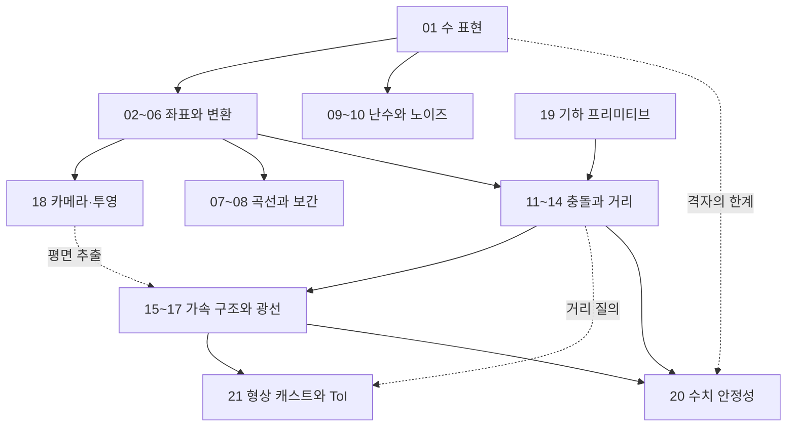

# 수학 시리즈 지도

`math/`는 게임에서 쓰는 공식을 모아 둔 참조표가 아니다. 각 편은 *하나의 계산이 어떤 전제 위에서 성립하고 그 전제가 깨질 때 무엇이 먼저 무너지는가* 를 소유한다. 같은 내적 한 줄이라도 시야 판정에서는 부호가, 정규화에서는 분모가, 충돌 축 투영에서는 축의 퇴화가 실패 조건이다. 이 축이 다루는 것은 그 실패 조건이다.

21편은 네 층으로 쌓인다. *수의 표현* 이 바닥이고, 그 위에 *좌표와 변환* 이, 그 위에 *시간과 확률에 따라 값을 만드는 도구* 가, 다시 그 위에 *기하 질의와 그것을 감당하는 가속 구조* 가 올라간다. 20이 이 전부를 장기 누적이라는 하나의 실패 조건으로 다시 묶는다.

## 읽는 순서

파일 번호는 대체로 읽는 순서와 같다. 다만 *네 곳* 은 번호와 전제가 어긋난다.

- **19 기하 프리미티브는 번호가 마지막이지만 전제는 앞이다.** 평면의 표현과 부호 관례, 점-평면·점-직선 거리, 무게중심 좌표는 11~18이 이미 쓰는 도구다. 특히 `Plane` 의 부호 관례($\hat{n}\cdot\vec{p}=d$)를 19의 1절에서 확정하고 들어가지 않으면 14·15·17·18의 코드가 전부 반대 부호로 읽힌다. 11로 들어가기 전에 19의 1~5절을 먼저 보는 편이 낫다. 6~8절(convex hull·triangulation·Voronoi)은 뒤로 미뤄도 된다. 다만 19를 쪼개 앞으로 옮기지는 않았다 — 5절의 무게중심과 `PointInTriangle` 이 7절 ear clipping의 재료라서, 앞부분만 떼면 6~8절이 전제를 잃거나 같은 정의를 다시 세우게 된다.
- **18 카메라와 투영은 06 좌표계의 직접 심화다.** 06을 읽은 직후에 읽어도 흐름이 끊기지 않는다. 그 사이의 07~17을 먼저 읽어야 할 이유는 없다.
- **20 수치 안정성은 01의 짝이다.** 마지막에 읽되 01을 다시 펴 놓고 읽는 것을 전제한다. 두 편은 같은 격자를 각각 *표현* 과 *누적* 의 관점에서 본다.
- **21 형상 캐스트는 번호가 마지막이지만 자리는 17 다음이다.** 광선 교차의 일반화이고 13의 지원 함수·거리 질의를 원시 연산으로 쓴다. 따라서 전제는 13과 17이며 20보다 앞에 온다. 번호를 20 앞으로 당기지 않은 것은 15~20의 번호와 `diagrams/` 파일 이름, 검수 기록이 인용하는 번호가 함께 어긋나기 때문이다 — 그 기록을 지금 번호로 고쳐 쓰면 검수 시점의 사실이 아니게 된다.

나머지 묶음 안에서는 번호 순서가 곧 전제 순서다. 특히 11 → 12 → 13은 뒤로 갈수록 앞 편의 한계를 동기로 삼고, 15 → 16 → 17 → 21도 같은 방식으로 이어진다.

| 묶음 | # | 문서 | 소유하는 모델 |
|---|---|---|---|
| 수의 토대 | 01 | [수 표현](part01_number_representation.md) | IEEE 754 격자, ULP, 반올림과 FMA, 고정소수점, 비트 트릭 |
| 좌표와 변환 | 02 | [벡터](part02_vectors.md) | 내적·외적의 기하 해석, 안전한 정규화, 투영·반사·슬라이딩 분해 |
| 좌표와 변환 | 03 | [행렬](part03_matrices.md) | 기저 변환, 동차 좌표, TRS 합성과 역, 법선 역전치, 메모리 레이아웃 |
| 좌표와 변환 | 04 | [회전 표현](part04_rotation_representations.md) | 네 표현의 트레이드오프, 짐벌락, 표현 사이 변환의 안정성 |
| 좌표와 변환 | 05 | [쿼터니언](part05_quaternions.md) | 쿼터니언 대수, $qpq^{-1}$ 유도, 측지선과 Slerp, 정규화 정책 |
| 좌표와 변환 | 06 | [좌표계](part06_coordinate_systems.md) | 좌표계 위계, 뷰 행렬의 역 구조, 핸드니스와 축 매핑, MVP 캐싱 |
| 좌표와 변환 | 18 | [카메라와 투영](part18_camera_projection.md) | 투영 행렬 유도(대칭·비대칭), 깊이 정밀도 분포, reverse-Z, 깊이 관례별 frustum 평면 추출 |
| 곡선과 보간 | 07 | [보간](part07_interpolation.md) | 연속성 등급, Hermite·Bezier·Catmull-Rom, easing과 체감 |
| 곡선과 보간 | 08 | [스플라인](part08_splines.md) | 지역 제어와 기저 함수, Cox-de Boor, 호 길이 매개화, 프레네 프레임 |
| 난수와 노이즈 | 09 | [난수와 분포](part09_random_and_noise.md) | PRNG 평가 축, 분포 샘플링의 편향, 시드 위계와 재현성 |
| 난수와 노이즈 | 10 | [절차적 노이즈](part10_procedural_noise.md) | 격자 노이즈의 진화, FBM과 domain warp, GPU 평가 트레이드오프 |
| 충돌과 거리 | 11 | [충돌 프리미티브](part11_collision_primitives.md) | 네 기본 도형, 쌍별 교차와 침투 깊이, closest point 함수군 |
| 충돌과 거리 | 12 | [SAT](part12_collision_sat.md) | 분리축 정리, 축 후보와 투영, MTV, 비볼록 처리의 한계 |
| 충돌과 거리 | 13 | [GJK와 EPA](part13_collision_gjk_epa.md) | Minkowski 차, 지원 함수 추상, 심플렉스 진화, 폴리토프 확장 |
| 충돌과 거리 | 14 | [거리 장](part14_distance_fields.md) | SDF와 Eikonal 조건, 합성과 smin, ray marching, mesh 베이킹 |
| 가속과 광선 | 15 | [공간 분할](part15_spatial_partitioning.md) | 그리드·트리 계열의 비용 모델, 동적 갱신 전략, 받은 평면으로 하는 컬링 질의 |
| 가속과 광선 | 16 | [BVH](part16_bvh.md) | 볼륨 선택, SAH와 LBVH 빌드, refit·rebuild, 트리 트래버설 |
| 가속과 광선 | 17 | [레이캐스팅](part17_raycasting.md) | 광선-도형 교차 닫힌 형태, 퇴화 방향, self-intersection 방어 |
| 가속과 광선 | 21 | [형상 캐스트와 ToI](part21_sweep_and_toi.md) | 터널링의 임계 조건, Minkowski 차 위의 광선 환원, conservative advancement의 수렴과 그 전제, ToI의 종료 밴드와 정밀도 |
| 기하 도구 | 19 | [기하 프리미티브](part19_geometry_primitives.md) | 평면·직선 표현과 부호 관례, 거리와 면적, 무게중심, hull·triangulation·Voronoi |
| 마무리 | 20 | [수치 안정성](part20_numerical_stability.md) | 오차의 종류와 누적, 보상 합산, 거대 좌표, 시간과 정규화 정책 |

### 역할별 경로

전부를 같은 깊이로 읽을 필요는 없다. 맡은 일에 따라 *먼저 닫아야 할 편* 이 다르다.

| 하는 일 | 먼저 | 그 다음 |
|---|---|---|
| 게임플레이·캐릭터 로직 | 01 · 02 · 03 · 11 | 04 · 07 · 21 · 20 |
| 렌더링·카메라 | 02 · 03 · 06 · 18 | 19(1~5절) · 16 · 17 |
| 물리·충돌 | 11 · 12 · 13 · 15 | 16 · 17 · 21 · 19 · 20 |
| 애니메이션 | 04 · 05 · 07 | 08 · 20(7절) |
| 절차적 생성 | 09 · 10 | 19(6~8절) · 08 |
| 도구·에디터 | 07 · 08 · 19 | 03 · 06 |

## 개념 소유권 지도

소유 문서는 정의·유도·불변식·실패 조건을 깊게 설명하고, 적용 문서는 필요한 전제만 짧게 적고 그 도메인 고유의 결정만 설명한다. 같은 식이 여러 편에 등장한다는 사실 자체는 중복이 아니다. *같은 정의와 유도를 반복하면* 중복이고, *소유 문서의 모델을 다른 실패 조건에 적용하면* 필요한 재사용이다.

### 소유가 분명한 개념

| 개념 | 소유 편 | 소유 근거 |
|---|---|---|
| 부동소수점 격자·ULP·특수값·반올림 모드·FMA | 01 | 비트 레이아웃에서 정밀도 분포를 직접 유도하는 유일한 편 |
| 부동소수점 비교 계약(절대·상대·ULP) | 01 | ULP 정의 바로 다음에 세 방식의 적용 조건과 한계를 함께 제시 |
| NaN의 의미와 전파·트랩 | 01 | 특수값 표현의 연장선이고 트랩 설정까지 닫는다 |
| 고정소수점 Q-format과 결정론적 시뮬레이션 | 01 | 균일 정밀도라는 다른 격자를 부동소수점과 대조해 소유 |
| 내적·외적의 기하 해석, 안전한 정규화, 반사·슬라이딩 분해 | 02 | 다섯 분해 패턴을 한곳에서 유도하고 나머지 편이 이를 재료로 쓴다 |
| 기저 변환·동차 좌표·TRS 합성과 닫힌 형태 역 | 03 | 행렬을 기저의 목적지 표로 보는 직관에서 모든 변환을 유도 |
| 법선 변환과 역전치 행렬 | 03 | 비균일 스케일에서 접선 외적으로 증명 스케치까지 제시 |
| 회전 행렬의 직교성 회복 | 03 | 직교 행렬의 성질을 소유하는 편이고 Gram-Schmidt 절차를 포함 |
| 네 회전 표현의 트레이드오프·짐벌락·표현 간 변환 | 04 | 비교가 이 편의 존재 이유이며 Shepperd 분기까지 다룬다 |
| 쿼터니언 대수·회전 공식 유도·지수/로그·Slerp의 미분 | 05 | 반각이 왜 등장하는지를 단계별로 유도하는 유일한 편 |
| 쿼터니언 단위성 drift와 정규화 빈도 정책 | 05 | drift 속도를 정량화하고 세 정책의 계측 기준을 제시 |
| 좌표계 위계·뷰 행렬·핸드니스·Y-up/Z-up·LookAt | 06 | 축 매핑과 임포트 관례 충돌을 다루는 유일한 편 |
| 투영 행렬 유도·FOV·깊이 정밀도·reverse-Z·무한 far | 18 | 닮은꼴 삼각형에서 행렬 각 행을 직접 세우고 정밀도 분포로 잇는다 |
| 연속성 등급·Hermite·Bezier·Catmull-Rom·easing | 07 | 키 사이 국소 보간의 기저 함수와 체감의 연결을 소유 |
| B-spline·Cox-de Boor·NURBS·subdivision·곡률·프레네 프레임 | 08 | 전역 곡선 정의와 지역 제어의 메커니즘을 소유 |
| PRNG 평가 축·분포 샘플링·modulo bias·시드 위계 | 09 | 재현성 계약과 통계 품질을 함께 다루는 유일한 편 |
| 격자 노이즈(Value·Perlin·Simplex)·FBM·domain warp | 10 | 격자 아티팩트라는 실패 조건에서 세 노이즈의 진화를 유도 |
| 기본 도형 표현·쌍별 교차·침투 깊이·closest point 함수군 | 11 | closest point를 모든 충돌의 토대로 놓고 7절에 함수군을 모은다 |
| 분리축 정리·축 후보·MTV·볼록 분해 | 12 | 축 후보 폭증과 edge-edge 함정까지 다루는 유일한 편 |
| Minkowski 차·지원 함수·심플렉스 진화·EPA | 13 | 도형 표현을 지원 함수로 추상화하는 패러다임을 소유 |
| SDF 정의·Eikonal·boolean과 smin 합성·ray marching | 14 | 형상을 연속 함수로 보는 표현을 유일하게 다룬다 |
| 공간 분할 구조의 비용 모델과 동적 갱신 전략 | 15 | 빌드·질의·갱신 세 비용의 트레이드오프를 구조별로 비교 |
| BVH 빌드(SAH·LBVH)·refit/rebuild·트리 트래버설 | 16 | 객체 트리라는 반대 패러다임과 빌드 품질의 영향을 소유 |
| 광선 표현·도형별 교차 닫힌 형태·self-intersection 방어 | 17 | leaf 단계의 정밀 교차와 퇴화 방향 처리를 소유 |
| 터널링의 임계 조건·캐스트 질의 계약·conservative advancement·ToI 정밀도 | 21 | 시간을 매개변수로 넣은 질의의 안전 전진·수렴비·종료 밴드를 유도하는 유일한 편 |
| 평면·직선 표현과 부호 관례·거리·면적·무게중심·hull·triangulation·Voronoi | 19 | 다른 편들이 쓰는 기하 원자를 정의하는 편 |
| 오차의 종류·조건수·장기 누적의 실패 조건과 체크리스트 | 20 | 개별 알고리즘 밖에서 누적을 하나의 실패 모델로 묶는다 |

### 중복 판정

본문을 대조해 *같은 정의와 코드가 두 편 이상에 반복되는* 곳을 아래로 확정한다. 판정을 먼저 기록하고, 본문 정리가 끝난 항목은 근거 칸에 *정리 완료* 와 그 결과를 함께 적는다.

| 중복 개념 | 현재 등장 위치 | 소유 판정 | 근거 |
|---|---|---|---|
| 보상 합산(Kahan)과 pairwise 합산 | 01의 4.2~4.3·4.6절, 20의 3절 | 20 | 20이 오차 경계를 조건수로 표현하고 Neumaier 변형과 `-ffast-math` 파괴까지 닫는다. 01은 덧셈 한 번의 반올림이라는 *원천* 만 남기면 된다 |
| Catastrophic cancellation | 01의 4.4·7.4절, 20의 2절 | 20 | 20이 대수적 변형·차 대신 비교·2차 방정식 회피까지 회피 패턴을 소유한다. 01은 ULP 격자에서 유효 자릿수가 사라지는 메커니즘만 남는다 |
| Floating origin | 01의 3.3절, 20의 5절 | 20 | 20이 알고리즘·다중 캐릭터 함정·시프트 시점·셰이더 처리·한계까지 다룬다. 01은 좌표 떨림의 원인 진술에서 멈추면 된다 |
| 시간 누적과 dt | 01의 7.3절, 20의 6절 | 20 | 20이 정수 tick 권위·fixed timestep·결정론까지 잇는다 |
| epsilon 비교 | 01의 3.5절, 20의 2.5절 | 01 | 절대·상대·ULP 세 방식의 정의가 ULP 정의 직후에 오는 것이 자연스럽다. 20은 체크리스트 항목(8.7절)으로 축약 가능 |
| 쿼터니언 정규화와 회전 행렬 직교성 회복 | 03의 4.6절, 05의 8.1~8.2절, 20의 7.1~7.2절 | 05(쿼터니언) · 03(행렬) | 05는 drift 속도와 정규화 정책을, 03은 직교 행렬의 성질을 각각 소유한다. 20의 7절은 같은 코드를 다시 제시하므로 장기 누적이라는 실패 조건 진술로 줄이는 쪽이 맞다 |
| Slerp 구현 전체 | 04의 5.8절, 05의 6.3~6.4절 | 05 | 05가 측지선 유도·Taylor 보정·미분·Squad까지 닫는다. 04는 표현 비교에 필요한 등각속도와 비용 진술만 있으면 된다 |
| 호 길이 매개화·LUT·일정 속도 추종 | 07의 7.3~7.5절, 08의 6.3~6.4절 | 08 | 08이 Simpson·Gauss-Legendre·적응 표본까지 적분 정확도를 소유한다. 07은 균일 t가 균등 거리가 아니라는 *문제 제기* 만 남으면 된다 |
| OBB-OBB 15축 SAT 구현 | 11의 5.2절, 12의 2.4·5.1절 | 12 | SAT가 12의 존재 이유이고 12만 MTV 부호 보정과 edge-edge 함정을 함께 다룬다. 11은 AABB 3축이라는 SAT 최소 사례와 AABB 선컬링 패턴만 유지 |
| Closest point on triangle | 11의 7.2절, 14의 7.2절 | 11 | 11의 7절이 closest point 함수군을 모아 두는 자리다. 14는 복셀 베이킹이라는 다른 실패 조건에서 호출만 하면 된다 |
| Ray-AABB slab test | 16의 8.1절, 17의 4.3절 | 17 | 17이 방향 0과 NaN 퇴화까지 다룬다. 16은 트래버설이 요구하는 계약(tNear·tFar 반환)만 진술하면 된다 |
| BVH 광선 트래버설과 가까운 자식 우선 | 16의 8.2~8.3절, 17의 7.2~7.3절 | 16 | 트리 구조와 가지치기는 자료구조를 소유한 편의 몫이다. 17은 leaf에서의 삼각형 교차와 any-hit/closest-hit 계약을 소유 |
| Frustum 평면 추출(Gribb-Hartmann) | 15의 7절, 18의 8절 | 18 | VP 행렬의 행 조합이라는 결과는 투영 행렬을 유도한 편에 붙는다. *정리 완료* — 18은 클립 부등식 이항에서 추출을 유도하고 NDC z 범위·reverse-Z에 따라 갈리는 near/far 두 평면까지 소유한다. 15는 평면 6개를 입력으로 받는 쪽으로 좁혔다 |
| 평면 부호 관례(`struct Plane`) | 14의 2.3절, 15의 7절, 17의 2절, 18의 8절, 19의 1·3절 | 19 | *정리 완료* — 저장소 표준을 Hessian $\hat{n}\cdot\vec{p}=d$(부호 거리 `dot(n,p) - d`)로 통일했다. 19가 정의와 일반형 $(A,B,C,D)$ ↔ Hessian 변환식($d=-D/\lVert(A,B,C)\rVert$)을 소유하고, 나머지 넷은 그 관례를 쓰며 각자의 실패 증상만 적는다. 부호가 어긋나면 컴파일도 실행도 정상이고 결과만 반대편이 되므로 관례 통일이 이 축에서 가장 값싼 방어다 |
| AABB vs frustum의 p-vertex/n-vertex 판정 | 15의 7.2절, 18의 8절 | 15 | *정리 완료* — 이 질의는 트리 트래버설의 컷 판정으로 쓰이므로 경계 볼륨 질의를 가진 15가 3분 판정(Outside/Inside/Intersect)까지 소유한다. 18에는 추출 결과를 검산하는 바운딩 구 검사만 남겼다 |
| Conservative advancement와 ToI 탐색 | 13의 8.3~8.4절, 21의 4~6절 | 21 | *정리 완료* — 13에는 거리 GJK가 시간 축 탐색의 원시 연산이라는 사실과 거리의 비단조성만 남기고, 안전 전진의 부등식·수렴비 $q=1-\cos\theta$·종료 밴드·초기 겹침에서의 정지는 21로 모았다. 13에 있던 이분 탐색 정밀화 의사 코드는 브래킷을 어떻게 잡는지를 답하지 않아 그 자리에서는 닫히지 않았다 |
| 쓸고 간 볼륨의 지원 함수 | 13의 8.4절, 21의 3.4절 | 21 | *정리 완료* — Minkowski 합의 지원 함수라는 항등식은 13의 2.3절이 소유하지만, 선분과의 합이라는 특수화는 캐스트 질의에서만 쓰인다. 13에서는 코드를 빼고 인터페이스가 같다는 진술만 남겼다 |
| 터널링의 동기 서술 | 13의 7.1·8.3절, 21의 1절 | 21 | 21만 조건 $v\Delta t < w+s$ 를 증명하고 삼각형 메시에서 $w=0$ 이라는 함정까지 닫는다. 13의 둘은 각각 판정 실패를 분리로 접었을 때의 결과, 시간 축 질의가 필요한 동기라는 한 문장 진술이라 중복이 아니다 |
| AoS/SoA 설명 | 02의 8.4절, 06의 8.6절 | 축 밖(`parts/`) | 데이터 배치와 CPU 비용은 `parts/`가 소유한다. math의 두 절은 SIMD 벡터 타입과 인스턴스 업로드라는 *결정* 만 남기고 개념 강의는 반복하지 않는 것이 맞다 |

### 판정을 유보한 것

- **Worley/cellular 노이즈** — 정의($f_1$, $f_2 - f_1$)가 19의 8.6절에만 있고, 10은 용도 선택(8.4·8.7절)에서 한 줄로 언급할 뿐 알고리즘을 두지 않는다. 기하로 보면 Voronoi를 소유한 19가, 노이즈로 보면 10이 자연스럽다. 현재 상태는 *노이즈 편에 Worley의 알고리즘이 없는* 공백에 가깝다.
- **볼록 분해(V-HACD)** — 12의 8.2절과 19의 6.6절에 함께 있다. 분량 차이가 커서(12는 표와 코드, 19는 두 문장) 중복으로 다루기에는 약하지만, 어느 편이 소유자인지는 정해 두는 편이 낫다. 비볼록 처리라는 실패 조건을 가진 12 쪽이 자연스럽다.

## 이 축의 범위와 비범위

`math/`는 *모델과 그 모델이 깨지는 조건* 을 소유하고, 그 모델을 특정 런타임 파이프라인에 배치하는 문제는 소유하지 않는다.

| 인접 주제 | 소유 축 | 여기 없는 이유 |
|---|---|---|
| 정렬·탐색·그래프·A*·해시 알고리즘의 정확성과 복잡도 | `algorithms/` | math는 이들을 기하 질의의 재료로 쓸 뿐 증명을 소유하지 않는다 |
| AoS/SoA·캐시·SIMD 자료형·할당 비용 | `parts/` | 데이터 배치와 CPU 실행 비용의 모델이 그쪽에 있다 |
| 컴파일러 재배열·부동소수점 최적화 계약 | `parts/` | C++ 추상 기계와 최적화 계약의 소유가 그쪽이다 |
| 적분기·강체 동역학·접촉 응답·제약 solver | `physics/` | math는 접촉의 *기하* 까지, 그 이후의 힘과 임펄스는 physics다 |
| broad phase 파이프라인 운영(증분 정렬·pair cache·persistent manifold·warm start) | `physics/` | math는 구조와 질의 복잡도를, physics는 프레임 간 일관성 정책을 소유한다 |
| solver 안의 CCD 정책(sub-step ToI 예산·speculative contact의 임펄스 처리·ToI island) | `physics/` | math는 캐스트 질의가 무엇을 보장하고 어떤 기하량을 내놓는지까지다. 그 값을 임펄스로 바꾸는 것은 동역학이다 |
| move-and-slide·ground snap·발사체 관통 정책 | `physics/` | 캐스트를 몇 번 어떤 순서로 부를지는 이동 규칙의 문제다 |
| 클립 공간·NDC 규약·깊이 버퍼·래스터화·원근 보정 보간 | graphics stage0 | math는 사상의 유도까지, API 규약과 픽셀 단계는 그쪽이다 |
| GPU 실행 모델·RT 파이프라인·디노이징 | graphics stage0 | 광선의 수학과 GPU 실행 비용은 다른 모델이다 |
| 경로 탐색·조향·지각 | `ai/` | 거리 함수는 재료이고 이동 결정은 다른 축의 문제다 |
| lockstep 동기화·롤백·복제 | `network/` | 결정론의 *수치적 조건* 은 math, 권위와 재현 프로토콜은 network다 |
| transform 계층의 런타임 갱신·프레임 오케스트레이션 | `engine/` | math는 부모-자식 합성의 수학까지, 갱신 스케줄은 engine이다 |

### 인접 축과 실제로 겹치는 지점

경계가 문서로 정해져 있어도 본문이 그 경계를 지키는지는 별개다. 대조해 확인한 것만 적는다.

- **투영 행렬 유도** — 18과 graphics stage0의 좌표 변환 편이 둘 다 유도하던 곳이다. 정해진 경계(math가 사상 유도, graphics가 clip/NDC/API 규약)에 따라 *유도는 18* 로 확정했다. 18은 w 행·x,y 행(비대칭 절두체의 시프트 항 포함)·z 행을 두 깊이 범위 각각에 대해 세우고, graphics 쪽은 투영 행렬이 만족해야 하는 두 계약과 결과 행렬만 인용한 뒤 목표 정육면체의 API별 차이를 소유한다. 깊이 정밀도와 reverse-Z는 18에 남긴다 — 사상 $z \mapsto (Az+B)/(-z)$ 의 분포는 유도의 직접적 귀결이기 때문이고, graphics 쪽 가시성 편이 다루는 Z-fighting·비교 함수·클리어 값은 같은 분포를 렌더링의 실패 조건에 적용하는 쪽이라 중복이 아니다.
- **무게중심 좌표** — 19의 5절과 graphics stage0의 래스터화 편이 겹친다. 정의는 19, 원근 보정 보간은 래스터라이저의 실패 조건이므로 graphics로 갈라지는 것이 자연스럽다. 19의 5.5절이 perspective-correct까지 다루는 점은 확인해 둘 만하다.
- **Sweep and Prune** — 16의 7.3절과 physics의 broad phase 편이 겹친다. 16은 정적 1회 스윕, physics는 frame coherence 기반 증분 갱신으로 서술이 갈리므로 현재 상태는 필요한 재사용에 가깝다. 다만 16의 비교표가 physics의 결론과 어긋나지 않는지는 축을 넘어 확인해야 한다.
- **SAT와 GJK** — 12·13과 physics의 narrow phase 편은 경계가 지켜지고 있다. physics 쪽은 manifold 생성·feature ID·warm start가 중심이고 기하 정리를 다시 유도하지 않는다.
- **형상 캐스트와 ToI** — 21을 신설하기 전까지 이 원시 연산은 *어느 축에도* 소유자가 없었다. physics의 캐릭터 컨트롤러 편은 `SweepCapsule` 을 산업 엔진의 표준 함수로 소개만 하고 move-and-slide·step 처리로 넘어갔고, physics의 발사체 편은 `Sweep` 을 선언만 하고 호출했으며, 17은 sweep을 한 번도 언급하지 않았다. 개별 편의 오류가 아니라 편들 사이의 공백이었다. 경계는 *질의* 와 *질의를 부르는 이동 규칙* 으로 갈린다. 21이 계약(`t` 의 단위, 첫 접촉 보장, 초기 겹침 정책, 양의 여유)과 그 계약이 깨지는 조건을 소유하고, physics 쪽 두 편은 그 계약을 전제로 각자의 이동 규칙만 남긴다. 캐릭터 컨트롤러 편에는 계약 명시를 반영했다.

## 완료 기준

- 한 식이 어떤 전제에서 성립하는지, 그 전제가 깨지면 무엇이 먼저 어긋나는지 말할 수 있다.
- 부동소수점 결과의 오차를 값의 크기와 연산 횟수로 어림할 수 있고, 비교에 쓸 허용오차를 도메인 단위에서 정할 수 있다.
- 같은 회전을 네 표현으로 오갈 수 있고, 각 표현이 무엇을 잃는지 설명할 수 있다.
- 두 도형의 교차 질의를 도형 종류·정밀도 요구·객체 수에 따라 어떤 알고리즘과 가속 구조로 풀지 고를 수 있다.
- 가속 구조의 빌드·질의·갱신 비용을 분리해 측정하고 워크로드에 맞는 갱신 전략을 고를 수 있다.
- 움직이는 도형의 충돌을 이산 검사로 풀 수 있는지 상대 속도·시간 스텝·두께로 판정하고, 안 되면 어떤 연속 질의를 어떤 정밀도로 쓸지 근거를 대고 고를 수 있다.
- 장기 누적에서 무너질 수 있는 값(좌표·시간·단위 벡터·직교성)을 지목하고 각각의 방어 정책을 정할 수 있다.
