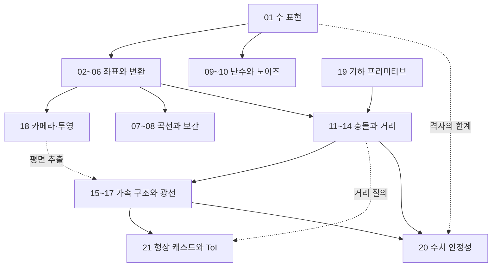

# 수학 시리즈 지도

`math/`는 게임에서 쓰는 공식을 모아 둔 참조표가 아니다. 각 편은 *하나의 계산이 어떤 전제 위에서 성립하고 그 전제가 깨질 때 무엇이 먼저 무너지는가* 를 살핀다. 같은 내적 한 줄이라도 시야 판정에서는 부호가, 정규화에서는 분모가, 충돌 축 투영에서는 축의 퇴화가 실패 조건이다. 이 축이 다루는 것은 그 실패 조건이다.

21편은 네 층으로 쌓인다. *수의 표현* 이 바닥이고, 그 위에 *좌표와 변환* 이, 그 위에 *시간과 확률에 따라 값을 만드는 도구* 가, 다시 그 위에 *기하 질의와 그것을 감당하는 가속 구조* 가 올라간다. 20이 이 전부를 장기 누적이라는 하나의 실패 조건으로 다시 묶는다.

## 읽는 순서

파일 번호는 대체로 읽는 순서와 같다. 다만 *네 곳* 은 번호와 전제가 어긋난다.

- **19 기하 프리미티브는 전제상 앞에서 읽는 편이 좋다.** 평면의 표현과 부호 관례, 점-평면·점-직선 거리, 무게중심 좌표는 11~18이 이미 쓰는 도구다. 특히 `Plane` 의 부호 관례($\hat{n}\cdot\vec{p}=d$)를 19의 1절에서 확정하고 들어가지 않으면 14·15·17·18의 코드가 전부 반대 부호로 읽힌다. 11로 들어가기 전에 19의 1~5절을 먼저 보는 편이 낫다. 6~8절(convex hull·triangulation·Voronoi)은 뒤로 미뤄도 된다. 5절의 무게중심과 `PointInTriangle` 은 7절 ear clipping에도 쓰인다.
- **18 카메라와 투영은 06 좌표계의 직접 심화다.** 06을 읽은 직후에 읽어도 흐름이 끊기지 않는다. 그 사이의 07~17을 먼저 읽어야 할 이유는 없다.
- **20 수치 안정성은 01의 짝이다.** 마지막에 읽되 01을 다시 펴 놓고 읽는 것을 전제한다. 두 편은 같은 격자를 각각 *표현* 과 *누적* 의 관점에서 본다.
- **21 형상 캐스트는 번호가 마지막이지만 자리는 17 다음이다.** 광선 교차의 일반화이고 13의 지원 함수·거리 질의를 원시 연산으로 쓴다. 따라서 전제는 13과 17이며 20보다 앞에 온다. 

나머지 묶음 안에서는 번호 순서가 곧 전제 순서다. 특히 11 → 12 → 13은 뒤로 갈수록 앞 편의 한계를 동기로 삼고, 15 → 16 → 17 → 21도 같은 방식으로 이어진다.

| 묶음 | # | 문서 | 다루는 내용 |
|---|---|---|---|
| 수의 토대 | 01 | [수 표현](part01_number_representation.md) | IEEE 754 격자, ULP, 반올림과 FMA, 고정소수점, 비트 트릭 |
| 좌표와 변환 | 02 | [벡터](part02_vectors.md) | 내적·외적의 기하 해석, 안전한 정규화, 투영·반사·슬라이딩 분해 |
| 좌표와 변환 | 03 | [행렬](part03_matrices.md) | 기저 변환, 동차 좌표, TRS 합성과 역, 법선 역전치, 메모리 레이아웃 |
| 좌표와 변환 | 04 | [회전 표현](part04_rotation_representations.md) | 네 표현의 트레이드오프, 짐벌락, 표현 사이 변환의 안정성 |
| 좌표와 변환 | 05 | [쿼터니언](part05_quaternions.md) | 쿼터니언 대수, $qpq^{-1}$ 유도, 측지선과 Slerp, 정규화 정책 |
| 좌표와 변환 | 06 | [좌표계](part06_coordinate_systems.md) | 좌표계 위계, 뷰 행렬의 역 구조, 핸드니스와 축 매핑, MVP 캐싱 |
| 좌표와 변환 | 18 | [카메라와 투영](part18_camera_projection.md) | 투영 행렬 유도(대칭·비대칭), 깊이 정밀도 분포, reverse-Z, 깊이 관례별 frustum 평면 추출 |
| 곡선과 보간 | 07 | [보간](part07_interpolation.md) | 연속성 등급, Hermite·Bezier·Catmull-Rom, easing과 체감 |
| 곡선과 보간 | 08 | [스플라인](part08_splines.md) | 지역 제어와 기저 함수, Cox-de Boor, 호 길이 매개화, 프레네 프레임 |
| 난수와 노이즈 | 09 | [난수와 분포](part09_random_and_noise.md) | PRNG 평가 축, 분포 샘플링의 편향, 시드 위계와 재현성 |
| 난수와 노이즈 | 10 | [절차적 노이즈](part10_procedural_noise.md) | 격자 노이즈의 진화, FBM과 domain warp, GPU 평가 트레이드오프 |
| 충돌과 거리 | 11 | [충돌 프리미티브](part11_collision_primitives.md) | 네 기본 도형, 쌍별 교차와 침투 깊이, closest point 함수군 |
| 충돌과 거리 | 12 | [SAT](part12_collision_sat.md) | 분리축 정리, 축 후보와 투영, MTV, 비볼록 처리의 한계 |
| 충돌과 거리 | 13 | [GJK와 EPA](part13_collision_gjk_epa.md) | Minkowski 차, 지원 함수 추상, 심플렉스 진화, 폴리토프 확장 |
| 충돌과 거리 | 14 | [거리 장](part14_distance_fields.md) | SDF와 Eikonal 조건, 합성과 smin, ray marching, mesh 베이킹 |
| 가속과 광선 | 15 | [공간 분할](part15_spatial_partitioning.md) | 그리드·트리 계열의 비용 모델, 동적 갱신 전략, 받은 평면으로 하는 컬링 질의 |
| 가속과 광선 | 16 | [BVH](part16_bvh.md) | 볼륨 선택, SAH와 LBVH 빌드, refit·rebuild, 트리 트래버설 |
| 가속과 광선 | 17 | [레이캐스팅](part17_raycasting.md) | 광선-도형 교차 닫힌 형태, 퇴화 방향, self-intersection 방어 |
| 가속과 광선 | 21 | [형상 캐스트와 ToI](part21_sweep_and_toi.md) | 터널링의 임계 조건, Minkowski 차 위의 광선 환원, conservative advancement의 수렴과 그 전제, ToI의 종료 밴드와 정밀도 |
| 기하 도구 | 19 | [기하 프리미티브](part19_geometry_primitives.md) | 평면·직선 표현과 부호 관례, 거리와 면적, 무게중심, hull·triangulation·Voronoi |
| 마무리 | 20 | [수치 안정성](part20_numerical_stability.md) | 오차의 종류와 누적, 보상 합산, 거대 좌표, 시간과 정규화 정책 |

### 역할별 경로

전부를 같은 깊이로 읽을 필요는 없다. 맡은 일에 따라 *먼저 닫아야 할 편* 이 다르다.

| 하는 일 | 먼저 | 그 다음 |
|---|---|---|
| 게임플레이·캐릭터 로직 | 01 · 02 · 03 · 11 | 04 · 07 · 21 · 20 |
| 렌더링·카메라 | 02 · 03 · 06 · 18 | 19(1~5절) · 16 · 17 |
| 물리·충돌 | 11 · 12 · 13 · 15 | 16 · 17 · 21 · 19 · 20 |
| 애니메이션 | 04 · 05 · 07 | 08 · 20(7절) |
| 절차적 생성 | 09 · 10 | 19(6~8절) · 08 |
| 도구·에디터 | 07 · 08 · 19 | 03 · 06 |

## 완료 기준

- 한 식이 어떤 전제에서 성립하는지, 그 전제가 깨지면 무엇이 먼저 어긋나는지 말할 수 있다.
- 부동소수점 결과의 오차를 값의 크기와 연산 횟수로 어림할 수 있고, 비교에 쓸 허용오차를 도메인 단위에서 정할 수 있다.
- 같은 회전을 네 표현으로 오갈 수 있고, 각 표현이 무엇을 잃는지 설명할 수 있다.
- 두 도형의 교차 질의를 도형 종류·정밀도 요구·객체 수에 따라 어떤 알고리즘과 가속 구조로 풀지 고를 수 있다.
- 가속 구조의 빌드·질의·갱신 비용을 분리해 측정하고 워크로드에 맞는 갱신 전략을 고를 수 있다.
- 움직이는 도형의 충돌을 이산 검사로 풀 수 있는지 상대 속도·시간 스텝·두께로 판정하고, 안 되면 어떤 연속 질의를 어떤 정밀도로 쓸지 근거를 대고 고를 수 있다.
- 장기 누적에서 무너질 수 있는 값(좌표·시간·단위 벡터·직교성)을 지목하고 각각의 방어 정책을 정할 수 있다.
