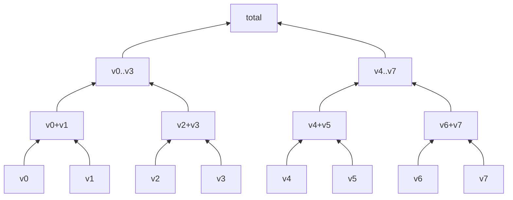

## 들어가며

게임 수학의 모든 연산은 결국 비트 위에서 일어난다. 캐릭터의 위치를 옮기고, 충돌을 검사하고, 카메라를 보간하는 모든 코드 한 줄 한 줄이 어떤 비트 패턴 위에서 더하고 곱하고 비교한다. 이 비트 패턴이 *어떻게 정밀도를 분배하는지* 모르면, 거대한 월드의 끝에서 캐릭터가 떨리는 이유, 두 점 사이 거리가 0인지 비교하는 코드가 가끔 거짓을 반환하는 이유, 곱셈 한 번에 무한대가 튀어나오는 이유를 *코드만 봐서는* 이해할 수 없다.

부동소수점(Floating Point)은 *무한 정밀의 환상* 이 아니다. 지수에 따라 정밀도가 비균일하게 분배되는 *불연속 격자* 다. 이 격자의 모양을 알면 게임 코드의 떨림, 클리핑, 충돌 누락의 *대부분* 이 이 격자의 한계와 닿아 있다는 것이 보인다.

이 글의 목표는 다음 다섯 가지다.

1. IEEE 754 부동소수점의 비트 레이아웃을 분해하고, `float`·`double` 의 표현 가능 범위와 정밀도가 어떻게 결정되는지 짚는다.
2. ULP(Unit in the Last Place)를 통해 *값의 크기에 따라 정밀도가 어떻게 변하는지* 정량화한다.
3. 단순 합산이 누적할 수 있는 오차의 한계와, Pairwise·Kahan summation으로 그 한계를 어떻게 줄이는지 본다.
4. Quake III의 fast inverse sqrt를 비트 레벨로 분해해, 매직 상수 `0x5f3759df` 의 유래를 수학적으로 풀어낸다.
5. 결정론적 시뮬레이션이 부동소수점을 거부하고 고정소수점(Fixed Point)을 쓰는 이유, 그리고 게임에서 흔히 만나는 수치 함정 다섯을 정리한다.

이 글이 *다른 모든 게임 수학 글의 토대* 다. 벡터·행렬·회전·충돌이 모두 *부동소수점 위에서* 도므로, 이 격자의 한계가 그 위에 쌓인 모든 알고리즘의 정확성에 그림자를 드리운다.


---

## 목차
1. [수의 컴퓨터 표현](#1-수의-컴퓨터-표현)
2. [IEEE 754 부동소수점](#2-ieee-754-부동소수점)
3. [정밀도와 표현 가능 범위](#3-정밀도와-표현-가능-범위)
4. [반올림 모드와 오차 누적](#4-반올림-모드와-오차-누적)
5. [Fast Inverse Sqrt와 비트 트릭](#5-fast-inverse-sqrt와-비트-트릭)
6. [Fixed-point 표현과 비교](#6-fixed-point-표현과-비교)
7. [게임에서 자주 만나는 수치 함정](#7-게임에서-자주-만나는-수치-함정)


---

## 1. 수의 컴퓨터 표현

CPU가 직접 다루는 수는 *정수* 와 *부동소수점* 두 종류뿐이다. 그 외의 모든 표현 — 분수, 복소수, 행렬, 벡터, 쿼터니언 — 은 이 둘 중 하나의 *배열* 또는 *구조체* 로 만들어진다. 게임 수학의 가장 깊은 층에는 이 두 표현이 있다.

### 1.1 정수 — unsigned와 signed

`unsigned int` 는 단순하다. $n$ 비트로 $0 \le x < 2^n$ 의 정수를 *직접 이진수로* 표현한다.

| 타입 | 비트 | 범위 |
|---|---|---|
| `uint8_t` | 8 | 0 ~ 255 |
| `uint16_t` | 16 | 0 ~ 65,535 |
| `uint32_t` | 32 | 0 ~ 4,294,967,295 |
| `uint64_t` | 64 | 0 ~ 약 1.8 × 10^19 |

음수를 표현하려면 *부호 비트* 가 필요한데, 부호의 표현 방식은 역사적으로 셋이 있었다.

- **부호-크기 (sign-magnitude)**: 최상위 비트가 부호, 나머지가 크기. 0이 *두 개* (+0, -0). 덧셈 회로가 복잡.
- **1의 보수 (1's complement)**: 음수는 양수의 비트 반전. 여전히 +0과 -0이 분리. 가산기 회로가 *end-around carry* 라는 부수 처리를 요구.
- **2의 보수 (2's complement)**: 음수는 양수의 비트 반전 + 1. 0이 유일. 덧셈·뺄셈 회로가 *unsigned와 동일*. 거의 모든 현대 CPU의 표준.

C++의 `int` / `int32_t` 는 *2의 보수* 다 (C++20부터 표준이 명시). $n$ 비트 signed 정수의 범위는 다음과 같다.

$$
-2^{n-1} \le x \le 2^{n-1} - 1
$$

음수 범위가 양수보다 *하나 더 넓다* — `INT_MIN = -2^31` 은 양의 대응값(`+2^31`) 이 표현 가능 범위를 넘어선다. 이게 흔한 함정의 시작점이다. `-INT_MIN` 은 *오버플로우* 라 동작이 정의되지 않는다.

```cpp
int x = INT_MIN;
int y = -x;       // UB: signed overflow
int z = std::abs(x);  // UB
```

### 1.2 정수의 비트 폭과 게임 좌표

게임에서 정수가 가장 많이 쓰이는 곳은 *타일 좌표·그리드 인덱스·ID* 다.

```cpp
struct TileCoord { int32_t x, y; };
struct EntityId  { uint32_t value; };
```

`int32_t` 는 ±21억까지 들어가니 *10000 × 10000 타일 그리드* 정도는 부담이 없다. 다만 *몇 가지 변환* 이 필요한 코드가 있을 때 부호 다루기에 주의한다.

- 픽셀 좌표를 음수로 받을 가능성: `int` 가 안전. `unsigned` 는 음수 처리에 취약.
- 컬렉션 크기는 `size_t` (unsigned) 인데 *루프 변수* 가 signed면 비교 시 *암묵적 부호 변환* 발생.
- 비트 시프트의 *부호 정수 우측 시프트* 는 C++20부터 산술 시프트로 표준화됐다 (이전에는 구현 정의). 다른 언어와 섞일 때, 또는 C++20 이전 빌드와 섞일 때는 동작 차이를 의식한다.

게임 코드에서 *루프 변수는 보통 signed `int`*, *크기와 인덱스는 `size_t`*, *명시적 비트 패턴은 `uint32_t` 또는 `uint64_t`* 로 분리하는 관행이 흔하다.

### 1.3 부동소수점은 왜 필요한가

정수만으로 *연속 공간* 의 좌표를 표현하려면 *고정 단위* 를 정해야 한다. "1mm 단위로 표현" 이라면 `int32_t` 의 양의 범위는 약 2,147,483,647mm, 즉 원점에서 약 2,147km다. 그러나 *충돌 검사* 는 mm 단위로 안 떨어지는 *비율* 과 *각도* 를 다룬다. 회전 행렬의 한 항은 $\cos\theta$ 같은 *0과 1 사이의 실수* 다.

비율을 정수로 표현하려면 *분모를 곱한 정수* (Q-format, 6절에서 다룸) 또는 *부동소수점* 이 필요하다. 게임에서는 *범위와 정밀도가 모두 필요* 한 좌표·각도·시간을 부동소수점으로 둔다.

### 1.4 정수 vs 부동소수점의 트레이드오프

| 측면 | 정수 (int32) | 부동소수점 (float32) |
|---|---|---|
| 비트 패턴 | 32비트, 균일 분포 | 32비트, 지수에 따라 비균일 분포 |
| 정밀도 | 1 (균일) | 값의 크기에 비례 (비균일) |
| 비트 수 | 32 | 32 |
| 결정론 | 완전 (정의된 동작) | 컴파일러·CPU 의존 |
| 산술 비용 | 매우 빠름 | 빠름 (FPU) |
| 0 비교 | `x == 0` | `\|x\| < \epsilon` 권장 |

이 비교의 핵심은 *비트 수가 같다* 는 점이다. `float32` 와 `int32` 모두 32비트지만, *분포* 가 다르다. 정수는 *균일 격자*, 부동소수점은 *지수에 따라 밀도가 다른 격자*. 이 차이가 게임 수학의 모든 미묘함의 출발점이다.

## 2. IEEE 754 부동소수점

IEEE 754는 1985년 제정, 2008년·2019년 개정된 부동소수점 표준이다. 거의 모든 현대 CPU의 FPU가 이 표준을 따른다 — Intel, AMD, ARM, RISC-V 모두. 이 표준이 *어느 정도 호환 가능한 수치 결과* 를 보장한다.

### 2.1 비트 레이아웃

IEEE 754의 *binary32* (C++의 `float`) 는 32비트를 다음과 같이 분배한다.

```text
 31  30        23 22                              0
┌───┬─────────────┬──────────────────────────────────┐
│ s │   exponent  │            mantissa             │
│ 1 │      8      │              23                 │
└───┴─────────────┴──────────────────────────────────┘
```

- **부호 비트 (s)**: 1 — 음수, 0 — 양수.
- **지수 (exponent)**: 8비트. 0 ~ 255 의 *bias 표현*. 실제 지수는 *exponent - 127*.
- **가수 (mantissa)**: 23비트. *암묵적 1* 이 있어 실제로는 24비트 정밀도.

값은 정규화된 수의 경우 다음 식으로 디코드된다.

$$
x = (-1)^s \cdot 2^{e - 127} \cdot \left(1 + \frac{m}{2^{23}}\right)
$$

여기서 $e$ 는 exponent 비트의 정수값, $m$ 은 mantissa 비트의 정수값이다.

### 2.2 binary64 (double)

`double` 은 64비트.

```text
 63  62              52 51                                                   0
┌───┬───────────────────┬───────────────────────────────────────────────────┐
│ s │     exponent      │                  mantissa                         │
│ 1 │        11         │                     52                            │
└───┴───────────────────┴───────────────────────────────────────────────────┘
```

bias가 1023, mantissa 정밀도가 53비트 (암묵적 1 포함). 값의 식은 동일하다.

$$
x = (-1)^s \cdot 2^{e - 1023} \cdot \left(1 + \frac{m}{2^{52}}\right)
$$

### 2.3 정규화·비정규화·특수값

지수 비트의 값에 따라 *해석이 달라진다*.

| exponent (8비트) | 의미 | 식 |
|---|---|---|
| 0 (모두 0) | *비정규화 수 (subnormal)* 또는 *0* | $(-1)^s \cdot 2^{-126} \cdot (m/2^{23})$ (암묵적 1 없음) |
| 1 ~ 254 | *정규화 수 (normal)* | $(-1)^s \cdot 2^{e-127} \cdot (1 + m/2^{23})$ |
| 255 (모두 1) | mantissa 0 → *무한대 (Inf)* / mantissa ≠ 0 → *NaN* | — |

**비정규화 수** (subnormal, 또는 denormalized) 는 *0과 가장 작은 정규화 수 사이* 의 빈 공간을 메우기 위한 별도 코딩이다. 가장 작은 정규화 `float` 는 약 $1.18 \times 10^{-38}$ 이고, 그보다 작은 수는 비정규화로 표현된다 (가장 작은 양수는 약 $1.4 \times 10^{-45}$).

비정규화 수의 비용은 CPU·GPU 세대, 연산 종류와 실행 모드에 따라 다르다. 일부 연산은 정상 수와 같은 처리량을 내고, 일부는 floating-point assist 때문에 크게 느려질 수 있다. 성능이나 결정성을 위해 FTZ (Flush-To-Zero)와 DAZ (Denormals-Are-Zero)를 사용할 수 있지만 이는 아주 작은 값을 0으로 바꾸는 수치 정책이다. thread별 부동소수점 환경과 플랫폼 차이를 고정하고 실제 hot path에서 측정해야 한다.

**무한대** (`+Inf`, `-Inf`) 는 분모 0 또는 오버플로우로 발생.

```cpp
float a = 1.0f / 0.0f;        // +Inf (FE_DIVBYZERO)
float b = std::numeric_limits<float>::max() * 2.0f;  // +Inf (FE_OVERFLOW)
```

**NaN** (Not a Number) 은 *수학적으로 정의되지 않은 결과*. `0/0`, `Inf - Inf`, `sqrt(-1)`, `log(-1)` 등.

NaN의 *전염성* 이 게임 코드의 흔한 버그다. NaN과의 산술은 *모두 NaN*. NaN을 *발견 못 한 채 캐릭터 좌표로 누적* 되면 그 프레임부터 캐릭터가 *영원히 사라진다*.

```cpp
float pos = compute_position();   // 어쩌다 NaN 반환
pos += velocity * dt;             // NaN
pos += velocity * dt;             // NaN
// ... 영원히 NaN
```

NaN 검사는 `std::isnan(x)` 또는 `x != x` (NaN의 정의가 *자기 자신과도 같지 않음* 이라). 디버그 빌드에서 게임 좌표 갱신 시 매 프레임 NaN 체크를 거는 게 흔한 방어 패턴이다.

### 2.4 부호 있는 0

IEEE 754는 `+0` 과 `-0` 을 *별개의 비트 패턴* 으로 둔다. 비교 시에는 *같다* 고 판정 (`-0 == +0` 은 true) 이지만, *나눗셈 결과의 부호* 가 갈린다.

```cpp
float a = 1.0f / +0.0f;   // +Inf
float b = 1.0f / -0.0f;   // -Inf
```

게임 코드에서는 거의 의식하지 않아도 되지만, *방향 벡터의 0 처리* 에서 가끔 흔적을 남긴다.

### 2.5 비트 패턴으로 보는 예시

`1.0f` 의 비트 패턴은 다음과 같다.

- 부호: 0
- 지수: $127$ (bias 적용 → 실제 지수 0)
- 가수: 0 (암묵적 1이 있어 값이 1.0)

비트로 풀면 `0 01111111 00000000000000000000000` = `0x3F800000`.

`0.5f` 는 `0x3F000000` (지수가 126 = 실제 -1).
`2.0f` 는 `0x40000000` (지수가 128 = 실제 +1).

비트 패턴이 *그대로* `int32_t` 로 해석하면 단조 증가한다 (양수 영역에서). 이 사실이 5절의 fast inverse sqrt 비트 트릭의 핵심이다.

### 2.6 부동소수점 산술의 결정론

같은 코드가 같은 입력에 *같은 결과* 를 줄까? 답은 *기본적으로 그렇다 — 다만 조건이 있다*.

- **같은 CPU, 같은 컴파일러, 같은 옵션**: 결정론.
- **다른 컴파일러**: 표현식의 평가 순서, 중간 결과의 정밀도(80비트 x87 vs 64비트 SSE2)가 다를 수 있어 *마지막 비트가 다를 수 있다*.
- **다른 CPU**: SSE2/AVX의 산술은 IEEE 754 표준이라 같은 결과. 그러나 `transcendentals` (sin, cos, exp) 는 표준이 *정확한 비트* 를 강제하지 않아 CPU·라이브러리마다 다를 수 있다.
- **multi-threaded 합산**: 합산 순서가 비결정적이라 *마지막 비트가 흔들린다*.

게임에서 *결정론적 시뮬레이션* (lockstep 멀티플레이어, 리플레이) 이 필요하면 부동소수점은 *조심스러운 통제* 가 필요하다. 6절의 fixed-point가 그 대안이다.

## 3. 정밀도와 표현 가능 범위

부동소수점이 *비균일 격자* 라는 사실의 정량적 표현이 ULP다. 이 절은 ULP를 정의하고, 1.0 근처와 큰 좌표에서의 *정밀도 차이* 가 게임 코드에 어떻게 드러나는지 본다.

### 3.1 ULP (Unit in the Last Place)

부동소수점의 *연속한 두 수 사이의 간격* 이 그 값에서의 ULP다. 1.0 근처에서 ULP는:

$$
\text{ULP}(1.0) = 2^{-23} \approx 1.19 \times 10^{-7}
$$

`1.0f` 의 다음 표현 가능 수는 `1.0f + ULP` = 약 `1.0000001`. 그 사이의 `1.00000005` 는 *표현 안 된다* — 가장 가까운 표현 가능 수로 *반올림* 된다.

ULP는 지수에 비례한다. *값의 크기가 2배가 되면 ULP도 2배*.

| 값 근처 | ULP (float) | ULP (double) |
|---|---|---|
| 1.0 | $2^{-23} \approx 1.2 \times 10^{-7}$ | $2^{-52} \approx 2.2 \times 10^{-16}$ |
| 1024 | $2^{-13} \approx 1.2 \times 10^{-4}$ | $2^{-42} \approx 2.3 \times 10^{-13}$ |
| 1,048,576 (= $2^{20}$) | $2^{-3} = 0.125$ | $2^{-32} \approx 2.3 \times 10^{-10}$ |
| $2^{24} = 16{,}777{,}216$ | $2^{1} = 2.0$ | $2^{-28} \approx 3.7 \times 10^{-9}$ |

가장 충격적인 줄이 마지막 — *float 1670만 근처에서 ULP가 1을 넘어* *연속된 정수가 표현 안 된다*. `16777216.0f + 1.0f` 는 `16777216.0f` 다 (가장 가까운 표현 가능 수로 반올림).

### 3.2 게임 좌표의 떨림 — 거대 월드의 그림자

이 사실이 게임에 직접 영향을 주는 시나리오는 *거대 월드 + 카메라 이동* 이다.

플레이어 캐릭터가 월드 원점에서 200km 떨어진 지점에 있다고 하자. World 좌표는 약 `200000.0f` 근처. ULP는 같은 binade(같은 지수 구간) 안에서 일정하다. $2^{17} = 131072 \le 200000 < 2^{18}$ 이므로 지수는 17이고:

$$
\text{ULP}(200000) = 2^{17 - 23} = 2^{-6} = 0.015625
$$

ULP 0.0156 ≈ 1.6cm. 캐릭터의 좌표를 매 프레임 *0.01cm 단위로* 갱신해도 *반올림되어* 변화가 누적되지 않는다. 카메라가 그 좌표를 따라가며 매 프레임 그 위치를 보내면, 카메라의 *행렬 변환 결과* 가 *cm 단위로 떨린다*.

이 떨림은 *셰이더 안에서도* 나타난다. 정점 좌표가 `200000` 근처면 변환 행렬을 곱해 카메라 공간 좌표를 만들 때 *큰 수 - 큰 수 = 작은 수* 가 일어나 *catastrophic cancellation* (4.4절) 이 정밀도를 더 깎는다. 결과는 *멀리 있는 물체가 끊임없이 1픽셀씩 떨리는 z-fighting 또는 wireframe 깜빡임*.

### 3.3 Floating origin — 떨림에 대한 표준 해법

상용 게임 엔진(Unity, Unreal)이 거대 월드를 다루는 표준 패턴은 *floating origin (이동 원점)* 이다.


*카메라가 일정 거리* (예: 1km) *이상 원점에서 멀어질 때마다* 월드 전체를 *카메라 위치만큼 평행이동* 한다. 모든 엔티티의 좌표가 *0 근처로 재배치* 되어 ULP가 작아진다.

평행이동은 *모든 정점·물리 객체·랜드마크의 위치* 를 동시에 갱신해야 해서 *조용한 frame stutter* 가 발생할 수 있다 — 게임 엔진은 이 시점을 *플레이어가 알아채지 못할 순간* (로딩 중, 카메라 컷 등) 으로 미루는 휴리스틱을 둔다.

### 3.4 표현 가능 범위의 한계

`float` 의 표현 가능 양수 범위는 다음과 같다.

| 종류 | 값 |
|---|---|
| 가장 작은 양의 정규화 수 | $2^{-126} \approx 1.18 \times 10^{-38}$ |
| 가장 작은 양의 비정규화 수 | $2^{-149} \approx 1.4 \times 10^{-45}$ |
| 가장 큰 정규화 수 | $(2 - 2^{-23}) \cdot 2^{127} \approx 3.4 \times 10^{38}$ |

게임에서 *오버플로우* 로 `+Inf` 가 등장하는 건 거의 *수학적 실수* 다 — 행렬 곱셈에서 분모가 0에 가까워질 때, 또는 $a^b$ 가 거대해질 때. 정상적인 좌표·시간·속도는 `float` 범위를 *훨씬* 벗어나지 못한다.

*언더플로우* (작은 값이 0으로) 는 정상 게임 워크로드에서는 드물지만, 작은 수를 작은 수로 나누는 코드에서 가끔 등장한다. 결과가 `0.0f` 가 되면 다음 줄의 분모가 *0으로 나누기* 가 된다.

### 3.5 epsilon — 비교의 단위

이 모든 사실의 결론은 *부동소수점의 같음 비교는 위험하다* 는 것이다. 두 부동소수점이 *수학적으로 같은 값을 산출하는 두 다른 경로* 로 계산되었어도, 마지막 비트가 다를 수 있다.

```cpp
double a = 0.1 + 0.2;     // 0.30000000000000004 (반올림 누적)
double b = 0.3;           // 0.29999999999999999 (단일 반올림)
bool same = (a == b);     // false
```

`float` 는 *마지막 비트 차이가 우연히 같은 값으로 반올림* 되는 경우가 있어 단일 사례로는 위 패턴이 부정확하다. *임의의 두 표현 가능 수의 산술이 마지막 비트에서 갈리는* 사례로는 다음이 더 정확하다.

```cpp
float a = 0.1f * 9.0f;    // 0.90000004f
float b = 0.9f;           // 0.9f
bool same = (a == b);     // false
```

이런 *경로 차이로 마지막 비트가 어긋남* 이 부동소수점 산술의 중요한 특성이다. 그렇다고 모든 `float` 비교를 근사 비교로 바꾸면 안 된다. 식별자처럼 쓰는 값, 정확히 대입한 sentinel, 비트 단위 재현성을 검사하는 테스트에는 `==`가 맞다. 측정값이나 계산 결과를 수학적 실수처럼 비교할 때만 문제의 단위와 오차 예산에 맞는 허용오차를 쓴다.

```cpp
constexpr float kEps = 1e-5f;
bool ApproxEqual(float a, float b) {
    return std::fabs(a - b) < kEps;
}
```

다만 *epsilon이 절대값* 인 이 식은 *큰 값 비교에 부적합* 하다 — `1e6` 근처의 ULP는 `0.0625`라 `1e-5` 안의 차이는 *항상 false*. 큰 값 비교에는 *상대적 epsilon* 이 필요하다.

```cpp
bool ApproxEqual(float a, float b,
                 float absEps = 1e-6f,
                 float relEps = 1e-5f) {
    const float diff = std::fabs(a - b);
    const float maxv = std::max(std::fabs(a), std::fabs(b));
    return diff <= std::max(absEps, maxv * relEps);
}
```

절대 허용오차는 0 근처의 바닥값이고, 상대 허용오차는 값의 크기에 따라 커진다. 두 상수는 좌표의 단위, 충돌 허용 간격, 반복 알고리즘의 종료 조건처럼 *도메인 계약* 에서 정해야 한다.

또는 *ULP 단위 비교* 로 비트 표현 간격을 직접 셀 수 있다. 같은 연산을 서로 다른 구현으로 계산한 결과가 몇 표현값만큼 차이 나는지 검사할 때 유용하다.

```cpp
bool UlpEqual(float a, float b, int maxUlps = 4) {
    if (std::signbit(a) != std::signbit(b)) {
        return a == b;  // 부호 다르면 정확히 0인 경우 외 false
    }
    int32_t ai, bi;
    std::memcpy(&ai, &a, sizeof(ai));
    std::memcpy(&bi, &b, sizeof(bi));
    return std::abs(ai - bi) <= maxUlps;
}
```

ULP 비교가 모든 문제에 가장 강건한 것은 아니다. 0을 가로지르는 부호, subnormal, NaN과 무한대 처리가 필요하고, 같은 ULP 차이도 값의 크기에 따라 실제 단위가 달라진다. 물리적 거리에는 절대·상대 허용오차가 자연스럽고, 수치 구현의 회귀 테스트에는 ULP 비교가 자연스럽다.

## 4. 반올림 모드와 오차 누적

부동소수점 연산은 *연산 결과를 가장 가까운 표현 가능 수로 반올림* 한다. 매 연산마다 *최대 0.5 ULP* 의 오차가 들어가고, 누적되면 큰 오차가 된다.

### 4.1 Round-to-nearest-even

IEEE 754의 기본 반올림 모드는 *Round to Nearest, Ties to Even* (RNE).

- 정확한 결과가 두 표현 가능 수 사이에 있으면, *가까운 쪽* 으로.
- 정확히 중간이면 *마지막 비트가 0인 쪽* (짝수) 으로.

이 모드의 통계적 *편향이 가장 작다*. 다른 모드 (`round toward +Inf`, `round toward -Inf`, `round toward zero`) 는 특수 용도다.

```cpp
// 기본 모드 확인 (대부분의 게임 환경에서 RNE)
#include <cfenv>
int mode = std::fegetround();   // FE_TONEAREST 가 기본
```

### 4.2 단순 합산의 오차 한계

$N$ 개의 수를 단순히 누적하면 마지막 결과의 오차는 *최악의 경우* $O(N \epsilon)$ — N에 비례한다.

```cpp
float sum = 0.0f;
for (int i = 0; i < N; ++i) {
    sum += values[i];      // 매번 0.5 ULP 오차 가능
}
```

$N = 10^6$ 이면 누적 오차가 $10^6 \cdot 10^{-7} = 0.1$. *float이 작은 수의 합산에 부적합한* 시나리오다. 게임에서 *물리 시뮬레이션의 누적 시간* 이 이 함정에 자주 빠진다 — 60fps 에서 1시간은 216,000 프레임이고, 누적 시간은 `3600s` 가 되어야 한다. `dt = 1/60` 을 매 프레임 더하면 반올림 오차가 누적되어 이 값에서 *보이지 않게* 어긋날 수 있다.

### 4.3 Pairwise summation

오차를 줄이는 단순한 방법은 *합산을 트리 구조로 쪼개는 것*.



각 항이 *적은 수의 덧셈* 을 거쳐 결과에 도달하므로 누적 오차가 $O(\log N \cdot \epsilon)$ 으로 줄어든다.

```cpp
float PairwiseSum(const float* v, int n) {
    if (n == 0) return 0.0f;
    if (n == 1) return v[0];
    int half = n / 2;
    return PairwiseSum(v, half) + PairwiseSum(v + half, n - half);
}
```

NumPy의 `np.sum` 이 내부적으로 이 패턴을 쓴다. SIMD 합산 루프도 자연스럽게 pairwise 모양이 된다 — 4-way SIMD가 4개를 합쳐 한 부분합을 만들고, 마지막에 부분합들끼리 합산.

### 4.4 Catastrophic cancellation

가장 *잠재적으로 파괴적* 인 오차는 *비슷한 크기의 두 수를 빼는* 경우다.

$$
a = 1{,}000{,}000.1, \quad b = 1{,}000{,}000.0
$$

수학적으로 $a - b = 0.1$. 그러나 `float` 표현에서 이 크기대(약 $2^{19}\sim2^{20}$)의 ULP는 `0.0625`라, 표현 가능한 값은 `0.0625`의 배수뿐이다. `1000000.1` 은 정확히 표현되지 않고 가장 가까운 `1000000.125` 로 반올림되어 저장된다. $b = 1000000.0$ 는 정확. 빼면 `0.125` — 원래 `0.1` 과 **25% 차이**. (반면 `1000000.5` 처럼 `0.0625`의 배수인 값은 정확히 저장돼 오차가 안 난다 — 손실은 *표현 불가능한* 소수부에서 생긴다.)

비슷한 두 큰 수를 빼면 *결과의 유효 자릿수가 급격히 줄어든다*. 이게 *catastrophic cancellation* 이다.

게임 코드의 흔한 사례:

- **두 좌표의 차로 거리 계산**: 캐릭터 둘이 멀리 있을수록 좌표가 큰데, 그 차이가 *작다* 면 cancellation. `sqrt((a.x-b.x)^2 + (a.y-b.y)^2)` 가 잘못된 거리를 반환할 수 있다.
- **각도 차이**: $\theta_1 - \theta_2$ 가 비슷한 큰 각도면 cancellation.
- **시간 차이**: 게임 시작 후 1시간 (`3600s`) 시점에서 `currentTime - startTime` 의 작은 시간 간격은 ULP가 커서 *연속한 dt가 같은 값으로 반올림* 될 수 있다.

대응:

- *상대적 좌표 시스템* (floating origin 또는 chunk 기반).
- *작은 시간 차* 는 *시작 시점의 timestamp* 가 아니라 *직전 프레임 timestamp* 와의 차이로 계산.
- *거리 비교* 가 정확해야 한다면 `double` 로 승급 후 빼기.

### 4.5 FMA (Fused Multiply-Add)

최신 CPU는 *곱셈과 덧셈을 한 명령으로 수행* 하면서 *중간 결과의 반올림을 생략* 하는 명령을 지원한다 — `fma(a, b, c) = a*b + c` 가 한 번의 반올림.

$$
\text{fma}(a, b, c) = \text{round}(a \cdot b + c)
$$

분리해서 계산하면 *두 번의 반올림* 이 필요하다.

$$
a \cdot b + c = \text{round}(\text{round}(a \cdot b) + c)
$$

FMA는 *정밀도가 더 좋고* *속도도 빠르다* (하나의 명령). 컴파일러 옵션 `-mfma` 또는 `/arch:AVX2` 로 활성화. 게임 엔진의 SIMD 코드는 거의 다 FMA를 활용한다.

다만 FMA의 결과가 *분리 계산과 다를 수 있다* 는 점이 *결정론* 에 영향을 준다. 빌드 옵션이 다르면 *비트가 어긋날 수 있어*, lockstep 멀티플레이어 클라이언트들 간 *정확히 같은 빌드* 가 요구된다.

### 4.6 Kahan summation — 더 정확한 합산

Pairwise보다 한 단계 더 정확한 합산은 *Kahan summation*. 매번의 반올림 오차를 *별도 변수에 저장해 다음 항에 보정* 하는 패턴.

```cpp
float KahanSum(const float* v, int n) {
    float sum = 0.0f;
    float c   = 0.0f;  // 보정 항 (compensation)
    for (int i = 0; i < n; ++i) {
        const float y = v[i] - c;
        const float t = sum + y;
        c = (t - sum) - y;   // 이 줄이 핵심: 잃어버린 비트를 c에 저장
        sum = t;
    }
    return sum;
}
```

오차가 naive 합산보다 크게 줄어든다. 이상적인 설명으로는 *N 의존성이 거의 사라진 상수 수준* 으로 볼 수 있지만, 실제 한계는 입력의 절대값 합 $\sum |x_i|$ 와 반올림 환경에 비례한다. 즉 $10^6$ 항 합산에서도 `float` 의 하위 비트를 훨씬 덜 잃는다.

Kahan 합산은 항마다 여러 산술 연산과 데이터 의존성을 추가한다. 산술 연산 수만 보면 단순 누적보다 크지만, 실제 실행 시간 비율은 벡터화 여부·메모리 병목·컴파일러 최적화에 따라 달라진다. 게임 코드에서는 *일반 합산은 단순 누적, 정밀이 중요한 곳만 Kahan* 으로 분리한다. 물리 시뮬레이션의 *총 운동량 보존 검증* 같은 *진단용* 코드에 흔히 등장.

## 5. Fast Inverse Sqrt와 비트 트릭

Quake III Arena가 출시된 1999년 무렵부터 다음 함수가 인터넷에 알려졌고, id Software가 전체 소스를 GPL로 공개한 시점은 2005년 8월이다.

```c
float Q_rsqrt(float number)
{
    long i;  // 원본 환경에서는 32-bit long을 가정
    float x2, y;
    const float threehalfs = 1.5F;

    x2 = number * 0.5F;
    y  = number;
    i  = * (long *) &y;                     // evil floating point bit hack
    i  = 0x5f3759df - (i >> 1);             // what the fuck?
    y  = * (float *) &i;
    y  = y * (threehalfs - (x2 * y * y));   // 1st iteration
    // y  = y * (threehalfs - (x2 * y * y));   // 2nd iteration (생략)
    return y;
}
```

`1/√x` 를 *세 줄의 비트 트릭* 으로 빠르게 근사한다. 정점 정규화처럼 역제곱근이 반복되는 당시의 하드웨어와 컴파일러에서 나눗셈과 제곱근을 피하려는 최적화였다. 정확한 속도 차이는 CPU·컴파일러·정밀도 요구에 따라 달라진다. 매직 상수 `0x5f3759df` 는 코드의 주석으로도 *what the fuck* 이라 적혀 있어, 한동안 그 유래가 인터넷의 미스터리였다.

이 코드는 *역사적 C 코드* 로 인용한다. 원본은 `float`와 `long`이 모두 32-bit인 구현을 가정한다. LP64 환경에서는 `long`이 64-bit일 수 있으므로 비트 폭부터 맞지 않는다. 또한 `*(long*)&y` 같은 *타입 펀닝(type punning)* 은 현대 C++에서 *strict aliasing 위반* 으로 정의되지 않은 동작이다. 컴파일러가 최적화 과정에서 두 포인터를 *다른 주소* 로 가정해 잘못된 결과를 낼 수 있다. 현대 코드에서 같은 트릭을 쓰려면 고정 폭 `uint32_t`와 `std::bit_cast` (C++20) 또는 `std::memcpy` 를 쓴다.

```cpp
// 현대 C++의 type punning
#include <bit>
uint32_t i = std::bit_cast<uint32_t>(y);   // float → uint32_t (C++20)

// C++17 이하 호환
uint32_t i;
std::memcpy(&i, &y, sizeof(i));
```

`bit_cast` 는 크기가 같은 trivially copyable 타입 사이의 비트 표현 복사를 명시하며 *strict aliasing 안전* 하다. 고정 크기 `memcpy`도 최적화 빌드에서 실제 메모리 호출 없이 레지스터 이동으로 사라지는 경우가 많지만, 특정 명령 수나 원본 캐스트와 같은 비용이 언어 차원에서 보장되지는 않는다.

이 절은 그 트릭을 *비트 레벨로 분해* 한다. 게임 수학에서 직접 쓸 일은 거의 없지만 (5.4절), *부동소수점의 비트 표현이 어떻게 수학적 연산이 되는지* 의 가장 명료한 사례다.

### 5.1 비트 패턴을 정수로 보면 로그가 된다

`float` 의 비트 패턴 $I$ 를 *그대로 정수* 로 해석하면, 그 정수값과 원래 float 값 $x$ 사이에 *근사 로그 관계* 가 있다.

float의 식을 다시 쓴다. 정규화 양수 $x$ 의 비트는:

$$
I = (e + 127) \cdot 2^{23} + m
$$

여기서 $e$ 는 실제 지수, $m$ 은 가수 비트(0 ~ $2^{23}-1$). 한편 같은 $x$ 는 다음 식으로 표현된다.

$$
x = 2^e \cdot (1 + m / 2^{23})
$$

$\log_2 x$ 를 계산하면:

$$
\log_2 x = e + \log_2(1 + m/2^{23})
$$

$0 \le m / 2^{23} < 1$ 이므로 $\log_2(1 + t) \approx t$ 의 근사가 *대략* 성립한다. 정확히는 $\log_2(1+t)=t+\sigma(t)$이고 $0\le\sigma(t)\le0.0861$이다. $t=0$ 부근의 테일러 전개는 $t/\ln2-t^2/(2\ln2)+O(t^3)$이다.

대입하면:

$$
\log_2 x \approx e + m / 2^{23}
$$

한편 $I$ 를 $2^{23}$ 으로 나누면:

$$
I / 2^{23} = e + 127 + m / 2^{23} \approx \log_2 x + 127
$$

즉 *float의 비트 패턴을 정수로 본 값이 $\log_2 x$ 의 근사* 다. 비트 표현이 *지수 우선* 으로 배치되어 있어, 더 큰 float일수록 더 큰 정수가 된다.

### 5.2 1/√x 를 로그로 풀기

$y = 1/\sqrt{x}$ 양변에 $\log_2$ 를 취하면:

$$
\log_2 y = -\frac{1}{2} \log_2 x
$$

5.1절의 근사로 *정수 표현* 으로 옮기면:

$$
I_y - 127 \cdot 2^{23} \approx -\frac{1}{2} (I_x - 127 \cdot 2^{23})
$$

$$
I_y \approx \frac{3}{2} \cdot 127 \cdot 2^{23} - \frac{I_x}{2}
$$

$\frac{3}{2} \cdot 127 \cdot 2^{23} = 1{,}598{,}029{,}824 = $ `0x5F400000`. 매직 상수 `0x5f3759df` 는 이와 약간 다른데, 그 차이가 *근사 오차의 통계적 보정* 이다.

### 5.3 매직 상수의 미세 보정

5.1의 근사 $\log_2(1+t) \approx t$ 에는 작은 음의 편향이 있어, 실제 더 정확한 매직 상수는 다음을 푼다.

$$
M = \frac{3}{2}(127-\sigma)\cdot 2^{23}
$$

여기서 $\sigma$는 선형 로그 근사의 편향을 조절하는 값이다. $\sigma \approx 0.0450465$를 대입하면 기준값 `0x5F400000`에서 약 566,817을 빼 `0x5f3759df`가 된다. 어떤 상수가 최적인지는 Newton 보정 횟수와 최대·평균 상대오차 중 무엇을 최소화하는지에 따라 달라진다(Lomont 2003).

다른 상수도 분석되었다 — `0x5f375a86` (Lomont이 다른 오차 기준에서 제안한 값) 등. 어느 상수가 더 좋은지는 Newton 보정 횟수와 최대·평균 상대오차 중 무엇을 최소화하는지에 따라 달라진다. 정규화 뒤 허용되는 길이 오차가 작은 시스템이라면 이 차이도 검증 없이 무시하면 안 된다.

### 5.4 Newton's method 한 번의 보정

비트 트릭이 *대략 1/√x* 를 주지만, 정확도는 *몇 % 오차*. Newton's method 한 번을 적용해 정확도를 *0.175% 이내* 로 끌어올린다.

$f(y) = 1/y^2 - x$ 의 영점이 $y = 1/\sqrt{x}$. Newton iteration:

$$
y_{n+1} = y_n - \frac{f(y_n)}{f'(y_n)} = y_n \cdot \left(\frac{3}{2} - \frac{x}{2} \cdot y_n^2\right)
$$

이게 코드의 `y = y * (threehalfs - (x2 * y * y));` 한 줄. *한 번의 곱셈 셋과 한 번의 뺄셈* 으로 정밀도가 폭증한다.

### 5.5 SSE 등장 이후의 자리

Pentium III 이후 x86 CPU는 SSE의 `rsqrtss` (reciprocal square root single) 명령을 지원한다 — 같은 트릭의 *하드웨어 구현*. 한 명령으로 약 12비트 정밀도, Newton 보정 한 번으로 거의 풀 정밀도.

```cpp
#include <xmmintrin.h>
float fast_rsqrt(float x) {
    __m128 v = _mm_set_ss(x);
    __m128 r = _mm_rsqrt_ss(v);
    // Newton 보정 (선택)
    float y = _mm_cvtss_f32(r);
    y = y * (1.5f - 0.5f * x * y * y);
    return y;
}
```

`rsqrtss` 가 더 빠르고 정확하다 — Quake III 시대의 비트 트릭은 *역사적 흥미* 가 됐다. 2000년대 이후 게임 엔진은 SSE 명령을 직접 쓴다.

다만 이 트릭의 *원리* 는 게임 그래픽에서 여전히 살아 있다. *비트 패턴을 다른 타입으로 재해석하는* 패턴 (`std::bit_cast` 또는 `memcpy`) 은 깊이 버퍼·법선 인코딩·텍스처 압축 등 도처에 등장한다.

### 5.6 다른 비트 트릭

부동소수점 비트 트릭의 다른 예.

**부호 비트 클리어 = 절댓값**:

```cpp
float Abs(float x) {
    uint32_t bits;
    std::memcpy(&bits, &x, sizeof(bits));
    bits &= 0x7FFFFFFF;
    float result;
    std::memcpy(&result, &bits, sizeof(result));
    return result;
}
```

`std::fabs` 가 보통 같은 코드로 컴파일된다. 직접 쓸 일은 없지만 동작 이해.

**부호 비트 토글 = 부호 반전**:

```cpp
float Negate(float x) {
    uint32_t bits;
    std::memcpy(&bits, &x, sizeof(bits));
    bits ^= 0x80000000;
    float result;
    std::memcpy(&result, &bits, sizeof(result));
    return result;
}
```

**지수 추출**:

```cpp
int Exponent(float x) {
    uint32_t bits;
    std::memcpy(&bits, &x, sizeof(bits));
    return ((bits >> 23) & 0xFF) - 127;
}
```

이런 트릭들이 *직접 게임 코드에 들어가는 일은 드물지만*, *수학 라이브러리 안의 미세 최적화* 에 흔히 등장한다. 예를 들어 빠른 `log2`, `pow`, `sin` 근사들이 모두 비슷한 비트 분해를 한다.

## 6. Fixed-point 표현과 비교

부동소수점이 모든 곳에 적합한 건 아니다. *결정론* 이 절대적으로 필요하거나, *작은 정밀도가 일정해야* 하거나, *FPU가 없는 임베디드 환경* 에서는 *고정소수점 (fixed-point)* 이 더 적합하다.

### 6.1 Q-format

고정소수점은 *정수의 일부 비트를 소수부로 해석* 한다. *Q포맷* 은 `Q<integer>.<fractional>` 형식으로 표기한다.

| 포맷 | 정수부 | 소수부 | 범위 (signed) | 정밀도 |
|---|---|---|---|---|
| Q16.16 | 16 | 16 | $\pm 32{,}768$ | $1/65{,}536 \approx 1.5 \times 10^{-5}$ |
| Q24.8 | 24 | 8 | $\pm 8{,}388{,}608$ | $1/256 \approx 3.9 \times 10^{-3}$ |
| Q8.24 | 8 | 24 | $\pm 128$ | $1/16{,}777{,}216 \approx 6 \times 10^{-8}$ |

Q16.16의 표현은 32비트 signed 정수를 *$2^{16}$ 으로 나눈 값* 으로 해석한다.

```cpp
struct Q16_16 {
    int32_t raw;
    static constexpr int64_t kScale = int64_t{1} << 16;

    static int32_t Saturate(int64_t x) {
        return static_cast<int32_t>(std::clamp(
            x,
            int64_t{std::numeric_limits<int32_t>::min()},
            int64_t{std::numeric_limits<int32_t>::max()}));
    }

    // 경계 입력은 정수 비율로 만든다. 반올림 정책은 0 방향으로 고정한다.
    static Q16_16 FromRatio(int32_t numerator, int32_t denominator) {
        if (denominator == 0) throw std::domain_error("zero denominator");
        int64_t scaled = int64_t(numerator) * kScale / denominator;
        return Q16_16{Saturate(scaled)};
    }

    double ToDouble() const { return double(raw) / double(kScale); }

    Q16_16 operator+(Q16_16 o) const {
        return Q16_16{Saturate(int64_t(raw) + o.raw)};
    }
    Q16_16 operator-(Q16_16 o) const {
        return Q16_16{Saturate(int64_t(raw) - o.raw)};
    }
    Q16_16 operator*(Q16_16 o) const {
        int64_t prod = int64_t(raw) * int64_t(o.raw);
        return Q16_16{Saturate(prod / kScale)};
    }
};
```

예제는 overflow를 saturate하고 나눗셈을 0 방향으로 반올림한다. wraparound나 nearest-even을 원한다면 그 정책을 별도 구현하고 직렬화 버전에 포함해야 한다. `float`에서 fixed-point로 들어오는 변환을 시뮬레이션 경계에서 반복하면 다시 부동소수점 차이를 들여오므로, 권위 입력은 정수 비율이나 양자화된 raw 값으로 받는다.

### 6.2 균일 정밀도 — 부동소수점과의 가장 큰 차이

Q16.16은 *전체 범위에 걸쳐 정밀도가 일정* 하다. 어디서나 ULP는 $2^{-16}$. 1.0 근처와 30000 근처가 *같은 정밀도*. 부동소수점의 비균일성이 사라진다.

이 *일정한 격자* 는 결정론적 산술 계약을 만들기 쉽게 한다. 그러나 fixed-point라는 이름만으로 결정론이 자동 보장되지는 않는다. 저장 비트 폭, 곱셈의 넓은 중간 타입, 나눗셈과 음수 shift의 반올림 방향, overflow의 wrap·saturate·error 정책을 모두 고정해야 한다. C++ signed overflow 같은 undefined behavior를 피하고 같은 입력 순서와 정수 연산 계약을 지켰을 때 비트 단위 재현성을 얻는다. 그러면 FMA, x87 중간 정밀도, 수학 라이브러리 구현 차이 같은 부동소수점 변수를 제거할 수 있다.

### 6.3 결정론적 시뮬레이션

Lockstep 멀티플레이어 게임은 *모든 클라이언트가 같은 입력에 같은 시뮬을 돌려 같은 결과* 를 얻는 모델이다. 서버는 입력만 중계, 시뮬은 각 클라이언트가 *독립적으로 계산*. 한 클라이언트가 다른 결과를 내면 *desync*.

부동소수점으로 lockstep을 구현하면 *컴파일러 차이, FMA 차이, 64비트 vs 32비트 빌드 차이, GPU 가속 vs CPU 차이* 등 모든 변수가 desync 위험. 그래서 *결정론적 lockstep* 게임은 *모든 시뮬 좌표·속도·각도를 fixed-point로* 두는 게 흔한 패턴이다.

| 게임 | 시뮬 표현 | 비고 |
|---|---|---|
| Age of Empires II | fixed-point | RTS의 표준 |
| StarCraft / WarCraft III | fixed-point | RTS의 표준 |
| Factorio | fixed-point | 결정론 + 멀티플레이어 |
| Street Fighter, Mortal Kombat | fixed-point | 격투 게임의 표준 |
| Dwarf Fortress | mixed (정수 위주) | 결정론 + 시뮬 깊이 |

대비로, *클라이언트-권위 게임* (FPS의 hit detection 등) 은 부동소수점이 흔하다. 약간의 desync가 *서버 권위로 보정* 되어 가시화되지 않는다.

### 6.4 곱셈 오버플로우와 조심해야 할 점

Q-format의 가장 큰 함정은 *곱셈 오버플로우* 다. Q16.16 두 수를 곱하면 결과가 *64비트가 필요한 정수* 가 된다. `int32_t` 산술로 직접 곱하면 *오버플로우*.

```cpp
// 잘못: 32비트 곱셈은 오버플로우 위험
int32_t bad = (a.raw * b.raw) >> 16;  // a, b가 크면 깨짐

// 옳음: 64비트로 승급
int32_t good = Q16_16::Saturate(int64_t(a.raw) * int64_t(b.raw) / Q16_16::kScale);
```

나눗셈도 비슷하게 *역산* 이 필요하다.

```cpp
// a / b 를 Q16.16으로
// 음수 signed left shift 는 UB가 될 수 있으므로 곱셈으로 스케일을 올린다.
int32_t div = int32_t((int64_t(a.raw) * (1LL << 16)) / int64_t(b.raw));
```

산술 라이브러리 (예: libfixmath) 가 이런 처리를 캡슐화해 준다.

### 6.5 부동소수점 vs Q-format 트레이드오프 요약

| 측면 | float (32bit) | Q16.16 |
|---|---|---|
| 비트 수 | 32 | 32 |
| 표현 가능 수 분포 | 비균일 (지수에 비례) | 균일 |
| 범위 | ±$3.4 \times 10^{38}$ | ±32768 |
| 정밀도 (1.0 근처) | $1.2 \times 10^{-7}$ | $1.5 \times 10^{-5}$ |
| 정밀도 (10000 근처) | $9.8 \times 10^{-4}$ | $1.5 \times 10^{-5}$ |
| 결정론 | 조건부 | 완전 |
| 곱셈 비용 | 1 명령 (FPU) | 1 명령 + shift (64비트 승급) |
| `sqrt`, `sin`, `cos` | FPU/SSE | 룩업 테이블 또는 정수 근사 |
| FPU 없는 환경 | 불가 | 가능 |

게임 엔진의 일반 코드는 부동소수점이 *정밀도와 범위 모두 우수* 해 표준이다. 결정론·임베디드·격투 게임 같은 *특수 도메인* 에서 fixed-point가 등장한다.

## 7. 게임에서 자주 만나는 수치 함정

이 절은 게임 코드에서 *자주 보이는 부동소수점 함정* 다섯을 정리한다. 각 함정은 *비트 격자의 비균일성* 에서 기인한다.

### 7.1 같음 비교의 함정

*수학적으로 같지만 다른 경로로 계산된 두 값* 이 *비트 단위로 다를 수 있다*.

```cpp
float a = 0.1f * 9.0f;       // 0.90000004f
float b = 0.9f;              // 0.9f
if (a == b) { /* 거짓 */ }
```

계산 결과를 연속량으로 비교하는 이 사례에는 도메인 허용오차를 쓴다.

```cpp
constexpr float kEps = 1e-5f;
if (std::fabs(a - b) < kEps) { /* 참 */ }
```

게임 코드에서 *벡터의 영벡터 비교*, *각도의 같음 비교*, *시간의 일치 비교* 가 흔히 이 함정에 빠진다. 정수 ID 비교는 항상 안전.

### 7.2 분모 0에 가까울 때의 폭주

게임 코드의 *방향 벡터 정규화* 가 분모 0 함정의 가장 흔한 사례.

```cpp
vec3 Normalize(vec3 v) {
    float len = std::sqrt(v.x*v.x + v.y*v.y + v.z*v.z);
    return v / len;   // len이 0에 가까우면 폭주
}
```

`len` 이 *작을 때* 의 결과는 *수학적으로 정의되지 않은* 영벡터의 정규화 + 부동소수점 폭주. 처리하는 두 가지 패턴은, 길이 제곱이 임계 미만이면 영벡터나 기본 방향을 돌려주는 쪽 (*더 정확*) 과 분모에 작은 epsilon을 더해 폭주만 막는 쪽 (*덜 깨짐* 을 우선) 이다.

### 7.3 시간 누적의 안정화

게임의 *총 경과 시간* 을 매 프레임 `t += dt` 로 누적하면 *시간이 지날수록 정밀도가 떨어진다*.

```cpp
float t = 0.0f;
while (running) {
    t += dt;          // dt = 1/60 ≈ 0.0167
    Update(t);
}
```

`t` 가 524,288 (약 6일) 이 되면 `dt = 0.0167` 이 *t의 ULP 절반에 못 미쳐 통째로 묻혀* 누적이 멈춘다. 시간이 *얼어붙은 것처럼 보이는* 버그.

대응:

- **`double` 사용**: `double` 의 ULP가 $2^{-52}$ 라 1년이 지나도 정밀도가 충분.
- **fixed-point 시간**: `int64_t` 마이크로초.
- **상대 시간만 누적**: `t - tLast` 의 *작은 차이* 만 다음 프레임 계산에 쓰고, 절대 시간은 *기록용* 으로만.

### 7.4 큰 좌표 차에서의 cancellation

4.4절의 catastrophic cancellation이 게임에서 가장 자주 보이는 곳은 *두 캐릭터 사이 거리* 다.

```cpp
float Distance(vec3 a, vec3 b) {
    vec3 d = a - b;
    return std::sqrt(d.x*d.x + d.y*d.y + d.z*d.z);
}
```

a와 b가 *모두 거대* 한데 둘 사이 거리가 ULP보다 작을 때 문제가 된다. 200000 근처의 ULP는 `0.015625`m이므로 각 좌표의 저장 오차가 차이에 약 1 ULP까지 반영될 수 있다. 다만 `200001.0f - 200000.0f`는 두 값이 모두 격자 위에 있어 정확히 `1.0f`다. 차이가 0으로 무너지는 것은 참 차이가 약 1.6cm보다 작아 두 좌표가 같은 float로 반올림될 때다.

대응:

- floating origin (3.3절).
- 거리가 *진정으로 중요* 하면 `double` 로 승급.
- *상대 좌표 시스템* (chunk + local position).

### 7.5 NaN의 전염

NaN은 *발견 못 하면* 게임을 *조용히 망가뜨린다*.

```cpp
// 어딘가에서 NaN 발생
float speed = velocity.length();
if (speed < epsilon) {
    velocity = velocity / speed;  // 0/0 = NaN
}

// 다음 프레임부터
position += velocity * dt;        // NaN
position += velocity * dt;        // NaN
// ... 캐릭터가 사라짐, 디버깅 어렵
```

대응 패턴:

- **assertion**: 매 프레임 좌표 갱신 후 NaN 체크.

```cpp
assert(!std::isnan(position.x));
assert(!std::isnan(position.y));
assert(!std::isnan(position.z));
```

- **방어적 정규화**: 7.2의 NormalizeSafe.
- **FE_INVALID 트랩**: NaN 발생 시 프로세스를 *즉시* 중지 (디버그 빌드).

```cpp
#include <fenv.h>
// feenableexcept는 표준이 아니라 glibc 확장이다 (std:: 네임스페이스에 없음).
// MSVC에서는 _controlfp_s(&prev, ~(_EM_INVALID | _EM_ZERODIVIDE), _MCW_EM)을 쓴다.
feenableexcept(FE_INVALID | FE_DIVBYZERO);
```

릴리즈 빌드는 *조용한 NaN 처리* (계속 진행, 프레임 한 번만 손실), 디버그 빌드는 *즉시 멈춤* 패턴이 흔하다.

### 7.6 정리: 부동소수점을 다루는 5가지 원칙

1. **비교 목적을 먼저 구분**. ID·sentinel·비트 재현성은 exact equality, 연속량은 단위에 맞는 절대·상대 허용오차.
2. **분모의 유효 범위를 계약으로 정의**. 0 또는 작은 분모에서 reject·별도 해법·상한 clamp 중 의미에 맞는 정책을 쓴다. 무조건 epsilon을 더하면 단위와 부호를 바꿀 수 있다.
3. **누적 변수는 정밀도 손실 모니터링**. 긴 시간 시뮬은 `double` 또는 fixed-point.
4. **좌표가 거대해지면 floating origin** 또는 chunk 기반.
5. **NaN을 디버그 빌드에서 즉시 잡기**. 매 프레임 assertion이 가장 안전.

이 다섯 가지가 게임 코드의 *부동소수점 위생* 의 토대다. 벡터·행렬·회전·충돌도 모두 부동소수점 위에서 도므로, 이 다섯이 *모든 게임 수학 알고리즘의 정확성 가드레일* 이다.


---

## 결론

부동소수점은 *무한 정밀의 환상* 이 아니라 *지수에 따라 정밀도가 비균일하게 분배되는 격자* 다. IEEE 754의 비트 레이아웃을 분해하면 그 격자의 모양이 보이고, ULP를 통해 *값의 크기에 따른 정밀도* 가 정량화된다. 이 두 가지가 게임 코드의 *떨림, 클리핑, 충돌 누락, 시간 표류* 의 거의 모든 케이스의 근거다.

이 글에서 짚은 다섯 가지가 토대다.

1. **IEEE 754의 비트 레이아웃** — 부호·지수·가수의 의미와 정규화/비정규화/특수값.
2. **ULP의 비균일성** — 1.0 근처와 거대 좌표에서의 정밀도 차이.
3. **합산 오차** — 단순 합산의 $O(N\epsilon)$ 한계와 Pairwise·Kahan의 개선.
4. **Fast inverse sqrt의 비트 분해** — 비트 표현이 *근사 로그* 라는 사실, 매직 상수의 유래.
5. **Fixed-point의 자리** — 결정론·균일 정밀도가 절대적인 도메인의 대안.

벡터, 행렬, 회전, 충돌은 *모두 부동소수점 위에서* 도는 알고리즘이다. 이 격자의 한계가 그 위에 쌓이는 모든 코드에 그림자를 드리운다는 사실이 이 글의 결론 — *수치적 위생 (numerical hygiene) 이 게임 수학의 첫 번째 원칙이다*.

## 더 읽을거리

- David Goldberg, "What Every Computer Scientist Should Know About Floating-Point Arithmetic" (1991) — 부동소수점의 표준 레퍼런스.
- IEEE 754-2019 표준 — 공식 문서.
- Eric Lengyel, *Foundations of Game Engine Development*, Vol. 1 — 게임 엔진 수학의 토대.
- Bruce Dawson, "Random ASCII" 부동소수점 시리즈 — 비트 수준 분석의 깊이 있는 글들.
- Quake III Arena source code (id Software, 1999) — `code/game/q_math.c` 의 `Q_rsqrt`.
- Chris Lomont, "Fast Inverse Square Root" (2003) — 매직 상수의 수학적 도출.
- Nick Trefethen & David Bau, *Numerical Linear Algebra* — 수치 안정성 일반론.
- Donald Knuth, *The Art of Computer Programming, Vol. 2 — Seminumerical Algorithms* — 부동소수점·반올림의 고전.
- libfixmath — 임베디드 fixed-point 라이브러리 참고 구현.
- Glenn Fiedler, "Floating Point Determinism" — 멀티플레이어 lockstep의 부동소수점 함정.
