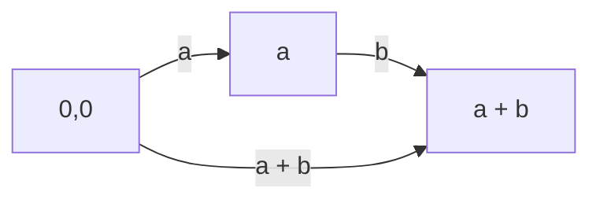
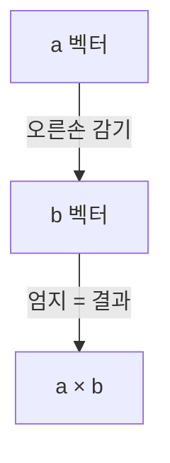
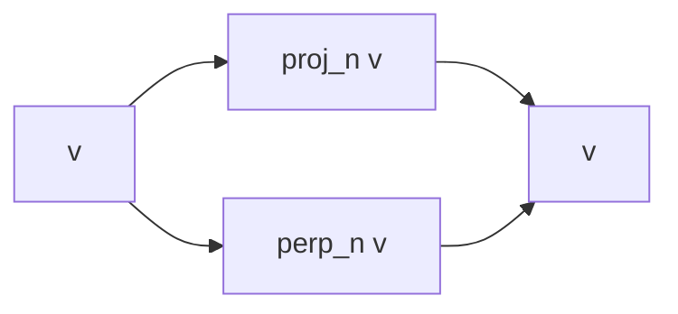
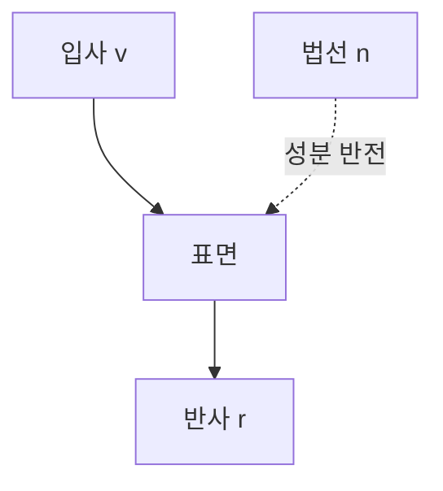

## 들어가며

벡터(Vector)는 게임 수학의 알파벳이다. 위치, 속도, 가속도, 법선, 색상, UV 좌표, 회전축, 충돌 노멀 — 게임 코드에서 *2개 이상의 숫자가 묶여 의미를 갖는* 거의 모든 양은 벡터로 표현된다. 이 위에 행렬·쿼터니언·충돌이 모두 쌓이므로, 벡터의 *연산을 직관적으로 해석할 수 있는가* 가 게임 수학을 다루는 능력의 토대다.

벡터 연산 중 *내적(Dot product)* 과 *외적(Cross product)* 두 가지가 게임에서 압도적으로 자주 등장한다. 시야 판정, 반사, 조준 보정, 백페이스 컬링, 슬라이딩 이동, 면의 방향 결정 — 모두 이 두 연산의 조합이다. 다른 모든 연산(합, 차, 스칼라 곱, 정규화)은 *벡터를 만들고 다듬는* 보조이고, 내적과 외적이 *기하학적 결정* 의 핵심이다.

이 글의 목표는 다음 다섯 가지다.

1. 벡터의 정의와 *위치 벡터 vs 방향 벡터* 의 구분, Vec2/Vec3/Vec4의 게임 안에서의 용도를 정리한다.
2. 내적의 *기하학적 의미* (방향 일치도) 와 게임 응용 (시야 판정, 백페이스 컬링) 을 연결한다.
3. 외적의 *오른손 법칙* 과 게임 응용 (삼각형 법선, 좌/우 판정) 을 연결한다.
4. 투영·반사·슬라이딩 같은 *벡터 분해 패턴* 을 게임 코드에 직접 쓸 수 있는 형태로 정리한다.
5. SIMD 친화적인 벡터 클래스 설계의 트레이드오프를 짚는다.

부동소수점의 *수치적 위생* (epsilon 비교, NaN 방어, 정규화 안전성) 이 이 글의 모든 코드에 깔려 있다. 벡터 연산이 *부동소수점 위에서* 도므로, 정규화의 분모 0 처리 같은 함정이 이 글에도 그대로 적용된다.


---

## 목차
1. [벡터의 정의와 좌표계](#1-벡터의-정의와-좌표계)
2. [기본 연산: 합·차·스칼라 곱](#2-기본-연산-합차스칼라-곱)
3. [내적과 그 기하학적 의미](#3-내적과-그-기하학적-의미)
4. [외적과 면 방향](#4-외적과-면-방향)
5. [정규화와 길이](#5-정규화와-길이)
6. [투영, 반사, 분해](#6-투영-반사-분해)
7. [게임 응용: 시야, 반사, 조준](#7-게임-응용-시야-반사-조준)
8. [SIMD 친화적 벡터 클래스](#8-simd-친화적-벡터-클래스)


---

## 1. 벡터의 정의와 좌표계

벡터는 수학적으로 *크기와 방향을 갖는 양* 이다. 좌표계가 정해지면 *성분 (component)* 의 묶음으로 표현된다. 게임 코드에서는 이 *성분 표현* 이 거의 모든 자리를 차지하지만, 기하학적 직관을 다질 때는 *좌표 없는 추상* 으로 보는 게 도움이 된다.

### 1.1 자유 벡터와 위치 벡터

수학적으로 *벡터는 시작점이 없다*. 같은 크기·같은 방향이면 *공간 어디에 있든 같은 벡터* 다 (자유 벡터, free vector). 화살표의 위치를 바꿔 그어도 같은 벡터.

게임 코드에서는 *시작점이 의미 있을 때* 가 많다 — 캐릭터의 위치, 충돌점. 이 경우 *위치 벡터 (position vector)* 라 부르고, *원점을 기준으로 한 자유 벡터* 로 해석한다. 즉 *원점으로부터의 변위* 다.

수학적으로는 같은 타입이지만, 의미가 다르다.

| 종류 | 의미 | 예시 |
|---|---|---|
| 위치 벡터 | 원점 기준 변위 | 캐릭터의 월드 좌표, 충돌점 |
| 자유 벡터 | 크기·방향만 | 속도, 힘, 법선, 라이트 방향 |

이 구분이 코드의 *연산 의미* 에 영향을 준다.

- 두 위치 벡터의 *합* 은 *기하학적 의미가 없다* (두 점의 좌표를 단순 더해도 의미 있는 점이 안 나옴). 다만 *평균* 은 의미 있다 — 두 점의 중간점.
- 두 위치 벡터의 *차* 는 한 점에서 다른 점으로의 *방향 벡터*. 이건 자유 벡터.
- 자유 벡터의 합·차·스칼라 곱은 모두 의미 있다 — 속도 합산, 힘의 합 등.
- 자유 벡터를 위치 벡터에 더하면 *위치를 옮긴* 새 위치 벡터.

코드에서는 같은 `vec3` 타입을 쓰지만 *변수 이름과 용도* 로 구분한다.

```cpp
vec3 position;       // 위치 벡터
vec3 velocity;       // 자유 벡터 (방향 + 크기)
vec3 normal;         // 자유 벡터 (보통 단위 길이)
vec3 displacement;   // 자유 벡터 (위치 차이)

position += velocity * dt;          // 위치 + 자유 = 새 위치 ✓
vec3 dir = positionB - positionA;   // 두 위치의 차 = 방향 ✓
vec3 wrong = positionA + positionB; // 두 위치의 합 = 의미 없음 ✗
```

CGAL (`Point_3`/`Vector_3`) 이나 WPF Media3D (`Point3D`/`Vector3D`) 같은 일부 기하 API는 *위치는 `Point`, 자유 벡터는 `Vector`* 로 *타입을 분리* 해 컴파일 타임에 잘못된 연산을 막는다. DirectXMath·Unity·Unreal 을 포함한 게임 엔진의 일반 코드는 같은 `vec3` (`XMVECTOR`·`Vector3`·`FVector`) 으로 두는 게 흔하다 — *프로그래머의 자기 규율* 에 맡기는 모델.

### 1.2 Vec2, Vec3, Vec4 — 차원의 의미

| 타입 | 차원 | 게임에서의 주 용도 |
|---|---|---|
| Vec2 | 2 | 2D 게임플레이 좌표, UV 텍스처 좌표, 화면 좌표 |
| Vec3 | 3 | 3D 위치, 속도, 색상 (RGB), 회전축, 법선 |
| Vec4 | 4 | homogeneous 3D 좌표, RGBA, quaternion |

Vec2는 *진짜 2D 게임* 에서만 등장하지는 않는다. 3D 게임에서도 *XZ 평면 (지면)* 을 다룰 때 Vec2로 처리하는 게 흔하고, *UV 좌표·화면 좌표·스크린 공간* 도 모두 Vec2다.

Vec3은 *물리적 공간* 의 표준. 위치, 속도, 가속도, 힘, 토크, 자기장, 법선, 라이트 방향, 색상 (RGB) 모두 Vec3. 게임 엔진의 코어 타입 중 가장 자주 등장한다.

Vec4의 *4번째 성분* 은 두 가지 의미 중 하나다.

- **Homogeneous 좌표 (w 성분)**: 위치 벡터 (w=1) 와 자유 벡터 (w=0) 를 *같은 4×4 행렬로 변환* 하기 위한 트릭. 위치는 평행이동에 영향 받고 자유 벡터는 안 받는 의미를 *w 성분 자체* 로 인코딩한다.
- **알파 (a 성분)**: 색상 RGBA의 투명도. 색상은 Vec4로 들고 다니는 게 일반적.

Vec4가 *quaternion* 의 4성분 $(x,y,z,w)$ 으로도 쓰인다. 같은 저장 형태라도 의미는 완전히 다르므로, 색·동차 좌표·쿼터니언을 별도 타입으로 구분하면 단위와 연산 실수를 줄일 수 있다.

### 1.3 좌표계 의존성

벡터는 *수학적으로* 좌표계에 종속되지 않지만, *코드에서는 항상 어떤 좌표계 기준의 성분 표현* 으로 산다. 같은 *물리적 화살표* 가 *다른 좌표계* 에서 *다른 성분 값* 으로 표현된다.

```cpp
vec3 forward_world  = {0, 0, -1};   // 월드 좌표계의 -Z 방향
vec3 forward_local  = {0, 0, 1};    // 로컬 좌표계 (캐릭터의 앞)
```

같은 *방향* 이 *다른 성분* 으로 표현되는 건 좌표계가 다르기 때문이다 — 그래픽스의 OpenGL은 *카메라가 -Z 방향* 을 보고, Unity의 *transform.forward* 는 +Z. 게임 코드에서 *어느 좌표계의 성분인지* 가 매 변수마다 의미의 일부다.

좌표계 변환은 행렬로 표현한다. 이 글에서는 *같은 좌표계 안의 벡터 연산* 만 본다 — 좌표계 변환을 거치기 *전* 또는 *후* 의 단일 좌표계 안에서 동작.

## 2. 기본 연산: 합·차·스칼라 곱

벡터의 가장 단순한 연산. 모두 *성분별 (component-wise)* 로 정의된다.

### 2.1 합과 차

$$
\vec{a} + \vec{b} = (a_x + b_x, a_y + b_y, a_z + b_z)
$$

$$
\vec{a} - \vec{b} = (a_x - b_x, a_y - b_y, a_z - b_z)
$$

기하학적으로 합은 *벡터를 머리부터 꼬리* 로 이은 합성 — 한 벡터를 따라간 뒤 다른 벡터를 따라가면 도착하는 점이 합벡터의 끝.



차는 *대상 - 시작* 이 *시작에서 대상을 향하는 방향 벡터*.

```cpp
vec3 toEnemy = enemyPos - playerPos;  // 플레이어 → 적 방향
```

이 한 줄이 게임 코드에서 가장 자주 보이는 패턴 중 하나다. 거리 계산, 시야 판정, 추적 AI, 충돌 응답 모두의 시작점.

### 2.2 스칼라 곱

$$
k \vec{a} = (k a_x, k a_y, k a_z)
$$

기하학적으로 *벡터의 길이를 $|k|$ 배* 로 늘리거나 줄임. $k$ 가 음수면 *방향 반전*, 0이면 영벡터가 된다.

```cpp
vec3 doubled  = velocity * 2.0f;     // 속도 두 배
vec3 reversed = velocity * -1.0f;    // 속도 반전 (= -velocity)
vec3 step     = velocity * dt;       // 한 프레임 동안의 변위
```

게임 코드의 가장 흔한 형태는 *속도 × 시간 = 변위*. 매 프레임 한 줄.

```cpp
position += velocity * dt;
```

### 2.3 대수 법칙

벡터 합·차·스칼라 곱은 다음 법칙을 만족한다.

| 법칙 | 식 |
|---|---|
| 교환법칙 | $\vec{a} + \vec{b} = \vec{b} + \vec{a}$ |
| 결합법칙 | $(\vec{a} + \vec{b}) + \vec{c} = \vec{a} + (\vec{b} + \vec{c})$ |
| 분배법칙 (스칼라) | $k(\vec{a} + \vec{b}) = k\vec{a} + k\vec{b}$ |
| 항등원 | $\vec{a} + \vec{0} = \vec{a}$ |
| 역원 | $\vec{a} + (-\vec{a}) = \vec{0}$ |

이 법칙들이 *수학적으로는* 정확히 성립하지만, *부동소수점 위에서는 마지막 비트가 어긋날 수 있다*. 예를 들어 결합법칙 $(a + b) + c$ 와 $a + (b + c)$ 가 *다른 비트 패턴* 을 줄 수 있다. 이는 부동소수점 덧셈 한 번마다 생기는 반올림이 합산 순서에 따라 다르게 쌓이기 때문이다.

게임 코드에서 이 차이가 의미 있는 경우는 드물지만, 결정론적 시뮬레이션에서는 *합산 순서를 고정* 해야 한다.

### 2.4 영벡터의 의미

$\vec{0}$ 은 *모든 성분이 0* 인 벡터. 길이도 0, 방향도 정의되지 않음.

게임 코드에서 영벡터가 등장하는 시나리오.

- **속도가 0**: 정지 상태. `velocity == vec3(0)` 비교는 *epsilon 비교* 로 (부동소수점 epsilon 패턴).
- **두 점이 같은 위치**: `pointA - pointB == 0`. 거리 0의 표현.
- **방향 벡터 정규화 시도**: 길이 0이라 분모 0 폭주. 5절에서 처리.

영벡터를 *방향* 으로 쓰면 *의미가 없다*. 0 벡터를 정규화하려는 시도가 NaN을 만드는 흔한 함정이다.

## 3. 내적과 그 기하학적 의미

내적 (Dot product, scalar product) 은 두 벡터를 *하나의 스칼라* 로 압축하는 연산이다. 게임 수학에서 *가장 자주 쓰이는 단일 연산*.

### 3.1 정의

$$
\vec{a} \cdot \vec{b} = a_x b_x + a_y b_y + a_z b_z
$$

성분별 곱셈의 합. Vec2면 2항, Vec3면 3항, Vec4면 4항 (또는 3항만 — 4번째 성분의 의미에 따라). 이 성분 공식은 *동일 단위의 정규직교 Cartesian 기저* 를 전제한다. 비직교 기저나 단위가 다른 축에서는 성분별 곱의 합이 물리적 내적이 되지 않으며, 기저의 Gram 행렬 $G$ 를 넣은 $\vec{a}^T G \vec{b}$ 가 필요하다 (03편 기저 변환).

이 정의가 *기하학적으로* 다음과 같다는 것이 핵심이다.

$$
\vec{a} \cdot \vec{b} = |\vec{a}| |\vec{b}| \cos\theta
$$

여기서 $\theta$ 는 두 벡터 사이의 각도. 이 두 식이 *같다* 는 게 코사인 법칙의 한 형태다.

### 3.2 부호로 보는 방향 관계

두 단위 벡터의 내적은 *코사인* 그 자체. 부호에 따라 방향 관계를 *분류* 한다.

| $\vec{a} \cdot \vec{b}$ | 각도 $\theta$ | 의미 |
|---|---|---|
| $+1$ | $0°$ | 같은 방향 |
| $\approx +0.7$ | $45°$ | 비슷한 방향 |
| $0$ | $90°$ | 수직 |
| $\approx -0.7$ | $135°$ | 비슷한 반대 방향 |
| $-1$ | $180°$ | 반대 방향 |

게임 코드의 *시야 판정* 이 이 표의 직접 응용이다. *플레이어가 보는 방향* 과 *적이 있는 방향* 의 내적이 양수면 *앞쪽*, 음수면 *뒤쪽*.

```cpp
vec3 forward = camera.GetForward();           // 단위 벡터
vec3 toEnemy = normalize(enemy.pos - camera.pos);
float facing = dot(forward, toEnemy);

if (facing > 0.0f) {
    // 적이 카메라 앞쪽에 있음
}
if (facing > std::cos(radians(30.0f))) {
    // 적이 60° FOV 콘 안에 있음 (좌우 30°씩)
}
```

`std::cos(radians(30°))` ≈ 0.866. 단위 벡터 둘의 내적이 이 값보다 크면 *60° 콘 안*. `enemy.pos`와 `camera.pos`가 같거나 방향 벡터가 유한하지 않으면 정규화할 수 없으므로, 실제 판정에서는 해당 경우를 먼저 분리한다.

### 3.3 다른 형태의 응용

**자기 자신과의 내적 = 길이의 제곱**:

$$
\vec{v} \cdot \vec{v} = v_x^2 + v_y^2 + v_z^2 = |\vec{v}|^2
$$

이게 *길이 제곱* 을 sqrt 없이 얻는 방법. 5.2절의 `length` vs `length squared` 비교의 토대.

**Pythagorean 관계**:

직각 삼각형의 *수직 두 변 길이의 제곱 합 = 빗변 길이의 제곱*. 벡터 합·내적으로 표현하면:

$$
|\vec{a} + \vec{b}|^2 = |\vec{a}|^2 + 2\vec{a} \cdot \vec{b} + |\vec{b}|^2
$$

$\vec{a}, \vec{b}$ 가 수직이면 내적 0이라 $|\vec{a} + \vec{b}|^2 = |\vec{a}|^2 + |\vec{b}|^2$. 일반적인 코사인 법칙.

**부호 있는 스칼라 투영 (signed scalar projection)**:

$\vec{a}$ 의 $\vec{b}$ 방향 성분의 *부호 있는 크기* 가 다음과 같다.

$$
\text{signed projection} = \frac{\vec{a} \cdot \vec{b}}{|\vec{b}|}
$$

이 값은 음수가 될 수 있다 — 투영 벡터가 $\vec{b}$ 와 반대 방향이면 부호가 음수다. *기하학적 길이* 를 원하면 그 절댓값 $|\vec{a} \cdot \vec{b}| / |\vec{b}|$ 을 쓴다. $\vec{b}$ 가 단위 벡터면 분모가 1이라 *내적 자체가 부호 있는 스칼라 투영* 이다. 6절의 투영 공식의 토대.

### 3.4 부호와 0의 의미

```cpp
float d = dot(a, b);
if (d > 0)     { /* 같은 반구 */ }
if (d == 0)    { /* 수직 (epsilon 비교 권장) */ }
if (d < 0)     { /* 반대 반구 */ }
```

$d = 0$ 의 정확한 비교는 부동소수점에서는 위험하다. *각도를 기준으로 거의 수직인지* 판단하려면 먼저 영벡터를 제외하고 두 벡터를 정규화한다. 원래 내적에 고정 epsilon을 적용하면 길이가 작은 평행 벡터도 수직으로 오판할 수 있다. 단위 벡터의 내적은 코사인이므로 아래 임계값은 벡터 크기와 무관한 각도 허용오차가 된다.

```cpp
// unitA, unitB는 영벡터를 제외한 뒤 정규화한 유한한 단위 벡터다.
if (std::fabs(dot(unitA, unitB)) < 1e-5f) { /* 거의 수직 */ }
```

### 3.5 백페이스 컬링의 직관

3D 그래픽스에서 *면 → 카메라 방향* 과 *면의 법선* 의 내적이 *0 이하* 면 *면이 카메라를 등진다* (백페이스). 이 면을 그리지 않는 게 *백페이스 컬링*.

```cpp
vec3 viewDir = normalize(camera.pos - face.center);  // face → camera
vec3 normal  = face.normal;
if (dot(viewDir, normal) <= 0.0f) {
    // 면이 카메라를 등짐 — 그리지 않음
}
```

`viewDir` 의 정의가 *면에서 카메라로* 다. 이 방향과 법선의 내적이 양수면 법선이 *카메라 쪽* 을 가리켜 *앞면*, 음수면 *카메라 반대 쪽* 을 가리켜 *뒷면*. 부등호 방향은 *viewDir 의 정의* 에 따라 갈린다.

GPU의 rasterizer가 이 검사를 *정점 winding order* 로 자동 한다. 직접 쓸 일은 줄었지만, *왜 백페이스 컬링이 가능한지* 는 내적의 직관 그 자체.

## 4. 외적과 면 방향

외적 (Cross product, vector product) 은 두 벡터로부터 *그 둘에 수직인 새 벡터* 를 만든다. 3D 전용 연산.

### 4.1 정의

$$
\vec{a} \times \vec{b} = (a_y b_z - a_z b_y,\ a_z b_x - a_x b_z,\ a_x b_y - a_y b_x)
$$

성분이 *어긋나는 패턴* 으로 들어간다. 외우기 어려우니 *행렬식 (determinant) 형태* 로 기억하는 게 흔하다.

$$
\vec{a} \times \vec{b} =
\begin{vmatrix}
\hat{i} & \hat{j} & \hat{k} \\
a_x & a_y & a_z \\
b_x & b_y & b_z
\end{vmatrix}
$$

기하학적 의미.

$$
|\vec{a} \times \vec{b}| = |\vec{a}| |\vec{b}| \sin\theta
$$

크기는 *두 벡터가 만드는 평행사변형의 넓이*. 방향은 *오른손 법칙* 으로 결정된다.

### 4.2 오른손 법칙

오른손의 *손가락이 $\vec{a}$ 에서 $\vec{b}$ 로 향하는 방향* 으로 감을 때 *엄지가 가리키는 방향* 이 $\vec{a} \times \vec{b}$.



이 정의는 *반교환법칙*. $\vec{b} \times \vec{a} = -(\vec{a} \times \vec{b})$. 순서를 뒤집으면 부호 반전.

좌표계의 *손잡이 (handedness)* 가 *외적 결과의 시각적 해석* 에 영향을 준다. 외적 공식 자체는 두 좌표계에서 동일하게 쓰지만, *축 방향의 방향성* 과 *winding 규칙* 이 달라 결과가 의도와 다르게 보일 수 있다.

- **오른손 좌표계**: 위 성분 공식은 $\hat{x} \times \hat{y} = \hat{z}$이며 오른손 법칙으로 해석한다.
- **왼손 좌표계에서 같은 성분 공식**: 결과 성분은 여전히 $\hat{x} \times \hat{y} = \hat{z}$지만 축의 실제 배치가 반대이므로 방향을 왼손 법칙으로 해석한다. Unity의 `Vector3.Cross` 문서가 이 관례를 사용한다.

API 이름만으로 좌표계가 결정되는 것은 아니다. 예를 들어 DirectXMath는 왼손·오른손 변환을 모두 제공하며, 외적 함수는 같은 성분 공식을 사용한다. 수학적 오른손 외적을 왼손 기저에 표현하는 경우에는 부호가 달라지므로, 공간의 방향과 라이브러리의 연산 관례를 함께 확인해야 한다. [Unity 외적 문서](https://docs.unity3d.com/ScriptReference/Vector3.Cross.html), [DirectXMath 좌표계 설명](https://learn.microsoft.com/en-us/windows/win32/dxmath/pg-xnamath-getting-started)을 참고한다.

게임 코드에서 *왼손↔오른손 좌표계* 사이 데이터를 옮길 때 *법선이 기대와 반대 방향* 으로 보이거나 *winding 순서* 가 어긋나 백페이스 컬링이 잘못 동작하는 일이 흔하다. 좌표계를 *명시* 한 후 *그 안에서 외적·winding·front-face 관례를 일관* 되게 쓴다.

### 4.3 점이 직선의 어느 쪽에 있는가

2D 게임 (또는 3D 평면 위) 에서 자주 쓰는 응용. 직선 위의 두 점 $P_0, P_1$ 과 임의의 점 $P$ 에 대해, *$P$ 가 직선의 왼쪽인가 오른쪽인가* 를 판정.

$$
\text{side} = (P_1 - P_0) \times (P - P_0)
$$

2D면 결과의 *z 성분* 만 보면 됨 (다른 성분은 0).

$$
\text{side}_z = (x_1 - x_0)(y - y_0) - (y_1 - y_0)(x - x_0)
$$

부호로 판정.

| `side_z` | 의미 |
|---|---|
| $> 0$ | $P$ 가 직선의 왼쪽 |
| $= 0$ | $P$ 가 직선 위 |
| $< 0$ | $P$ 가 직선의 오른쪽 |

이 한 식이 게임의 다양한 판정에 쓰인다.

- **삼각형 안에 점이 있는가**: 세 변 모두 같은 부호면 안에 있음.
- **다각형 winding order**: 정점 순서가 시계/반시계 어느 쪽인가.
- **2D 충돌 시 어느 쪽에서 부딪혔는가**: 충돌 노멀 결정.

```cpp
// 2D에서 점 p가 선분 (a, b)의 어느 쪽?
float CrossSign2D(vec2 a, vec2 b, vec2 p) {
    return (b.x - a.x) * (p.y - a.y) - (b.y - a.y) * (p.x - a.x);
}
```

### 4.4 삼각형 법선

3D 메쉬의 삼각형 면의 *법선 (normal)* 은 두 변의 외적으로 계산.

$$
\vec{n} = (\vec{v_1} - \vec{v_0}) \times (\vec{v_2} - \vec{v_0})
$$

크기를 정규화해 단위 법선으로.

```cpp
vec3 ComputeFaceNormal(vec3 v0, vec3 v1, vec3 v2) {
    vec3 e1 = v1 - v0;
    vec3 e2 = v2 - v0;
    // 퇴화 삼각형이 아니고 외적이 안전하게 정규화 가능한 범위라고 가정한다.
    return normalize(cross(e1, e2));
}
```

세 점이 같거나 일직선이면 외적이 영벡터라 단위 법선을 정의할 수 없다. 실제 메시 처리에서는 퇴화 삼각형을 거부하거나 별도 정책으로 처리한다.

정점 순서 (winding) 가 법선 방향을 결정한다. 시계방향이면 한 쪽, 반시계방향이면 반대 쪽. 게임 엔진은 *winding 규칙을 일관* 되게 정해 (예: 반시계가 앞면) 백페이스 컬링과 결합한다.

### 4.5 평행사변형 넓이와 삼각형 넓이

외적의 크기 자체가 평행사변형 넓이라, 삼각형 넓이는 그 절반.

$$
\text{Area of triangle} = \frac{1}{2} |(\vec{v_1} - \vec{v_0}) \times (\vec{v_2} - \vec{v_0})|
$$

이 식이 *barycentric 좌표 계산*, *충돌 검사*, *메쉬 단순화* 등에 등장.

## 5. 정규화와 길이

벡터의 *길이* 와 *방향* 을 분리하는 연산. 정규화는 *방향만 남기고 길이를 1로* 만든다.

### 5.1 길이 (magnitude, length)

$$
|\vec{v}| = \sqrt{v_x^2 + v_y^2 + v_z^2} = \sqrt{\vec{v} \cdot \vec{v}}
$$

`sqrt` 가 들어간다 — 부동소수점 연산 중 *상대적으로 비싼* 명령. 마이크로초 단위가 의미 있는 hot path에서는 *길이 제곱* 을 대신 쓰는 패턴이 흔하다.

### 5.2 길이 제곱 (length squared)

$$
|\vec{v}|^2 = v_x^2 + v_y^2 + v_z^2 = \vec{v} \cdot \vec{v}
$$

`sqrt` 없음. 실수 연산에서 *비교 용도* 에는 length squared가 충분하다 — $|\vec{a}| < |\vec{b}|$ 와 $|\vec{a}|^2 < |\vec{b}|^2$ 가 *길이 ≥ 0 인 한 동치*. 부동소수점에서는 제곱합이 overflow·underflow하거나 반올림으로 서로 같아질 수 있으므로 입력 범위가 보장되지 않으면 스케일링이나 더 넓은 타입이 필요하다.

```cpp
// 잘못: 매 비교마다 sqrt 호출
if (length(a) < length(b)) { ... }

// 옳음: 비교만 한다면 length squared
if (length_squared(a) < length_squared(b)) { ... }
```

게임 코드의 *거리 비교* 가 가장 자주 등장하는 패턴 — *플레이어와 적 사이 거리가 N 미만인가* 같은. 비교 임계값도 *제곱* 으로 둔다.

```cpp
constexpr float kAttackRangeSq = 5.0f * 5.0f;  // 5m

if (length_squared(target.pos - self.pos) < kAttackRangeSq) {
    // 공격 범위 안
}
```

### 5.3 정규화 (normalization)

$$
\hat{v} = \frac{\vec{v}}{|\vec{v}|}
$$

길이가 1이 되는 단위 벡터. *방향만* 남는다.

```cpp
vec3 normalize(vec3 v) {
    float len = length(v);
    return v / len;
}
```

위 코드의 *분모 0 함정* 이 게임 코드의 흔한 NaN 원천이다. 길이가 작다는 사실만으로 NaN이나 Inf가 생기는 것은 아니지만, 제곱합이 underflow해 0이 되거나 입력이 유한하지 않으면 결과가 깨질 수 있다. 정점 좌표가 같은 두 점 사이의 방향 벡터는 길이가 0이라 정규화할 수 없다.

### 5.4 안전한 정규화

세 가지 패턴이 흔하다.

```cpp
// 옵션 A: 임계 미만이면 fallback. fallback은 단위 벡터여야 한다.
vec3 NormalizeSafe(vec3 v, vec3 fallback = vec3(0, 0, 1)) {
    float len2 = dot(v, v);
    if (len2 < 1e-12f) return fallback;
    return v * (1.0f / std::sqrt(len2));
}

// 옵션 B: 최대 절대 성분으로 스케일해 overflow/underflow를 피한다.
vec3 NormalizeScaled(vec3 v, vec3 fallback = vec3(0, 0, 1)) {
    if (!std::isfinite(v.x) || !std::isfinite(v.y) || !std::isfinite(v.z))
        return fallback;
    float m = std::max({std::fabs(v.x), std::fabs(v.y), std::fabs(v.z)});
    if (!(m > 0.0f)) return fallback;   // 영벡터
    vec3 s = v / m;                     // 모든 성분 ≤ 1
    return s * (1.0f / std::sqrt(dot(s, s)));
}

// 옵션 C: 분모에 epsilon 추가 (폭주는 줄이지만 안 깨짐을 보장하지 않음)
vec3 NormalizeBias(vec3 v) {
    float len = std::sqrt(dot(v, v) + 1e-12f);
    return v / len;
}
```

옵션 A는 *길이 제곱이 finite인 범위* 만 방어한다. 성분이 모두 finite라도 `(1e30, 0, 0)` 처럼 크면 `dot(v, v)` 가 overflow해 무한대가 되고 `1/sqrt(inf)` 가 0이라 *영벡터를 반환하며 단위 길이를 잃는다*. 옵션 C도 폭주를 줄일 뿐 단위 길이·유한성을 일반적으로 보장하지 않으며, epsilon을 더하는 것은 정규화가 아니라 *regularization* 이다. 안전한 정규화의 계약은 *입력 성분의 유한성*, *단위 길이 fallback*, *overflow/underflow 회피* 를 명시하는 것이고, 성능이 중요하면 옵션 B처럼 최대 절대 성분으로 스케일한 뒤 정규화한다. 입력 크기를 도메인에서 제한한다면 그 제한을 명시하고 이 코드를 *제한형 예제* 로 표시한다.

게임 코드에서는 *fallback 방향을 줄 수 있는 Safe 버전이 더 흔하다*. 영벡터일 때 *명시적 방향* 을 줄 수 있어 의도가 분명하다.

### 5.5 정규화의 비용 최적화

Quake III의 fast inverse sqrt 트릭 이 정규화에 직접 들어간다.

$$
\hat{v} = \vec{v} \cdot \frac{1}{|\vec{v}|} = \vec{v} \cdot \frac{1}{\sqrt{\vec{v} \cdot \vec{v}}}
$$

`sqrt` 와 나누기 두 비싼 명령이 *rsqrt 한 번 + 곱셈* 으로 줄어든다. 현대 SSE의 `_mm_rsqrt_ps` 가 같은 동작.

```cpp
#include <xmmintrin.h>

vec3 NormalizeFast(vec3 v) {
    float len2 = dot(v, v);
    __m128 r = _mm_rsqrt_ss(_mm_set_ss(len2));
    float invLen = _mm_cvtss_f32(r);
    // Newton 보정 (선택)
    invLen *= 1.5f - 0.5f * len2 * invLen * invLen;
    return v * invLen;
}
```

게임 엔진의 SIMD 벡터 라이브러리는 이 패턴을 4-way (Vec4) 또는 8-way (AVX) 로 확장한다.

## 6. 투영, 반사, 분해

벡터를 *방향이 다른 두 성분* 으로 쪼개는 패턴. 게임의 충돌 응답·미끄러짐·반사가 모두 이 분해에서 나온다.

### 6.1 투영 (projection)

벡터 $\vec{v}$ 의 *단위 벡터 $\hat{n}$ 방향 성분*.

$$
\text{proj}_{\hat{n}} \vec{v} = (\vec{v} \cdot \hat{n}) \hat{n}
$$

$\vec{v} \cdot \hat{n}$ 은 *$\hat{n}$ 방향으로의 부호 있는 스칼라 투영* (3.3절) 이다. 거기에 $\hat{n}$ 을 곱하면 *그 부호 있는 크기만큼 $\hat{n}$ 방향* 의 벡터.

$\hat{n}$ 이 단위 벡터가 *아닐* 때는 다음 식이 정확.

$$
\text{proj}_{\vec{n}} \vec{v} = \frac{\vec{v} \cdot \vec{n}}{\vec{n} \cdot \vec{n}} \vec{n}
$$

게임 코드에서는 *법선이 단위 벡터인 경우* 가 압도적이라 첫 식이 표준.

```cpp
vec3 Project(vec3 v, vec3 unitN) {
    return dot(v, unitN) * unitN;
}
```

### 6.2 수직 성분 (perpendicular)

투영의 *나머지*. $\vec{v}$ 에서 $\hat{n}$ 방향 성분을 빼면 *$\hat{n}$ 에 수직인 성분*.

$$
\text{perp}_{\hat{n}} \vec{v} = \vec{v} - \text{proj}_{\hat{n}} \vec{v} = \vec{v} - (\vec{v} \cdot \hat{n}) \hat{n}
$$

이 두 성분을 합하면 다시 원본 — *$\vec{v}$ 의 분해*.



### 6.3 반사 (reflection)

벡터 $\vec{v}$ 가 법선 $\hat{n}$ 의 면에서 *반사* 된 결과.

$$
\vec{r} = \vec{v} - 2(\vec{v} \cdot \hat{n}) \hat{n}
$$

기하학적으로 *법선 방향 성분의 부호만 반전* 한 것. 평면 성분은 그대로, 법선 성분만 뒤집는다.



```cpp
vec3 Reflect(vec3 v, vec3 unitN) {
    return v - 2.0f * dot(v, unitN) * unitN;
}
```

게임의 *공이 벽에 부딪혀 튀는* 모든 코드의 토대. 라이트 셰이더의 *반사 벡터* 도 같은 식.

### 6.4 슬라이딩 (sliding)

캐릭터가 벽에 부딪혔을 때 *벽을 따라 미끄러지는* 동작은 *법선 방향 성분 제거*.

$$
\vec{v}_{\text{slide}} = \vec{v} - (\vec{v} \cdot \hat{n}) \hat{n}
$$

= $\text{perp}_{\hat{n}} \vec{v}$. 즉 *수직 성분*. 6.2의 식.

```cpp
vec3 Slide(vec3 v, vec3 unitN) {
    return v - dot(v, unitN) * unitN;
}
```

반사와 슬라이딩의 차이는 *법선 성분을 뒤집느냐 (반사) 제거하느냐 (슬라이딩)*. 1줄 차이.

### 6.5 굴절 (refraction)

빛이 매질을 지나면서 *각도가 바뀌는* 효과. Snell의 법칙 ($n_1 \sin\theta_1 = n_2 \sin\theta_2$) 에서 유도된 식.

$$
\vec{r} = \frac{n_1}{n_2} \vec{v} + \left(\frac{n_1}{n_2} \cos\theta_1 - \cos\theta_2\right) \hat{n}
$$

이 식의 가정 셋을 분명히 한다.

- $\vec{v}$ 와 $\hat{n}$ 은 *단위 벡터*. 정규화되지 않으면 결과 길이가 의미를 잃는다.
- $\hat{n}$ 은 *입사 매질 쪽* (빛이 들어오는 쪽) 을 향한다. 면의 *바깥 방향*.
- *전반사 (total internal reflection) 가 일어나지 않는다* — 즉 $\sin\theta_2$ 가 1을 넘지 않는다. 넘으면 굴절이 없고 *모두 반사*.

GLSL의 `refract(I, N, eta)` 가 이 식을 구현하되 *전반사 시 영벡터 반환*. 셰이더에서는 영벡터를 검사해 *반사 (reflect) 로 폴백* 하는 게 표준. 셰이더에서 유리·물 표현에 등장.

### 6.6 정리: 5가지 분해 패턴

| 패턴 | 식 | 게임 응용 |
|---|---|---|
| 투영 | $\text{proj}_{\hat{n}} \vec{v} = (\vec{v} \cdot \hat{n}) \hat{n}$ | 그림자 길이, 카메라 시점 거리 |
| 수직 성분 | $\vec{v} - (\vec{v} \cdot \hat{n}) \hat{n}$ | 캐릭터 슬라이딩 |
| 반사 | $\vec{v} - 2(\vec{v} \cdot \hat{n}) \hat{n}$ | 공 튕기기, 라이트 반사 |
| 굴절 | (Snell 식) | 셰이더 굴절 |
| 분해 | $\vec{v} = \text{proj} + \text{perp}$ | 충돌 응답 일반 |

이 다섯이 게임 수학의 *벡터 분해 패턴* 거의 전부다.

## 7. 게임 응용: 시야, 반사, 조준

이 절은 앞 절의 연산이 *게임 코드에 어떻게 직접 등장* 하는지 여섯 시나리오로 정리한다.

### 7.1 FOV 콘 안 판정

3.2절의 시야 판정을 콘으로 확장. *카메라 forward 방향* 과 *대상 방향* 의 내적이 *FOV 절반의 코사인* 보다 크면 콘 안.

```cpp
bool IsInFovCone(vec3 cameraPos, vec3 cameraForward,
                  vec3 targetPos, float fovDeg) {
    vec3 delta = targetPos - cameraPos;
    if (length_squared(delta) < 1e-12f) {
        // 카메라 위치 = 타겟 위치 — 방향 정의 안 됨. 자기 자신은 콘 안으로.
        return true;
    }
    vec3 toTarget = NormalizeSafe(delta);
    float cosHalfFov = std::cos(radians(fovDeg * 0.5f));
    return dot(cameraForward, toTarget) >= cosHalfFov;
}
```

`cameraForward` 가 *단위 벡터* 라는 가정. 5.4절의 NormalizeSafe로 *타겟이 카메라와 같은 위치* 일 때의 NaN을 방어한다. AI가 적을 *볼 수 있는가* 의 1차 판정 — 거리 검사 + FOV 콘 검사 + 가시선 검사 (raycast) 셋이 결합한다.

### 7.2 공이 벽에 튀어나가기

6.3 반사 공식의 직접 응용.

```cpp
struct Ball {
    vec3 pos;
    vec3 vel;
};

void OnBallHitWall(Ball& ball, vec3 wallNormal, float bounceDamping = 0.8f) {
    ball.vel = reflect(ball.vel, wallNormal) * bounceDamping;
}
```

`bounceDamping` 가 *완전 탄성 충돌이 아닌 에너지 손실* 을 표현. 1.0이면 영원히 튕김 (비현실적), 0.0이면 즉시 정지.

핀볼·아케이드 게임·캐릭터 컨트롤러의 일부에 등장한다. 물리 엔진의 충돌 응답은 질량·회전·회복 계수를 포함한 *일반화된 임펄스 모델* 을 쓰지만, 단순 반사가 *시각적 효과* 에는 충분한 경우가 많다.

### 7.3 캐릭터 슬라이딩

캐릭터 컨트롤러가 벽에 부딪혔을 때 *벽 방향으로 진행을 멈추고 벽을 따라 미끄러진다*. 6.4의 슬라이딩.

```cpp
vec3 desiredMovement = velocity * dt;

// 충돌 검사 후 wall normal 얻음
if (CollidesWithWall(pos, desiredMovement, wallNormal)) {
    desiredMovement = desiredMovement -
                       dot(desiredMovement, wallNormal) * wallNormal;
}
pos += desiredMovement;
```

위 코드는 *이미 접촉 중인 평면* 에서의 기하학적 투영을 보여 주는 축소형이다. 실제 컨트롤러는 먼저 *접촉 시점 (TOI) 까지만* 이동한 뒤 *남은 변위* 를 평면에 투영한다. 프레임 전체 이동량을 그대로 투영하면 벽에 닿기 전의 유효한 법선 방향 이동까지 지워지기 때문이다.

여러 벽이 동시에 부딪히는 경우 (코너) 는 *반복 슬라이딩* 으로 다룬다. 다만 비직교 코너에서는 두 번째 평면에 투영한 결과가 *첫 번째 제약을 다시 위반* 할 수 있으므로, 반복 한도를 두고 매 반복마다 모든 접촉 제약을 재검사한다. 실제 물리 캐릭터 컨트롤러는 접촉 제약 집합, 반복 한도, 재검사·보정을 함께 관리한다.

### 7.4 경사 판정 (지면 각도)

캐릭터의 발 아래 *지면 법선* 과 *월드 up 벡터* 의 내적으로 경사 각도를 판정.

```cpp
vec3 groundNormal = GetGroundNormal();
vec3 worldUp = vec3(0, 1, 0);

float cosSlope = dot(groundNormal, worldUp);
// 부동소수점 오차로 cosSlope가 ±1 범위를 미세하게 벗어날 수 있다.
// acos은 그 입력에 NaN을 반환하므로 clamp가 필수.
cosSlope = std::clamp(cosSlope, -1.0f, 1.0f);
float slopeDeg = degrees(std::acos(cosSlope));

if (slopeDeg > 45.0f) {
    // 너무 가파름 — 미끄러져 내려감
}
```

`acos` 는 비싼 함수 + *입력이 [-1, 1] 밖이면 NaN* 함정. *cos 값으로 직접 비교* 가 자주 더 효율적이고 안전하다.

```cpp
// std::cos는 C++23까지 constexpr가 아니므로 리터럴로 둔다 (cos 45° = √2/2)
constexpr float kSlopeLimitCos = 0.70710678f;

if (cosSlope < kSlopeLimitCos) {
    // 너무 가파름
}
```

`cos` 는 *각도가 클수록 작은 값* 이라 부등호 방향에 주의.

### 7.5 조준 보정 (aim assist)

콘솔 슈터의 *조준 보정* 은 *조준선이 적에 가까울 때 자동으로 보정* 하는 동작. 내적 기반 가중치.

```cpp
vec3 aimDir = camera.GetForward();
vec3 delta  = enemy.pos - camera.pos;
if (length_squared(delta) < 1e-12f) return;   // 같은 위치 — aim 보정 의미 없음

vec3 toEnemy = NormalizeSafe(delta);
float alignment = dot(aimDir, toEnemy);
// alignment가 1에 가까울수록 정조준
// 예: 0.99 이상이면 자동 추적 가속

if (alignment > 0.99f) {
    // aim 가속 (마우스/스틱 입력에 가중치 추가)
}
```

게임마다 디테일이 다르지만, *정조준 정도를 코사인으로 측정* 은 거의 보편 패턴이다. 적이 카메라와 같은 위치에 겹치는 *극단적 케이스* 는 거리 0 체크로 분리한다.

### 7.6 거리 정렬

가까운 적부터 처리하려면 *거리 제곱으로 정렬*.

```cpp
struct EnemyDist {
    Enemy* enemy;
    float distSq;
};

std::vector<EnemyDist> nearby;
for (auto& e : enemies) {
    nearby.push_back({&e, length_squared(e.pos - player.pos)});
}
std::sort(nearby.begin(), nearby.end(),
           [](auto& a, auto& b) { return a.distSq < b.distSq; });
```

`sqrt` 를 *비교에는 쓰지 않는* 게 핵심. 정렬 키는 거리 제곱.

## 8. SIMD 친화적 벡터 클래스

게임 엔진의 *코어 벡터 타입* 은 SSE/AVX 명령에 *데이터 정렬* 이 맞아야 한다. 이 절은 그 설계 결정을 정리한다.

### 8.1 정렬 (alignment) 의 의미

SSE의 `__m128` 은 *16-byte 정렬* 을 요구한다. 정렬 안 된 주소에서 SIMD 로드를 하면 *처음 의도한* aligned load는 *segfault*, *unaligned load* (`_mm_loadu_ps`) 는 동작하지만 일부 CPU에서 느림.

```cpp
struct alignas(16) Vec4 {
    float x, y, z, w;
};
```

`alignas(16)` 가 *이 구조체가 항상 16-byte 정렬에 위치* 하도록 컴파일러에 지시. `std::vector<Vec4>` 가 16-byte 정렬된 메모리를 할당 (C++17 이후 표준).

### 8.2 Vec3의 딜레마

Vec3 는 *세 float = 12 byte*. 16-byte 정렬에 정확히 안 맞는다. 두 선택지.

**옵션 A: 12 byte (패딩 없음)**.

```cpp
struct Vec3 {
    float x, y, z;   // 12 byte
};
```

장점: 메모리 절약. 1만 정점이면 160 KB → 120 KB.

단점: SIMD 로드 어색. `_mm_loadu_ps` 로 4 byte 더 읽으면 *옆 데이터를 침범*. *3 by 3* 로드는 별도 명령 (mm_loadl_pi + 추가).

**옵션 B: 16 byte (4 byte 패딩)**.

```cpp
struct alignas(16) Vec3 {
    float x, y, z;
    float pad;       // 16 byte
};
```

장점: SSE 로드/저장이 *aligned*. `_mm_load_ps` 한 명령.

단점: 메모리 33% 추가 (12→16 byte). 1만 정점이면 160 KB.

게임 엔진의 일반적 선택.

| 엔진 | Vec3 크기 | 비고 |
|---|---|---|
| GLM (glm::vec3) | 12 byte | 정렬 없음, 메모리 우선 |
| DirectXMath (XMVECTOR) | 16 byte | SIMD 우선 |
| Unreal (FVector3f) | 12 byte (float3) | 메모리 우선. UE5의 `FVector` 는 double 24 byte |
| Unity (Vector3) | 12 byte | 메모리 우선 |
| 자체 엔진 | 사용자 결정 | 워크로드 의존 |

*렌더링 정점 버퍼* 는 12-byte Vec3 (GPU에 메모리 절약). *물리 시뮬·게임플레이* 는 16-byte Vec3 (SIMD 활용) 이 흔한 절충.

### 8.3 SSE 내적

```cpp
#include <xmmintrin.h>
#include <smmintrin.h>  // SSE 4.1

// SSE 4.1: dpps 한 명령
float DotSSE(Vec4 a, Vec4 b) {
    __m128 va = _mm_load_ps(&a.x);
    __m128 vb = _mm_load_ps(&b.x);
    __m128 r  = _mm_dp_ps(va, vb, 0xFF);  // 모든 성분 곱·합 → 모든 lane에 결과
    return _mm_cvtss_f32(r);
}
```

`_mm_dp_ps` 가 *내적 한 명령*. SSE 4.1 이후 지원. SSE 2까지만 쓰면 다음 패턴.

```cpp
float DotSSE2(Vec4 a, Vec4 b) {
    __m128 va = _mm_load_ps(&a.x);
    __m128 vb = _mm_load_ps(&b.x);
    __m128 m  = _mm_mul_ps(va, vb);            // 성분별 곱
    __m128 s1 = _mm_add_ps(m, _mm_shuffle_ps(m, m, _MM_SHUFFLE(2, 3, 0, 1)));
    __m128 s2 = _mm_add_ps(s1, _mm_shuffle_ps(s1, s1, _MM_SHUFFLE(0, 1, 2, 3)));
    return _mm_cvtss_f32(s2);
}
```

scalar 4번 곱 + 3번 합 = 7 명령. SSE는 *곱 1번 + 셔플·합 4번* = 5 명령. 한 단일 내적의 차이는 작지만 *대량 내적* 에서 이득.

### 8.4 SoA로 가는 길

*벡터 배열의 SIMD* 는 *4개 벡터를 한 번에 처리* 하는 *SoA (Structure of Arrays)* 가 더 효율적이다.

```cpp
// AoS: vector array
Vec4 positions[N];

// SoA: 성분별 분리
struct Vec4SoA {
    alignas(16) float x[N];
    alignas(16) float y[N];
    alignas(16) float z[N];
    alignas(16) float w[N];
};
```

SoA의 장점은 *N개의 x를 한 SIMD 레지스터에 로드*. 4-way SIMD가 4개 벡터를 한 번에 처리. *모든 벡터에 같은 연산을 적용* 하는 hot path (정점 변환, 입자 시뮬) 에서 압도적 이득.

단점은 *임의 접근이 어색* — 한 벡터만 보려면 4번 로드.

게임 엔진의 *물리 broad phase*, *입자 시스템*, *인스턴스 정점 변환* 같은 핫 루프가 SoA로 작성되는 게 흔하다. *일반 게임플레이 코드* 는 AoS로 둔다 — 임의 접근이 많고, SIMD 효과가 hot path만큼 크지 않다.

### 8.5 라이브러리 선택

자체 벡터 라이브러리를 짤지, 외부 라이브러리를 쓸지의 결정.

| 라이브러리 | 특징 | 적합한 곳 |
|---|---|---|
| GLM | 헤더-only, GLSL 호환 | 그래픽스 위주 프로토타입 |
| DirectXMath | Windows, SIMD 우선 | DirectX 게임 |
| Eigen | 고차원 선형대수 | 시뮬레이션, 머신러닝 |
| 자체 구현 | 게임 도메인 맞춤 | 큰 엔진 |

GLM이 *학습 단계* 에 가장 자주 등장. 사용법이 GLSL과 거의 같아 셰이더 코드와 자연스럽게 매칭. 다만 SIMD 활용은 약간 부족하다 — 하드한 SIMD가 필요하면 DirectXMath 또는 자체 라이브러리.


---

## 결론

벡터는 *2개 이상의 숫자가 묶여 의미를 갖는* 게임 코드의 가장 흔한 단위다. 단순한 합·차·스칼라 곱 위에 *내적과 외적* 두 연산이 얹히면, 게임의 *거의 모든 공간 판정* 이 이 두 연산의 조합으로 풀린다.

이 글에서 정리한 핵심.

1. **위치 벡터 vs 자유 벡터** — 같은 `vec3` 타입 안에서도 *연산의 의미* 가 갈린다.
2. **내적의 부호로 보는 방향 일치도** — 시야 판정, 백페이스 컬링의 토대.
3. **외적의 오른손 법칙** — 좌/우 판정, 삼각형 법선의 핵심.
4. **분해 5패턴 (투영/수직/반사/슬라이딩/굴절)** — 충돌 응답·미끄러짐·반사가 모두 여기서 나온다.
5. **SIMD 정렬과 SoA** — 게임 엔진의 hot path가 메모리 레이아웃을 결정.

이 위에 행렬 변환이 올라가면 벡터가 *자유롭게 다른 좌표계* 로 옮겨진다. 다만 *어떤 변환이냐* 에 따라 보존되는 성질이 다르다 — *직교 변환 (회전·반사)* 에서는 *길이와 각도가 보존* 되고 내적의 의미가 그대로 유지된다. 외적은 크기·수직성은 보존되지만 *반사 (행렬식 $-1$)* 에서는 결과의 방향이 뒤집힌다. *일반 affine 변환 (비균일 스케일·전단 포함)* 에서는 길이·각도가 깨지고, 법선은 *역전치 행렬* 같은 별도 규칙이 필요하다. 다만 *직교 평면 투영* 은 선형이라 affine 범주에서 다룰 수 있지만, 원근 분할을 포함한 *원근 사영* 은 3D affine 변환이 아니어서 normal inverse-transpose 사용 조건도 달라진다 — 일반 affine normal transform은 *가역인 3×3 선형 부분* 에 대해 설명한다. 행렬은 *어떤 부분 공간을 어떻게 보존하는가* 를 다루는 도구다.

## 더 읽을거리

- Eric Lengyel, *Foundations of Game Engine Development*, Vol. 1, Ch. 1 — 게임 엔진 벡터 수학의 표준 레퍼런스.
- Fletcher Dunn & Ian Parberry, *3D Math Primer for Graphics and Game Development*, 2nd ed. — 벡터·행렬·쿼터니언의 게임 중심 입문서.
- 3Blue1Brown, "Essence of Linear Algebra" 시리즈 — 벡터·행렬의 기하학적 직관을 그림으로 풀어내는 동영상 강의.
- Gilbert Strang, *Introduction to Linear Algebra* — 학부 선형대수 표준 교과서.
- GLM 라이브러리 소스 코드 — `glm/detail/type_vec3.hpp` — 게임 수학 라이브러리의 실제 구현 예.
- Intel Intrinsics Guide — SSE/AVX 명령 카탈로그.
- DirectXMath 문서 — `XMVECTOR`, `XMVector3Dot`, `XMVector3Cross` 의 SIMD 기반 구현.
