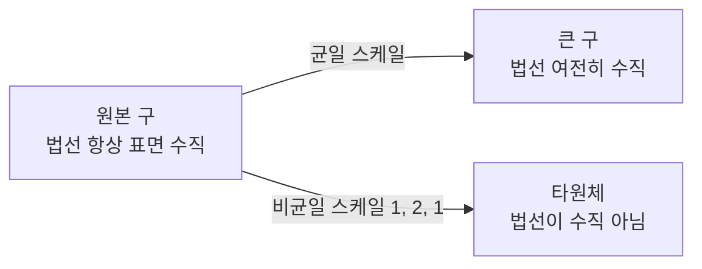
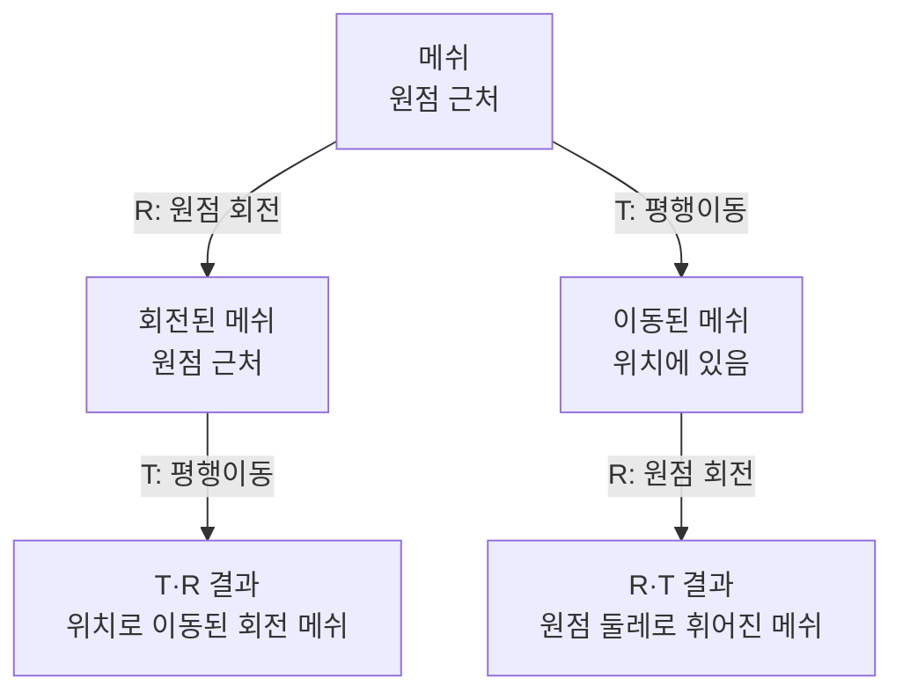
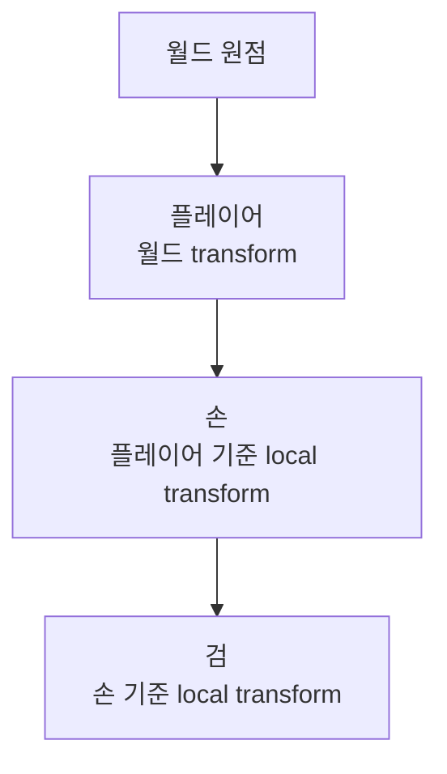
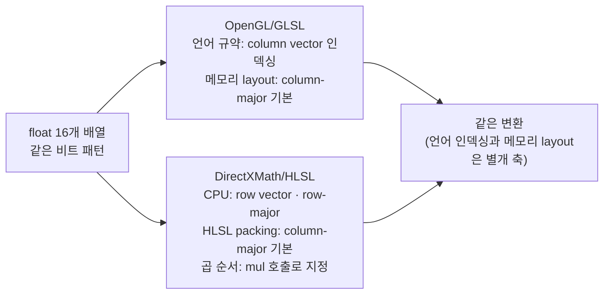

## 들어가며

행렬(Matrix)은 *좌표계 사이를 오가는 다리* 다. 점을 회전시키고, 카메라를 따라가게 하고, 빛이 비치는 표면을 변형하고, 최종적으로 화면 픽셀 좌표에 박는 모든 단계가 *4×4 행렬의 곱* 으로 표현된다. 게임의 GPU 파이프라인이 매 프레임 *수십만 정점에 같은 변환을 적용* 할 수 있는 이유가 *변환을 행렬로 합성* 할 수 있기 때문이다.

벡터가 *공간의 점과 방향* 을 표현한다면, 행렬은 *공간을 다른 공간으로 보내는 함수* 다. 두 함수의 합성이 다시 함수이듯, 두 행렬의 곱이 다시 행렬이라는 사실이 *모델→월드→카메라→투영* 같은 다단계 변환을 *한 번의 곱* 으로 묶는 토대다.

이 글의 목표는 다음 다섯 가지다.

1. 행렬을 *기저 벡터의 목적지를 적어 둔 표* 로 보는 직관을 만든다. 행렬-벡터 곱이 *그 표를 기준으로 벡터를 분해해 새 좌표계로 옮기는* 동작이라는 의미를 짚는다.
2. 동차 좌표(Homogeneous Coordinates) 4×4 행렬이 *이동까지 곱셈으로 통합* 하는 트릭을 분해한다.
3. 회전·스케일·이동의 합성 규칙과 *곱 순서가 의미를 바꾸는* 사실을 코드 예시로 풀어낸다.
4. 일반 역행렬의 비용과 *직교 행렬의 전치 = 역* 이라는 사실, TRS의 닫힌 형태 역을 정리한다.
5. Column-major / Row-major *메모리 레이아웃과 수학적 표기* 의 분리, OpenGL과 DirectX 관례 차이를 짚는다.

벡터 연산이 *같은 좌표계 안* 의 동작이었다면, 이 글의 행렬은 *좌표계 자체를 바꾸는* 동작이다. 행렬이 들어가면 같은 *물리적 점* 이 *다른 성분 표현* 으로 옮겨가고, 회전 표현(Euler/Quaternion)도 행렬 변환과 결합된다.


---

## 목차
1. [행렬의 정의와 곱셈](#1-행렬의-정의와-곱셈)
2. [선형 변환과 기저 변환](#2-선형-변환과-기저-변환)
3. [이동 변환과 동차 좌표](#3-이동-변환과-동차-좌표)
4. [회전 변환](#4-회전-변환)
5. [스케일과 비균일 스케일](#5-스케일과-비균일-스케일)
6. [변환 합성과 곱 순서](#6-변환-합성과-곱-순서)
7. [역행렬과 직교 행렬](#7-역행렬과-직교-행렬)
8. [Column-major vs Row-major](#8-column-major-vs-row-major)


---

## 1. 행렬의 정의와 곱셈

행렬은 *수의 직사각형 배열* 이다. $m \times n$ 행렬 $A$ 는 $m$ 개의 행과 $n$ 개의 열로 $mn$ 개의 원소를 가진다.

$$
A = \begin{pmatrix} a_{11} & a_{12} & \cdots & a_{1n} \\ a_{21} & a_{22} & \cdots & a_{2n} \\ \vdots & \vdots & \ddots & \vdots \\ a_{m1} & a_{m2} & \cdots & a_{mn} \end{pmatrix}
$$

게임 수학에서 자주 보는 형태는 $3 \times 3$ (회전·스케일), $4 \times 4$ (위치·회전·스케일·투영 통합) 가 거의 전부다. 행렬을 *수학적 추상* 으로 보는 동시에 저장 순서, 벡터 convention과 padding을 가진 *float 배열* 로 보아야 한다.

### 1.1 행렬-벡터 곱

$m \times n$ 행렬 $A$ 와 길이 $n$ 인 열 벡터 $\vec{v}$ 의 곱은 길이 $m$ 인 열 벡터.

$$
A \vec{v} = \begin{pmatrix} \sum_j a_{1j} v_j \\ \sum_j a_{2j} v_j \\ \vdots \\ \sum_j a_{mj} v_j \end{pmatrix}
$$

성분으로 풀면 *$i$ 번째 결과 = 행렬의 $i$ 번째 행과 벡터의 내적*. 행렬의 한 행이 *벡터에서 그 차원의 결과를 뽑아내는 가중치* 라는 해석.

```cpp
vec3 MatVec(const mat3& M, vec3 v) {
    return {
        M[0][0]*v.x + M[0][1]*v.y + M[0][2]*v.z,
        M[1][0]*v.x + M[1][1]*v.y + M[1][2]*v.z,
        M[2][0]*v.x + M[2][1]*v.y + M[2][2]*v.z,
    };
}
```

이 코드는 *수학적 행-열 인덱싱* (`M[row][col]`) 을 따른다. *row-major / column-major* 는 8절에서 다루는 *메모리 저장 순서* 의 문제로, 인덱싱 표기와는 별개다. 메모리 레이아웃이 정해지면 코드의 인덱스 순서가 그에 맞춰 달라질 수 있다.

### 1.2 행렬-행렬 곱

$m \times k$ 행렬 $A$ 와 $k \times n$ 행렬 $B$ 의 곱은 $m \times n$ 행렬.

$$
(AB)_{ij} = \sum_{l=1}^{k} A_{il} B_{lj}
$$

성분 (i, j) = *A의 i번째 행과 B의 j번째 열의 내적*. *행렬-벡터 곱을 B의 각 열에 적용한 결과를 모은 것* 으로 해석할 수도 있다.

```cpp
mat3 MatMul(const mat3& A, const mat3& B) {
    mat3 R;
    for (int i = 0; i < 3; ++i)
        for (int j = 0; j < 3; ++j) {
            R[i][j] = 0;
            for (int l = 0; l < 3; ++l)
                R[i][j] += A[i][l] * B[l][j];
        }
    return R;
}
```

3중 for문, $O(n^3)$ 복잡도. $4 \times 4$ 면 64번 곱셈 + 48번 덧셈. SIMD로 짜면 더 빠르지만 핵심은 변하지 않는다.

### 1.3 행렬 곱의 대수 법칙

| 법칙 | 식 | 게임에서의 의미 |
|---|---|---|
| 결합법칙 | $(AB)C = A(BC)$ | 변환 합성을 *어느 쌍 먼저 묶어 계산해도 결과 같음* |
| 분배법칙 | $A(B+C) = AB + AC$ | (게임에선 거의 안 쓴다) |
| 교환법칙 | $AB \ne BA$ (일반적으로) | *변환 순서가 의미를 바꾼다* (6절) |

*결합* 은 성립하지만 *교환* 은 일반적으로 성립하지 않는다. 이 비대칭이 *왜 변환 순서가 중요한가* 의 수학적 이유다.

```cpp
// 결합법칙: 같은 결과
mat4 ResultA = (M1 * M2) * M3;
mat4 ResultB = M1 * (M2 * M3);
// ResultA == ResultB (마지막 비트는 부동소수점이라 다를 수 있음)

// 교환법칙: 다른 결과
mat4 RT = R * T;
mat4 TR = T * R;
// RT != TR (이동 후 회전 vs 회전 후 이동)
```

### 1.4 단위 행렬과 영행렬

$n \times n$ 정방 행렬에서 *대각이 1, 나머지가 0* 인 행렬을 *단위 행렬 (identity matrix) $I$* 라 한다.

$$
I = \begin{pmatrix} 1 & 0 & 0 & 0 \\ 0 & 1 & 0 & 0 \\ 0 & 0 & 1 & 0 \\ 0 & 0 & 0 & 1 \end{pmatrix}
$$

곱셈에서 *항등원*: $A I = I A = A$. *변환을 안 함* 의 표현. 게임 코드에서 *Transform 초기값* 으로 자주 등장.

```cpp
mat4 Identity() {
    return {
        {1, 0, 0, 0},
        {0, 1, 0, 0},
        {0, 0, 1, 0},
        {0, 0, 0, 1},
    };
}
```

영행렬은 행렬 누적값, Jacobian·covariance 초기화, 모든 성분을 제거하는 선형 사상 등에서 유효하다. 다만 “변환 없음”을 뜻하는 transform 초기값은 영행렬이 아니라 단위 행렬이어야 한다.

## 2. 선형 변환과 기저 변환

행렬을 *수의 표* 가 아니라 *기저 벡터의 목적지* 로 보는 직관이 게임 수학의 핵심이다. 이 절은 그 시각으로 행렬을 다시 본다.

### 2.1 기저 벡터와 좌표

3D 공간의 *표준 기저 (standard basis)* 는 다음 세 단위 벡터.

$$
\hat{x} = (1, 0, 0), \quad \hat{y} = (0, 1, 0), \quad \hat{z} = (0, 0, 1)
$$

임의의 벡터 $\vec{v} = (v_x, v_y, v_z)$ 는 기저의 *선형 조합* 으로 분해된다.

$$
\vec{v} = v_x \hat{x} + v_y \hat{y} + v_z \hat{z}
$$

벡터의 *성분* 이 *기저별 가중치* 와 같다는 사실 — 사실 *성분의 정의* 가 그것이다. 다른 기저를 선택하면 같은 *물리적 벡터* 의 *성분이 달라진다*.

### 2.2 행렬은 기저의 목적지를 적은 표

선형 변환 $T$ 가 *기저 벡터를 다음과 같이 옮긴다* 고 하자.

$$
T(\hat{x}) = \vec{a}, \quad T(\hat{y}) = \vec{b}, \quad T(\hat{z}) = \vec{c}
$$

선형성에 의해 임의의 $\vec{v}$ 에 대해:

$$
T(\vec{v}) = T(v_x \hat{x} + v_y \hat{y} + v_z \hat{z}) = v_x \vec{a} + v_y \vec{b} + v_z \vec{c}
$$

이걸 *행렬 형태* 로 적으면:

$$
T(\vec{v}) = \begin{pmatrix} | & | & | \\ \vec{a} & \vec{b} & \vec{c} \\ | & | & | \end{pmatrix} \begin{pmatrix} v_x \\ v_y \\ v_z \end{pmatrix}
$$

*행렬의 열* 이 *기저 벡터의 변환된 결과*. 이게 행렬의 *진짜 의미* 다.

### 2.3 회전 행렬의 직관

z축 둘레 90° 회전을 예로 들면:

$$
T(\hat{x}) = \hat{y}, \quad T(\hat{y}) = -\hat{x}, \quad T(\hat{z}) = \hat{z}
$$

행렬은:

$$
R_z(90°) = \begin{pmatrix} 0 & -1 & 0 \\ 1 & 0 & 0 \\ 0 & 0 & 1 \end{pmatrix}
$$

첫 열이 $T(\hat{x}) = (0, 1, 0)$, 두 번째 열이 $T(\hat{y}) = (-1, 0, 0)$, 세 번째 열이 $T(\hat{z}) = (0, 0, 1)$.

*행렬을 보고 그 변환이 무엇인지 즉시 읽는* 능력이 이 직관에서 나온다 — *각 열이 어디로 가는 화살표인지* 만 보면 된다.

### 2.4 좌표계 변환

행렬의 *진짜 자주 쓰이는* 응용은 *한 좌표계의 좌표를 다른 좌표계의 좌표로 변환* 하는 것이다. 모델 공간 → 월드 공간, 월드 공간 → 카메라 공간, 카메라 공간 → 클립 공간 — 모두 *행렬 곱 한 번*.

캐릭터의 *로컬 공간* 좌표가 *월드 공간* 의 어디로 가는지는 *캐릭터의 transform 행렬* 이 결정한다.

```cpp
mat4 modelMatrix = ...;          // 캐릭터의 transform
vec4 localPos = vec4(0, 1, 0, 1);  // 머리 위 1m
vec4 worldPos = modelMatrix * localPos;
```

이 한 줄이 *캐릭터의 머리 위치가 월드 어디인지* 를 계산. 모델 공간의 (0, 1, 0) 이 캐릭터 자세와 위치에 따라 월드의 어디든 갈 수 있다.

### 2.5 선형 변환의 한계

선형 변환은 다음 두 가지를 보존한다.

- 원점은 원점으로: $T(\vec{0}) = \vec{0}$
- 직선은 직선으로 (또는 점으로 붕괴)

*이동 (translation)* 은 원점을 옮긴다 — *선형 변환이 아니다*. 3×3 행렬로는 표현 불가능.

이 한계는 위치 벡터에 $w=1$, 방향 벡터에 $w=0$을 붙이는 *4×4 동차 좌표* 로 우회한다. 이동은 추가 차원의 선형 변환으로 표현된다.

## 3. 이동 변환과 동차 좌표

3D 공간의 점을 4개 성분으로 표현하는 *동차 좌표 (homogeneous coordinates)* 가 *이동도 행렬 곱으로* 처리하는 핵심 트릭이다.

### 3.1 4번째 성분 w

3D 점 $(x, y, z)$ 를 4번째 성분 $w$ 와 함께 $(x, y, z, w)$ 로 표현한다.

| $w$ | 의미 |
|---|---|
| $1$ | 위치 벡터 (point) — 평행이동 영향 받음 |
| $0$ | 자유 벡터 (direction) — 평행이동 영향 안 받음 |

이 구분이 *4×4 행렬 곱* 의 결과에 *자동으로 반영* 되도록 행렬이 설계된다.

### 3.2 4×4 이동 행렬

$x$ 축으로 $t_x$, $y$ 축으로 $t_y$, $z$ 축으로 $t_z$ 만큼 이동하는 변환:

$$
T = \begin{pmatrix} 1 & 0 & 0 & t_x \\ 0 & 1 & 0 & t_y \\ 0 & 0 & 1 & t_z \\ 0 & 0 & 0 & 1 \end{pmatrix}
$$

위치 벡터 $(x, y, z, 1)$ 에 곱하면:

$$
T \begin{pmatrix} x \\ y \\ z \\ 1 \end{pmatrix} = \begin{pmatrix} x + t_x \\ y + t_y \\ z + t_z \\ 1 \end{pmatrix}
$$

*위치가 이동* 했다. 자유 벡터 $(x, y, z, 0)$ 에 곱하면:

$$
T \begin{pmatrix} x \\ y \\ z \\ 0 \end{pmatrix} = \begin{pmatrix} x \\ y \\ z \\ 0 \end{pmatrix}
$$

*변하지 않는다*. 자유 벡터 (속도, 법선 등) 가 *이동에 영향을 안 받는* 의미가 *w 성분 자체* 로 인코딩된다.

### 3.3 위치와 방향의 통합 처리

이 트릭이 게임 엔진의 *통합 변환 파이프라인* 의 토대다. 모든 변환을 *4×4 행렬 곱* 으로 통일.

```cpp
struct Vec4 {
    float x, y, z, w;
    static Vec4 Point(float x, float y, float z) { return {x, y, z, 1}; }
    static Vec4 Vector(float x, float y, float z) { return {x, y, z, 0}; }
};

vec4 worldPos = modelMatrix * Vec4::Point(localPos.x, localPos.y, localPos.z);
vec4 worldDir = modelMatrix * Vec4::Vector(localDir.x, localDir.y, localDir.z);
```

같은 행렬, 같은 곱, 다른 의미. *w 성분이 위치/방향의 의미를 자동으로 맞춰 준다*.

### 3.4 투영에서 w 성분의 다른 의미

아핀 변환에서는 점의 동차 좌표 $w=1$이 유지되지만, 원근 투영 행렬은 일반적으로 출력의 $w$를 카메라 깊이에 비례하도록 바꾼다. 클립 좌표 $(x_c,y_c,z_c,w_c)$에 원근 분할

$$
(x_c,y_c,z_c,w_c)\longmapsto
\left(\frac{x_c}{w_c},\frac{y_c}{w_c},\frac{z_c}{w_c}\right)
$$

을 적용하면 같은 월드 크기의 물체도 카메라에서 멀수록 화면상 작아진다. 즉 $w$는 "항상 1인 여분의 칸"이 아니라, 아핀 변환과 사영 변환을 하나의 행렬 곱 체계에 함께 넣는 좌표다.

### 3.5 동차 좌표의 메모리 비용

`vec4` 가 `vec3` 보다 33% 더 큰 메모리. 게임 엔진의 정점 버퍼는 *vec3 위치 + 별도 처리* 또는 *vec4 위치* 두 선택이 있다.

| 선택 | 정점당 byte | 비고 |
|---|---|---|
| vec3 + GPU에서 w=1 추가 | 12 | OpenGL/Vulkan의 일반 패턴 |
| vec4 (w=1 명시) | 16 | DirectX의 일부 ConstantBuffer |
| vec3 (w 없음) | 12 | 게임플레이 위치, 변환 시 4D로 임시 승급 |

게임플레이 코드는 보통 `vec3` 으로 위치를 들고, *변환 시점에만* 임시로 `vec4` 로 승급한다. 정점 버퍼도 메모리 절약 우선. *행렬 곱 직전에만* 4D 표현이 필요한 모델.

## 4. 회전 변환

회전은 게임 수학에서 가장 자주 쓰는 변환 중 하나다. 이 절은 *축별 회전* 과 *임의 축 회전* 의 행렬 형태를 정리한다.

### 4.1 축별 회전 행렬

오른손 좌표계 + 시계 반대 방향 (오른손 법칙 양의 방향) 으로의 회전.

**X축 회전** ($yz$ 평면이 회전):

$$
R_x(\theta) = \begin{pmatrix} 1 & 0 & 0 \\ 0 & \cos\theta & -\sin\theta \\ 0 & \sin\theta & \cos\theta \end{pmatrix}
$$

**Y축 회전** ($zx$ 평면이 회전):

$$
R_y(\theta) = \begin{pmatrix} \cos\theta & 0 & \sin\theta \\ 0 & 1 & 0 \\ -\sin\theta & 0 & \cos\theta \end{pmatrix}
$$

**Z축 회전** ($xy$ 평면이 회전):

$$
R_z(\theta) = \begin{pmatrix} \cos\theta & -\sin\theta & 0 \\ \sin\theta & \cos\theta & 0 \\ 0 & 0 & 1 \end{pmatrix}
$$

회전 축 자체는 변하지 않는다 — 그 축에 해당하는 행/열이 단위 행렬과 같다.

### 4.2 4×4 형태로 확장

3×3 회전 행렬을 4×4로 확장하려면 4번째 행/열에 *단위 행렬 일부* 를 채운다.

$$
R_z^{4 \times 4}(\theta) = \begin{pmatrix} \cos\theta & -\sin\theta & 0 & 0 \\ \sin\theta & \cos\theta & 0 & 0 \\ 0 & 0 & 1 & 0 \\ 0 & 0 & 0 & 1 \end{pmatrix}
$$

이렇게 하면 *위치 벡터* $(x, y, z, 1)$ 에 곱했을 때 w 성분이 1을 유지하고, 회전이 정확히 적용된다.

### 4.3 좌표계 손잡이의 영향

오른손 좌표계 vs 왼손 좌표계에서 *같은 시각적 회전* 의 행렬 부호가 다르다.

- **OpenGL 관례** (오른손이 흔함): 4.1의 식 그대로.
- **DirectX 관례** (왼손이 흔함): DirectXMath의 `XMMatrixRotationX/Y/Z` 원소가 4.1과 *전치* 로 보이는 것은 손잡이가 아니라 *행 벡터 관례* (8.4) 때문이고, 좌표 사상은 4.1과 같다. 손잡이 자체 (z축 반전) 를 바꿔 *같은 시각적 회전* 을 얻으려면 z축을 섞는 $R_x$·$R_y$ 의 sin 항 부호만 뒤집히고 $R_z$ 는 그대로다.

DirectX 자체가 *왼손을 강제* 하지는 않는다. DirectXMath의 축 회전 함수는 `XMMatrixRotationX/Y/Z`처럼 손잡이 접미사가 없고, 뷰·투영 함수가 `XMMatrixLookAtLH/RH`, `XMMatrixPerspectiveFovLH/RH` 쌍을 제공한다. *튜토리얼과 일반적 관례* 가 LH일 뿐이다. 어느 좌표계로 갈지는 *프로젝트 시작 시 결정* 하고 일관되게 쓴다.

```cpp
// 오른손 좌표계 (OpenGL 관례): 4.1의 R_x 그대로
mat4 RotateX_RH(float theta) {
    float c = cos(theta), s = sin(theta);
    return {
        { 1,  0,  0, 0},
        { 0,  c, -s, 0},
        { 0,  s,  c, 0},
        { 0,  0,  0, 1},
    };
}

// 왼손 좌표계 (z축 반전) 에서 같은 시각적 회전: sin 항 부호 반전
mat4 RotateX_LH(float theta) {
    float c = cos(theta), s = sin(theta);
    return {
        { 1,  0,  0, 0},
        { 0,  c,  s, 0},
        { 0, -s,  c, 0},
        { 0,  0,  0, 1},
    };
}
```

게임 엔진의 일관된 손잡이 선택이 *모든 행렬 식* 을 결정한다. 두 엔진을 섞으면 *회전이 거꾸로 보이는* 흔한 함정.

### 4.4 임의 축 회전 (Rodrigues 공식)

축 $\hat{u} = (u_x, u_y, u_z)$ 둘레 각도 $\theta$ 회전. Rodrigues의 공식:

$$
R = I + \sin\theta \cdot K + (1 - \cos\theta) \cdot K^2
$$

여기서 $K$ 는 *외적 행렬*:

$$
K = \begin{pmatrix} 0 & -u_z & u_y \\ u_z & 0 & -u_x \\ -u_y & u_x & 0 \end{pmatrix}
$$

$K \vec{v} = \hat{u} \times \vec{v}$ 와 같다 — 외적을 행렬 곱으로 표현한 것.

전개하면:

$$
R = \begin{pmatrix}
c + u_x^2(1-c) & u_x u_y (1-c) - u_z s & u_x u_z (1-c) + u_y s \\
u_y u_x (1-c) + u_z s & c + u_y^2 (1-c) & u_y u_z (1-c) - u_x s \\
u_z u_x (1-c) - u_y s & u_z u_y (1-c) + u_x s & c + u_z^2 (1-c)
\end{pmatrix}
$$

복잡한 형태지만 *축과 각도* 만 알면 행렬을 직접 만들 수 있다. 다만 *Quaternion 표현이 더 효율적* 이라 직접 이 식을 자주 쓰지는 않는다.

### 4.5 회전 행렬의 성질

회전 행렬은 다음 성질을 만족한다.

1. **직교 (orthogonal)**: 행/열이 서로 수직인 단위 벡터. $R^T R = I$.
2. **행렬식 $+1$**: 부피·방향을 보존. 행렬식이 $-1$ 이면 *반사 (reflection)* 도 포함.
3. **역 = 전치**: $R^{-1} = R^T$. 직교 행렬은 일반 역행렬 알고리즘 없이 전치만으로 역을 구한다.
4. **합성**: 두 회전의 곱은 다시 회전. 회전 그룹 SO(3).

이 성질들이 *회전이 부동소수점 누적에 강한 (어느 정도)* 이유다. 회전 행렬을 매 프레임 갱신해도 직교성이 *대체로* 유지된다 — 다만 *완벽히* 유지되지는 않아 누적되면 *점점 회전이 아닌 것* 이 될 수 있다 (4.6 참조).

### 4.6 회전 행렬의 직교성 회복

매 프레임 작은 회전을 누적하면 *부동소수점 오차* 가 누적되어 행렬이 *엄밀히 직교가 아니게* 된다. 이 상태로 더 누적하면 점·법선이 *왜곡* 되어 보인다 (모델이 늘어나거나 찌그러진다).

대응: *주기적 직교성 회복 (re-orthogonalization)*. Gram-Schmidt 또는 SVD 기반.

```cpp
mat3 ReOrthogonalize(mat3 m) {
    vec3 col0 = normalize(m.col(0));
    vec3 col1 = normalize(m.col(1) - dot(m.col(1), col0) * col0);
    vec3 col2 = cross(col0, col1);
    return mat3{col0, col1, col2};
}
```

매 N 프레임 (예: 60프레임) 마다 한 번 적용. 또는 *Quaternion으로 회전을 들고* 변환 시에만 행렬로 변환하는 게 *근본적 회피*.

## 5. 스케일과 비균일 스케일

스케일은 *벡터의 각 축 성분에 다른 배율* 을 곱하는 변환. 단순한 대각 행렬.

### 5.1 균일 스케일

모든 축에 같은 배율 $s$:

$$
S(s) = \begin{pmatrix} s & 0 & 0 & 0 \\ 0 & s & 0 & 0 \\ 0 & 0 & s & 0 \\ 0 & 0 & 0 & 1 \end{pmatrix}
$$

물체가 *중심 (원점) 기준으로 균등하게 커지거나 작아진다*. 비율이 유지되어 *모양이 변하지 않음*.

```cpp
mat4 ScaleUniform(float s) {
    return {
        { s, 0, 0, 0},
        { 0, s, 0, 0},
        { 0, 0, s, 0},
        { 0, 0, 0, 1},
    };
}
```

### 5.2 비균일 스케일

축별로 다른 배율 $(s_x, s_y, s_z)$:

$$
S(s_x, s_y, s_z) = \begin{pmatrix} s_x & 0 & 0 & 0 \\ 0 & s_y & 0 & 0 \\ 0 & 0 & s_z & 0 \\ 0 & 0 & 0 & 1 \end{pmatrix}
$$

축마다 다르게 늘어나/줄어든다. *모양이 왜곡* 된다 — 구가 타원체로, 정육면체가 직육면체로.

게임 엔진의 *Transform 컴포넌트* 가 보통 비균일 스케일을 지원한다. 기획 단계에서 *사람을 길쭉하게 만들거나*, *일부 메쉬를 납작하게 만드는* 경우.

### 5.3 비균일 스케일과 법선 변환의 함정

이 절이 *행렬에서 가장 잘 빠지는 함정* 이다.

비균일 스케일이 적용되면 *원래 면에 수직이던 법선이 더 이상 수직이 아니다*. 같은 행렬로 위치와 법선을 변환하면 *법선이 잘못된 방향* 을 가리킨다.



수학적으로, 선형 부분이 가역인 변환 행렬 $M$ 으로 *법선* 을 변환하려면 *역전치 행렬* 을 쓴다. 면 위의 두 접선 벡터 $\vec{t_1}, \vec{t_2}$ 가 $M$ 으로 변환되면 변환된 면 법선은 그 외적인 $(M\vec{t_1}) \times (M\vec{t_2})$ 이고, 외적의 항등식

$$
(M\vec{u}) \times (M\vec{v}) = \det(M)\, (M^{-1})^T (\vec{u} \times \vec{v})
$$

에 의해 이것은 $\det(M) (M^{-1})^T \vec{n}$ 다. 여기서 $\det(M)$ 은 *부호를 가진* 스케일 인자다. 정규화가 없애는 것은 $|\det(M)|$ 의 *크기* 이지 $\det(M) < 0$ 의 *부호가 아니다*. 따라서 winding으로 만든 면 법선과 역전치로 운반한 방향 법선은 *행렬식이 음수인 변환에서 부호가 갈린다*:

$$
\operatorname{normalize}\big((M\vec{t_1}) \times (M\vec{t_2})\big) = \operatorname{sign}(\det M)\, \operatorname{normalize}\big((M^{-1})^T \vec{n}\big)
$$

예를 들어 $M = \operatorname{diag}(-1, 1, 1)$ (x축 거울) 에서 모델 법선 $\vec{n} = \hat{z}$ 를 생각하자. 변환된 접선의 외적은 $-\hat{z}$ 를 주지만, 역전치로 운반한 $(M^{-1})^T \vec{n} = \hat{z}$ 는 부호가 반대다. 정규화 후에도 이 부호 차이는 남는다. 거울 변환 ($\det M < 0$) 에서는 *winding 순서를 뒤집을지*, *front-face 상태를 바꿀지* 를 별도 계약으로 정한다.

```cpp
// 위치 변환
vec4 worldPos = modelMatrix * vec4(modelPos, 1.0);

// 법선 변환 (비균일 스케일 안전)
mat3 normalMatrix = transpose(inverse(mat3(modelMatrix)));
vec3 worldNormal = normalize(normalMatrix * modelNormal);
```

이 코드는 *방향 법선 (oriented normal)* 을 보존한다 — 음수 행렬식이면 winding 기반 면 법선과 부호가 다를 수 있으므로 위 계약이 필요하다. 균일 스케일이면 $(M^{-1})^T = M / s^2$ 이라 *방향만 같음*. 정규화하면 결과 같다 — 균일 스케일 시 법선 변환에 단순 행렬 곱을 써도 된다.

비균일 스케일이 들어가는 게임 엔진은 *셰이더에 normal matrix를 별도 uniform* 으로 넘기는 게 표준. 이를 안 하면 *라이팅이 잘못 되는 미묘한 버그* — 특히 원거리 빛이 어색하게 비치는 모습.

### 5.4 음수 스케일과 반사

스케일 인자가 음수면 해당 축 방향이 뒤집힌다. 음수 축이 홀수 개면 행렬식이 음수라 방향을 뒤집는 반사가 포함되고, 두 축이 음수면 행렬식이 양수라 전체 방향은 보존된다.

$$
S(-1, 1, 1) = \begin{pmatrix} -1 & 0 & 0 & 0 \\ 0 & 1 & 0 & 0 \\ 0 & 0 & 1 & 0 \\ 0 & 0 & 0 & 1 \end{pmatrix}
$$

x축 기준 거울 반사. 물체가 좌우 뒤집힘. 행렬식이 $-1$ 이라 *손잡이 (handedness) 가 뒤집힌다*.

게임 엔진에서 *음수 스케일은 자주 위험* 하다 — 셰이더의 백페이스 컬링이 *winding order 반대* 로 인식해 메쉬가 사라진 것처럼 보인다. 좌우 거울상 캐릭터 같은 효과를 음수 스케일로 만들면 *추가 셰이더 처리* 가 필요하다.

## 6. 변환 합성과 곱 순서

여러 변환을 한 행렬로 합치는 게 *행렬 곱* 의 가장 큰 활용. 이 절은 *합성 순서가 의미를 바꾸는* 사실을 정리한다.

### 6.1 TRS 관례

게임 엔진의 표준 합성 순서는 *Scale → Rotate → Translate* (S, R, T 순서로 적용). 행렬 곱으로는 *오른쪽부터 적용* 되므로:

$$
M = T \cdot R \cdot S
$$

위치 벡터에 곱하면 $S$ 가 먼저 적용되고, 그 다음 $R$, 마지막으로 $T$.

$$
\vec{v}_{\text{world}} = T \cdot R \cdot S \cdot \vec{v}_{\text{local}} = T (R (S \vec{v}_{\text{local}}))
$$

```cpp
mat4 ModelMatrix(vec3 position, quat rotation, vec3 scale) {
    mat4 S = ScaleNonUniform(scale.x, scale.y, scale.z);
    mat4 R = RotationFromQuat(rotation);
    mat4 T = Translate(position.x, position.y, position.z);
    return T * R * S;
}
```

이 순서가 *직관적* 이다 — 메쉬를 *원점에서 크기 조정*, *원점에서 회전*, *마지막 위치로 이동*.

### 6.2 곱 순서가 다른 의미

*$T \cdot R$* 와 *$R \cdot T$* 가 다른 변환이라는 사실의 직관.

**$T \cdot R$**: 회전 후 이동. 메쉬가 *원점에서 회전한 뒤 위치로 이동*. 일반적으로 의도하는 모델 변환.

**$R \cdot T$**: 이동 후 회전. 메쉬가 *위치로 옮긴 뒤 그 위치에서 원점 둘레로 회전*. 결과가 *위치와 회전이 결합* 된 이상한 변환.



같은 R과 T의 순서를 바꾸면 일반적으로 결과 위치가 다르다. 이 두 경우의 선형 부분은 모두 R이므로, 이동이 물체의 방향 자체를 바꾸지는 않는다.

### 6.3 키포인트 회전 (피봇 회전)

특정 점 $\vec{p}$ *둘레로* 회전하려면 다음 순서.

1. 메쉬를 $-\vec{p}$ 만큼 이동 (피봇이 원점에 오도록).
2. 원점 둘레로 회전.
3. $+\vec{p}$ 만큼 이동.

행렬 곱: $T(\vec{p}) \cdot R \cdot T(-\vec{p})$.

```cpp
mat4 RotateAroundPivot(vec3 pivot, quat rotation) {
    mat4 toOrigin = Translate(-pivot);
    mat4 R = RotationFromQuat(rotation);
    mat4 fromOrigin = Translate(pivot);
    return fromOrigin * R * toOrigin;
}
```

캐릭터의 *발 둘레 회전* (점프 회전), *카메라의 타겟 둘레 회전* 같은 게임 코드의 패턴.

### 6.4 부모-자식 계층 (transform hierarchy)

게임 엔진의 *씬 그래프* 는 *부모의 변환을 자식에 누적* 한다.



검의 *월드 변환* 은:

$$
M_{\text{sword, world}} = M_{\text{player}} \cdot M_{\text{hand, local}} \cdot M_{\text{sword, local}}
$$

로컬 → 손 → 플레이어 → 월드. *오른쪽부터 적용*.

```cpp
mat4 GetWorldMatrix(GameObject* obj) {
    mat4 M = obj->localMatrix;
    GameObject* parent = obj->parent;
    while (parent) {
        M = parent->localMatrix * M;
        parent = parent->parent;
    }
    return M;
}
```

캐싱이 흔한 최적화 — *자신의 로컬 transform과 조상들의 월드 transform이 모두 변하지 않으면* 월드 매트릭스를 재사용한다. 어느 쪽이든 바뀌면 해당 캐시를 무효화해야 한다.

### 6.5 변환 분해 (decomposition)

합성된 행렬 $M$ 에서 *T, R, S 를 다시 추출* 하는 역연산이다. 다음 코드는 *shear 없는 양수 스케일 TRS* 를 전제한다. 계층에서 상속된 변환을 다시 분해할 때는 *양수 단일 TRS*, *부호가 비유일한 signed TRS*, *shear가 있는 일반 affine* 을 구분해야 한다.

- **양수 단일 TRS**: 위 코드처럼 각 열의 길이를 스케일로, 정규화한 열을 회전으로 뽑는다.
- **signed TRS (shear 없음)**: 열 길이와 $\det M$ 의 부호를 조합해 *한 축의 부호* 를 선택하면 분해할 수 있다. 원래 각 축의 부호는 *비유일* 하지만 (어느 축에 음수를 붙여도 같은 행렬이 될 수 있다), *SVD가 반드시 필요한 것은 아니다*. 부호 선택 규약 (예: 항상 z축에 음수를 몰아넣기) 을 정한다.
- **일반 affine (shear 포함)**: 하나의 *순수 TRS로 정확히 표현되지 않을 수 있다*. 이 경우 Polar 분해나 SVD로 회전·스케일·shear를 분리하거나, shear를 별도 성분으로 다룬다.

```cpp
struct TRS {
    vec3 translation;
    quat rotation;
    vec3 scale;
};

// 가정: M이 T·R·S 형태 (shear 없음, scale 양수)
TRS Decompose(mat4 M) {
    TRS result;
    // 1. Translation: 마지막 열의 위쪽 3성분
    result.translation = vec3(M[0][3], M[1][3], M[2][3]);

    // 2. Scale: 위쪽 3×3 부분의 각 열의 길이 (양수 가정)
    vec3 col0 = vec3(M[0][0], M[1][0], M[2][0]);
    vec3 col1 = vec3(M[0][1], M[1][1], M[2][1]);
    vec3 col2 = vec3(M[0][2], M[1][2], M[2][2]);
    result.scale = vec3(length(col0), length(col1), length(col2));

    // 3. Rotation: 위쪽 3×3에서 스케일을 제거한 직교 부분
    mat3 R = mat3(col0 / result.scale.x,
                   col1 / result.scale.y,
                   col2 / result.scale.z);
    result.rotation = QuaternionFromMatrix(R);

    return result;
}
```

다만 *비균일 스케일 + 회전이 합성된 행렬* 의 *완벽한 TRS 분해* 는 보장되지 않는다 — 부동소수점 오차와 분해의 비유일성이 함께 작용한다. 게임 엔진은 *분해를 피하고 처음부터 T, R, S를 분리해 보관* 하는 게 일반.

## 7. 역행렬과 직교 행렬

행렬의 *역 (inverse)* $M^{-1}$ 은 $MM^{-1} = I$ 를 만족하는 행렬. 변환의 *되돌리기* 다.

### 7.1 일반 역행렬의 비용

$n \times n$ 행렬의 일반적인 역 계산은 피벗을 포함한 *가우스-조던 소거* 또는 분해 후 선형계 풀이로 $O(n^3)$ 이다. 4×4는 크기가 고정이므로 점근 복잡도보다 실제 산술량·분기·데이터 이동이 중요하다. 그래도 직교·아핀·TRS 구조를 이용한 전용 역보다 작업이 많고, 특이하거나 조건수가 큰 행렬을 처리해야 한다.

```cpp
mat4 Inverse(mat4 M);  // 일반 4×4 역: 구현과 하드웨어에 따라 비용이 달라진다
```

### 7.2 역이 존재하는 조건

행렬이 *가역 (invertible)* 이려면 *행렬식이 0이 아니어야* 한다.

$$
\det(M) \ne 0 \implies M^{-1} \text{ 존재}
$$

행렬식 0 = *변환이 차원을 줄임* (3D를 2D 평면으로 투영, 또는 1D 선으로 줄임). 이 경우 *원래 차원으로 되돌릴 정보가 손실* 되어 역이 존재하지 않는다.

게임 코드에서 *비균일 스케일이 0* 이면 행렬식 0 — 가역이 아니다. *Transform.scale = (0, 1, 1)* 같은 설정 자체가 즉시 NaN을 만들지는 않지만, *역행렬 계산·정규화·normal matrix 계산* 에서 NaN/Inf가 발생해 그 이후 코드가 깨진다.

### 7.3 직교 행렬의 빠른 역

순수 회전 행렬 (4.5절) 은 *직교*. 즉 $R^T R = I$ 라 $R^{-1} = R^T$. *역 = 전치*.

전치는 산술적인 소거 대신 *원소 자리 바꾸기* 만 한다. 제자리 4×4 전치는 대각선 위의 여섯 쌍을 교환하면 된다. SIMD 레지스터에서는 shuffle과 unpack으로 구현할 수도 있다.

```cpp
mat4 InverseRotation(mat4 R) {
    return Transpose(R);
}
```

게임 엔진의 카메라 view matrix는 *4×4 전체가 직교가 아니다* — 이동이 들어가기 때문. 다만 카메라가 *rigid transform (회전 + 이동만, 스케일 없음)* 이면 *3×3 회전 부분은 직교* 라 다음과 같이 빠르게 역을 계산할 수 있다.

$$
M = \begin{pmatrix} R & \vec{t} \\ 0 & 1 \end{pmatrix}, \quad
M^{-1} = \begin{pmatrix} R^T & -R^T \vec{t} \\ 0 & 1 \end{pmatrix}
$$

```cpp
mat4 InverseRigid(mat3 R, vec3 t) {
    mat3 RT = Transpose(R);
    vec3 newT = -(RT * t);
    return AssembleAffine(RT, newT);
}
```

3×3 전치 + 행렬-벡터 곱 한 번이면 된다. 일반 4×4 역행렬보다 연산 구조가 단순하고 특이성 검사도 필요 없다. 실제 속도 비율은 수학 라이브러리와 SIMD 구현을 벤치마크해 판단한다.

### 7.4 TRS 행렬의 닫힌 형태 역

$M = T \cdot R \cdot S$ 의 역은:

$$
M^{-1} = S^{-1} \cdot R^{-1} \cdot T^{-1} = S^{-1} \cdot R^T \cdot T(-\vec{t})
$$

각 부분의 역이 *간단하다*.

| 부분 | 역 |
|---|---|
| 이동 $T(\vec{t})$ | $T(-\vec{t})$ |
| 회전 $R$ | $R^T$ |
| 균일 스케일 $S(s)$ | $S(1/s)$ |
| 비균일 스케일 $S(s_x, s_y, s_z)$ | $S(1/s_x, 1/s_y, 1/s_z)$ |

```cpp
mat4 InverseTRS(vec3 t, quat r, vec3 s) {
    // 각 scale 성분은 0이 아니고 r은 단위 쿼터니언이어야 한다.
    vec3 invS = vec3(1/s.x, 1/s.y, 1/s.z);
    quat invR = Conjugate(r);  // 단위 quat의 역 = conjugate
    vec3 invT = -t;
    // 합성 순서: invS · invR · invT (오른쪽부터 적용)
    return ScaleMatrix(invS) * RotationMatrix(invR) * TranslateMatrix(invT);
}
```

이 닫힌 형태는 각 스케일 성분이 0이 아니고 `r`이 단위 쿼터니언이라는 전제에서 성립한다. 일반 역보다 연산 구조가 단순한 것이 게임 엔진이 transform을 *T, R, S 분리 보관* 하는 이유 중 하나다.

### 7.5 좌표계 변환의 역

월드 → 카메라 변환 행렬의 역은 *카메라 → 월드*. 게임 엔진의 *view matrix* 가 보통 *카메라의 world transform의 역*:

$$
M_{\text{view}} = M_{\text{camera}}^{-1}
$$

카메라 transform을 단위 회전 + 이동으로 만들면 view matrix는 *3×3 전치 + 평행이동 변환* 으로 계산할 수 있다.

### 7.6 numerical 안정성

일반 역행렬 계산은 *가우스 소거의 pivot이 0에 가까워지는* 함정이 있다. 다만 *행렬식이 작은 것* 과 *조건이 나쁜 것 (ill-conditioned)* 은 다르다. $\varepsilon I$ 는 행렬식이 매우 작아도 조건수는 1이고, $\operatorname{diag}(K, 1/K, 1)$ 은 행렬식이 1이어도 $K$ 가 크면 조건수가 크다. 역의 정확도는 행렬식의 절대값이 아니라 *스케일을 반영한 조건수* 로 판단한다.

```cpp
mat4 inv = Inverse(M);

// (1) 전체 원소의 finite 여부 — 최소 방어선
for (int i = 0; i < 4; ++i)
    for (int j = 0; j < 4; ++j)
        if (!std::isfinite(inv[i][j])) { /* fallback */ }

// (2) 잔차 ||M·inv − I|| 로 역의 정확도를 확인
mat4 R = M * inv;
for (int i = 0; i < 4; ++i)
    for (int j = 0; j < 4; ++j)
        R[i][j] -= (i == j) ? 1.0f : 0.0f;
float residual = Norm(R);   // 스케일에 맞는 임계값과 비교
```

`inv[0][0]` 하나만 finite인지 보는 검사는 다른 원소의 NaN/Inf나 *유한하지만 큰 오차* 를 검출하지 못한다. finite 검사는 *전체 원소에 대한 최소 방어* 이고 역의 정확도 *보증이 아니다*. 정확도가 문제되는 경로에서는 스케일 상대적인 pivot/조건수 추정과 위 잔차 검사를 함께 쓴다.

게임 엔진은 *역행렬 계산 직후 finite 검사* 가 흔하다. 또는 *처음부터 직교 + TRS 분리 보관* 으로 일반 역행렬 호출을 *피한다*.

## 8. Column-major vs Row-major

같은 행렬을 *메모리에 어떻게 저장하는가* 의 두 진영. *수학적 표기* 와 *메모리 레이아웃* 을 분리해서 보면 혼란이 줄어든다.

### 8.1 두 메모리 레이아웃

행렬 $\begin{pmatrix} a & b & c & d \\ e & f & g & h \\ i & j & k & l \\ m & n & o & p \end{pmatrix}$ 를 16개 float 배열로 저장하는 두 방식.

**Row-major**: 한 행씩 차례로 저장.

```text
[a, b, c, d, e, f, g, h, i, j, k, l, m, n, o, p]
```

**Column-major**: 한 열씩 차례로 저장.

```text
[a, e, i, m, b, f, j, n, c, g, k, o, d, h, l, p]
```

### 8.2 API 별 관례

| 표기 | API |
|---|---|
| Column-major | OpenGL, GLSL, glm, Metal Shading Language, Unity (`Matrix4x4`) |
| Row-major | DirectXMath, Unreal (DirectXMath의 row-vector + row-major 관례) |
| 사용자 선택 | Eigen (column-major default), Vulkan/SPIR-V (layout decoration으로 지정) |

OpenGL/GLSL 셰이더에서 *행렬 인덱싱이 `M[col][row]`* 인 것은 *언어가 열 벡터를 기준으로 정의한 규약* 이다. 이것은 메모리 저장 순서와 별개다 — `row_major` / `column_major` block layout 한정자는 *메모리 layout* 을 바꾸지만 언어의 인덱싱 의미는 바꾸지 않는다.

HLSL의 *uniform parameter matrix packing 기본값은 column-major* 다 (Microsoft 공식 문서 기준). 이는 *DirectXMath의 일반 row-major 관례* 와 별개라 *호스트 코드와 셰이더 사이 행렬 packing* 이 어긋날 수 있다 — *D3DCOMPILE_PACK_MATRIX_ROW_MAJOR* 컴파일 플래그, `row_major` / `column_major` 키워드, `#pragma pack_matrix` 로 명시 변경. CPU 측 DirectXMath는 row-vector + row-major 관례지만 GPU 측 HLSL은 별도 packing 설정이라 *둘 사이 변환을 셰이더 컴파일 시점에 명시* 하는 게 표준.

### 8.3 수학 표기와 메모리 레이아웃의 분리

핵심 통찰: *수학적 행렬 곱은 메모리 레이아웃과 무관* 하다. $M \vec{v}$ 의 *결과* 가 같은 한, 메모리에 어떻게 저장하든 의미 같음.

다만 *코드의 인덱싱 순서* 는 다르다.

```cpp
// Row-major
struct Mat4Row {
    float m[4][4];   // m[row][col]
};
float access = M.m[0][1];  // 0행 1열

// Column-major
struct Mat4Col {
    float m[4][4];   // m[col][row]
};
float access = M.m[1][0];  // 0행 1열 (인덱스 순서 반대)
```

같은 *수학적 위치* 가 *코드에서 다른 인덱스* 로 접근. 라이브러리 간 변환 시 *혼동의 원천*.

### 8.4 행 벡터 vs 열 벡터

*수학적으로* 벡터를 *행 벡터* 또는 *열 벡터* 로 쓸지에 따라 곱셈 표기가 다르다.

**Column vector convention**: $\vec{v}$ 가 열 벡터, 행렬을 *왼쪽에서* 곱한다.

$$
\vec{v}' = M \vec{v}
$$

OpenGL, GLSL, glm.

**Row vector convention**: $\vec{v}$ 가 행 벡터, 행렬을 *오른쪽에서* 곱한다.

$$
\vec{v}' = \vec{v} M
$$

DirectX, Unreal.

두 관례에서 *같은 변환을 표현하는 행렬은 서로 전치 관계*. column convention의 $M$ 이 row convention의 $M^T$.

### 8.5 메모리 레이아웃 + 벡터 관례 = 같은 코드

*Column-major + column vector* 와 *Row-major + row vector* 의 *특정 관례 쌍* 에서는 *같은 16개 float 배열* 을 *서로 전치된 수학 행렬* 로 해석해 *같은 변환* 을 만들 수 있다. 즉 *전치 관계 + 곱하는 쪽 (왼쪽/오른쪽) 도 같이 뒤집힌* 조합이라 결과가 일치한다.

다만 이 *비트 일치* 는 무조건 성립하지 않는다. *API의 packing 옵션* (HLSL의 `column_major` / `row_major` 키워드), *셰이더 transpose 옵션* (`glUniformMatrix4fv` 의 transpose 인자), *mul 호출 순서* (`mul(M, v)` vs `mul(v, M)`) 가 모두 일치해야 한다. 어느 하나라도 어긋나면 *전치된 행렬이 그대로 적용* 되어 회전이 거꾸로 보이거나 변환이 깨진다.

이 사실이 *셰이더 라이브러리 설계의 트릭* 이다. 같은 *float[16] 배열* 을 OpenGL과 DirectX 셰이더 양쪽에서 *적절히 해석* 하면 같은 변환이 적용된다.



### 8.6 코드 작성 시 주의

- *행렬 라이브러리의 곱셈 함수 시그니처* 가 어떤 관례를 따르는지 확인. glm은 column-major + column vector라 `M * v` 가 자연스럽다. DirectX의 `XMVector4Transform(v, M)` 은 *행 벡터를 행렬 오른쪽* 으로 곱하는 의미.
- *셰이더에 행렬을 넘길 때* 메모리 레이아웃 일치를 확인. OpenGL의 `glUniformMatrix4fv`에서 세 번째 인자인 `transpose`가 전치를 요청하고, 마지막 인자는 행렬 데이터 포인터다.
- *행렬 곱 순서가 의미적으로 같으려면* 수학 표기와 코드 호출이 일관해야 한다. column convention 코드에서 *모델 → 월드* 순서가 `world * model`, row convention이면 `model * world`.

게임 엔진의 *수학 라이브러리 선택* 이 *팀 전체의 코딩 스타일* 을 결정한다. glm을 쓰면 *OpenGL 스타일*, DirectXMath를 쓰면 *DirectX 스타일*. 섞으면 혼란.

### 8.7 SIMD와 메모리 레이아웃

SIMD 행렬 곱은 *메모리 레이아웃에 민감*. *4×4 행렬 곱* 의 SSE 구현은 *한 행 또는 한 열을 한 SIMD 레지스터에 로드* 하므로, 레이아웃이 *접근 패턴* 을 결정.

```cpp
// SSE 4×4 곱 (m[col][row] 저장, A·B). 각 열에는 float 4개가 있다.
mat4 MulSSE(mat4 A, mat4 B) {
    mat4 R;
    for (int j = 0; j < 4; ++j) {
        __m128 sum = _mm_setzero_ps();
        for (int k = 0; k < 4; ++k) {
            __m128 aCol = _mm_loadu_ps(&A.m[k][0]);
            __m128 b = _mm_set1_ps(B.m[j][k]);
            sum = _mm_add_ps(sum, _mm_mul_ps(aCol, b));
        }
        _mm_storeu_ps(&R.m[j][0], sum);
    }
    return R;
}
```

DirectXMath는 SSE 가속이 기본. glm도 SIMD 가속이 *가능* 하지만 *빌드 옵션과 타입 선택* 에 의존한다 — `GLM_FORCE_SSE2` 같은 매크로와 `glm::aligned_*` 또는 `glm::*_align` 타입을 명시하지 않으면 일반 scalar 코드로 컴파일된다. 정확한 구현은 라이브러리 소스를 보면 좋다 — *학습 가치가 큰 코드*.


---

## 결론

행렬은 *벡터를 다른 벡터로 보내는 함수* 다. 4×4 행렬 하나로 위치·회전·스케일·투영이 한 자리에 묶이고, 행렬 곱이 *변환 합성* 을 표현한다. GPU 파이프라인이 매 프레임 *수십만 정점에 같은 변환* 을 적용할 수 있는 이유다.

이 글에서 정리한 핵심.

1. **행렬은 기저 벡터의 목적지를 적은 표** — 각 열이 *어디로 가는 화살표*. 행렬을 보면 변환을 즉시 읽을 수 있다.
2. **동차 좌표 4번째 성분 w** — 위치(1) 와 자유 벡터(0) 를 같은 행렬로 통합 처리. 이동을 곱셈으로 끌어들이는 트릭.
3. **TRS 합성과 곱 순서** — $T \cdot R \cdot S$ 가 표준. 곱 순서를 바꾸면 *피봇 회전, 부모-자식 변환* 같은 다른 의미.
4. **직교 행렬의 전치 = 역** — 회전·view 행렬에서는 일반 소거 없이 역을 계산한다. 일반 역행렬은 $O(n^3)$, 분해된 TRS는 전제 조건 아래 닫힌 형태를 쓸 수 있다.
5. **메모리 레이아웃 vs 수학 표기** — Column-major / Row-major + column vector / row vector 조합이 라이브러리·API마다 다르다. 같은 수학을 다른 코드 인덱싱으로.

비균일 스케일에서 *법선이 역전치 행렬로 변환되어야 한다* 는 5.3절의 사실이 *게임 엔진의 normal matrix uniform* 의 근거다. 회전 행렬의 직교성이 누적 후 깨질 수 있는 점이 *Quaternion 표현* 을 쓰는 이유 — 4성분 정규화 한 번이 직교성 회복보다 단순하다.

## 더 읽을거리

- Eric Lengyel, *Foundations of Game Engine Development*, Vol. 1, Ch. 2 — 게임 엔진 행렬 수학의 표준 레퍼런스.
- 3Blue1Brown, "Essence of Linear Algebra" 시리즈 — 행렬을 *기저 변환* 으로 보는 직관을 영상으로 풀어낸 명강의.
- Gilbert Strang, *Introduction to Linear Algebra*, 5th ed. — 학부 선형대수 표준 교과서.
- Tomas Akenine-Möller et al., *Real-Time Rendering*, 4th ed., Ch. 4 "Transforms" — 그래픽스 관점의 변환 종합.
- glm 라이브러리 소스 — `glm/detail/type_mat4x4.hpp` — column-major 구현 예.
- DirectXMath 문서 — `XMMATRIX`, `XMMatrixMultiply`, `XMMatrixInverse` — row-major + SSE 구현.
- "Matrix Computations", Golub & Van Loan — 수치 안정성·역행렬 알고리즘의 깊이 있는 레퍼런스.
