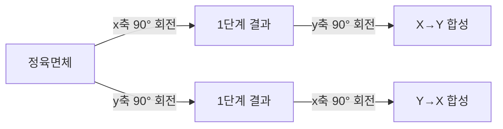
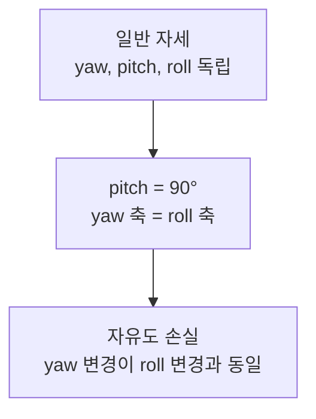
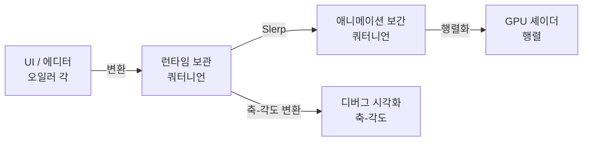

## 들어가며

3차원 회전을 *어떻게 표현할 것인가* 는 게임 수학에서 가장 자주 마주치는 *설계 결정* 이다. 같은 *물리적 회전* 을 표현하는 방법이 네 가지 — 오일러 각(Euler Angles), 축-각도(Axis-Angle), 회전 행렬(Rotation Matrix), 쿼터니언(Quaternion). 어느 표현도 *모든 측면에서 우월* 하지 않다. 메모리, 합성 비용, 보간, 짐벌락 (Gimbal Lock), 직관성 — 다섯 축 중 한 표현은 한두 축에서 강하고 다른 축에서 약하다.

게임 엔진이 이 트레이드오프를 다루는 표준 패턴은 *위치마다 다른 표현* 이다. UI 입력은 오일러 각으로 받고, 내부 보관은 쿼터니언, 셰이더로 넘기는 본 변환은 행렬, 디버그 표시는 축-각도. *한 표현으로 모든 곳을 처리하지 않는다*.

이 글의 목표는 다음 다섯 가지다.

1. *회전이 무엇인가* 를 SO(3) 그룹의 추상으로 보고, 네 표현이 *같은 추상의 다른 좌표* 라는 직관을 만든다.
2. 오일러 각의 *짐벌락* 을 기하학적으로 이해하고, 왜 보간·합성에 어색한지 짚는다.
3. 회전 행렬과 쿼터니언이 *수학적으로 자매* 인 동시에 *비용·안정성에서 차이* 가 나는 점을 정리한다.
4. 표현 사이의 변환 식과 *수치 안정성 함정* 을 짚는다.
5. 게임 엔진의 *어느 자리에서 어느 표현* 인지의 패턴을 정리한다.

*회전 행렬* 의 *직교성 누적 손실* 문제가 이 글에서 *왜 쿼터니언이 나왔는가* 의 동기다. 쿼터니언의 4개 성분 정규화가 행렬의 9개 성분 직교성 회복보다 *훨씬 단순* 하다는 사실이 게임 엔진 설계의 핵심.


---

## 목차
1. [회전이라는 연산의 본질](#1-회전이라는-연산의-본질)
2. [오일러 각과 짐벌락](#2-오일러-각과-짐벌락)
3. [축-각도 표현](#3-축-각도-표현)
4. [회전 행렬 복습](#4-회전-행렬-복습)
5. [쿼터니언 개요](#5-쿼터니언-개요)
6. [네 표현의 트레이드오프 표](#6-네-표현의-트레이드오프-표)
7. [표현 사이의 변환](#7-표현-사이의-변환)
8. [언제 무엇을 쓰나](#8-언제-무엇을-쓰나)


---

## 1. 회전이라는 연산의 본질

게임 수학의 *회전* 은 *3차원 공간을 회전한 다른 3차원 공간으로 보내는 변환* 이다. 수학적으로 다음 세 성질을 만족한다.

1. **길이 보존**: 변환 전후로 모든 벡터의 길이가 같다.
2. **각도 보존**: 두 벡터 사이 각도가 같다.
3. **방향 보존**: 오른손 좌표계가 오른손 좌표계로 (반사 없음).

이 셋을 만족하는 변환의 모임이 *특수 직교 그룹 SO(3)*. *Special Orthogonal* 의 약자.

### 1.1 SO(3)의 원소

SO(3) 의 원소는 다음 둘로 동치 정의 가능.

- *3×3 직교 행렬* 중 *행렬식이 +1* 인 것.
- *어떤 단위 축 둘레로 어떤 각도 회전* (Euler's rotation theorem).

후자가 *3D 회전의 가장 자연스러운 표현* — *축과 각도* 두 개. 모든 회전이 *어떤 단일 축 둘레의 회전* 으로 표현 가능하다는 사실은 자명하지 않지만 (오일러의 정리), 게임 수학의 *축-각도 표현* 의 토대다.

### 1.2 회전의 합성

두 회전 $R_1, R_2$ 의 합성 $R_2 \circ R_1$ 도 다시 회전이다 (그룹 닫힘). 합성은 *교환적이지 않다* — $R_2 \circ R_1 \ne R_1 \circ R_2$ 가 일반적.



x→y 와 y→x 합성 결과가 *다른 자세* 다. 손에 책을 들고 직접 돌려 보면 즉시 보인다.

### 1.3 표현이 다른 이유

같은 *SO(3) 원소* 를 *다른 형태로 저장* 하는 게 표현이다. 네 표현의 비유.

| 표현 | 비유 |
|---|---|
| 오일러 각 | "x로 30°, y로 45°, z로 60° 돌려라" |
| 축-각도 | "이 축 둘레로 50° 돌려라" |
| 회전 행렬 | "각 기저 벡터를 이 화살표로 옮겨라" |
| 쿼터니언 | "허수 세 단위로 분해된 4D 단위 벡터" |

같은 *물리적 회전* 을 네 가지 *언어* 로 옮긴 것. 서로 변환 가능 (7절). 다만 *변환 비용과 정밀도 손실* 이 있어 *변환을 자주 하지 않는* 게 게임 엔진의 일반 패턴.

### 1.4 회전 표현의 다섯 평가 축

네 표현을 비교할 때의 다섯 축.

| 축 | 의미 |
|---|---|
| 메모리 | 4 byte float 몇 개로 저장되는가 |
| 합성 비용 | 두 회전을 합치는 데 드는 명령 수 |
| 보간 | 두 회전 사이를 매끄럽게 잇는 게 가능한가 |
| 짐벌락 | 회전이 자유도를 잃는 특이점이 있는가 |
| 직관 | 사람이 값을 보고 회전을 떠올릴 수 있는가 |

이 다섯 축에서 *네 표현이 어느 축에 강하고 어디에 약한지* 가 6절의 트레이드오프 표에 정리된다.

## 2. 오일러 각과 짐벌락

오일러 각은 *세 축 둘레의 회전을 차례로 적용* 하는 표현이다. 가장 직관적이지만 *짐벌락* 이라는 근본 한계를 가진다.

### 2.1 정의

세 축 둘레 회전을 *순서대로* 합성.

$$
R = R_3(\gamma) \cdot R_2(\beta) \cdot R_1(\alpha)
$$

각 $R_i$ 가 한 축 둘레 회전. 축 순서와 *내재적 (intrinsic) / 외재적 (extrinsic)* 의 의미에 따라 *24가지 변종* 이 있다.

| 변종 | 축 순서 | 의미 |
|---|---|---|
| XYZ-extrinsic | x → y → z (월드 축 기준) | 매 회전이 *고정된 월드 축* 에 대해 |
| XYZ-intrinsic | x → y' → z'' (회전된 로컬 축 기준) | 매 회전이 *직전 회전 결과의 로컬 축* 에 대해 |
| ZYX-Tait-Bryan | yaw-pitch-roll | 항공 분야의 표준. 일반적 게임에서 흔함 |
| ZXZ-classic | classical Euler | 천체역학·고전역학에서 |

게임 엔진의 일반 관례는 *yaw (Y) - pitch (X) - roll (Z)* 또는 *roll (Z) - pitch (X) - yaw (Y)* 같은 *Tait-Bryan* 변종. 이 문서의 코드 (7절) 는 항공식 *ZYX* (yaw = z축, pitch = y축, roll = x축) 로 쓴다 — Y-up 엔진은 같은 이름을 다른 축 (yaw = y축) 에 붙이므로, 이름이 아니라 *순서와 축* 을 맞춰 읽는다. Unity와 Unreal 모두 *내부는 quaternion 또는 matrix* 로 처리하고, *UI Euler 표시·입력 관례* 가 엔진마다 다르다. 같은 (30°, 45°, 60°) 라도 *어느 순서로 적용되는가* 가 다르면 *완전히 다른 회전* 이 된다 — 엔진 문서의 회전 순서 정의를 직접 확인한다.

### 2.2 직관

세 각도 $(\alpha, \beta, \gamma)$ 를 사람이 입력하면 *대략 어떤 자세가 될지* 예측 가능. UI 인터페이스에 가장 자주 등장.

```cpp
// 이 문서의 관례 (7절 코드와 동일): ZYX-Tait-Bryan, 오른손 좌표계
struct EulerAngles {
    float yaw;    // z축 둘레 (좌우 보기)
    float pitch;  // y축 둘레 (위아래 보기)
    float roll;   // x축 둘레 (좌우 기울기)
};
```

FPS 게임의 *마우스 입력* 이 *yaw, pitch* 두 각도로 자연스럽게 매핑.

### 2.3 짐벌락의 기하학적 의미

*세 짐벌이 같은 평면에 정렬* 되면 *한 자유도가 사라진다*. 가장 흔한 예: pitch가 90° 일 때 yaw와 roll이 *같은 축* 둘레 회전이 되어 두 자유도가 한 자유도로 줄어든다.



수치적으로는 *yaw 와 roll 값이 무한히 많은 조합으로 같은 회전* 을 표현 — *유일성이 깨진다*. 보간이나 미분에서 *작은 입력 변화가 큰 출력 변화* 를 만들거나 *불연속* 이 생긴다.

### 2.4 게임에서의 짐벌락 시나리오

FPS의 카메라가 *수직 위* 를 보면 (pitch = 90°) 직관적 자유도가 무너진다. 일반적인 yaw/pitch 카메라는 roll을 저장하지 않으므로 화면이 roll로 기우는 게 아니라, *yaw 축의 의미가 불안정해지거나 yaw 입력이 화면 회전처럼 느껴지는* 문제가 핵심이다.

```cpp
// 잘못된 패턴: 매 프레임 yaw, pitch에 변화 누적
camera.yaw   += mouseDeltaX;
camera.pitch += mouseDeltaY;
camera.pitch = clamp(camera.pitch, -89, 89);  // 짐벌락 회피
```

`clamp` 가 *수직 위 보기 자체를 막는* 임시 방편. 회전 자유도를 *제한* 한 셈이지만 *대부분 게임에서 충분*. 짐벌락이 *숨겨진* 형태.

진짜 *완전 자유 회전* (우주선, VR 컨트롤러) 이 필요하면 오일러로는 어렵다 — 쿼터니언이 답.

### 2.5 보간의 어색함

두 오일러 각 (1°, 89°, 0°) 와 (1°, 91°, 0°) 의 *물리적 자세* 자체는 가깝다. 다만 *값이 연속적으로 변하는데도 yaw / roll 분해가 불안정* 해 *보간 경로* 가 튈 수 있다. 짐벌락 부근에서는 *같은 회전을 다른 (yaw, roll) 조합* 으로 표현 가능해 *선형 보간이 의도와 다른 경로* 를 그린다.

```cpp
EulerAngles Lerp(EulerAngles a, EulerAngles b, float t) {
    return {
        a.yaw   + (b.yaw   - a.yaw)   * t,
        a.pitch + (b.pitch - a.pitch) * t,
        a.roll  + (b.roll  - a.roll)  * t,
    };
}
```

이 코드의 결과가 *물리적으로 의도와 다른 경로* 를 그릴 수 있다. *(0°, 0°, 0°)* → *(350°, 0°, 0°)* 보간이 *10° 단축 회전* 인지 *350° 우회* 인지 *각도 모듈로* 처리에 따라 갈린다.

애니메이션 키프레임을 오일러 각으로 보관하면 *키 사이 어색한 회전* 이 흔한 버그. 게임 엔진의 애니메이션 시스템이 *쿼터니언으로 키* 를 보관하는 이유.

### 2.6 메모리

3 floats = 12 byte. 가장 적은 메모리. 다만 *합성은 단순 각도 덧셈이 아니다* — 일반 합성은 *quaternion 또는 matrix로 변환* 후 곱한 뒤 *다시 Euler로 분해* 가 필요. *짐벌락 처리* 와 *보간 어색함* 까지 더하면 합성·보간 위주 코드에는 부적합.

## 3. 축-각도 표현

회전을 *축 $\hat{u}$ 와 각도 $\theta$ 의 쌍* 으로 표현. 오일러의 회전 정리에 가장 직접적인 형태.

### 3.1 정의

$$
\text{rotation} = (\hat{u}, \theta)
$$

$\hat{u}$ 가 단위 벡터 (3 floats), $\theta$ 가 라디안 각도 (1 float). 총 4 floats = 16 byte.

```cpp
struct AxisAngle {
    vec3  axis;     // 단위 벡터
    float angle;    // 라디안
};
```

### 3.2 회전 벡터 (rotation vector)

축과 각도를 *한 벡터로 묶은* 표현.

$$
\vec{r} = \theta \hat{u}
$$

3 floats = 12 byte. 메모리가 더 적다.

```cpp
struct RotationVector {
    vec3 r;    // 길이 = 각도, 방향 = 축
};

vec3 axis  = normalize(r);
float angle = length(r);
```

영회전이 *영벡터* 로 표현되는 게 깔끔하다 — 길이가 0 이라 축이 정의되지 않지만 *회전이 없음* 의 의미가 자연스럽다.

다만 *축과 각도를 분리해 쓰는 코드* 는 매번 정규화·길이 계산이라 *추가 비용*. 표현은 작지만 *연산이 약간 비싸다*.

### 3.3 Rodrigues 공식으로 행렬화

축-각도에서 회전 행렬로의 변환은 *Rodrigues 공식*.

$$
R = I + \sin\theta \cdot K + (1 - \cos\theta) \cdot K^2
$$

여기서 $K$ 가 외적 행렬:

$$
K = \begin{pmatrix} 0 & -u_z & u_y \\ u_z & 0 & -u_x \\ -u_y & u_x & 0 \end{pmatrix}
$$

```cpp
mat3 ToMatrix(AxisAngle aa) {
    float c = cos(aa.angle), s = sin(aa.angle);
    float x = aa.axis.x, y = aa.axis.y, z = aa.axis.z;
    float oneMinusC = 1.0f - c;
    return mat3{
        c + x*x*oneMinusC,    x*y*oneMinusC - z*s, x*z*oneMinusC + y*s,
        y*x*oneMinusC + z*s,  c + y*y*oneMinusC,   y*z*oneMinusC - x*s,
        z*x*oneMinusC - y*s,  z*y*oneMinusC + x*s, c + z*z*oneMinusC,
    };
}
```

### 3.4 합성과 보간

축-각도 *합성* 은 어색하다. 두 (축, 각도) 의 합이 *대수적으로 단순한 식* 이 없다 — *행렬 또는 쿼터니언으로 변환 후 합성* 하는 게 보통.

*보간* 은 *한 축 둘레* 라면 자연스럽다 — 각도만 보간. 다른 축 사이라면 다시 *쿼터니언 Slerp* 가 표준.

축-각도가 *주력 표현* 이 되는 곳은 드물다. *디버그 시각화*, *Rodrigues 공식의 입력*, *짧은 일회성 회전 적용* 정도.

### 3.5 짐벌락 없음

축-각도는 *어떤 자세에서도 자유도 손실이 없다*. 임의 회전 = 임의 축 + 임의 각도. 짐벌락 한계가 사라진다.

다만 두 가지 *비유일성* 이 있다.

- **각도 0 부근**: 회전이 없으면 *어떤 축이든 결과가 같다*. 코드에서는 영벡터 또는 임의 단위 벡터로 처리.
- **각도 π 부근**: $(\hat{u}, \theta)$ 와 $(-\hat{u}, -\theta)$ 가 *같은 회전*. $\theta = \pi$ 면 $\hat{u}$ 와 $-\hat{u}$ 가 *같은 180° 회전을 표현*. 보통 각도를 $[0, \pi]$ 또는 $[-\pi, \pi]$ 로 정규화한 뒤 *축 부호* 를 함께 결정해 비유일성을 줄인다.

## 4. 회전 행렬 복습

회전 행렬을 *회전 표현* 의 한 가지로 다시 본다. 다른 표현과의 비교 관점.

### 4.1 메모리

3×3 행렬 = 9 floats = 36 byte. *가장 큰 메모리*. 4×4 동차 형태로 보관하면 더 (16 floats = 64 byte) 늘지만, 회전 부분만이면 9 floats.

게임 엔진의 *수만 본* 을 모두 행렬로 보관하면 메모리 부담. 본은 *쿼터니언으로 보관하고 셰이더에 넘길 때만 행렬로 변환* 하는 게 표준.

### 4.2 합성 비용

행렬 곱 = 27회 곱 + 18회 합 (3×3). *상대적으로 비싸다*. 다만 *벡터 변환 비용* 은 가장 적다 — 벡터에 행렬 곱은 9 곱 + 6 합.

| 연산 | 행렬 |
|---|---|
| 합성 (회전 × 회전) | 27 곱 + 18 합 |
| 변환 (회전 × 벡터) | 9 곱 + 6 합 |

GPU 셰이더의 정점 변환은 *행렬 × 벡터* 가 표준. *표현이 행렬* 이면 한 번 곱으로 변환 가능.

### 4.3 직교성 누적 손실

함정. 작은 회전을 매 프레임 누적하면 *부동소수점 오차로 직교성이 무너진다*. 9 floats를 *직교 + 행렬식 +1* 의 부분 공간으로 *주기적으로 투영* 해야 (Gram-Schmidt).

절차는 Gram-Schmidt 세 단계 — 첫 열을 정규화하고, 둘째 열에서 첫 열 성분을 뺀 뒤 정규화하고, 셋째 열을 두 열의 외적으로 잡는다.

이 비용이 *쿼터니언 정규화 (4 floats / sqrt 한 번)* 보다 *상당히 비싸다*. 회전 누적이 빈번한 코드에서는 행렬보다 쿼터니언이 적합.

### 4.4 짐벌락 없음

행렬 자체는 짐벌락이 없다. *표현이 자연스럽고 자유도가 항상 3*. 다만 *오일러 각으로 분해* 시 짐벌락이 *분해 단계에서* 나타날 수 있다.

### 4.5 보간

행렬 보간은 *어색하다*. 두 행렬의 *성분별 선형 보간* 은 *직교성을 깨뜨려* 결과가 회전이 아닌 변환이 된다.

```cpp
// 잘못: 직교성 깨짐
mat3 Lerp(mat3 a, mat3 b, float t) {
    return a * (1-t) + b * t;  // 결과는 회전 행렬이 아님
}
```

올바른 행렬 보간은 *행렬 → 쿼터니언 → Slerp → 행렬* 변환 경유 또는 *log-exp* 형태의 행렬 보간 (Lie group / Lie algebra). 둘 다 비용이 크다 — 그냥 *쿼터니언으로 보관해 Slerp 후 변환* 이 게임 엔진의 표준.

## 5. 쿼터니언 개요

쿼터니언은 *4D 단위 벡터로 회전을 표현* 하는 형태. 1843년 Hamilton이 발견한 이래 컴퓨터 그래픽스의 회전 표준.

### 5.1 정의

쿼터니언은 *복소수의 4D 일반화*. 복소수가 $a + bi$ ($i^2 = -1$) 라면, 쿼터니언은:

$$
q = w + xi + yj + zk
$$

세 허수 단위 $i, j, k$ 가 다음 관계를 만족.

$$
i^2 = j^2 = k^2 = ijk = -1
$$

$$
ij = k, \quad jk = i, \quad ki = j
$$

$$
ji = -k, \quad kj = -i, \quad ik = -j
$$

곱셈이 *비교환적*. 회전이 비교환적인 점과 일치.

코드에서는 보통 4 floats.

```cpp
struct quat {
    float w, x, y, z;
};
```

순서는 라이브러리마다 다르다 — `(w, x, y, z)` 또는 `(x, y, z, w)`. 두 라이브러리를 섞으면 *값이 어긋난* 회전이 된다.

### 5.2 단위 쿼터니언이 회전을 표현

*길이가 1인 쿼터니언* (unit quaternion) 이 3D 회전을 표현.

$$
|q| = \sqrt{w^2 + x^2 + y^2 + z^2} = 1
$$

축-각도 $(\hat{u}, \theta)$ 와 쿼터니언의 관계.

$$
q = \cos\frac{\theta}{2} + (u_x i + u_y j + u_z k) \sin\frac{\theta}{2}
$$

성분으로 풀면:

$$
w = \cos\frac{\theta}{2}, \quad (x, y, z) = \sin\frac{\theta}{2} \cdot \hat{u}
$$

각도가 *반각으로* 들어가는 점이 특징. 이 *반각 트릭* 이 쿼터니언의 *합성과 보간* 을 단순하게 만든다.

### 5.3 회전 적용

쿼터니언으로 벡터 $\vec{v}$ 를 회전하려면 *순수 쿼터니언* $p = (0, v_x, v_y, v_z)$ 를 만들고:

$$
p' = q p q^{-1}
$$

결과 $p'$ 의 (x, y, z) 가 회전된 벡터.

이 식의 비용은 *얼마나 많은 벡터를 같은 회전으로 변환하는가* 에 따라 갈린다. *단일 벡터 한 번* 의 회전이라면 위 쿼터니언 곱을 벡터 식으로 직접 전개한 형태가 행렬 생성 후 곱보다 빠를 수 있다. *수많은 벡터를 같은 회전으로* 변환하는 셰이더 본 변환 같은 패턴에서는 *쿼터니언을 행렬로 한 번 변환* 하고 그 행렬을 N번 적용하는 게 *amortized로 빠르다*.

```cpp
mat3 QuatToMatrix(quat q) {
    float xx = q.x*q.x, yy = q.y*q.y, zz = q.z*q.z;
    float xy = q.x*q.y, xz = q.x*q.z, yz = q.y*q.z;
    float wx = q.w*q.x, wy = q.w*q.y, wz = q.w*q.z;
    return mat3{
        1 - 2*(yy + zz), 2*(xy - wz),     2*(xz + wy),
        2*(xy + wz),     1 - 2*(xx + zz), 2*(yz - wx),
        2*(xz - wy),     2*(yz + wx),     1 - 2*(xx + yy),
    };
}
```

### 5.4 합성

두 쿼터니언의 곱 = 두 회전의 합성.

$$
q_1 q_2 = (w_1 w_2 - \vec{v_1} \cdot \vec{v_2},\ w_1 \vec{v_2} + w_2 \vec{v_1} + \vec{v_1} \times \vec{v_2})
$$

여기서 $\vec{v_i} = (x_i, y_i, z_i)$. 16회 곱 + 12회 합 — 행렬 곱 (27/18) 보다 적다.

### 5.5 역과 conjugate

단위 쿼터니언의 역은 *conjugate (켤레)*.

$$
q^{-1} = q^* = (w, -x, -y, -z) \quad (|q| = 1 \text{ 일 때})
$$

부호 반전 셋만으로 역. *행렬의 역* (가우스 소거 또는 전치) 보다 훨씬 단순.

```cpp
quat Conjugate(quat q) { return {q.w, -q.x, -q.y, -q.z}; }
```

### 5.6 단위성 회복

부동소수점 오차로 *길이가 1에서 살짝 벗어날* 수 있다. 정규화로 회복.

```cpp
quat Normalize(quat q) {
    float len = std::sqrt(q.w*q.w + q.x*q.x + q.y*q.y + q.z*q.z);
    return {q.w/len, q.x/len, q.y/len, q.z/len};
}
```

4 floats + sqrt 1번. 행렬의 직교성 회복 (Gram-Schmidt 9 floats + sqrt + 외적) 보다 *훨씬 빠르다*.

이 *정규화 비용 차이* 가 *회전 누적이 빈번한 게임 코드* 에서 쿼터니언이 행렬을 이기는 핵심 이유.

### 5.7 짐벌락 없음

쿼터니언은 *4성분이지만 단위성 제약 ($\|q\| = 1$) 하나* 로 실제 자유도가 3 — 정확히 SO(3) 의 자유도와 같다. *4D 단위 구 (3-구) 위의 점* 으로 표현되어 *어떤 자세에서도 자유도 손실이 없다*. 짐벌락이 없다.

다만 *부호 모호성* 이 있다 — $q$ 와 $-q$ 가 *같은 회전* 을 표현. 단위 구를 *반쪽씩* 두 번 덮는다 (universal cover). 보간 시 이 부호를 맞춰야 *단축 경로* 로 간다 (5.9 참조).

### 5.8 Slerp (Spherical Linear Interpolation)

두 쿼터니언 사이를 *4D 구면 위 대원 (great circle)* 으로 보간.

$$
\text{Slerp}(q_0, q_1, t) = \frac{\sin((1-t)\theta)}{\sin\theta} q_0 + \frac{\sin(t\theta)}{\sin\theta} q_1
$$

여기서 $\theta = \arccos(q_0 \cdot q_1)$ 가 두 쿼터니언 사이 *4D 각도*.

```cpp
quat Slerp(quat q0, quat q1, float t) {
    float dot = q0.w*q1.w + q0.x*q1.x + q0.y*q1.y + q0.z*q1.z;
    // 부호 일치 — 단축 경로 보장
    if (dot < 0.0f) { q1 = {-q1.w, -q1.x, -q1.y, -q1.z}; dot = -dot; }
    if (dot > 0.9995f) {
        // 거의 같음 — 선형 보간으로 폴백 (수치 안정성)
        return Normalize(quat{
            q0.w + t*(q1.w - q0.w),
            q0.x + t*(q1.x - q0.x),
            q0.y + t*(q1.y - q0.y),
            q0.z + t*(q1.z - q0.z),
        });
    }
    float theta = std::acos(std::clamp(dot, -1.0f, 1.0f));
    float sinTheta = std::sin(theta);
    float w0 = std::sin((1-t)*theta) / sinTheta;
    float w1 = std::sin(t*theta) / sinTheta;
    return {
        w0*q0.w + w1*q1.w,
        w0*q0.x + w1*q1.x,
        w0*q0.y + w1*q1.y,
        w0*q0.z + w1*q1.z,
    };
}
```

`acos` 호출 전 `clamp` 가 *NaN 방어*. 두 쿼터니언이 거의 같으면 *작은 각도 분모 0* 함정이라 *선형 보간 + 정규화* 로 폴백.

Slerp가 게임 애니메이션의 *키프레임 보간* 에 표준이다. 캐릭터 관절이 *키 사이 매끄럽게* 회전하는 모습이 Slerp의 결과.

### 5.9 부호 모호성과 단축 경로

$q$ 와 $-q$ 가 같은 회전이지만, *Slerp는 부호 차이에 민감*. $q_0 \cdot q_1 < 0$ 이면 *대원의 먼 쪽* 으로 보간 — 캐릭터가 *360° 우회* 하는 어색한 모션.

```cpp
if (dot < 0.0f) { q1 = -q1; dot = -dot; }
```

이 한 줄이 *항상 단축 경로* 를 보장. 두 부호 중 *내적이 양수가 되는 부호* 를 선택.

## 6. 네 표현의 트레이드오프 표

다섯 평가 축에서 네 표현을 비교.

| 표현 | 메모리 | 합성 | 벡터 변환 | 보간 | 짐벌락 | 직관 |
|---|---|---|---|---|---|---|
| Euler | 12 B | 일반 합성 부적합 (변환 필요) | 변환 필요 | 어색 | 있음 | 강함 |
| Axis-Angle | 16 B (또는 12 B) | 변환 필요 | Rodrigues 직접 또는 변환 | 1축이면 좋음 | 없음 | 보통 |
| Matrix | 36 B | 큼 (27 곱) | 빠름 (9 곱) | 직접 보간 어색 | 없음 | 약함 |
| Quaternion | 16 B | 빠름 (16 곱) | 단일 빠름·배치는 행렬 변환 후 | Slerp | 없음 | 약함 |

각 평가 축 해설.

**메모리**: 행렬이 가장 크고 (36 B), 회전 벡터가 가장 작다 (12 B). 수만 본을 보관하는 애니메이션 시스템에서 차이가 *메가 byte 단위*.

**합성 비용**: 쿼터니언 곱 (16 곱 + 12 합) 이 행렬 곱 (27 + 18) 보다 약간 빠르다. 오일러 합성은 *각도 합* 으로 보이지만 *회전은 순서 의존이라 성분별 각도 합은 합성이 아님*, 실용은 행렬·쿼터니언으로 변환 후 합성.

**보간**: 쿼터니언 Slerp 가 표준. 오일러는 짐벌락 + 모듈로 처리 어색. 행렬은 직접 보간 시 직교성 깨짐. 축-각도는 같은 축이면 단순.

**짐벌락**: 오일러만 있음. 나머지 셋은 없음.

**직관**: 오일러 각이 압도적으로 직관적 — 사람이 (yaw=30°, pitch=45°) 를 보면 자세가 떠오른다. 쿼터니언의 (w=0.7, x=0, y=0.7, z=0) 은 떠오르지 않는다.

### 6.1 게임 엔진의 패턴

이 트레이드오프를 보면 *어느 표현도 만능이 아니다*. 게임 엔진이 채택하는 패턴:

- *내부 보관*: 쿼터니언 (메모리 + 합성 + 보간 + 안정성).
- *셰이더 변환*: 행렬 (벡터 변환 비용 최소).
- *UI 입력*: 오일러 각 (직관).
- *디버그 시각화*: 축-각도 (회전축이 보임).

표현이 *위치마다 갈린다*. 한 표현으로 모든 곳을 처리하지 않는다.

## 7. 표현 사이의 변환

위치마다 표현이 다르면 *변환* 이 필요하다. 이 절은 자주 쓰이는 변환의 식과 함정을 정리한다.

### 7.1 오일러 → 행렬

세 축 둘레 회전 행렬을 *순서대로 곱*. ZYX (yaw, pitch, roll) 변종:

$$
R = R_z(\gamma) \cdot R_y(\beta) \cdot R_x(\alpha)
$$

```cpp
mat3 EulerToMatrix(float yaw, float pitch, float roll) {
    float cy = cos(yaw),   sy = sin(yaw);
    float cp = cos(pitch), sp = sin(pitch);
    float cr = cos(roll),  sr = sin(roll);
    return mat3{
        cy*cp,  cy*sp*sr - sy*cr,  cy*sp*cr + sy*sr,
        sy*cp,  sy*sp*sr + cy*cr,  sy*sp*cr - cy*sr,
        -sp,    cp*sr,             cp*cr,
    };
}
```

순서가 *엔진마다 다른* 점이 함정. Unity는 *ZXY*, Unreal은 *XYZ* 등.

### 7.2 오일러 → 쿼터니언

같은 ZYX 순서로 세 축별 쿼터니언을 차례로 곱.

$$
q = q_z(\gamma) \cdot q_y(\beta) \cdot q_x(\alpha)
$$

전개하면:

```cpp
quat EulerToQuat(float yaw, float pitch, float roll) {
    float cy = cos(yaw   * 0.5f), sy = sin(yaw   * 0.5f);
    float cp = cos(pitch * 0.5f), sp = sin(pitch * 0.5f);
    float cr = cos(roll  * 0.5f), sr = sin(roll  * 0.5f);
    return quat{
        cy*cp*cr + sy*sp*sr,    // w
        cy*cp*sr - sy*sp*cr,    // x
        sy*cp*sr + cy*sp*cr,    // y
        sy*cp*cr - cy*sp*sr,    // z
    };
}
```

각도 *반각으로 입력* 되는 게 쿼터니언 변환의 특징.

### 7.3 축-각도 → 쿼터니언

5.2의 식 직접.

```cpp
quat AxisAngleToQuat(vec3 axis, float angle) {
    float halfAngle = angle * 0.5f;
    float s = sin(halfAngle);
    return quat{cos(halfAngle), axis.x*s, axis.y*s, axis.z*s};
}
```

`axis` 가 단위 벡터 가정. 아니면 결과 쿼터니언이 단위가 아닌 채로 나간다.

### 7.4 쿼터니언 → 행렬

5.3절의 `QuatToMatrix` 함수.

이 변환은 *부동소수점 안정* — 쿼터니언이 단위 길이라면 결과 행렬도 *직교*. 정밀도 손실이 거의 없다.

### 7.5 행렬 → 쿼터니언 (Shepperd's method)

가장 *수치 안정성* 이 까다로운 변환. 단순 식은 *일부 케이스에서 정밀도 폭주*. Shepperd의 방법은 *행렬의 trace에 따라 다른 식* 으로 분기해 안정.

```cpp
quat MatrixToQuat(mat3 m) {
    float trace = m[0][0] + m[1][1] + m[2][2];
    if (trace > 0.0f) {
        float s = std::sqrt(trace + 1.0f) * 2.0f;
        return {
            0.25f * s,
            (m[2][1] - m[1][2]) / s,
            (m[0][2] - m[2][0]) / s,
            (m[1][0] - m[0][1]) / s,
        };
    } else if (m[0][0] > m[1][1] && m[0][0] > m[2][2]) {
        float s = std::sqrt(1.0f + m[0][0] - m[1][1] - m[2][2]) * 2.0f;
        return {
            (m[2][1] - m[1][2]) / s,
            0.25f * s,
            (m[0][1] + m[1][0]) / s,
            (m[0][2] + m[2][0]) / s,
        };
    } else if (m[1][1] > m[2][2]) {
        float s = std::sqrt(1.0f + m[1][1] - m[0][0] - m[2][2]) * 2.0f;
        return {
            (m[0][2] - m[2][0]) / s,
            (m[0][1] + m[1][0]) / s,
            0.25f * s,
            (m[1][2] + m[2][1]) / s,
        };
    } else {
        float s = std::sqrt(1.0f + m[2][2] - m[0][0] - m[1][1]) * 2.0f;
        return {
            (m[1][0] - m[0][1]) / s,
            (m[0][2] + m[2][0]) / s,
            (m[1][2] + m[2][1]) / s,
            0.25f * s,
        };
    }
}
```

각 분기가 *대각 성분 중 가장 큰 것* 을 기준으로 *분모가 0에 안 가까워지도록*. 핵심 안정성 트릭.

### 7.6 쿼터니언 → 오일러

가장 어려운 변환. 짐벌락 부근에서 *분모 0 폭주* 또는 *해의 비유일성*. 일반 식:

아래 코드는 *특정 yaw / pitch / roll 순서와 축 관례* (이 문서의 ZYX-Tait-Bryan + 오른손 좌표계) 에만 대응한다. 엔진의 convention이 다르면 *축 인덱스와 부호가 달라진다* — 엔진 문서를 확인해 식을 맞추거나, 가능하면 *오일러 ↔ 쿼터니언 왕복을 피하는* 단방향 흐름을 쓴다.

```cpp
// ZYX-Tait-Bryan + 오른손 좌표계 가정.
EulerAngles QuatToEuler(quat q) {
    float sinPitch = 2.0f * (q.w*q.y - q.z*q.x);
    sinPitch = std::clamp(sinPitch, -1.0f, 1.0f);

    float pitch = std::asin(sinPitch);
    float yaw, roll;
    if (std::fabs(sinPitch) > 0.9999f) {
        // 짐벌락 부근 — yaw로 모음, roll = 0
        yaw  = std::atan2(-2.0f * (q.x*q.y - q.w*q.z), 1.0f - 2.0f*(q.x*q.x + q.z*q.z));
        roll = 0.0f;
    } else {
        yaw  = std::atan2(2.0f * (q.w*q.z + q.x*q.y),
                          1.0f - 2.0f*(q.y*q.y + q.z*q.z));
        roll = std::atan2(2.0f * (q.w*q.x + q.y*q.z),
                          1.0f - 2.0f*(q.x*q.x + q.y*q.y));
    }
    return {yaw, pitch, roll};
}
```

`asin` 의 입력 clamp + 짐벌락 부근 분기. *완전한 회복* 은 어렵다 — 짐벌락 부근 입력은 *정보 손실* 이라 원래 오일러 각을 *정확히 복원* 하지 못할 수 있다.

게임 엔진은 *오일러 → 쿼터니언 → 보관 → 변환 → 행렬* 의 *단방향 흐름* 이 표준. *오일러 ↔ 쿼터니언 왕복* 을 피해 정밀도 손실을 최소화한다.

## 8. 언제 무엇을 쓰나

이 절은 게임 엔진의 *실제 위치별 표현 패턴* 을 정리한다.

### 8.1 UI 입력과 에디터

플레이어 또는 디자이너가 *각도 입력 박스* 에 값을 입력. 사람이 직관적으로 다루는 형태가 *오일러 각*.

```cpp
struct EditorTransform {
    vec3 position;       // 위치
    vec3 eulerAngles;    // 회전 (UI 표시용)
    vec3 scale;          // 스케일
};
```

내부 저장은 다른 표현으로 변환. UI에 표시할 때만 오일러 → 표시.

### 8.2 캐릭터·오브젝트 회전 보관

런타임 *회전 상태* 는 쿼터니언. 메모리 (16 B), 합성·보간·안정성 모두 우월.

```cpp
struct Transform {
    vec3 position;
    quat rotation;       // 회전 (런타임 보관)
    vec3 scale;
};
```

작은 회전 누적·합성·역이 빈번한 코드에 적합.

### 8.3 애니메이션 키프레임

본별 회전 키 = 쿼터니언. 키 사이 보간 = Slerp.

```cpp
struct BoneKey {
    float time;          // 키 시간
    quat  rotation;      // 본의 회전
};

quat InterpolateBone(BoneKey a, BoneKey b, float t) {
    return Slerp(a.rotation, b.rotation, t);
}
```

수십 본 × 수백 키 × 수천 애니메이션의 메모리·CPU 부담이 *쿼터니언 보관 + Slerp* 패턴으로 처리됨.

### 8.4 GPU 셰이더의 본 변환

본 변환을 *셰이더* 에 보낼 때 *행렬* 로 변환. GPU의 정점 변환이 *행렬 × 벡터* 가 표준.

```cpp
// CPU: 본 회전을 행렬로 변환
for (int i = 0; i < boneCount; ++i) {
    boneMatrices[i] = TRSMatrix(bones[i].position,
                                  bones[i].rotation,
                                  bones[i].scale);
}
// GPU에 boneMatrices 전송
```

각 본 16 floats (4×4 행렬). 수만 본이면 *megabyte 단위 GPU 전송*. 일부 엔진은 *3×4 affine 행렬* (12 floats) 또는 *듀얼 쿼터니언* 으로 압축.

### 8.5 디버그 시각화

회전축을 *시각적으로 보고 싶을 때* 축-각도. 회전축 화살표 + 각도 호 그리기.

```cpp
void DrawRotationDebug(quat q, vec3 origin) {
    AxisAngle aa = QuatToAxisAngle(q);
    DrawArrow(origin, origin + aa.axis * 1.0f, COLOR_RED);
    DrawArc(origin, aa.axis, aa.angle, COLOR_BLUE);
}
```

물리 디버거나 애니메이션 디버거에 등장. 사람이 *어떤 회전이 일어나는지* 시각적으로 파악.

### 8.6 짐벌락 회피의 실용

게임 카메라의 *FPS 시점* 은 보통 *yaw + pitch* 두 자유도만 (roll 고정). 짐벌락이 *로직상* 발생할 수 없어 *오일러 두 각도 보관* 으로 충분.

*완전 자유 회전* (우주선 시뮬, VR 컨트롤러, 항공 시뮬) 은 *쿼터니언 보관*. 짐벌락 우회.

### 8.7 패턴 정리 (그림)



각 위치의 표현이 *그 위치의 요구* 에 가장 적합. 변환 비용은 *경계에서 한 번씩만* 들면 충분.


---

## 결론

3D 회전을 표현하는 네 방식 — 오일러 각, 축-각도, 회전 행렬, 쿼터니언 — 은 *같은 SO(3) 추상의 다른 좌표* 다. 어느 표현도 *모든 측면에서 우월* 하지 않고, 메모리·합성·보간·짐벌락·직관 다섯 축에서 *서로 다른 자리에 강점* 을 가진다.

이 글에서 정리한 핵심.

1. **오일러 각의 짐벌락** — pitch ±90° 부근에서 자유도 손실. UI 입력은 직관적이지만 보간·합성에 어색.
2. **회전 행렬의 직교성 손실** — 부동소수점 누적 시 9 floats의 직교성 회복 비용이 크다.
3. **쿼터니언의 4 floats 균형** — 메모리·합성·보간·안정성 모두 평균 이상. 게임 엔진의 *내부 보관* 표준.
4. **Slerp의 단축 경로** — 부호 모호성 ($q$ vs $-q$) 을 내적 부호로 처리. 보간이 항상 짧은 경로.
5. **위치마다 다른 표현** — UI는 오일러, 보관은 쿼터니언, 셰이더는 행렬, 디버그는 축-각도. *변환은 경계에서 한 번씩*.

쿼터니언의 *반각 트릭* 과 *4D 단위 구* 라는 기하학적 사실이 회전을 표현하는 핵심이다. Hamilton의 발견 ($i^2 = j^2 = k^2 = ijk = -1$) 은 3D 회전을 안정적으로 합성하는 대수적 기반이 된다.

## 더 읽을거리

- Eric Lengyel, *Foundations of Game Engine Development*, Vol. 1, Ch. 2.7 — 게임 엔진 회전 표현의 표준.
- Ken Shoemake, "Animating Rotation with Quaternion Curves" (SIGGRAPH 1985) — Slerp의 원전.
- James Diebel, "Representing Attitude: Euler Angles, Unit Quaternions, and Rotation Vectors" (2006) — 표현 변환의 종합 레퍼런스.
- Tomas Akenine-Möller et al., *Real-Time Rendering*, 4th ed., Ch. 4.3 — 그래픽스 관점.
- 3Blue1Brown, "Quaternions and 3D rotation, explained interactively" — 4D 단위 구의 시각적 직관.
- Shoemake, "Quaternions" (CGI tutorial 1994) — 쿼터니언 기초의 깊이 있는 튜토리얼.
- DirectXMath / glm 소스 — 산업 표준 구현 예 (`XMQuaternionSlerp`, `glm::quat`).
