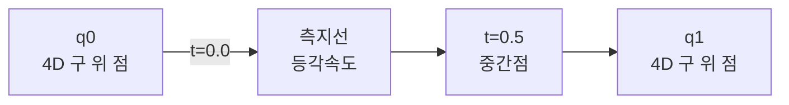

## 들어가며

쿼터니언을 *4D 단위 구 위의 점이 회전을 표현* 한다는 사실까지 정리했다. 이 글은 그 안으로 들어간다 — 곱셈의 *대수적 구조*, 회전 공식 $qpq^{-1}$ 의 *유도*, 지수·로그·거듭제곱의 *연속적 의미*, Slerp의 *닫힌 형태와 미분*, 그리고 *수치 안정성과 정규화 정책*.

쿼터니언이 게임 엔진에 자리 잡은 데에는 *세 가지 결정적 이유* 가 있다.

1. **메모리 효율**: 4 floats. 회전 행렬 (9 floats) 보다 절약.
2. **합성 효율**: 두 회전의 곱이 16 곱 + 12 합. 행렬 (27 + 18) 보다 빠름.
3. **보간 효율**: Slerp가 *4D 구면 측지선* 으로 *등각속도 회전*. 자연스러운 애니메이션.

이 셋 모두 *Hamilton의 1843년 발견* — $i^2 = j^2 = k^2 = ijk = -1$ — 에서 출발해 *4D 단위 구의 곱이 3D 회전과 같다* 는 사실로 이어진다. 이 글은 그 다리를 *수학적으로* 본다.

이 글의 목표는 다음 다섯 가지다.

1. 쿼터니언의 *비교환 곱셈* 이 *왜 회전 합성과 같은가* 를 분해한다.
2. 회전 공식 $p' = q p q^{-1}$ 가 *왜 회전인가* 를 단계별로 유도한다 — *반각이 등장하는 이유*.
3. 지수·로그가 *쿼터니언의 측지선* 을 정의하고 Slerp가 그 측지선의 닫힌 형태임을 본다.
4. Slerp vs Nlerp 트레이드오프와 작은 각도 함정의 Taylor 보정.
5. 누적 곱의 단위성 손실 속도, 정규화 빈도, 부호 일치, 압축 표현 (smallest-three) 패턴.

*네 표현의 비교 지도* 였다면, 이 글은 *쿼터니언 한 표현의 깊이*. 게임 엔진의 회전·애니메이션 코드 위에 깔린 수학적 토대를 다진다.


---

## 목차
1. [쿼터니언 대수](#1-쿼터니언-대수)
2. [켤레, 노름, 역원](#2-켤레-노름-역원)
3. [단위 쿼터니언과 회전](#3-단위-쿼터니언과-회전)
4. [회전 공식 유도](#4-회전-공식-유도)
5. [지수, 로그, 거듭제곱](#5-지수-로그-거듭제곱)
6. [Slerp와 그 미분](#6-slerp와-그-미분)
7. [Nlerp와의 비교](#7-nlerp와의-비교)
8. [수치 안정성과 정규화 정책](#8-수치-안정성과-정규화-정책)


---

## 1. 쿼터니언 대수

쿼터니언은 *복소수의 4D 일반화* 다. 1843년 William Rowan Hamilton이 *3D 공간 회전을 대수적으로 다루는 수 체계* 를 찾던 중 발견했다. 다리 위에서 떠오른 식 $i^2 = j^2 = k^2 = ijk = -1$ 을 *교각에 새겼다* 는 일화로 유명하다.

### 1.1 정의

쿼터니언 $q$ 는 네 실수 $w, x, y, z$ 와 세 허수 단위 $i, j, k$ 의 결합.

$$
q = w + xi + yj + zk
$$

*스칼라-벡터* 분해.

$$
q = (w, \vec{v}), \quad \vec{v} = (x, y, z)
$$

스칼라 부분이 *실수* (real part), 벡터 부분이 *순허수* (imaginary part). 이 분해가 회전 공식 유도와 보간에 자주 등장.

### 1.2 기본 곱셈 관계

세 허수 단위의 곱셈 규칙:

$$
i^2 = j^2 = k^2 = -1
$$

$$
ij = k, \quad jk = i, \quad ki = j
$$

$$
ji = -k, \quad kj = -i, \quad ik = -j
$$

오른쪽 두 줄은 *순환 (cyclic)* 패턴. 시계 방향이면 양수, 반시계면 음수. 외적과 같은 모양 — 우연이 아니라 *둘이 같은 구조* 다 (4절).

곱셈이 *비교환적*: $ij \ne ji$. *회전이 비교환적* 이라는 사실과 정확히 일치.

### 1.3 일반 곱셈

두 쿼터니언 $q_1 = w_1 + x_1 i + y_1 j + z_1 k$ 와 $q_2 = w_2 + x_2 i + y_2 j + z_2 k$ 의 곱을 분배법칙으로 전개하고 1.2의 관계로 정리하면:

$$
q_1 q_2 = (w_1 w_2 - x_1 x_2 - y_1 y_2 - z_1 z_2)
$$

$$
+ (w_1 x_2 + x_1 w_2 + y_1 z_2 - z_1 y_2) i
$$

$$
+ (w_1 y_2 - x_1 z_2 + y_1 w_2 + z_1 x_2) j
$$

$$
+ (w_1 z_2 + x_1 y_2 - y_1 x_2 + z_1 w_2) k
$$

스칼라-벡터 형태로 압축하면:

$$
q_1 q_2 = (w_1 w_2 - \vec{v_1} \cdot \vec{v_2},\ w_1 \vec{v_2} + w_2 \vec{v_1} + \vec{v_1} \times \vec{v_2})
$$

*내적과 외적이 한 식에 같이 등장*. 쿼터니언 곱이 *벡터 대수와 직결* 되는 구조다.

```cpp
quat Multiply(quat a, quat b) {
    return quat{
        a.w*b.w - a.x*b.x - a.y*b.y - a.z*b.z,
        a.w*b.x + a.x*b.w + a.y*b.z - a.z*b.y,
        a.w*b.y - a.x*b.z + a.y*b.w + a.z*b.x,
        a.w*b.z + a.x*b.y - a.y*b.x + a.z*b.w,
    };
}
```

16 곱 + 12 합. 행렬 곱 (27 + 18) 보다 적다.

### 1.4 결합법칙과 비교환성

쿼터니언 곱은 *결합법칙* 을 만족: $(q_1 q_2) q_3 = q_1 (q_2 q_3)$. 회전을 합성하는 *순서를 묶음만 바꿔도 결과 같음*.

*교환법칙* 은 일반적으로 성립 안 함: $q_1 q_2 \ne q_2 q_1$. 예외는 *같은 축 둘레 회전* — 같은 축이면 외적이 0이라 교환 가능.

### 1.5 항등원과 영원

곱셈의 *항등원* 은 $1 = (1, 0, 0, 0)$. 어느 $q$ 에 곱해도 $q$ — *회전 없음* 의 표현.

$0 = (0, 0, 0, 0)$ 은 곱셈에서 *영원* 이지만 *회전을 표현하지 않는다*. 단위 길이 가 아니라 *유효한 쿼터니언 회전* 이 아니다.

### 1.6 두 가지 곱셈 관례

쿼터니언 곱셈에 *두 관례* 가 있다.

- **Hamilton 관례**: 1.2의 식 그대로. $ij = k$.
- **JPL 관례**: 부호 반전. $ij = -k$. NASA의 항법 라이브러리 등.

게임 그래픽스는 거의 모두 *Hamilton 관례*. JPL 관례 라이브러리와 섞을 일이 거의 없다.

## 2. 켤레, 노름, 역원

쿼터니언의 세 기본 연산. 회전 공식 유도의 토대.

### 2.1 켤레 (conjugate)

쿼터니언 $q = (w, \vec{v})$ 의 *켤레* 는 *벡터 부분의 부호 반전*.

$$
q^* = (w, -\vec{v}) = w - xi - yj - zk
$$

복소수의 켤레와 같은 모양 — 허수 부분의 부호 반전.

```cpp
quat Conjugate(quat q) { return {q.w, -q.x, -q.y, -q.z}; }
```

### 2.2 켤레의 성질

켤레는 다음 항등식을 만족.

$$
(q^*)^* = q
$$

$$
(q_1 q_2)^* = q_2^* q_1^* \quad \text{(순서 뒤집힘)}
$$

$$
(q_1 + q_2)^* = q_1^* + q_2^*
$$

곱의 켤레가 *순서가 뒤집힌 켤레의 곱* 이라는 점이 4절의 회전 공식 유도에서 결정적이다.

### 2.3 노름 (norm, magnitude)

쿼터니언의 *길이의 제곱* 은 자기 자신과 켤레의 곱.

$$
\|q\|^2 = q q^* = w^2 + x^2 + y^2 + z^2
$$

쿼터니언의 *4D 길이* 가 자연스럽게 정의된다 — 4D 벡터 길이와 같다.

```cpp
float NormSq(quat q) { return q.w*q.w + q.x*q.x + q.y*q.y + q.z*q.z; }
float Norm(quat q)   { return std::sqrt(NormSq(q)); }
```

### 2.4 역원 (inverse)

쿼터니언의 *역* 은 곱셈에서 항등원을 만드는 원소.

$$
q q^{-1} = q^{-1} q = 1
$$

식으로:

$$
q^{-1} = \frac{q^*}{\|q\|^2}
$$

증명: $q \cdot \frac{q^*}{\|q\|^2} = \frac{q q^*}{\|q\|^2} = \frac{\|q\|^2}{\|q\|^2} = 1$.

```cpp
quat Inverse(quat q) {
    float n2 = NormSq(q);
    return {q.w/n2, -q.x/n2, -q.y/n2, -q.z/n2};
}
```

### 2.5 단위 쿼터니언의 역 = 켤레

가장 중요한 특수 케이스: *단위 쿼터니언 ($\|q\| = 1$) 의 역 = 켤레*.

$$
\|q\| = 1 \implies q^{-1} = q^*
$$

분모가 1이라 *부호 반전 셋만으로 역*. 행렬의 역 (가우스 소거) 보다 훨씬 단순.

회전 쿼터니언이 단위 길이라는 불변식을 유지하면 역은 네 성분의 켤레로 계산할 수 있어 일반적인 $q^{-1}=q^*/\lVert q\rVert^2$ 의 norm 계산과 나눗셈을 피한다. 이 단순한 역 연산이 회전 표현으로서의 장점 중 하나다.

### 2.6 거리와 내적

두 쿼터니언 사이 *내적* 은 4D 벡터 내적과 같다.

$$
q_1 \cdot q_2 = w_1 w_2 + x_1 x_2 + y_1 y_2 + z_1 z_2
$$

이게 단위 쿼터니언일 때 *4D 구면 위 두 점 사이 코사인* — Slerp 식의 핵심 (6절).

```cpp
float Dot(quat a, quat b) {
    return a.w*b.w + a.x*b.x + a.y*b.y + a.z*b.z;
}
```

## 3. 단위 쿼터니언과 회전

단위 길이 쿼터니언이 3D 회전과 *어떻게 대응* 되는가를 정리한다. 핵심은 *반각 (half angle)* 이 등장하는 이유.

### 3.1 회전을 표현하는 식

축 $\hat{u}$ 둘레 각도 $\theta$ 회전을 다음 쿼터니언으로 표현.

$$
q = \cos\frac{\theta}{2} + \sin\frac{\theta}{2} (u_x i + u_y j + u_z k)
$$

스칼라-벡터 형태:

$$
q = \left(\cos\frac{\theta}{2},\ \sin\frac{\theta}{2} \hat{u}\right)
$$

각도가 *반각* 으로 들어간다. 왜 반각인가는 4절의 유도에서 보인다.

```cpp
quat FromAxisAngle(vec3 axis, float angle) {
    float half = angle * 0.5f;
    float s = std::sin(half);
    return {std::cos(half), axis.x*s, axis.y*s, axis.z*s};
}
```

### 3.2 단위성 검증

$\hat{u}$ 가 단위 벡터 ($u_x^2 + u_y^2 + u_z^2 = 1$) 일 때:

$$
\|q\|^2 = \cos^2\frac{\theta}{2} + \sin^2\frac{\theta}{2} (u_x^2 + u_y^2 + u_z^2) = \cos^2\frac{\theta}{2} + \sin^2\frac{\theta}{2} = 1
$$

축이 단위 벡터면 쿼터니언도 단위 길이. 회전 표현은 *항상 단위 쿼터니언*.

### 3.3 이중 덮개 (double cover)

$\theta = 2\pi$ 회전 (한 바퀴) 의 쿼터니언:

$$
q(2\pi) = \cos\pi + \sin\pi \hat{u} = -1
$$

*$-1$* 이 *항등 회전* (한 바퀴 = 회전 없음) 을 표현. 즉 $1$ 과 $-1$ 모두 회전 없음을 표현한다.

일반화: 회전 $\theta$ 에 대해 $q$ 와 $-q$ 가 *같은 회전*. 4D 단위 구 (3-구) 가 SO(3) 를 *2:1* 로 덮는다 — *이중 덮개*.

```cpp
quat q1 = FromAxisAngle({0,1,0}, M_PI * 2);  // 360° 회전
// q1 ≈ (-1, 0, 0, 0) — 항등 회전과 *부호만 다름*
```

### 3.4 부호 모호성의 실용적 함의

$q$ 와 $-q$ 가 같은 회전이라는 사실이 *Slerp의 부호 일치* (6절) 와 *애니메이션 키프레임 보간* 에 영향을 준다.

같은 *물리적 회전 시퀀스* 가 *수치적으로 부호가 갈리는* 두 경로 중 어느 쪽인지가 보간 결과를 바꾼다. 코드는 *항상 단축 경로* 를 보장하기 위해 *내적이 음수면 부호 반전*.

### 3.5 항등 회전과 작은 회전

회전이 없으면 ($\theta = 0$):

$$
q(0) = \cos 0 + \sin 0 \hat{u} = 1 = (1, 0, 0, 0)
$$

작은 각도 $\theta \approx 0$ 일 때 Taylor 전개:

$$
q \approx 1 + \frac{\theta}{2} (u_x i + u_y j + u_z k)
$$

$w \approx 1$, 벡터 부분이 $\frac{\theta}{2} \hat{u}$ 로 작다. 작은 회전들의 합성이 *벡터 부분을 누적* 하는 모양 — 이게 *각속도와 쿼터니언 미분* 의 토대 (5.4절).

### 3.6 직관: 4D 구면 위의 회전

3D 회전이 *4D 단위 구 위의 점* 으로 표현된다는 사실이 *시각적으로 다가오기* 어렵다. 다음의 *2D 단순화* 가 도움이 된다.

```mermaid
flowchart LR
    Real[w 축<br/>cos(θ/2)] -->|항등 회전 q=(1,0)| RealOne[1]
    Imag[i 축<br/>sin(θ/2)] -->|180° 회전 q=(0,1)| ImagOne[i]
    Real -.->|θ/2 만큼 진행| Imag
```

평면의 단위 원 위에서 *회전 각도가 2배로 풀려 보이는* 모양. 4D 단위 구 (3-구) 위에서는 *축 방향이 단위 벡터로 표현되는 3차원 구 + 1D 시계*.

## 4. 회전 공식 유도

쿼터니언으로 벡터를 회전하는 공식 $p' = q p q^{-1}$. 이 식이 *왜 회전인가* 를 단계별로 본다.

### 4.1 순수 쿼터니언 (pure quaternion)

3D 벡터 $\vec{v} = (v_x, v_y, v_z)$ 를 *스칼라가 0인 쿼터니언* 으로 둔다.

$$
p = (0, \vec{v}) = v_x i + v_y j + v_z k
$$

이를 *순수 쿼터니언* (pure quaternion) 이라 한다. 벡터의 쿼터니언 표현.

### 4.2 회전 식

회전 쿼터니언 $q = (w, \vec{n}) = (\cos(\theta/2), \sin(\theta/2) \hat{u})$ 와 순수 쿼터니언 $p$ 에 대해:

$$
p' = q p q^{-1}
$$

$q$ 가 단위 쿼터니언이면 $q^{-1} = q^*$. 결과 $p'$ 도 *순수 쿼터니언* 이고, 그 벡터 부분이 *회전된 $\vec{v}$*.

### 4.3 단계별 유도

$qpq^*$ 를 전개해 *벡터 부분* 이 *Rodrigues 공식과 같음* 을 보인다.

먼저 $qp$ 를 1.3의 곱셈 공식으로 계산.

$$
qp = (w, \vec{n}) \cdot (0, \vec{v})
$$

스칼라-벡터 형태 곱셈 공식 적용:

$$
qp = (w \cdot 0 - \vec{n} \cdot \vec{v},\ w \vec{v} + 0 \cdot \vec{n} + \vec{n} \times \vec{v})
$$

$$
= (-\vec{n} \cdot \vec{v},\ w \vec{v} + \vec{n} \times \vec{v})
$$

다음 이 결과에 $q^* = (w, -\vec{n})$ 을 오른쪽에서 곱.

$$
qpq^* = (-\vec{n} \cdot \vec{v},\ w \vec{v} + \vec{n} \times \vec{v}) \cdot (w, -\vec{n})
$$

스칼라-벡터 곱셈 다시 적용. 스칼라 부분:

$$
\text{scalar} = (-\vec{n} \cdot \vec{v}) w - (w \vec{v} + \vec{n} \times \vec{v}) \cdot (-\vec{n})
$$

$$
= -w (\vec{n} \cdot \vec{v}) + w (\vec{v} \cdot \vec{n}) + (\vec{n} \times \vec{v}) \cdot \vec{n}
$$

$\vec{n}\cdot\vec{v}=\vec{v}\cdot\vec{n}$이라는 내적의 교환법칙으로 첫 두 항이 상쇄한다. $(\vec{n} \times \vec{v}) \cdot \vec{n} = 0$ (외적은 두 벡터에 모두 수직). 결과 스칼라 부분 *= 0*. *순수 쿼터니언*이 보존.

벡터 부분:

$$
\text{vector} = (-\vec{n} \cdot \vec{v}) \cdot (-\vec{n}) + w (w \vec{v} + \vec{n} \times \vec{v}) + (w \vec{v} + \vec{n} \times \vec{v}) \times (-\vec{n})
$$

$$
= (\vec{n} \cdot \vec{v}) \vec{n} + w^2 \vec{v} + w (\vec{n} \times \vec{v}) - w (\vec{v} \times \vec{n}) - (\vec{n} \times \vec{v}) \times \vec{n}
$$

$\vec{v} \times \vec{n} = -(\vec{n} \times \vec{v})$ 이므로:

$$
= (\vec{n} \cdot \vec{v}) \vec{n} + w^2 \vec{v} + 2w (\vec{n} \times \vec{v}) - (\vec{n} \times \vec{v}) \times \vec{n}
$$

마지막 항은 BAC-CAB 법칙: $(\vec{a} \times \vec{b}) \times \vec{c} = \vec{b}(\vec{a} \cdot \vec{c}) - \vec{a}(\vec{b} \cdot \vec{c})$. 이를 사용:

$$
(\vec{n} \times \vec{v}) \times \vec{n} = \vec{v}(\vec{n} \cdot \vec{n}) - \vec{n}(\vec{v} \cdot \vec{n})
$$

$\vec{n} = \sin(\theta/2) \hat{u}$ 라 $\vec{n} \cdot \vec{n} = \sin^2(\theta/2)$. 정리:

$$
\text{vector} = (\vec{n} \cdot \vec{v}) \vec{n} + w^2 \vec{v} + 2w (\vec{n} \times \vec{v}) - \sin^2(\theta/2) \vec{v} + (\vec{n} \cdot \vec{v}) \vec{n}
$$

$$
= 2 (\vec{n} \cdot \vec{v}) \vec{n} + (w^2 - \sin^2(\theta/2)) \vec{v} + 2w (\vec{n} \times \vec{v})
$$

이제 $w = \cos(\theta/2)$ 와 $\vec{n} = \sin(\theta/2) \hat{u}$ 대입.

$$
\vec{n} \cdot \vec{v} = \sin(\theta/2) (\hat{u} \cdot \vec{v})
$$

$$
2 (\vec{n} \cdot \vec{v}) \vec{n} = 2 \sin^2(\theta/2) (\hat{u} \cdot \vec{v}) \hat{u}
$$

$$
w^2 - \sin^2(\theta/2) = \cos^2(\theta/2) - \sin^2(\theta/2) = \cos\theta
$$

$$
2w (\vec{n} \times \vec{v}) = 2 \cos(\theta/2) \sin(\theta/2) (\hat{u} \times \vec{v}) = \sin\theta (\hat{u} \times \vec{v})
$$

$2 \sin^2(\theta/2) = 1 - \cos\theta$ 로 정리:

$$
\text{vector} = (1 - \cos\theta)(\hat{u} \cdot \vec{v}) \hat{u} + \cos\theta \cdot \vec{v} + \sin\theta (\hat{u} \times \vec{v})
$$

$$
= \cos\theta \cdot \vec{v} + \sin\theta (\hat{u} \times \vec{v}) + (1 - \cos\theta)(\hat{u} \cdot \vec{v}) \hat{u}
$$

이게 정확히 *Rodrigues 회전 공식*. 즉 $qpq^*$ 의 벡터 부분이 *Rodrigues 공식으로 회전된 $\vec{v}$* 와 같다.

### 4.4 반각의 의미

유도에서 *반각이 등장하는 이유* 가 보인다. $w^2 - \sin^2(\theta/2) = \cos\theta$ 를 만들기 위해 *각도가 반으로* 들어가야 *완전 한 바퀴 (각도 $\theta$) 회전이 결과로* 나타난다.

수학적으로는 *4D 단위 구 (3-구) 가 SO(3) 를 2:1 로 덮는* 사실의 알맞은 표현. 쿼터니언에서 *각도 한 바퀴 = 부호 반전*, 두 바퀴 = 원래 자신.

### 4.5 합성의 의미

두 회전 $q_1, q_2$ 의 합성:

$$
(q_2 q_1) p (q_2 q_1)^{-1} = (q_2 q_1) p (q_1^{-1} q_2^{-1}) = q_2 (q_1 p q_1^{-1}) q_2^{-1}
$$

먼저 $q_1$ 으로 회전, 그 결과를 $q_2$ 로 회전. *합성 쿼터니언* 이 *$q_2 q_1$* (오른쪽부터 적용). 행렬 곱과 같은 순서.

### 4.6 코드 형태

회전 적용을 직접 구현할 수도, 행렬로 변환 후 적용할 수도 있다. 한 번의 회전이면:

```cpp
vec3 Rotate(quat q, vec3 v) {
    quat p   = {0, v.x, v.y, v.z};
    quat qInv = Conjugate(q);
    quat r   = Multiply(Multiply(q, p), qInv);
    return {r.x, r.y, r.z};
}
```

실제 비용은 *CPU·컴파일러·SIMD·캐시·행렬 생성 비용* 에 따라 갈린다. *소수 벡터에 한 번씩 회전을 적용* 하면 직접 형태 (또는 4.6의 빠른 직접 식) 가 충분하고, *많은 벡터를 같은 회전으로* 변환하는 셰이더 본 변환 같은 패턴에서는 *행렬화 후 적용* 이 amortized로 유리하다.

최적화된 직접 형태도 있다 (Hamilton product 전개를 푼 후 단순화):

$$
\vec{v}' = \vec{v} + 2w (\vec{n} \times \vec{v}) + 2 (\vec{n} \times (\vec{n} \times \vec{v}))
$$

곱셈 18 + 합 12 정도. Hamilton product 두 번 (각 16 곱) 보다 빠르다.

```cpp
vec3 RotateFast(quat q, vec3 v) {
    vec3 n = {q.x, q.y, q.z};
    vec3 t = 2.0f * cross(n, v);
    return v + q.w * t + cross(n, t);
}
```

게임 엔진의 *벡터 회전 한 줄짜리 핫 패스* 에 등장.

## 5. 지수, 로그, 거듭제곱

쿼터니언의 *연속적 구조* 를 다루는 세 함수. Slerp의 닫힌 형태가 여기서 나온다.

### 5.1 쿼터니언 지수

순수 쿼터니언 $p = (0, \vec{v})$ 의 지수:

$$
\exp(p) = \cos\|\vec{v}\| + \frac{\sin\|\vec{v}\|}{\|\vec{v}\|} \vec{v}
$$

$\|\vec{v}\|$ 가 *각도의 절반* 역할. 결과는 *축 $\vec{v}/\|\vec{v}\|$ 둘레 각도 $2\|\vec{v}\|$ 회전*.

일반 쿼터니언 $q = (w, \vec{v})$ 의 지수:

$$
\exp(q) = e^w \left(\cos\|\vec{v}\| + \frac{\sin\|\vec{v}\|}{\|\vec{v}\|} \vec{v}\right)
$$

복소수 지수 $e^{a+bi} = e^a (\cos b + i \sin b)$ 의 일반화.

### 5.2 쿼터니언 로그

지수의 역. 단위 쿼터니언 $q = (\cos\phi, \sin\phi \hat{u})$ 의 로그:

$$
\log(q) = (0, \phi \hat{u})
$$

*순수 쿼터니언* — 스칼라 0, 벡터가 *축 × 반각*. 일반 쿼터니언 $q = (w, \vec{v})$:

$$
\log(q) = \left(\log\|q\|, \arccos\frac{w}{\|q\|} \cdot \frac{\vec{v}}{\|\vec{v}\|}\right)
$$

### 5.3 거듭제곱

쿼터니언의 *t승* 은 지수와 로그를 결합.

$$
q^t = \exp(t \log(q))
$$

단위 쿼터니언 $q = (\cos\phi, \sin\phi \hat{u})$ 에 대해:

$$
q^t = (\cos(t\phi), \sin(t\phi) \hat{u})
$$

같은 축 둘레 *각도 비율 t 만큼의 회전*. $t = 0$ 이면 항등, $t = 1$ 이면 원래 회전, $t = 0.5$ 면 반회전.

```cpp
quat Power(quat q, float t) {
    // q를 단위 쿼터니언 가정.
    float phi = std::acos(std::clamp(q.w, -1.0f, 1.0f));
    if (phi < 1e-6f) {
        // 거의 항등 회전 — 작은 각도 근사로 처리.
        // t = 0이면 (1, 0, 0, 0), t = 1이면 q에 가깝다.
        return Normalize(quat{1.0f, q.x * t, q.y * t, q.z * t});
    }
    float newPhi = t * phi;
    float scale  = std::sin(newPhi) / std::sin(phi);
    return {std::cos(newPhi), q.x * scale, q.y * scale, q.z * scale};
}
```

`acos` 입력 clamp가 NaN 방어. 작은 각도 분기가 0/0 함정 방어.

### 5.4 각속도와 미분

쿼터니언의 *시간에 대한 미분* 이 *각속도* 와 직접 연결된다.

각속도 $\vec{\omega}$ 인 회전을 따르는 쿼터니언 $q(t)$:

$$
\dot{q}(t) = \frac{1}{2} \omega q(t)
$$

여기서 $\omega = (0, \vec{\omega})$ 가 *순수 쿼터니언* 형태의 각속도.

*이 식은 angular velocity를 어느 좌표계에서 표현하느냐에 따라 곱 순서가 바뀐다*. 위 식은 $\vec{\omega}$ 가 *월드 좌표계 기준* 일 때. *body / 로컬 좌표계* 기준이면 $\dot{q} = \frac{1}{2} q \omega$ 로 우측 곱. 이 글은 *4절의 $p' = q p q^{-1}$* 관례를 따르므로 월드 기준이 자연. 물리 엔진의 일부는 body 기준이라 *어느 관례인지를 명시* 하고 일관되게 쓴다.

이 식이 *물리 시뮬레이션의 회전 적분* 의 기반. 매 스텝:

$$
q(t + \Delta t) \approx q(t) + \frac{\Delta t}{2} \omega q(t)
$$

작은 dt 근사. 실제로는 *지수 형태 적분* 이 더 정확:

$$
q(t + \Delta t) = \exp\left(\frac{\Delta t}{2} \omega\right) q(t)
$$

지수 항이 *축 $\hat{\omega}$ 둘레 각도 $|\vec{\omega}| \Delta t$ 의 단위 쿼터니언* — 정확한 회전 갱신.

### 5.5 거듭제곱과 보간

거듭제곱이 *두 쿼터니언 사이 보간* 의 기반.

$q_0$ 에서 $q_1$ 으로 *비율 t* 만큼 보간:

$$
q(t) = q_0 (q_0^{-1} q_1)^t
$$

*$q_0^{-1} q_1$* 이 *$q_0$ 에서 $q_1$ 로의 회전*. 그 회전의 *t 승* = *그 회전의 비율 t 만큼*. 결과를 $q_0$ 에 곱하면 *t 만큼 진행한 보간*.

이 식이 6절의 Slerp의 *추상적 정의*. 거듭제곱을 직접 풀면 6절의 Slerp 닫힌 형태.

*상대 회전이 오른쪽에 곱해지는* 점에 주의. $q_1 = q_0 (q_0^{-1} q_1)$ — 즉 $q_0^{-1} q_1$ 이 *$q_0$ 기준의 상대 회전* 이고, 이를 $t$ 비율로 거듭제곱한 뒤 *$q_0$ 의 오른쪽에* 곱한다. 1.4절의 비교환성 때문에 $q_1 q_0^{-1}$ (왼쪽 곱용 상대 회전) 와 $q_0^{-1} q_1$ 은 다른 값이고, 어느 쪽에 곱하느냐와 짝이 맞아야 한다 — 좌·우 곱 관례를 일관되게 쓴다.

## 6. Slerp와 그 미분

Slerp (Spherical Linear Interpolation) 가 게임 애니메이션의 *표준 보간*. 5.5절의 추상을 닫힌 형태로 정리한다.

### 6.1 Slerp 식

$$
\text{Slerp}(q_0, q_1, t) = \frac{\sin((1-t)\theta)}{\sin\theta} q_0 + \frac{\sin(t\theta)}{\sin\theta} q_1
$$

여기서 $\theta = \arccos(q_0 \cdot q_1)$ 가 두 쿼터니언 사이 *4D 각도*.

$t = 0$ 이면 첫 번째 항 계수가 $\sin\theta / \sin\theta = 1$, 두 번째 항이 0. 결과 $q_0$. $t = 1$ 이면 반대로 $q_1$. *경계 일치*.

### 6.2 4D 구면 측지선

기하학적으로 Slerp는 *$q_0$ 와 $q_1$ 을 잇는 4D 구면 위 대원* (great circle) 을 따라 *등각속도로* 진행한다. 두 쿼터니언이 *4D 단위 구 위의 두 점* 이라, 그 둘 사이 *최단 경로* 가 대원의 짧은 호.



*등각속도* 의 의미: $t$ 가 $0 \to 1$ 로 *균등 변화* 할 때, 회전이 *균등 각속도로* 진행. 2D 구면에서 두 도시 사이 항공기 경로가 *같은 속도로 동일 각도씩 진행* 하는 것과 같은 패턴.

### 6.3 부호 일치 (단축 경로 보장)

$q_0$ 와 $q_1$ 이 *4D 구의 반대편* 에 있을 수도 있다 — 내적 음수. 이 경우 Slerp가 *대원의 먼 쪽* 으로 보간해 *360° 우회* 같은 어색한 모션.

$q$ 와 $-q$ 가 같은 회전이라는 사실 (3.3절) 을 이용해 *부호 반전으로 단축 경로 보장*.

```cpp
if (Dot(q0, q1) < 0.0f) {
    q1 = {-q1.w, -q1.x, -q1.y, -q1.z};
}
```

이 한 줄이 *항상 단축 경로 보간*. 게임 애니메이션 코드의 표준 패턴.

### 6.4 작은 각도 함정과 Taylor 보정

$\theta$ 가 0에 가까우면 $\sin\theta$ 가 0에 가까워 *분모 0 폭주*. 두 가지 처리.

**옵션 A: 선형 보간 + 정규화 폴백**.

```cpp
quat Slerp(quat q0, quat q1, float t) {
    float dot = Dot(q0, q1);
    if (dot < 0.0f) { q1 = {-q1.w, -q1.x, -q1.y, -q1.z}; dot = -dot; }
    if (dot > 0.9995f) {
        // 거의 같음 — 선형 보간 + 정규화로 폴백
        return Normalize({
            q0.w + t*(q1.w - q0.w),
            q0.x + t*(q1.x - q0.x),
            q0.y + t*(q1.y - q0.y),
            q0.z + t*(q1.z - q0.z),
        });
    }
    float theta = std::acos(std::clamp(dot, -1.0f, 1.0f));
    float sinTheta = std::sin(theta);
    float w0 = std::sin((1-t)*theta) / sinTheta;
    float w1 = std::sin(t*theta) / sinTheta;
    return {
        w0*q0.w + w1*q1.w,
        w0*q0.x + w1*q1.x,
        w0*q0.y + w1*q1.y,
        w0*q0.z + w1*q1.z,
    };
}
```

`dot > 0.9995` 면 두 쿼터니언이 거의 같음 — Nlerp (7절) 와 거의 차이가 없으니 그것으로 폴백.

**옵션 B: Taylor 전개 보정**.

작은 $\theta$ 에서 $\sin\theta \approx \theta - \theta^3/6$. 이를 분자·분모에 동시 적용해 *상쇄* 를 얻는 식. 더 정확하지만 코드 복잡. 게임 엔진은 보통 옵션 A로 충분.

### 6.5 Slerp의 미분

$\frac{d}{dt} \text{Slerp}(q_0, q_1, t)$ 를 계산하면 *각속도 표현*.

$$
\frac{d}{dt} \text{Slerp} = \theta \cdot \frac{-\cos((1-t)\theta) q_0 + \cos(t\theta) q_1}{\sin\theta}
$$

이 미분식 자체는 $\cos((1-t)\theta)$ 와 $\cos(t\theta)$ 를 포함해 *t에 따라 방향이 변한다* — 4D 구면 위 측지선이라 접벡터가 *t 위치에 따라 다른 방향* 을 가리키는 게 자연스럽다. 다만 *그 접벡터의 크기 (= 회전 각속도) 는 t에 무관* — $\theta$ 로 일정. 이게 *등각속도* 의 정확한 의미.

이 사실이 *Slerp가 자연스러운 회전 보간* 인 이유. 캐릭터 관절이 키 사이를 *균등한 각속도* 로 진행해 *자연스러운 모션* 을 만든다.

### 6.6 다중 키 보간

세 키프레임 $q_0, q_1, q_2$ 사이 *연속 보간* 은 단순 Slerp 두 번이 아닌 *Squad (Spherical Quadrangle)* 같은 더 매끄러운 형태.

$$
\text{Squad}(q_0, q_1, s_0, s_1, t) = \text{Slerp}(\text{Slerp}(q_0, q_1, t),\ \text{Slerp}(s_0, s_1, t),\ 2t(1-t))
$$

*Bezier 4점 곡선의 쿼터니언 버전*. 키 사이 *부드러운 가속/감속* 을 만든다. 일반 Slerp 두 번 연속이면 *키에서 각속도 갑자기 꺾임*. Squad가 그걸 매끄럽게.

게임 엔진의 *카메라 자세 키프레임* 같은 곳에 등장. 일반 본 애니메이션은 Slerp + 키 밀도로 충분.

## 7. Nlerp와의 비교

Nlerp (Normalized Lerp) 는 *선형 보간 후 정규화*. Slerp의 *근사* 지만 더 빠르다.

### 7.1 정의

$$
\text{Nlerp}(q_0, q_1, t) = \frac{(1-t) q_0 + t q_1}{\|(1-t) q_0 + t q_1\|}
$$

선형 보간 후 결과 길이를 1로 맞춤.

```cpp
quat Nlerp(quat q0, quat q1, float t) {
    float dot = Dot(q0, q1);
    if (dot < 0.0f) { q1 = {-q1.w, -q1.x, -q1.y, -q1.z}; }
    return Normalize({
        q0.w + t*(q1.w - q0.w),
        q0.x + t*(q1.x - q0.x),
        q0.y + t*(q1.y - q0.y),
        q0.z + t*(q1.z - q0.z),
    });
}
```

부호 일치 + 선형 보간 + 정규화. Slerp보다 *훨씬 단순*.

### 7.2 Slerp vs Nlerp

| 측면 | Slerp | Nlerp |
|---|---|---|
| 식 | sin 함수 사용 | 선형 + 정규화 |
| 비용 | dot + acos + 2 sin + 1 div | sqrt + 합산 + 8 곱 |
| 등각속도 | 정확 | 근사 (가운데 약간 빠름) |
| 보간 경로 | 단위 3-구의 최단 측지선 | 같은 큰 원 위를 지나지만 매개화 속도는 비균일 |
| 짧은 회전 | Nlerp와 차이가 고차항으로 작아짐 | Slerp에 가까워짐 |

Nlerp는 정규화가 필요하고 Slerp는 역삼각·삼각 함수 또는 근사 구현이 필요하다. 실제 비용 차이는 SIMD 폭, 벡터 수학 라이브러리, 작은 각도 fast path와 batch 크기에 따라 달라진다. 애니메이션 hot path에서는 두 구현을 같은 오차 허용치로 측정한다.

### 7.3 등각속도 차이

Nlerp는 *t 진행에 따라 각속도가 약간 변한다* — 가운데가 가장 빠르고 양 끝이 느림. Slerp는 *균일*. 다만 *짧은 회전* (예: 본 애니메이션의 인접 키 사이 5° 회전) 에서는 차이가 *거의 안 보인다*.

큰 회전 (예: 90° 이상) 에서는 차이가 *시각적으로 보인다*. Slerp가 더 자연스럽다.

### 7.4 게임 엔진의 패턴

본 애니메이션의 인접 키 사이는 *Nlerp 충분*. 키 간격이 작아 회전이 짧고, 미세한 등각속도 차이가 묻힌다.

큰 회전 (카메라 전환, 캐릭터 회전 명령) 은 *Slerp* 가 자연스럽다. 60° ~ 180° 회전을 일정한 각속도로 진행한다. 가속·감속이 필요하면 보간 매개변수 `t`를 easing 곡선으로 재매핑하거나 Squad를 사용한다.

```cpp
// 본 애니메이션 (인접 키, 작은 회전)
quat result = Nlerp(boneKey0.rot, boneKey1.rot, blendT);

// 카메라 전환 (큰 회전)
quat result = Slerp(camera.from, camera.to, transitionT);
```

엔진마다 다르다. Unity는 `Quaternion.Slerp` 와 `Quaternion.Lerp` (실제로는 Nlerp) 둘 다 제공.

## 8. 수치 안정성과 정규화 정책

쿼터니언 누적 곱의 *단위성 손실* 과 그 회복.

### 8.1 누적 손실 속도

부동소수점 곱셈마다 *최대 0.5 ULP* 의 오차. 단위 쿼터니언끼리 곱한 결과의 길이가 *1에서 살짝 벗어난다*.

매 곱 후 길이가 약 $1 \pm 10^{-7}$ (float 단정밀도). $N$ 번 곱하면 *길이가 $1 \pm N \cdot 10^{-7}$* 까지 표류.

매 프레임 작은 회전을 누적하면 ($N \sim 60 \times 60 = 3600$ 매 분) 길이가 *$1 \pm 4 \times 10^{-4}$* — 눈에 띄지 않지만 *오랜 시간 후* 회전이 *서서히 변형* 된다.

### 8.2 정규화 빈도

대응 패턴 셋.

**A. 매 곱 후 정규화**.

```cpp
quat result = Normalize(Multiply(q1, q2));
```

가장 안전. 다만 *모든 곱에 sqrt 한 번* 추가 — 비용 부담.

**B. 주기적 정규화**.

```cpp
if (++frameCount % 60 == 0) {
    transform.rotation = Normalize(transform.rotation);
}
```

매 60 프레임마다 한 번 — 시각적으로 충분. 비용 거의 없음.

**C. 길이 검사 후 임계 초과 시 정규화**.

```cpp
if (std::fabs(NormSq(transform.rotation) - 1.0f) > 0.001f) {
    transform.rotation = Normalize(transform.rotation);
}
```

drift를 관측해 필요할 때만 정규화하는 정책이다. 임계값 `0.001`은 예시이며, 정규화 전 회전 오차 예산과 저장 정밀도에서 정한다. 분기 예측과 norm 계산 비용도 남는다.

주기적 정규화와 오차 기반 정규화는 모두 가능한 절충이다. 곱셈 빈도와 입력의 정규화 보장에 따라 필요한 주기가 달라지므로, norm drift를 계측해 정책을 정한다.

### 8.3 부호 점프 처리 (보간)

Slerp/Nlerp 입력에서 부호 일치는 6.3 / 7.1 의 *내적 음수면 부호 반전*. 게임 코드의 표준.

다만 *애니메이션 키프레임 시퀀스* 에서 *연속한 키들 사이 부호가 일관* 해야 매끄럽다. 키 압축·디코딩 시 *연속 부호 일치 검사* + 필요 시 *키 부호 반전 저장* 패턴.

```cpp
void NormalizeKeyframeSigns(std::vector<quat>& keys) {
    for (size_t i = 1; i < keys.size(); ++i) {
        if (Dot(keys[i-1], keys[i]) < 0.0f) {
            keys[i] = {-keys[i].w, -keys[i].x, -keys[i].y, -keys[i].z};
        }
    }
}
```

키 데이터 *전처리 단계* 에서 한 번 적용. 이후 보간이 *자동으로 단축 경로*.

### 8.4 압축 표현 — Smallest Three

쿼터니언은 4 floats = 16 byte. *애니메이션 키 압축* 에서 더 줄이려는 시도가 있다.

*단위 쿼터니언* 이라는 제약 ($w^2 + x^2 + y^2 + z^2 = 1$) 으로 *3개 성분만 알면 4번째를 복원* 가능.

$$
w = \sqrt{1 - x^2 - y^2 - z^2}
$$

부호 모호성이 있어 *부호를 별도로 보관하거나, 생략된 성분을 양수로 강제* 한다. 후자는 *전체 쿼터니언을 뒤집어 (q → -q, 같은 회전이라 OK) 가장 큰 성분을 양수로* 만든다 — 부호 비트 자체가 필요 없어진다. 전자는 단순 비트 1개 추가.

**Smallest-Three** 패턴: *4성분 중 가장 큰 것* 의 인덱스 (2 bits) + *나머지 3성분을 정수로 양자화* (예: 16-bit 또는 10-bit).

```cpp
struct CompressedQuat {
    uint8_t  largestIndex;    // 0~3, 가장 큰 성분 인덱스
    uint16_t a, b, c;          // 나머지 3성분 (양자화)
    // 총 8 byte (16-bit 양자화 기준)
};
```

원본 16 byte → 압축 8 byte. 키 메모리 절반. 디코딩에 약간 비용 (sqrt 한 번 + bit 추출) 이지만 *디스크 IO 절감* 이 그 비용을 보상.

Insomniac Games 등 AAA 스튜디오의 발표에 자주 등장하는 패턴.

### 8.5 정규화 정책의 게임 엔진 패턴

종합하면:

- **런타임 보관**: 정규화 단위 쿼터니언 (`Transform.rotation`).
- **누적 곱 후**: 오차 예산에 따른 주기적 또는 norm 기반 정규화.
- **Slerp/Nlerp 직전**: 부호 일치 검사.
- **애니메이션 키 데이터**: smallest-three 압축 + 부호 일관.
- **사용자 입력 (오일러 → 쿼터니언)**: 변환 직후 한 번 정규화.

이 패턴은 장시간 회전 누적의 주요 실패 원인을 줄인다. 실제 보장은 norm·각도 오차와 NaN 발생을 장기 스트레스 테스트로 확인한다.


---

## 결론

쿼터니언은 *4D 단위 구 위의 점* 으로 3D 회전을 표현한다. Hamilton의 *비교환 곱셈* 이 *회전 합성* 과 같은 구조라는 사실, 그리고 *반각이 등장하는 이유* 가 *이중 덮개* 라는 기하학적 사실에서 나온다.

이 글에서 정리한 핵심.

1. **Hamilton 곱과 회전 합성** — 스칼라-벡터 형태로 *내적과 외적이 한 식에 등장*. 1.3절의 곱셈 공식이 회전 합성과 정확히 일치.
2. **회전 공식 $qpq^{-1}$** — 4절의 단계별 유도로 Rodrigues 공식과 같음을 확인. *반각이 한 바퀴를 만들기 위한 수학적 필연*.
3. **지수·로그·거듭제곱** — 5절. Slerp의 추상적 정의 $q(t) = q_0 (q_0^{-1} q_1)^t$ 가 거듭제곱으로 풀린다. 각속도와 시간 적분의 기반.
4. **Slerp의 등각속도** — 6.5절. 접벡터의 *방향은 t에 따라 변하지만 크기 (각속도) 는 일정*. 자연스러운 회전 보간의 수학적 근거.
5. **수치 안정성과 압축** — 누적 곱의 단위성 손실, 주기적 정규화, smallest-three 압축. 산업 패턴.

쿼터니언이 *모든 회전 표현의 결론* 은 아니다. 두 회전을 *연속해서 보간* 하거나 *각속도까지 고려한 시뮬레이션* 에서는 *듀얼 쿼터니언* (회전 + 이동) 또는 *Lie group / Lie algebra* 같은 더 일반적 구조가 등장한다. 다만 *게임 엔진의 90% 이상* 의 회전 처리에 쿼터니언이면 충분하다 — 4 floats의 한 표현이 *짐벌락 없이, 부드러운 보간으로, 빠른 합성으로* 회전을 다룬다는 사실이 그 90% 의 핵심.

좌표계 사이의 이동은 모델 공간, 월드 공간, 카메라 공간, 클립 공간 사이를 행렬과 쿼터니언으로 오가는 변환 파이프라인이다.

## 더 읽을거리

- Ken Shoemake, "Animating Rotation with Quaternion Curves" (SIGGRAPH 1985) — Slerp와 Squad의 원전.
- Erik B. Dam, Martin Koch, Martin Lillholm, "Quaternions, Interpolation and Animation" (1998) — 보간 알고리즘 종합 분석 (DIKU 기술 보고서).
- Eric Lengyel, *Foundations of Game Engine Development*, Vol. 1, Ch. 2.7 — 쿼터니언의 게임 엔진 적용.
- John Vince, *Quaternions for Computer Graphics* (Springer, 2nd ed., 2021) — 쿼터니언 입문서.
- Insomniac Games, "Quaternion Compression" (GDC 발표) — smallest-three 패턴의 산업 사례.
- William Rowan Hamilton, *Lectures on Quaternions* (1853) — 원전.
- 3Blue1Brown, "Quaternions and 3D rotation, explained interactively" — 4D 단위 구의 시각적 직관 영상.
- DirectXMath / glm 소스 — `XMQuaternionSlerp`, `glm::quat` 의 산업 표준 구현.
