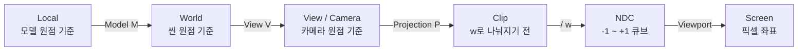
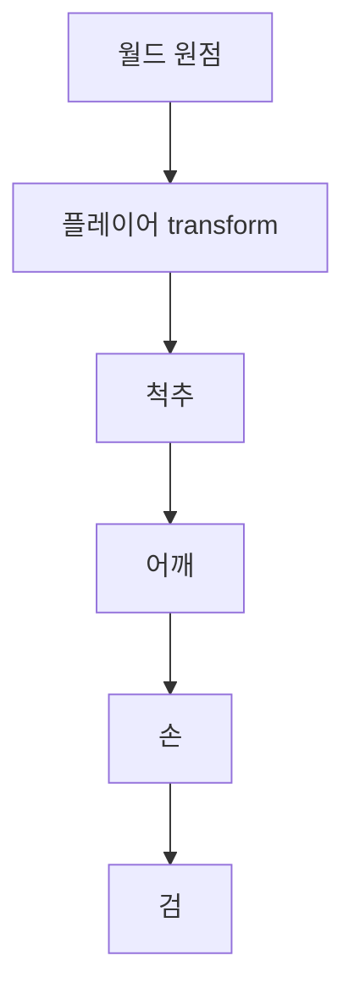
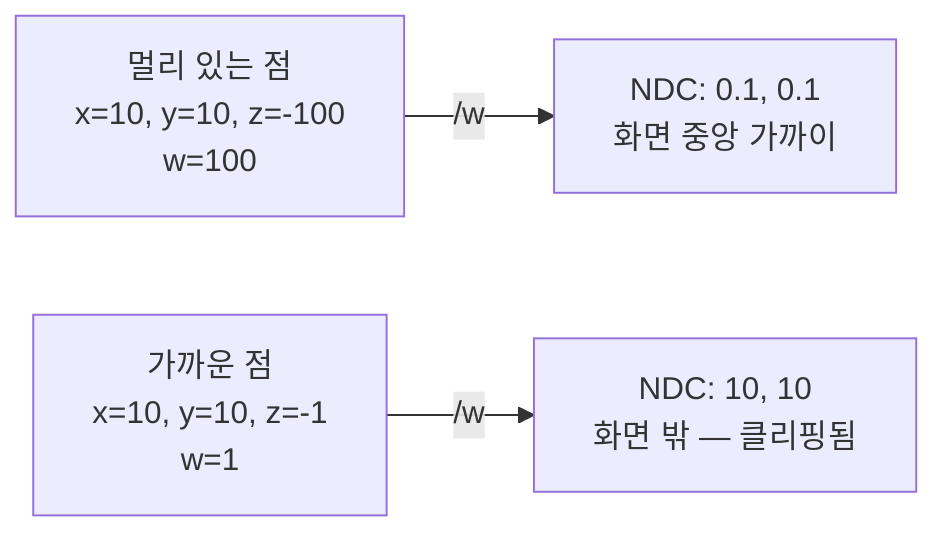
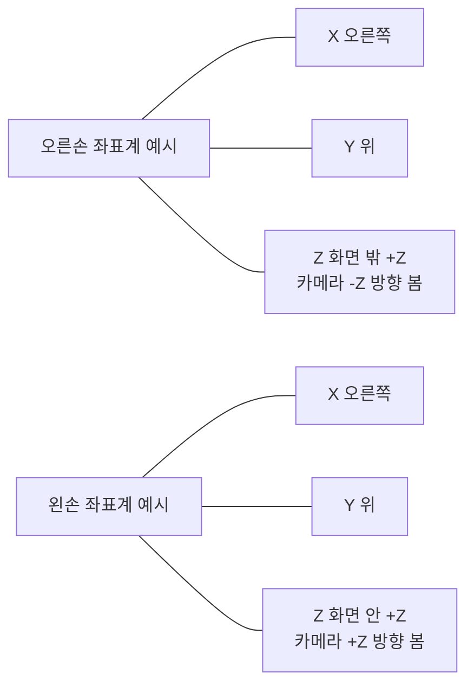

## 들어가며

게임의 한 프레임에서 정점 하나는 *모델 좌표* 에서 시작해 *월드 좌표 → 뷰 좌표 → 클립 좌표 → NDC → 화면 픽셀* 까지 *다섯 개 이상의 좌표계* 를 거친다. 각 좌표계마다 *원점이 어디에 있고, 축이 어디를 가리키며, 단위가 무엇인지* 가 다르다. 한 단계를 잘못 건너면 *모델이 거꾸로 박히거나 카메라가 뒤를 본다*.

이 글의 핵심 통찰은 *좌표계가 추상이지만 코드에서는 매우 구체적으로 충돌한다* 는 사실이다. 좌표계 사이의 변환은 수학적으로 *행렬 곱* 한 번이지만, *그 행렬을 어느 방향으로 만드는가* 는 *손잡이 (handedness)·위 방향 (Y-up vs Z-up)·축 관례* 에 따라 갈린다. 두 엔진을 섞거나 외부 모델을 임포트할 때 *축 매핑 행렬* 이 필요한 이유다.

이 글의 목표는 다음 다섯 가지다.

1. 좌표계의 위계 (Local → World → View → Clip → NDC → Screen) 와 각 단계에서 적용되는 행렬을 정리한다.
2. *카메라가 자기 좌표계의 원점에 있는* 뷰 변환의 의미와, 왜 view matrix가 *카메라 transform의 역* 인가를 풀어낸다.
3. 손잡이와 위 방향의 *엔진별 관례* 와 *모델 임포트 시 축 교환* 패턴을 정리한다.
4. LookAt 행렬을 *forward·right·up 세 벡터의 직교화* 로 분해해 손잡이별 부호 차이를 짚는다.
5. MVP 합성과 dirty flag 기반 캐싱, 인스턴스 렌더링에서의 모델 행렬 처리의 표준 패턴.

행렬과 회전 표현이 *공간을 변환하는 도구* 였다면, 이 글은 그 도구로 *어느 공간을 어디로 보내는지* 의 지도다. 카메라·투영·조명 수학이 모두 이 지도 위에서 흐른다.


---

## 목차
1. [좌표계 위계: Local→World→View→Clip](#1-좌표계-위계-localworldviewclip)
2. [Local에서 World로](#2-local에서-world로)
3. [World에서 View로](#3-world에서-view로)
4. [View에서 Clip으로](#4-view에서-clip으로)
5. [핸드니스: 왼손 vs 오른손](#5-핸드니스-왼손-vs-오른손)
6. [Y-up vs Z-up](#6-y-up-vs-z-up)
7. [카메라 수학: LookAt 행렬](#7-카메라-수학-lookat-행렬)
8. [변환 합성과 캐싱](#8-변환-합성과-캐싱)


---

## 1. 좌표계 위계: Local → World → View → Clip

게임 한 프레임의 정점 변환 파이프라인. 각 단계가 *한 좌표계에서 다음 좌표계* 로 옮긴다.



### 1.1 각 좌표계의 의미

| 좌표계 | 원점 | 단위 | 주 용도 |
|---|---|---|---|
| Local (Object, Model) | 모델 자체의 기준점 | 모델 단위 (보통 미터) | 메쉬 정점이 저장된 형태 |
| World | 씬의 절대 원점 | 게임 단위 (보통 미터) | 게임플레이·물리 시뮬 |
| View (Camera, Eye) | 카메라 위치 | 미터 | 빛·셰이딩·시야 판정 |
| Clip | 투영 후, w로 나누기 전 | 동차 좌표 | GPU의 투영 절두체 클리핑 |
| NDC (Normalized Device) | 화면 중앙 | $[-1, 1]$ 또는 $[0, 1]$ 큐브 | 픽셀 위치 계산 직전 |
| Screen | 화면 좌상단 (또는 좌하단) | 픽셀 | 최종 출력 |

각 단계의 *행렬* 이 정해져 있다.

| 변환 | 행렬 | 메모 |
|---|---|---|
| Local → World | $M$ (Model matrix) | 오브젝트마다 다름 |
| World → View | $V$ (View matrix) | 카메라마다 다름 |
| View → Clip | $P$ (Projection matrix) | 카메라마다 다름 (FOV·aspect·near·far) |
| Clip → NDC | $/ w$ (perspective divide) | GPU의 고정 단계 |
| NDC → Screen | viewport transform | GPU의 고정 단계 |

### 1.2 MVP 행렬

세 개의 행렬을 한 번에 곱해 *Local → Clip* 변환을 한 번의 행렬로 만들 수 있다.

$$
\text{MVP} = P \cdot V \cdot M
$$

GPU 셰이더의 *정점 셰이더 핵심 한 줄*.

```glsl
// vertex shader
gl_Position = MVP * vec4(localPosition, 1.0);
```

이 한 줄로 정점이 *Local에서 Clip 좌표* 까지 한 번에 변환. 이후 GPU가 자동으로 perspective divide와 viewport transform을 적용해 픽셀 위치를 결정한다.

### 1.3 변환의 누적 의미

각 행렬이 *공간을 다른 공간으로 보낸다* 는 의미. 행렬 곱 순서가 *오른쪽부터 적용* 임을 다시 짚는다 (column-vector 관례 기준).

$$
P V M \vec{v}_{\text{local}} = P (V (M \vec{v}_{\text{local}}))
$$

먼저 $M$ 이 정점을 *월드로*, 그 결과를 $V$ 가 *카메라 공간으로*, 마지막에 $P$ 가 *클립 공간으로*. 정점이 *세 단계를 차례로* 통과.

## 2. Local에서 World로

가장 단순한 변환. 오브젝트의 *Transform 컴포넌트* (위치·회전·스케일) 가 그대로 모델 행렬이 된다.

### 2.1 모델 행렬

$$
M = T \cdot R \cdot S
$$

TRS 합성 그대로. 스케일 → 회전 → 이동 순서로 적용 (오른쪽부터).

```cpp
mat4 ModelMatrix(vec3 position, quat rotation, vec3 scale) {
    mat4 S = ScaleMatrix(scale);
    mat4 R = RotationFromQuat(rotation);
    mat4 T = TranslateMatrix(position);
    return T * R * S;
}
```

### 2.2 부모-자식 계층

씬 그래프의 *부모-자식 변환 누적* 이 모델 행렬을 만든다. 자식의 *월드 변환* 은 *부모의 월드 × 자식의 로컬*.

$$
M_{\text{child, world}} = M_{\text{parent, world}} \cdot M_{\text{child, local}}
$$

손, 검, 어깨갑옷이 모두 *플레이어 캐릭터의 부모-자식 계층* 안에서 누적된다.



검의 *월드 변환* = 플레이어 × 척추 × 어깨 × 손 × 검 (각 로컬). 5번의 행렬 곱.

### 2.3 변환의 캐싱

매 프레임 모든 본의 월드 변환을 다시 계산하면 *수십 ~ 수백 번의 행렬 곱*. 게임 엔진은 *dirty flag* 로 캐싱한다.

```cpp
struct Transform {
    vec3 localPos;
    quat localRot;
    vec3 localScale;

    mat4 cachedWorldMatrix;
    bool dirty = true;

    void SetLocalPosition(vec3 p) {
        localPos = p;
        dirty = true;
    }

    mat4 GetWorldMatrix(Transform* parent) {
        if (dirty) {
            mat4 local = TRS(localPos, localRot, localScale);
            cachedWorldMatrix = parent ? parent->GetWorldMatrix(...) * local
                                        : local;
            dirty = false;
        }
        return cachedWorldMatrix;
    }
};
```

부모가 dirty면 자식도 *전이적으로 dirty*. 부모의 캐시가 무효화되면 자식들도 다시 계산.

### 2.4 인스턴싱

같은 메쉬를 *수천 번 그릴 때* 각 인스턴스의 *모델 행렬을 GPU에 한꺼번에 전달*. 인스턴싱 패턴.

```cpp
struct InstanceData {
    mat4 modelMatrix;
    vec4 color;     // 옵션: 인스턴스별 색상
};

std::vector<InstanceData> instances;
// ... 모든 적의 InstanceData 채움
glBufferData(GL_ARRAY_BUFFER, sizeof(InstanceData) * instances.size(),
              instances.data(), GL_DYNAMIC_DRAW);
glDrawArraysInstanced(GL_TRIANGLES, 0, vertexCount, instances.size());
```

GPU가 정점 셰이더에서 *인스턴스 ID로 모델 행렬을 가져와 곱한다*. 5천 적 = *1번의 draw call로 5천 모델 그리기*.

## 3. World에서 View로

뷰 변환은 *카메라가 원점에 있고 정해진 방향을 보는* 좌표계로 옮긴다. 카메라의 *시점에서 본 모습* 을 만드는 단계.

### 3.1 뷰 행렬의 의미

카메라가 *월드의 어떤 위치*에서 *어떤 방향* 을 본다고 하자. 카메라 자체의 *transform* 행렬을 $M_{\text{cam}}$ 이라 하면, 뷰 행렬은 그 *역*.

$$
V = M_{\text{cam}}^{-1}
$$

직관: 카메라가 월드에서 *오른쪽으로 5m, 위로 3m* 에 있으면, 뷰 변환은 *모든 것을 왼쪽 5m, 아래 3m* 로 옮긴다 — *카메라를 원점에 두기* 위해.

### 3.2 rigid transform의 빠른 역

카메라 transform이 *회전 + 이동만 가진 rigid transform* 이면 (보통 그렇다 — 스케일 없음), *닫힌 형태 역*.

$$
M_{\text{cam}} = \begin{pmatrix} R & \vec{t} \\ 0 & 1 \end{pmatrix}, \quad V = \begin{pmatrix} R^T & -R^T \vec{t} \\ 0 & 1 \end{pmatrix}
$$

3×3 회전 부분의 *전치 + $-R^T\vec{t}$ 계산* 만 필요하다. 일반 4×4 역처럼 소거와 특이성 처리를 하지 않아 연산 구조가 단순하며, 실제 속도 비율은 사용하는 수학 라이브러리와 SIMD 구현에서 측정한다.

```cpp
mat4 ViewMatrixRigid(vec3 cameraPos, mat3 cameraRot) {
    mat3 RT = Transpose(cameraRot);
    vec3 newT = -(RT * cameraPos);
    return AssembleAffine(RT, newT);
}
```

### 3.3 카메라 좌표계의 축 관례

카메라가 *원점에 있을 때* 어느 축을 forward로 정할지는 엔진과 수학 helper의 관례다. 그래픽 API의 clip-space 규약과 구분해야 한다.

| 관례/엔진 | 카메라 forward | 카메라 right | 카메라 up |
|---|---|---|---|
| RH view helper 관례 (`glm::lookAtRH`) | $-Z$ | $+X$ | $+Y$ |
| LH view helper 관례 (`XMMatrixLookAtLH`) | $+Z$ | $+X$ | $+Y$ |
| Unity (월드) | $+Z$ | $+X$ | $+Y$ |
| Unreal (월드) | $+X$ | $+Y$ | $+Z$ |

OpenGL 튜토리얼은 RH view와 $-Z$ forward를, 초기 Direct3D 튜토리얼은 LH view와 $+Z$ forward를 자주 사용하지만 API가 그 월드 관례를 강제하지 않는다. Unreal처럼 $+X$ forward, $+Z$ up을 쓰는 엔진도 있다.

view helper, 투영 행렬, front-face와 에셋 임포터가 한 관례에 맞아야 한다. 외부 모델을 임포트할 때 축 변환이 필요한 이유다.

### 3.4 뷰 좌표계의 활용

뷰 좌표계에서 *간편해지는 계산* 들.

- **백페이스 컬링**: 보통 *projected winding* 또는 *법선과 view direction의 내적* 으로 판단. 뷰 공간에서는 *카메라가 원점* 이라 view direction 계산이 단순해진다 — 다만 z 부호 단독 판단은 정확하지 않고, 면의 *winding 또는 normal·viewDir 내적* 이 정식 기준이다.
- **거리 계산**: 카메라까지의 거리 = *뷰 좌표의 길이*. 월드 좌표 빼기 카메라 위치보다 단순.
- **셰이딩**: 광원·시점 모두 뷰 공간으로 변환되어 있으면 *행렬 곱 없이* 내적 계산.

뷰 공간에서 셰이딩을 하는 *deferred renderer* 가 흔한 이유.

## 4. View에서 Clip으로

투영 행렬이 *시야 절두체 (frustum)* 를 *정사각 큐브* 로 변형. *원근감* 이 만들어지는 단계.

### 4.1 투영의 두 종류

**원근 투영 (Perspective Projection)**: *멀리 있는 물체가 작게* 보이는 일반 게임 카메라.

**직교 투영 (Orthographic Projection)**: *거리에 무관* 하게 같은 크기. 2D 게임·CAD·UI에서 흔함.

이 글은 원근 투영 위주로 다룬다. 직교는 비슷하지만 *원근 분할* 이 없는 단순 형태.

### 4.2 원근 투영 행렬

OpenGL 관례 (오른손, -Z 방향 보기) 의 원근 투영 행렬:

$$
P = \begin{pmatrix}
\frac{1}{\tan(\text{fov}/2) \cdot \text{aspect}} & 0 & 0 & 0 \\
0 & \frac{1}{\tan(\text{fov}/2)} & 0 & 0 \\
0 & 0 & \frac{-(f+n)}{f-n} & \frac{-2fn}{f-n} \\
0 & 0 & -1 & 0
\end{pmatrix}
$$

매개변수.

- `fov`: vertical field of view (라디안).
- `aspect`: 화면의 가로/세로 비.
- `n`: near plane 거리.
- `f`: far plane 거리.

### 4.3 동차 좌표의 w 성분

이 행렬을 view 공간 점 $(x, y, z, 1)$ 에 곱하면 결과 $(x', y', z', w')$ 의 *w 성분* 이 1이 아니다.

$$
w' = -z
$$

(OpenGL 관례에서 카메라가 -Z 보므로 카메라 앞이면 z 음수, w 양수.)

이 *w 성분이 깊이 정보* 를 담으며, 바로 이어지는 *원근 분할* 의 제수가 된다.

### 4.4 원근 분할 (perspective divide)

*Clipping 자체는 perspective divide 전에 일어난다*. GPU가 *Clip 공간에서 절두체 안에 들어오는 부분만* 잘라내고, *그 후* 살아남은 정점에 대해 perspective divide를 적용해 NDC 를 만든다. Clip 좌표 $(x', y', z', w')$ 에서 *모든 성분을 w로 나눔*.

$$
(x_{\text{NDC}}, y_{\text{NDC}}, z_{\text{NDC}}) = \left(\frac{x'}{w'}, \frac{y'}{w'}, \frac{z'}{w'}\right)
$$

이 나누기로 *멀리 있는 점이 화면 중앙으로 모인다* — *원근감* 의 수학적 표현.



### 4.5 NDC와 화면 좌표

NDC는 *$[-1, 1]^3$ 큐브* (또는 *$z \in [0, 1]$* — DirectX/Vulkan 관례). 그 안의 점만 화면에 그려진다.

이후 *viewport transform* 으로 NDC를 픽셀 좌표로.

$$
x_{\text{screen}} = \frac{x_{\text{NDC}} + 1}{2} \cdot \text{width}
$$

$$
y_{\text{screen}} = \frac{1 - y_{\text{NDC}}}{2} \cdot \text{height} \quad \text{(y 축 뒤집힘)}
$$

화면의 y가 *위에서 아래* 로 증가하는 관례 (DirectX·일부 OpenGL 빌드) 에 따라 부호 다름.

### 4.6 깊이 정밀도와 reverse-Z

z 성분의 NDC 값이 *비선형* 으로 분포한다 — *near 근처는 정밀하고 far 근처는 거칠다*. 이게 *z-fighting* 의 원인.

해결책: *Reverse-Z*. near를 큰 depth, far를 0 쪽으로 매핑하고 깊이 비교를 뒤집는다. 부동소수점 depth buffer의 표현 밀도와 perspective의 $1/z$ 분포를 더 잘 맞춰 넓은 거리 범위의 정밀도를 크게 개선한다. fixed-point depth buffer에서는 같은 이득이 나오지 않으며, coplanar surface·너무 가까운 near plane·부정확한 world transform에서 생기는 z-fighting까지 없애지는 않는다.

Reverse-Z는 *단순히 near/far를 swap하는 게 아니라 투영 행렬을 처음부터 새로 만들어야* 한다. 깊이 비교 함수도 `GL_LESS` → `GL_GREATER` 로 바꿔야 한다.

## 5. 핸드니스: 왼손 vs 오른손

3D 좌표계의 *손잡이 (handedness)* 가 그래픽스 API와 엔진을 가르는 가장 큰 관례 차이다.

### 5.1 두 좌표계의 정의

외적은 보통 *오른손 법칙* 으로 정의된다. 두 좌표계의 차이는 *기저 벡터의 방향* 이다.

오른손 좌표계에서는 오른손 외적 기준으로 $\hat{x} \times \hat{y}$ 가 *$+z$ 방향* 을 가리킨다. 오른손 엄지 (X), 검지 (Y), 중지 (Z) 가 서로 수직으로 펼쳐진 모양.

왼손 좌표계는 *기저의 방향성이 반대* 다 — Z축이 반대 방향. 같은 오른손 외적 공식을 적용하면 $\hat{x} \times \hat{y}$ 가 *그 좌표계의 -Z 방향* 을 가리킨다.



### 5.2 무엇이 갈라지는가

같은 *물리적 회전* 이 두 좌표계에서 *수치적으로 부호가 다른* 행렬로 표현. 외적 결과의 시각적 의미도 갈린다.

| 항목 | 오른손 | 왼손 |
|---|---|---|
| $\hat{x} \times \hat{y}$ | $+\hat{z}$ | $-\hat{z}$ (같은 식이지만 Z 방향 자체가 반대) |
| 양의 회전 방향 (+Y 둘레) | 반시계 (위에서 봤을 때) | 시계 (위에서 봤을 때) |
| 카메라 forward | 보통 $-Z$ | 보통 $+Z$ |
| Winding (front face) | 투영·viewport와 rasterizer 설정의 계약 | 투영·viewport와 rasterizer 설정의 계약 |

### 5.3 엔진별 관례

| 엔진/API | 손잡이 | 위 | forward |
|---|---|---|---|
| OpenGL API | 월드/뷰 손잡이 강제 안 함 | 강제 안 함 | 튜토리얼에서 RH, view $-Z$가 흔함 |
| Vulkan | 강제 안 함 | 강제 안 함 | 강제 안 함 |
| Direct3D API | 월드/뷰 손잡이 강제 안 함 | 강제 안 함 | LH/RH helper 모두 사용 가능 |
| Unity | LH | $+Y$ | $+Z$ |
| Unreal | LH | $+Z$ | $+X$ |
| Blender | RH | $+Z$ | $-Y$ |
| Maya | RH | $+Y$ | $-Z$ |

DirectX 자체가 *왼손을 강제* 하지 않는다는 점은 짚었다 — DirectXMath는 LH/RH 함수 모두 제공. *튜토리얼과 일반적 관례* 가 LH일 뿐이다.

### 5.4 좌표계 사이 변환

다른 손잡이 사이 모델을 옮기려면 *축 부호* 또는 *winding 순서* 를 뒤집는다.

**한 축 반전 행렬** (Z 반전):

$$
M_{\text{flip Z}} = \begin{pmatrix} 1 & 0 & 0 & 0 \\ 0 & 1 & 0 & 0 \\ 0 & 0 & -1 & 0 \\ 0 & 0 & 0 & 1 \end{pmatrix}
$$

이 행렬을 적용하면 *손잡이가 뒤집힌다*. 행렬식이 -1 이라 *winding order 도 반전*.

```cpp
// 오른손 모델을 왼손 엔진에 임포트
mat4 flipZ = ScaleMatrix(vec3(1, 1, -1));
modelMatrix = flipZ * originalModelMatrix;

// 또는 인덱스 버퍼의 winding 뒤집기
for (int i = 0; i < indexCount; i += 3) {
    std::swap(indices[i+1], indices[i+2]);
}
```

축 하나를 반전하는 변환은 *handedness 를 바꾸며 삼각형 winding 도 뒤집는다*. 따라서 렌더링 파이프라인에서는 다음 중 하나 이상의 처리가 필요하다 — *front-face 설정 변경*, *인덱스 winding 교체*, *normal/tangent basis 변환*. 어떤 조합이 필요한지는 *셰이더 파이프라인 + 모델 데이터 형태* 에 따라 갈린다.

## 6. Y-up vs Z-up

두 번째 관례 차이. *어느 축이 위 방향* 인가.

### 6.1 두 진영

| 진영 | 위 축 | 흔한 환경 |
|---|---|---|
| Y-up | $+Y$ | 게임/그래픽스 (OpenGL, DirectX, Unity, 영화 VFX) |
| Z-up | $+Z$ | CAD, 엔지니어링, 항공·조선, Unreal, Blender, Maya (옵션) |

게임 그래픽스는 *Y-up이 표준*. CAD·엔지니어링은 *현실 세계의 측량 관례* 와 일치하는 *Z-up*. Unreal은 *역사적 엔진 관례* 로 Z-up + X-forward 를 사용한다.

### 6.2 좌표계 + 위 방향 조합

손잡이 + 위 방향 = 4가지 조합.

| 조합 | 예 |
|---|---|
| RH + Y-up | OpenGL, Maya |
| RH + Z-up | Blender |
| LH + Y-up | DirectX, Unity |
| LH + Z-up | Unreal |

엔진 사이 모델을 옮길 때마다 *어느 조합에서 어느 조합으로* 가 모두 다르다. *축 매핑 행렬* 이 필요한 이유.

### 6.3 축 매핑 행렬

Z-up 모델을 Y-up 엔진에 임포트할 때.

$$
M_{\text{Z-up to Y-up}} = \begin{pmatrix} 1 & 0 & 0 & 0 \\ 0 & 0 & 1 & 0 \\ 0 & -1 & 0 & 0 \\ 0 & 0 & 0 & 1 \end{pmatrix}
$$

행렬이 *Y와 Z 축을 swap + 한 축 부호 반전*. 행렬식이 +1 이라 *손잡이 보존* — 이 행렬은 *위 방향만* 바꾼다.

*Blender Z-up + RH → Unity Y-up + LH* 같은 *위 방향 + handedness 동시 변환* 은 이 axisMap 하나로는 부족하다. 두 변환을 *분리* 해 따로 적용한다.

- **Z-up → Y-up**: 위의 axisMap (det = +1, handedness 보존).
- **RH → LH**: 한 축 부호 반전 (det = -1, handedness 뒤집음). 보통 *Z 부호 반전*.

```cpp
// Blender Z-up + RH 모델을 Unity Y-up + LH 으로
mat4 zUpToYUp  = ZUpToYUpMatrix();   // det = +1
mat4 flipZ     = ScaleMatrix(vec3(1, 1, -1));  // det = -1
mat4 axisMap   = flipZ * zUpToYUp;   // 두 단계 합성

unityModelMatrix = axisMap * blenderModelMatrix * Inverse(axisMap);
```

*conjugation* 패턴 ($A M A^{-1}$). 외부 행렬을 *현재 좌표계로 가져와* 적용 후 *원래 좌표계로 되돌림*. flipZ 단계가 들어가면서 winding/normal 처리도 동시에 필요해진다 (5.4절).

### 6.4 조합 변환

Z-up + RH (Blender) → Y-up + LH (Unity) 같은 *손잡이 + 위 방향* 동시 변환은 *두 행렬의 곱* 또는 *한 행렬에 둘 다 인코딩*.

게임 엔진의 모델 임포터가 보통 *축 매핑 행렬을 임포트 옵션* 으로 노출. 디자이너가 Maya 모델을 Unity로 옮길 때 *Maya의 Y-up* 이라 손잡이만 바꾸면 되고, Blender 모델은 *Z-up과 손잡이 둘 다*.

### 6.5 코드의 일관성

엔진 안에서는 *한 좌표계로 통일*. 외부 모델은 *임포트 시점에 변환* 후 그 좌표계로 통일.

```cpp
// 임포트 단계
mat4 axisMap = GetAxisMappingMatrix(sourceCoordSystem, engineCoordSystem);
for (auto& vertex : importedMesh.vertices) {
    vertex.position = (axisMap * vec4(vertex.position, 1.0)).xyz;
    vertex.normal   = (NormalMatrix(axisMap) * vertex.normal).xyz;
}
```

*위치는 행렬 곱*, *법선은 normal matrix 곱* (비균일 스케일 처리와 같은 원리). axisMap이 *직교 행렬* 이면 normal matrix = axisMap 자체.

## 7. 카메라 수학: LookAt 행렬

카메라의 *위치 (eye), 보는 점 (target), 위 방향 (up)* 세 정보로 *뷰 행렬을 만드는* 표준 함수.

### 7.1 LookAt 식

세 단위 벡터를 만든다.

$$
\vec{f} = \frac{\vec{target} - \vec{eye}}{|\vec{target} - \vec{eye}|}
$$

$$
\vec{r} = \frac{\vec{f} \times \vec{up}}{|\vec{f} \times \vec{up}|}
$$

$$
\vec{u} = \vec{r} \times \vec{f}
$$

$\vec{f}$ 가 *카메라 forward 방향*, $\vec{r}$ 이 *카메라 right*, $\vec{u}$ 가 *직교화된 up*. 입력 `up` 은 *대략적인 위* 만 알려주면 되고, 정확한 카메라 up은 *right × forward* 외적으로 자동 결정.

뷰 행렬은 이 셋과 eye 위치로 만들어진다.

$$
V = \begin{pmatrix} r_x & r_y & r_z & -\vec{r} \cdot \vec{eye} \\ u_x & u_y & u_z & -\vec{u} \cdot \vec{eye} \\ -f_x & -f_y & -f_z & \vec{f} \cdot \vec{eye} \\ 0 & 0 & 0 & 1 \end{pmatrix}
$$

(OpenGL 관례. 세 번째 행이 *forward의 반대* 인 이유는 카메라가 *-Z 방향 forward* 라 view 공간으로 옮길 때 *부호 반전* 필요.)

### 7.2 손잡이별 부호

DirectX 관례 (왼손, 카메라 +Z 방향 forward) 에서는 세 번째 행이 *forward 그대로* 부호 양수.

$$
V_{\text{LH}} = \begin{pmatrix} r_x & r_y & r_z & -\vec{r} \cdot \vec{eye} \\ u_x & u_y & u_z & -\vec{u} \cdot \vec{eye} \\ f_x & f_y & f_z & -\vec{f} \cdot \vec{eye} \\ 0 & 0 & 0 & 1 \end{pmatrix}
$$

손잡이가 다르면 *부호 한 줄* 차이. 이 차이가 *코드를 잘못 옮길 때* 카메라가 *뒤를 보는* 흔한 버그.

### 7.3 코드 예

```cpp
mat4 LookAtRH(vec3 eye, vec3 target, vec3 up) {
    vec3 f = normalize(target - eye);
    vec3 r = normalize(cross(f, up));
    vec3 u = cross(r, f);
    return mat4{
         r.x,  r.y,  r.z, -dot(r, eye),
         u.x,  u.y,  u.z, -dot(u, eye),
        -f.x, -f.y, -f.z,  dot(f, eye),
         0,    0,    0,    1,
    };
}
```

glm의 `glm::lookAt` 이 이 식을 그대로 구현. DirectXMath의 `XMMatrixLookAtRH` / `XMMatrixLookAtLH` 도 같은 패턴.

### 7.4 Up 벡터의 함정

LookAt의 *up 입력* 이 *forward 방향과 같으면* (예: target이 카메라 *바로 위*) `cross(f, up)` 결과가 *영벡터* 라 정규화 시 NaN.

```cpp
mat4 LookAtSafe(vec3 eye, vec3 target, vec3 up) {
    vec3 forward = target - eye;
    if (length_squared(forward) < 1e-12f) {
        // target == eye — forward 정의 안 됨. 기본 방향으로.
        forward = vec3(0, 0, -1);  // OpenGL 관례
    } else {
        forward = normalize(forward);
    }
    if (length_squared(cross(forward, up)) < 1e-12f) {
        // forward와 up이 평행 — 다른 up 선택
        up = std::fabs(forward.y) < 0.99f ? vec3(0, 1, 0) : vec3(1, 0, 0);
    }
    // ... 나머지 같음
}
```

*길이 검사가 정규화보다 먼저* 와야 한다. `normalize(target - eye)` 를 *먼저 호출* 하면 target == eye 일 때 *영벡터 정규화 = NaN*.

*카메라가 수직 위/아래를 정확히 볼 때* 발생하는 함정. 안전한 LookAt은 *up이 forward와 평행한지 검사* 후 다른 up을 선택.

### 7.5 구면 카메라 (orbit camera)

게임의 *3인칭 카메라* 가 캐릭터 둘레로 도는 패턴. *yaw + pitch* 두 각도로 카메라 위치를 결정.

```cpp
vec3 OrbitCameraPos(vec3 target, float yaw, float pitch, float distance) {
    return target + distance * vec3(
        std::cos(pitch) * std::sin(yaw),
        std::sin(pitch),
        std::cos(pitch) * std::cos(yaw)
    );
}
```

target이 *주시 점*, yaw가 *수평 회전*, pitch가 *수직 회전*, distance가 *거리*. 마우스 입력으로 yaw·pitch를 갱신하고 LookAt으로 view 행렬 생성.

이 패턴이 *3인칭 액션 게임의 표준 카메라*. 마우스 좌우 = yaw 변경, 마우스 위아래 = pitch 변경.

## 8. 변환 합성과 캐싱

매 프레임 *모든 오브젝트의 MVP* 를 다시 계산하는 비용과 그 캐싱 전략.

### 8.1 MVP 계산 비용

오브젝트 N개, 카메라 1개. 매 프레임:

- 모델 행렬 N개: 각 오브젝트의 transform → 4×4 행렬.
- 뷰 행렬 1개: 카메라의 transform 의 역.
- 투영 행렬 1개: FOV·aspect·near·far (보통 매 프레임 안 바뀜).
- MVP N개: $P \cdot V \cdot M_i$.

PV는 *카메라당 1회* 캐싱 가능. PVM은 *오브젝트당 1회* 행렬 곱이 필요. N=10000이면 *PV 1번 + PVM 10000번* — 4×4 행렬 곱 64 곱 + 48 합 기준 약 0.25 ms.

### 8.2 PV 캐싱

*P × V* 는 카메라가 안 바뀌면 매 프레임 같다. 한 번 계산해 캐시.

```cpp
mat4 viewProjection;  // 카메라당 한 번 계산
for (auto& obj : objects) {
    mat4 mvp = viewProjection * obj.modelMatrix;
    // GPU에 mvp 전송
}
```

N개 행렬 곱이 *반으로 줄어든다*. 카메라 한 개 + 오브젝트 만 개에서 큰 절감.

### 8.3 dirty flag 기반 모델 행렬 캐싱

오브젝트가 *움직이지 않은 프레임* 은 모델 행렬도 안 바뀐다. dirty flag로 캐싱.

```cpp
struct Transform {
    vec3 position, scale;
    quat rotation;
    mat4 cachedMatrix;
    bool dirty = true;

    mat4 GetMatrix() {
        if (dirty) {
            cachedMatrix = TRS(position, rotation, scale);
            dirty = false;
        }
        return cachedMatrix;
    }
};
```

씬의 *대부분 오브젝트가 정적* 인 게임에서 큰 이득. 매 프레임 행렬 계산 = 움직이는 N% 만.

### 8.4 부모 transform 변경 전이

부모가 변하면 *자식 모두의 캐시 무효화*. 트리 구조에서 dirty 플래그 전파.

```cpp
void Transform::SetPosition(vec3 p) {
    position = p;
    dirty = true;
    for (auto* child : children) child->MarkDirtyRecursive();
}

void Transform::MarkDirtyRecursive() {
    dirty = true;
    for (auto* child : children) child->MarkDirtyRecursive();
}
```

부모 transform의 한 변경이 *전체 서브트리 무효화*. 다음 프레임에 *방문한 자식만 재계산*.

### 8.5 GPU 인스턴싱과 모델 행렬

수천 인스턴스의 모델 행렬을 *한 버퍼* 로 묶어 GPU에 보냄.

```cpp
struct InstanceData {
    mat4 modelMatrix;     // 64 byte
    vec4 instanceColor;   // 16 byte
};
```

인스턴스당 80 byte. 1만 인스턴스 = 800 KB. 매 프레임 갱신이면 GPU 대역폭 부담 — *움직이는 인스턴스만 갱신* 하는 partial update가 흔한 최적화.

### 8.6 SoA vs AoS — 인스턴스 데이터 레이아웃

Transform 데이터의 *AoS (Array of Structs)* 와 *SoA (Struct of Arrays)* 트레이드오프.

```cpp
// AoS: 게임 코드에서 자주 등장
struct GameObject {
    vec3 position;
    quat rotation;
    vec3 scale;
};
std::vector<GameObject> objects;

// SoA: 배치 처리에 유리
struct ObjectsSoA {
    std::vector<vec3> positions;
    std::vector<quat> rotations;
    std::vector<vec3> scales;
};
```

*개별 오브젝트 임의 접근* 은 AoS가 자연. *모든 오브젝트의 모델 행렬을 한꺼번에 계산* 같은 배치 처리는 SoA가 SIMD 친화. 거대 게임 엔진 (DOTS, ECS) 이 SoA 패턴을 채택하는 이유.

### 8.7 컬링 단계와 행렬 계산

화면 밖 오브젝트의 *MVP를 굳이 계산할 필요 없다*. *컬링 단계 (frustum culling)* 가 가시 오브젝트만 추려 그 부분집합에 대해서만 MVP 계산.

```cpp
std::vector<Object*> visible;
for (auto& obj : objects) {
    if (frustumIntersects(obj.boundingBox, cameraFrustum)) {
        visible.push_back(&obj);
    }
}

for (auto* obj : visible) {
    obj->mvp = viewProjection * obj->GetModelMatrix();
}
```

씬의 *수십만 오브젝트* 중 *수천 개만 가시* 인 일반적 시나리오에서 큰 절감. 컬링 자체의 비용 (BVH·octree 같은 공간 분할) 도 게임 엔진의 표준 토픽.


---

## 결론

게임의 정점 변환 파이프라인은 *Local → World → View → Clip → NDC → Screen* 의 다섯 좌표계 변환이다. 각 단계가 *행렬 한 번* 으로 처리되고, 셋의 곱 (MVP) 이 *정점 셰이더의 핵심 한 줄* 을 만든다.

이 글에서 정리한 핵심.

1. **MVP의 의미** — 모델 행렬 (오브젝트 transform), 뷰 행렬 (카메라 transform의 역), 투영 행렬 (절두체 → 큐브). 셋의 곱이 한 번에 적용.
2. **rigid transform의 빠른 역** — 카메라 view 행렬은 *3×3 회전의 전치 + $-R^T\vec{t}$* 로 계산한다.
3. **손잡이와 API 규약의 분리** — OpenGL·Direct3D·Vulkan의 clip/NDC·viewport 규약과 엔진의 월드/뷰 handedness는 별도 선택이다. Unity·Unreal 같은 엔진은 자체 월드 축 관례를 가지며, 임포트·투영·front-face 설정이 그 변환과 일치해야 한다.
4. **Y-up vs Z-up** — 게임 그래픽스의 Y-up과 CAD·Unreal·Blender의 Z-up. 모델 임포트 시 *축 매핑 행렬* 로 변환.
5. **dirty flag 기반 캐싱** — 움직이지 않은 오브젝트의 모델 행렬을 매 프레임 재계산하지 않는다. 부모 transform 변경 시 자식 트리 전이.

좌표계가 *추상* 이지만 *코드에서는 매우 구체적* 으로 충돌한다. 손잡이·위 방향·축 관례를 *프로젝트 시작 시 명시* 하고 *그 안에서 일관되게* 쓰는 게 실용적 결론. 외부 데이터 (모델, 애니메이션) 가 들어올 때마다 *임포트 시점에 통일된 좌표계로 변환* 한다.

이 변환 파이프라인은 *시간축* 으로도 확장된다 — 두 자세 사이를 *부드럽게 잇는* 보간, 카메라 페이드, 키프레임 애니메이션의 수학.

## 더 읽을거리

- Eric Lengyel, *Foundations of Game Engine Development*, Vol. 1, Ch. 2 — 좌표계와 변환의 게임 엔진 표준.
- Tomas Akenine-Möller et al., *Real-Time Rendering*, 4th ed., Ch. 4 "Transforms" — 그래픽스 관점.
- Joey de Vries, *Learn OpenGL — Coordinate Systems* — 정점 변환 파이프라인의 시각적 입문.
- Tom Forsyth, "Matrix Storage" — 메모리 레이아웃과 변환 파이프라인의 실전.
- Microsoft DirectXMath 문서 — `XMMatrixLookAtRH`, `XMMatrixPerspectiveFovLH` 등.
- glm 소스 — `glm/ext/matrix_transform.hpp` 의 LookAt 구현.
- Khronos Vulkan 1.x 명세 — 좌표계와 NDC 정의.
- Aras Pranckevičius, "Coordinate System Conventions" 블로그 — 엔진별 관례 비교.
