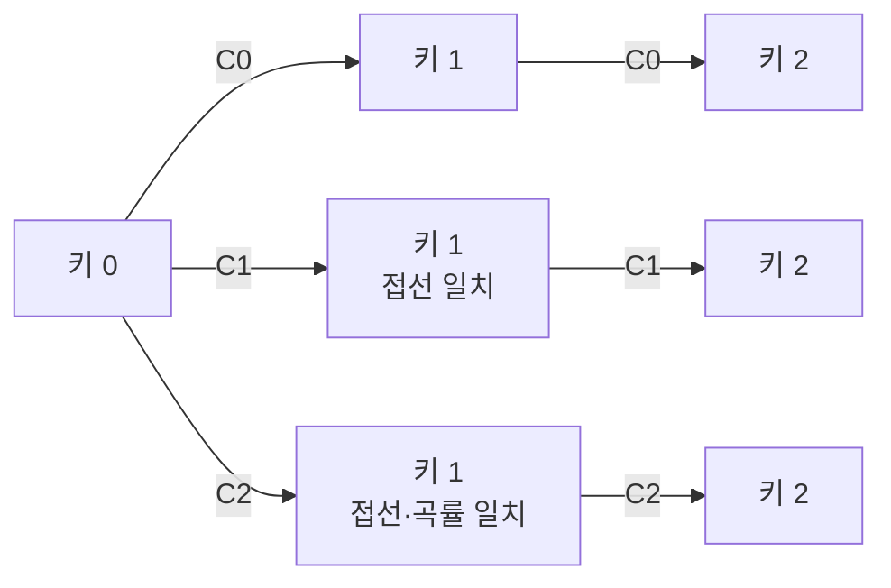
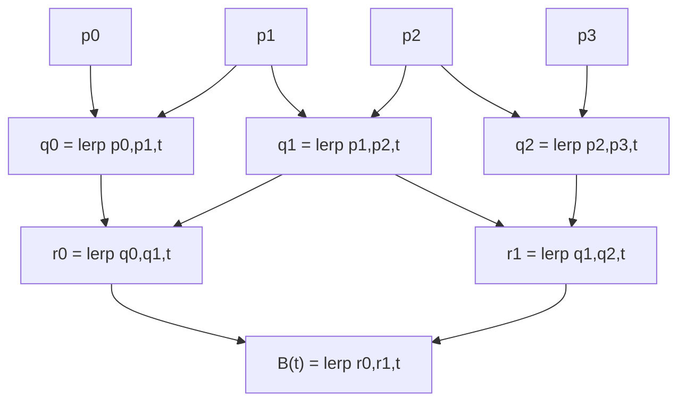
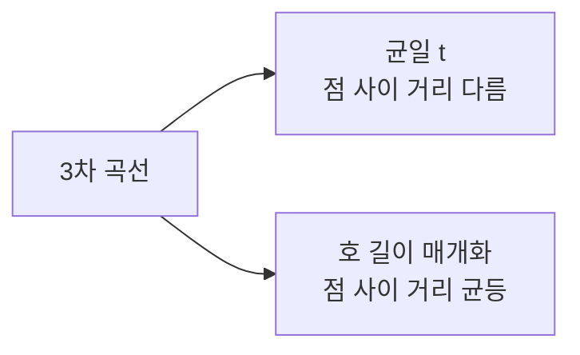

## 들어가며

보간 (Interpolation) 은 *두 키프레임 사이를 자연스럽게 잇는 다리* 다. 게임의 거의 모든 시각적·감각적 변화가 보간이다. 캐릭터가 위치 A에서 B로 이동, 카메라가 한 시점에서 다른 시점으로 회전, 적이 등장할 때 *서서히 커지며* 나타나는 효과, UI 버튼이 눌리는 순간의 *살짝 줄어드는* 반응 — 모두 *보간 함수* 의 선택이 그 *체감* 을 결정한다.

수학적으로 보간은 *두 값 사이를 매개변수 t (0 ~ 1) 로 잇는 함수*. 가장 단순한 형태는 *선형 보간 (Lerp)* — 직선으로 잇기. 다만 *직선이 자연스럽지 않은* 경우가 많다. 회전은 *4D 구면 위 측지선* 이 자연스럽고, 카메라 경로는 *부드러운 곡선* 이, UI 모션은 *가속·감속이 들어간 곡선* 이 더 매끄럽다.

이 글의 목표는 다음 다섯 가지다.

1. 보간 함수의 *연속성 등급* (C0, C1, C2) 과 게임 감각의 관계를 정리한다.
2. 위치·스칼라·색상의 *Lerp* 와 회전의 *Slerp/Nlerp* 의 차이.
3. 카메라 경로와 캐릭터 트랙의 *Hermite·Bezier·Catmull-Rom* 곡선의 의미와 차이.
4. *균일 매개화 vs 호 길이 매개화* 의 함정 — 같은 t 변화가 *거리 변화로 균등* 하지 않은 문제.
5. Easing 함수가 *게임 감각의 무게* 를 만드는 패턴.

쿼터니언 Slerp가 이 글의 기본 도구 중 하나다. 회전을 *키프레임 사이 부드럽게* 잇는 도구로 쓰이고, 위치 보간의 Hermite·Bezier와 같은 t로 동기화된다.


---

## 목차
1. [보간이 무엇을 보장하나](#1-보간이-무엇을-보장하나)
2. [Lerp와 그 한계](#2-lerp와-그-한계)
3. [Slerp와 Nlerp](#3-slerp와-nlerp)
4. [Hermite 곡선](#4-hermite-곡선)
5. [Bezier 곡선](#5-bezier-곡선)
6. [Catmull-Rom 곡선](#6-catmull-rom-곡선)
7. [매개화: 균일 vs 호 길이](#7-매개화-균일-vs-호-길이)
8. [Easing 함수와 게임 감각](#8-easing-함수와-게임-감각)


---

## 1. 보간이 무엇을 보장하나

보간 함수의 *품질* 은 *연속성 (continuity)* 으로 분류한다. 키프레임 사이 *값* 만 부드러우면 충분한지, *속도* 까지 매끄러워야 하는지, *가속도* 까지 매끄러워야 하는지에 따라 다른 보간이 적합하다.

### 1.1 연속성 등급

| 등급 | 의미 | 시각적 결과 |
|---|---|---|
| C0 | 값이 연속 | 끊김 없이 이어지지만 *꺾임 가능* |
| C1 | 값과 1차 도함수 (속도) 연속 | 부드럽게 이어지고 *속도 점프 없음* |
| C2 | 값·속도·가속도 모두 연속 | *가속의 변화도 부드러움* |

게임에서:

- **위치 이동**: C0 만으로도 가끔 충분 (작은 거리). 일반적으로 C1 이상.
- **카메라 추종**: C1 필수. C2 가 자연스러움.
- **물리 시뮬 경로**: C2 (가속도가 부드러워야 *힘이 부드러움*).
- **UI 트윈**: C0 면 *딱 멈추는* 느낌, C1 이면 *부드러움*, easing이 들어가면 *생동감*.

### 1.2 키프레임 사이 vs 키프레임 자체

보간 곡선이 *한 키프레임 사이* 에서는 부드럽게 정의되어도, *키프레임 자체* 에서 어떤 등급인지가 중요하다.



- **C0 만**: 각 키 사이를 직선으로 잇기. 키마다 *방향 갑자기 바뀜* 가능.
- **C1**: 키 양쪽의 *접선이 일치*. 키를 지날 때 *속도 안 끊김*.
- **C2**: 접선과 *곡률* 모두 일치. *가속도 점프 없음*.

게임 카메라가 *키프레임 시퀀스* 를 따라갈 때 C0 이면 *키마다 카메라가 흔들리는* 느낌. C1 이면 매끄럽지만 *가속이 갑자기 변함*. C2 가 가장 자연스럽지만 *비싸다*.

### 1.3 게임에서 적절한 등급

대부분 게임 코드는 *C1 이 충분*. C2 가 필요한 곳은 *영화적 카메라* 또는 *물리 정확성* 이 핵심인 시뮬레이션. UI 트윈은 *C0 + Easing 함수* 로 충분.

연속성과 비용의 트레이드오프.

| 등급 | 곡선 | 비용 | 게임 사용 |
|---|---|---|---|
| C0 | 선형 보간 (Lerp) | 가장 싸 | 단순 위치, 색상, 알파 |
| C1 | Hermite, Catmull-Rom | 중간 | 카메라 추종, 캐릭터 경로 |
| C2 | B-Spline, NURBS | 비싸 | 영화 카메라, 정밀 시뮬 |

## 2. Lerp와 그 한계

선형 보간 (Linear Interpolation, Lerp) 은 가장 단순한 보간. 두 값 사이의 *직선* 을 매개변수 t로 잇는다.

### 2.1 정의

$$
\text{lerp}(a, b, t) = (1 - t) a + t b
$$

t = 0 이면 a, t = 1 이면 b, t = 0.5 이면 *중간*. 모든 게임 수학의 출발점.

```cpp
template<typename T>
T Lerp(T a, T b, float t) {
    return a + (b - a) * t;
}
```

자주 사용하는 *최적화 형태* `a + (b - a) * t`. 곱셈이 한 번 적다. 부동소수점은 분배법칙이 성립하지 않아 두 식은 다른 함수이고, 컴파일러도 (`-ffast-math` 없이는) 서로 바꿔 최적화하지 않는다. 부동소수점 정밀도 측면에서는 두 형태가 *키 양 끝에서 비트 단위 차이* 가 있을 수 있다 — 일반 게임 코드에서는 무관.

### 2.2 적용 가능한 타입

| 타입 | Lerp |
|---|---|
| `float`, `double` | 직접 적용 |
| `vec2`, `vec3`, `vec4` | 성분별 |
| 색상 (RGB, RGBA) | 성분별 (다만 *gamma* 주의 — 2.4절) |
| 시간, 알파, 스칼라 매개변수 | 직접 |

쿼터니언과 행렬은 *Lerp 가 직접 적용 안 됨*. 결과가 *단위 길이가 아니거나* *직교성 깨진다*. 쿼터니언은 Slerp/Nlerp (3절), 행렬은 *분해 후 보간* (또는 쿼터니언 변환).

### 2.3 C0 의 한계

여러 키프레임 사이를 *Lerp 로 차례로 잇기* 가 일반적 패턴.

```cpp
vec3 Path(const std::vector<vec3>& keys, float t) {
    int seg = std::min(int(t), int(keys.size()) - 2);
    float localT = t - seg;
    return Lerp(keys[seg], keys[seg + 1], localT);
}
```

t = 0 ~ N-1 (N개 키) 으로 *키 사이를 직선으로 잇기*. 결과 곡선이 *각 키에서 꺾인다* — *방향이 갑자기 변한다*. C0 만 보장.

캐릭터가 이런 경로를 따라가면 *매 키에서 즉시 방향 전환* — 자연스럽지 않음. 키 사이 곡선을 부드럽게 잇는 *Hermite·Catmull-Rom* 이 필요.

### 2.4 색상의 보간과 gamma

색상의 Lerp는 *RGB 성분별 선형 보간* 이지만, 모니터 출력이 *비선형 gamma* 라 *시각적 결과* 가 어색할 수 있다.

빨강 (1, 0, 0) 과 초록 (0, 1, 0) 사이 t = 0.5 의 단순 Lerp:

$$
(0.5, 0.5, 0)
$$

수학적 중간이지만 *어두운 노란색*. *시각적 중간* 이라기엔 어둡다. 이유: 모니터의 출력 함수가 sRGB라 *0.5 입력이 실제 빛으로는 약 0.22 강도*. 두 색이 *각각 약하게* 출력되어 합쳐 *어둡게 보인다*.

해결: *gamma 보정* (linear space 보간).

```cpp
vec3 LerpSRGB(vec3 a, vec3 b, float t) {
    vec3 aLin = pow(a, vec3(2.2));   // sRGB → linear
    vec3 bLin = pow(b, vec3(2.2));
    vec3 cLin = Lerp(aLin, bLin, t);  // linear에서 보간
    return pow(cLin, vec3(1.0/2.2)); // linear → sRGB
}
```

게임 셰이더는 *대부분 linear 공간에서 작업* 후 *최종 출력에서만 gamma 적용*. 색상 보간이 자연스러운 형태로.

### 2.5 Lerp의 일반화: 가중 평균

3개 이상 값의 보간은 *가중치 합*.

$$
\text{weighted}(v_1, v_2,..., v_n; w_1,..., w_n) = \sum w_i v_i, \quad \sum w_i = 1
$$

barycentric 좌표가 가장 흔한 예 — 삼각형 위 점을 *세 정점의 가중 평균* 으로. 셰이더의 정점 속성 보간이 이 패턴.

```cpp
vec3 BarycentricLerp(vec3 v0, vec3 v1, vec3 v2, vec3 bary) {
    return bary.x * v0 + bary.y * v1 + bary.z * v2;
}
```

`bary.x + bary.y + bary.z == 1` 가정. 정점 색상·법선·UV 좌표의 픽셀별 보간이 GPU의 자동 동작.

## 3. Slerp와 Nlerp

쿼터니언 보간. 다뤘으니 *간단히 복습 + 추가 패턴*.

### 3.1 Slerp 복습

$$
\text{Slerp}(q_0, q_1, t) = \frac{\sin((1-t)\theta)}{\sin\theta} q_0 + \frac{\sin(t\theta)}{\sin\theta} q_1
$$

$\theta = \arccos(q_0 \cdot q_1)$. *4D 구면 위 측지선* 을 따라 *등각속도* 로 보간.

게임 애니메이션의 *키프레임 보간* 표준. 캐릭터 관절이 *부드러운 각속도* 로 움직인다.

### 3.2 Nlerp 복습

$$
\text{Nlerp}(q_0, q_1, t) = \frac{(1-t) q_0 + t q_1}{\|(1-t) q_0 + t q_1\|}
$$

선형 보간 후 정규화. 비등각속도지만 *훨씬 빠르다*. 짧은 회전에는 시각적으로 거의 같다.

### 3.3 게임 엔진의 패턴

| 시나리오 | 추천 |
|---|---|
| 본 애니메이션 인접 키 (작은 회전) | Nlerp |
| 카메라 자세 전환 (큰 회전) | Slerp |
| 적이 플레이어를 향해 회전 (지속적) | Slerp 매 프레임 + 작은 t |
| AI 타겟 갱신 (잦은 변경) | Nlerp |

대형 게임 엔진 (Unity, Unreal) 의 *Quaternion.Lerp* 가 실제로는 Nlerp. *진짜 Slerp* 가 필요한 곳은 *큰 회전 + 정확한 각속도* 인 경우.

### 3.4 보간 외의 쿼터니언 활용

쿼터니언 보간이 *위치·스칼라 보간과 동기화* 되는 패턴이 흔하다.

```cpp
struct CameraKey {
    vec3  position;
    quat  rotation;
    float fov;
    float time;
};

void InterpolateCamera(CameraKey a, CameraKey b, float t) {
    camera.pos    = Lerp(a.position, b.position, t);
    camera.rot    = Slerp(a.rotation, b.rotation, t);
    camera.fov    = Lerp(a.fov, b.fov, t);
}
```

*같은 t로 셋을 동시에 보간*. 키프레임의 모든 속성이 *동일한 시간축* 으로 진행.

## 4. Hermite 곡선

두 *점과 두 접선* 으로 정의되는 3차 곡선. 키프레임 사이 *부드러운 호* 를 만드는 가장 단순한 형태.

### 4.1 정의

두 끝점 $\vec{p}_0, \vec{p}_1$ 과 두 접선 (출발 접선) $\vec{m}_0$, (도착 접선) $\vec{m}_1$ 로 정의된 3차 곡선.

$$
\vec{p}(t) = h_{00}(t) \vec{p}_0 + h_{10}(t) \vec{m}_0 + h_{01}(t) \vec{p}_1 + h_{11}(t) \vec{m}_1
$$

여기서 *Hermite 기저 함수*.

$$
h_{00}(t) = 2t^3 - 3t^2 + 1
$$

$$
h_{10}(t) = t^3 - 2t^2 + t
$$

$$
h_{01}(t) = -2t^3 + 3t^2
$$

$$
h_{11}(t) = t^3 - t^2
$$

### 4.2 기저 함수의 의미

각 기저 함수가 *t 에서 어떤 가중치* 를 갖는지가 의미.

| 기저 | t=0 | t=1 | 1차 도함수 t=0 | 1차 도함수 t=1 |
|---|---|---|---|---|
| $h_{00}$ | 1 | 0 | 0 | 0 |
| $h_{10}$ | 0 | 0 | 1 | 0 |
| $h_{01}$ | 0 | 1 | 0 | 0 |
| $h_{11}$ | 0 | 0 | 0 | 1 |

이 표 덕분에:

- $\vec{p}(0) = \vec{p}_0$ (시작점)
- $\vec{p}(1) = \vec{p}_1$ (끝점)
- $\vec{p}'(0) = \vec{m}_0$ (시작 접선)
- $\vec{p}'(1) = \vec{m}_1$ (끝 접선)

*양 끝점과 양 끝 접선* 이 *정확히 입력값* 이 된다. 이게 Hermite의 *직관적 의미*.

### 4.3 코드

```cpp
template<typename T>
T HermiteInterpolate(T p0, T m0, T p1, T m1, float t) {
    float t2 = t * t;
    float t3 = t2 * t;
    float h00 =  2*t3 - 3*t2 + 1;
    float h10 =      t3 - 2*t2 + t;
    float h01 = -2*t3 + 3*t2;
    float h11 =      t3 -   t2;
    return h00 * p0 + h10 * m0 + h01 * p1 + h11 * m1;
}
```

7회 곱 + 6회 합 + 4회 가중합. 매개변수 4개 — 키마다 *위치 + 접선* 두 개씩 보관.

### 4.4 Hermite의 게임 활용

**카메라 경로**: 키마다 *위치 + 카메라 진행 방향* 을 두 접선으로 보관. 매끄러운 카메라 추종.

**캐릭터 등장 경로**: 적이 무대 뒤에서 *부드럽게 등장* 하는 경로. 시작 접선 = 무대 뒤 방향, 끝 접선 = 정지.

**물리 충격 반응**: 캐릭터가 충격을 받고 *튕기는* 모션. 시작 접선 = 충격 방향 + 크기, 끝 접선 = 0.

### 4.5 키 사이 연속성

여러 키프레임 사이를 Hermite로 잇는 게 일반적. *키의 두 접선 (오른쪽으로 가는 접선·왼쪽에서 오는 접선) 을 일치* 시키면 C1 보장.

```cpp
struct HermiteKey {
    vec3  position;
    vec3  tangent;   // 양쪽 접선이 일치 = C1 보장
};

vec3 HermitePath(const std::vector<HermiteKey>& keys, float t) {
    int seg = std::min(int(t), int(keys.size()) - 2);
    float localT = t - seg;
    return HermiteInterpolate(
        keys[seg].position,     keys[seg].tangent,
        keys[seg + 1].position, keys[seg + 1].tangent,
        localT
    );
}
```

각 키에서 *왼쪽 끝 접선 = 오른쪽 시작 접선*. 자동으로 C1.

C2 까지 보장하려면 *키마다 곡률 정보 (2차 도함수)* 도 일치시켜야 — *비싸다*. 게임 카메라는 보통 C1 으로 충분.

## 5. Bezier 곡선

*제어점 (control points)* 으로 정의되는 곡선. 직관적인 *모양 편집* 이 가능해 디자인 도구·UI 모션·도로 형상에 자주 등장.

### 5.1 2차 Bezier

세 제어점 $\vec{p}_0, \vec{p}_1, \vec{p}_2$ 로 정의되는 *parabola* 형태.

$$
B(t) = (1-t)^2 \vec{p}_0 + 2(1-t)t \vec{p}_1 + t^2 \vec{p}_2
$$

$\vec{p}_0$ 와 $\vec{p}_2$ 는 *시작·끝점* (곡선이 지난다). $\vec{p}_1$ 은 *제어점* (곡선이 지나가지 않고 곡선의 *모양만 결정*).

```cpp
vec3 Bezier2(vec3 p0, vec3 p1, vec3 p2, float t) {
    float u = 1.0f - t;
    return u*u * p0 + 2*u*t * p1 + t*t * p2;
}
```

### 5.2 3차 Bezier

네 제어점 $\vec{p}_0, \vec{p}_1, \vec{p}_2, \vec{p}_3$. *시작·끝점 + 두 접선* 같은 의미.

$$
B(t) = (1-t)^3 \vec{p}_0 + 3(1-t)^2 t \vec{p}_1 + 3(1-t) t^2 \vec{p}_2 + t^3 \vec{p}_3
$$

$\vec{p}_0, \vec{p}_3$ 가 *지나가는 점*. $\vec{p}_1, \vec{p}_2$ 가 *제어점* — 시작 접선 방향 = $\vec{p}_1 - \vec{p}_0$ (스케일된), 끝 접선 = $\vec{p}_3 - \vec{p}_2$.

```cpp
vec3 Bezier3(vec3 p0, vec3 p1, vec3 p2, vec3 p3, float t) {
    float u  = 1.0f - t;
    float t2 = t * t, t3 = t2 * t;
    float u2 = u * u, u3 = u2 * u;
    return u3 * p0 + 3*u2*t * p1 + 3*u*t2 * p2 + t3 * p3;
}
```

3차 Bezier가 *Photoshop·Illustrator·CSS 트랜지션* 의 표준. 디자이너에게 익숙한 형태.

### 5.3 Hermite와의 관계

3차 Bezier는 *Hermite 곡선의 같은 식의 다른 표현*. 같은 곡선 — 매개변수만 다르다.

$$
\vec{m}_0 = 3(\vec{p}_1 - \vec{p}_0)
$$

$$
\vec{m}_1 = 3(\vec{p}_3 - \vec{p}_2)
$$

이 변환으로 Hermite ↔ Bezier 자유 변환. 게임 엔진은 *내부적으로 Hermite* 로 보관하고 *디자이너 UI에는 Bezier 제어점* 을 노출하는 게 흔한 패턴.

### 5.4 de Casteljau 알고리즘

Bezier 곡선 위 *한 점을 구하는 재귀적 방법*. 직관적이고 *수치적으로 안정*.



각 단계가 *Lerp 한 번*. 3차 Bezier면 *3 + 2 + 1 = 6번의 Lerp*. 위 직접 식보다 살짝 비싸지만 *수치적으로 안정*.

```cpp
vec3 BezierDeCasteljau(vec3 p0, vec3 p1, vec3 p2, vec3 p3, float t) {
    vec3 q0 = Lerp(p0, p1, t);
    vec3 q1 = Lerp(p1, p2, t);
    vec3 q2 = Lerp(p2, p3, t);
    vec3 r0 = Lerp(q0, q1, t);
    vec3 r1 = Lerp(q1, q2, t);
    return Lerp(r0, r1, t);
}
```

곡선을 *분할* 하는 동시에 점을 구할 때 유용 (LOD, adaptive tessellation).

### 5.5 제어점의 전역 영향

Bezier의 한 가지 단점: *한 제어점이 곡선 전체에 영향* 을 준다. 특히 *3차 Bezier 한 개* 는 4 제어점이 *모두 곡선의 모든 t에 영향*.

긴 경로를 *여러 Bezier 조각으로* 잇는 게 흔한 패턴. *조각 사이 C1 보장* 을 위해 *접선 일치 제약*.

```cpp
// 두 3차 Bezier 조각을 C1 으로 잇기
// p3a (첫 조각 끝) == p0b (둘째 조각 시작)
// 접선 일치: p3a - p2a == p1b - p0b
//          → p1b = 2*p3a - p2a
```

CSS의 cubic-bezier 트랜지션 또는 Photoshop의 펜 도구가 *각 조각* 을 별도로 다룬다.

### 5.6 NURBS와 B-Spline 개요

Bezier는 *전역 영향* 이 단점이라, *지역 영향만 미치는 (local control)* 곡선이 발전했다.

**B-Spline**: 제어점 추가/이동이 *근처 일부* 에만 영향. 긴 경로 편집에 유리. 게임에서는 가끔 등장.

**NURBS** (Non-Uniform Rational B-Spline): B-Spline + *유리 (rational) 가중치* + *비균일 매개화*. CAD의 표준이지만 게임 그래픽스에서는 *직접 쓰는 일은 드물다* — 대부분 mesh로 변환 후 사용.

## 6. Catmull-Rom 곡선

*키프레임 점들을 자동으로 잇는* 보간. *접선이 자동 계산* 된다는 편의 + *곡선이 키 점을 지난다* 는 직관성.

### 6.1 정의

연속한 4개 점 $\vec{p}_{-1}, \vec{p}_0, \vec{p}_1, \vec{p}_2$ 가 주어지면, 가운데 두 점 $\vec{p}_0, \vec{p}_1$ 사이를 잇는 곡선이 *외부 점 두 개로 접선을 자동 결정*.

$$
\vec{m}_0 = \frac{\vec{p}_1 - \vec{p}_{-1}}{2}
$$

$$
\vec{m}_1 = \frac{\vec{p}_2 - \vec{p}_0}{2}
$$

이 접선들로 Hermite 보간. 결과 곡선이:

- *$\vec{p}_0$ 와 $\vec{p}_1$ 을 지난다* (점 위 보간).
- *접선이 인접 점 차이의 절반* — *자연스러운 곡선*.
- *키 사이 C1* 자동 보장.

```cpp
vec3 CatmullRom(vec3 pm1, vec3 p0, vec3 p1, vec3 p2, float t) {
    vec3 m0 = (p1 - pm1) * 0.5f;
    vec3 m1 = (p2 - p0)  * 0.5f;
    return HermiteInterpolate(p0, m0, p1, m1, t);
}
```

### 6.2 긴장도 (tension)

$\frac{1}{2}$ 계수를 일반 매개변수 $\tau$ 로 바꾸면 *긴장도 (tension)* 가 변한다.

$$
\vec{m}_0 = \tau (\vec{p}_1 - \vec{p}_{-1})
$$

| $\tau$ | 효과 |
|---|---|
| $0.0$ | 직선 (각 키에서 꺾임) |
| $0.5$ | 표준 Catmull-Rom |
| $1.0$ | 큰 곡률 (overshoot 가능) |

게임 에디터의 *긴장도 슬라이더* 가 디자이너가 곡선의 *부드러움 정도* 를 조절하는 도구.

### 6.3 게임 활용

**캐릭터 경로 추종**: 정찰 경로, 레일 트랙 위 진행. 키 점만 찍어 두면 자동으로 부드럽게.

**카메라 시퀀스**: 영상의 *키 위치만 디자이너가 찍기*. 카메라가 자동으로 매끄럽게.

**파티클 트레일**: 시작/끝 + 중간 한두 점. Catmull-Rom으로 자동 트레일 곡선.

### 6.4 양 끝점 처리

Catmull-Rom은 *양 끝 키* 에서 *외부 점이 없어* 접선이 정의 안 된다. 두 가지 처리.

**옵션 A: 양 끝 점 복제**.

```cpp
// 키 시퀀스: A, B, C, D
// 시작 세그먼트 A→B 에서 외부점은 A 자신 사용
```

가장 단순. 시작점 접선은 $(\vec{p}_1-\vec{p}_0)/2$가 되어 외삽 방식보다 절반만큼 완만하게 출발하므로 *조금 어색* 할 수 있다.

**옵션 B: 외삽 (extrapolation)**.

```cpp
vec3 startVirtual = 2 * keys[0] - keys[1];
vec3 endVirtual   = 2 * keys.back() - keys[keys.size() - 2];
```

가상의 *외부 점* 을 *대칭 외삽* 으로. 양 끝에서 더 자연스러운 곡선.

엔진마다 다른 처리. 디자이너의 의도에 따라 선택.

### 6.5 Catmull-Rom vs Hermite vs Bezier

| 특성 | Catmull-Rom | Hermite | Bezier |
|---|---|---|---|
| 점 위 보간? | O | O | 시작·끝만 |
| 접선 입력? | 자동 | 명시 | 제어점으로 간접 |
| C1 자동? | O | 접선 일치 시 | 접선 일치 시 |
| 디자이너 직관 | 점만 찍기 | 접선 별도 | 제어점 시각적 |

게임의 *간단한 트랙·경로* 에는 Catmull-Rom이 가장 편하다. *섬세한 모양 제어* 가 필요하면 Bezier (또는 디자이너에게 익숙한 형태). *내부 데이터 형태* 는 Hermite로 변환 후 균일 처리가 흔하다.

## 7. 매개화: 균일 vs 호 길이

곡선의 매개변수 t 가 *0 ~ 1* 변할 때 *곡선 위의 거리 변화* 가 *균등하지 않다* 는 함정. 이 절은 그 의미와 해결.

### 7.1 균일 매개화의 함정

3차 곡선 $\vec{p}(t)$ 에서 t = 0.0, 0.1, 0.2,..., 1.0 의 11개 점을 찍으면, *각 점 사이의 거리* 가 균등하지 않다.



t 변화당 거리는 곡률이 아니라 *속도 벡터의 크기* $|\vec{p}'(t)|$ 가 정한다 — 제어점이 *몰린 구간* 에서는 작고, *벌어진 구간* 에서는 크다. *캐릭터가 t 균등 변화로 움직이면 속도가 들쭉날쭉*.

### 7.2 호 길이 (arc length)

곡선의 *시작부터 매개변수 t 까지의 곡선 길이*.

$$
s(t) = \int_0^t |\vec{p}'(\tau)| d\tau
$$

곡선의 미분 (속도 벡터) 의 크기를 적분. 닫힌 형태 풀이가 *3차 이상에서 어렵다* — 수치 적분으로 근사.

### 7.3 수치 적분 (Simpson, sampling)

균등 분할 후 합산.

```cpp
float ApproximateArcLength(const Curve& c, float t0, float t1, int N = 32) {
    float total = 0.0f;
    vec3 prev = c.At(t0);
    for (int i = 1; i <= N; ++i) {
        float t = t0 + (t1 - t0) * (float(i) / N);
        vec3 cur = c.At(t);
        total += length(cur - prev);
        prev = cur;
    }
    return total;
}
```

Riemann sum 형태. N 이 크면 정확. 32 ~ 64 분할이 *대부분 게임에 충분*.

### 7.4 호 길이로 재매개화

곡선을 *호 길이 s* 로 매개화하면 *s 균등 변화 = 거리 균등 변화*.

런타임에 *역함수 $t = s^{-1}$* 가 필요하다 — 즉 "거리 s 만큼 진행했을 때의 매개변수 t".

게임 엔진의 흔한 패턴: *Lookup Table (LUT) 캐싱*.

```cpp
struct ArcLengthLUT {
    std::vector<float> tValues;     // 균등 s에 대응하는 t
    float totalLength;

    void Build(const Curve& c, int sampleCount = 64) {
        // 1. 균일 t로 표본 + 호 길이 계산
        std::vector<float> samples(sampleCount + 1);
        samples[0] = 0;
        vec3 prev = c.At(0);
        for (int i = 1; i <= sampleCount; ++i) {
            float t = float(i) / sampleCount;
            vec3 cur = c.At(t);
            samples[i] = samples[i-1] + length(cur - prev);
            prev = cur;
        }
        totalLength = samples.back();

        // 2. 균등 s 인덱스에 대응하는 t 찾기
        tValues.resize(sampleCount + 1);
        for (int i = 0; i <= sampleCount; ++i) {
            float targetS = totalLength * (float(i) / sampleCount);
            tValues[i] = FindTForS(samples, targetS, sampleCount);
        }
    }

    float TFromS(float s) const {
        float idx = (s / totalLength) * (tValues.size() - 1);
        int   i0  = std::clamp(int(idx), 0, int(tValues.size()) - 2);
        float frac = idx - i0;
        return Lerp(tValues[i0], tValues[i0 + 1], frac);
    }
};
```

빌드 비용 (한 번만). 런타임은 *LUT 조회 + 선형 보간* 으로 *상수 시간*.

### 7.5 일정 속도 이동

캐릭터가 *경로를 일정 속도* 로 따라가려면.

```cpp
// 매 프레임
distance += speed * dt;
float t = lut.TFromS(distance);
character.position = curve.At(t);
```

*거리 누적* + *호 길이 LUT 변환*. 곡선 모양에 무관하게 *균등 속도*.

### 7.6 적용 시나리오

- **롤러코스터**: 트랙 위 *물리적으로 자연스러운 속도* 가 필요.
- **레일 슈터의 카메라**: *일정 속도로 진행* 해야 *적 등장 타이밍* 이 일관.
- **NPC 정찰 경로**: 디자이너가 의도한 *시간 안에 한 바퀴*.
- **파티클의 곡선 운동**: *균등한 입자 분포*.

UI 트윈은 보통 *t 균등* 으로 충분 — 거리가 짧고 *시간 균등* 이 더 직관적.

## 8. Easing 함수와 게임 감각

UI 트윈·이펙트의 *체감* 을 결정하는 함수 카탈로그. 같은 시작·끝, 같은 시간이지만 *함수의 모양* 으로 *무게감·반응성·생동감* 이 달라진다.

### 8.1 기본 카테고리

| 카테고리 | 의미 | 시각적 |
|---|---|---|
| Linear | 선형 — Lerp 그대로 | 무덤덤 |
| Ease-in | 시작 천천히 → 끝 빠르게 | "출발이 무거움" |
| Ease-out | 시작 빠르게 → 끝 천천히 | "도착에서 멈추는 느낌" |
| Ease-in-out | 양 끝 천천히 → 가운데 빠름 | 가장 자연스러움 |
| Bounce | 끝에서 튀기 | 활기참 |
| Elastic | 끝에서 진동 | 장난스러움 |
| Back | 시작·끝에서 *반대 방향으로 살짝 갔다 옴* | "준비 동작" 같은 느낌 |

### 8.2 Ease-in / Ease-out 함수

```cpp
// Ease-in (quadratic)
float EaseInQuad(float t) { return t * t; }

// Ease-out (quadratic)
float EaseOutQuad(float t) { return t * (2.0f - t); }

// Ease-in-out (quadratic)
float EaseInOutQuad(float t) {
    return t < 0.5f ? 2.0f * t * t : 1.0f - 0.5f * (2*t - 2) * (2*t - 2);
}
```

*제곱·세제곱·사인 등* 으로 곡선의 곡률 차이. quadratic, cubic, quartic, quintic, sine 등 카테고리.

### 8.3 게임 UI에서의 적용

| UI 동작 | 추천 |
|---|---|
| 메뉴 등장 | Ease-out (도착에서 멈춤) |
| 메뉴 사라짐 | Ease-in (천천히 시작 후 빠르게) |
| 버튼 눌림 | 짧은 Ease-out + 살짝 작아짐 |
| 알림 팝업 | Bounce (활기차게 등장) |
| 스크롤 관성 | Ease-out |
| 카메라 줌 | Ease-in-out (자연스러움) |

UI 라이브러리 (DOTween, LeanTween, CSS transition 등) 가 이 함수 카탈로그를 *기본 옵션* 으로 제공.

### 8.4 Bounce와 Elastic

```cpp
float EaseOutBounce(float t) {
    if (t < 1.0f / 2.75f) {
        return 7.5625f * t * t;
    } else if (t < 2.0f / 2.75f) {
        t -= 1.5f / 2.75f;
        return 7.5625f * t * t + 0.75f;
    } else if (t < 2.5f / 2.75f) {
        t -= 2.25f / 2.75f;
        return 7.5625f * t * t + 0.9375f;
    } else {
        t -= 2.625f / 2.75f;
        return 7.5625f * t * t + 0.984375f;
    }
}
```

여러 부분으로 쪼갠 *튀기는 패턴*. 시각적으로 *공이 바닥에 튀는* 효과.

Elastic은 *진동* 을 더한 형태:

```cpp
float EaseOutElastic(float t) {
    if (t == 0 || t == 1) return t;
    float p = 0.3f;
    return std::pow(2, -10 * t) * std::sin((t - p/4) * (2 * M_PI) / p) + 1;
}
```

지수 감쇠 + 사인 진동. *튀기듯이 정착* 하는 모양.

### 8.5 Penner의 Easing 표준

Robert Penner가 2002년 저서 (*Programming Macromedia Flash MX* 의 easing 챕터) 에서 정리한 카탈로그가 *표준화* 의 기원. 약 40가지 함수 (Quad, Cubic, Quart, Quint, Sine, Expo, Circ, Back, Elastic, Bounce × In/Out/InOut) 가 공식화되어 *대부분 트윈 라이브러리의 기본 옵션*.

| 약어 | 함수 |
|---|---|
| Linear | $f(t) = t$ |
| Quad | $f(t) = t^2$ |
| Cubic | $f(t) = t^3$ |
| Sine | $f(t) = 1 - \cos(t \pi / 2)$ |
| Expo | $f(t) = 2^{10(t-1)}$ |
| Circ | $f(t) = 1 - \sqrt{1 - t^2}$ |
| Back | $f(t) = (s+1) t^3 - s t^2$ ($s = 1.70158$) |

각 함수의 In/Out/InOut 변형 셋. 총 *카탈로그 약 30~40개*.

### 8.6 함수의 미분과 게임 감각

이 함수들의 *1차 도함수* 가 *속도 곡선* 이다.

- *Ease-out*: 끝에서 도함수 0 — *완전 정지로 부드러움*.
- *Ease-in*: 시작에서 도함수 0 — *천천히 시동*.
- *Bounce*: 도함수가 *불연속점 여러 개* — *튕김 느낌*.

게임 디자이너가 *easing 함수 미분 그래프* 를 보면 *어떤 느낌인지* 직관 가능.

### 8.7 커스텀 곡선 — Bezier 기반 Easing

CSS의 `cubic-bezier(0.42, 0, 0.58, 1.0)` 같은 형태. *3차 Bezier* 의 시작·끝을 (0,0), (1,1) 로 고정하고 *두 제어점 (x, y) 로 모양 결정*.

이 형태의 장점은 *디자이너가 시각적으로 곡선을 그려* easing 함수를 만들 수 있다는 것. Penner의 표준 카탈로그를 넘어 *프로젝트 고유* 의 감각.

```cpp
float CustomEasing(float t, float p1x, float p1y, float p2x, float p2y) {
    // 3차 Bezier: (0,0), (p1x, p1y), (p2x, p2y), (1,1)
    // x = t로 푸는 역함수 후 y 반환 (Newton 또는 binary search)
    float foundT = SolveBezierX(t, p1x, p2x);
    return EvaluateBezierY(foundT, p1y, p2y);
}
```

Newton 또는 이분 탐색으로 *x = t 에 해당하는 매개변수* 를 찾고 *y 좌표 반환*. 비싸지만 *디자인 자유도* 가 압도적.

게임 엔진의 *Animation Curve* (Unity) / *Timeline Curve* (Unreal) 가 이 패턴.


---

## 결론

보간은 *키프레임 사이를 잇는 다리* 다. 어떤 함수를 쓰느냐에 따라 *같은 두 점 사이를 직선 vs 부드러운 호 vs 튕기는 곡선* 으로 그릴 수 있고, 그 차이가 게임의 *무게감·기품·생동감* 을 만든다.

이 글에서 정리한 핵심.

1. **연속성 등급 (C0/C1/C2)** — 게임 카메라는 보통 C1, 영화적 시퀀스는 C2. 비용과의 트레이드오프.
2. **Lerp와 색상 gamma** — 직선 보간이 *시각적 중간이 아닌* 경우. linear 공간에서 보간 후 sRGB로 변환.
3. **Hermite·Bezier·Catmull-Rom의 같은 곡선 다른 표현** — 내부는 Hermite, 디자이너 UI는 Bezier 또는 점-only Catmull-Rom.
4. **호 길이 매개화** — 곡선 위 *균등 거리 진행* 을 위한 LUT. 일정 속도 이동의 표준 패턴.
5. **Easing 함수 카탈로그** — Penner 표준 30~40개 + Bezier 기반 커스텀. UI 모션의 *감각* 을 결정.

보간을 *공간적으로 확장* 하면 더 많은 키 점을 매끄럽게 잇는 *스플라인 (spline)* 으로 이어진다. B-Spline의 지역 영향, NURBS의 가중치 제어, 게임의 트랙·경로·표면 모델링이 이 범주에 들어간다.

## 더 읽을거리

- Ron Goldman, *Pyramid Algorithms* — Bezier·B-Spline의 알고리즘적 접근.
- Robert Penner, "Easing functions" — UI Easing 카탈로그의 표준.
- Freya Holmer, "The Beauty of Bezier Curves" (YouTube) — Bezier·Hermite의 시각적 직관.
- *Curves and Surfaces for Computer Aided Geometric Design* (Farin) — CAD 곡선의 종합 레퍼런스.
- DOTween / LeanTween 라이브러리 소스 — 게임의 트윈 시스템 산업 사례.
- CSS `cubic-bezier` 사양 — 웹의 표준 easing.
