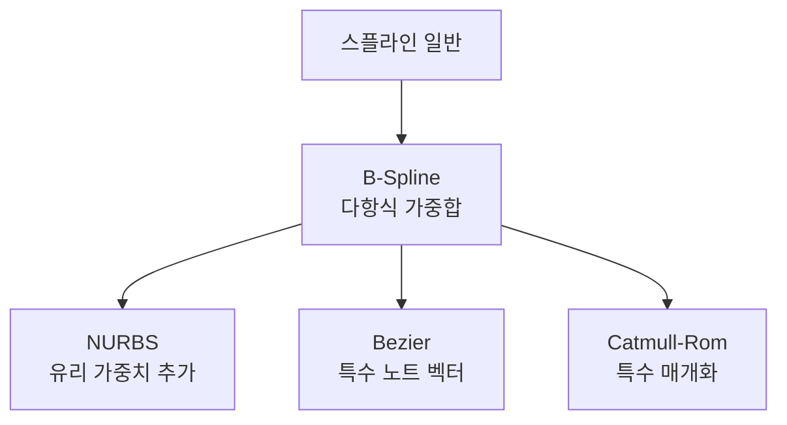
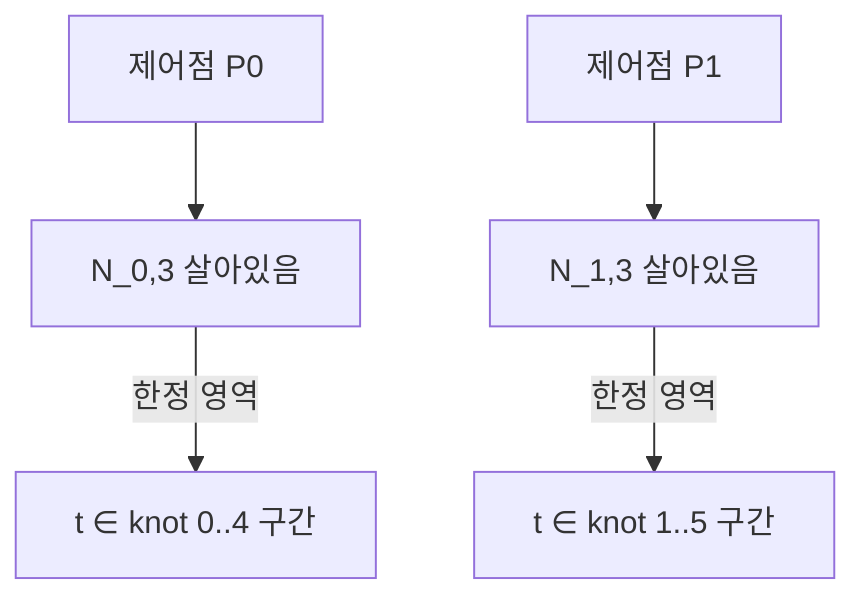
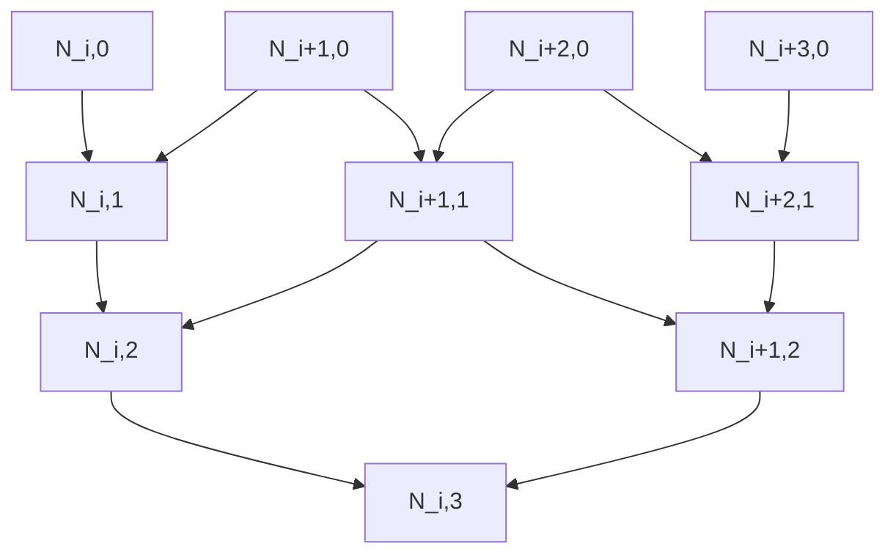
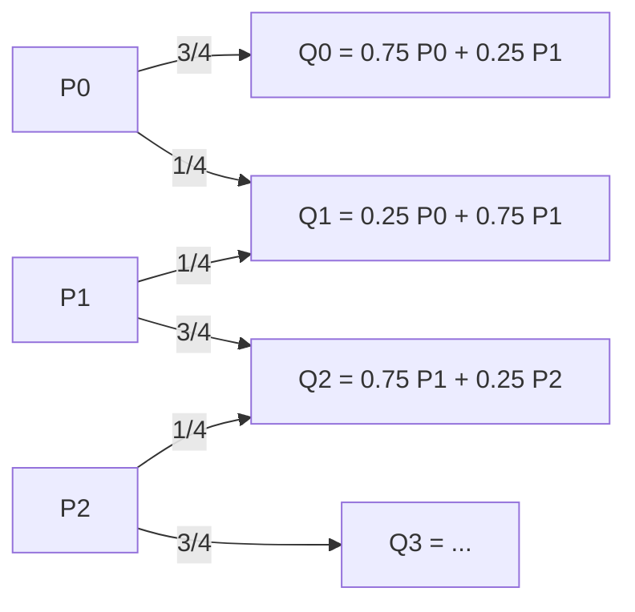
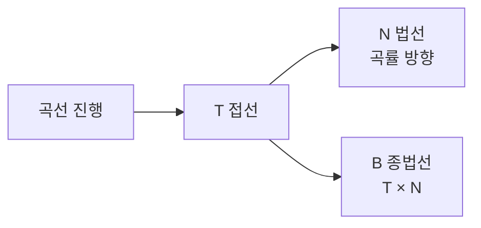

## 들어가며

스플라인 (Spline) 은 *많은 제어점* 을 매끄럽게 잇는 곡선의 일반화다. Bezier와 Catmull-Rom 이 *몇 개의 점만* 다루는 형태였다면, 스플라인은 *수십·수백 개의 제어점 위* 에 부드러운 곡선을 정의한다. 도로 형상, 카메라 시네마틱 경로, 적의 등장 패턴, 머리카락 시뮬, 트랙 시스템 — 게임의 *복잡한 곡선* 이 모두 스플라인이다.

핵심 통찰은 *지역 영향 (local control)*. 3차 Bezier 한 개는 4 제어점 *모두* 가 곡선 *전체* 에 영향을 주지만, B-Spline 같은 스플라인은 *한 제어점이 곡선의 일부에만* 영향. 디자이너가 *긴 트랙의 한 부분만 수정* 해도 *다른 부분은 안 바뀐다*. 이게 게임 에디터의 *직관적 곡선 편집* 의 토대.

이 글의 목표는 다음 다섯 가지다.

1. 스플라인을 *조각 다항식의 모음* 으로 보고, 노트 (knot) 에서의 연속성 보장 메커니즘을 정리한다.
2. B-Spline의 *Cox-de Boor 재귀 공식* 과 기저 함수의 *지역성* 을 풀어낸다.
3. NURBS의 가중치가 *원·원뿔 같은 곡선의 정확한 표현* 을 가능하게 하는 이유.
4. 호 길이 매개화·곡률·프레네 프레임으로 *곡선 위 위치·자세* 를 결정하는 패턴.
5. 게임의 도로·시네마틱·트랙 시스템에서 스플라인이 *어떤 형태로* 들어가는지.

보간 곡선 (Hermite, Bezier, Catmull-Rom) 이 *각 키 사이* 에 적용되는 *국소 보간* 이었다면, 이 글의 스플라인은 *전역 곡선 정의* 다. 다만 *거의 모든 스플라인이 내부적으로 Bezier 또는 Hermite 조각의 합성* 으로 표현 가능하다 — 도구 위에 한 층이 더 올라간다.


---

## 목차
1. [스플라인의 정의](#1-스플라인의-정의)
2. [B-Spline과 기저 함수](#2-b-spline과-기저-함수)
3. [Cox-de Boor 재귀](#3-cox-de-boor-재귀)
4. [NURBS](#4-nurbs)
5. [Subdivision Curve](#5-subdivision-curve)
6. [곡선의 길이와 호 길이 매개화](#6-곡선의-길이와-호-길이-매개화)
7. [곡률과 프레네 프레임](#7-곡률과-프레네-프레임)
8. [게임에서의 스플라인](#8-게임에서의-스플라인)


---

## 1. 스플라인의 정의

스플라인은 *조각 다항식 (piecewise polynomial)* 의 모음. 곡선 전체를 *작은 조각들로 나눠* 각 조각마다 *낮은 차수의 다항식* 을 정의하고, *조각 사이 경계에서 연속성* 을 보장한다.

### 1.1 왜 조각인가

전체를 *한 다항식* 으로 표현하려면 차수가 폭발한다. N개 점을 *모두 정확히 지나는 한 다항식* 의 차수는 *N - 1*. N = 100이면 *99차 다항식* — 수치적으로 불안정 (Runge 현상), 평가 비용 큼, 한 점 변경이 전체 곡선에 영향.

조각 분할이 답이다. *각 조각마다 3차 다항식*, *조각 사이 경계에서 연속성*. 100점 = 99개 3차 조각. 각 조각의 평가는 *상수 시간* (3차 다항식), 한 조각의 변경이 *그 조각만* 영향.

### 1.2 노트 (knot)

스플라인의 조각 경계 매개변수 값들의 시퀀스가 *노트 (knot)*.

$$
T = \{t_0, t_1, t_2,..., t_n\}, \quad t_0 \le t_1 \le... \le t_n
$$

각 $t_i$ 가 *조각 경계*. $t_i \le t < t_{i+1}$ 구간이 한 조각의 *매개변수 범위*.

### 1.3 노트 벡터의 종류

| 종류 | 정의 | 특성 |
|---|---|---|
| Uniform | 균등 간격 (예: $0, 1, 2, 3,...$) | 단순, 자동 |
| Non-uniform | 불균등 | 디자이너의 변형 자유 |
| Clamped | 양 끝 노트가 *차수 + 1번 (= order) 반복* | 곡선이 첫·끝 제어점을 지난다 |
| Periodic | 주기적 | 닫힌 곡선 (loop track) |

게임 에디터는 보통 *clamped + uniform* 또는 *clamped + non-uniform* 을 노출. *주기적* 은 *원형 트랙* 같은 닫힌 경로에서.

### 1.4 차수와 연속성의 관계

스플라인의 *차수 (degree)* $k$ 가 다항식의 차수. 노트에서의 연속성 등급은 차수와 연결.

| 차수 | 일반 명칭 | 노트에서 자동 보장 |
|---|---|---|
| 1 | Linear | C0 |
| 2 | Quadratic | C1 |
| 3 | Cubic | C2 |
| 4 | Quartic | C3 |

3차 (Cubic) 가 *게임에서 가장 자주 쓰이는* 차수. *단순 노트 (simple knot, multiplicity 1) 기준 C^2 자동 보장* + *조각 평가 빠름*. 더 높은 차수는 평가 비용 + 진동 위험.

위 표는 *단순 노트* 기준이다. 노트의 *중복도 (multiplicity) r* 이 1보다 크면 그만큼 *연속성이 떨어진다* — 일반적으로 $C^{k-r}$. Clamped endpoint 는 그래서 *끝점 보간을 얻는 대신* 끝에서 연속성이 낮다.

### 1.5 조각 사이 연속성의 메커니즘

B-Spline의 연속성은 *기저 함수가 노트 주변에서 특정 차수까지 매끄럽게 이어지도록 정의된 구조* 에서 나온다. 인접 조각이 *같은 계수를 공유* 해서가 아니라, 기저 함수와 노트 multiplicity의 형태가 *그 자체로* 연속성을 만든다. 단, 중복 노트가 있으면 그만큼 연속성이 낮아진다.


이게 Bezier 조각을 *수동으로 잇는* 패턴 (*접선 일치 제약*) 보다 우월한 점. 디자이너가 *접선을 수동으로 맞추지 않아도* 자동.

### 1.6 NURBS와 일반 B-Spline의 위계



B-Spline 이 *대부분 스플라인의 일반화*. 단일 Bezier 곡선은 *endpoint knot 가 degree + 1번 반복된 특수 knot vector를 가진* B-Spline 으로 표현 가능. Catmull-Rom은 *interpolating cubic Hermite / cardinal spline* 계열로, 자동 접선 계산이 특징. NURBS는 B-Spline에 *유리 가중치* 추가.

## 2. B-Spline과 기저 함수

B-Spline 은 *기저 함수 (basis function) 의 가중합* 으로 곡선을 정의한다. 핵심 정의:

$$
\vec{P}(t) = \sum_{i=0}^{n} N_{i,k}(t) \vec{P}_i
$$

여기서 $\vec{P}_i$ 가 *제어점*, $N_{i,k}(t)$ 가 *차수 k의 i번째 기저 함수*. 각 기저 함수가 *t에 따라 다른 가중치* 를 만들어 제어점들의 *가중합* 으로 곡선 점이 결정.

### 2.1 기저 함수의 지역성

B-Spline의 가장 중요한 성질: 기저 함수 $N_{i,k}(t)$ 가 *오직 노트 $[t_i, t_{i+k+1})$ 안에서만* 0이 아니다. 그 밖에서는 0.

이 성질이 *지역 영향 (local control)* 의 토대. 한 제어점 $\vec{P}_i$ 가 *해당 기저 함수가 살아있는 노트 구간만* 곡선에 영향을 준다.



3차 B-Spline에서 한 제어점이 영향을 미치는 t 구간은 *4개 노트 구간* (= 4개 조각). 그 외 곡선은 *전혀 영향 없음*.

### 2.2 부분 합의 1

B-Spline 기저 함수의 또 다른 성질:

$$
\sum_{i=0}^{m} N_{i,k}(t) = 1, \quad \forall t \in [t_k, t_{m+1}]
$$

여기서 *제어점이 $\vec{P}_0,..., \vec{P}_m$* (총 $m+1$ 개), *차수 $k$*, *노트 벡터 $t_0,..., t_{m+k+1}$* (총 $m+k+2$ 개) 라 가정. 노트 인덱스와 제어점 인덱스를 분리.

모든 t에서 *기저 함수의 합이 1*. 곡선이 *제어점들의 볼록 결합 (convex combination)* — *볼록 껍질 (convex hull) 안에 들어간다*.

이 성질이 *디자이너에게 직관적*: 곡선이 *제어점들이 만드는 다각형 안에 갇혀 있다*. 제어점을 옮기면 *그 근처에서만 곡선이 따라온다*.

### 2.3 차수와 연속성의 자동 보장

차수 $k$ B-Spline은 *자동으로 $C^{k-1}$ 연속*. 노트에서 *부드러운 이음* 이 기저 함수의 형태로 인코딩되어 있다.

| 차수 | 자동 연속성 |
|---|---|
| 1 (Linear) | C0 |
| 2 (Quadratic) | C1 |
| 3 (Cubic) | C2 |
| 4 (Quartic) | C3 |

3차 B-Spline 이 *게임 에디터의 표준*. C2 자동 + 4 제어점 지역 영향.

### 2.4 NURBS의 일반화

NURBS는 B-Spline에 *유리 가중치* 추가. 가중치 $w_i$ 가 각 제어점의 *영향 강도* 를 조절한다.

$$
\vec{P}(t) = \frac{\sum_i w_i N_{i,k}(t) \vec{P}_i}{\sum_i w_i N_{i,k}(t)}
$$

분모가 *가중치들의 가중합*. 같으면 ($w_i = 1$) 일반 B-Spline. 다르면 *제어점이 곡선을 더 강하게 끌어당김*.

이 가중치 추가의 *대수적 결과* 가 *원·타원·원뿔 같은 곡선의 정확한 표현* 가능. 일반 B-Spline 으로는 원을 *근사* 만 가능.

### 2.5 한 제어점 변경의 영향

B-Spline의 *지역성* 을 코드로 보면.

```cpp
// 3차 B-Spline에서 한 제어점 변경 시
// 영향받는 곡선 구간 = 노트 4개 구간

void OnControlPointChanged(int idx) {
    int firstAffected = idx;
    int lastAffected  = idx + 3;
    InvalidateSegments(firstAffected, lastAffected);
    // 다른 모든 조각은 캐시 유지
}
```

수십 km 트랙을 편집할 때 *전체 트랙을 다시 계산하지 않고* 영향받는 일부만. 게임 에디터 응답성의 핵심.

## 3. Cox-de Boor 재귀

B-Spline 기저 함수 $N_{i,k}(t)$ 를 *재귀적으로 계산* 하는 표준 공식. 1970년대 Cox와 de Boor가 발견한 *수치적으로 안정* 한 알고리즘.

### 3.1 정의

차수 0 (상수) 기저:

$$
N_{i,0}(t) = \begin{cases} 1 & \text{if } t_i \le t < t_{i+1} \\ 0 & \text{otherwise} \end{cases}
$$

각 노트 구간에 *그 구간만 1, 나머지는 0* 인 step 함수.

차수 k 기저는 차수 k-1 기저들의 *선형 결합*:

$$
N_{i,k}(t) = \frac{t - t_i}{t_{i+k} - t_i} N_{i,k-1}(t) + \frac{t_{i+k+1} - t}{t_{i+k+1} - t_{i+1}} N_{i+1,k-1}(t)
$$

두 항의 *가중치* 가 *t의 위치에 따라 변하는* 선형 매개변수.

### 3.2 재귀의 구조



*피라미드 모양* 의 의존 관계. 차수 k 기저 한 개를 계산하려면 *차수 0 기저 (k+1) 개* 까지 거슬러 올라간다.

### 3.3 코드 구현

```cpp
float CoxDeBoor(int i, int k, float t, const std::vector<float>& knots) {
    if (k == 0) {
        return (knots[i] <= t && t < knots[i+1]) ? 1.0f : 0.0f;
    }

    float a = 0.0f, b = 0.0f;

    // 첫 번째 항. 분모 0 검사.
    float denom1 = knots[i+k] - knots[i];
    if (denom1 != 0.0f) {
        a = ((t - knots[i]) / denom1) * CoxDeBoor(i, k-1, t, knots);
    }

    // 두 번째 항. 분모 0 검사.
    float denom2 = knots[i+k+1] - knots[i+1];
    if (denom2 != 0.0f) {
        b = ((knots[i+k+1] - t) / denom2) * CoxDeBoor(i+1, k-1, t, knots);
    }

    return a + b;
}
```

*분모 0 처리* 가 핵심. 노트가 중복되면 (multiple knot) 분모가 0이 될 수 있다 — 그 항을 *0으로 처리* 가 표준.

또 *마지막 노트 $t = t_{\text{last}}$* 일 때 모든 base-case 기저가 0이 되는 함정이 있다 (조건 $t < t_{i+1}$ 이 *반열린 구간* 이라). 실전 구현은 *마지막 endpoint를 특수 처리* 하거나, 평가 전에 *t를 유효 구간 안으로 clamp* 한다.

```cpp
t = std::clamp(t, knots[degree], knots[knots.size() - 1 - degree] - 1e-7f);
```

### 3.4 메모이제이션

순진한 재귀는 *지수 시간* 호출. 같은 $(i, k, t)$ 가 여러 번 평가됨.

아래 cache는 *한 t에서의 평가에만 유효*. 다른 t로 평가할 때는 *cache를 비우거나 새 인스턴스* 를 만들어야 한다 — key가 $(i, k)$ 만 갖고 t는 안 갖기 때문.

```cpp
struct CoxDeBoorMemo {
    std::map<std::pair<int, int>, float> cache;  // 한 t 평가용

    float Compute(int i, int k, float t, const std::vector<float>& knots) {
        auto key = std::make_pair(i, k);
        auto it = cache.find(key);
        if (it != cache.end()) return it->second;
        // ... 재귀 + 캐시
    }
};
```

또는 *bottom-up* 으로 차수 0부터 차수 k까지 *반복* 계산. 모든 살아있는 기저 동시 평가가 자연.

### 3.5 한 점 평가의 효율적 알고리즘

곡선의 *한 점 $\vec{P}(t)$* 을 평가하려면 *모든 기저 합* 이 아니라 *살아있는 기저들* 만 합산.

차수 k B-Spline의 한 t에서 *살아있는 기저 수 = k+1*. 다른 기저들은 0이라 합산할 필요 없음.

```cpp
vec3 EvaluateBSpline(float t, const std::vector<vec3>& controlPoints,
                       const std::vector<float>& knots, int degree) {
    // 1. t를 포함하는 노트 구간 찾기
    int span = FindKnotSpan(t, knots, degree);

    // 2. 그 구간에서 살아있는 (degree + 1)개 기저 평가
    std::vector<float> N(degree + 1);
    EvaluateBasisFunctions(t, span, degree, knots, N);

    // 3. 가중합
    vec3 result = vec3(0);
    for (int i = 0; i <= degree; ++i) {
        result += N[i] * controlPoints[span - degree + i];
    }
    return result;
}
```

3차 B-Spline 평가 비용 = *4개 기저 + 4번 가중합*. 곡선 길이에 무관한 *상수 시간*.

### 3.6 de Boor 알고리즘

Cox-de Boor 기저를 직접 평가하지 않고 *de Casteljau 와 비슷한 점 분할* 로 직접 점 평가하는 방법. *수치적으로 더 안정* 하다.

```cpp
vec3 DeBoor(float t, int span, const std::vector<vec3>& cp,
              const std::vector<float>& knots, int degree) {
    // 살아있는 (degree + 1)개 점 복사
    std::vector<vec3> work(degree + 1);
    for (int j = 0; j <= degree; ++j) {
        work[j] = cp[span - degree + j];
    }

    // degree 단계 반복 — 각 단계 점 한 개 줄어듦
    for (int r = 1; r <= degree; ++r) {
        for (int j = degree; j >= r; --j) {
            int  k    = span - degree + j;
            float alpha = (t - knots[k]) / (knots[k + degree - r + 1] - knots[k]);
            work[j] = (1 - alpha) * work[j-1] + alpha * work[j];
        }
    }
    return work[degree];
}
```

de Casteljau와 같은 *점진적 lerp 분할*. *수치 안정성* 이 우월해 *장기 시뮬레이션* 에 적합.

## 4. NURBS

Non-Uniform Rational B-Spline. CAD의 표준이지만 게임에서는 *직접 쓰는 일은 드물다*. 다만 *임포트 파이프라인* 에서 만난다.

### 4.1 유리 (rational) 의 의미

B-Spline의 식에 *유리 함수 형태* — 분자/분모.

$$
\vec{P}(t) = \frac{\sum_i w_i N_{i,k}(t) \vec{P}_i}{\sum_i w_i N_{i,k}(t)}
$$

각 제어점에 *가중치 $w_i \ge 0$* 가 붙고, 가중치들의 가중합으로 정규화. $w_i = 1$ 모두 같으면 *일반 B-Spline*.

### 4.2 원·원뿔의 정확한 표현

가장 중요한 특성: *원·타원·포물선·쌍곡선* 같은 *원뿔 곡선 (conic section)* 을 *정확히* 표현. NURBS 표면 (NURBS surface) 으로 확장하면 *원기둥·원뿔·구·토러스* 같은 표면도 정확히 표현 가능 — 곡선과 표면을 분리해 분류한다.

원의 정확한 NURBS 표현은 *9개 제어점 + 특정 가중치*.

```cpp
// 단위 원의 NURBS 표현
std::vector<vec3>  cps = {
    { 1,  0, 0}, { 1,  1, 0}, { 0,  1, 0}, {-1,  1, 0},
    {-1,  0, 0}, {-1, -1, 0}, { 0, -1, 0}, { 1, -1, 0},
    { 1,  0, 0},   // 닫힌 곡선
};
std::vector<float> weights = { 1, 0.707, 1, 0.707, 1, 0.707, 1, 0.707, 1 };
std::vector<float> knots   = { 0, 0, 0, 0.25, 0.25, 0.5, 0.5, 0.75, 0.75, 1, 1, 1 };
// degree = 2
```

*$0.707 = \cos(45°)$* 가중치가 정확한 원을 만든다. 일반 B-Spline 으로는 *근사 원* 만 가능.

이 정확성이 CAD에서 NURBS가 표준인 이유. 기계 부품의 *정확한 원형 구멍*, *완벽한 원형 단면* 을 표현.

### 4.3 게임에서의 NURBS 위치

게임 그래픽스에서 NURBS는 *직접 쓰지 않는다*.

- *런타임 평가가 무거움*: 분자/분모 두 번 계산.
- *Tessellation 필요*: GPU의 정점 처리는 *triangles* 가 표준 — NURBS도 결국 *삼각형으로 변환* 되어야 한다.
- *대안이 충분*: B-Spline + Bezier 조합으로 *시각적으로 충분히 부드러운* 곡선 표현.

NURBS가 등장하는 곳:

- **모델 임포트 (Maya, 3ds Max, Rhino)**: 디자이너가 NURBS로 *높은 정밀도* 모델링 후 *게임 엔진으로 임포트 시 mesh로 변환*.
- **CAD 자료의 게임화** (예: 자동차 게임의 정확한 차량 형상): NURBS 자료를 mesh tessellation.
- **머리카락 시뮬** (일부 엔진): 머리카락을 NURBS로 추적 후 셰이더로 mesh 생성.

### 4.4 임포트 시 tessellation

NURBS를 mesh로 변환하는 게 *tessellation*.

```cpp
struct TessellationOptions {
    float maxError;        // 곡선과 직선 근사의 최대 오차
    int   minSegments;     // 최소 분할 수
    int   maxSegments;     // 최대 분할 수
};

std::vector<vec3> Tessellate(const NURBS& curve, TessellationOptions opts) {
    // 적응적 분할: 곡률이 큰 부분은 더 세밀하게
    std::vector<vec3> points;
    AdaptiveTessellate(curve, 0.0f, 1.0f, opts, points);
    return points;
}
```

곡률이 큰 부분 (sharp turn) 은 *세밀히 분할*, 평탄한 부분은 *드물게*. *시각적 품질 + 메모리 효율* 의 균형.

## 5. Subdivision Curve

*세분화 (subdivision) 규칙* 으로 점을 반복 분할해 부드러운 곡선을 얻는 방법. 닫힌 형태 식 없이 *반복으로* 곡선 생성.

### 5.1 Chaikin 알고리즘

가장 단순한 곡선 subdivision. 1974년 Chaikin이 발견.

규칙: 각 변을 *1/4, 3/4 점* 으로 분할.



매 반복마다 점이 *2배로 늘고 모양이 부드러워진다*. 무한 반복의 극한이 *2차 B-Spline* 과 같다.

```cpp
std::vector<vec2> ChaikinIterate(const std::vector<vec2>& points) {
    std::vector<vec2> result;
    for (size_t i = 0; i < points.size() - 1; ++i) {
        vec2 q1 = 0.75f * points[i] + 0.25f * points[i+1];
        vec2 q2 = 0.25f * points[i] + 0.75f * points[i+1];
        result.push_back(q1);
        result.push_back(q2);
    }
    return result;
}
```

3~5번 반복이면 *시각적으로 부드러운 곡선*. 단순한 코드로 *그럴듯한 곡선* 을 빠르게.

### 5.2 코너 컷팅의 의미

Chaikin의 본질은 *각 변의 코너를 잘라내는* 동작. *시각적 직관* 이 매우 단순.


수학적 분석 없이도 *결과를 시각적으로 예상* 가능.

### 5.3 더 높은 차수의 subdivision

Chaikin은 *2차*. 3차 또는 4차 subdivision은 더 부드러운 결과 + 더 복잡한 규칙.

| 알고리즘 | 차수 | 노트 |
|---|---|---|
| Chaikin | 2 | 단순, 빠름 |
| 4-point | 3 | 점 위 보간, 4개 이웃 사용 |
| Lane-Riesenfeld | k (가변) | k번 평균으로 차수 k 곡선 |
| (Catmull-Clark·Doo-Sabin은 표면 subdivision이라 곡선 문서에서 제외) | — | *표면 분할 알고리즘* |

게임에서 곡선 subdivision은 드물게 등장 (대부분 B-Spline 또는 Bezier 직접 평가가 충분). *표면 subdivision (Catmull-Clark)* 이 mesh smoothing에 더 자주.

### 5.4 게임 활용

- **머리카락 가닥 부드럽게**: 시뮬레이션은 *적은 점* 으로, 렌더링은 *세분화 후 mesh*.
- **로프, 쇠사슬**: 물리 시뮬 노드 + 시각적 subdivision.
- **트랙 prototyping**: 디자이너가 *대략적 점* 을 찍으면 자동으로 *부드러운 트랙*.

대부분 게임 엔진에서는 *직접 구현하기보다 B-Spline 을 사용*. subdivision은 *프로토타입 단계의 빠른 곡선* 또는 *표면 처리* 에 등장.

## 6. 곡선의 길이와 호 길이 매개화

호 길이 매개화를 *스플라인* 에 일반화. *수치 적분* 의 정확도와 비용 트레이드오프.

### 6.1 스플라인의 길이

곡선 $\vec{P}(t)$ 의 *전체 길이*:

$$
L = \int_0^1 |\vec{P}'(t)| dt
$$

*속도 벡터의 크기 적분*. 닫힌 형태 풀이가 *대부분의 스플라인에서 어렵다* — 수치 적분 필수.

### 6.2 수치 적분 방법

**Polyline chord-length 근사**:

엄밀히는 $|\vec{P}'(t)|$ 의 Riemann sum이 아니라 *N개 점을 직선으로 잇는 polyline 길이* 다. 곡선이 매끄러우면 N이 클 때 같은 결과로 수렴.

```cpp
float ArcLengthPolylineApprox(const Spline& s, int N) {
    float total = 0.0f;
    vec3 prev = s.At(0);
    for (int i = 1; i <= N; ++i) {
        vec3 cur = s.At(float(i) / N);
        total += length(cur - prev);
        prev = cur;
    }
    return total;
}
```

가장 단순. 정확도가 N에 비례. 게임에서 N = 32~64면 충분.

**Simpson's rule** (3점당 2차 다항식 적분):

```cpp
float ArcLengthSimpson(const Spline& s, int N) {
    // N is even
    float h   = 1.0f / N;
    float sum = length(s.Derivative(0)) + length(s.Derivative(1));

    for (int i = 1; i < N; i += 2) {
        sum += 4 * length(s.Derivative(i * h));
    }
    for (int i = 2; i < N; i += 2) {
        sum += 2 * length(s.Derivative(i * h));
    }
    return sum * h / 3.0f;
}
```

Riemann 보다 *훨씬 정확* (오차 $O(h^4)$ vs $O(h)$). 같은 정확도 위해 *N을 크게 줄임*.

**Gauss-Legendre quadrature** (가장 정확):

특정 *Gauss 점* 에서 표본해 *낮은 N으로 높은 정확도*. CAD 라이브러리의 표준.

```cpp
// 5점 Gauss-Legendre (오차 O(h^10))
const float kGaussX[5] = {
    -0.9061798f, -0.5384693f, 0.0f, 0.5384693f, 0.9061798f
};
const float kGaussW[5] = {
    0.2369269f, 0.4786287f, 0.5688889f, 0.4786287f, 0.2369269f
};
```

5개 점 평가로 *Riemann 100점 정도 정확도*. 게임 런타임에는 *Simpson 또는 Riemann이 더 흔함*.

### 6.3 LUT 빌드

*Lookup Table* 패턴. 빌드 시 균일 t로 표본 + LUT 구축.

```cpp
struct ArcLengthLUT {
    std::vector<float> samples;     // 균일 t에 대응하는 호 길이
    float totalLength;

    void Build(const Spline& s, int sampleCount = 128) {
        samples.resize(sampleCount + 1);
        samples[0] = 0;
        vec3 prev = s.At(0);
        for (int i = 1; i <= sampleCount; ++i) {
            float t = float(i) / sampleCount;
            vec3 cur = s.At(t);
            samples[i] = samples[i-1] + length(cur - prev);
            prev = cur;
        }
        totalLength = samples.back();
    }

    float TFromS(float s) const {
        if (samples.size() < 2 || totalLength <= 0.0f) return 0.0f;

        // s 를 [0, totalLength] 로 clamp.
        s = std::clamp(s, 0.0f, totalLength);

        auto it  = std::lower_bound(samples.begin(), samples.end(), s);
        int  idx = int(it - samples.begin());
        if (idx == 0) return 0.0f;
        if (idx >= int(samples.size())) return 1.0f;

        float t0   = float(idx - 1) / (samples.size() - 1);
        float t1   = float(idx)     / (samples.size() - 1);
        float denom = samples[idx] - samples[idx-1];
        if (denom <= 0.0f) return t0;  // 표본이 같음 — 분모 0 회피
        float frac = (s - samples[idx-1]) / denom;
        return Lerp(t0, t1, frac);
    }
};
```

빌드는 한 번. 런타임은 *이분 탐색 O(log N) + 보간*.

### 6.4 일정 속도 추종

게임 코드의 핵심 패턴.

```cpp
// 매 프레임
character.distanceTraveled += character.speed * dt;
if (character.distanceTraveled > arcLut.totalLength) {
    // 트랙 끝 — 정지 또는 loop
    return;
}
float t = arcLut.TFromS(character.distanceTraveled);
character.position = spline.At(t);
character.tangent  = normalize(spline.Derivative(t));
```

*거리 누적* + *LUT 변환* + *위치 + 접선*. 캐릭터·차량·카메라가 *균등 속도로 트랙* 을 따라간다.

### 6.5 적응적 표본

*곡률이 큰 부분* 은 LUT를 *세밀히*, 평탄한 부분은 *드물게* 표본.

```cpp
void AdaptiveBuild(const Spline& s, ArcLengthLUT& lut, float maxError) {
    Recurse(s, 0.0f, 1.0f, maxError, lut);
}

void Recurse(const Spline& s, float t0, float t1, float maxError, ArcLengthLUT& lut) {
    vec3 p0 = s.At(t0);
    vec3 p1 = s.At(t1);
    vec3 mid = s.At((t0 + t1) * 0.5f);
    float chordLen   = length(p1 - p0);
    float midLen     = length(mid - p0) + length(p1 - mid);
    if (midLen - chordLen < maxError) {
        // 충분히 평탄
        lut.AddSample(t0, ...);
    } else {
        // 더 분할
        Recurse(s, t0, (t0+t1)*0.5f, maxError, lut);
        Recurse(s, (t0+t1)*0.5f, t1, maxError, lut);
    }
}
```

균일 표본보다 *적은 메모리로 같은 정확도*. 트랙 데이터의 압축 형태.

## 7. 곡률과 프레네 프레임

곡선 위 *각 점에서의 자세* 를 결정하는 도구. 트랙 위 자동차가 *어느 방향을 보고 어떻게 기울어야 하는지* 의 수학적 근거.

### 7.1 곡률 (curvature)

곡선이 *얼마나 휘어 있는가* 의 정량.

$$
\kappa = \frac{|\vec{P}'(t) \times \vec{P}''(t)|}{|\vec{P}'(t)|^3}
$$

분자가 *속도와 가속도의 외적*, 분모가 *속도 길이의 세제곱*. *직선이면 $\kappa = 0$*, *작은 원이면 $\kappa$ 크다*.

곡률 반경 $r = 1 / \kappa$ — *그 점에서 곡선과 가장 잘 맞는 원의 반지름*.

### 7.2 프레네 프레임 (Frenet frame)

곡선 위 한 점에서의 *3개 직교 단위 벡터*. 곡선의 *지역 좌표계*.

- **접선 (Tangent) $\hat{T}$**: $\vec{P}'(t) / |\vec{P}'(t)|$. 곡선 진행 방향.
- **법선 (Normal) $\hat{N}$**: 곡률 방향 (곡선이 휘는 쪽).
- **종법선 (Binormal) $\hat{B}$**: $\hat{T} \times \hat{N}$.



$\vec{P}'(t)\ne0$이고 곡률 $\kappa(t)\ne0$인 regular curve 구간에서는 세 벡터가 직교 단위 frame을 이룬다. 정지점에서는 접선이, 직선·변곡 구간에서는 Frenet normal이 정의되지 않으며 부호가 갑자기 뒤집힐 수도 있다.

### 7.3 게임에서의 활용

**자동차 게임의 자세**: 트랙 위 자동차가 *접선 방향을 향한다*. 자동차 자세의 *up* 은 *Frenet normal* 이 아니라 *도로 surface normal* 또는 *별도 reference up* 을 쓴다 — Frenet normal은 *곡선이 휘는 방향* 이라 수평 코너에서 *코너 안쪽 (수평)* 을 가리킨다. 차량을 그 방향으로 세우면 *옆으로 누운 자세*.

올바른 패턴은 *Tangent + reference up + (옵션) banking curve*.

```cpp
struct CarOnTrack {
    float distance;            // 트랙 따라 이동한 거리
    AnimCurve bankingCurve;    // 디자이너 작성 — 코너에서의 기울기

    void UpdatePose(const Spline& track, ArcLengthLUT& lut, vec3 worldUp = {0, 1, 0}) {
        float t = lut.TFromS(distance);
        vec3 pos = track.At(t);
        vec3 vel = track.Derivative(t);

        vec3 T = normalize(vel);
        // Frenet normal 대신 worldUp을 T에 직교 정규화 (RMF 단순 형태)
        vec3 Nraw = worldUp - dot(worldUp, T) * T;
        if (length_squared(Nraw) < 1e-8f) {
            vec3 fallback = std::fabs(T.x) < 0.9f
                          ? vec3{1, 0, 0} : vec3{0, 0, 1};
            Nraw = fallback - dot(fallback, T) * T;
        }
        vec3 N = normalize(Nraw);
        vec3 R = cross(N, T);  // right

        // 옵션: banking 회전을 N·R 평면에서 추가
        float bank = bankingCurve.At(t);
        // ... bank 만큼 N과 R을 R 축 둘레 회전 등

        car.position = pos;
        car.rotation = MatrixFromAxes(T, N, R);
    }
};
```

진짜 *Frenet normal* 이 필요하면 *연쇄 외적* 식이 있다. 부호가 안전한 형태:

```cpp
vec3 N = normalize(acc - dot(acc, T) * T);   // T에 수직인 가속도 성분
// 또는
vec3 N = normalize(cross(cross(vel, acc), T));
```

이 식은 *곡선이 휘는 쪽* 을 가리킨다. 자동차의 *up 결정* 에는 부적합 — 7.4 절의 한계 참고.

자동차가 *트랙을 따라 자연스럽게 회전* 한다.

**카메라 사이드 추종**: 카메라가 *트랙 옆 일정 거리 + 법선 방향* 에 위치. 코너 안쪽으로 *기울어 보이는* 효과.

**롤러코스터 카트**: 곡률에 따라 *기울기 (banking)* 자동 적용. 곡률이 크면 더 기울어 *진짜 같은* 운동.

### 7.4 프레네 프레임의 함정

*직선 구간에서 법선이 정의 안 됨*. 곡률 0 = 분자 영벡터 = 정규화 NaN.

대응: *parallel transport frame* 또는 *RMF (Rotation Minimizing Frame)*. 직선 구간에서도 *연속적인 법선* 을 보장하는 변형.

```cpp
// 직선 구간 처리
vec3 EstimateNormal(vec3 T, vec3 prevN) {
    vec3 N = prevN - dot(prevN, T) * T;  // T에 수직 부분만
    if (length_squared(N) < 1e-6f) {
        // 이전 N이 T와 평행 — 임시로 다른 축
        N = std::fabs(T.y) < 0.99f ? vec3(0, 1, 0) : vec3(1, 0, 0);
        N = normalize(N - dot(N, T) * T);
    } else {
        N = normalize(N);
    }
    return N;
}
```

*이전 프레임의 법선* 을 *현재 접선에 직교 정규화*. 곡선이 *연속적인 자세 변화* 를 보장.

### 7.5 카메라의 부드러운 자세

카메라가 곡선을 따라가며 *프레네 프레임으로 자세 결정* 하면 *코너에서 흔들림*. RMF가 더 자연스럽다.

```cpp
struct CameraTrack {
    Spline path;
    ArcLengthLUT lut;
    vec3 prevN;  // 이전 프레임 법선 (parallel transport)

    void Update(float dt) {
        distance += speed * dt;
        float t = lut.TFromS(distance);
        vec3 T = normalize(path.Derivative(t));
        vec3 N = EstimateNormal(T, prevN);
        vec3 B = cross(T, N);

        camera.SetTransform(path.At(t), T, N, B);
        prevN = N;  // 다음 프레임 위해 저장
    }
};
```

카메라가 *코너에서 갑자기 뒤집히는* 함정 회피. 디자이너 의도대로 *부드러운 자세*.

## 8. 게임에서의 스플라인

이 절은 게임의 *어느 자리에 어떤 스플라인* 인지의 패턴 정리.

### 8.1 카메라 시네마틱 경로

영화적 컷씬·트레일러·튜토리얼 카메라 워크.

```cpp
struct CinematicCamera {
    Spline       posPath;    // 위치 곡선 (3차 B-Spline)
    Spline       lookPath;   // 시선 대상 곡선 (선택)
    AnimCurve    fovCurve;   // FOV 변화
    AnimCurve    timingCurve; // 시간 진행 함수 (easing)

    void Sample(float t) {
        float adjustedT = timingCurve.At(t);  // ease-in-out 등
        camera.position = posPath.At(adjustedT);
        vec3 lookTarget = lookPath.At(adjustedT);
        camera.LookAt(lookTarget);
        camera.fov = fovCurve.At(adjustedT);
    }
};
```

위치·시선·FOV 셋이 *같은 timingCurve* 로 동기화. 디자이너가 *몇 개 키 점 + easing* 만 찍으면 자동.

### 8.2 도로·트랙 시스템

레이싱 게임·러너 게임의 *물리적 트랙* 이 스플라인.

```cpp
struct RoadSegment {
    Spline center;        // 도로 중심선
    float  width;          // 도로 폭 (또는 spline)
    Spline banking;        // 기울기 (옵션)

    // 트랙 mesh 생성 (런타임 또는 빌드 타임)
    Mesh GenerateMesh(int segments) {
        Mesh m;
        for (int i = 0; i <= segments; ++i) {
            float t = float(i) / segments;
            vec3 p   = center.At(t);
            vec3 T   = normalize(center.Derivative(t));
            vec3 N   = ComputeNormal(t);
            vec3 right = cross(T, N) * (width * 0.5f);

            m.AddVertex(p - right);  // 좌측 가장자리
            m.AddVertex(p + right);  // 우측 가장자리
        }
        return m;
    }
};
```

도로가 *수 km 길이* 라도 *수십 제어점* 으로 정의. 디자이너의 *직관적 편집* + 자동 mesh 생성.

### 8.3 적의 등장 패턴

슈팅 게임의 *적이 화면 옆에서 등장 후 곡선으로 진행*. 미리 정의된 패턴.

```cpp
struct EnemyPattern {
    Spline path;
    float duration;
    AnimCurve speedCurve;  // 진행 속도 변화

    void Spawn(EnemyManager& mgr) {
        Enemy* e = mgr.SpawnEnemy();
        e->path     = &path;
        e->t        = 0;
        e->duration = duration;
    }

    void Update(Enemy& e, float dt) {
        e.t += dt / e.duration;
        if (e.t > 1.0f) { mgr.DestroyEnemy(e); return; }

        float adjT = speedCurve.At(e.t);
        e.position = e.path->At(adjT);
        e.facing   = normalize(e.path->Derivative(adjT));
    }
};
```

스타일 게임·아케이드 슈터의 *고전적 패턴*. 디자이너가 곡선 + 속도 곡선만 정의.

### 8.4 머리카락·로프 시뮬

물리 시뮬은 *적은 노드* 로, 렌더링은 *스플라인 보간* 으로 부드럽게.

```cpp
struct Hair {
    std::vector<vec3> simNodes;  // 8~16개 노드 (물리 시뮬)
    Spline render;                // 렌더용 스플라인

    void UpdatePhysics(float dt) { /* 적은 노드 시뮬 */ }
    void UpdateRender() {
        render.SetControlPoints(simNodes);
    }
    Mesh GenerateMesh() {
        // 스플라인 따라 tessellation + 머리카락 mesh
    }
};
```

*적은 노드 시뮬 → 부드러운 시각화*. 게임 캐릭터의 머리카락·천·로프·쇠사슬에 자주.

### 8.5 활·투사체 궤적

발사된 화살·수류탄·미사일의 *예상 궤적* 표시.

```cpp
struct ProjectilePath {
    vec3 start, velocity;
    float gravity;

    Spline ToSpline() {
        Spline s;
        for (int i = 0; i <= 20; ++i) {
            float t = float(i) / 20.0f * 2.0f;  // 2초 동안
            vec3 p = start + velocity * t + vec3(0, -0.5f * gravity * t * t, 0);
            s.AddControlPoint(p);
        }
        return s;
    }
};
```

투사체의 *물리적 궤적* 을 미리 *스플라인으로* 표현 후 시각화. *조준 보조* 또는 *디버그 표시*.

### 8.6 트랙 에디터의 핸들 편집

게임 에디터에서 디자이너가 *제어점에 핸들* 을 잡고 드래그.

```cpp
struct SplineEditor {
    Spline spline;
    int    selectedIdx = -1;

    void Render() {
        // 곡선 그리기
        DrawCurve(spline);
        // 제어점에 핸들 그리기
        for (int i = 0; i < spline.PointCount(); ++i) {
            vec3 p = spline.GetPoint(i);
            DrawHandle(p, i == selectedIdx);
        }
    }

    void OnMouseDrag(vec2 mousePos) {
        if (selectedIdx >= 0) {
            vec3 newPos = ScreenToWorld(mousePos);
            spline.SetPoint(selectedIdx, newPos);
            spline.InvalidateAffected(selectedIdx);
        }
    }
};
```

*직접 조작 + 곡선 즉시 갱신*. 에디터의 표준 인터랙션.

### 8.7 직접 구현 vs 라이브러리

게임 엔진의 *내장 스플라인* 또는 *외부 라이브러리*.

| 옵션 | 장점 | 단점 |
|---|---|---|
| Unity AnimationCurve | 통합·시각 편집 | Unity 종속 |
| Unreal FSplineComponent | 통합·시각 편집 | Unreal 종속 |
| 자체 구현 (Hermite, B-Spline) | 학습 가치, 통제 | 시간 |
| GLM glm::CatmullRom | 헤더-only | 종합 기능 부족 |
| OpenSubdiv (Pixar) | 표면 subdivision 풀 기능 | 무거움 |

학습 단계에서는 *자체 구현*. Hermite/Bezier 위에 *제어점 시퀀스 + 노트 벡터* 만 더하면 B-Spline 가능.


---

## 결론

스플라인은 *많은 제어점 위로 부드러운 곡선* 을 정의하는 표준 도구다. *조각 다항식* + *기저 함수의 지역성* + *자동 연속성* 의 셋이 게임 에디터의 *직관적 곡선 편집* 의 토대다.

이 글에서 정리한 핵심.

1. **B-Spline의 지역 영향** — 한 제어점이 곡선 일부에만 영향. 긴 트랙의 한 부분만 수정해도 다른 부분 안 바뀐다.
2. **Cox-de Boor 재귀** — 기저 함수의 표준 정의. 한 점 평가는 *살아있는 (degree+1) 개 기저* 만 합산.
3. **NURBS의 가중치** — 원·원뿔의 정확한 표현. CAD 표준이지만 게임은 mesh tessellation 후 사용.
4. **호 길이 매개화** — 캐릭터의 일정 속도 추종. LUT 빌드 + 이분 탐색.
5. **프레네 프레임** — 곡선 위 자세 결정. 자동차 자세, 카메라 추종에 직접 적용.

스플라인이 *시각적 자연스러움* 의 도구라면, *통계적 임의성* 은 같은 시드에서 같은 결과가 나오는 결정론적 난수와 자연스러운 노이즈(Perlin, Simplex)의 수학이다. 두 도구가 게임의 *절차적 콘텐츠 생성* 의 기반이다.

## 더 읽을거리

- Carl de Boor, *A Practical Guide to Splines* — B-Spline의 표준 레퍼런스.
- Gerald Farin, *Curves and Surfaces for CAGD* — CAD 곡선의 종합 교재.
- Freya Holmer, "The Continuity of Splines" (YouTube) — 스플라인의 시각적 직관.
- Tomas Akenine-Möller et al., *Real-Time Rendering*, 4th ed., 곡선·표면 챕터.
- Kenneth I. Joy, "Splines and Smooth Curves" — UC Davis 강의 노트.
- Pixar OpenSubdiv 문서 — subdivision의 산업 표준 구현.
- Khronos glTF 명세 — *cubic spline* 키프레임 보간의 게임 표준 형식.
