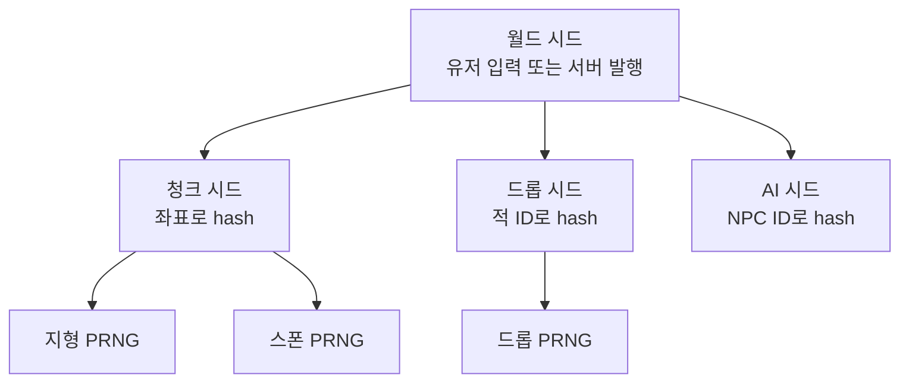

## 들어가며

게임의 *무작위성* 은 *진짜 무작위가 아니다*. 시드 (Seed) 에서 출발해 *결정론적 알고리즘* 으로 만들어지는 *유사 난수 (Pseudo-Random)* 다. 이 결정성이 *멀티플레이어 동기화·리플레이·치트 탐지·디버깅* 의 토대다. *같은 알고리즘·버전·초기화와 같은 호출 순서* 에서 같은 시드를 두 클라이언트가 사용하면 *같은 적이 같은 위치에 등장* 하고 *같은 드롭이 떨어진다*. 분포 변환과 스케줄링까지 같아야 한다는 조건은 별도의 재현성 계약이다.

게임 PRNG는 *통계적 균일성* 과 *결정론적 재현성* 을 동시에 요구한다. 암호용 난수 (`/dev/urandom`, `std::random_device`) 만큼의 보안성은 필요 없지만, *분포가 균일하고*, *같은 알고리즘·초기화에서 같은 호출 순서* 라면 같은 수열이 나와야 한다. 분포 변환과 스레드 스케줄링은 이 수열 위에 *별도의 재현성 계약* 을 더한다. 이 두 요구를 만족하는 *경량 PRNG* 가 게임의 표준 도구.

이 글의 목표는 다음 다섯 가지다.

1. PRNG의 *주기·통계 품질·속도·상태 크기* 평가 축을 정리한다.
2. 게임에서 자주 쓰는 PRNG 셋 (Xorshift·PCG·Mersenne Twister) 의 트레이드오프.
3. Uniform·Normal·Poisson 분포 샘플링과 *modulo bias* 같은 함정.
4. *Box-Muller* 와 *Marsaglia polar* 같은 정규 분포 표본의 표준 알고리즘.
5. 월드·청크·객체 단위 *시드 위계* 와 hash 기반 결정론적 시드 유도.

보간이 *부드러운 변화* 를 만들었다면, 이 글은 *균일하지만 통계적으로 무작위한 흔들림* 을 만든다. 두 도구의 조합이 Perlin·Simplex 노이즈 — *부드러운 무작위* — 의 토대다.


---

## 목차
1. [PRNG의 의미](#1-prng의-의미)
2. [Xorshift 계열](#2-xorshift-계열)
3. [PCG](#3-pcg)
4. [Mersenne Twister](#4-mersenne-twister)
5. [Uniform 분포](#5-uniform-분포)
6. [Normal 분포 샘플링](#6-normal-분포-샘플링)
7. [Poisson과 기타 분포](#7-poisson과-기타-분포)
8. [시드 관리와 결정론](#8-시드-관리와-결정론)


---

## 1. PRNG의 의미

유사 난수 생성기 (Pseudo-Random Number Generator) 는 *결정론적 함수* 가 *통계적으로 무작위해 보이는 수열* 을 만든다.

$$
s_{n+1} = f(s_n), \quad x_n = g(s_n)
$$

내부 *상태 (state) $s$* 가 매 호출마다 *결정론적으로 갱신* 되고, 그 상태에서 *출력 $x$* 가 추출된다. 같은 초기 상태 (시드) 면 *항상 같은 수열*.

### 1.1 평가 축

PRNG의 품질을 평가하는 다섯 축.

| 축 | 의미 |
|---|---|
| 주기 | 내부 상태 (따라서 수열 전체) 가 처음으로 되풀이되기까지 호출 수 |
| 통계 품질 | 분포 균일성, 자기상관 (autocorrelation), 비트 패턴 |
| 속도 | 한 호출의 명령 수 |
| 상태 크기 | 시드와 내부 상태의 byte |
| 시드 민감도 | 시드 비트의 작은 차이가 출력에 어떻게 퍼지는가 |

### 1.2 게임이 요구하는 품질

암호용 난수와 비교하면 게임의 요구는 *훨씬 가볍다*.

| 응용 | 요구 |
|---|---|
| 암호 (TLS, 비밀번호) | 계산적으로 예측하기 어려움, 충분한 엔트로피, 상태 노출 내성 |
| 시뮬레이션·통계 | 검증된 통계 특성, 충분한 주기와 독립 스트림 |
| 게임 (드롭, AI 결정) | 통계 균일, 결정론, 빠름 |

게임의 PRNG 요구는 *상황별로 갈린다*.

- **클라이언트 시뮬용**: 결정론이 핵심. 예측 불가능성은 *보통 필요 없다*. 시각 효과·AI 흔들림·로컬 시뮬에 PCG/xoshiro 충분.
- **보상·드롭·가챠**: *보안성* 이 필요. 서버가 출력을 관측·선택할 수 있는 위협 모형이라면 *예측 불가능성* 이 필요하고, 중요 보상에는 *검증된 CSPRNG (서버 측)* 를 쓴다. 클라이언트가 시드를 예측해 *유리한 결과* 를 강제하면 안 된다.
- **PvP 매치 결과·핵심 판정**: *서버 권위* 모델. 클라이언트는 입력만 보내고 서버가 권위적 판정. 서버 권위는 *누가 계산하는가* 를 정하는 것이고, 예측 불가능성은 *관측자가 결과를 미리 알 수 있는가* 를 정하는 별개 축이다.
- **암호 (인증·세션 토큰)**: *CSPRNG 필수*. 운영체제의 보안 난수 API 또는 이를 올바르게 감싼 검증된 암호 라이브러리를 사용한다. C++ 표준은 `std::random_device`가 항상 비결정적 OS CSPRNG라고 보장하지 않으므로 구현 문서를 확인하지 않은 채 보안 경계에 쓰면 안 된다.

이 글이 다루는 PRNG 셋 (Xorshift, PCG, MT19937) 은 *결정론적 시뮬레이션용* 이다. 서버가 계산 주체라는 사실(서버 권위)만으로 *예측 불가능성* 이 확보되지는 않는다. 예측 불가능성·보안이 필요한 보상·보안 판정에는 CSPRNG를 쓴다. 반대로 서버의 결정론적 시뮬레이션 자체는 이 PRNG들로 충분하다.

### 1.3 통계 품질 검증

PRNG 품질 검증의 표준 도구.

- **TestU01** (Pierre L'Ecuyer): 학계 표준. *SmallCrush*, *Crush*, *BigCrush* 세 단계 테스트 모음.
- **Diehard / Dieharder**: Diehard는 George Marsaglia의 고전 테스트 모음이고, Dieharder는 Robert G. Brown이 이를 확장한 별도 패키지다.
- **PractRand**: 빠른 통계 검증, 자동 워닝.

실무에서는 *이미 검증된 PRNG (PCG, xoshiro 등) 를 사용* 하는 게 표준. *자체 PRNG를 만들 때만* TestU01/PractRand로 검증한다. 검증 못 한 PRNG는 *비트 패턴이 보이는* 결함이 있어, *2D 산점도에 격자 무늬* 같은 시각적 결함으로 드러난다.

### 1.4 결정론의 의미

같은 시드 → 같은 수열. 이게 게임의 *재현 가능성* 토대.

- **리플레이**: 입력만 저장하면 게임 재생 가능. *세상의 모든 무작위* 가 시드에서 결정론으로 도출.
- **멀티플레이어 lockstep**: 모든 클라이언트가 같은 시드 + 같은 입력 = 같은 시뮬.
- **버그 재현**: 버그 발생 시드만 저장하면 *그 게임을 재현*.
- **테스트**: 테스트마다 같은 입력에 같은 출력.

### 1.5 PRNG의 결정성을 깨뜨리는 패턴

게임 코드에서 *우연히 결정성을 깨는* 흔한 패턴.

- *전역 PRNG* 를 *여러 시스템이 공유* — 호출 순서가 시스템마다 다르면 결과 갈림.
- *시간 기반 시드* (`time(0)`) — 실행마다 다른 결과.
- *부동소수점 비결정성* — FMA 옵션, 컴파일러 차이로 *수열 자체가 갈림*.
- *멀티 스레드 호출* — 호출 순서 비결정.

대응: *시스템마다 별도 PRNG 인스턴스*, *시드는 외부 입력*, *부동소수점 산술 일관 빌드*, *PRNG는 단일 스레드 또는 명시적 동기화*.

## 2. Xorshift 계열

George Marsaglia가 2003년에 제안. 비트 시프트와 XOR만으로 만든 PRNG. *극도로 빠른* 게 강점.

### 2.1 xorshift32

```cpp
struct Xorshift32 {
    uint32_t state;

    uint32_t Next() {
        uint32_t x = state;
        x ^= x << 13;
        x ^= x >> 17;
        x ^= x << 5;
        state = x;
        return x;
    }
};
```

*세 번의 시프트 + XOR* 만. 속도가 가장 빠른 PRNG 중 하나. 주기 $2^{32} - 1$.

다만 *통계 품질이 낮다*. 32비트 상태에 *시드 0이 잠금 상태* (영원히 0 출력). BigCrush 일부 테스트 실패.

게임에서 *파티클·간단한 흔들림* 같은 *통계 정밀이 필요 없는* 곳에 OK.

### 2.2 xorshift64

```cpp
struct Xorshift64 {
    uint64_t state;

    uint64_t Next() {
        uint64_t x = state;
        x ^= x << 13;
        x ^= x >> 7;
        x ^= x << 17;
        state = x;
        return x;
    }
};
```

64비트 상태로 주기 $2^{64} - 1$. 시프트 상수도 다르다. 32비트보다 *통계 품질 향상*.

### 2.3 xorshift128+

128비트 상태 + 덧셈. *단순 xorshift보다 통계 품질이 좋다*. 다만 xorshift 계열은 *낮은 비트의 선형성이 약점* — float 생성처럼 *상위 비트* 를 쓰는 용도에는 적합하지만, *낮은 비트를 그대로 modulo* 에 쓰는 패턴은 피한다.

```cpp
struct Xorshift128p {
    uint64_t state[2];

    uint64_t Next() {
        uint64_t s1 = state[0];
        uint64_t s0 = state[1];
        state[0] = s0;
        s1 ^= s1 << 23;
        state[1] = s1 ^ s0 ^ (s1 >> 18) ^ (s0 >> 5);
        return state[1] + s0;
    }
};
```

JavaScript 엔진의 V8·SpiderMonkey 가 *역사적으로 이 알고리즘을 채택한 적이 있다* — 엔진 구현은 시간이 지나며 갱신되니 현재 정확한 알고리즘은 엔진 문서를 확인. 게임에서도 *고품질 + 빠름* 의 균형.

### 2.4 xoshiro256++

Xorshift 계열의 상태 전이와 비선형 출력 변환을 결합한 256비트 상태 generator다. 알려진 통계 battery 결과와 속도가 좋지만, 특정 battery 통과는 모든 사용 패턴의 무작위성을 증명하지 않는다.

```cpp
struct Xoshiro256pp {
    uint64_t state[4];

    uint64_t rotl(uint64_t x, int k) { return (x << k) | (x >> (64 - k)); }

    // 64비트 시드를 splitmix64로 4워드로 확장. state 전체가 0이 되지 않게 한다.
    void Seed(uint64_t seed) {
        for (int i = 0; i < 4; ++i) {
            seed += 0x9E3779B97F4A7C15ULL;
            uint64_t z = seed;
            z = (z ^ (z >> 30)) * 0xBF58476D1CE4E5B9ULL;
            z = (z ^ (z >> 27)) * 0x94D049BB133111EBULL;
            state[i] = z ^ (z >> 31);
        }
    }

    uint64_t Next() {
        uint64_t result = rotl(state[0] + state[3], 23) + state[0];
        uint64_t t = state[1] << 17;
        state[2] ^= state[0];
        state[3] ^= state[1];
        state[1] ^= state[2];
        state[0] ^= state[3];
        state[2] ^= t;
        state[3] = rotl(state[3], 45);
        return result;
    }
};
```

상태 32 byte. 한 호출 비용은 xorshift64보다 약간 비싸지만 *통계가 우월*.

xorshift32와 마찬가지로 *256비트 상태가 모두 0이면 영원히 0만 출력* 하므로 *all-zero state 는 금지* 다. `state[4]` 를 직접 채울 때는 적어도 한 워드가 0이 아니어야 하고, 64비트 시드 하나는 위 `Seed` 처럼 splitmix64로 4워드로 확장하는 계약을 붙인다.

## 3. PCG

Permuted Congruential Generator. 2014년 Melissa O'Neill 발표. *선형 합동 생성기 (LCG) 에 비트 순열* 을 더해 통계를 끌어올린 PRNG.

### 3.1 핵심 아이디어

LCG는 단순:

$$
s_{n+1} = (a s_n + c) \bmod m
$$

단순하고 빠르지만 *낮은 비트의 통계가 나쁘다* — 낮은 비트가 *짧은 주기로 순환*.

PCG의 통찰: *LCG의 출력에서 높은 비트만 추출 + 비트 순열* 로 통계를 *비트별로 균일하게*.

### 3.2 PCG-XSH-RR (32비트 출력)

```cpp
struct PCG32 {
    uint64_t state;
    uint64_t inc;     // 시퀀스 ID (홀수)

    uint32_t Next() {
        uint64_t oldstate = state;
        state = oldstate * 6364136223846793005ULL + (inc | 1);
        uint32_t xorshifted = ((oldstate >> 18) ^ oldstate) >> 27;
        uint32_t rot = oldstate >> 59;
        return (xorshifted >> rot) | (xorshifted << ((-rot) & 31));
    }

    void Seed(uint64_t s, uint64_t seq = 1) {
        state = 0;
        inc   = (seq << 1) | 1;  // 홀수 보장
        Next();
        state += s;
        Next();
    }
};
```

64비트 상태에서 32비트 출력하며 각 stream의 주기는 $2^{64}$ 다. 참조 PCG32 변형은 일반적인 통계 battery에서 좋은 결과를 보이지만, 출력 비트를 잘라 쓰거나 잘못 seed하면 별도 검증이 필요하다.

### 3.3 PCG의 게임 친화성

| 특성 | 평가 |
|---|---|
| 속도 | xorshift64와 비슷 |
| 통계 | xorshift128+ 와 동등 또는 우월 |
| 상태 | 16 byte (64비트 상태 + 64비트 inc) |
| 시퀀스 | 홀수 increment로 $2^{63}$개의 서로 다른 full-period sequence 선택 가능 |
| 시드 민감도 | 1비트 차이가 출력에 잘 퍼짐 |

서로 다른 stream selector는 호출 순서를 분리한 **서로 다른 결정적 수열**을 만든다. 이것이 모든 stream 사이의 통계적 독립을 증명하는 것은 아니지만, 한 시스템의 추가 호출이 다른 시스템의 상태를 전진시키지 않게 한다.

```cpp
PCG32 enemyRng,    dropRng,     uiRng;
enemyRng.Seed(worldSeed, 1);
dropRng.Seed(worldSeed, 2);
uiRng.Seed(worldSeed, 3);
```

각 시스템이 *자기 PRNG* 를 가져 *다른 시스템 호출에 무관*. 결정성 + 모듈성.

### 3.4 PCG-XSL-RR (64비트 출력)

128비트 상태에서 64비트 출력. 더 큰 주기 + 더 큰 상태.

게임의 일반 PRNG에는 PCG32 가 충분. *시뮬레이션·통계용* 에서 PCG64.

### 3.5 PCG의 약점

*예측 가능성*. 시드 + 출력 몇 개를 알면 *내부 상태를 복원* 가능 — 암호용으로는 *부적합*. 게임에서는 무관.

*상태가 16 byte* 라 일부 시나리오에서 부담 (수만 PRNG 인스턴스). 그런 경우 xorshift32로 줄이는 것도 옵션.

## 4. Mersenne Twister

1997년 Matsumoto와 Nishimura가 발표한 PRNG. C++ `std::mt19937` 의 알고리즘. *통계 품질이 매우 우수* 하지만 *상태가 큰* 게 단점.

### 4.1 MT19937

이름의 *19937* 은 주기 *$2^{19937} - 1$*. 메르센 소수.

상태 = 624개 32비트 정수 = 약 2.5 KB. 다른 PRNG보다 압도적으로 큼.

```cpp
#include <random>

std::mt19937 rng(seed);
uint32_t value = rng();
```

C++ 표준 라이브러리에 포함. 시뮬레이션·통계 용도의 표준.

### 4.2 게임에서의 평가

| 측면 | 평가 |
|---|---|
| 통계 | 긴 주기와 고차원 equidistribution, 선형성 관련 약점 존재 |
| 주기 | 압도적 ($2^{19937}$) |
| 속도 | xorshift·PCG보다 약간 느림 |
| 상태 | 2.5 KB (게임에 부담될 수 있음) |
| 시드 초기화 | 큰 내부 상태를 작은 seed 공간에서 채우는 정책을 별도로 설계해야 함 |

MT의 큰 상태를 작은 seed 공간에서 초기화하면 도달 가능한 초기 상태가 제한되고, 선형 generator 특성도 남는다. 앞의 출력을 임의 개수 버리는 “워밍업”은 이를 일반적으로 해결하지 않는다.

여기서 구분해야 할 것은 *재현용 application seed 공간* 과 *암호적 entropy* 다. `std::seed_seq` 를 비롯한 seed expansion 은 *주어진 seed 비트를 상태에 분산* 하는 초기화·분산 방법이지, 없는 entropy 를 만들어 내는 생성기가 아니다. 64비트 seed 로 초기화한 MT는 도달 가능한 상태가 여전히 $2^{64}$개로 제한되지만, 이는 작은 seed 라서 잘못된 것이 아니라 *재현 가능한 시뮬레이션 seed 로는 정상* 인 계약이다. 보안 경계에는 이와 별도로 CSPRNG 를 쓴다.

```cpp
// 작은 application seed: 재현 가능한 초기화. 상태 공간이 seed 수만큼인 것은 의도된 계약이다.
std::seed_seq seq{uint32_t(seed), uint32_t(seed >> 32)};
std::mt19937 rng(seq);

// 표준에는 배열을 직접 받는 생성자가 없으므로, seed_seq 나 엔진의 seed 함수를 거친다.
std::array<uint32_t, 624> words = /* ... */;
std::seed_seq seq2(words.begin(), words.end());
std::mt19937 rng2(seq2);

// 또는 MMIX 계열 64비트 LCG로 624워드를 채운 뒤 seed_seq로 초기화
uint64_t s = seed;
std::array<uint32_t, 624> state;
for (auto& w : state) {
    s = s * 6364136223846793005ULL + 1442695040888963407ULL;
    w = uint32_t(s >> 32);
}
std::seed_seq seq3(state.begin(), state.end());
std::mt19937 rng3(seq3);
```

*워밍업 (몇 번의 출력 버리기)* 은 *엔트로피를 늘리지 못한다* — 시드 자체가 부족하면 워밍업 후에도 부족. 핵심은 *시드 분산* 이며, 보안이 필요하면 별도 CSPRNG 를 쓴다.

### 4.3 게임에서의 위치

MT19937은 *게임의 일반 PRNG로는 무겁다*. 2.5 KB 상태는 PRNG 인스턴스를 대량으로 둘 때 캐시와 메모리 비용이 된다. 또한 작은 application seed를 큰 내부 상태로 확장하는 초기화 정책과 stream 분리 방법을 별도로 설계해야 한다.

게임의 *몬테카를로 시뮬레이션*, *통계적 분석 도구* 같은 일부 도구 코드에 등장한다. 게임플레이에서는 작은 상태, 빠른 생성, 재현 가능한 stream 분리가 필요하므로 PCG 계열이나 xoshiro 계열 같은 다른 생성기를 후보로 비교할 수 있다.

## 5. Uniform 분포

가장 기본 분포. *정해진 범위 안에서 모든 값이 같은 확률*.

### 5.1 [0, 1) 실수 균일

PRNG의 32비트 정수 출력을 *float [0, 1)* 로 변환. *24비트만 쓰는 형태* 가 표준.

```cpp
// 표준 구현: 상위 24비트만 사용
float UniformFloat(uint32_t bits) {
    return float(bits >> 8) * (1.0f / 16777216.0f);  // 1 / 2^24
}
```

float의 mantissa가 23비트 + 암묵적 1비트 = *24비트 정밀도*. 24비트만 쓰면 *모든 결과가 정확한 float* 이고 [0, 1) 보장.

*32비트를 직접 변환하면 위험*. `float(bits) * (1.0f / 4294967296.0f)` 은 bits가 클 때 *반올림으로 1.0f 가 나올 수 있어* [0, 1) 보장이 깨질 수 있다. 거기에 *최하위 8비트가 반올림* 되어 일부 값이 같은 float로 매핑되는 정밀도 손실까지.

double은 mantissa 52비트라 32비트 정수 변환에 정밀도 손실 없음. 다만 1.0 반올림 함정은 동일 — 64비트면 53비트만 쓰는 패턴이 표준.

### 5.2 정수 [a, b) 균일과 modulo bias

가장 흔한 패턴: *정수 0..n-1 중 하나*.

```cpp
uint32_t UniformIntBad(uint32_t bits, uint32_t n) {
    return bits % n;
}
```

이 코드의 *함정* 이 *modulo bias*. $2^{32}$ 가 $n$ 으로 *정확히 나뉘지 않으면* 일부 값이 *살짝 더 자주 나온다*.

예: $n = 100$. $2^{32} = 4{,}294{,}967{,}296$, $100$ 으로 나누면 *완전 균등 영역 = 4{,}294{,}967{,}200*. 마지막 96 값은 일부만 나옴 → 0~95 가 *살짝 더 자주*.

```cpp
// 모듈로 편향 회피
uint32_t UniformIntFixed(uint32_t (*nextBits)(), uint32_t n) {
    uint32_t threshold = -n % n;  // n으로 나누어 떨어지지 않는 부분
    uint32_t r;
    do {
        r = nextBits();
    } while (r < threshold);
    return r % n;
}
```

*거부 샘플링*. 작은 영역에 들어간 값은 버리고 다시. 평균 호출이 $1$ 회보다 약간 많지만 (드물게) *완전 균등*.

### 5.3 부동소수점 [a, b)

```cpp
// [a, b) 반열림 계약. a + u*(b-a) 의 반올림으로 b 가 나오지 않도록 상한을 제한한다.
float UniformFloatRange(uint32_t bits, float a, float b) {
    if (!(a < b)) return a;              // 빈/역전 범위는 별도 계약으로 거부해도 된다
    float u  = UniformFloat(bits);       // [0, 1)
    float r  = a + u * (b - a);
    float hi = std::nextafter(b, a);     // b 바로 아래 표현 가능한 값
    return r > hi ? hi : r;              // 결과가 [a, b) 임을 보장
}
```

원래 구현은 $a=1, b=2, \text{bits}=\text{UINT32\_MAX}$ 처럼 $a + u(b-a)$ 가 반올림되면 $b$ 자체를 돌려줄 수 있어 $[a,b)$ 계약이 깨진다. 위 구현은 `nextafter(b, a)` 로 최댓값을 제한해 끝점을 막지만, 이 한 줄이 *모든 부동소수점 값에 대한 균등성 증명은 아니다* — `UniformFloat(bits)` 는 24비트 격자의 균등 표본이므로 $[a,b)$ 안의 실수 전체가 균등해지는 것은 아니다. 또한 $a + u(b-a)$ 자체의 중간 overflow 도 별도로 점검해야 한다. *$a$와 $b$의 부호 차이* 또는 *큰 차이* 에서는 정밀도도 잃는다. 큰 범위에서 작은 변화를 원하면 *정수 균일 후 정수 산술* 이 더 안전.

### 5.4 게임 응용

- **드롭 확률**: `UniformFloat < dropChance` 로 단순 비교.
- **랜덤 위치**: `UniformFloatRange(minX, maxX)`.
- **랜덤 색상**: 세 성분 각각 균일.
- **랜덤 인덱스**: 가능한 행동 N개 중 하나.

거의 모든 게임 무작위가 *Uniform에서 출발*. 다른 분포는 *Uniform을 변환* 해 만든다.

### 5.5 가중 샘플링 (weighted random)

각 항목에 *가중치* 가 있을 때.

```cpp
// 계약: weights 는 비음수 유한값이고 total > 0 이며 u ∈ [0,1). 빈 배열은 실패.
int WeightedSample(const std::vector<float>& weights, float u) {
    if (weights.empty()) return -1;  // 호출 계약 위반 — 유효 인덱스 없음
    float total = 0;
    for (float w : weights) {
        if (!(w >= 0.0f) || !std::isfinite(w)) return -1;  // 음수/NaN/∞ 거부
        total += w;
    }
    if (!(total > 0.0f)) return -1;  // 모두 0이면 확률 분포가 아님

    float r = u * total;
    float acc = 0;
    for (int i = 0; i < int(weights.size()); ++i) {
        acc += weights[i];
        if (r < acc) return i;
    }
    return int(weights.size()) - 1;  // 부동소수점 누적 오차로 남은 경계 fallback
}
```

*가중합 → 균일 표본 r → 누적합과 비교*. $O(N)$ 이지만 *드문 호출* 이라 일반적으로 OK. *비음수 유한 가중치와 양의 total* 이 계약이다. 빈 배열·음수·NaN·total 0 은 유효한 확률 분포가 아니므로 실패(`-1`)로 돌려준다. 큰 가중치가 많으면 float 누적에서 정밀도가 손실되어 경계가 흔들릴 수 있고, 마지막 항목 반환은 그 fallback 이다.

자주 호출하는 케이스는 *Alias method* — *전처리 $O(N)$ + 호출 $O(1)$*. 큰 가중 풀에 효율적.

## 6. Normal 분포 샘플링

종 모양 분포. 평균 주변에 *중심으로 모이고 양 끝은 드문*. 자연 현상의 표준 분포.

### 6.1 Normal 분포의 정의

$$
f(x) = \frac{1}{\sigma \sqrt{2\pi}} e^{-\frac{(x - \mu)^2}{2\sigma^2}}
$$

매개변수 $\mu$ (평균), $\sigma$ (표준편차). 표준 정규는 $\mu = 0, \sigma = 1$.

### 6.2 Box-Muller 변환

가장 단순한 Normal 표본 알고리즘. 두 개의 균일 $u_1, u_2 \in (0, 1)$ 에서 두 개의 표준 정규 표본을 얻는다.

$$
z_0 = \sqrt{-2 \ln u_1} \cos(2\pi u_2)
$$

$$
z_1 = \sqrt{-2 \ln u_1} \sin(2\pi u_2)
$$

```cpp
struct BoxMuller {
    bool   hasCached = false;
    float  cached;

    float Next(float (*uniform)()) {
        if (hasCached) {
            hasCached = false;
            return cached;
        }
        float u1 = uniform();
        float u2 = uniform();
        while (u1 <= 0.0f) u1 = uniform();  // log(0) 방지: 0은 재추출 (1e-10 clamp 아님)
        float r = std::sqrt(-2.0f * std::log(u1));
        float theta = 2.0f * 3.14159265f * u2;
        cached = r * std::sin(theta);
        hasCached = true;
        return r * std::cos(theta);
    }
};
```

`log` 와 `sin`/`cos` 두 비싼 함수 호출. 두 표본을 *하나는 반환, 하나는 캐시*. 호출당 평균 *log 0.5번 + sin/cos 0.5번씩*. u1=0 을 `1e-10` 으로 clamp 하면 *그 반경에 인공적인 확률 질량* 이 생겨 꼬리가 왜곡된다. 0 은 재추출하거나 (0,1] 매핑을 쓰고, 근사 tail cutoff 가 있으면 명시한다. 또 `cached` 는 *분포 상태* 이므로 PRNG를 재시드하거나 상태를 저장·복원할 때 함께 초기화·직렬화해야 재현성이 유지된다.

### 6.3 Marsaglia polar method

Box-Muller의 *극좌표 형태*. `sin/cos` 호출을 피한다.

```cpp
struct PolarNormal {
    bool  hasCached = false;
    float cached;

    float Next(float (*uniform)()) {
        if (hasCached) {
            hasCached = false;
            return cached;
        }
        float u, v, s;
        do {
            u = uniform() * 2.0f - 1.0f;  // [-1, 1]
            v = uniform() * 2.0f - 1.0f;
            s = u*u + v*v;
        } while (s >= 1.0f || s == 0.0f);
        float r = std::sqrt(-2.0f * std::log(s) / s);
        cached = v * r;
        hasCached = true;
        return u * r;
    }
};
```

단위 원 안의 점을 *거부 샘플링* 으로 얻고 변환한다. `sin/cos`를 피하는 대신 반복 횟수가 가변이고 `log`와 `sqrt`는 남는다. 거부율은 $1 - \pi/4 \approx 21\%$ 라 받아들인 한 쌍당 평균 약 $4/\pi \approx 1.27$회의 후보 생성이 필요하다. Box-Muller와의 실제 속도는 수학 라이브러리, 벡터화, 분기 비용에 따라 달라진다.

### 6.4 Ziggurat 알고리즘

정규분포 표본을 빠르게 생성하기 위한 대표적인 table 기반 알고리즘이다. *분포의 모양을 여러 층으로 분할* 하고 빠른 수락 경로와 드문 느린 경로를 둔다.

많은 호출이 table lookup과 비교만으로 끝나고, 경계와 꼬리 표본은 추가 계산을 거친다. table 크기, 난수 비트 사용법, 분기 예측과 벡터화에 따라 다른 방법보다 빠를 수도 느릴 수도 있으므로 핫 패스에서 측정한다.

코드가 *복잡* 하고 *table 빌드* 가 필요. 게임에서는 *고성능 Normal 표본이 핫 패스* 인 경우 (입자 시스템 등) 도입.

```cpp
// 의사 코드. scale/limit 테이블은 양수 크기용이고, 부호는 비트에서 분리한다.
float Ziggurat(uint32_t bits) {
    int      idx  = bits & 0x7F;                          // 하위 7비트: 128 박스 선택
    uint32_t mag  = (bits >> 7) & 0x00FFFFFFu;            // 나머지 비트: 박스 내부 위치(크기)
    float    sign = (bits & 0x80000000u) ? -1.0f : 1.0f;  // 최상위 비트: 부호
    float    x    = mag * scale[idx];                     // scale 테이블은 양수
    if (x < limit[idx]) return sign * x;
    // 꼬리 처리 (별도 알고리즘)
    return TailHandling(bits, idx);
}
```

일반적인 양수 scale/limit 테이블을 그대로 쓰면 `bits * scale[idx]` 는 음수 표본을 만들지 못한다. 표준 구현은 부호 있는 정수를 쓰거나 위처럼 *부호 비트와 크기 비트를 분리* 한다. 테이블 구성·layer 선택·tail 처리는 생략해도, *부호와 잔여 비트의 역할* 은 계약으로 명시한다.

C++ 표준은 `std::normal_distribution`의 내부 알고리즘과 같은 엔진·시드에 대한 구현 간 동일 출력까지 규정하지 않는다. 구현은 polar, Ziggurat 또는 다른 방법을 선택할 수 있다. 비트 단위 재현성이 계약이면 분포 변환까지 직접 버전 고정해야 한다.

### 6.5 게임 응용

- **적의 능력치 분포**: HP·공격력·방어력이 평균 주변에 모이는 형태. *주류 적은 평균, 보스는 꼬리*.
- **입자 속도 흩뿌리기**: 폭발의 입자가 *중심 속도 주변에 흩어진다*. Normal 분포.
- **AI 의사결정의 노이즈**: 결정에 *작은 흔들림* 추가.
- **드물게 발생하는 이벤트**: 평균에서 *멀리 떨어진* 값이 자연스럽게 드물다.

```cpp
float HPVariation(float baseHP, float stdDev = 0.1f) {
    float z = polarNormal.Next(uniform);
    return baseHP * (1.0f + z * stdDev);
}
```

기본 HP 100, 편차 10% 면 대부분 *90~110 사이*, 드물게 *70 이하 또는 130 이상*.

게임 수치 (HP, 데미지, 거리 등) 는 *음수가 되면 안 되는 경우* 가 많다. Normal 분포는 양 끝이 무한대라 *드물게 음수* 가 나올 수 있다. 두 가지 처리.

- *Clamp*: `result = std::max(result, minValue)` — 분포가 약간 왜곡되지만 단순.
- *Truncated normal*: 임계 밖이면 다시 표본. 분포 정확하지만 거부율 발생.

```cpp
float HPVariationClamped(float baseHP, float stdDev = 0.1f) {
    float z = polarNormal.Next(uniform);
    return std::max(1.0f, baseHP * (1.0f + z * stdDev));  // 최소 1 보장
}
```

## 7. Poisson과 기타 분포

게임에서 자주 등장하는 다른 분포들.

### 7.1 Bernoulli

가장 단순. *확률 p 로 true*.

```cpp
bool Bernoulli(float p, float u) {
    return u < p;
}
```

게임의 *드롭 발생 여부*, *치명타 발생*, *AI의 결정 분기* 의 기본 단위.

### 7.2 Discrete weighted sampling

5.5절. N개 항목 중 가중치에 따라 하나 선택.

### 7.3 Poisson 분포

*단위 시간 동안 발생하는 이벤트 수* 의 분포.

$$
P(k) = \frac{\lambda^k e^{-\lambda}}{k!}
$$

매개변수 $\lambda$ 가 *평균 발생 횟수*.

```cpp
int PoissonSample(float lambda, float (*uniform)()) {
    float L = std::exp(-lambda);
    int k = 0;
    float p = 1.0f;
    do {
        ++k;
        p *= uniform();
    } while (p > L);
    return k - 1;
}
```

*Knuth의 알고리즘*. $\lambda$ 가 작으면 빠르고, 크면 느리다 ($\lambda$ 에 비례). 그런데 더 심각한 것은 *underflow* 다. binary32에서 $\lambda$ 가 약 87을 넘으면 $e^{-\lambda}$ 는 정규수 범위를 벗어나며, 서브노멀을 보존하고 반올림하는 환경이라면 약 104 부근에서 0이 된다. 서브노멀을 0으로 처리하는 환경은 더 일찍 0이 될 수 있다. 이때 `p` 도 underflow 할 때까지 곱한 뒤 $\lambda$ 와 무관한 값에 갇힌다. 따라서 이 코드는 *작은 $\lambda$ (대략 $\lambda \lesssim 10$)* 전용으로 쓰고, 큰 $\lambda$ 에는 검증된 rejection 알고리즘 (예: PTRS/PTRD)이나 로그 영역의 별도 처리를 쓴다. Normal 근사 ($\mu = \sigma^2 = \lambda$) 는 음이 아닌 정수 support 와 근사 오차를 함께 명시할 때만 대안이 된다.

게임 응용:

- **시간 단위 이벤트**: *분당 적 등장 수*, *분당 드롭 발생 수*.
- **공간 분포**: *영역 단위 보물 수*.

### 7.4 Exponential 분포

*이벤트 사이 시간* 의 분포. Poisson 과 짝.

$$
f(t) = \lambda e^{-\lambda t}
$$

샘플:

```cpp
// 계약: lambda > 0, u ∈ [0,1). 작은 u 에서 1-u 의 상쇄를 피한다.
float ExponentialSample(float lambda, float u) {
    return -std::log1p(-u) / lambda;
}
```

`log` 호출 한 번. *다음 이벤트까지 대기 시간*. u 가 `float` epsilon 보다 작으면 `1.0f - u` 가 `1.0f` 로 반올림되어 $0$ 대기 시간이 나온다. `log1p(-u)` 는 $1-u$ 를 명시적으로 만들지 않아 이 상쇄를 피한다. `lambda > 0, u \in [0,1)` 계약을 명시한다. 앞 절의 24비트 균등 표본만 쓰면 최소 양수 표본이 $2^{-24}$ 라 영향이 제한되지만, 함수 일반 계약은 더 넓다.

게임 응용:

- **NPC 다음 행동까지 시간**: 0 근처의 짧은 간격이 가장 흔하고, 평균보다 긴 간격도 지수 꼬리를 따라 드물게 나온다.
- **무기 재장전 변동**: 작은 변동을 추가.

### 7.5 Triangular 분포

*최소·최대·최빈값* 으로 정의되는 단순 비대칭 분포.

```cpp
float TriangularSample(float a, float b, float c, float u) {
    // a = min, b = max, c = mode
    float Fc = (c - a) / (b - a);
    if (u < Fc) {
        return a + std::sqrt(u * (b - a) * (c - a));
    } else {
        return b - std::sqrt((1 - u) * (b - a) * (b - c));
    }
}
```

*간단한 비대칭 분포가 필요할 때* 의 가벼운 대안. 게임 디자이너가 *최소·최대·중심* 직관적으로 입력.

### 7.6 Discrete uniform

정수 $a$ 부터 $b$ 까지 균일.

```cpp
// 계약: a <= b 이고 범위 크기 0 < n <= 2^32. n = 2^32 (전체 int32)는 별도로 매핑한다.
int DiscreteUniform(int a, int b, uint32_t (*nextBits)()) {
    if (a > b) return a;  // 잘못된 범위는 호출 계약 위반 (실패 정책은 선택)
    uint64_t n = uint64_t(int64_t(b) - int64_t(a)) + 1ULL;

    uint32_t r;
    if (n == 0x100000000ULL) {
        r = nextBits();                 // 2^32 전체는 32비트 값 자체가 균등
    } else {
        r = UniformIntFixed(nextBits, uint32_t(n));
    }
    return int(int64_t(a) + int64_t(r));
}
```

modulo bias 회피 (5.2절) 결합. *주사위 굴리기*, *적 종류 선택*, *카드 뽑기*. `b - a + 1` 을 `int` 로 계산하면 `[-INT_MAX, INT_MAX]` 같은 유효 범위에서 signed overflow (UB) 다. 범위는 `int64`/`uint64` 로 계산하고, 전체 int32 범위처럼 $n = 2^{32}$ 인 경우는 `uint32_t` 로 표현할 수 없으므로 ($0$ 으로 wrap) 별도로 매핑한다. $0 < n \le 2^{32}$ 를 계약으로 두고 잘못된 범위는 실패로 돌려준다. 반환의 `int` cast 와 덧셈도 `int64` 중간값으로 처리해 overflow 를 피한다.

## 8. 시드 관리와 결정론

*같은 시드 = 같은 우주* 라는 게임 규칙. 시드를 *어떻게 위계로 관리* 할지가 결정성의 토대.

### 8.1 단일 전역 시드의 함정

가장 단순한 패턴.

```cpp
// 안티 패턴: 전역 PRNG 하나
PCG32 g_rng;
g_rng.Seed(seed);
```

이 패턴의 함정:

- *모든 시스템이 같은 PRNG 호출* — 시스템 호출 순서가 다르면 결과 달라짐.
- *멀티 스레드 호출 시 race* — 결정성 깨짐.
- *디버깅에서 한 시스템 disable* 하면 다른 시스템도 영향.

### 8.2 시드 위계

게임의 표준 패턴: *시드의 트리 구조*.



월드 시드에서 *각 시스템·청크·객체의 시드* 를 *결정론적으로 유도*. 한 시스템의 PRNG 가 *다른 시스템에 영향 없음*.

### 8.3 Hash 기반 시드 유도

부모 시드 + 자식 ID 로 *결정론적 해시*.

```cpp
// domainTag 는 AI/drop/chunk 같은 시스템 종류를 구분하는 고정 tag.
// (parentSeed, domainTag, childId) 를 고정 폭으로 packing 한다.
uint64_t DeriveSeed(uint64_t parentSeed, uint32_t domainTag, uint64_t childId) {
    // splitmix64. tag 를 비영으로 섞어 DeriveSeed(0,0,0)=0 을 피한다.
    uint64_t z = parentSeed
               + (uint64_t(domainTag) + 1) * 0x9E3779B97F4A7C15ULL
               + childId * 0xBF58476D1CE4E5B9ULL;
    z = (z ^ (z >> 30)) * 0xBF58476D1CE4E5B9ULL;
    z = (z ^ (z >> 27)) * 0x94D049BB133111EBULL;
    return z ^ (z >> 31);
}
```

`splitmix64` 가 가벼운 hash. 시드 비트의 *작은 차이* 가 *출력에 잘 퍼진다*. 같은 `(parentSeed, childId)` 에 서로 다른 *시스템 tag* 를 사용해 도메인을 구분한다. 입력 조합이 출력 64비트보다 크므로 서로 다른 입력의 충돌은 피할 수 없으며, 이 산술 결합도 모든 조합의 유일성을 보장하지 않는다. tag/좌표 표현/버전을 고정해 재현성을 유지한다. `DeriveSeed(0, 0, 0)` 의 결과는 0이 아니지만 다른 입력에서 0이 나올 수 있으므로 생성기별 seed 정책 (예: xorshift 계열은 0 state 금지) 을 별도로 연결한다.

```cpp
// 사용 예
enum SeedDomain : uint32_t { DomainTerrain = 1, DomainDrop = 2, DomainAI = 3 };
uint64_t worldSeed = 12345;
uint64_t chunkSeed = DeriveSeed(worldSeed, DomainTerrain, ChunkHash(chunkX, chunkY));
uint64_t treeSeed  = DeriveSeed(chunkSeed, DomainTerrain, treeIndex);
PCG32 treeRng;
treeRng.Seed(treeSeed);
```

청크의 *어느 트리* 인지 묻기만 하면 *PRNG 즉시 재현*. 게임을 종료했다 다시 켜도 *같은 트리가 같은 곳에*.

### 8.4 Wang hash, splitmix, MurmurHash

시드 유도용 hash 후보.

| Hash | 특성 |
|---|---|
| splitmix64 | 64비트 → 64비트, 빠름, 비트 분산 우월 |
| Wang hash | 32비트 → 32비트, 가벼움 |
| MurmurHash3 | 가변 입력 → 32/128비트, 정확 분포 |
| FNV-1a | 가변 입력, 단순, 약간 약함 |

시드 유도는 *splitmix* 또는 *Wang hash* 가 표준. *문자열 시드* 가 필요하면 MurmurHash.

### 8.5 멀티플레이 시드 동기화

Lockstep 멀티플레이의 핵심: *모든 클라이언트가 같은 시드*.

```cpp
// 게임 시작 시
void OnGameStart(uint64_t serverSeed) {
    g_worldSeed = serverSeed;
    InitAllSystems(serverSeed);
}
```

서버가 *권위적 시드* 발행. 모든 클라이언트가 *같은 입력 + 같은 시드 = 같은 시뮬*.

### 8.6 리플레이용 시드 저장

게임 시작 시점의 시드를 *리플레이 데이터 헤더* 에 저장.

```cpp
struct ReplayHeader {
    uint64_t worldSeed;
    int      gameVersion;
    // ... 입력 시퀀스가 뒤따른다
};
```

리플레이 재생 시 *시드 복원 + 입력 적용 = 같은 게임*. 디버깅·치트 탐지·기록 분석에 직접 활용.

### 8.7 결정론을 깨는 흔한 패턴

피해야 할 패턴.

- **`time(0)`, `std::random_device` 시드** — 실행마다 다른 결과. 외부 입력으로만 시드.
- **`std::mt19937 g_rng;`** — 전역 단일 PRNG. 시스템별로 분리.
- **부동소수점 산술 차이** — 컴파일러 옵션에 따라 *마지막 비트 어긋남*. 결정론 필요 시 fixed-point 또는 통제된 빌드.
- **컨테이너 순회 순서 의존** — `std::unordered_map` 의 순회는 *구현·해시 의존*. 결정론에 부적합.


---

## 결론

게임의 무작위는 *결정론적 알고리즘이 만든 통계적으로 균일한 수열*. 시드만 같으면 같은 우주가 만들어진다. 이 사실이 멀티플레이어·리플레이·디버깅의 토대.

이 글에서 정리한 핵심.

1. **게임 PRNG의 평가 축** — 주기·통계·속도·상태·시드 민감도. 게임은 *통계 균일 + 결정론 + 빠름* 의 균형.
2. **PCG와 xoshiro 계열** — 작은 상태와 좋은 처리량을 가진 후보. PCG의 stream selector와 xoshiro의 jump 함수는 서로 다른 방식으로 수열을 분할한다.
3. **modulo bias 회피** — `bits % n` 의 함정. *거부 샘플링* 으로 균일 보장.
4. **Normal 분포의 Box-Muller / polar / Ziggurat** — 비용 트레이드오프. 게임 hot path는 polar 또는 Ziggurat.
5. **시드 위계와 hash 유도** — splitmix64로 부모 시드 + 자식 ID → 자식 시드. *시스템·청크·객체별 독립 PRNG*.

PRNG 선택과 별개로 seed 위계, unbiased mapping, 호출 순서와 상태 serialization이 게임의 재현 계약을 결정한다.

## 더 읽을거리

- Melissa O'Neill, "PCG: A Family of Simple Fast Space-Efficient Statistically Good Algorithms for Random Number Generation" (2014) — PCG의 원전.
- George Marsaglia, "Xorshift RNGs" (Journal of Statistical Software, 2003) — Xorshift의 원전.
- Sebastiano Vigna, *xoshiro / xoroshiro* 페이지 (prng.di.unimi.it) — Xorshift 후속 알고리즘.
- Pierre L'Ecuyer & Richard Simard, "TestU01: A C Library for Empirical Testing of Random Number Generators" — 통계 검증 표준.
- *Numerical Recipes*, 3rd ed., Ch. 7 — PRNG와 분포 샘플링의 종합.
- Donald Knuth, *The Art of Computer Programming*, Vol. 2 — 난수의 고전 레퍼런스.
- Thomas Wang, "Integer Hash Function" (1997) — 시드 유도 hash 기법.
- David Blackman & Sebastiano Vigna, "Scrambled Linear Pseudorandom Number Generators" — 현대 PRNG 분석.
