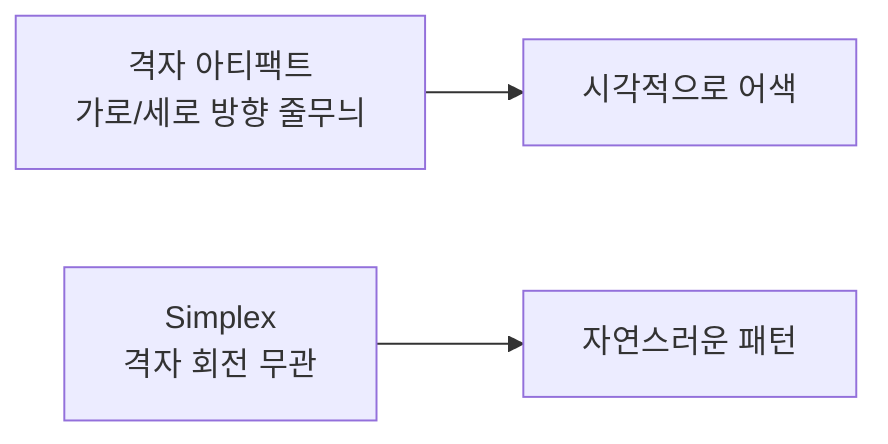
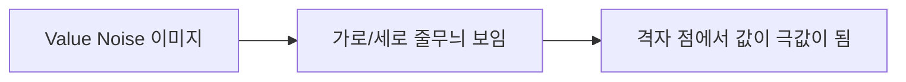
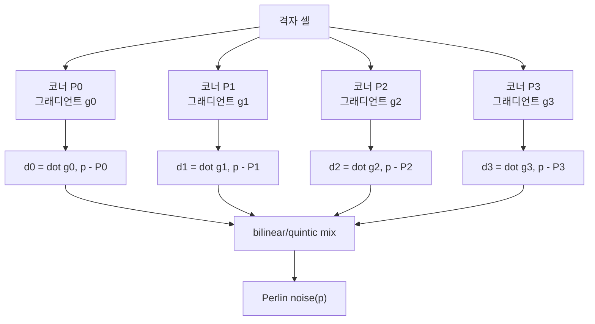
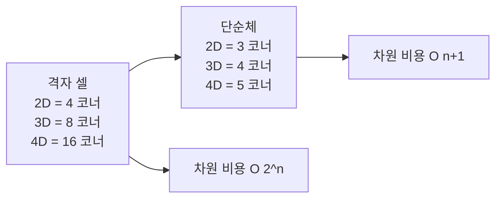
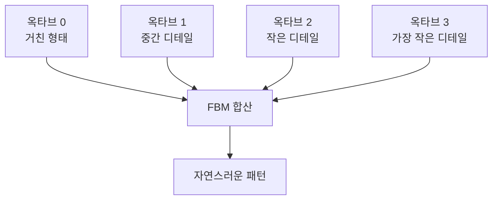
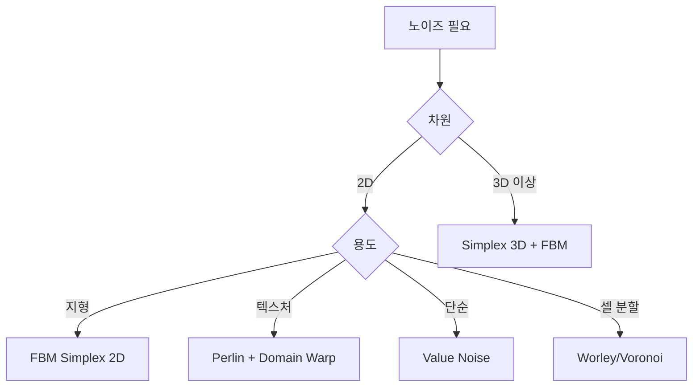

## 들어가며

절차적 노이즈 (Procedural Noise) 는 *좌표를 입력받아 부드러운 무작위 값을 출력하는 함수* 다. 같은 좌표에 같은 값을 반환하는 *결정론적 함수* 이면서, 좌표가 변하면 *통계적으로 무작위해 보이는* 출력을 만든다. 지형 높이맵, 구름, 불꽃, 안개, 대리석 무늬, 나무 텍스처, 절차적 던전 — 게임의 *자연 형상* 이 거의 모두 이 함수의 합성으로 만들어진다.

PRNG 가 *수열* 을 만들었다면, 노이즈는 *공간상의 부드러운 무작위* 를 만든다. PRNG로 *격자 점에 값* 을 두고 *그 사이를 보간* 하면 노이즈가 된다 — 이게 Value Noise. 거기에 *그래디언트 벡터* 와 *내적 보간* 을 더하면 Perlin. *단순체 (simplex) 구조* 로 효율을 끌어올리면 Simplex. 단계마다 *격자 아티팩트가 줄고 등방성이 좋아진다*.

이 글의 목표는 다음 다섯 가지다.

1. 노이즈 함수가 만족해야 할 조건 (연속성·균일성·결정론·격자 아티팩트 회피) 을 정리한다.
2. Value → Perlin → Simplex 의 *진화 과정* 과 각 단계의 트레이드오프.
3. *FBM (Fractal Brownian Motion)* 옥타브 합성으로 *디테일 + 거친 형태* 를 한 식에 담는 패턴.
4. *Domain Warping* 으로 *흐르는 듯한 자연스러운 패턴* 만들기.
5. GPU 셰이더에서의 노이즈 구현 — 텍스처 lookup vs 산술 hash, 셰이더 친화 패턴.

PRNG 결정론과 시드 위계가 이 글의 *해시 함수* 의 토대. *좌표 → 격자 점의 무작위 값* 이 결정론적이어야 *같은 시드 + 같은 좌표 = 같은 노이즈*.


---

## 목차
1. [노이즈 함수가 만족해야 할 조건](#1-노이즈-함수가-만족해야-할-조건)
2. [Value Noise](#2-value-noise)
3. [Perlin Noise](#3-perlin-noise)
4. [Simplex와 OpenSimplex](#4-simplex와-opensimplex)
5. [FBM과 옥타브 합성](#5-fbm과-옥타브-합성)
6. [Domain Warping](#6-domain-warping)
7. [GPU에서의 노이즈](#7-gpu에서의-노이즈)
8. [용도별 노이즈 선택](#8-용도별-노이즈-선택)


---

## 1. 노이즈 함수가 만족해야 할 조건

이상적인 노이즈 함수의 조건들. 실제 구현은 *어느 정도 양보* 한다.

### 1.1 결정론

같은 좌표 입력 = 같은 출력. *시드를 매개변수로* 받아 *시드별 무작위 함수* 를 만든다.

$$
\text{noise}(p, \text{seed}) = f(p, \text{seed})
$$

이 결정성이 *재현 가능한 절차적 콘텐츠* 의 핵심. 같은 시드면 *같은 산이 같은 곳에*.

### 1.2 통계적 균일성

큰 영역에서 *평균이 일정*, *분산이 일정*. 일부 영역에서 *값이 더 자주 나오는* 편향이 없어야 한다.

이상적으로는 *공간 어디를 잘라봐도 같은 분포*. 게임 노이즈는 보통 *충분히 균일* 한 정도면 OK.

### 1.3 연속성과 미분 가능성

*입력의 작은 변화 = 출력의 작은 변화* (C0). 더 부드러우려면 *미분 가능* 까지.

| 등급 | 의미 |
|---|---|
| C0 | 연속 (값 안 끊김) |
| C1 | 1차 미분 가능 (기울기 안 끊김) |
| C2 | 2차 미분 가능 (곡률 안 끊김) |

지형 높이와 법선을 쓰는 셰이더 노이즈에는 *C1 이상* 이 필요하다 — 끊긴 1차 미분은 법선과 조명 경계를 만든다. 곡률이나 2차 미분 기반 필터를 쓰는 경우에는 *C2*가 필요하다.

### 1.4 격자 정렬 아티팩트 부재

격자 기반 노이즈는 *격자 방향으로 패턴이 보이는* 함정. 같은 좌표를 회전해 입력하면 *결과가 달라지는* 비등방성.



Value Noise > Perlin > Simplex 순으로 격자 아티팩트가 *줄어든다*. 좋은 노이즈는 *공간을 회전해도 통계적 차이가 없다*.

### 1.5 빠른 평가

게임의 노이즈는 *수만~수백만 점에서* 호출. 한 호출의 비용이 *마이크로초 단위* 여야 *프레임 안에 끝난다*.

호출 비용의 상대 순위도 구현에 따라 바뀐다. permutation table 접근, hash 방식, SIMD batch, derivative 동시 계산, CPU cache와 GPU shader compiler를 포함해 같은 octave 수와 품질에서 측정해야 한다. 차원이 커지면 hypercube의 $2^n$ corner를 평가하는 고전 Perlin 방식보다 simplex의 기여 corner 수가 유리해지는 경향은 있다.

### 1.6 게임 노이즈의 트레이드오프

| 측면 | Value | Perlin | Simplex |
|---|---|---|---|
| 격자 아티팩트 | 큼 | 작음 | 거의 없음 |
| 매끄러움 | 보간 함수에 의존 | fade와 gradient 구성에 의존 | kernel 차수에 의존 |
| 차원 비용 (n차원) | $O(2^n)$ | $O(2^n)$ | $O(n^2)$ |
| 코드 복잡도 | 단순 | 중간 | 복잡 |
| 라이선스 | 자유 | 자유 | 역사적 특허 이슈 (2022 만료) — 현재 자유 |
| 대표 용도 | 단순 scalar field | 방향성 있는 gradient field | 고차원 gradient noise |

차원만으로 알고리즘을 정하지 않는다. tileability, analytic derivative, isotropy, 대역 제한, SIMD/GPU 구현과 라이선스 요구를 함께 본다.

비용 트레이드오프는 *구현·차원·GPU* 에 따라 갈린다. 일반적으로 *고차원 (3D 이상) 에서 Simplex의 이점이 커진다* — Perlin의 $O(2^n)$ 코너 수 부담이 차원에 따라 폭증.

## 2. Value Noise

가장 단순한 노이즈. 격자 점마다 *무작위 값* 을 두고 *그 사이를 보간*.

### 2.1 알고리즘

1. 입력 좌표 $p$ 의 정수 부분 $i = \lfloor p \rfloor$, 소수 부분 $f = p - i$.
2. 정수 격자 점 $i$ 에 *해시 (hash)* 를 적용해 *결정론적 무작위 값*.
3. 인접 격자 점들의 값을 *$f$ 로 보간*.

2D 의 경우 *4 격자 점* 의 값을 *bilinear* 또는 *smoothstep* 으로 보간.

```cpp
float Hash(int x, int y) {
    uint32_t h = uint32_t(x) * 374761393u + uint32_t(y) * 668265263u;
    h = (h ^ (h >> 13)) * 1274126177u;
    return float(h ^ (h >> 16)) / float(UINT32_MAX);
}

float ValueNoise2D(float px, float py) {
    int   ix = int(std::floor(px)), iy = int(std::floor(py));
    float fx = px - ix, fy = py - iy;

    float v00 = Hash(ix,   iy);
    float v10 = Hash(ix+1, iy);
    float v01 = Hash(ix,   iy+1);
    float v11 = Hash(ix+1, iy+1);

    // smoothstep으로 C1 연속성 확보
    float ux = fx * fx * (3.0f - 2.0f * fx);
    float uy = fy * fy * (3.0f - 2.0f * fy);

    float i0 = Lerp(v00, v10, ux);
    float i1 = Lerp(v01, v11, ux);
    return Lerp(i0, i1, uy);
}
```

### 2.2 Smoothstep과 Quintic

선형 보간 (Lerp) 은 C0 만 보장. *smoothstep* 으로 C1, *quintic* 으로 C2.

| 함수 | 식 | 연속성 |
|---|---|---|
| Lerp | $f$ | C0 |
| Smoothstep | $f^2 (3 - 2f)$ | C1 |
| Quintic | $f^3 (10 - 15f + 6f^2)$ | C2 |

게임에서 *smoothstep* 이 표준. 라이팅 계산이 *법선 (미분 1번)* 을 쓰니 C1 이면 충분. C2 가 필요한 곳 (예: 곡률 기반 셰이더) 에서만 quintic.

### 2.3 격자 아티팩트

Value Noise의 가장 큰 약점. *격자 방향으로 패턴이 보인다*.



격자 점이 *값의 봉우리/골짜기* 라 *격자 자체가 시각적으로 드러난다*. 회전해도 같은 격자 무늬.

이 함정 때문에 게임에서 Value Noise 단독은 *드물다*. *FBM 합성* (5절) 으로 격자 아티팩트가 어느 정도 가려지지만 완벽하지 않다.

### 2.4 사용 시나리오

- *간단한 절차적 텍스처* (대리석, 구름의 단순 형태).
- *디버깅용 노이즈* — 코드가 단순해 빠르게 테스트.
- *낮은 정밀도가 OK 인 곳* (UI 효과, 작은 입자 흔들림).

진지한 게임 노이즈는 *Perlin 또는 Simplex* 로 시작.

## 3. Perlin Noise

1985년 Ken Perlin이 SIGGRAPH 논문으로 발표한 *그래디언트 노이즈*. 이전 *Tron* (1982) 의 절차적 효과 작업에서 출발한 기법으로, 1997년 Academy Technical Achievement Award 를 수상. 게임 그래픽스 노이즈의 *역사적 표준*.

### 3.1 핵심 아이디어

Value Noise는 *격자 점에 값* 을 둔다. Perlin은 *격자 점에 그래디언트 벡터* 를 둔다. 노이즈 값은 *그 벡터와 셀 내부 위치의 내적* 을 보간한 것.



격자 점에서의 *값이 항상 0* — 그래디언트와 *영벡터* 의 내적이라. 이게 *격자 아티팩트를 줄이는* 핵심.

### 3.2 알고리즘 (2D)

```cpp
const vec2 kPerlinGradients[8] = {
    {1, 0}, {-1, 0}, {0, 1}, {0, -1},
    {0.707f, 0.707f}, {-0.707f, 0.707f},
    {0.707f, -0.707f}, {-0.707f, -0.707f},
};

float PerlinNoise2D(float px, float py) {
    int   ix = int(std::floor(px)), iy = int(std::floor(py));
    float fx = px - ix, fy = py - iy;

    // 4개 코너에서 그래디언트 선택 (해시 기반)
    auto gradAt = [&](int x, int y) {
        uint32_t h = HashCoord(x, y);
        return kPerlinGradients[h & 7];
    };

    vec2 g00 = gradAt(ix,   iy);
    vec2 g10 = gradAt(ix+1, iy);
    vec2 g01 = gradAt(ix,   iy+1);
    vec2 g11 = gradAt(ix+1, iy+1);

    // 셀 내부 위치 - 코너 위치 = 거리 벡터
    float d00 = dot(g00, vec2(fx,       fy));
    float d10 = dot(g10, vec2(fx - 1.0f, fy));
    float d01 = dot(g01, vec2(fx,       fy - 1.0f));
    float d11 = dot(g11, vec2(fx - 1.0f, fy - 1.0f));

    // quintic으로 C2 연속성
    float ux = fx*fx*fx*(fx*(fx*6 - 15) + 10);
    float uy = fy*fy*fy*(fy*(fy*6 - 15) + 10);

    float i0 = Lerp(d00, d10, ux);
    float i1 = Lerp(d01, d11, ux);
    return Lerp(i0, i1, uy);
}
```

8개 또는 12개의 *고정 그래디언트* 에서 해시로 선택. 각 코너 그래디언트와 *셀 내부 거리 벡터* 의 내적.

### 3.3 그래디언트 테이블

전체 그래디언트가 *균등 분포 단위 벡터* 일 필요는 없다. *8 ~ 16개의 고정 단위 벡터* 에서 *해시로 선택* 하는 게 빠르고 충분.

3D Perlin의 그래디언트는 *입방체 모서리 방향 12개*. 길이가 *$\sqrt{2}$* 인 벡터들로, 정확히 단위 벡터는 아니지만 *모든 12개의 길이가 같다* — 노이즈의 통계 균일성에 충분.

```cpp
// 입방체 모서리 방향 12개. 길이는 모두 sqrt(2).
const vec3 kPerlin3DGradients[12] = {
    { 1,  1,  0}, {-1,  1,  0}, { 1, -1,  0}, {-1, -1,  0},
    { 1,  0,  1}, {-1,  0,  1}, { 1,  0, -1}, {-1,  0, -1},
    { 0,  1,  1}, { 0, -1,  1}, { 0,  1, -1}, { 0, -1, -1},
};
```

길이 차이는 *상수 스케일* 이라 노이즈 결과의 *최종 진폭* 만 영향. 정규화하려면 각 벡터를 $\sqrt{2}$ 로 나누면 단위 벡터.

12 가 *2의 거듭제곱이 아니라* 해시 매핑이 살짝 어색하지만, *정수 연산만으로 처리* 가능. 일부 구현은 16개로 늘려 단순화.

### 3.4 Improving Noise (Perlin 2002)

Ken Perlin이 2002년 발표한 *개선판*. 핵심 변경:

1. 보간 함수를 cubic ($f^2(3-2f)$) → quintic ($f^3(10-15f+6f^2)$) 으로. C1 → C2.
2. 그래디언트를 *난수에서 선택* → *고정 12개* 로. 빠름 + 더 균일.

대부분 게임의 Perlin은 *Improving Noise (2002)* 버전. 1985년 원본은 *역사적 의미*.

### 3.5 Perlin의 격자 아티팩트

Value Noise 보다 훨씬 좋지만 *완벽하지 않다*. 격자 정렬된 *45° 방향의 약한 줄무늬* 가 보일 수 있다. *FBM 으로 가려지지만* 단일 옥타브 Perlin은 회전 시 약간 다르게 보인다.

이 약점이 *Simplex 등장의 동기*.

## 4. Simplex와 OpenSimplex

2001년 Ken Perlin이 발표. *격자가 아닌 단순체 (simplex)* 구조. *2D = 삼각형*, *3D = 사면체*, *4D = 5-cell*.

### 4.1 단순체의 의미

n차원에서 *최소 점 수로 만드는 부피*. 2D 삼각형 (3점), 3D 사면체 (4점), 4D 5-cell (5점). 격자 (2D 정사각형 4점, 3D 정육면체 8점) 보다 *적은 코너*.



코너 수가 적어 *차원 비용이 $O(n^2)$ 에 가깝다*. Perlin의 $O(2^n)$ 보다 훨씬 *고차원 친화적*.

### 4.2 Simplex 격자 변환

Simplex 평가는 *입력 좌표를 simplex 좌표계로 변환* 후 *각 단순체 코너에서 기여* 를 합산.

대략적 흐름:

1. 입력 좌표를 *왜곡 (skew)* 해서 격자가 simplex 정렬되도록.
2. 그 격자에서 *현재 포함된 단순체* 의 코너들 (n+1 개) 식별.
3. 각 코너에서 *그래디언트 + 거리 기반 기여* 계산.
4. 합산 후 다시 원래 좌표계로.

```cpp
// 의사 코드
float SimplexNoise2D(float x, float y) {
    // skew constant for 2D simplex
    const float F = 0.5 * (sqrt(3.0) - 1.0);
    const float G = (3.0 - sqrt(3.0)) / 6.0;

    // 입력 좌표 skew
    float s = (x + y) * F;
    int i = floor(x + s);
    int j = floor(y + s);

    // un-skew
    float t = (i + j) * G;
    float X0 = i - t;
    float Y0 = j - t;
    float x0 = x - X0;
    float y0 = y - Y0;

    // 어느 단순체인지 결정
    int i1, j1;
    if (x0 > y0) { i1 = 1; j1 = 0; }
    else         { i1 = 0; j1 = 1; }

    // 세 코너에서의 기여 합산
    // ... (코드 생략)
}
```

코드가 *복잡하다*. 직접 구현하기보다 *공인된 라이브러리* (예: stb_perlin) 를 쓰는 게 일반적.

### 4.3 Simplex의 장점

| 측면 | 우월성 |
|---|---|
| 등방성 | 축 정렬 격자 noise보다 방향성 artifact를 줄이는 경향 |
| 차원 비용 | 고차원에서 평가 corner 증가가 완만 |
| 시각적 패턴 | 구현과 gradient set에 따라 격자 artifact 감소 |
| 미분 가능성 | 격자 노이즈보다 등방성 좋고 충분히 매끄러움 (구현·커널 의존) |

3D 볼륨에는 Simplex뿐 아니라 Perlin, value, Worley/cellular, curl noise와 texture 기반 noise가 목적에 따라 함께 쓰인다.

### 4.4 특허 문제

Simplex 가 *Ken Perlin 의 특허* (3D 이상). 만료는 2022년이라 *현재는 자유*. 하지만 *역사적으로 Simplex 회피판* 인 OpenSimplex 가 등장.

### 4.5 OpenSimplex

Kurt Spencer가 2014년 발표. *공개 도메인*. Simplex의 *시각적 특성을 유지* 하면서 *알고리즘이 다름*.

| 측면 | OpenSimplex |
|---|---|
| 라이선스 | public domain |
| 시각 | 다른 lattice와 gradient 구성으로 유사하지만 동일하지 않음 |
| 속도 | 구현·차원·gradient 계산에 의존 |
| 구현 | 공개 코드 풍부 |

알고리즘 이름만으로 선택하지 말고 필요한 차원, derivative, tile 주기와 구현 라이선스를 확인한다. OpenSimplex2도 하나의 후보이지 보편적인 후속 표준은 아니다.

### 4.6 구현 선택

- **stb_perlin.h**: Sean Barrett의 단일 헤더. Perlin + Improving Noise.
- **FastNoise / FastNoise2**: Jordan Peck의 종합 라이브러리. Value/Perlin/Simplex/Cellular 모두.
- **OpenSimplex2**: 공식 OpenSimplex 후속. C / Java / GLSL 등 다양한 포팅.

라이브러리를 쓸 때는 출력 범위, seed/hash 안정성, 좌표 음수 처리, SIMD 정렬, derivative와 주기적 tile 지원을 시험한다. 서로 다른 버전의 출력이 bit-exact하게 유지된다고 가정하지 말고 생성 결과를 asset 또는 algorithm version과 함께 관리한다.

## 5. FBM과 옥타브 합성

단일 노이즈는 *한 주파수* — 결과가 *단조롭게* 보인다. *여러 주파수의 노이즈를 합성* 해 *디테일 + 거친 형태* 를 한 식에 담는 게 *FBM (Fractal Brownian Motion)*.

### 5.1 정의

$$
\text{FBM}(p) = \sum_{i=0}^{N-1} a^i \cdot \text{noise}(b^i p)
$$

매개변수.

- **N**: 옥타브 수. 보통 4 ~ 8.
- **$a$**: persistence (각 옥타브의 진폭 비율). 보통 0.5.
- **$b$**: lacunarity (각 옥타브의 주파수 비율). 보통 2.0.

옥타브 $i$ 가 *주파수가 2배인 노이즈* (디테일이 더 작음) 와 *진폭이 절반인 노이즈* (영향이 작음).

### 5.2 시각적 의미



낮은 옥타브 = 큰 산·구릉. 높은 옥타브 = 작은 바위·풀잎. 자연의 *프랙탈 모양* 이 이 합성에서 나온다.

### 5.3 코드

```cpp
float FBM(float x, float y, int octaves = 4,
            float persistence = 0.5f, float lacunarity = 2.0f) {
    float total = 0.0f;
    float amplitude = 1.0f;
    float frequency = 1.0f;
    float maxValue = 0.0f;

    for (int i = 0; i < octaves; ++i) {
        total     += SimplexNoise2D(x * frequency, y * frequency) * amplitude;
        maxValue  += amplitude;
        amplitude *= persistence;
        frequency *= lacunarity;
    }

    return total / maxValue;  // [-1, 1] 정규화
}
```

8옥타브면 노이즈 호출 8번. 여전히 마이크로초 단위 — 게임 한 프레임에 *10000번* 호출 가능.

### 5.4 매개변수의 효과

| 매개변수 | 작은 값 | 큰 값 |
|---|---|---|
| octaves | 단순한 모양 | 디테일 풍부, 비용 ↑ |
| persistence | 디테일 약함 | 디테일 강함, 거친 형태 약화 |
| lacunarity | 디테일 큰 단위 | 디테일 작은 단위 |

게임 디자이너가 *세 매개변수 슬라이더* 로 지형의 *느낌* 을 조절. *프로토타이핑에 가장 직관적인 도구*.

### 5.5 변형: Ridged FBM

각 옥타브의 *절댓값을 1에서 빼* 산맥처럼 보이게 만든다.

$$
\text{Ridged}(p) = \sum_i a^i \cdot (1 - |\text{noise}(b^i p)|)
$$

```cpp
float RidgedFBM(float x, float y, int octaves = 4) {
    float total = 0.0f;
    float amplitude = 1.0f;
    float frequency = 1.0f;
    for (int i = 0; i < octaves; ++i) {
        float n = SimplexNoise2D(x * frequency, y * frequency);
        total += (1.0f - std::fabs(n)) * amplitude;
        amplitude *= 0.5f;
        frequency *= 2.0f;
    }
    return total;
}
```

값이 *피크 (1)* 에서 모이고 *0 부근에 골짜기*. 산맥 + 협곡 같은 시각적 효과.

### 5.6 변형: Billow

같은 패턴을 *둥근 구름* 처럼 만든다.

$$
\text{Billow}(p) = \sum_i a^i \cdot |\text{noise}(b^i p)|
$$

`abs` 만 절댓값. 결과가 *둥근 봉우리들의 모임*. 구름·언덕에 자주.

## 6. Domain Warping

노이즈의 *입력 좌표* 자체를 *다른 노이즈* 로 흔들어서 *흐르는 듯한 패턴* 을 만든다. Inigo Quilez의 글로 표준화된 기법.

### 6.1 정의

$$
f(p) = \text{noise}(p + g(p))
$$

여기서 $g(p)$ 도 노이즈 (또는 노이즈 벡터). *좌표를 자기 자신의 노이즈로 옮긴* 후 다시 노이즈 평가.

### 6.2 코드

```cpp
vec2 NoiseVec2(vec2 p) {
    return vec2(
        SimplexNoise2D(p.x, p.y),
        SimplexNoise2D(p.x + 100.0f, p.y + 100.0f)
    );
}

float DomainWarpedNoise(vec2 p, float strength = 1.0f) {
    vec2 q = NoiseVec2(p);
    return SimplexNoise2D(p.x + q.x * strength,
                           p.y + q.y * strength);
}
```

*노이즈 두 개로 좌표 흔들기 + 노이즈 한 개로 결과*. 호출 비용 3배.

### 6.3 시각적 효과


좌표가 흔들리면 *원래 노이즈 패턴이 늘어지고 휘어진* 모양. 흐르는 강물, 연기, 화염, 대리석 무늬에 자주.

### 6.4 다중 단계 Warping

한 번 흔든 결과를 *또 흔들기*.

```cpp
float MultiWarpNoise(vec2 p) {
    vec2 q  = NoiseVec2(p + vec2(0.0f, 0.0f));
    vec2 r  = NoiseVec2(p + 4.0f * q + vec2(1.7f, 9.2f));
    vec2 warped = p + 4.0f * r;
    return SimplexNoise2D(warped.x, warped.y);
}
```

Quilez의 *fbm of fbm* 패턴. 더 *복잡하고 자연스러운* 결과. 비용은 호출 N배.

### 6.5 게임 응용

- **구름·연기 셰이더**: domain warp으로 *흘러가는 모양*. 시간을 좌표에 더해 *애니메이션*.
- **물 표면**: 두 개 노이즈 합성 + warp.
- **대리석·나무 텍스처**: 격자 무관한 *흐르는 무늬*.
- **화염·번개**: 강한 warp + 색상 매핑.

```cpp
// 시간 애니메이션 noise
float AnimatedNoise(vec2 p, float time) {
    vec2 warped = vec2(
        p.x + SimplexNoise3D(p.x, p.y, time * 0.1f),
        p.y + SimplexNoise3D(p.x + 100, p.y + 100, time * 0.1f)
    );
    return SimplexNoise2D(warped.x, warped.y);
}
```

3D Simplex의 *세 번째 좌표를 시간* 으로. 시간이 흐르면 *노이즈 패턴이 부드럽게 변형*.

## 7. GPU에서의 노이즈

셰이더에서 *수백만 픽셀에 노이즈* 를 평가. CPU와 *완전히 다른 트레이드오프*.

### 7.1 두 접근

**A. Texture lookup**:

```glsl
// CPU 측: 256x256 노이즈 텍스처 미리 생성 (한 번)
// GPU 측: texture2D로 lookup
float Noise(vec2 uv) {
    return texture(noiseTexture, uv).r;
}
```

장점: *극도로 빠름*. 한 텍스처 fetch.
단점: *텍스처 메모리* 사용. *주기적 패턴이 보일 수 있음*.

**B. 산술 노이즈 (procedural)**:

```glsl
float Hash(vec2 p) {
    return fract(sin(dot(p, vec2(12.9898, 78.233))) * 43758.5453);
}

float ValueNoise(vec2 p) {
    vec2 i = floor(p);
    vec2 f = fract(p);
    vec2 u = f * f * (3.0 - 2.0 * f);
    return mix(
        mix(Hash(i + vec2(0,0)), Hash(i + vec2(1,0)), u.x),
        mix(Hash(i + vec2(0,1)), Hash(i + vec2(1,1)), u.x),
        u.y
    );
}
```

장점: *텍스처 없음*. 무한 디테일.
단점: *명령 수 많음*. hash 함수의 통계가 텍스처보다 약함.

게임 셰이더는 *둘 다* — 큰 패턴은 텍스처 lookup, 디테일은 산술.

### 7.2 셰이더 hash 함수

GPU 친화적 hash. *부동소수점 산술 + sin/fract 트릭* 가 흔하다.

```glsl
// 가장 흔한 패턴 (GLSL)
float Hash(vec2 p) {
    return fract(sin(dot(p, vec2(12.9898, 78.233))) * 43758.5453);
}

// PCG 영감 hash (더 균일)
uint Hash(uint x) {
    x = x * 747796405u + 2891336453u;
    x = ((x >> ((x >> 28u) + 4u)) ^ x) * 277803737u;
    return (x >> 22u) ^ x;
}
```

`sin/fract` 트릭은 *셰이더 모델에 따라 정밀도가 갈린다*. 모바일 GPU의 lowp 정밀도에서는 *불안정*. *정수 hash* 가 더 안전하다 (uint 지원하는 셰이더).

### 7.3 Inigo Quilez 패턴

`iquilezles.org` 의 *셰이더 노이즈 라이브러리* 가 GLSL 셰이더 노이즈의 *사실상 표준 레퍼런스*.

- **`noise12`, `noise21`, `noise31`**: 각 차원의 산술 노이즈.
- **`fbm`**: 옥타브 합성 인라인 함수.
- **`smin`**: smooth minimum (메타볼).
- **distance functions**: SDF 형상.

ShaderToy 의 거의 모든 셰이더가 이 패턴을 사용. *학습 가치 큰 코드*.

### 7.4 셰이더 메모리 트레이드오프

| 옵션 | 메모리 | 평가 비용 | 시각적 |
|---|---|---|---|
| 256×256 RGBA8 텍스처 | 256 KB | 매우 빠름 | 64 픽셀 주기 보임 |
| 256×256 R8 텍스처 | 64 KB | 매우 빠름 | 동일 |
| 1024×1024 RGBA8 텍스처 | 4 MB | 빠름 | 거의 안 보임 |
| 산술 노이즈 (Value) | 0 | 중간 | 격자 아티팩트 |
| 산술 노이즈 (Simplex) | 0 | 느림 | 가장 좋음 |

게임의 *런타임 셰이더* 는 *텍스처 lookup이 압도적으로 빠르다*. 메모리 사용 vs 셰이더 명령 수 트레이드오프에서 보통 메모리 쪽 승.

### 7.5 noise를 baking

복잡한 노이즈 합성을 *오프라인으로 평가* 후 *결과를 텍스처에 baking*.

```cpp
// CPU: FBM 결과를 한 번 계산
for (int y = 0; y < 1024; ++y) {
    for (int x = 0; x < 1024; ++x) {
        float val = FBM(x * 0.01f, y * 0.01f, 8);
        bakedNoise[y * 1024 + x] = val;
    }
}
```

빌드 타임에 *비싼 노이즈* 를 풀어 *런타임 텍스처 lookup*. *프로토타이핑에서 완성도까지 가는* 자연스러운 흐름.

## 8. 용도별 노이즈 선택

게임의 *어디에 어느 노이즈* 인지 패턴 정리.

### 8.1 지형 높이맵

```text
장르: 오픈 월드, 샌드박스
추천: FBM(Simplex 2D), 4~8 옥타브
기법: 산맥은 RidgedFBM, 평원은 일반 FBM
```

지형은 *큰 형태 + 디테일* 의 자연스러운 합성. FBM 이 표준. 산맥 강조하려면 RidgedFBM.

```cpp
float TerrainHeight(float x, float z) {
    float continentScale = 0.001f;
    float continent = FBM(x * continentScale, z * continentScale, 6);
    float ridgeScale = 0.01f;
    float ridges = RidgedFBM(x * ridgeScale, z * ridgeScale, 4);
    return continent * 1000.0f + ridges * 100.0f;
}
```

### 8.2 구름·안개·연기

```text
장르: 모든 게임
추천: 3D Simplex FBM + Domain Warp
기법: 셰이더의 ray-march 또는 볼류메트릭 패턴
```

구름의 *공간적 모양* 이 3D 노이즈. 시간 차원을 추가하면 *흐르는* 효과.

### 8.3 절차적 텍스처

```text
장르: 모든 게임
추천: Value Noise + Threshold (단순), Perlin + Domain Warp (자연스러움)
기법: 셰이더 또는 텍스처 bake
```

대리석, 나무 무늬, 가죽, 천 — Domain Warp Perlin 으로 *대부분 표현* 가능.

### 8.4 절차적 던전

```text
장르: 로그라이크
추천: Worley/Voronoi noise
기법: 셀 분할 + 통로 연결
```

*Voronoi noise* 는 *공간을 셀로 나누는* 노이즈. 던전 배치, 지역 분할에 사용. 일반 Perlin/Simplex와 다른 종류.

### 8.5 적 스폰 분포

```text
장르: 액션, 어드벤처
추천: Value Noise (낮은 빈도) 또는 FBM
기법: 노이즈 값을 임계값과 비교
```

*적이 모이는 지역 + 비어 있는 지역* 의 자연스러운 분포. *맵의 같은 영역에 항상 같은 적 분포* (결정론).

```cpp
bool ShouldSpawnEnemy(float x, float z, uint64_t worldSeed) {
    float densityRaw = SimplexNoise2D(x * 0.05f, z * 0.05f);  // [-1, 1]
    float density01  = densityRaw * 0.5f + 0.5f;              // [0, 1]로 매핑
    float threshold  = 0.3f;
    return density01 > threshold && Hash(x, z, worldSeed) < density01;
}
```

### 8.6 시각 효과

| 효과 | 노이즈 |
|---|---|
| 폭발 입자 분산 | Normal 분포 + 시간 축 노이즈 |
| 화염 셰이더 | Simplex 3D + 강한 Domain Warp |
| 번개 모양 | 1D Simplex + 분기 |
| 흔들리는 깃발 | 시간 좌표 노이즈 |
| 글리치 효과 | 격자 아티팩트 있는 Value 의도적 사용 |

### 8.7 결정 트리



*차원 결정 → 용도 결정 → 노이즈 종류 결정*. 게임 노이즈 선택의 표준 흐름.


---

## 결론

절차적 노이즈는 *무한한 디테일을 메모리 없이 만드는* 도구다. 좌표 → 부드러운 무작위 값의 함수 한 번이 옥타브 합성과 도메인 워프를 거치며 *지형, 구름, 텍스처, 던전* 같은 자연 형상이 된다.

이 글에서 정리한 핵심.

1. **Value → Perlin → Simplex 의 진화** — 격자 아티팩트가 줄고, 차원 비용이 $O(2^n)$ 에서 $O(n^2)$ 로.
2. **Improving Noise (Perlin 2002)** — quintic 보간 + 고정 그래디언트로 C2 자동.
3. **FBM 옥타브 합성** — 거친 형태 + 디테일을 한 식. persistence·lacunarity 디자이너 슬라이더.
4. **Domain Warping** — 좌표 자체 흔들기. 흐르는 듯한 자연스러운 패턴.
5. **GPU 노이즈** — 텍스처 lookup vs 산술. 게임 런타임은 *둘 다* 사용.

절차적 노이즈의 핵심은 결정적 hash에서 시작한 의사 난수를 공간적으로 상관된 연속장으로 바꾸고, 주파수 대역·진폭·미분 가능성과 타일링 조건을 목적에 맞게 통제하는 것이다. 지형·텍스처·애니메이션에 사용할 때는 시각적 풍부함뿐 아니라 샘플 비용, aliasing, 좌표 규모와 재현 가능한 seed 계약을 함께 검증한다.

## 더 읽을거리

- Ken Perlin, "An Image Synthesizer" (SIGGRAPH 1985) — Perlin Noise 원전.
- Ken Perlin, "Improving Noise" (SIGGRAPH 2002) — quintic + 고정 그래디언트 개선판.
- Stefan Gustavson, "Simplex noise demystified" (2005) — Simplex의 시각적 설명.
- Inigo Quilez, "Domain Warping" (iquilezles.org) — Warp 기법의 표준 글.
- Inigo Quilez, ShaderToy 셰이더 노이즈 컬렉션 — 실용 셰이더 노이즈의 보고.
- Sean Barrett, *stb_perlin.h* — 단일 헤더 Perlin/Improving Noise.
- Jordan Peck, *FastNoise2* — 종합 노이즈 라이브러리.
- KdotJPG, *OpenSimplex2* — 공개 도메인 OpenSimplex 후속.
- Worley, "A Cellular Texture Basis Function" (SIGGRAPH 1996) — Worley/Voronoi 노이즈 원전.
