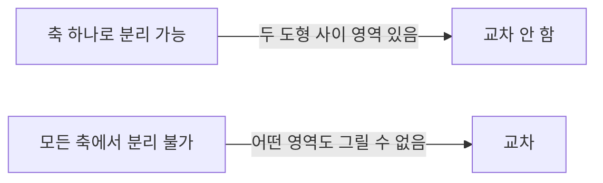

## 들어가며

게임의 물리는 결국 *단순한 도형 사이의 거리* 를 묻는 일이다. 화살이 적과 부딪혔는가, 캐릭터가 벽에 닿았는가, 폭발 범위 안에 누가 있는가, 카메라가 지면에 박혀 있는가 — 모두 *두 도형 사이 교차 또는 거리* 의 계산.

게임에서 압도적으로 자주 등장하는 *기본 도형 (primitive)* 은 네 가지: *구 (Sphere)*, *축 정렬 박스 (AABB)*, *회전 박스 (OBB)*, *캡슐 (Capsule)*. 이 넷의 *교차 판정* 과 *거리 함수* 가 게임 충돌의 *80%* 를 처리한다. 임의 볼록 도형의 일반 충돌(SAT, GJK)은 *이 기본 도형이 부족할 때* 등장하는 *고급 토픽*.

이 글의 목표는 다음 다섯 가지다.

1. 네 기본 도형의 *수학적 표현* 과 *메모리 비용* 을 정리한다.
2. *Sphere-Sphere*, *AABB-AABB*, *Sphere-AABB* 같은 *기본 쌍의 교차 판정* 을 풀어낸다.
3. *Closest point 함수* — 한 점에서 도형까지 가장 가까운 점 — 가 *모든 충돌의 토대* 임을 보인다.
4. *분리축 이론 (SAT)* 의 가장 단순한 사례인 *AABB-AABB* 를 통해 SAT 직관을 만든다.
5. *침투 깊이 (penetration depth)* 와 *접촉 정보 (contact)* 가 *물리 응답* 으로 어떻게 이어지는지의 토대.

벡터·행렬·거리 도구들이 모두 이 글의 *재료*. 내적·외적·정규화·길이 비교가 충돌 판정의 모든 단계에 등장한다.


---

## 목차
1. [기본 도형의 정의](#1-기본-도형의-정의)
2. [Sphere-Sphere](#2-sphere-sphere)
3. [AABB-AABB](#3-aabb-aabb)
4. [Sphere-AABB](#4-sphere-aabb)
5. [OBB와 그 표현](#5-obb와-그-표현)
6. [Capsule 충돌](#6-capsule-충돌)
7. [Closest Point 함수](#7-closest-point-함수)
8. [거리 함수의 게임 응용](#8-거리-함수의-게임-응용)


---

## 1. 기본 도형의 정의

게임의 *충돌 도형 (collision shape)* 은 *그래픽 mesh와 별개* 다. 그래픽 mesh는 *수만 정점의 복잡한 형상* 이지만, 충돌 도형은 *그 형상을 단순한 기본 도형으로 근사* 한다. 캐릭터의 그래픽이 *수천 정점의 옷·머리카락* 이라도 충돌은 *캡슐 하나*.

### 1.1 Sphere (구)

가장 단순한 도형. *중심 + 반지름*.

```cpp
struct Sphere {
    vec3  center;
    float radius;
};
```

메모리 16 byte (vec3 + float). 모든 회전·변환에 *대칭* — 회전을 적용해도 *모양이 안 바뀐다*.

게임 응용: 폭발 범위, 트리거, 단순 캐릭터 (아바타).

### 1.2 AABB (Axis-Aligned Bounding Box)

축에 정렬된 직육면체. *최소 코너와 최대 코너* 두 점으로 표현.

```cpp
struct AABB {
    vec3 min;
    vec3 max;
};
```

메모리 24 byte. *축에 정렬* 이라 *회전이 없는 박스* 만 표현. 회전한 오브젝트의 충돌에는 부적합.

대안 표현: *중심 + 절반 크기 (extents)*.

```cpp
struct AABBCentered {
    vec3 center;
    vec3 extents;  // half size
};
```

같은 24 byte. 코너 표현보다 *연산이 더 빠른 경우가 많다*.

게임 응용: *broad phase* (넓은 영역 컬링), 카메라 frustum 영역, 트리거 영역, 셀 분할 (octree).

### 1.3 OBB (Oriented Bounding Box)

*회전이 들어간 박스*. AABB의 일반화.

```cpp
struct OBB {
    vec3 center;
    vec3 axes[3];   // 직교 단위 벡터
    vec3 extents;   // 각 축의 절반 길이
};
```

메모리 60 byte (center 12 + axes[3] 36 + extents 12 — vec3가 16 byte 정렬되면 더 커짐). *quaternion + 위치 + extents* 형태로 표현하면 40 byte (16 + 12 + 12) 로 줄일 수 있다.

회전한 오브젝트 (자동차, 차량, 가구) 의 *정확한 박스 컬링*. AABB보다 *비싸지만* 정확.

### 1.4 Capsule (캡슐)

*두 끝점 + 반지름*. 양 끝이 *반구* 로 마무리된 *원기둥*.

```cpp
struct Capsule {
    vec3  a, b;     // 두 끝점
    float radius;
};
```

메모리 28 byte (vec3 두 개 + float).

캐릭터의 *세로 형상* 에 가장 적합. 머리부터 발까지 *높이가 큰 모양*. 여러 게임 엔진의 *기본 캐릭터 충돌 도형*.

### 1.5 도형 표현의 트레이드오프

| 도형 | 메모리 | 회전 | 정확도 | 충돌 비용 |
|---|---|---|---|---|
| Sphere | 16 B | 자동 (대칭) | 가장 부정확 | 가장 빠름 |
| AABB | 24 B | 회전 표현 안 함 | 부정확 (회전 시) | 빠름 |
| OBB | 60 B (또는 quat 형 40 B) | 회전 직접 | 정확 (박스에) | 중간 |
| Capsule | 28 B | 두 끝점으로 | 캐릭터에 적합 | 중간 |

게임에서 자주 쓰는 *조합 패턴*:

- **Broad phase**: AABB (속도 우선).
- **Narrow phase**: OBB / Capsule / Sphere (정확도).
- **캐릭터 컨트롤러**: Capsule (수직 모양 + 매끄러운 충돌).
- **트리거 영역**: AABB 또는 Sphere (단순).

복잡한 *그래픽 mesh* 의 정확한 충돌이 필요하면 *볼록 분해(convex decomposition)* 로 단순 도형 묶음을 만들거나, *Bounding Volume Hierarchy(BVH)* 로 검사할 삼각형 후보를 줄인다.

## 2. Sphere-Sphere

가장 단순한 충돌. *두 중심 사이 거리* 가 *반지름 합 이하* 면 교차.

### 2.1 교차 판정

$$
|\vec{c_1} - \vec{c_2}| \le r_1 + r_2 \iff \text{교차}
$$

```cpp
bool SphereSphereIntersect(Sphere a, Sphere b) {
    return length(a.center - b.center) <= a.radius + b.radius;
}
```

이 코드의 *함정* 이 `length` (sqrt). 비교만이 목적이면 *길이 제곱* 으로.

```cpp
bool SphereSphereIntersect(Sphere a, Sphere b) {
    float distSq = length_squared(a.center - b.center);
    float rSum = a.radius + b.radius;
    return distSq <= rSum * rSum;
}
```

`sqrt` 한 번 절감. 게임 코드의 *무수한 거리 검사* 에서 누적되면 큰 차이.

### 2.2 침투 깊이 (penetration depth)

교차 시 *얼마나 침투했는가* 를 계산해 *물리 응답* 에 쓴다.

$$
d = (r_1 + r_2) - |\vec{c_1} - \vec{c_2}|
$$

침투 깊이가 양수면 교차. 0이면 접촉. 음수면 분리.

```cpp
struct Contact {
    bool  isColliding;
    float depth;        // 침투 깊이
    vec3  normal;       // 분리 방향
    vec3  point;        // 접촉점
};

Contact SphereSphereContact(Sphere a, Sphere b) {
    vec3 delta = b.center - a.center;
    float dist = length(delta);
    float rSum = a.radius + b.radius;

    Contact c;
    c.isColliding = dist <= rSum;
    if (!c.isColliding) return c;

    c.depth  = rSum - dist;
    c.normal = (dist > 1e-6f) ? delta / dist : vec3(1, 0, 0);
    c.point  = a.center + c.normal * a.radius;
    return c;
}
```

`dist` 가 0에 가까우면 *normal이 정의 안 됨* — 두 구가 *완벽히 같은 위치* 에 있을 때. 임의의 *기본 방향* (예: x축) 으로 폴백.

### 2.3 게임 응용

**발사체-적**: 화살 = Sphere (또는 작은 Capsule), 적 = Sphere.

```cpp
for (auto& enemy : enemies) {
    if (SphereSphereIntersect(arrow.shape, enemy.shape)) {
        DealDamage(enemy, arrow.damage);
        arrow.destroyed = true;
    }
}
```

**폭발 범위**: Sphere overlap query — 폭발 중심 + 반지름의 구 안의 *모든 적*.

```cpp
std::vector<Enemy*> InExplosionRange(vec3 center, float radius) {
    std::vector<Enemy*> hit;
    for (auto& e : enemies) {
        float dSq = length_squared(e.shape.center - center);
        float effectiveR = radius + e.shape.radius;
        if (dSq <= effectiveR * effectiveR) hit.push_back(&e);
    }
    return hit;
}
```

거리 감쇠 데미지도 *거리 / 반지름 비율* 로 자연스럽게.

## 3. AABB-AABB

축 정렬 박스 둘의 교차. *세 축에서 모두 구간이 겹치면* 교차. *분리축 이론 (SAT)* 의 가장 단순한 형태.

### 3.1 교차 판정

```cpp
// 정책: 접촉 (max == min) 도 교차로 본다 (트리거 overlap 용)
bool AABBIntersect(AABB a, AABB b) {
    if (a.max.x < b.min.x || a.min.x > b.max.x) return false;
    if (a.max.y < b.min.y || a.min.y > b.max.y) return false;
    if (a.max.z < b.min.z || a.min.z > b.max.z) return false;
    return true;
}
```

각 축에서 *분리되지 않으면* 교차. 한 축에서라도 *분리* 되면 즉시 false (early-out).

*접촉 (touching)* 처리 정책. 위 코드는 *겹침 없는 접촉 (max == min)* 도 *교차로 판정* — 트리거 overlap 에 적합. *물리 침투 응답* 에는 *진짜 겹침 (overlap > 0)* 만 필요해 *< 와 > 대신 <= 와 >=* 를 써 접촉을 *분리* 로 본다. 이 글의 코드는 *전자 (트리거 정책)* 에 통일. *침투 깊이 코드 (3.3절)* 는 *후자 (overlap > 0)* 정책.

이 코드 패턴이 *분리축 이론 (Separating Axis Theorem)* 의 가장 단순한 사례. AABB는 *축 후보가 3개* (x, y, z) 만 있어 단순.

### 3.2 SAT의 직관

*두 볼록 도형* 이 *어떤 축* 으로 분리 가능하면 *반드시 분리됨*. 모든 후보 축에서 *분리 안 되면* 교차.



축 후보는 *각 도형의 면 법선 (face normal)* 과 (3D에서는) *모서리 외적*. AABB는 면 법선이 *3개 축에 정렬* 이라 후보가 3개.

OBB-OBB 는 면 법선 6개 (3+3) + 모서리 외적 9개 = *15개 후보*. 이것이 SAT의 일반 형태로 확장된다.

### 3.3 침투 깊이

각 축에서 *겹치는 길이* 를 계산하고 *최소 겹침의 축* 이 *분리 방향*.

```cpp
struct AABBContact {
    bool  isColliding;
    float depth;
    vec3  normal;  // 분리 방향
};

// 정책: contact normal 은 "A 에서 B 를 향하는 방향" — Sphere-Sphere 와 일관.
// 이 글 전체에서 normal 은 동일하게 a → b 방향이며,
// 침투 해소 시 A 를 -normal, B 를 +normal 로 밀어낸다.
AABBContact AABBAABBContact(AABB a, AABB b) {
    AABBContact c;
    c.isColliding = false;

    // 축별 겹침 = 두 방향 분리 거리 중 작은 쪽 — 한 구간이 다른 구간을 포함해도 맞다.
    float overlapX = std::min(a.max.x - b.min.x, b.max.x - a.min.x);
    float overlapY = std::min(a.max.y - b.min.y, b.max.y - a.min.y);
    float overlapZ = std::min(a.max.z - b.min.z, b.max.z - a.min.z);

    // 침투 응답용: 겹침 0 (접촉) 은 분리로 본다 (트리거는 AABBIntersect 사용)
    if (overlapX <= 0 || overlapY <= 0 || overlapZ <= 0) return c;

    c.isColliding = true;

    // 가장 작은 겹침의 축이 분리 방향. normal 은 a → b 방향.
    if (overlapX < overlapY && overlapX < overlapZ) {
        c.depth  = overlapX;
        c.normal = vec3((a.min.x + a.max.x) < (b.min.x + b.max.x) ? 1 : -1, 0, 0);
    } else if (overlapY < overlapZ) {
        c.depth  = overlapY;
        c.normal = vec3(0, (a.min.y + a.max.y) < (b.min.y + b.max.y) ? 1 : -1, 0);
    } else {
        c.depth  = overlapZ;
        c.normal = vec3(0, 0, (a.min.z + a.max.z) < (b.min.z + b.max.z) ? 1 : -1);
    }
    return c;
}
```

*가장 작은 겹침의 축* 이 *최단 분리 방향*. 물리 응답에서 *A 를 -normal, B 를 +normal 로 밀어내면* 가장 적은 거리로 분리.

### 3.4 메모리 레이아웃과 SIMD

AABB-AABB 검사는 *6번의 비교 + 분기*. SIMD로 묶으면 축별 비교가 lane 병렬로 접혀 *비교 2명령 + mask 결합 + 부호 추출* 로 줄고, 분기도 사라진다.

```cpp
// 전제: AABB 의 min/max 가 vec4 또는 16-byte padding 을 갖는다.
// vec3 (3 floats) 배열에서 _mm_loadu_ps 는 4번째 float read 가 OOB 일 수 있어
// 안전하지 않다. 아래는 padded 구조체용.
struct AABB16 { vec4 min; vec4 max; };  // 마지막 성분 padding

bool AABBIntersectSSE(const AABB16& a, const AABB16& b) {
    __m128 amax = _mm_loadu_ps(&a.max.x);
    __m128 amin = _mm_loadu_ps(&a.min.x);
    __m128 bmax = _mm_loadu_ps(&b.max.x);
    __m128 bmin = _mm_loadu_ps(&b.min.x);

    __m128 c1 = _mm_cmplt_ps(amax, bmin);  // a.max < b.min
    __m128 c2 = _mm_cmpgt_ps(amin, bmax);  // a.min > b.max
    __m128 either = _mm_or_ps(c1, c2);

    return (_mm_movemask_ps(either) & 7) == 0;  // 4번째 성분 무시
}
```

게임의 *수만 AABB 검사* 에서 SIMD 가속이 큰 차이. *broad phase* 의 hot path. 단, AABB 데이터가 *16 byte 정렬 padding* 을 갖도록 *데이터 레이아웃 설계가 선결*.

### 3.5 AABB의 변환

오브젝트가 회전하면 *AABB가 더 이상 그 오브젝트를 정확히 감싸지 않는다*. 회전된 *그래픽 mesh의 새 AABB* 를 다시 계산해야 한다.

```cpp
AABB TransformAABB(AABB a, mat4 M) {
    // 8개 코너 모두 변환 후 새 AABB
    vec3 corners[8] = {
        {a.min.x, a.min.y, a.min.z}, {a.max.x, a.min.y, a.min.z},
        {a.min.x, a.max.y, a.min.z}, {a.max.x, a.max.y, a.min.z},
        {a.min.x, a.min.y, a.max.z}, {a.max.x, a.min.y, a.max.z},
        {a.min.x, a.max.y, a.max.z}, {a.max.x, a.max.y, a.max.z},
    };
    AABB result;
    result.min = result.max = (M * vec4(corners[0], 1)).xyz();
    for (int i = 1; i < 8; ++i) {
        vec3 p = (M * vec4(corners[i], 1)).xyz();
        result.min = min(result.min, p);
        result.max = max(result.max, p);
    }
    return result;
}
```

8개 코너 변환. 더 빠른 *행렬 절대값 트릭* 도 있지만 *회전된 AABB는 원본보다 작아지지 않는다* (박스를 다시 축 정렬로 보내는 회전만 같고, 그 외에는 더 크다) — *정확하지 않은 컬링* 의 시작점.

## 4. Sphere-AABB

자주 쓰이는 조합. *AABB 위 가장 가까운 점 (closest point) 을 구하고 그 점과 구 중심 사이 거리* 가 반지름 이하인지.

### 4.1 Closest Point on AABB

가장 가까운 점은 *각 축에서 구 중심을 AABB 범위로 clamp*.

$$
\vec{p}_{\text{closest}} = \text{clamp}(\vec{c}, \vec{\text{min}}, \vec{\text{max}})
$$

```cpp
vec3 ClosestPointOnAABB(vec3 p, AABB box) {
    return vec3(
        std::clamp(p.x, box.min.x, box.max.x),
        std::clamp(p.y, box.min.y, box.max.y),
        std::clamp(p.z, box.min.z, box.max.z)
    );
}
```

3번의 clamp. 매우 빠르다.

### 4.2 교차 판정

```cpp
bool SphereAABBIntersect(Sphere s, AABB box) {
    vec3 closest = ClosestPointOnAABB(s.center, box);
    return length_squared(s.center - closest) <= s.radius * s.radius;
}
```

*가장 가까운 점까지 거리 제곱* 이 *반지름 제곱 이하* 면 교차.

### 4.3 시각적 직관


구 중심이 *AABB 안에 있으면* closest = 중심 자신, 거리 0 → 무조건 교차. AABB 밖이면 *AABB 표면 위 한 점*. 그 점까지 거리로 판정.

### 4.4 침투 깊이

```cpp
// 정책: Sphere 가 a, AABB 가 b. normal 은 sphere 중심 → AABB 표면 방향 (a → b).
Contact SphereAABBContact(Sphere s, AABB box) {
    vec3 closest = ClosestPointOnAABB(s.center, box);
    vec3 delta   = closest - s.center;          // s → box 방향
    float distSq = length_squared(delta);

    Contact c;
    c.isColliding = distSq <= s.radius * s.radius;
    if (!c.isColliding) return c;

    if (distSq > 1e-6f) {
        // AABB 밖 — closest 가 AABB 표면 위
        float dist = std::sqrt(distSq);
        c.normal = delta / dist;
        c.depth  = s.radius - dist;
        c.point  = closest;
    } else {
        // AABB 안 — 구 중심이 박스 내부.
        // AABB 6면 중 가장 가까운 면을 찾아 그 면의 법선으로 push.
        vec3 toMin = s.center - box.min;
        vec3 toMax = box.max - s.center;
        float dx   = std::min(toMin.x, toMax.x);
        float dy   = std::min(toMin.y, toMax.y);
        float dz   = std::min(toMin.z, toMax.z);
        // normal 은 a → b (구 → 박스 안쪽) 방향 일관 유지.
        // 가장 가까운 면이 min 쪽이면 탈출 방향은 -축이므로,
        // normal 은 그 반대(+축, 박스 더 깊은 쪽)가 되어야
        // "player -= normal * depth" 해소가 박스 밖으로 민다.
        if (dx <= dy && dx <= dz) {
            c.normal = vec3(toMin.x < toMax.x ? 1 : -1, 0, 0);
            c.depth  = s.radius + dx;
        } else if (dy <= dz) {
            c.normal = vec3(0, toMin.y < toMax.y ? 1 : -1, 0);
            c.depth  = s.radius + dy;
        } else {
            c.normal = vec3(0, 0, toMin.z < toMax.z ? 1 : -1);
            c.depth  = s.radius + dz;
        }
        c.point  = s.center;
    }
    return c;
}
```

*AABB 안에 구 중심* 이 들어간 케이스. AABB 의 *6면까지 거리* 중 *가장 가까운 면* 을 찾아 *그 면의 외향 법선* 으로 push. 침투 깊이는 *반지름 + (구 중심에서 그 면까지 거리)*.

### 4.5 게임 응용

**캐릭터 vs 환경 박스**: 캐릭터를 Sphere로 근사, 환경의 박스 충돌 영역과의 검사.

```cpp
for (auto& box : staticGeometry) {
    Contact c = SphereAABBContact(player.shape, box);
    if (c.isColliding) {
        // normal 이 sphere → box 방향이므로,
        // player 를 box 반대편으로 (-normal) 밀어내 분리한다.
        player.position -= c.normal * c.depth;
    }
}
```

각 정적 박스에 대해 *침투 해소*. 반복하면 캐릭터가 모든 박스에서 분리.

**총알 vs 정적 환경**: 광선 (Ray) 으로 처리하는 게 더 정확하지만, *작은 총알 = Sphere* 도 OK.

## 5. OBB와 그 표현

회전된 박스. AABB의 일반화. SAT 일반 형태가 등장하는 가장 단순한 도형.

### 5.1 표현 방법

```cpp
struct OBB {
    vec3 center;
    vec3 axes[3];   // 단위 벡터, 직교
    vec3 extents;   // 각 축의 절반 크기
};
```

또는 *행렬 + 절반 크기* 형태.

```cpp
struct OBBMatrix {
    mat4 transform;  // 회전 + 이동 (스케일 없음)
    vec3 extents;
};
```

또는 *quaternion + 위치 + 절반 크기*.

```cpp
struct OBBQuat {
    vec3  position;
    quat  rotation;
    vec3  extents;
};
```

게임 엔진의 일반적 형태가 *quaternion + 절반 크기* — 메모리 효율 + 회전 보간 자연.

### 5.2 OBB-OBB 충돌 (SAT)

15개 분리축 후보 검사.

```cpp
bool OBBOBBIntersectSAT(OBB a, OBB b) {
    // 후보 1: A의 3축
    // 후보 2: B의 3축
    // 후보 3: A의 축과 B의 축의 외적 9개
    vec3 axes[15];
    for (int i = 0; i < 3; ++i) axes[i]     = a.axes[i];
    for (int i = 0; i < 3; ++i) axes[i + 3] = b.axes[i];
    for (int i = 0; i < 3; ++i)
        for (int j = 0; j < 3; ++j)
            axes[6 + i*3 + j] = cross(a.axes[i], b.axes[j]);

    for (auto& axis : axes) {
        if (length_squared(axis) < 1e-6f) continue;  // 평행한 축
        if (IsSeparated(a, b, normalize(axis))) return false;
    }
    return true;
}
```

각 축에서 *두 OBB의 투영이 겹치는가* 를 검사. 한 축에서라도 분리되면 false.

```cpp
bool IsSeparated(OBB a, OBB b, vec3 axis) {
    float aRange = std::fabs(dot(a.axes[0], axis)) * a.extents.x +
                    std::fabs(dot(a.axes[1], axis)) * a.extents.y +
                    std::fabs(dot(a.axes[2], axis)) * a.extents.z;
    float bRange = std::fabs(dot(b.axes[0], axis)) * b.extents.x +
                    std::fabs(dot(b.axes[1], axis)) * b.extents.y +
                    std::fabs(dot(b.axes[2], axis)) * b.extents.z;
    float dist = std::fabs(dot(b.center - a.center, axis));
    return dist > aRange + bRange;
}
```

각 OBB의 *축에 대한 투영 길이* + *중심 사이 투영 거리* 비교. 분리 여부 판정.

### 5.3 컬링 패턴

OBB-OBB SAT는 *비싸다 (15축 검사)*. 일반적 패턴: *AABB 컬링 후 OBB 정밀 검사*.

```cpp
bool BroadPhaseOBB(OBB a, OBB b) {
    AABB aabbA = ToAABB(a);  // OBB를 감싸는 AABB
    AABB aabbB = ToAABB(b);
    if (!AABBIntersect(aabbA, aabbB)) return false;
    return OBBOBBIntersectSAT(a, b);
}
```

대부분 쌍이 *AABB 단계에서 빠르게 false* 반환. *진짜 겹칠 가능성이 있는 쌍* 만 SAT로.

### 5.4 실용 패턴

게임 엔진의 *기본 충돌 도형* 으로 OBB는 *덜 흔하다*. 보통 *Capsule (캐릭터)* + *AABB (환경 정적 박스)* + *Sphere (총알·트리거)* 조합.

OBB가 등장하는 곳:

- **자동차·차량**: 직육면체 차체.
- **상자·트럭**: 회전한 직육면체.
- **frustum culling 의 대상**: frustum 자체는 6평면 (plane test) 으로 표현하지만, 그 안에 들어가는지 검사할 *대상* 이 AABB 또는 OBB.

## 6. Capsule 충돌

*두 끝점 + 반지름*. 캐릭터 충돌의 표준.

### 6.1 Capsule-Capsule

핵심: *두 선분 사이 최단 거리*.

$$
\text{distance}(\text{capsule}_1, \text{capsule}_2) = \text{distance}(\text{seg}_1, \text{seg}_2) - r_1 - r_2
$$

선분 사이 거리는 *parametric form* 으로 풀이 (코드 복잡, 닫힌 형태 있음).

```text
// 의사 코드 — s, t 풀이는 Real-Time Collision Detection 5.1.9 참조.
// 평행 / 한쪽 끝점 우세 등 케이스 분기가 많아 전체 코드는 ~30 줄.
SegmentSegmentDistance(p1, q1, p2, q2):
    d1 = q1 - p1
    d2 = q2 - p2
    r  = p1 - p2
    a  = dot(d1, d1)   // 선분 1 길이²
    e  = dot(d2, d2)   // 선분 2 길이²
    f  = dot(d2, r)
    if (a <= eps and e <= eps): 두 점 — 그냥 거리 반환
    if (a <= eps): 선분 1 이 점 — 점-선분 closest
    if (e <= eps): 선분 2 가 점 — 점-선분 closest
    // 일반 케이스: s, t 를 풀고 [0,1] clamp + 재투영
    s, t = 풀이 (RTCD 5.1.9 의 분기들)
    closest1 = p1 + s * d1
    closest2 = p2 + t * d2
    return length(closest1 - closest2)
```

```cpp
bool CapsuleCapsuleIntersect(Capsule a, Capsule b) {
    vec3 c1, c2;
    float dist = SegmentSegmentDistance(a.a, a.b, b.a, b.b, c1, c2);
    return dist <= a.radius + b.radius;
}
```

선분 사이 거리 알고리즘이 가장 까다로운 부분. Christer Ericson의 *Real-Time Collision Detection* 5.1.9 가 표준 레퍼런스. *복사 붙여 넣기 가능한 완성 코드는 책 또는 그 예제 코드*.

### 6.2 Capsule-Sphere

`Closest point on segment` 가 핵심.

```cpp
vec3 ClosestPointOnSegment(vec3 p, vec3 a, vec3 b) {
    vec3 ab = b - a;
    float denom = dot(ab, ab);
    if (denom < 1e-8f) return a;            // 퇴화: a == b
    float t = dot(p - a, ab) / denom;
    t = std::clamp(t, 0.0f, 1.0f);
    return a + t * ab;
}

bool CapsuleSphereIntersect(Capsule cap, Sphere s) {
    vec3 closest = ClosestPointOnSegment(s.center, cap.a, cap.b);
    float distSq = length_squared(s.center - closest);
    float rSum   = cap.radius + s.radius;
    return distSq <= rSum * rSum;
}
```

*캡슐의 선분 위 가장 가까운 점* 까지 거리. 효율적.

### 6.3 Capsule-AABB

핵심 식: *캡슐의 선분과 AABB 사이 최단 거리 ≤ 반지름* 이면 교차.

$$
\text{distance}(\text{seg}, \text{AABB}) \le r \iff \text{교차}
$$

선분-AABB 거리는 닫힌 형태가 *복잡* (분기 케이스 다수). 실용적으로 *보수적 근사* (캡슐을 감싸는 AABB → broad phase) + *정밀 검사 (SAT 또는 GJK)* 조합.

```cpp
bool CapsuleAABBIntersect(Capsule cap, AABB box) {
    // 보수적 근사: 캡슐을 감싸는 AABB로 1차 컬링 후
    // 정밀 검사는 SAT 또는 GJK
    AABB capAABB = CapsuleToAABB(cap);
    if (!AABBIntersect(capAABB, box)) return false;
    // ... 정밀 검사
}
```

Capsule-AABB 정확한 풀이는 *분리축 + closest point* 조합. 실용적으로는 *GJK* 가 더 일반적.

### 6.4 캐릭터 컨트롤러

게임의 *3D 캐릭터 컨트롤러* 는 보통 Capsule.

```cpp
struct CharacterController {
    Capsule shape;     // 캐릭터 모양
    vec3    velocity;
    bool    isGrounded;

    void Move(const std::vector<AABB>& staticGeo, float dt) {
        vec3 desired = shape.a + velocity * dt;
        // ... 충돌 검사 + 슬라이딩
    }
};
```

캐릭터의 *세로 길이* 가 캡슐의 길이, *몸 두께* 가 반지름. 머리부터 발까지 *부드럽게 처리*.

### 6.5 캡슐 vs 박스 환경

캡슐 캐릭터가 *AABB 환경* 에 부딪히는 패턴.

```cpp
for (auto& box : environment) {
    if (CapsuleAABBIntersect(player.shape, box)) {
        // 침투 해소: closest point + 캡슐 내부 점 사이 normal
        ResolveCapsuleAABB(player, box);
    }
}
```

침투 해소 후 *남은 속도를 슬라이딩* (벡터 슬라이딩 패턴) — 캐릭터가 *벽을 따라 부드럽게 미끄러진다*.

## 7. Closest Point 함수

*한 점에서 도형까지 가장 가까운 점*. 거의 모든 충돌 알고리즘의 *재료*.

### 7.1 Closest Point on Segment

```cpp
vec3 ClosestPointOnSegment(vec3 p, vec3 a, vec3 b) {
    vec3 ab = b - a;
    float denom = dot(ab, ab);
    if (denom < 1e-8f) return a;            // 퇴화 선분: a == b
    float t = dot(p - a, ab) / denom;
    t = std::clamp(t, 0.0f, 1.0f);
    return a + t * ab;
}
```

*점에서 선분으로 투영 후 [0, 1] 클램프*. 양 끝 *밖이면 끝점 자신*. 퇴화 선분 (a == b) 일 때 *0 으로 나누기 방지*.

### 7.2 Closest Point on Triangle

```cpp
vec3 ClosestPointOnTriangle(vec3 p, vec3 a, vec3 b, vec3 c) {
    // Voronoi 영역 분류 (Real-Time Collision Detection 5.1.5)
    // 7개 영역: 정점 3, 변 3, 면 1
    vec3 ab = b - a;
    vec3 ac = c - a;
    vec3 ap = p - a;
    float d1 = dot(ab, ap);
    float d2 = dot(ac, ap);
    if (d1 <= 0.0f && d2 <= 0.0f) return a;  // 영역 1: 정점 a 가까움

    vec3 bp = p - b;
    float d3 = dot(ab, bp);
    float d4 = dot(ac, bp);
    if (d3 >= 0.0f && d4 <= d3) return b;    // 영역 2: 정점 b

    float vc = d1*d4 - d3*d2;
    if (vc <= 0.0f && d1 >= 0.0f && d3 <= 0.0f) {
        float t = d1 / (d1 - d3);
        return a + t * ab;                    // 영역 4: 변 ab
    }

    // ... (나머지 영역들)
}
```

Voronoi 영역 분류로 *어느 부분 (정점·변·면) 이 가장 가까운지* 판정. 코드 복잡하지만 *닫힌 형태*.

### 7.3 Closest Point on AABB

4.1 절. *clamp 3번*.

### 7.4 Closest Point on OBB

OBB의 로컬 좌표계로 변환 후 AABB와 같은 방식.

```cpp
vec3 ClosestPointOnOBB(vec3 p, OBB box) {
    vec3 d = p - box.center;
    vec3 result = box.center;
    for (int i = 0; i < 3; ++i) {
        float dist = dot(d, box.axes[i]);
        dist = std::clamp(dist, -box.extents[i], box.extents[i]);
        result += dist * box.axes[i];
    }
    return result;
}
```

각 축으로 *투영 + 절반 길이 안으로 clamp*.

### 7.5 Closest Point on Sphere

*표면 (surface) 기준* 과 *체적 (solid) 기준* 둘이 다르다.

- **표면 기준** (아래 코드): 점이 *구 표면 위 가장 가까운 점*. 점이 구 내부에 있어도 *표면으로 투영*.
- **체적 기준**: 점이 *solid sphere 안* 이면 *closest = 점 자신* (거리 0). 충돌 도형으로 다룰 때 자연스런 의미.

```cpp
// 표면 기준: 항상 구 표면 위 점 반환
vec3 ClosestPointOnSphereSurface(vec3 p, Sphere s) {
    vec3 dir = p - s.center;
    float dist = length(dir);
    if (dist < 1e-6f) return s.center + vec3(s.radius, 0, 0);
    return s.center + dir * (s.radius / dist);
}

// 체적 기준: 내부에 있으면 점 자신, 밖이면 표면 위
vec3 ClosestPointOnSolidSphere(vec3 p, Sphere s) {
    vec3 dir = p - s.center;
    float distSq = dot(dir, dir);
    if (distSq <= s.radius * s.radius) return p;   // 내부
    float dist = std::sqrt(distSq);
    return s.center + dir * (s.radius / dist);
}
```

*충돌 알고리즘 (closest feature, GJK 의 지원 함수)* 에서는 *체적 기준*. *물체 표면 위 점이 필요* 한 경우 (랜덤 샘플링, 표면 위 마커) 는 *표면 기준*.

### 7.6 Closest Point 함수 표

| 도형 | 가장 가까운 점 | 비용 |
|---|---|---|
| Point | 자기 자신 | 즉시 |
| Segment | 매개변수 + clamp | 빠름 |
| Triangle | Voronoi 분류 | 중간 |
| AABB | 3 clamp | 빠름 |
| OBB | 축 변환 + clamp | 중간 |
| Sphere | center + r * direction | 빠름 |
| Capsule | segment closest + radius offset | 중간 |

이 함수들이 *충돌 판정의 가장 기본 단위*. 위 표의 어느 함수든 *효율적으로 구현되어 있어야* 게임 충돌이 빠르다.

## 8. 거리 함수의 게임 응용

거리 함수 한 줄이 *게임 룰 한 줄* 이 되는 패턴. 게임 코드의 *어디에 거리 계산이 있는지* 정리.

### 8.1 폭발 데미지 거리 감쇠

```cpp
void ApplyExplosionDamage(vec3 center, float radius, float maxDamage) {
    float radiusSq = radius * radius;
    for (auto& enemy : enemies) {
        float distSq = length_squared(enemy.position - center);
        if (distSq > radiusSq) continue;

        // 거리 감쇠: 0 거리 = maxDamage, radius = 0 damage
        float dist = std::sqrt(distSq);
        float falloff = 1.0f - (dist / radius);
        float damage = maxDamage * falloff;
        DealDamage(enemy, damage);
    }
}
```

*거리 / 반지름 비율* 로 데미지 감쇠. 자연스러운 *폭발의 영향력 감소*.

### 8.2 시야 가림 검사

```cpp
bool CanSee(vec3 eye, vec3 target, const std::vector<AABB>& occluders) {
    vec3 dir = target - eye;
    float dist = length(dir);
    Ray ray = { eye, dir / dist };

    for (auto& occluder : occluders) {
        float hitDist;
        if (RayAABBIntersect(ray, occluder, hitDist) && hitDist < dist) {
            return false;  // 가림
        }
    }
    return true;
}
```

*눈 → 타겟 광선* 위에 *가림 도형이 있으면* 시야 차단. AI의 *플레이어 발견 판정*, 카메라의 *벽 뚫고 보임 방지*.

### 8.3 적 탐지 범위

```cpp
bool DetectsPlayer(Enemy& enemy, vec3 playerPos, float detectRadius, float fovDeg) {
    vec3 toPlayer = playerPos - enemy.position;
    float dist = length(toPlayer);

    // 1. 거리 검사
    if (dist > detectRadius) return false;

    // 2. FOV 콘 검사 (전방 벡터와 시선 방향의 각도 비교)
    vec3 dir = toPlayer / dist;
    float cosHalfFov = std::cos(radians(fovDeg * 0.5f));
    if (dot(enemy.forward, dir) < cosHalfFov) return false;

    // 3. 시야 가림 검사
    return CanSee(enemy.position, playerPos, environment.occluders);
}
```

거리 + FOV + 가림 셋의 결합. AI의 표준 발견 알고리즘.

### 8.4 길찾기 휴리스틱

A* 알고리즘의 *예상 비용 함수* 가 거리.

```cpp
float Heuristic(vec3 from, vec3 to) {
    return length(to - from);  // Euclidean
    // 또는 Manhattan: std::fabs(to.x - from.x) + ...
    // 또는 Chebyshev: std::max(std::fabs(...), ...)
}
```

격자 게임에는 Manhattan, 자유 이동에는 Euclidean. 휴리스틱이 *실제 비용 이하* 여야 A* 의 최적성 보장.

### 8.5 LOD (Level of Detail) 결정

거리에 따라 *렌더 정밀도* 가 달라짐.

```cpp
int ChooseLOD(vec3 cameraPos, vec3 objPos) {
    float distSq = length_squared(objPos - cameraPos);
    if (distSq < 100.0f * 100.0f) return 0;   // 가장 정밀
    if (distSq < 500.0f * 500.0f) return 1;
    return 2;                                   // 가장 단순
}
```

*거리 제곱 비교* 로 sqrt 회피. 카메라에서 멀어질수록 *낮은 정밀도* 모델.

### 8.6 사운드 감쇠

3D 사운드의 *거리에 따른 볼륨 감소*.

```cpp
float SoundVolume(vec3 listener, vec3 source, float maxDist) {
    float dist = length(source - listener);
    if (dist > maxDist) return 0.0f;
    return 1.0f - (dist / maxDist);  // 선형 감쇠
}
```

물리 정확하려면 *역제곱 감쇠* (`1 / dist^2`), 게임 감각에는 *선형 감쇠* 가 흔하다.

### 8.7 트리거 영역 진입

```cpp
struct TriggerVolume {
    AABB region;
    std::function<void(GameObject*)> onEnter;
    std::set<GameObject*> currentlyInside;
};

void UpdateTriggers(std::vector<TriggerVolume>& triggers,
                     std::vector<GameObject*>& objects) {
    for (auto& trigger : triggers) {
        for (auto* obj : objects) {
            bool inside = AABBContains(trigger.region, obj->position);
            bool wasInside = trigger.currentlyInside.contains(obj);

            if (inside && !wasInside) {
                trigger.onEnter(obj);
                trigger.currentlyInside.insert(obj);
            } else if (!inside && wasInside) {
                trigger.currentlyInside.erase(obj);
            }
        }
    }
}
```

*영역 안 들어왔는가* 를 매 프레임 검사. *진입·이탈 이벤트* 발생.

### 8.8 broad phase의 거리 정렬

수많은 충돌 후보는 *거리 순으로 정렬* 해 가까운 것부터 검사한다. 후보 자체를 빠르게 줄이려면 octree나 BVH 같은 *공간 분할 구조* 를 함께 사용한다.


---

## 결론

기본 도형 (Sphere, AABB, OBB, Capsule) 의 *교차 판정과 거리 함수* 가 게임 충돌의 *80%* 를 차지한다. 단순한 식들이지만 *수만 검사가 매 프레임* 일어나, *효율적인 구현* 과 *빠른 컬링* 이 게임 성능의 핵심.

이 글에서 정리한 핵심.

1. **네 도형의 트레이드오프** — 메모리·정확도·비용. 캐릭터는 Capsule, 환경은 AABB, 트리거는 Sphere/AABB.
2. **분리축 이론 (SAT)** — AABB-AABB가 가장 단순 형태. OBB는 15축, 더 일반적인 볼록 도형은 SAT/GJK로 처리.
3. **Closest Point 함수** — 모든 충돌의 토대. 표 형태의 *도형별 closest point* 가 라이브러리의 핵심.
4. **거리 제곱 비교** — sqrt 회피. 게임 코드의 무수한 거리 검사에서 누적 절감.
5. **broad phase + narrow phase** — AABB로 빠르게 거르고 OBB/Capsule로 정밀 검사. 게임 엔진의 표준 패턴.

기본 도형으로 *80%* 가 처리되지만 *나머지 20%* — 임의 볼록 도형, 오목 도형, 메쉬 — 에 *일반화된 충돌 알고리즘* 이 필요하다. SAT 일반 형태와 GJK가 그 토픽이다.

## 더 읽을거리

- Christer Ericson, *Real-Time Collision Detection* (Morgan Kaufmann, 2005) — 게임 충돌의 표준 레퍼런스. 이 글의 closest point 함수, SAT 실용 형태가 모두 이 책에서.
- Eric Lengyel, *Foundations of Game Engine Development*, Vol. 1, Ch. 3 — 직선·평면 등 기하 프리미티브 수학의 게임 엔진 적용.
- David Eberly, *3D Game Engine Design*, 2nd ed. — 도형 라이브러리의 종합.
- Box2D 소스 (`box2d/src/collision/`) — 2D 충돌의 산업 표준 구현.
- Bullet Physics 소스 (`bullet3/src/BulletCollision/`) — 3D 충돌의 산업 표준.
- *Real-Time Rendering*, 4th ed., Ch. 22 — 렌더링 관점의 충돌·교차.
- GDC physics talks (Erin Catto, Dirk Gregorius) — 물리·충돌의 산업 사례.
