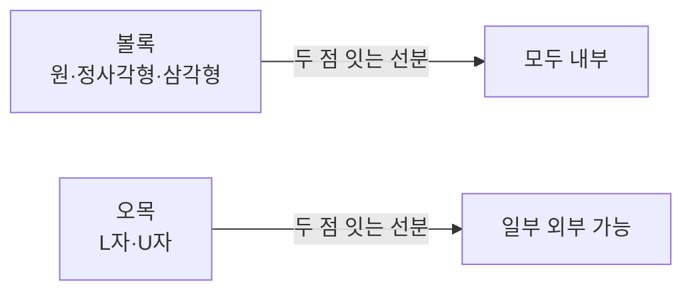
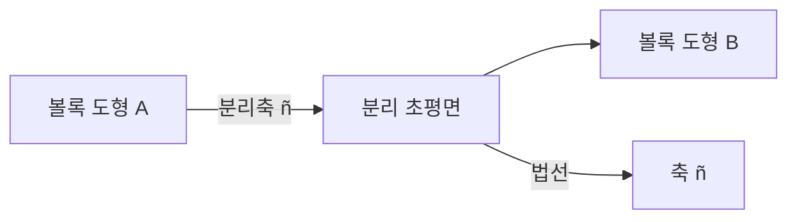
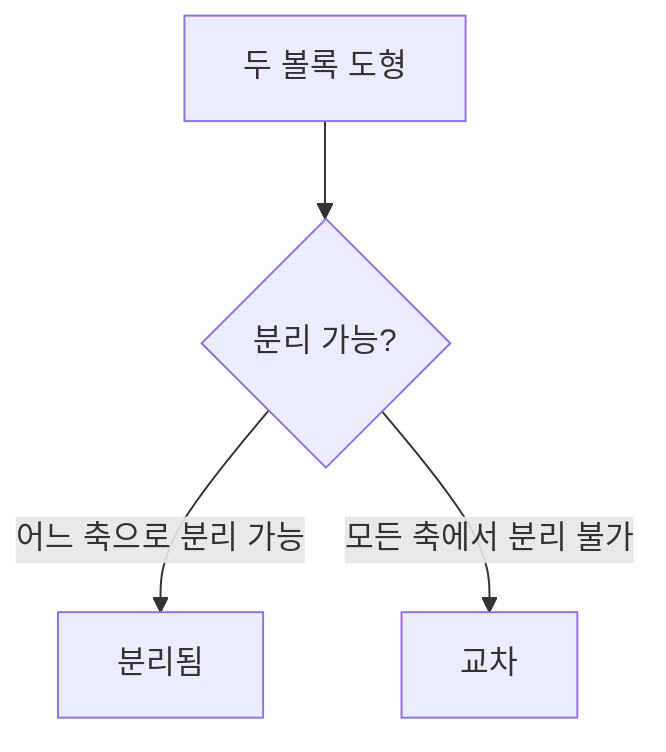
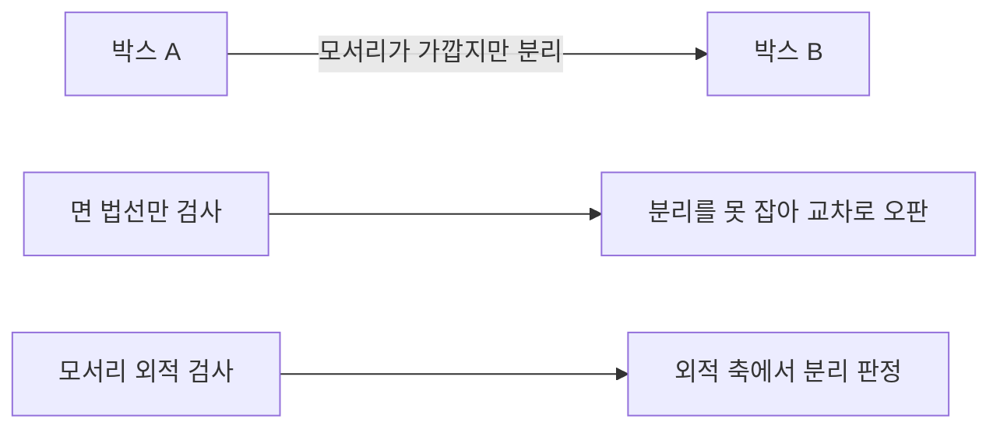
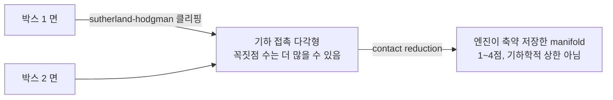
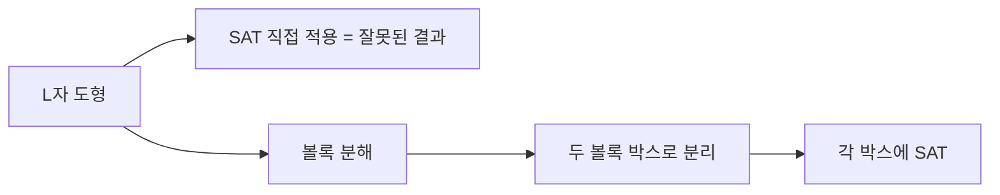
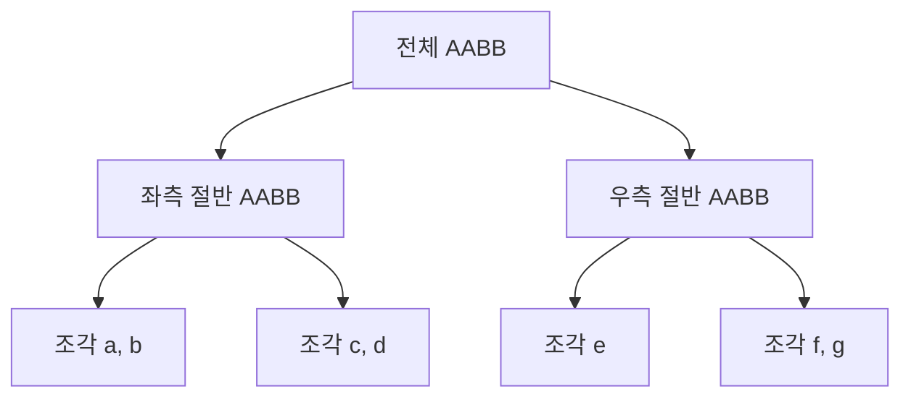

## 들어가며

분리축 이론 (Separating Axis Theorem, SAT) 은 *두 볼록 도형의 교차 여부* 를 일반적으로 판정하는 도구다. *AABB-AABB 검사* 가 가장 단순한 SAT의 사례였다 — 세 축에서 분리되지 않으면 교차. 이 글은 그 직관을 *임의 볼록 도형* 으로 일반화한다.

핵심 명제는 한 줄. *"두 볼록 도형이 분리되어 있다면, 그 사이를 가르는 분리 초평면이 반드시 존재하고, 그 법선이 분리축이 된다."* 이 명제가 다각형·다면체·회전 박스·임의 볼록 도형의 충돌을 *통일* 한다. 게임의 *narrow phase 충돌 판정* 의 표준 도구.

이 글의 목표는 다음 다섯 가지다.

1. 볼록성과 분리축 정리의 *수학적 직관* 을 만든다.
2. *축 후보 선정* — 다각형은 변의 법선, 다면체는 면 법선 + 변 외적.
3. *도형의 축 위 투영* + *구간 겹침 검사* 의 표준 패턴.
4. 2D 다각형 SAT와 3D 다면체 SAT의 구현 차이, *edge-edge 축* 의 함정.
5. *침투 깊이* 와 *MTV (Minimum Translation Vector)* 추출.

기본 도형 충돌이 *특수 케이스의 빠른 코드* 였다면, SAT는 *일반 형태의 통일된 도구* 다. *GJK* 는 SAT의 한계를 넘는 추가 일반화다.


---

## 목차
1. [볼록성과 분리축 정리](#1-볼록성과-분리축-정리)
2. [축 후보 선정](#2-축-후보-선정)
3. [도형의 축 위 투영](#3-도형의-축-위-투영)
4. [2D 다각형 SAT](#4-2d-다각형-sat)
5. [3D 다면체 SAT](#5-3d-다면체-sat)
6. [Edge-Edge 축](#6-edge-edge-축)
7. [침투 깊이와 충돌 법선](#7-침투-깊이와-충돌-법선)
8. [한계와 비볼록 처리](#8-한계와-비볼록-처리)


---

## 1. 볼록성과 분리축 정리

SAT가 동작하려면 *두 도형 모두 볼록* 이어야 한다. 이 절에서 볼록성을 정의하고, 분리축 정리의 의미를 짚는다.

### 1.1 볼록 집합 (convex set)

집합 $S$ 의 *임의 두 점 사이를 잇는 선분* 이 *모두 $S$ 안에 있으면* 볼록.

$$
\forall \vec{a}, \vec{b} \in S, \quad \forall t \in [0, 1]: \quad (1-t)\vec{a} + t\vec{b} \in S
$$



게임에서 자주 만나는 볼록 도형: 원·구·정다각형·정다면체·박스 (AABB·OBB)·캡슐·삼각형. 비볼록 (오목) 도형: L자·U자·메쉬 (별도 처리).

### 1.2 분리축 정리 (Separating Axis Theorem)

명제: *두 볼록 집합 $A, B$ 가 분리되어 있으면 ($A \cap B = \emptyset$), 그 사이에 분리 초평면 (separating hyperplane) 이 존재한다*.

3D에서 *초평면* = 평면. 2D 에서는 직선. 그 평면의 *법선 벡터* 가 *분리축*.



핵심: 두 도형이 *분리* 라면 *그 분리 평면의 법선* 으로 둘을 *수직으로 투영* 하면, *두 투영 구간이 겹치지 않는다*.

### 1.3 SAT의 유한성

분리 평면은 *연속적으로 무한히 많다*. 모두 검사하면 무한 비용. 그러나 *볼록 도형의 면 법선과 변 방향* 만 *유한 후보* 로 검사하면 충분하다는 게 SAT의 실용적 명제.

**유한 후보 정리**: 두 볼록 다각형/다면체에 대해 *분리되어 있으면, 다음 후보 중 적어도 하나가 분리축이다*.

- (2D) 두 다각형의 *변의 법선*.
- (3D) 두 다면체의 *면의 법선* 또는 *두 도형 변의 외적*.

이 정리 덕분에 SAT가 *유한 검사* 로 풀린다.

### 1.4 직관적 그림

볼록 도형 두 개를 *손으로 잡고 떨어뜨리려면 어느 방향* 으로 미는 게 가장 효과적인지 — 그게 *분리축의 직관*.



게임 코드에서는 *각 후보 축에 대해 두 도형의 투영* 을 계산하고 *겹침 여부* 를 확인.

### 1.5 SAT의 적용 범위

| 도형 쌍 | SAT 후보 수 |
|---|---|
| 2D AABB - AABB | 2축 (x, y) |
| 2D 다각형 (n각형) - (m각형) | n + m |
| 3D OBB - OBB | 15 (3+3+9) |
| 3D 다면체 (면 $f_A, f_B$, 모서리 $e_A, e_B$) | $f_A + f_B + e_A \cdot e_B$ |
| 3D 박스 - 임의 다면체 | 후보 폭증 |

$f_A, f_B$ 가 작으면 SAT가 빠르다. 하지만 *모서리 외적 후보가 $e_A \cdot e_B$* 로 폭증해 *고차 다면체에는 부담* — 이때 GJK 가 더 적합.

### 1.6 SAT가 동작하지 않는 도형

- *오목 도형*: 볼록성 가정 깨짐. 볼록 분해 (8절) 필요.
- *원·구*: 면이 무한 — 후보가 무한. 다른 도형의 *면 법선* + *중심에서 다른 도형의 closest feature 로 향하는 축* 을 추가해야 한다. 단순히 "면 법선 + 반지름 보정" 만으로 *모서리·정점이 가장 가까운 케이스* 를 놓친다. 실용적으로는 *closest point 코드* 또는 *GJK* 로 처리.
- *임의 곡면*: 일반 SAT 부적합. GJK 가 답.

## 2. 축 후보 선정

SAT의 *유한 후보 집합*. 2D와 3D가 다르다.

### 2.1 2D 다각형의 축 후보

볼록 n각형 *A* 와 m각형 *B*. 분리축 후보는 *각 도형의 변의 법선*.

```cpp
std::vector<vec2> SATAxes2D(const Polygon2D& a, const Polygon2D& b) {
    std::vector<vec2> axes;
    auto addAxes = [&](const Polygon2D& p) {
        for (int i = 0; i < p.vertices.size(); ++i) {
            int j = (i + 1) % p.vertices.size();
            vec2 edge = p.vertices[j] - p.vertices[i];
            // 2D 법선: 변 방향에 수직
            vec2 normal = vec2(-edge.y, edge.x);
            if (length_squared(normal) < 1e-12f) continue;  // 중복 정점 / 퇴화 edge
            axes.push_back(normalize(normal));
        }
    };
    addAxes(a);
    addAxes(b);
    return axes;
}
```

*n + m* 개의 후보. *축 정규화* 가 후속 비교에 필수.

### 2.2 중복 축 제거 (선택 최적화)

두 다각형이 평행한 변을 가지면 *같은 법선이 중복*. 검사 비용을 줄이려면 *중복 제거*.

```cpp
bool IsParallel(vec2 a, vec2 b, float eps = 1e-4f) {
    float cross = a.x * b.y - a.y * b.x;
    return std::fabs(cross) < eps;
}
```

다만 *제거 비용 (모든 쌍 비교)* 이 *검사 비용 절감* 보다 클 수 있다. n + m이 작으면 그냥 모두 검사.

### 2.3 3D 다면체의 축 후보

볼록 다면체 *A* (a 면) 와 *B* (b 면, ea + eb 모서리). 분리축 후보 셋.

1. *A의 면 법선* — a 개.
2. *B의 면 법선* — b 개.
3. *A의 모서리와 B의 모서리의 외적* — ea × eb 개.

OBB-OBB 의 경우 면 6 + 6, 모서리 12 + 12 개지만 *축이 평행한 모서리들이 있어 외적 후보가 9개 (3×3)* 로 줄어든다.

### 2.4 OBB-OBB 의 15축

각 OBB가 *3축 (x, y, z)* 만 가지므로:

```cpp
std::vector<vec3> OBBSATAxes(OBB a, OBB b) {
    std::vector<vec3> axes;
    // 6: A의 3축 + B의 3축
    for (int i = 0; i < 3; ++i) axes.push_back(a.axes[i]);
    for (int i = 0; i < 3; ++i) axes.push_back(b.axes[i]);
    // 9: A 축 × B 축 외적
    for (int i = 0; i < 3; ++i)
        for (int j = 0; j < 3; ++j) {
            vec3 c = cross(a.axes[i], b.axes[j]);
            if (length_squared(c) > 1e-6f) {
                axes.push_back(normalize(c));
            }
        }
    return axes;
}
```

평행 축의 외적 = 영벡터라 *생략*. 실제 후보 수는 평행 정도에 따라 12~15.

### 2.5 다면체의 후보 폭증

일반 다면체 (예: 정12면체) 는 *면 12개 + 모서리 30개* 정도. 두 정12면체 사이 SAT 후보:

- 면 법선: 12 + 12 = 24.
- 모서리 외적: 30 × 30 = 900.

*900축 검사* 는 부담. *고차 다면체에는 SAT가 부적합* — GJK 가 답.

## 3. 도형의 축 위 투영

각 후보 축에서 *두 도형의 투영 구간* 을 비교. *겹치지 않으면 분리*.

### 3.1 도형의 축 투영

도형의 *모든 정점을 축에 내적* → 최소·최대로 *구간*.

```cpp
struct Projection {
    float min, max;
};

Projection ProjectOntoAxis(const Polygon2D& p, vec2 axis) {
    float minV = dot(p.vertices[0], axis);
    float maxV = minV;
    for (int i = 1; i < p.vertices.size(); ++i) {
        float v = dot(p.vertices[i], axis);
        minV = std::min(minV, v);
        maxV = std::max(maxV, v);
    }
    return {minV, maxV};
}
```

n개 정점 → n번 내적. n각형이면 *축 한 개당 n 비용*.

### 3.2 OBB의 효율적 투영

OBB는 *모든 8 코너를 투영하지 않아도 된다*. 중심·축·extents 로 *닫힌 형태*.

$$
\text{half-extent} = |\hat{a}_x \cdot \hat{n}| e_x + |\hat{a}_y \cdot \hat{n}| e_y + |\hat{a}_z \cdot \hat{n}| e_z
$$

여기서 $\hat{n}$ 이 축, $\hat{a}_i$ 가 OBB의 i번째 축, $e_i$ 가 그 축의 절반 길이.

```cpp
float ProjectOBBHalfExtent(OBB box, vec3 axis) {
    return std::fabs(dot(box.axes[0], axis)) * box.extents.x +
           std::fabs(dot(box.axes[1], axis)) * box.extents.y +
           std::fabs(dot(box.axes[2], axis)) * box.extents.z;
}
```

3번 곱 + 2번 합. 8 코너 투영 (8번 내적) 보다 *훨씬 빠르다*.

### 3.3 구간 겹침 검사

두 구간 $[a_{\min}, a_{\max}]$ 와 $[b_{\min}, b_{\max}]$ 가 겹치는 조건.

$$
a_{\max} \ge b_{\min} \land b_{\max} \ge a_{\min}
$$

```cpp
bool Overlap(Projection a, Projection b) {
    return a.max >= b.min && b.max >= a.min;
}

// 축 방향으로 b를 a 밖으로 밀어내는 최소 거리 (containment 포함)
float OverlapAmount(Projection a, Projection b) {
    float pushPositive = a.max - b.min;  // b를 +axis로
    float pushNegative = b.max - a.min;  // b를 -axis로
    return std::min(pushPositive, pushNegative);
}
```

각 축의 겹침 양은 두 방향 분리 거리 중 작은 쪽이며, 그 축 방향으로 두 도형을 분리하는 데 필요한 이동 거리의 후보다. 가장 작은 양의 겹침을 주는 축이 최소 이동 벡터(MTV)의 방향을 정한다. 단순 교집합 길이 $\min(a_{\max}, b_{\max}) - \max(a_{\min}, b_{\min})$ 은 한 구간이 다른 구간에 완전히 포함될 때 실제 분리 거리보다 작게 나온다 — $A = [-2, 2]$, $B = [-1, 1]$ 이면 교집합 길이는 2 지만 실제로는 3 만큼 밀어야 한다.

### 3.4 SAT의 일반 알고리즘

```cpp
bool SATIntersect(const Polygon2D& a, const Polygon2D& b) {
    auto axes = SATAxes2D(a, b);
    for (auto& axis : axes) {
        Projection pa = ProjectOntoAxis(a, axis);
        Projection pb = ProjectOntoAxis(b, axis);
        if (!Overlap(pa, pb)) return false;  // 분리축 발견 — 분리됨
    }
    return true;  // 모든 축에서 겹침 — 교차
}
```

핵심 패턴: *한 축에서라도 분리되면 즉시 false* (early-out). 평균적으로 *적은 축만 검사* 하면 끝나는 게 SAT의 빠른 점.

## 4. 2D 다각형 SAT

볼록 2D 다각형 두 개의 충돌 판정. Box2D 같은 2D 물리 엔진의 표준 도구.

### 4.1 코드

3절의 일반 패턴이 그대로 2D 적용.

```cpp
struct Polygon2D {
    std::vector<vec2> vertices;  // 시계 또는 반시계 정렬
};

bool SATIntersect2D(const Polygon2D& a, const Polygon2D& b) {
    auto checkAxes = [&](const Polygon2D& src) {
        int n = int(src.vertices.size());
        for (int i = 0; i < n; ++i) {
            int j = (i + 1) % n;
            vec2 edge = src.vertices[j] - src.vertices[i];
            vec2 normal = vec2(-edge.y, edge.x);
            if (length_squared(normal) < 1e-12f) continue;  // 중복 정점 / 퇴화 edge
            vec2 axis = normalize(normal);

            Projection pa = ProjectOntoAxis(a, axis);
            Projection pb = ProjectOntoAxis(b, axis);
            if (!Overlap(pa, pb)) return false;
        }
        return true;
    };

    return checkAxes(a) && checkAxes(b);
}
```

A의 변 법선 후보 검사 + B의 변 법선 후보 검사. 한 함수에서 둘 다.

### 4.2 정점 정렬과 법선 방향

다각형의 정점을 *시계 (CW) 또는 반시계 (CCW) 일관되게* 정렬해야 *법선이 외향* 을 가리킨다. 게임 엔진의 표준은 CCW (수학 관례).

CCW 정렬에서 변 (i → i+1) 의 *외향 법선* (변을 시계방향으로 90° 회전):

$$
\vec{n}_{\text{out}} = (\text{edge}.y, -\text{edge}.x)
$$

반시계방향 90° 회전한 $(-\text{edge}.y, \text{edge}.x)$ 는 *내향 법선*. CW 정렬이면 부호 반대.

SAT 의 *교차 판정 자체* 는 축 부호와 무관 (양쪽 투영 비교는 부호 대칭). *MTV 부호* 도 4.3 절처럼 *밀어내기 방향* 에서 뽑으면 축 부호와 무관하다. 하지만 축 방향을 그대로 법선으로 쓰는 구현과 *contact manifold 의 reference face 선택* (7.5절) 은 *외향 법선 일관성* 에 의존한다.

### 4.3 침투 깊이 추출

분리축이 모두 겹쳐도 *어느 축의 겹침이 가장 작은지* 가 *최소 침투 방향*.

```cpp
struct SAT2DResult {
    bool  isColliding;
    float depth;
    vec2  normal;
};

SAT2DResult SAT2D(const Polygon2D& a, const Polygon2D& b) {
    SAT2DResult result;
    result.isColliding = false;
    result.depth  = std::numeric_limits<float>::max();

    auto check = [&](const Polygon2D& src) -> bool {
        int n = int(src.vertices.size());
        for (int i = 0; i < n; ++i) {
            int j = (i + 1) % n;
            vec2 edge = src.vertices[j] - src.vertices[i];
            vec2 normal = vec2(-edge.y, edge.x);
            if (length_squared(normal) < 1e-12f) continue;  // 중복 정점 / 퇴화 edge
            vec2 axis = normalize(normal);

            Projection pa = ProjectOntoAxis(a, axis);
            Projection pb = ProjectOntoAxis(b, axis);
            if (!Overlap(pa, pb)) return false;

            float pushPositive = pa.max - pb.min;  // b를 +axis로
            float pushNegative = pb.max - pa.min;  // b를 -axis로
            float overlap = std::min(pushPositive, pushNegative);  // = OverlapAmount(pa, pb)
            if (overlap < result.depth) {
                result.depth  = overlap;
                // 깊이를 고른 밀어내기 방향이 그대로 법선 부호 (a → b)
                result.normal = (pushPositive < pushNegative) ? axis : -axis;
            }
        }
        return true;
    };

    if (!check(a) || !check(b)) return result;
    result.isColliding = true;
    return result;
}
```

두 도형의 후보를 모두 검사. *가장 작은 겹침의 축* 이 *최소 분리 방향* — Minimum Translation Vector (MTV).

### 4.4 정확한 충돌 노멀 방향

법선의 *부호* 가 *어느 도형이 어느 도형을 미는지* 결정. 보통 *법선이 a → b 방향* 을 가리키도록 통일. 4.3 의 코드는 이 규약을 이미 만족한다 — *깊이를 고른 밀어내기 방향* 이 곧 b 를 밀어낼 방향이기 때문이다.

축별 부호를 추적하지 않은 구현은 *무게중심 비교* 로 사후 보정하기도 한다.

```cpp
// a의 중심 → b의 중심 방향 확인 후 부호 보정
vec2 centerDelta = Centroid(b) - Centroid(a);
if (dot(result.normal, centerDelta) < 0) {
    result.normal = -result.normal;
}
```

이 보정은 *근사* 다. 축별 부호는 두 *투영 구간 중점* 의 순서로 정해지는데 ($\text{push}^+ < \text{push}^-$ 는 a 의 구간 중점이 b 의 구간 중점보다 작다는 뜻), 무게중심 비교는 *무게중심을 투영한 값* 의 순서로 정한다. 원·박스처럼 *중심 대칭* 인 도형은 두 기준이 일치하지만 *비대칭 볼록 다각형* 에서는 갈린다. $A$ = 삼각형 $(-1,-1), (0,-1), (0,2)$ 와 $B$ = 삼각형 $(-3,1), (0,-1), (3,1)$ 에서 최소 축은 $y$ 축이고 $\text{push}^+ = 3$, $\text{push}^- = 2$ 라 b 를 $-y$ 로 2 만큼 밀어야 한다. 그런데 무게중심은 $c_A = (-1/3,\, 0)$, $c_B = (0,\, 1/3)$ 이라 위 보정이 $+y$ 를 고르고, 그 방향으로 2 만큼 밀면 겹침이 $y \in [1, 2]$ 로 남는다. 정사각형처럼 중심 대칭인 도형만 쓰는 테스트로는 드러나지 않는 결함이다.

물리 엔진은 *법선 방향이 일관* 해야 *임펄스 응답* 이 정확.

### 4.5 게임 응용

**2D 플랫포머의 캐릭터 vs 환경**: 캐릭터 = 박스 또는 다각형, 환경 = 다각형 (지형). SAT 로 충돌 + MTV 로 침투 해소.

**히트박스 시스템**: 캐릭터의 공격 범위 = 다각형, 적의 피격 박스 = 다각형. SAT 로 hit 여부 판정.

**부드러운 슬라이딩**: 침투 해소 후 *남은 속도를 법선 방향 성분 제거* (슬라이딩) → 자연스러운 벽 미끄러짐.

## 5. 3D 다면체 SAT

3D OBB-OBB 가 가장 흔한 케이스. 일반 다면체는 후보 폭증으로 GJK가 더 적합.

### 5.1 OBB-OBB 알고리즘

15축 SAT.

```cpp
struct OBBSATResult {
    bool  isColliding;
    float depth;
    vec3  normal;
};

OBBSATResult OBBOBBSAT(OBB a, OBB b) {
    OBBSATResult r;
    r.isColliding = false;
    r.depth = std::numeric_limits<float>::max();

    auto checkAxis = [&](vec3 axis) -> bool {
        if (length_squared(axis) < 1e-6f) return true;  // 평행 — 건너뜀
        axis = normalize(axis);

        // 두 OBB의 축 위 투영 길이 (3.2의 닫힌 형태)
        float halfA = ProjectOBBHalfExtent(a, axis);
        float halfB = ProjectOBBHalfExtent(b, axis);
        float dist = std::fabs(dot(b.center - a.center, axis));

        if (dist > halfA + halfB) return false;  // 분리

        float overlap = halfA + halfB - dist;
        if (overlap < r.depth) {
            r.depth  = overlap;
            r.normal = axis;
            // 부호 보정 (a → b 방향)
            if (dot(b.center - a.center, axis) < 0) r.normal = -r.normal;
        }
        return true;
    };

    // A의 3축
    for (int i = 0; i < 3; ++i)
        if (!checkAxis(a.axes[i])) return r;
    // B의 3축
    for (int i = 0; i < 3; ++i)
        if (!checkAxis(b.axes[i])) return r;
    // 외적 9축
    for (int i = 0; i < 3; ++i)
        for (int j = 0; j < 3; ++j)
            if (!checkAxis(cross(a.axes[i], b.axes[j]))) return r;

    r.isColliding = true;
    return r;
}
```

15축 검사. early-out 으로 *분리되면 즉시 false*.

### 5.2 일반 다면체의 SAT

각 다면체가 면 a개 + 모서리 ea개. 후보:

- 면 법선: a + b.
- 모서리 외적: ea × eb.

후보 수가 많아 *각 축마다 도형의 모든 정점 투영* 이 비용. *볼록 hull 표현* + *지원 함수* 로 더 효율적 처리 가능 — GJK의 토대.

### 5.3 OBB의 정확한 침투 추출

7절의 *MTV* 가 OBB 물리 응답의 핵심. 가장 작은 겹침의 축으로 *분리 방향* 결정.

```cpp
void ResolveOBBOBB(OBB& a, OBB& b, OBBSATResult sat) {
    if (!sat.isColliding) return;
    // a를 절반 미는 패턴 (질량 같다고 가정)
    a.center -= sat.normal * (sat.depth * 0.5f);
    b.center += sat.normal * (sat.depth * 0.5f);
}
```

질량 차이가 있으면 *더 가벼운 쪽이 더 많이 미는* 비율로 분배.

## 6. Edge-Edge 축

3D SAT의 *가장 함정 많은 부분*. 면 법선만으로는 변-변 방향에서만 나타나는 *분리축을 놓칠 수 있다*. 그러면 실제로 떨어진 도형을 교차한다고 판정하는 false positive가 생긴다.

### 6.1 변-변 분리의 시나리오

서로 기울어진 두 박스의 모서리가 아주 가깝게 스쳐 지나가지만 실제로는 떨어진 케이스를 생각하자. 각 박스의 면 법선으로 투영하면 모두 겹쳐 보일 수 있지만, 두 모서리 방향의 외적에서는 투영 구간이 분리된다.



*면 법선만 검사* 하면 모든 축에서 겹쳐 보이므로 *거짓 교차*가 나온다. *변-변 외적이 분리축* 이 되어야 정확히 떨어졌다고 판정한다.

### 6.2 외적 축의 의미

두 변 $\vec{e}_a, \vec{e}_b$ 의 외적 $\vec{e}_a \times \vec{e}_b$ 가 *두 변에 모두 수직인 방향*. 이 방향으로 두 도형을 투영하면 *변-변 분리 시점에 둘이 분리* 되어 보인다.

$\vec{e}_a$ 와 $\vec{e}_b$ 가 *평행* 이면 외적 = 영벡터 → 의미 없는 축. *평행 변은 건너뛰기*.

### 6.3 후보 수의 폭증

OBB-OBB 는 변 후보가 적다 (3축씩) — 외적 9개. 일반 다면체는 변이 많아 외적이 *수백·수천*.

```cpp
// 일반 다면체의 모든 변-변 외적
std::vector<vec3> EdgeEdgeAxes(const Polyhedron& a, const Polyhedron& b) {
    std::vector<vec3> axes;
    for (auto& ea : a.edges) {
        vec3 dirA = normalize(ea.end - ea.start);   // 방향만 사용 — 길이 제거
        for (auto& eb : b.edges) {
            vec3 dirB = normalize(eb.end - eb.start);
            vec3 c = cross(dirA, dirB);             // |c| = sin(각)
            // 절대 길이가 아니라 *각도* 기준. 모델을 축소해도 후보가 사라지지 않는다.
            if (length_squared(c) > 1e-6f) {
                axes.push_back(normalize(c));
            }
        }
    }
    return axes;
}
```

n × m 외적. *고차 다면체에 부적합*. 정규화한 변 방향끼리의 외적이라 임계값이 *각도* 를 뜻하므로 물체 크기와 무관하다. 평행에 가까운 변 쌍의 축을 생략하는 것은 *보수적* 근사로, 그 경우 실제로는 분리인 배치를 교차로 볼 수 있으므로 임계값과 근사 정책을 명시한다.

### 6.4 Gauss Map 기반 최적화

GDC 2013 Dirk Gregorius 발표 ("The Separating Axis Test between Convex Polyhedra") 의 *Gauss Map* 기법. *변 둘이 실제로 인접한 면을 분리할 가능성이 있는 경우만* 검사.

수학적으로 *Minkowski difference 의 면이 두 도형의 변-변 쌍과 대응* 함을 활용. 검사할 변 쌍을 $O(n^2)$ → 실용적으로 *훨씬 적게* 만든다.

게임 엔진 (Bullet, PhysX) 의 SAT 구현이 이 기법을 채택. 직접 구현은 복잡 — 라이브러리에 위임.

### 6.5 Edge-Edge 의 전형적 함정

OBB-OBB 외에도 *임의 다면체*에서 변-변 검사를 빠뜨리면 *떨어진 두 도형이 교차해 보이는* 버그가 생긴다. 검사 축의 부분집합에서 분리를 발견했다면 그 결론은 항상 참이지만, 분리를 발견하지 못했다고 교차가 보장되지는 않는다.

검증 패턴: 두 박스를 서로 기울여 모서리끼리 스쳐 지나가게 놓고, *변-변 외적 축에서만 아주 작게 분리되는 배치*를 만든다. 완전한 15축 SAT는 분리를 반환하고, 면 법선 6축만 검사한 구현은 교차를 반환해야 이 누락을 재현한다.

## 7. 침투 깊이와 충돌 법선

SAT 가 *교차 여부* 만 알려주면 부족. *어떻게 분리할지* 의 정보 — *침투 깊이 + 분리 방향* — 가 물리 응답의 입력.

### 7.1 MTV (Minimum Translation Vector)

*가장 작게 겹친 축* 이 *최소 분리 방향*. 그 축으로 *겹친 양만큼* 도형을 밀면 *최소 거리로 분리*.

$$
\text{MTV} = \text{normal} \cdot \text{depth}
$$

여기서 `depth` 가 *모든 후보 축 중 가장 작은 겹침 양*, `normal` 이 *그 축의 단위 벡터*.

### 7.2 코드

3절의 *겹침 양* 계산을 SAT 루프 안에서 *최소값 추적*.

```cpp
struct SATResult {
    bool  isColliding;
    float depth;
    vec3  normal;
};

// 중심 대칭 투영 (OBB 등) 전용. 일반 폴리토프는 구간 끝점 기준 push 를
// 쓴다 (4.3절). centerDelta 부호 비교는 중심 대칭일 때만 구간 끝점과 일치.
void TrackMinOverlap(SATResult& r, vec3 axis,
                       float halfA, float halfB,
                       vec3 centerDelta) {
    float dist = std::fabs(dot(centerDelta, axis));
    float overlap = halfA + halfB - dist;
    if (overlap < r.depth) {
        r.depth  = overlap;
        r.normal = axis;
        // 부호 보정 (a → b 방향)
        if (dot(centerDelta, axis) < 0) r.normal = -r.normal;
    }
}
```

각 축에서 *겹침 양 계산 + 최소값 갱신*. 모든 축 검사 후 결과는 *MTV*.

### 7.3 MTV 의 부호와 push 방향

법선의 *부호* 가 *a 가 어느 방향으로 밀려야 하는지* 결정. 아래 centerDelta 기반 보정은 구간이 중심에 대해 *대칭* 인 투영 (OBB·원 등) 에서만 4.3절의 *구간 끝점 기준 push* 와 일치한다. 비대칭 볼록 다각형은 4.4절 반례처럼 중심 비교가 반대로 나올 수 있으므로, 일반 폴리토프는 4.3절 코드처럼 *구간 끝점의 push 방향* 을 직접 쓴다. 두 가지 부호 처리 패턴이 있다.

**A. a → b 방향으로 통일**:

```cpp
if (dot(centerDelta, axis) < 0) normal = -normal;
```

물리 응답에서 *a 는 -normal 방향, b 는 +normal 방향*.

**B. 항상 양수 dot (`fabs` 처리)**:

매 축의 부호를 따로 다루지 않고 *push 시점에 결정*. 코드가 간결하지만 디버깅 어려움.

### 7.4 침투 해소

```cpp
// splitA 는 a 가 떠맡는 몫 (0~1). 나머지 1 - splitA 를 b 가 맡아 두 이동량의 합이 정확히 depth.
void ResolvePenetration(vec3& posA, vec3& posB, SATResult sat, float splitA) {
    if (!sat.isColliding) return;
    posA -= sat.normal * (sat.depth * splitA);
    posB += sat.normal * (sat.depth * (1.0f - splitA));
}
```

기하가 정하는 것은 *분리 방향 (normal) 과 총 이동량 (depth)* 까지다. 두 도형이 그 depth 를 어떻게 나눠 갖는지 — 한쪽만 밀지, 반씩 밀지, 질량에 따라 밀지 — 는 질량과 motion type 을 아는 동역학 모델의 몫이다.

### 7.5 Contact Manifold

*한 충돌이 한 점에서만 일어나지 않는다*. 두 박스가 *면 vs 면* 으로 부딪히면 *접촉 영역이 다각형*. 이 영역을 *Contact Manifold* 라 한다.



물리 엔진은 *접촉 다각형* 에서 *contact 를 추리거나 줄여 (contact reduction)* 제한된 개수 (흔히 1~4개) 만 저장한다. 이 개수는 *기하학적 상한이 아니라 엔진의 선택 정책 (reduction/cache 용량)* 이다 — 클리핑 다각형의 꼭짓점 수는 그보다 많을 수 있다. 각 contact 에 임펄스를 적용해 *안정적 접촉 응답* 을 만든다.

이 추출 알고리즘 (Sutherland-Hodgman 클리핑 등) 은 SAT 다음 단계. Box2D / Bullet 의 *manifold 생성 코드* 가 산업 표준.

## 8. 한계와 비볼록 처리

SAT 는 *볼록 도형 전제*. 게임의 일부 형상은 비볼록이라 *별도 처리* 가 필요.

### 8.1 비볼록 도형의 함정

L자, U자, 문자 모양, 메쉬 — 이런 도형에 SAT를 직접 적용하면 오목한 빈 공간을 볼록 hull의 내부처럼 취급한다. 그 결과 *외부에 있는 점을 내부로*, 또는 실제로 분리된 도형을 교차한다고 잘못 판정할 수 있다.



### 8.2 볼록 분해 (Convex Decomposition)

비볼록 도형을 *여러 볼록 조각으로 쪼갠다*. 각 조각이 *완전 볼록* 이라 SAT 가능. 분해는 일반적으로 *근사* 다 — 볼록 hull 이 오목한 빈 공간을 메워 원본보다 커질 수 있다.

| 알고리즘 | 특성 |
|---|---|
| HACD (Hierarchical Approximate Convex Decomposition) | 메쉬 → 근사 볼록 조각, 오프라인 임포트 파이프라인용 |
| V-HACD | HACD 개선판. *근사* 볼록 분해이며 엔진·버전별 통합 범위는 제품 문서로 확인 |
| Triangulation | 가장 단순, 조각 많음 |
| Hand-authored | 디자이너가 직접 박스 배치 |

Unity/Unreal 등 여러 엔진이 임포트 파이프라인에서 *볼록 분해 도구* 를 제공하거나 외부 도구를 받아들이지만, 어떤 알고리즘을 기본으로 쓰는지·자동인지 수동인지는 엔진·버전·플러그인에 따라 다르다. 분해 결과는 *근사* 라서 오목한 빈 공간을 메우는 오차가 생기고, 조각 수·hull 정확도·성능이 트레이드오프다.

### 8.3 분해 후 충돌 검사

```cpp
struct ConvexPart {
    OBB  shape;  // 또는 다른 볼록 형태
};

struct ConcaveBody {
    std::vector<ConvexPart> parts;
};

bool ConcaveSAT(const ConcaveBody& a, const ConcaveBody& b) {
    for (auto& pa : a.parts) {
        for (auto& pb : b.parts) {
            if (OBBOBBSAT(pa.shape, pb.shape).isColliding) return true;
        }
    }
    return false;
}
```

모든 부분 쌍 검사. broad phase (BVH 등) 으로 *후보 쌍을 줄여* 비용 절감.

### 8.4 Bounding Volume Hierarchy (BVH)

수많은 볼록 조각을 *계층적 트리* 로 묶어 *영역 단위로 빠른 컬링*.



쿼리 시 *AABB 단계에서 빠르게 가지를 친다*. BVH는 여러 AABB를 계층화해 대부분의 도형을 정밀 검사 전에 배제하는 구조다.

### 8.5 GJK 로의 다리

SAT 의 한계.

- 후보 폭증 (고차 다면체).
- 변-변 검사의 복잡성.
- 곡면 (구·캡슐 외) 부적합.

이 한계들을 해결하는 알고리즘이 *GJK (Gilbert-Johnson-Keerthi)* 다.

GJK 의 핵심 아이디어: *Minkowski 차이* 를 명시적으로 만들지 않고 *지원 함수 (support function) 만으로* 두 도형의 차이의 가장 가까운 점을 찾는다. *임의 볼록 도형* (다각형, 다면체, 구, 캡슐, 메쉬의 볼록 hull) 모두 같은 알고리즘으로 처리.


---

## 결론

SAT 는 *볼록 도형 충돌 판정의 일반 도구*. AABB-AABB가 가장 단순한 형태였고, 이 글은 *임의 볼록 다각형·다면체* 로 일반화했다. 축 후보를 정확히 모으고 투영을 비교하면 *어떤 볼록 도형 쌍의 교차도 결정* 된다.

이 글에서 정리한 핵심.

1. **분리축 정리** — 두 볼록 도형이 분리되면 반드시 분리축이 존재. *유한 후보* (면 법선 + 모서리 외적) 만 검사하면 충분.
2. **2D 다각형 SAT** — n + m 축. 변 법선만 후보. Box2D 의 표준.
3. **3D OBB SAT** — 15축 (3 + 3 + 9). 면 법선 6 + 모서리 외적 9.
4. **Edge-Edge 함정** — 면 법선만 검사하면 모서리 방향의 분리축을 놓쳐 거짓 충돌이 생긴다. 외적 축이 필수다.
5. **MTV (Minimum Translation Vector)** — 가장 작은 겹침의 축이 최소 분리 방향. 물리 응답의 입력.

SAT 의 *후보 폭증* 과 *곡면 부적합* 이 한계다. *GJK + EPA* 는 그 한계를 넘는 일반 도구다. 임의 볼록 도형 간 *Minkowski 차이* 의 원점 포함 여부를 *지원 함수만으로* 판정한다.

## 더 읽을거리

- Christer Ericson, *Real-Time Collision Detection*, Ch. 4-5 — SAT의 종합 레퍼런스.
- Dirk Gregorius, "The Separating Axis Test between Convex Polyhedra" (GDC 2013) — Gauss Map 기반 SAT 최적화.
- David Eberly, *Game Physics* — 충돌·물리 알고리즘의 종합.
- Erin Catto (Box2D 저자) GDC talks — 2D 물리 엔진의 SAT 활용.
- Box2D v2.4 소스 (`box2d/src/collision/`; v3 은 `src/` 평면 구조) — 산업 표준 2D 충돌.
- Bullet Physics (`bullet3/src/BulletCollision/NarrowPhaseCollision/`) — 3D SAT 구현.
- Real-Time Rendering, 4th ed., Ch. 22 — 그래픽스 관점의 충돌·교차.
- V-HACD (Khaled Mamou, `kmammou/v-hacd`) — 볼록 분해의 산업 표준 라이브러리.
