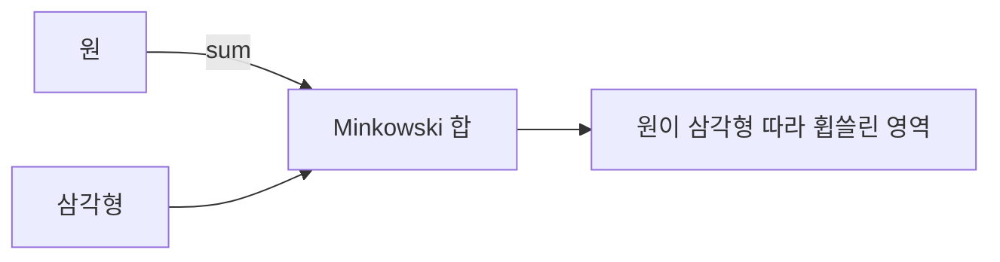
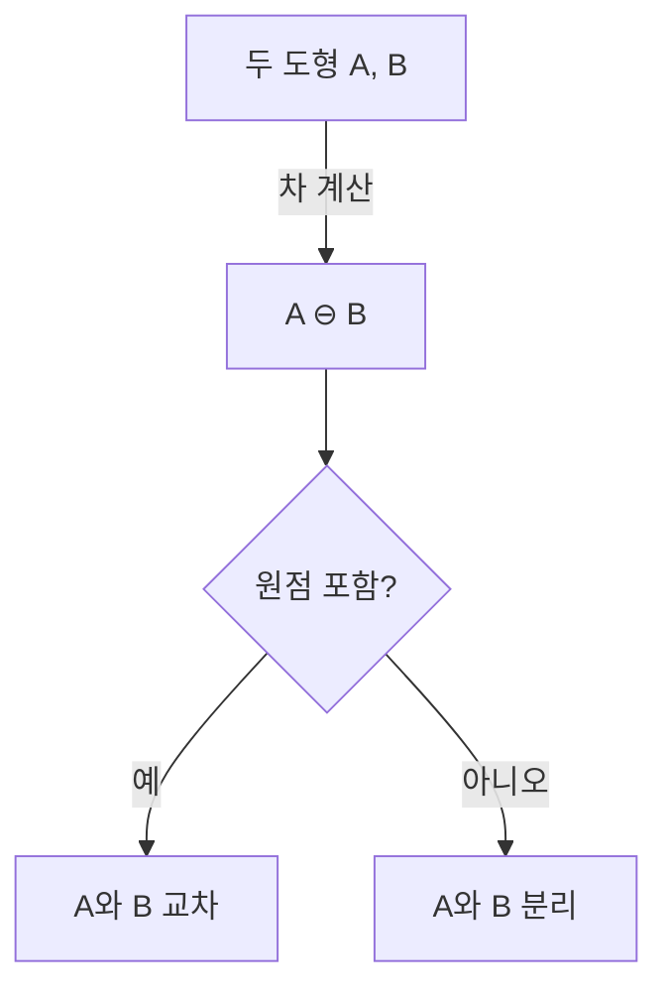
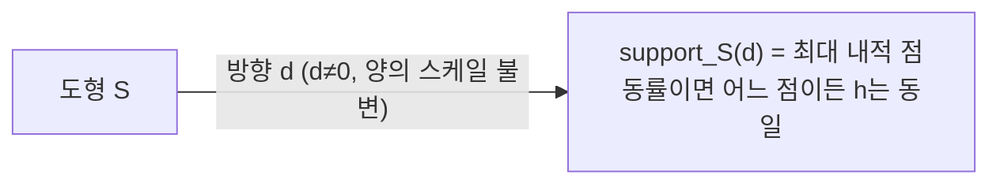
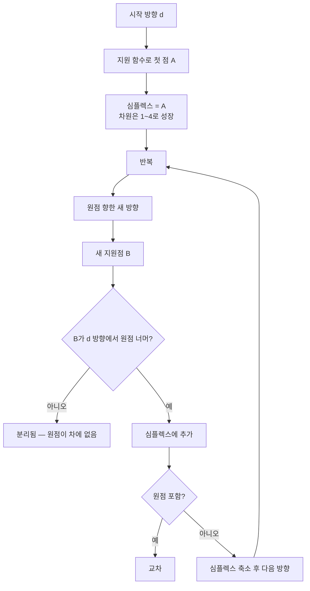
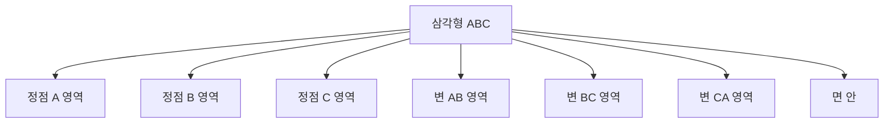
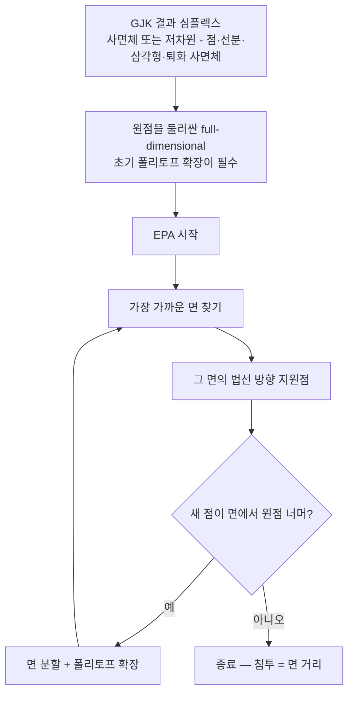

## 들어가며

SAT 는 *볼록 도형의 모든 정점·면·모서리* 를 다 알고 있어야 동작한다. 다면체의 면이 많으면 *후보 폭증*, 곡면 도형 (구·캡슐) 은 *부적합*. *임의의 볼록 도형* 을 *통일된 알고리즘* 으로 처리하려면 *다른 추상* 이 필요하다.

GJK (Gilbert-Johnson-Keerthi) 알고리즘이 그 답이다. 1988년 발표된 이 알고리즘의 통찰: *도형의 내부 구조를 몰라도, 지원 함수 (support function) 만 있으면 두 볼록 도형의 거리·교차를 풀 수 있다*. 지원 함수는 *주어진 방향에서 가장 먼 점* 을 반환하는 단일 함수. Sphere·Box·Convex hull·캡슐·임의 볼록 mesh — 모두 지원 함수만 정의하면 같은 GJK 코드가 동작.

GJK 가 *교차 여부와 거리* 만 답한다면, 침투 깊이는 *EPA (Expanding Polytope Algorithm)* 가 이어 받는다. GJK 결과 사면체에서 시작해 *Minkowski 차의 경계* 를 확장하며 *원점에서 가장 가까운 면* 을 찾으면, 그 면의 *법선과 거리* 가 *침투 법선과 깊이*.

이 글의 목표는 다음 다섯 가지다.

1. *Minkowski 합·차* 의 개념과 *교차 ⇔ 차의 원점 포함* 핵심 동등성.
2. *지원 함수* 가 도형 표현을 *추상화* 하는 메커니즘.
3. GJK 의 *심플렉스 진화* — 1D 선분 → 2D 삼각형 → 3D 사면체로 원점에 다가가는 과정.
4. *거리 GJK* 와 *교차 GJK* 의 종료 조건 차이.
5. *EPA* 의 폴리토프 확장으로 *침투 깊이 추출*.

GJK와 EPA는 볼록 도형의 지원 함수만으로 거리·충돌·침투를 푼다. 이는 정점과 면을 직접 순회하는 방식과 다르며, *거리 자체가 형상* 이 되는 SDF와도 구별되는 패러다임이다.


---

## 목차
1. [Minkowski 합과 차](#1-minkowski-합과-차)
2. [지원 함수](#2-지원-함수)
3. [GJK 핵심 아이디어](#3-gjk-핵심-아이디어)
4. [심플렉스 진화](#4-심플렉스-진화)
5. [거리 GJK와 종료 조건](#5-거리-gjk와-종료-조건)
6. [EPA 알고리즘](#6-epa-알고리즘)
7. [수치 안정성](#7-수치-안정성)
8. [엔진에서의 GJK 활용](#8-엔진에서의-gjk-활용)


---

## 1. Minkowski 합과 차

GJK 의 수학적 토대. 두 도형의 *교차* 를 *한 도형의 원점 포함* 으로 환원한다.

### 1.1 Minkowski 합

두 집합 $A, B$ 의 Minkowski 합:

$$
A \oplus B = \{a + b \mid a \in A, b \in B\}
$$

A의 모든 점과 B의 모든 점을 더한 모든 결과의 집합. 기하학적으로 *B를 A의 모든 점에 평행이동시킨 합집합* — *A를 따라 B를 끌고 다닌* 모양.



게임에서 *오프셋된 형상* 또는 *Configuration Space* 에 등장.

### 1.2 Minkowski 차

핵심 도구.

$$
A \ominus B = \{a - b \mid a \in A, b \in B\}
$$

또는 *$A \oplus (-B)$* — A에 *-B (B를 원점 둘레 점대칭한 것)* 를 합한 것.

### 1.3 교차 ⇔ 차의 원점 포함

GJK 의 핵심 동등성:

$$
A \cap B \ne \emptyset \iff \vec{0} \in A \ominus B
$$

증명. *A와 B가 점 $\vec{p}$ 에서 교차* ⇔ $\vec{p} \in A$ 이고 $\vec{p} \in B$ ⇔ $\vec{p} - \vec{p} = \vec{0} \in A \ominus B$.



이 동등성이 *충돌 판정 → Minkowski 차의 원점 포함 판정* 으로 환원되는 핵심.

### 1.4 거리 동등성

교차 안 할 때 *A와 B 사이 최단 거리* 도 Minkowski 차로 환원.

$$
\text{dist}(A, B) = \text{dist}(\vec{0}, A \ominus B)
$$

원점에서 $A \ominus B$ 까지 *가장 가까운 점의 거리* 가 두 도형 사이 거리. 거리 GJK 의 토대.

### 1.5 Minkowski 차의 시각화

볼록 도형 *A, B* 의 Minkowski 차도 *볼록 도형*. A의 모든 점에서 B의 모든 점을 뺀 *모든 점의 집합*.

게임에서 *Minkowski 차를 명시적으로 생성* 하지 않는다. 두 도형의 지원 함수를 조합하면 임의 방향에서 Minkowski 차의 극점을 바로 얻을 수 있어 필요한 부분만 *암묵적으로* 탐색한다.

## 2. 지원 함수

GJK의 *유일한 도형 인터페이스*. 도형 표현이 무엇이든 이 함수 하나만 있으면 GJK 동작.

### 2.1 정의

수학에서 도형 $S$ 의 *지원 함수 (support function)* 는 방향별 최대 내적 *스칼라* 다.

$$
h_S(\vec{d}) = \max_{\vec{p} \in S} \vec{d} \cdot \vec{p}
$$

게임 충돌 문헌은 관용적으로 *그 최대를 이루는 점* 을 반환하는 함수를 지원 함수라 부른다. 이 글도 그 관용을 따르되, 이를 *지원 매핑 (support mapping)* 이라 구분해 적는다.

$$
\text{support}_S(\vec{d}) = \arg\max_{\vec{p} \in S} \vec{d} \cdot \vec{p}, \qquad h_S(\vec{d}) = \vec{d} \cdot \text{support}_S(\vec{d})
$$

방향 $\vec{d}$ 가 주어졌을 때, *$\vec{d}$ 방향으로 가장 먼 점* 을 반환한다. 최대를 이루는 점은 *유일하지 않을 수 있다* — 면이 방향에 수직이면 그 면의 모든 점이 같은 내적을 갖는다. 어느 하나를 골라도 최대 내적 $h_S$ 는 같다.

기하학적 직관: *도형 $S$ 의 그림자를 $\vec{d}$ 방향에서 봤을 때 가장 멀리 보이는 점*.



### 2.2 도형별 지원 함수

| 도형 | 지원 함수 |
|---|---|
| Point $\vec{p}$ | $\vec{p}$ (방향 무관) |
| Sphere $(\vec{c}, r)$ | $\vec{c} + r \cdot \hat{d}$ |
| AABB $(\vec{\min}, \vec{\max})$ | 각 성분이 $d > 0$ 면 $\max$, $d < 0$ 면 $\min$ |
| OBB | 로컬 좌표계로 변환 후 AABB와 같음 |
| Convex hull (n점) | 모든 점과 $\vec{d}$ 내적 후 max |
| Capsule (선분 + r) | 선분의 끝 점 + Sphere |

```cpp
vec3 SupportSphere(Sphere s, vec3 d) {
    // d == 0 (정확히 영벡터) 만 별도 정책: support 가 유일하지 않으므로
    // 호출자가 정한 기본점(여기서는 center)을 반환한다. 0 방향은 분리 증명에 쓰지 않는다.
    // 비영 방향은 크기와 무관하게 최대 성분으로 나눈 뒤 정규화해
    // 아주 작은 d 에서도 진짜 극점을 반환한다 (양의 스케일 불변).
    float m = std::max(std::fabs(d.x), std::max(std::fabs(d.y), std::fabs(d.z)));
    if (m == 0.0f) return s.center;
    vec3 scaled = d / m;
    return s.center + s.radius * (scaled / length(scaled));
}

vec3 SupportAABB(AABB box, vec3 d) {
    return vec3(
        d.x >= 0 ? box.max.x : box.min.x,
        d.y >= 0 ? box.max.y : box.min.y,
        d.z >= 0 ? box.max.z : box.min.z
    );
}

vec3 SupportConvexHull(const std::vector<vec3>& points, vec3 d) {
    int bestIdx = 0;
    float bestDot = dot(points[0], d);
    for (int i = 1; i < points.size(); ++i) {
        float v = dot(points[i], d);
        if (v > bestDot) { bestDot = v; bestIdx = i; }
    }
    return points[bestIdx];
}
```

각 도형이 *효율적인 지원 함수* 를 갖는다. Convex hull 은 $O(n)$, 다른 형태는 $O(1)$.

### 2.3 Minkowski 차의 지원 함수

핵심 사실: *Minkowski 차의 지원 함수 = 두 도형 지원 함수의 차*.

$$
\text{support}_{A \ominus B}(\vec{d}) = \text{support}_A(\vec{d}) - \text{support}_B(-\vec{d})
$$

증명: $A \ominus B$ 의 점은 $\vec{a} - \vec{b}$ 형태. $\vec{d}$ 와 내적 최대 = $\vec{a}$ 가 $\vec{d}$ 방향 max + $\vec{b}$ 가 $-\vec{d}$ 방향 max.

```cpp
vec3 SupportMinkowskiDiff(vec3 d, auto supportA, auto supportB) {
    return supportA(d) - supportB(-d);
}
```

이게 GJK 의 *유일한* 도형 접근. Minkowski 차를 *명시적으로 만들지 않고* 필요한 점만 *지원 함수로 즉석 계산*.

### 2.4 지원 함수의 효율성

게임의 흔한 도형들이 *상수 시간 지원 함수* 를 갖는다.

- Sphere: 1번 normalize.
- AABB: 3개 비교.
- OBB: 9번 곱 + 비교.
- Capsule: 2점 비교 + Sphere.

Convex hull (n점) 만 $O(n)$. *대부분 게임 도형* 이 빠르다.

### 2.5 Minkowski 차의 *암묵적* 다루기

지원 함수가 있으니 *Minkowski 차를 명시적으로 만들 필요 없다*. GJK 가 매 반복에서 *필요한 한 점만* 지원 함수로 얻어 사용.

이 *지연 평가 (lazy evaluation)* 가 GJK 의 *메모리 효율성* 의 핵심. 다만 *저장하는 심플렉스 크기* 와 *support 검색 비용* 은 별개다. 심플렉스는 상수 개 ($O(1)$) 정점만 들고 다니지만, 2.2절의 선형 `SupportConvexHull` 은 *매 호출마다 hull 의 모든 정점 $O(n)$* 을 검사한다. 정점 수가 많으면 hill-climbing (인접 정점 따라 이동) 이나 지원 구조 (k-DOP, BVH) 로 검색을 줄인다.

## 3. GJK 핵심 아이디어

Minkowski 차의 원점 포함 여부를 *지원 함수만으로* 판정.

### 3.1 알고리즘 개요



핵심: *Minkowski 차 안의 점 (지원점) 을 점진적으로 모으며 원점에 다가간다*. 못 다가가면 *분리*, 모으는 점이 *원점을 둘러싸면* 교차.

### 3.2 첫 지원점

임의 방향 $\vec{d}_0$ 으로 첫 지원점.

```cpp
vec3 d = vec3(1, 0, 0);  // 임의 시작 방향
vec3 a = SupportMinkowskiDiff(d, supA, supB);
```

이후 방향이 *원점 - a 방향* 으로 갱신 → 두 번째 지원점.

```cpp
d = -a;  // 원점을 향함
vec3 b = SupportMinkowskiDiff(d, supA, supB);
```

이때 *$b$ 가 d 방향에서 원점 너머에 있지 않으면* — 즉 $\vec{d} \cdot b < 0$ — *Minkowski 차가 원점을 포함 못 함* — 분리. 즉시 종료.

*접촉 (touching) 정책*. $\vec{d} \cdot b = 0$ 은 *원점이 그 방향의 support plane 위* 에 있다는 뜻일 뿐, *원점이 형상에 포함된다는 뜻은 아니다* — 예를 들어 $x=0$ 평면에 놓였지만 $y$ 가 떨어진 선분이 있다. 실제 접촉은 *심플렉스의 최근접점/원점 포함* 으로 확정해야 한다. $\vec{d} \cdot b < 0$ 이면 그 방향으로 원점에 닿지 못하므로 *분리가 증명* 되고, $\ge 0$ (특히 `= 0`) 은 *분리 증명의 실패* 일 뿐이다. 트리거 overlap 처럼 *touch 를 collision 으로 보려면* `< 0` 으로, *침투만 collision 으로 보려면* `<= 0` 또는 `< epsilon` 정책. 이 글의 코드는 *touch = collision (< 0 으로 분리 판정)* 정책.

### 3.3 심플렉스의 의미

GJK 가 진행되며 *1점 → 2점 (선분) → 3점 (삼각형) → 4점 (사면체)* 의 *심플렉스* 를 만든다. 심플렉스는 *원점을 둘러쌀 후보* — *Minkowski 차 안의 점들의 부분집합*.

매 반복에서:

1. 현재 심플렉스에서 *원점에 가장 가까운 부분 심플렉스* 를 식별.
2. 그 부분 심플렉스에 *대응하는 새 방향* 으로 *지원 함수* 호출.
3. 새 지원점을 추가해 심플렉스를 한 차원 키운다.
4. 사면체가 되어 *원점이 그 안에 있으면* 교차 종료.

### 3.4 종료 조건 둘

- **분리**: 새 지원점이 *원점을 향한 방향에서 진전 못 함*. $\vec{d} \cdot \text{newSupport} < 0$ → Minkowski 차가 그 방향으로 원점에 못 닿음. 분리.
- **교차**: 사면체가 *원점을 안에 가짐*. 어느 면을 봐도 원점이 *반대 쪽*. 교차.

이 둘 사이의 *진동* 을 막는 게 4·5절의 심플렉스 진화 + 종료 조건.

## 4. 심플렉스 진화

심플렉스의 *각 차원에서 원점 분류 후 다음 방향 결정*. GJK 의 핵심 메커니즘.

### 4.1 1D — 선분 심플렉스

심플렉스 $\{A, B\}$. *A 가 가장 최근 추가된 점*, B가 이전 점.

원점이 어느 영역?


`A 방향 단순화` 패턴. AB 변 안에 원점이 있는 경우만 의미.

```cpp
struct Simplex {
    std::vector<vec3> points;
};

bool DoLine(Simplex& s, vec3& d) {
    vec3 a = s.points[1];   // 최근
    vec3 b = s.points[0];   // 이전
    vec3 ab = b - a;
    vec3 ao = -a;            // a → 원점

    if (dot(ab, ao) > 0) {
        // 원점이 AB 변 안 — 다음 방향: AB에 수직, AO 향함
        vec3 perp = cross(cross(ab, ao), ab);
        // 퇴화: ab 와 ao 가 거의 평행하면 perp ≈ 0 → 임의 수직축 fallback
        if (length_squared(perp) < 1e-12f) {
            d = std::fabs(normalize(ab).x) < 0.7f ? vec3(1, 0, 0) : vec3(0, 1, 0);
            d = normalize(cross(ab, d));
        } else {
            d = perp;
        }
    } else {
        // 원점이 A 너머 — B 버림, A만 유지
        s.points = {a};
        d = ao;
    }
    return false;  // 이 단계는 '원점 포함' 만 보고한다. 선분이 원점을 품을 수도 있지만
                   // 그 접촉/침투 판정과 저차 EPA seed 확장은 6.1–6.2절에서 다룬다.
}
```

선분 진화의 두 케이스. 새 방향 $\vec{d}$ 를 갱신 후 다음 지원점. *ab 와 ao 가 평행* (원점이 선분의 연장선 위) 이면 `cross(cross(ab, ao), ab)` 가 영벡터 — 임의 수직축으로 fallback. 선분이 원점을 내부에 포함하는 접촉도 가능하다 — 이 함수가 `false` 를 반환하는 것은 *원점 미포함* 이 아니라 *이 단계에서 포함을 확정하지 않음* 을 뜻한다.

### 4.2 2D — 삼각형 심플렉스

심플렉스 $\{A, B, C\}$. 원점이 어느 영역? 7개 Voronoi 영역 (정점 3, 변 3, 면 1).

```cpp
bool DoTriangle(Simplex& s, vec3& d) {
    vec3 a = s.points[2];
    vec3 b = s.points[1];
    vec3 c = s.points[0];
    vec3 ab = b - a;
    vec3 ac = c - a;
    vec3 ao = -a;

    vec3 abc = cross(ab, ac);  // 삼각형 법선

    // 원점이 AC 변 너머에 있나?
    if (dot(cross(abc, ac), ao) > 0) {
        if (dot(ac, ao) > 0) {
            s.points = {c, a};       // AC 변
            d = cross(cross(ac, ao), ac);
        } else {
            s.points = {b, a};
            return DoLine(s, d);     // AB 변 검사로 위임
        }
    } else if (dot(cross(ab, abc), ao) > 0) {
        s.points = {b, a};
        return DoLine(s, d);
    } else {
        // 면 안 — 위 또는 아래 결정
        if (dot(abc, ao) > 0) {
            d = abc;                  // 위
        } else {
            s.points = {b, c, a};     // 순서 뒤집어 아래
            d = -abc;
        }
    }
    return false;
}
```

복잡한 분기. *Voronoi 영역 분류* 의 표준 패턴.

### 4.3 3D — 사면체 심플렉스

심플렉스 $\{A, B, C, D\}$. 원점이 *사면체 내부* 면 교차 종료.

```cpp
bool DoTetrahedron(Simplex& s, vec3& d) {
    vec3 a = s.points[3];   // 최근
    vec3 b = s.points[2];
    vec3 c = s.points[1];
    vec3 dpt = s.points[0];
    vec3 ab = b - a;
    vec3 ac = c - a;
    vec3 ad = dpt - a;
    vec3 ao = -a;

    vec3 abc = cross(ab, ac);
    vec3 acd = cross(ac, ad);
    vec3 adb = cross(ad, ab);

    if (dot(abc, ao) > 0) {
        s.points = {c, b, a};
        return DoTriangle(s, d);  // ABC 면 검사
    }
    if (dot(acd, ao) > 0) {
        s.points = {dpt, c, a};
        return DoTriangle(s, d);
    }
    if (dot(adb, ao) > 0) {
        s.points = {b, dpt, a};
        return DoTriangle(s, d);
    }
    // 모든 면이 원점을 안 향함 → 사면체 내부에 원점!
    return true;
}
```

A 를 포함한 3개 면 (ABC·ACD·ADB) 의 *법선이 원점에서 멀어지는 방향* 인지 검사 — BCD 면은 A 가 직전 방향 d 로 원점 너머에서 뽑힌 지원점이라 원점이 그 면의 A 쪽에 있음이 보장되어 생략한다. *모든 면이 원점을 안 향하면* 원점이 사면체 안. 교차 종료.

*주의*: 위 코드는 사면체의 *winding 이 일관* (네 정점의 순서가 결정한 면 법선이 모두 외향) 이라고 가정한다. 새 지원점이 추가될 때 *D 가 ABC 평면의 어느 쪽에 있는가* 에 따라 면 법선 방향이 뒤집힐 수 있어, 산업 구현은 *추가 직후 winding 보정* 단계를 둔다 (예: `if (dot(abc, ad) > 0) swap(b, c)`). 교육용 코드에서는 생략했지만, *면 법선 방향 일관성* 은 실전 구현의 필수 항목.

### 4.4 진화의 흐름

```cpp
bool GJKIntersect(auto supA, auto supB) {
    Simplex s;
    vec3 d = vec3(1, 0, 0);
    s.points.push_back(SupportMinkowskiDiff(d, supA, supB));

    // 첫 지원점이 원점 위면 (정확히 맞닿은 배치) 원점이 support plane 위 — touch = collision.
    d = -s.points[0];
    if (length_squared(d) < 1e-12f) return true;

    for (int iter = 0; iter < 100; ++iter) {
        vec3 newPt = SupportMinkowskiDiff(d, supA, supB);
        if (dot(newPt, d) < 0) return false;  // 분리

        s.points.push_back(newPt);

        bool contains = false;
        if (s.points.size() == 2) contains = DoLine(s, d);
        else if (s.points.size() == 3) contains = DoTriangle(s, d);
        else if (s.points.size() == 4) contains = DoTetrahedron(s, d);

        if (contains) return true;
    }
    return false;  // 안전 fallback — '분리 확정' 이 아니라 '판정 실패'
}
```

100회 반복 한도. 보통 5~15 회 안에 종료. *수치 함정* 으로 무한 루프 가능 — 한도가 안전망. 다만 상한 도달은 분리에 대한 아무 정보도 주지 않으므로, 산업 구현은 이 경로를 `false` 로 접지 않고 별도 상태 (`IterationLimit`) 로 보고한다 (7.1절). 첫 지원점이 *원점 위* 에 놓이면 (두 도형이 정확히 맞닿아 원점이 support plane 위에 있는 배치) 다음 방향이 영벡터가 되어 무진행 — 원점이 Minkowski 차의 경계 위이므로 접촉 정책대로 collision 으로 종료한다. 중심이 같은 대칭 도형은 오히려 첫 지원점이 원점에서 가장 먼 점이라 이 경우가 아니다.

위 코드의 분리 판정 `dot(newPt, d) < 0` 의 *접촉 정책* 은 3.2절을 따른다 — touch (`= 0`) 는 `< 0` 분리 조건에 걸리지 않으므로 *분리로 빠지지 않는다*. 따라서 이 코드는 *접촉도 collision* 으로 본다.

### 4.5 Voronoi 영역의 직관

각 심플렉스 차원에서 *원점이 어느 영역에 있는지* 가 *다음 방향* 을 결정.



각 영역 분류 → 그 영역의 *반대 방향* 으로 다음 지원점. 결국 *원점을 향한 진전*.

## 5. 거리 GJK와 종료 조건

GJK 가 *교차 안 할 때* 의 *최단 거리* 도 답한다. 다만 *종료 조건이 다를 뿐 아니라* 현재 최근접 심플렉스와 witness 를 매 반복 갱신해야 한다.

### 5.1 거리 GJK

원점이 Minkowski 차 안에 *없을 때*, 가장 가까운 점이 *심플렉스의 한 부분 심플렉스에서* 결정된다. 교차 GJK 와 달리 *종료 조건만 바뀌는 것이 아니다*. 매 반복에서 (a) 현재 심플렉스의 원점 최근접점 $\vec{v}$ 와 그 barycentric 좌표, (b) 새 지원점이 주는 거리 하한을 함께 갱신해야 한다. 임의의 탐색 방향과 단순한 Voronoi 처리만으로는 거리 상한/하한이 나오지 않는다.

```cpp
struct DistanceResult {
    float dist;
    vec3  closestOnA;
    vec3  closestOnB;
};

DistanceResult GJKDistance(auto supA, auto supB) {
    // 1. 초기 심플렉스 (예: 첫 두 support 점).
    // 2. 반복:
    //    v    = 심플렉스의 원점 최근접점, |v| = 거리 *상한*
    //    dHat = -v / |v|, newPt = support_{A⊖B}(dHat)
    //    하한 = dot(newPt, dHat)          // 원점 방향 거리 하한
    //    if (|v| - 하한 < epsilon) 종료
    //    아니면 newPt 를 넣고 *원점 최근접 부분 심플렉스* 로 축소 (barycentric reduction)
    //    새 support 점의 |newPt| 가 줄지 않아도 v 는 줄 수 있으므로
    //    |newPt| 가 아니라 *갱신된 |v|* 를 진행 지표로 본다.
    //    witness 점(closestOnA/B)은 v 의 barycentric 좌표로 복원한다 (5.4).
}
```

종료 조건이 *교차 GJK* 와 다르다.

### 5.2 종료 조건의 차이

| 모드 | 종료 |
|---|---|
| 교차 GJK | 사면체가 원점 포함 OR 새 지원점이 d 방향에서 진전 못 함 |
| 거리 GJK | 최근접점 $\vec{v}$ 와 support 하한의 간격이 epsilon 이하 |

거리 모드는 *epsilon 비교* 가 종료에 들어간다. 매 반복에서 *현재 closest point 방향 $\hat{d}$ (Minkowski 차의 closest-to-origin → 원점 방향)* 으로 새 지원점을 얻고, 갱신한 심플렉스 거리와 support 하한의 간격이 *충분히 작아지면* 수렴 종료.

```text
// 의사 코드:
//   v       = 현재 심플렉스의 closest-to-origin (벡터)
//   |v|     = 현재 추정 최단 거리
//   dHat    = -v / |v| (원점 향한 단위 방향)
//   newPt   = support_{A⊖B}(dHat)
//   진행도  = |v| + dot(newPt, dHat)        // 상한 - 하한
// 진행도 < epsilon 이면 종료, |v| 가 두 도형 사이 최단 거리.
// 아니면 newPt 를 심플렉스에 넣고 원점 최근접 부분 심플렉스로 축소 + barycentric 갱신.
```

진행도는 상한 − 하한이므로 *항상 0 이상* 이다. 원점이 Minkowski 차 *안에* 있으면 진행도가 작아지는 대신 심플렉스가 *원점을 포함* 하게 되어 $v = 0$ 이 되고, 이때 거리 0 (교차) 으로 분기해 EPA 로 넘긴다. 원점이 경계에 정확히 *닿은* touching 만이 $|v| \to 0$, $\text{dot}(\text{newPt}, \hat{d}) \to 0$ 으로 진행도가 0 에 수렴하는 경우다.

### 5.3 가까운 점 추출

심플렉스의 *부분 심플렉스* 가 가장 가까울 때, 그 부분의 *barycentric 좌표* 로 closest point 계산.

```cpp
// 선분 closest point
vec3 ClosestPointOnLineToOrigin(vec3 a, vec3 b) {
    vec3 ab = b - a;
    float denom = dot(ab, ab);
    if (denom < 1e-12f) return a;   // 퇴화 선분 (a == b) — 0/0 방지
    float t = dot(-a, ab) / denom;
    t = std::clamp(t, 0.0f, 1.0f);
    return a + t * ab;
}
```

삼각형·사면체도 같은 패턴 — *Voronoi 영역 분류 + barycentric 계산*. 선분 helper 는 Part11 `ClosestPointOnSegment` 와 같은 퇴화 계약 (a == b -> 한 점) 을 따른다.

### 5.4 두 도형의 가장 가까운 점

심플렉스의 점들이 *Minkowski 차의 점들*. 그 closest point 의 *barycentric 좌표* 로 *두 원본 도형* 의 가장 가까운 점 추적 가능.

```cpp
// 심플렉스의 closest point가 barycentric (lambda_0, lambda_1, lambda_2) 면
// A 도형의 closest = lambda_0 * supportA(d_0) + lambda_1 * supportA(d_1) + ...
```

각 심플렉스 점이 *어느 지원 함수 호출* 에서 나왔는지 기억해, 그 *원본 A 점들의 가중합* 이 closest. 같은 방식으로 B 도형 closest.

이 정보가 *broad phase 의 거리 정렬*, *카메라 자세 결정*, *AI 의 이동 목표* 에 직접 활용.

### 5.5 게임 응용

- **Sphere-Mesh 거리**: 메쉬가 임의 볼록 hull. 다른 알고리즘이 적용 어려운 경우.
- **레벨 콜라이더 충돌**: 레벨의 임의 볼록 형상 vs 캐릭터.
- **CCD (Continuous Collision Detection)**: 시간을 매개로 *가까워지다 충돌하는 시점* 찾기 — GJK 거리가 0이 되는 t.

## 6. EPA 알고리즘

GJK 가 *교차 여부* 만 답한다. *침투 깊이* 가 필요하면 EPA (Expanding Polytope Algorithm) 가 이어 받는다.

### 6.1 핵심 아이디어

GJK 의 *결과 심플렉스* 는 *원점을 포함하는 Minkowski 차 안의 부분*. 보통은 사면체지만 *점·선분·삼각형 접촉이나 퇴화 사면체* 로 끝날 수도 있다. EPA 는 원점을 둘러싼 *full-dimensional* 폴리토프가 필요하므로, 그 심플렉스를 시작 폴리토프로 확장하는 단계가 필수다 (6.2절). EPA 는 그 사면체에서 시작해 *Minkowski 차의 경계* 에 *폴리토프* 를 *확장*. 원점에서 *가장 가까운 면* 의 *법선과 거리* 가 *침투 법선과 깊이*.



GJK 와 같은 *지원 함수만으로 동작*. Minkowski 차의 경계로 *점진적 수렴*.

### 6.2 폴리토프 표현

EPA 는 *3D 다면체 (폴리토프)* 를 *면 리스트* 로 들고 다닌다.

```cpp
struct EPAFace {
    int vertexIndex[3];  // 폴리토프의 정점 인덱스
    vec3 normal;          // 외향 법선
    float distance;       // 원점까지 거리
};

struct Polytope {
    std::vector<vec3>     vertices;
    std::vector<EPAFace>  faces;
};
```

교차 GJK 가 사면체를 만들어 종료하면 *그 4 정점·4 면* 이 시작 폴리토프다. 그런데 교차 함수가 `bool` 만 반환하거나, 접촉이 *점·선분·삼각형* 저차 심플렉스에서 확정되거나, 사면체가 *퇴화(거의 평면)* 일 수 있다. EPA 는 원점을 둘러싼 *일관된 외향 폐폴리토프 (full-dimensional)* 가 필요하므로, GJK→EPA 사이에 다음 계약이 필수다.

- **심플렉스 보존**: 교차 판정 함수가 `bool` 만이 아니라 *마지막 심플렉스와 그 정점별 A/B witness* 를 함께 넘긴다.
- **full-dimensional 초기화**: 원점을 포함하되 부피가 0이 아닌 폴리토프로 확장한다. 저차 심플렉스 (점·선분·삼각형) 는 그 *차원 방향으로 support 점을 추가* 해 한 차원씩 키운다. Bullet 의 `EncloseOrigin()` 이 이 역할로, simplex 차원에 따라 축/수직 방향으로 지원점을 더해 원점을 감싼다.
- **touch 처리**: 원점이 경계에 정확히 닿은 접촉은 침투 깊이 0 으로 반환하고, 폴리토프 확장이 불가능하면 실패가 아니라 *zero-depth 접촉* 으로 처리한다.
- **중복·퇴화면 제거**: 같은 support 점의 재등장, 면적 0 에 가까운 면, 일관성 없는 winding 을 제거하고, 그래도 full-dimensional 폴리토프를 못 만들면 *명시적 실패 상태* (별도 enum) 로 보고한다 (`bool` 로 뭉개지 않는다).

### 6.3 면 확장

매 반복:

1. *원점에 가장 가까운 면 (distance 최소)* 선택.
2. 그 면의 *법선 방향* 으로 *지원 함수 호출* — Minkowski 차 안의 새 점.
3. 새 점이 *면보다 원점 더 멀리 있는가* 검사.
 - *예*: 폴리토프에 새 점 추가, 그 점이 보이는 *기존 면들 제거*, *새 면들 추가*.
 - *아니오*: 종료. 그 면이 *Minkowski 차 경계의 가장 가까운 면*.

```cpp
struct EPAResult {
    vec3 normal;
    float depth;
};

EPAResult EPA(Polytope& poly, auto supA, auto supB) {
    for (int iter = 0; iter < 100; ++iter) {
        // 1. 가장 가까운 면 찾기
        int closestIdx = 0;
        float minDist = poly.faces[0].distance;
        for (int i = 1; i < poly.faces.size(); ++i) {
            if (poly.faces[i].distance < minDist) {
                minDist = poly.faces[i].distance;
                closestIdx = i;
            }
        }

        EPAFace face = poly.faces[closestIdx];
        vec3 newPt = SupportMinkowskiDiff(face.normal, supA, supB);
        float newDist = dot(face.normal, newPt);

        if (newDist - face.distance < epsilon) {
            // 종료. 침투 깊이 = "가장 가까운 면의 거리".
            // newDist 와 face.distance 가 epsilon 이내라 거의 같지만,
            // 의미상·수치 안정성상 face.distance 를 채택.
            return {face.normal, face.distance};
        }

        // 2. 폴리토프 확장: 새 점이 보이는 면들을 제거하고 새 면 추가
        ExpandPolytope(poly, newPt);
    }
    // ... 안전 fallback
}
```

매 반복마다 *지원 함수 한 번 + 폴리토프 갱신*.

### 6.4 폴리토프 확장 디테일

새 점 P 가 보이는 *기존 면들의 집합* 이 있다. 이 면들을 *제거* 하고 *경계 모서리들 + 새 점 P* 로 새 면들을 만든다.


이 *폴리토프 확장 로직* 이 EPA 구현의 가장 까다로운 부분. *모서리 인접 정보* 와 *부동소수점 안정성* 의 함정.

### 6.5 종료 조건과 정밀도

새 지원점이 *현재 가장 가까운 면을 더 바깥으로 밀어낼 간격* 이 tolerance 이하이면 종료. 즉 support gap `newDist - face.distance` 가 epsilon 이하이고, *그 면이 Minkowski 차 경계에 도달* 했다는 뜻이다.

epsilon이 작을수록 *정확* 하지만 *반복 수* 가 늘고 *수치 불안정* 위험. 게임은 보통 $10^{-4}$ ~ $10^{-6}$.

### 6.6 출력

EPA 의 출력:

- *충돌 법선*: $\hat{n}$ (가장 가까운 면의 단위 법선).
- *침투 깊이*: 그 면까지 거리.

물리 응답에 그대로 입력. 두 도형을 *법선 방향으로 깊이만큼* 분리.

```cpp
// a 를 -normal 방향으로, b 를 +normal 방향으로. splitA 는 a 가 떠맡는 몫 (0~1).
void SeparateAlongNormal(vec3& posA, vec3& posB, EPAResult epa, float splitA) {
    posA -= epa.normal * (epa.depth * splitA);
    posB += epa.normal * (epa.depth * (1.0f - splitA));
}
```

EPA 가 책임지는 것은 *법선과 깊이* 까지다. 그 depth 를 두 도형이 어떻게 나눠 갖는지는 질량과 motion type 을 아는 동역학 모델이 정한다.

### 6.7 Contact Point 추출

EPA 가 *법선과 깊이* 를 주지만 *충돌 점 (contact point)* 도 필요한 경우. 가장 가까운 면의 *barycentric 좌표* 로 *원본 도형의 점들* 추적 (5.4절과 같은 패턴).

```cpp
vec3 ContactOnA = a0 * lambda0 + a1 * lambda1 + a2 * lambda2;
vec3 ContactOnB = b0 * lambda0 + b1 * lambda1 + b2 * lambda2;
```

각 폴리토프 정점이 *어느 A 점과 어느 B 점에서 왔는지* 기억해, barycentric 가중합으로 두 원본 도형의 *접촉 점* 추적.

## 7. 수치 안정성

GJK / EPA 의 *수치적 함정* 들. 산업 구현에서 *대부분 코드가 안정성 처리* 에 들어간다.

### 7.1 GJK 의 무한 루프

부동소수점 오차로 *거의 같은 지원점* 을 반복 추가하면 무한 루프.

대응:

- *반복 한도* (보통 100회).
- *지원점 중복 검사* — 이미 심플렉스에 있는 점이 다시 나오면 종료.

```cpp
for (auto& existing : s.points) {
    if (length_squared(newPt - existing) < epsilon) {
        // 같은 점 — 진전 없음, 종료
        return false;
    }
}
```

이 `return false` 는 *분리 확정* 이 아니라 *판정 실패* 다. 정확 연산의 완전 중복이라도 *곧바로 분리가 증명되는 것은 아니다* — 저차 심플렉스 접촉이나 원점을 포함한 심플렉스에서도 같은 지원점이 나올 수 있기 때문이다. 중복만으로 분리를 주장하려면 *distance mode 의 최근접점·정확성 전제* (5절) 가 추가로 필요하다. 위 코드는 tolerance 비교라 touching 이나 epsilon 이하의 얕은 침투에서도 걸리므로, 완전 중복이든 tolerance 중복이든 *현재 최근접 거리와 접촉 정책* 을 확인해 분리/접촉을 결정한다. 산업 구현은 별도 상태 (`DuplicateSupport`) 로 보고하고, 현재 최근접 거리가 contact slop 안이면 touching 으로 처리한다. 4.4절의 반복 상한 탈출도 마찬가지로 아무 정보를 주지 않으므로 분리로 단정할 수 없다.

### 7.2 EPA 의 면 분류 오류

거의 평행한 면에서 *법선이 거의 같음* → 어느 면이 가장 가까운지 *모호*. 부동소수점 오차로 *잘못된 면 선택* → 폴리토프가 깨짐.

대응: epsilon 비교 + 보수적 처리. *불확실한 분류는 보수적인 쪽* 으로.

### 7.3 Voronoi 분류 트릭

GJK 의 심플렉스 진화에서 *경계 영역* 이 모호. *세 영역 경계* 에서 어느 쪽인지 부동소수점이 헷갈린다.

Christer Ericson 의 *RTCD* 가 정리한 *분류 순서 트릭*: 어느 순서로 분기하든 *항상 같은 영역* 으로 가도록 *결정론적 우선순위*.

### 7.4 산업 구현 참고

- **Casey Muratori, "Implementing GJK"** (Molly Rocket): 가장 깨끗한 구현 영상.
- **Bullet Physics**: GJK + EPA 산업 구현. 안정성 처리가 풍부.
- **PhysX**: GJK 변형 알고리즘. 수치 함정 처리 정교.

직접 구현은 *학습 가치* 큼. 프로덕션은 *검증된 라이브러리* 사용 권장.

### 7.5 GJK 가 본질적으로 깨지지 않는 이유

*볼록 다면체* 에 대해서는 GJK 의 *최악 케이스* 가 *유한 시간 종료* 하는 게 수학적으로 증명되어 있다 — 지원점이 유한 정점집합에서 나와 심플렉스가 순환할 수 없기 때문이다. 구·캡슐 같은 곡면 볼록체는 정확 산술에서도 점근 수렴만 하므로 허용오차 종료가 필수다. 다만 *부동소수점 환경* 에서 *실제 구현* 은 *유한 시간 보장 안 됨* — epsilon + 반복 한도가 안전망.

## 8. 엔진에서의 GJK 활용

게임 엔진의 어디에 GJK 가 들어가는지 정리.

### 8.1 narrow phase 표준

대부분 게임 엔진의 *임의 볼록 형상 충돌* 이 GJK + EPA.

| 엔진 | 사용 |
|---|---|
| Bullet Physics | GJK + EPA, 다양한 도형 |
| PhysX | GJK 변형, OBB 같은 특수 도형 빠른 경로 |
| Box2D | 2D 엔진. GJK 는 *distance / shape cast* 계열에서 사용 |
| Havok | GJK + 자체 EPA |

게임 엔진을 직접 만든다면 GJK + EPA가 *narrow phase 의 일반 도구*.

### 8.2 캐릭터 컨트롤러

캐릭터 = 캡슐 (또는 임의 볼록 형상), 환경 = 임의 다면체. GJK 거리로 *충돌 검사* + *침투 해소*.

```cpp
void UpdateCharacter(CharacterController& cc,
                      const std::vector<ConvexShape>& geo) {
    for (auto& shape : geo) {
        if (GJKIntersect(MakeSupport(cc.shape), MakeSupport(shape))) {
            EPAResult epa = EPA(...);
            cc.position -= epa.normal * epa.depth;
            // 슬라이딩 처리
        }
    }
}
```

### 8.3 시간을 매개변수로 넣은 질의

빠른 물체가 한 프레임에 얇은 벽을 넘어가면 프레임 단위 이산 검사는 아무것도 보지 못한다. 이때 필요한 답은 *교차 여부* 가 아니라 *처음 닿는 시각* 이고, 질의의 입력에 시간이 들어간다.

GJK 가 여기서 맡는 역할은 하나다. 시각 $t$ 의 두 자세에 대해 *거리와 witness point* 를 돌려주는 원시 연산이다. 시간 축의 탐색은 그 원시 연산을 반복 호출한다.

주의할 성질이 하나 있다. 거리는 시간에 대해 *단조가 아니다*. 가까워졌다 멀어지는 경로에서 $\text{dist}(t)$ 는 골짜기를 그린다. 따라서 "양 끝에서 겹치지 않으면 사이에서도 겹치지 않는다" 가 성립하지 않고, 교차 GJK 의 불리언 결과를 시간 축에서 이분 탐색하는 방식은 관통을 통째로 놓칠 수 있다. 시간 축 탐색이 5절의 *거리* GJK 를 원시 연산으로 쓰는 이유이고, 교차 GJK 만으로는 이 질의를 만들 수 없는 이유다.

### 8.4 캐스트 질의와의 관계

도형이 경로를 따라 이동할 때의 첫 충돌을 찾는 질의도 같은 지원 함수 인터페이스 위에 올라간다. 도형 표현이 무엇이든 지원 함수 하나로 추상된다는 성질이 그대로 유지되고, 5.4절의 witness point 복원도 그대로 쓰인다.

이 글의 범위는 *고정된 두 자세* 사이의 교차·거리·침투 방향과 깊이까지다. 시각을 반환하는 질의는 종료 조건과 수렴 논증이 다른 문제이며, 여기서 세운 지원 함수 추상과 거리 질의를 재료로 쓴다.

### 8.5 충돌 응답의 입력

GJK + EPA 의 출력 (*법선·깊이·접촉점*) 이 *물리 엔진 응답 시스템* 의 입력.

- *침투 해소*: 위치 직접 수정.
- *법선 임펄스*: 충돌 면에 수직 임펄스로 분리 속도 조정.
- *마찰 임펄스*: 면에 평행. Coulomb 마찰 모델.

이 글의 범위는 교차 여부, 거리, 침투 방향·깊이를 구하는 기하 질의까지다. 질량·관성·마찰·반발·시간 적분을 포함한 충돌 응답은 별도의 동역학 모델이며, GJK/EPA의 출력만으로 결정되지 않는다.

### 8.6 GJK vs SAT 결정

| 상황 | 추천 |
|---|---|
| OBB-OBB | SAT (15축 빠름) |
| Sphere-Box | 특수 코드 (closest point) |
| 임의 볼록 hull | GJK |
| 곡면 (구·캡슐) 포함 | GJK |
| 메쉬 (오목) | 볼록 분해 후 GJK |
| 침투 깊이 필요 | EPA |

게임 엔진은 *SAT (특수) + GJK (일반)* 둘 다 갖고 있다. 도형 쌍에 따라 *적합한 알고리즘* 선택.


---

## 결론

GJK + EPA 는 *임의 볼록 도형 사이의 충돌* 을 *지원 함수 하나로* 통일한다. SAT 가 도형의 *모든 면·정점·모서리* 정보를 요구하는 데 비해, GJK 는 *지원 함수 인터페이스* 만 요구. 새 도형 종류 추가가 *그 지원 함수만 정의* 하면 끝.

이 글에서 정리한 핵심.

1. **Minkowski 차의 원점 포함 ⇔ 두 도형의 교차** — GJK 의 수학적 핵심 동등성.
2. **지원 함수의 추상화** — Sphere·Box·OBB·Capsule·Convex hull 모두 같은 인터페이스.
3. **심플렉스 진화** — 1점 → 2점 → 3점 → 4점 사면체. Voronoi 영역 분류로 다음 방향 결정.
4. **EPA 폴리토프 확장** — GJK 사면체에서 시작해 Minkowski 차 경계로 수렴. 가장 가까운 면이 침투 법선·깊이.
5. **수치 안정성** — 부동소수점 함정 + 무한 루프 방지. 산업 구현은 안정성 처리에 코드 절반.

GJK와 EPA는 벡터, 내적, 외적, 볼록성이라는 작은 수학 부품을 조합해 복잡한 충돌 질의를 푼다. *Signed Distance Field(SDF)* 처럼 거리 자체를 형상으로 다루는 모델과 비교하면, 어떤 표현이 어떤 질의에 유리한지도 더 선명해진다.

## 더 읽을거리

- E. G. Gilbert, D. W. Johnson, S. S. Keerthi, "A Fast Procedure for Computing the Distance Between Complex Objects in Three-Dimensional Space" (1988) — GJK 원전.
- Christer Ericson, *Real-Time Collision Detection*, Ch. 9 — GJK 의 종합 설명.
- Casey Muratori, "Implementing GJK" (Molly Rocket, 2006) — 알고리즘 시각적 설명 영상.
- Erin Catto, GDC presentations — 게임 물리 엔진의 GJK 활용.
- Bullet Physics 소스 (`btGjkPairDetector.cpp`, `btGjkEpa2.cpp`) — 산업 표준 구현.
- *Real-Time Collision Detection* 의 EPA 구현 절 — 안정성 디테일.
- van den Bergen, *Collision Detection in Interactive 3D Environments* — GJK + 변형 알고리즘 종합.
- Dirk Gregorius, "Robust Contact Creation for Physics Simulations" (GDC) — contact manifold 의 산업 응용.
