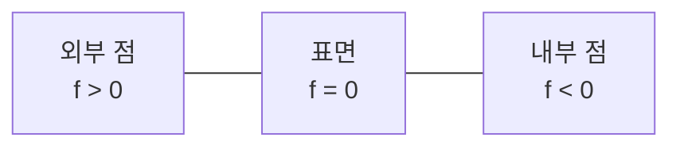
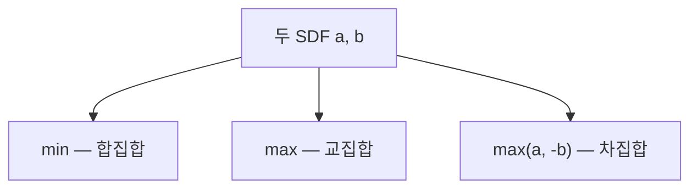
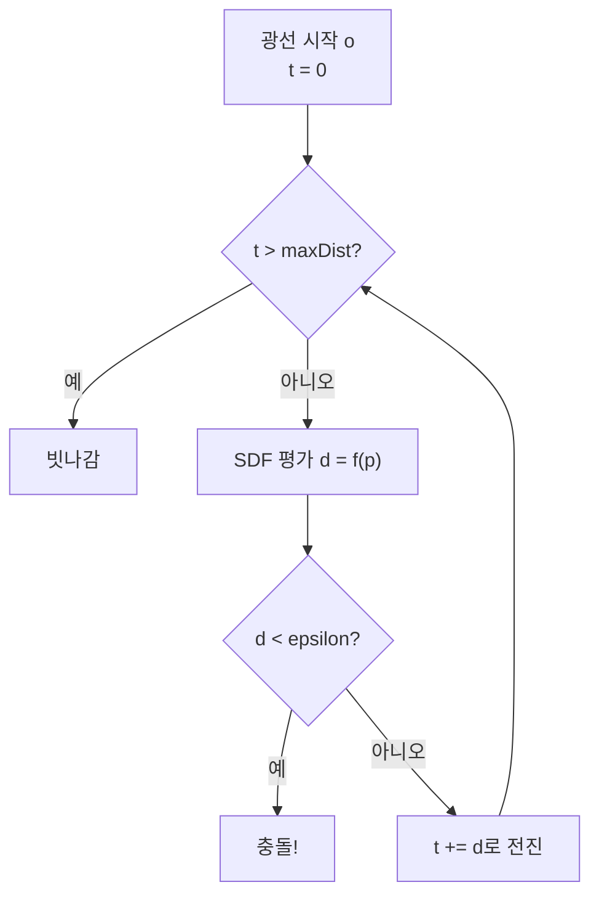
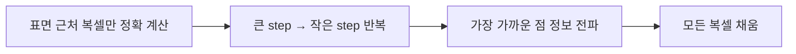
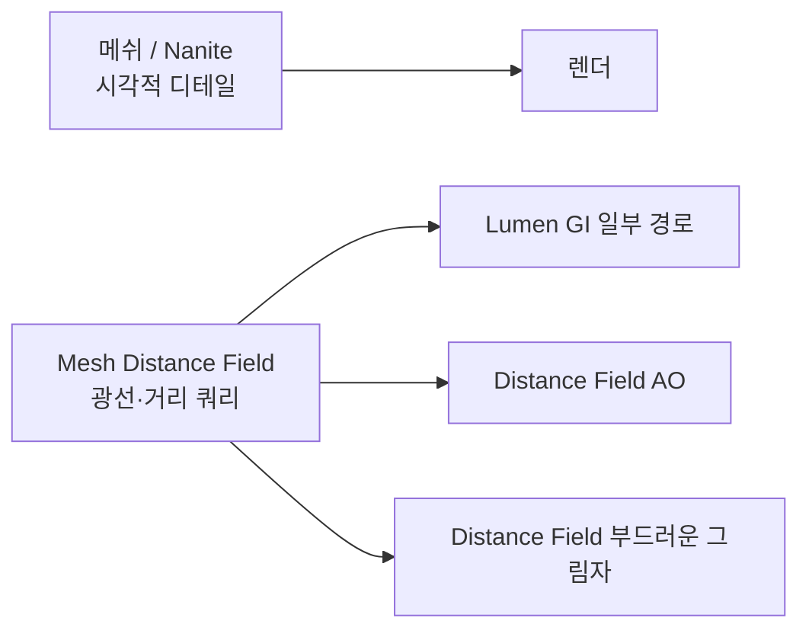

## 들어가며

SAT 같은 충돌 알고리즘은 *형상의 표면을 정점·면·모서리* 로 명시하고, GJK·EPA 는 support 함수라는 *암묵 표현* 위에서 동작한다 (Part13). *거리 장(Distance Field)* 은 또 다른 패러다임으로, 형상을 *공간의 거리 함수* 로 표현한다.

거리 장의 정의: *공간의 모든 점 $\vec{p}$* 에 대해 *가장 가까운 형상 표면까지의 거리* 를 함수 $f(\vec{p})$ 로 표현. 표면 안쪽에 *음의 부호* 를 더하면 *부호 거리 함수 (Signed Distance Function, SDF)*.

핵심 통찰. *형상의 정의가 거리 함수 자체*. 표면은 그 함수의 *영등고면 (level set $f(\vec{p}) = 0$)*. 정점과 면이 사라지고 *연속 함수 하나* 가 형상 전체를 표현.

이 시점 변화가 가져오는 능력.

1. **합성**: 두 형상의 *합집합·교집합·차집합* 이 *min·max·복합 연산* 으로. 메쉬로는 어려운 boolean 연산이 *수식 한 줄*.
2. **부드러운 합성**: $\text{smin}$ 으로 *blob 처럼 녹아드는* 합성. 메쉬로는 거의 불가능한 효과.
3. **레이 마칭**: SDF 가 보장하는 *최대 안전 거리* 로 광선이 *형상을 통과 없이* 표면까지 도달. 폴리곤 래스터화의 대안 렌더링.
4. **GPU 친화**: 셰이더에서 *함수만 평가*. VBO·IBO 없이 GPU 가 형상 자체를 *그리고* *물어볼* 수 있다.
5. **거리 쿼리**: 기본 도형 하나라면 임의 점에서 *형상까지 거리* 가 함수 평가 한 번. 다만 *복잡한 SDF 조합* 은 평가하는 프리미티브 수와 텍스처 조회 횟수에 비례하는 비용이지 *일정한 상수 한 번* 이 아니다. AI 위협 평가, 충돌 보조, 사운드 감쇠에 직접 활용.

이 글의 목표.

- *SDF 의 정의* 와 *Eikonal 조건* — $|\nabla f| = 1$ 이 의미하는 것.
- *기본 도형의 SDF* — 구·박스·평면·실린더의 *닫힌 형식*.
- *SDF 합성 규칙* — boolean + smooth + 변환.
- *레이 마칭* — SDF 만으로 장면을 그리는 알고리즘.
- *법선 추출* — 그래디언트와 *셰이더 4번 평가* 트릭.
- *Mesh → SDF 변환* — 메쉬 형상을 거리 함수로 굽기.
- *게임 효과 응용* — fog, 외곽선, 그림자, MSDF 폰트.

거리 장은 형상을 연속 함수로 바꾸며, 메쉬와 다른 방식으로 합성·렌더링·거리 쿼리를 가능하게 한다. 표현 방식과 무관하게 대량의 형상을 효율적으로 조회하려면 공간 분할 구조가 함께 필요하다.


---

## 목차
1. [SDF의 정의](#1-sdf의-정의)
2. [기본 도형의 SDF](#2-기본-도형의-sdf)
3. [SDF 변환과 합성](#3-sdf-변환과-합성)
4. [Smooth Min과 부드러운 합성](#4-smooth-min과-부드러운-합성)
5. [Ray Marching](#5-ray-marching)
6. [SDF 그래디언트와 법선](#6-sdf-그래디언트와-법선)
7. [Mesh→SDF 변환](#7-meshsdf-변환)
8. [게임 효과에서의 SDF](#8-게임-효과에서의-sdf)


---

## 1. SDF의 정의

거리 장의 수학적 정의. *왜 이 함수가 형상을 묘사할 수 있는가*.

### 1.1 거리 장 (Distance Field)

공간의 도메인 $\Omega \subset \mathbb{R}^3$ 와 형상 표면 $\partial S$ 가 주어졌을 때, 거리 장:

$$
f(\vec{p}) = \min_{\vec{q} \in \partial S} \|\vec{p} - \vec{q}\|
$$

*점 $\vec{p}$ 에서 표면 위 점까지의 최단 거리*. 항상 *비음수*. 형상의 *내부와 외부 구분 없음*.

### 1.2 부호 거리 함수 (SDF)

내부에 음수, 외부에 양수, 표면에 0을 부여하면 *부호 거리 함수*:

$$
f_S(\vec{p}) = \begin{cases}
+\min_{\vec{q} \in \partial S} \|\vec{p} - \vec{q}\| & \vec{p} \notin S \\
-\min_{\vec{q} \in \partial S} \|\vec{p} - \vec{q}\| & \vec{p} \in S
\end{cases}
$$



이 부호 덕분에 *형상의 내·외 판별* 이 *함수 평가 한 번*. *포함 검사 (point-in-shape) → SDF 평가 후 부호 검사*.

### 1.3 표면 = 영등고면 (level set)

형상의 *표면* 은 SDF 의 *영등고면 (zero level set)*:

$$
\partial S = \{\vec{p} \mid f_S(\vec{p}) = 0\}
$$

*형상의 정의가 함수의 zero set*. 형상이 *함수* 가 되었다.

### 1.4 Eikonal 조건

이상적인 SDF 는 *Eikonal 방정식* 을 만족한다:

$$
|\nabla f(\vec{p})| = 1 \quad \text{(거의 모든 곳에서)}
$$

직관: 이상적 SDF 에서 *그래디언트 방향으로 한 단위 이동* 하면 거리도 *한 단위만큼* 변한다. 다른 방향 $\hat{u}$ 로 이동할 때의 방향 미분은 $\nabla f \cdot \hat{u}$ 로 *그 방향 성분만큼* 변하므로, $|\nabla f|$ 는 *어느 방향으로든 한 단위씩 변한다는 뜻이 아니라 최대 변화율* 이다.

함의:

- **그래디언트 = 표면의 외향 법선**: $\hat{n} = \nabla f$ (단위벡터).
- **거리의 정직성**: $f(\vec{p})$ 가 *진짜 거리*. 광선이 $f(\vec{p})$ 만큼 진행해도 *표면을 넘어가지 않음*.

Eikonal 이 깨지거나 그래디언트가 정의되지 않는 곳: *최근접 표면 점이 둘 이상* 인 medial axis. 이것은 형상 *내부* 뿐 아니라 비볼록 형상의 *외부* 에도 나타난다. 이런 집합에서 그래디언트는 불연속이거나 잘 정의되지 않으므로, Eikonal 식은 그래디언트가 정의되는 *거의 모든 곳* 에서만 성립한다.

### 1.5 SDF 의 표현 형태

게임에서 SDF 는 *둘 중 하나*.

- **해석적 (analytical)**: *수식* 으로 표현. Sphere $|\vec{p}| - r$ 같은 닫힌 형식.
- **이산화 (discretized)**: *3D 텍스처 (volume texture)* 에 *복셀별 거리 값*. 임의 메쉬는 이 형태로 표현.

해석적 SDF 는 *셰이더에서 평가*. 이산 SDF 는 *3D 텍스처 샘플링*. 둘을 혼용 가능.

## 2. 기본 도형의 SDF

게임에 흔히 쓰이는 도형의 *해석적 SDF*. 모두 셰이더에서 *수식 한 줄*.

### 2.1 Sphere (구)

가장 간단.

$$
f_{\text{sphere}}(\vec{p}; r) = \|\vec{p}\| - r
$$

*원점 중심, 반지름 r 의 구*. 외부면 양수, 내부면 음수, 표면면 0. 명백히 *Eikonal 조건* $|\nabla f| = |\hat{p}| = 1$ 만족.

```cpp
float sdSphere(vec3 p, float r) {
    return length(p) - r;
}
```

### 2.2 Box (축 정렬 박스)

반지름 (half-extent) $\vec{b}$ 의 박스:

$$
f_{\text{box}}(\vec{p}; \vec{b}) = \|\max(|\vec{p}| - \vec{b}, \vec{0})\| + \min(\max((|\vec{p}| - \vec{b})_x, (|\vec{p}| - \vec{b})_y, (|\vec{p}| - \vec{b})_z), 0)
$$

복잡해 보이지만 두 부분으로 나뉜다.

- **외부 (max(...) > 0)**: 음수 성분을 0 으로 자르고 *유클리드 거리*.
- **내부 (max(...) ≤ 0)**: 가장 가까운 면까지의 음수 거리.

```cpp
float sdBox(vec3 p, vec3 b) {
    vec3 q = abs(p) - b;
    return length(max(q, 0.0)) + min(max(q.x, max(q.y, q.z)), 0.0);
}
```

Inigo Quilez 의 *경량화된 형식*. 두 항이 외부·내부 케이스를 *동시에* 다룬다.

### 2.3 Plane (평면)

단위 법선 $\hat{n}$, 원점에서 평면까지의 부호 거리 $d$ 로 둔 평면 $\hat{n} \cdot \vec{p} = d$:

$$
f_{\text{plane}}(\vec{p}; \hat{n}, d) = \hat{n} \cdot \vec{p} - d
$$

```cpp
float sdPlane(vec3 p, vec3 n, float d) {
    return dot(p, n) - d;   // n·p = d 관례 (d = 원점에서 평면까지의 부호 거리)
}
```

*무한 평면* 의 SDF. *반공간 (half-space)* 의 SDF 도 같은 식 — 법선 반대쪽인 음수 측이 *내부*.

평면 SDF 는 다른 도형과 달리 *부호 관례가 두 갈래* 라 그대로 옮겨 쓰다 뒤집히기 쉽다. $\hat{n} \cdot \vec{p} + D = 0$ 형식으로 온 평면은 $d = -D$ 로 바꿔 넣는다. 검산: $\hat{n} = (0,0,1)$, $d = 5$ 는 $z = 5$ 평면이고 $\vec{p} = (0,0,7)$ 에서 $7 - 5 = +2$ (바깥), $\vec{p} = (0,0,1)$ 에서 $1 - 5 = -4$ (안쪽). 부호가 반대로 들어가면 안팎이 뒤집히는 것이 아니라 *평면이 원점 반대편으로 옮겨 앉는다* — $z = 5$ 대신 $z = -5$ 의 반공간을 재게 된다. 반환값의 부호와 크기가 여전히 그럴듯하므로 ray marching 은 정상적으로 수렴하고 *엉뚱한 자리에 표면을 그린다*. SDF 합성에 섞이면 원인을 짚기 어려운 종류의 오류다.

### 2.4 Cylinder (실린더)

Y축 정렬, 반지름 r, *반(半) 높이 (half-height) h*. 즉 전체 높이는 2h.

박스 SDF 와 같은 *내·외 결합* 패턴. $d_x = \|\vec{p}_{xz}\| - r$ (반지름 방향 부호 거리), $d_y = |\vec{p}_y| - h$ (높이 방향 부호 거리) 를 두고:

$$
f_{\text{cyl}}(\vec{p}; r, h) = \min(\max(d_x, d_y), 0) + \|\max((d_x, d_y), \vec{0})\|
$$

```cpp
// h: 반(半) 높이 (전체 높이는 2h)
float sdCylinder(vec3 p, float r, float h) {
    vec2 d = vec2(length(p.xz) - r, abs(p.y) - h);
    return min(max(d.x, d.y), 0.0) + length(max(d, 0.0));
}
```

단순한 `max(...)` 형태는 *capped cylinder* 의 정확한 SDF가 아니다 — 모서리 바깥에서 실제 유클리드 거리보다 작게 추정하는 보수적 하한이다. sphere tracing이 표면을 건너뛰지는 않지만 step이 작아져 수렴이 느릴 수 있다. 위 *내·외 분리 형식* 이 정확한 부호 거리다.

### 2.5 Capsule (캡슐)

선분 $\vec{a}, \vec{b}$ 와 반지름 r:

$$
f_{\text{cap}}(\vec{p}; \vec{a}, \vec{b}, r) = \|\vec{p} - \text{closestOnSegment}(\vec{p}, \vec{a}, \vec{b})\| - r
$$

```cpp
float sdCapsule(vec3 p, vec3 a, vec3 b, float r) {
    vec3 pa = p - a;
    vec3 ba = b - a;
    float baLenSq = dot(ba, ba);
    if (baLenSq < 1e-8) return length(pa) - r;     // 퇴화: a == b → 구
    float h = clamp(dot(pa, ba) / baLenSq, 0.0, 1.0);
    return length(pa - ba * h) - r;
}
```

### 2.6 Torus (원환체)

반지름 큰 R, 작은 r:

$$
f_{\text{torus}}(\vec{p}; R, r) = \sqrt{(\|\vec{p}_{xz}\| - R)^2 + p_y^2} - r
$$

```cpp
float sdTorus(vec3 p, float R, float r) {
    vec2 q = vec2(length(p.xz) - R, p.y);
    return length(q) - r;
}
```

### 2.7 SDF 카탈로그

Inigo Quilez 의 *Distance Functions* 페이지가 *수십 가지 도형* 의 SDF 를 정리. 게임에 쓰이는 거의 모든 형상.

| 도형 | 비용 | 특기 |
|---|---|---|
| Sphere | 1 sqrt | 가장 빠름 |
| Box | abs + max + length | OBB 도 같은 비용 |
| Plane | 1 dot | 무한 평면 |
| Cylinder | 2 length | 절단 실린더 |
| Capsule | 1 dot + 1 length | 캐릭터 콜라이더 |
| Torus | 2 length | 도넛 |
| Cone | 더 복잡 | 끝이 뾰족 |

이 도형들이 *프리미티브 빌딩 블록*. 합성으로 *복잡한 형상* 만들기.

## 3. SDF 변환과 합성

기본 도형들을 *변형* 하고 *합성* 해 복잡한 형상.

### 3.1 평행이동

형상을 $\vec{t}$ 만큼 이동:

$$
f_{\text{translated}}(\vec{p}) = f(\vec{p} - \vec{t})
$$

*입력 점을 역 이동*. SDF 의 *공간 변형* 일반 패턴.

### 3.2 회전

행렬 $R$ 로 형상 회전:

$$
f_{\text{rotated}}(\vec{p}) = f(R^{-1} \vec{p}) = f(R^T \vec{p})
$$

회전 행렬의 *역 = 전치*. 입력 점을 *역회전* 시켜 평가.

### 3.3 균등 스케일

스케일 인자 $s > 0$ 의 균등 스케일:

$$
f_{\text{scaled}}(\vec{p}) = s \cdot f(\vec{p} / s)
$$

핵심: *결과에 s 곱*. 안 곱하면 *Eikonal 깨짐* — 거리가 *왜곡됨*.

비균등 스케일 (성분별 다른 스케일) 은 *Eikonal 보존 안 됨* → 거리가 *근사값* 됨. 게임에서 가능하지만 *주의*.

### 3.4 합집합 (union)

두 형상의 합:

$$
f_{A \cup B}(\vec{p}) = \min(f_A(\vec{p}), f_B(\vec{p}))
$$

*가장 가까운 형상의 거리* — 둘 중 더 가까운 표면.

```cpp
float opUnion(float a, float b) { return min(a, b); }
```

### 3.5 교집합 (intersection)

$$
f_{A \cap B}(\vec{p}) = \max(f_A(\vec{p}), f_B(\vec{p}))
$$

*두 형상 모두에 속해야 내부*. 두 SDF 의 *큰 값*.

```cpp
float opIntersect(float a, float b) { return max(a, b); }
```

### 3.6 차집합 (subtraction)

$$
f_{A - B}(\vec{p}) = \max(f_A(\vec{p}), -f_B(\vec{p}))
$$

*A 의 내부에서 B 를 뺀다*. B의 SDF 부호를 뒤집어 *교집합* 처럼.

```cpp
float opSubtract(float a, float b) { return max(a, -b); }
```

### 3.7 합성의 한계

*min/max 합성* 의 결과는 *진짜 SDF 가 아님*. *합성 이음매에서 떨어진 곳의 거리는 정확*, 하지만 *두 형상이 만나는 오목 이음매 근처* 에서는 경계 바로 옆에서도 실제 거리보다 작게 나온다 (예: 두 반평면의 교집합 밖 모서리 근처에서 max 는 참거리의 약 0.71 배). 단순 합성은 *근사 SDF (거리의 하한, bound on distance)*.

게임 응용에서 대부분 *경계 근처만 중요* (레이 마칭이 표면을 향해 진행) → 실용적으로 OK.



이 boolean 합성 + smooth 합성으로 *수십 가지 도형* 만 가지고 *복잡한 객체* 만들기.

### 3.8 도메인 변환 트릭

SDF 의 *입력 공간 자체를 변형* 하는 트릭들.

- **Repetition (반복)**: $\vec{p}_{\text{mod}} = \text{mod}(\vec{p}, \vec{c}) - 0.5 \vec{c}$ — *무한 반복 패턴*. 한 형상 SDF 가 *공간을 채우는 격자*.
- **Symmetry (대칭)**: $\vec{p}_{\text{sym}} = (|\vec{p}_x|, \vec{p}_y, \vec{p}_z)$ — 한 축으로 *거울 대칭*.
- **Bend/Twist**: 비선형 입력 변형으로 *형상 굽히기·꼬기*. Eikonal 깨지지만 *시각적 효과*.

이 도메인 변형을 조합하면 기본 도형만 나열할 때보다 훨씬 다양한 형상을 표현할 수 있다. 다만 변형 뒤의 함수가 정확한 signed distance를 유지하지 않을 수 있으므로, sphere tracing의 안전한 step 크기와 법선 품질을 별도로 검증해야 한다.

## 4. Smooth Min과 부드러운 합성

`min` 합집합은 *경계가 날카롭다*. *부드럽게 녹아드는* 합성이 SDF 의 진가.

### 4.1 Smooth Min 의 정의

여러 변형 중 가장 흔한 *지수 smin*:

$$
\text{smin}_{\exp}(a, b, k) = -\frac{1}{k} \ln(e^{-ka} + e^{-kb})
$$

$k$ 가 *부드러움 정도*. $k$ 큼 → 일반 min 에 가까움. $k$ 작음 → 더 부드러운 융합.

```cpp
float sminExp(float a, float b, float k) {
    float res = exp(-k * a) + exp(-k * b);
    return -log(res) / k;
}
```

지수가 *부동소수점 overflow* 위험. 게임은 *폴리노미얼 smin* 선호.

### 4.2 폴리노미얼 smin

$$
\text{smin}_{\text{poly}}(a, b, k) = \min(a, b) - \frac{h^2 \cdot k}{4}, \quad h = \frac{\max(k - |a - b|, 0)}{k}
$$

```cpp
float sminPoly(float a, float b, float k) {
    float h = max(k - abs(a - b), 0.0) / k;
    return min(a, b) - h * h * k * 0.25;
}
```

빠르고 안정적. *대부분 셰이더 데모* 가 이 폼.

### 4.3 Smooth Max

대칭으로 *smooth max* 도 가능. 교집합·차집합의 부드러운 버전.

```cpp
float smaxPoly(float a, float b, float k) {
    return -sminPoly(-a, -b, k);
}
```

### 4.4 Blob 효과

여러 구가 *서로 다가가면 녹아드는* 효과 (metaballs).

```cpp
float blob(vec3 p, vec3 c1, vec3 c2, vec3 c3, float r, float k) {
    float d1 = sdSphere(p - c1, r);
    float d2 = sdSphere(p - c2, r);
    float d3 = sdSphere(p - c3, r);
    return sminPoly(sminPoly(d1, d2, k), d3, k);
}
```

여러 구가 가까워질수록 *물방울처럼 합쳐짐*. 메쉬 기반으로는 *마칭 큐브* 같은 무거운 알고리즘이 필요한 효과를 *수식 한 줄* 로.

### 4.5 게임 응용

- **유체 표면**: 입자 기반 유체의 *meta-surface* 시각화.
- **부드러운 캐릭터 스컬프팅**: ZBrush 같은 *DynaMesh* 효과.
- **녹아 합쳐지는 슬라임 적**: 게임 적 형태 변환.
- **창의적 모델링**: 기본 도형을 smin 으로 합성한 *조각 같은 형상*.


## 5. Ray Marching

SDF 만으로 장면을 *그리는* 알고리즘. 폴리곤 래스터화의 대안.

### 5.1 핵심 아이디어

광선 $\vec{r}(t) = \vec{o} + t \hat{d}$ 를 따라 *매 단계 SDF 만큼 안전하게 전진*.



SDF 가 보장: $|\nabla f| = 1$ → *한 단위 거리에 한 단위 변화* → *$f(\vec{p})$ 만큼 진행해도 표면 통과 안 함*.

### 5.2 알고리즘

```cpp
struct RayResult {
    bool  hit;
    float t;
    vec3  point;
    int   iterations;
};

// 전제: 광선이 외부에서 시작 (sdfFunc(ro) > 0), 단위 방향 (|rd| = 1),
//       sdfFunc 는 exact signed distance (외부에서 거리 하한을 만족).
// 내부 확장은 hit 규칙과 step 을 함께 바꿔야 한다 (아래 설명 참조).
RayResult RayMarch(vec3 ro, vec3 rd, auto sdfFunc, float maxDistance) {
    const int   MAX_ITER = 100;
    const float EPSILON  = 0.001f;

    float t = 0.0;
    for (int i = 0; i < MAX_ITER; ++i) {
        // 평가 전에 t 범위를 먼저 확인 — MAX_DIST 밖은 hit 로 반환하지 않는다.
        if (t > maxDistance) {
            return {false, t, ro + t * rd, i};
        }
        vec3 p = ro + t * rd;
        float d = sdfFunc(p);

        // 외부 시작 가정이라 d >= 0. 내부 확장은 step = abs(d) 와
        // 입/출구 목표 계약을 함께 도입해야 한다 (아래 설명).
        if (d < EPSILON) {
            return {true, t, p, i};
        }
        if (d > maxDistance - t) {  // 다음 step 이 최대거리를 넘으면 miss.
            return {false, maxDistance, ro + maxDistance * rd, i};
        }
        t += d;  // SDF 만큼 안전하게 전진
    }
    return {false, t, ro + t * rd, MAX_ITER};
}
```

매 반복: *현재 위치의 SDF 평가 + 그 만큼 전진*. epsilon 보다 작아지면 *표면에 도달*. 위 코드는 *외부 시작* (`sdfFunc(ro) > 0`) 전제. 내부 시작이나 내부 통과를 다루려면 *판정과 step 을 함께* 바꿔야 한다. `abs(d) < EPSILON` 만으로 hit 을 판정하고 `t += d` 를 그대로 두면, 내부의 음수 d 에서 광선이 *뒤로* 진행한다. 내부 확장 예시는 *step = abs(d)* 로 전진하고, 목표를 *입구/출구 경계 교차* 로 명시하며, 시작점이 이미 표면 띠 안이면 그 자체를 hit 로 처리하는 계약을 둔다.

### 5.3 Sphere Tracing 이라는 이름

이 알고리즘의 정식 이름은 *Sphere Tracing*. 매 단계 *반지름 $f(\vec{p})$ 의 빈 구 안에서 안전한 진행* 이라는 의미. SDF 가 *최대 안전 반지름* 보장.

### 5.4 종료 조건과 함정

- **MAX_ITER**: 무한 루프 방지. 100~256 회 일반적.
- **MAX_DIST**: 광선이 너무 멀어지면 종료. 장면 크기에 맞춰.
- **EPSILON**: 표면 도달 판정. 너무 작으면 *수렴 못 함*, 너무 크면 *표면이 부풀어 보임*.

흔한 함정: *SDF 가 진짜 거리가 아닐 때 (boolean 합성, 비균등 스케일, twist 등)*. *실제 거리보다 큰 추정* 이면 *광선이 표면을 통과* 한다. 그런데 오버추정 비율의 상한을 모르는 상태에서 *0.5~0.8 곱* 만으로 관통 방지가 보장되지는 않는다. 안전을 보장하려면 알려진 Lipschitz 상한 $L$ 로 나눈 lower bound ($d/L$) 를 쓰거나, 비균등 축소·twist 처럼 $L > 1$ 인 변환의 실제 bound 를 계산한다. 0.5~0.8 같은 계수는 검증된 bound 가 없을 때의 *휴리스틱* 일 뿐이다.

```cpp
t += 0.7 * d;  // 휴리스틱 — 오버추정 상한을 모르면 안전 보장 아님
```

수렴 속도가 느려지지만 상한이 알려진 경우에 한해 *통과 방지* 를 돕는다.

### 5.5 그림자

*광선 쏘기* 가 SDF 의 자연스런 응용. 그림자도 광선 마칭으로.

```cpp
float HardShadow(vec3 ro, vec3 light, auto sdf) {
    vec3 rd = normalize(light - ro);
    vec3 origin = ro + 0.01 * rd;          // 자기 차폐 회피용 오프셋
    float maxT = length(light - origin);   // 오프셋된 origin 기준으로 다시 계산
    RayResult r = RayMarch(origin, rd, sdf, maxT);
    // maxT 밖은 hit 로 반환되지 않으므로 그림자 여부는 r.hit 만으로 정해진다.
    return r.hit ? 0.0 : 1.0;
}
```

epsilon 만큼 띄워서 *시작점 근처 자체 충돌 회피*. 중요: 오프셋 후에는 *maxT 도 새 origin 에서 다시 계산* 해야 한다. 원래 ro 기준 maxT 를 그대로 넘기면 광원 바로 뒤의 차폐체를 그림자로 처리하거나 march 구간이 실제 광원과 어긋난다. 또한 고정 최대 거리는 광원이 그보다 멀면 그림자를 놓치므로, 이 값은 *장면 크기나 광원 거리* 에 맞춰 전달한다.

### 5.6 Soft Shadow

SDF는 한 광선에서 가림 여부와 함께 *부드러운 그림자의 근사치* 를 누적할 수 있다.

```cpp
float SoftShadow(vec3 ro, vec3 rd, float k, auto sdf) {
    float res = 1.0;
    float t = 0.01;
    for (int i = 0; i < 32; ++i) {
        float d = sdf(ro + t * rd);
        if (d < 0.001) return 0.0;
        res = min(res, k * d / t);
        t += d;
    }
    return res;
}
```

광선 따라 *최소 거리 / t 비율* 을 추적하는 휴리스틱이다. 최대 32회의 추가 SDF 평가가 필요하므로 공짜가 아니며, SDF가 복잡한 절차 함수인지 텍스처 조회인지에 따라 비용이 크게 달라진다. 여러 shadow-map 표본을 쓰는 PCF와 비교해 유리할 수 있지만, 빛의 실제 면적을 적분한 정확한 가시성 해법은 아니다. step 수·최대 거리·허용오차와 생기는 누광(light leaking)을 함께 측정한다.

### 5.7 ShaderToy 의 표준

ShaderToy (https://shadertoy.com) 가 *SDF + 레이 마칭의 메카*. Inigo Quilez 의 데모들이 *수십 줄의 셰이더로 photoreal* 같은 장면을 그림.

게임 엔진은 보통 *폴리곤 + 일부 SDF* 혼용. 순수 SDF 는 *셰이더 효과*, *볼륨 fog*, *외곽선* 등에.

## 6. SDF 그래디언트와 법선

SDF 의 *그래디언트* 가 *표면 법선*. 셰이딩에 필요.

### 6.1 그래디언트 = 법선

Eikonal 조건의 함의:

$$
\hat{n}(\vec{p}) = \frac{\nabla f(\vec{p})}{|\nabla f(\vec{p})|} \approx \nabla f(\vec{p})
$$

이상적인 SDF 는 그래디언트가 *이미 단위벡터*. 합성·근사로 깨지면 *normalize* 한 번 더.

### 6.2 해석적 그래디언트

수식 SDF 는 *직접 미분*. Sphere:

$$
\nabla(\|\vec{p}\| - r) = \frac{\vec{p}}{\|\vec{p}\|}
$$

```cpp
vec3 sdSphereNormal(vec3 p) {
    return normalize(p);  // 원점 중심 기준
}
```

복잡한 SDF (boolean 합성 등) 는 *해석적으로 미분 어렵다*. *수치 미분* 을 쓴다.

### 6.3 중앙 차분 수치 미분

표준 6 회 평가:

```cpp
vec3 SDFNormal6(vec3 p, auto sdf, float h = 0.001) {
    return normalize(vec3(
        sdf(p + vec3(h, 0, 0)) - sdf(p - vec3(h, 0, 0)),
        sdf(p + vec3(0, h, 0)) - sdf(p - vec3(0, h, 0)),
        sdf(p + vec3(0, 0, h)) - sdf(p - vec3(0, 0, h))
    ));
}
```

각 축에 *epsilon 양/음* 으로 *차분*. 표준이지만 *6 번 평가*.

### 6.4 셰이더 4번 평가 트릭 (Tetrahedron sampling)

Inigo Quilez 의 *4 회 평가 트릭*. 정사면체의 4 정점 방향으로만 평가:

```cpp
vec3 SDFNormal4(vec3 p, auto sdf, float h = 0.001) {
    const vec2 k = vec2(1.0, -1.0);
    return normalize(
        k.xyy * sdf(p + k.xyy * h) +
        k.yyx * sdf(p + k.yyx * h) +
        k.yxy * sdf(p + k.yxy * h) +
        k.xxx * sdf(p + k.xxx * h)
    );
}
```

4번 평가로 *그래디언트 추정*. *6 회 중앙 차분과 비슷한 정확도의 4-sample 근사* — 등가가 아니라 정사면체 대칭 방향 4 점에서 *유한 차분* 한 결과다. 평가 횟수는 6회에서 4회로 줄지만 이것이 *전체 셰이더 wall time 의 33% 감소* 를 뜻하지는 않는다. 실제 오차와 성능은 SDF 함수의 비용·노이즈·하드웨어에 따라 달라지므로 측정으로 확인한다.

### 6.5 epsilon 선택

너무 작으면 *부동소수점 노이즈*, 너무 크면 *표면 디테일 평탄화*. 표면 거리에 따라 *적응 epsilon*:

```cpp
float h = max(0.0001, 0.001 * t);  // 카메라에서 멀수록 epsilon 크게
```

가까운 픽셀은 정밀, 먼 픽셀은 *에일리어싱 방지*.

## 7. Mesh→SDF 변환

해석적 SDF 가 다룰 수 없는 *임의 메쉬* 를 SDF 로 *굽기 (bake)*.

### 7.1 복셀 그리드

장면 공간을 *3D 그리드* 로 분할. 각 복셀에 *그 복셀 중심에서 메쉬 표면까지 거리* 저장.


3D 텍스처에 저장 후 *셰이더에서 trilinear 샘플링*. 임의 위치의 SDF 가 *3D 텍스처 fetch* 한 번.

### 7.2 Closest Point on Triangle

각 복셀에서 *모든 삼각형까지 최단 거리* 의 *최소값*. 핵심 함수:

```cpp
vec3 ClosestPointOnTriangle(vec3 p, vec3 a, vec3 b, vec3 c) {
    vec3 ab = b - a;
    vec3 ac = c - a;
    vec3 ap = p - a;

    float d1 = dot(ab, ap);
    float d2 = dot(ac, ap);
    if (d1 <= 0.0 && d2 <= 0.0) return a;

    vec3 bp = p - b;
    float d3 = dot(ab, bp);
    float d4 = dot(ac, bp);
    if (d3 >= 0.0 && d4 <= d3) return b;

    // ... 7 개 영역 분류 (Christer Ericson RTCD)
    // 결과: 정점·변·면 중 가장 가까운 점
}
```

7개 Voronoi 영역 분류 (정점 3 + 변 3 + 면 1). RTCD 책의 표준 구현.

### 7.3 부호 결정

거리가 *음수 (내부)* 인지 *양수 (외부)* 인지 결정.

방법 1: *법선 기반*. 가장 가까운 점에서의 *삼각형 법선* 과 *최근접점→복셀 벡터* 내적. 양수면 외부, 음수면 내부. *간단하지만 취약* — closed/watertight mesh 에서도 *모서리 (변·정점이 가장 가까운 케이스)* 와 *비정상 normal* 에서 자주 틀린다. 학습용으로만.

방법 2 (실전 표준): *광선 카운트 (ray casting)*. 복셀에서 *임의 방향* 으로 광선 쏴 *메쉬와 교차 횟수* 카운트. 홀수면 내부, 짝수면 외부 (*Jordan curve theorem*). 비싸지만 전제가 맞으면 *강건*. 다만 공유 모서리에서 교차가 이중 카운트되거나 퇴화 삼각형·비폐곡면에서 홀짝이 흔들릴 수 있으므로, watertight 폐곡면·퇴화 제거·광선 방향 선택을 전제로 한다.

방법 3 (모던 표준): *Generalized Winding Number*. Jacobson 등의 알고리즘. open mesh·self-intersection mesh 에서도 *부호 추정* 을 준다. 다만 열린 mesh 에서 '내부' 를 유일하게 정하는 정리가 아니므로 *임계값 정책* 이 필요하다. ray casting 보다 강건한 경우가 많다.

### 7.4 Jump Flooding 가속

순수 brute force 는 $O(\text{voxels} \times \text{triangles})$ — 매우 느림. *Jump Flooding Algorithm (JFA)* 으로 가속.



표면 근처만 정확 계산 후 *점진적으로 전파*. $O(\text{voxels} \log \text{N})$ 에 *근사 SDF* 완성. GPU 친화적. 다만 JFA 전파·trilinear 보간·양자화 값은 *conservative distance bound 를 보장하지 않는다*. 안전한 sphere tracing 이 필요하면 표본 간격과 보간 오차의 *상한* 을 따로 구하거나 보수적으로 줄여 잡는다.

### 7.5 정밀도와 메모리

| 그리드 해상도 | 메모리 (float) | 정밀도 |
|---|---|---|
| 64³ | 1 MB | 거친 |
| 128³ | 8 MB | 보통 |
| 256³ | 64 MB | 정밀 |
| 512³ | 512 MB | 매우 정밀 |

캐릭터·소품은 64³~128³, 환경은 *영역 분할*. *float 대신 half (FP16)* 또는 *unorm 8-bit* 로 *정밀도 trade*.

### 7.6 게임 활용

- **GI Probes (UE5 Lumen, Unity HDRP)**: SDF 가 *간접 조명* 의 광선 쿼리에.
- **AO (Ambient Occlusion)**: 표면에서 *주변 SDF 거리 평균* → AO.
- **GPU 파티클 충돌**: 파티클이 SDF 평가로 *환경과 충돌*.
- **Soft Body 변형**: 가깝게 옮길 표면을 SDF 로 잡기.

UE5 *Mesh Distance Field* 가 자동 SDF 굽기 + 위 효과들 통합.

## 8. 게임 효과에서의 SDF

SDF 가 *어떤 게임 효과* 에 활용되는지 정리.

### 8.1 Volume Fog

거리 기반 fog 농도.

```cpp
float fogDensity(vec3 p, auto fogVolumeSDF) {
    float d = fogVolumeSDF(p);
    return smoothstep(0.0, 0.5, -d);  // 안쪽일수록 진하게
}
```

*임의 형상의 fog 영역*. 박스로 안 되는 *동굴 내부, 부드러운 안개 띠* 를 SDF 로.

### 8.2 외곽선 (Edge Detection)

셀 셰이딩 외곽선의 *깊이/법선 차이* 대신 *SDF 거리* 사용.

```cpp
float surfaceBand(vec3 p, auto sdf, float width) {
    return 1.0 - smoothstep(0.0, width, abs(sdf(p)));  // 표면 띠 — edge0 < edge1
}
```

이 식은 *3D 표면 띠(surface band)* 다. 표면을 렌더한 *모든 점* 에서 `abs(sdf)=0` 이므로 silhouette 만 강조하지 않는다. 화면 공간 외곽선이 목적이면 시선·법선 조건(silhouette 판정)을 따로 넣어야 한다. 또한 GLSL `smoothstep` 은 `edge0 >= edge1` 일 때 결과가 정의되지 않으므로 `1 - smoothstep(0, width, x)` 처럼 *증가하는 edge* 를 쓴다.

### 8.3 부드러운 그림자 (이미 5.6절)

5.6절 SoftShadow. 한 광선으로 *PCF 없이* 부드러운 그림자.

### 8.4 GPU 파티클 충돌

CPU 파티클을 *각 충돌* 검사 안 함. GPU 컴퓨트 셰이더에서 *SDF 평가 한 번* 으로 충돌 + 법선 추출.

```glsl
// 의사 셰이더 (HLSL 컴퓨트 + GLSL 스타일 혼합)
[numthreads(64,1,1)]
void CSParticleStep(uint id : SV_DispatchThreadID) {
    Particle p = particles[id];
    p.pos += p.vel * dt;
    float d = SampleSDF(p.pos);
    if (d < p.radius) {
        vec3 n = SDFNormalFromTexture(p.pos);
        p.pos += (p.radius - d) * n;        // 위치 보정으로 침투 해소
        if (dot(p.vel, n) < 0.0) {          // 다가올 때만 반사
            p.vel = reflect(p.vel, n) * 0.6; // 0.6 은 단순 속도 감쇠(마찰 근사)
        }
    }
    particles[id] = p;
}
```

수만 파티클이 *환경과 충돌*. 폴리곤 충돌은 *프래그멘테이션 폭발*. `dot(v, n) < 0` 가드가 없으면 표면에서 *바깥으로* 움직이는 파티클까지 반사해 다시 안쪽으로 보낸다. 위치 보정이 없으면 다음 프레임에 다시 겹쳐 반복 반사될 수 있다. 0.6 전체 속력 감쇠는 Coulomb 마찰 자체가 아니라 단순 감쇠 계수다. 빠른 파티클은 substep 이나 CCD 로 터널링을 막는다.

### 8.5 절차적 폰트 (MSDF)

벡터 폰트를 *SDF 텍스처* 로 굽기. 작은 텍스처에서 *큰 화면 크기* 까지 *날카로운* 글자.

원형: Chris Green (Valve), "Improved Alpha-Tested Magnification for Vector Textures and Special Effects" (2007). 알파 테스트 + bilinear → *매끄러운 외곽선*.

진화형: *Multi-channel SDF (MSDF)*. RGB 채널 각각 다른 SDF. *모서리 (corner)* 에서 *날카로움 보존*. 일반 SDF 가 모서리에서 *둥글게* 되는 단점 해결.

```glsl
float msdfMask(vec3 sample) {
    float median = max(min(sample.r, sample.g),
                       min(max(sample.r, sample.g), sample.b));
    return smoothstep(0.5 - dx, 0.5 + dx, median);
}
```

UI 텍스트, 게임 내 표지판, HUD 에 표준.

### 8.6 광역 거리 쿼리

AI 위협 평가, 사운드 감쇠, 적 회피 — *임의 점에서 환경까지 거리* 가 필요.

```cpp
float threatLevel(vec3 aiPos, auto playerSDF) {
    float d = playerSDF(aiPos);
    return saturate(1.0 - d / threatRange);  // 가까울수록 위협 큼
}
```

폴리곤 환경의 정확한 거리 쿼리는 BVH 순회와 closest-point 계산이 필요하다. 미리 구운 SDF는 이를 3D 텍스처 조회와 보간으로 바꾸지만, 메모리 용량·대역폭·캐시 지역성·양자화와 해상도 오차를 지불한다. 같은 영역에 반복 쿼리해 캐시가 잘 맞으면 빠를 수 있고, 큰 희소 월드나 임의 접근에서는 3D 텍스처 비용이 병목이 될 수 있다.

### 8.7 SDF 의 진짜 능력

게임 그래픽의 흐름이 *Mesh-only* 에서 *Mesh + SDF 혼용* 으로 옮겨가는 중. UE5 의 *Mesh Distance Field* 는 *Lumen GI · 부드러운 그림자 · AO* 등에 활용된다 (Lumen 자체는 SDF 외에 software/hardware ray tracing, surface cache 등 여러 표현을 함께 쓴다). Nanite 는 별도의 가상 지오메트리 시스템.



*표면 표현* 과 *공간 표현* 이 *공존*. 둘이 잘 하는 일을 분담.


---

## 결론

SDF 는 *형상을 거리 함수로 표현* 한다는 시점 변화로 게임 그래픽·물리에 *새로운 도구* 를 제공한다. boolean 합성, 부드러운 융합, 레이 마칭, 거리 쿼리 — 메쉬로는 무거운 연산이 *함수 평가 한 번*.

이 글에서 정리한 핵심.

1. **거리 함수의 정의** — Eikonal $|\nabla f| = 1$, 표면 = 영등고면.
2. **기본 도형 SDF** — Sphere/Box/Plane/Cylinder/Capsule/Torus 의 닫힌 형식.
3. **합성** — min/max boolean + smin 부드러운 융합.
4. **레이 마칭 (Sphere Tracing)** — SDF 가 보장하는 안전 거리로 표면까지 도달.
5. **법선 추출** — 그래디언트 = 법선. 셰이더에서 4 회 평가 트릭.
6. **Mesh → SDF 굽기** — 복셀 그리드 + 부호 결정 + Jump Flooding 가속.
7. **게임 효과** — fog, 외곽선, 부드러운 그림자, GPU 파티클, MSDF 폰트, GI.

이 글은 형상을 거리 함수로 표현하는 관점과 그 게임 활용을 정리했다. 거리 쿼리를 더 큰 장면으로 확장하려면 공간 분할 구조(BVH, Octree, KD-Tree)가 함께 쓰이지만, 그 자료구조의 설계는 이 글의 범위 밖이다.

## 더 읽을거리

- Inigo Quilez, "Distance Functions" 페이지 (https://iquilezles.org/articles/distfunctions/) — SDF 카탈로그의 표준.
- Inigo Quilez, "Smooth Minimum" 글 — smin 의 다양한 변형과 트레이드오프.
- John C. Hart, "Sphere Tracing: A Geometric Method for the Antialiased Ray Tracing of Implicit Surfaces" (1996) — 레이 마칭 원전.
- Chris Green, "Improved Alpha-Tested Magnification for Vector Textures and Special Effects" (Valve, 2007) — SDF 폰트의 시작.
- Viktor Chlumský, "Shape Decomposition for Multi-channel Distance Fields" (2015) — MSDF 알고리즘.
- Jacobson et al., "Robust Inside-Outside Segmentation Using Generalized Winding Numbers" (2013) — open mesh 에 강건한 부호 결정.
- Christer Ericson, *Real-Time Collision Detection*, Ch. 5 — Closest point on triangle.
- ShaderToy (https://shadertoy.com) — SDF 데모의 표준 라이브러리.
- Unreal Engine 5 *Mesh Distance Fields* 문서 — 산업 통합 사례.
- Karras, Aila, "Fast Parallel Construction of High-Quality Bounding Volume Hierarchies" — GPU 에서의 고품질 BVH 병렬 구축 (트리렛 재구조화). 이 논문은 SDF 정의·합성·마칭의 안전성 근거가 아니며, BVH 구축 가속에 관한 참고문헌으로 Part16 의 GPU BVH 맥락에 속한다. 이 편에서는 거리 쿼리 가속의 연결 참고로만 둔다.
