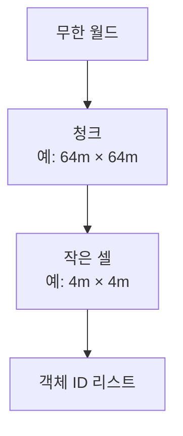
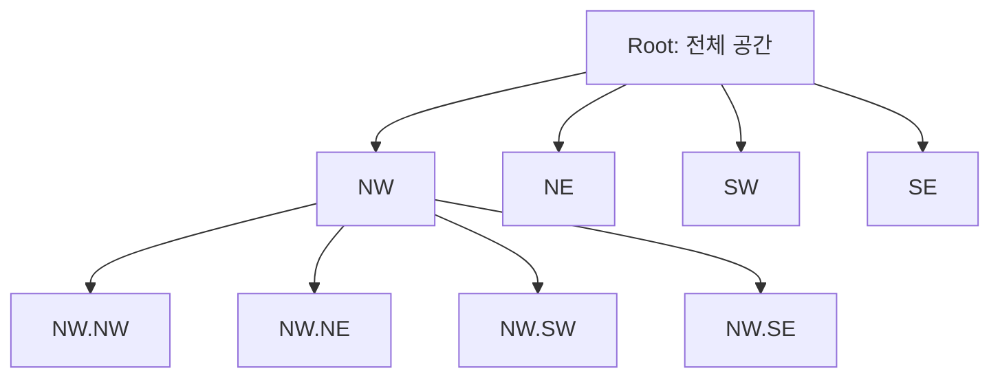
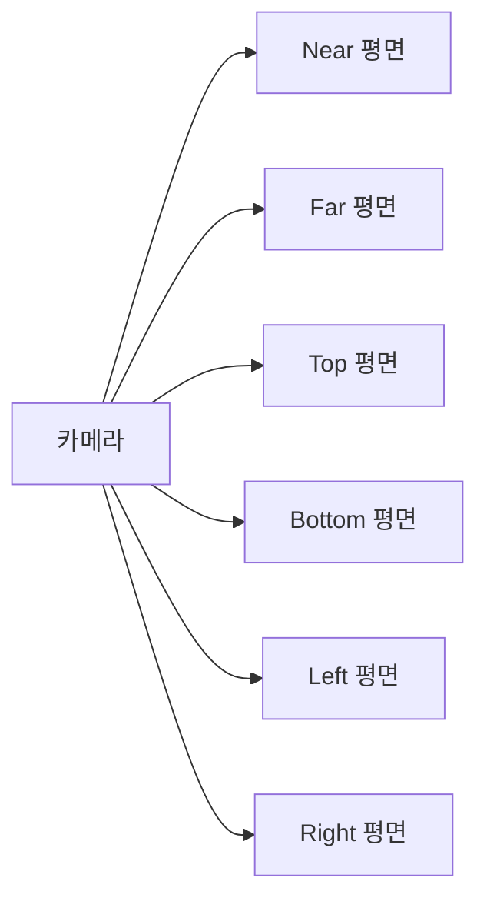

## 들어가며

SAT, GJK·EPA 같은 알고리즘은 *두 도형 사이의 충돌 한 번* 을 정밀하게 푼다. 이 글의 토픽은 *대량의 객체 중 검사할 후보를 줄이는 방법* 이다. 1만 개의 적, 5만 개의 발사체, 100만 개의 환경 콜라이더에서 모든 쌍을 검사하는 *naive O(n²)* 는 *4자리 수의 객체에서도 무너진다*.

대안. *공간을 미리 쪼개 두고, 쿼리 시 관련 영역만 본다*. 이게 *공간 분할 (Spatial Partitioning)* 이다. *어디에 누가 있는가* 의 매핑을 *쿼리마다 다시 계산하지 않고* *유지된 자료구조에서 조회*. 1만 객체의 *전쌍* 약 5천만 비교에 비해, *한 번의 범위 질의* 가 반환하는 후보 수는 *수십 ~ 수백* 으로 줄어들 수 있다. 다만 이것은 *단일 질의* 기준이고 전체 프레임 broad phase 비용은 *최종 충돌 쌍 수 + 객체 크기·밀도* 에 달렸다. 모든 객체가 한 셀에 몰리면 *전쌍 $O(n^2)$ 로 되돌아간다*. 측정 환경이 없는 수치는 예시로 본다.

핵심 자료구조 네 가지.

1. **균일 그리드 (Uniform Grid)**: 월드를 *같은 크기 셀* 로 나눠 객체를 *셀 리스트* 에 등록. 쿼리는 *해당 셀의 리스트만*. $O(1)$ 셀 접근 + *근접 셀 순회*.
2. **Quadtree / Octree**: 공간을 *재귀적으로 4분할 / 8분할*. 객체 분포가 *불균일* 해도 *밀집 영역만 깊게* 분할.
3. **K-d Tree**: *차원별 교대 분할*. 정적 객체에 강함, 가장 가까운 이웃 (NN) 쿼리에 우수.
4. **Loose Quadtree**: 셀의 경계를 *두 배로 늘려* 동적 객체가 *재삽입 안 해도* 한 셀 안에 머물게 함.

각 자료구조의 *빌드 비용·쿼리 비용·동적 갱신 비용* 트레이드오프가 *게임 상황별 선택의 분기점*. 정답은 없다. *객체 분포 + 쿼리 패턴 + 정적/동적 비율* 에 따라 결정.

이 글의 목표.

- *공간 쿼리 비용 문제* 의 정량화 ($O(n^2)$ 가 *얼마나 빨리 무너지는가*).
- *균일 그리드* — 가장 단순하고 가장 흔한 선택.
- *해시 그리드* — 무한 월드·청크 로딩에 친화적.
- *Quadtree·Octree* — 분포 적응적 분할.
- *K-d Tree* — 차원별 교대 분할, NN 쿼리.
- *Loose Quadtree* — 동적 객체에 적합한 변형.
- *Frustum Culling* — 카메라에서 받은 6평면으로 트리를 자르는 3분 판정.
- *동적 객체 갱신 전략*.

*BVH (객체 자체를 트리로)* 와 함께, 이 둘이 *broad phase 가속 구조* 의 표준 패밀리다.


---

## 목차
1. [공간 쿼리의 비용 문제](#1-공간-쿼리의-비용-문제)
2. [균일 그리드](#2-균일-그리드)
3. [해시 그리드와 무한 월드](#3-해시-그리드와-무한-월드)
4. [Quadtree와 Octree](#4-quadtree와-octree)
5. [K-d Tree](#5-k-d-tree)
6. [Loose Quadtree](#6-loose-quadtree)
7. [Frustum Culling](#7-frustum-culling)
8. [동적 객체 갱신 전략](#8-동적-객체-갱신-전략)


---

## 1. 공간 쿼리의 비용 문제

게임 상황별 *naive 비용* 의 정량화. 왜 가속 구조가 *선택지가 아니라 필수* 인지.

### 1.1 모든 쌍 검사의 비용

n 개 객체의 모든 쌍 충돌:

$$
\text{비용} = \binom{n}{2} = \frac{n(n-1)}{2} \approx O(n^2)
$$

| n | 쌍 비교 |
|---|---|
| 100 | 5,000 |
| 1,000 | 500,000 |
| 10,000 | 50,000,000 |
| 100,000 | 5,000,000,000 |

1만 객체 = 5천만 비교 = *모든 비교가 단순 distance 검사* 라도 60fps 한 프레임 16.6ms 안에 처리 어렵다. 게임이 *2자리 수 객체* 만 다루면 OK, *수천 ~ 수만* 부터 가속 필요.

### 1.2 게임의 흔한 쿼리 종류

- **점 쿼리**: *이 점 근처에 누가 있는가*. AI 인식, 트리거 영역.
- **영역 쿼리 (range query)**: *이 AABB / 구 안에 누가 있는가*. 폭발 데미지, 광역 효과.
- **이웃 쿼리 (k-NN)**: *가장 가까운 k 개*. 군집 행동, 카메라 타겟 후보.
- **레이캐스팅**: *이 광선이 처음 만나는 객체*. 시야 검사, 마우스 피킹.
- **자가 충돌 (self collision)**: *모든 쌍에서 충돌하는 쌍*. broad phase.

이 쿼리들이 모두 *공간 분할 자료구조 + 가속 알고리즘* 의 같은 패밀리에서 풀린다.

### 1.3 Broad / Narrow Phase

게임 충돌 시스템의 표준 분리.


- **Broad phase**: 공간 분할로 *충돌 가능성 있는 쌍* 만 추림. AABB 정도의 빠른 검사.
- **Narrow phase**: 후보 쌍에 *정밀한 충돌 알고리즘* (GJK, SAT, EPA).

브로드 페이즈가 *대부분의 쌍을 빠르게 컷*. narrow phase 는 *진짜 충돌하는 1% 미만* 의 쌍만 검사.

### 1.4 가속 구조의 비용 모델

각 자료구조의 *세 비용*.

| 비용 | 의미 |
|---|---|
| **빌드 (build)** | 자료구조 처음 만들 때 |
| **쿼리 (query)** | 한 번의 점·영역·레이 쿼리 |
| **갱신 (update)** | 객체가 움직였을 때 자료구조 갱신 |

| 자료구조 | 빌드 | 쿼리 | 동적 갱신 |
|---|---|---|---|
| 균일 그리드 | $O(n)$ | $O(\text{셀 객체})$ | $O(1)$ 셀 옮김 |
| Quadtree/Octree | $O(n \log n)$ | $O(\log n + k)$ | $O(\log n)$ |
| K-d Tree | $O(n \log n)$ | $O(\log n + k)$ | 약함 (재빌드 권장) |
| BVH | $O(n \log n)$ | $O(\log n + k)$ | refit 가능 |

$k$ = 쿼리가 반환하는 객체 수. 정적 씬이면 빌드 1번 + 쿼리 다수 → 빌드 비용 *상각*. 동적 씬이면 *갱신 비용* 이 결정적. 표의 복잡도는 *평균적/기대* 비용이고, 밀집 분포나 최악 분포에서는 쿼리당 $O(n)$ 또는 전체 broad phase $O(n^2)$ 까지 갈 수 있다. *단일 쿼리 비용* 과 *한 프레임의 전쌍 처리 비용* 을 같은 축에 놓고 비교하지 않는다.

### 1.5 분할 구조 vs 객체 트리

크게 두 패러다임.

- **공간 분할 (이 글)**: *공간을 쪼개서* 셀에 객체 등록. Grid, Quadtree, K-d Tree.
- **객체 계층 (BVH)**: *객체 자체를 트리로*. 객체 박스를 더 큰 박스로 묶음.

공간 분할은 *빈 공간이 분할에 포함*. 객체 계층은 *객체 분포에 정확히 맞춤*. 트레이드오프가 다르다.

## 2. 균일 그리드

가장 단순하고 게임에서 가장 흔한 가속 구조. *월드를 같은 크기 셀로 잘라* 객체를 등록.

### 2.1 자료구조

```cpp
struct UniformGrid {
    float           cellSize;
    int             width, height;     // 2D 기준
    vec2            origin;             // 좌상단
    std::vector<std::vector<int>> cells;  // [cellIdx] → 객체 ID 리스트
};

int CellIndex(const UniformGrid& g, vec2 p) {
    // (int) 캐스팅은 음수에서 0 방향 truncation — 음수 좌표에서 셀이 틀어진다.
    // 항상 floor 사용 + 그리드 범위 clamp.
    int cx = (int)std::floor((p.x - g.origin.x) / g.cellSize);
    int cy = (int)std::floor((p.y - g.origin.y) / g.cellSize);
    cx = std::clamp(cx, 0, g.width  - 1);
    cy = std::clamp(cy, 0, g.height - 1);
    return cy * g.width + cx;
}
```

각 셀이 *그 셀에 들어 있는 객체 ID 리스트* 를 유지한다. 셀 인덱스 계산은 상수 시간이다. 다만 clamp는 그리드 밖의 모든 좌표를 가장자리 셀에 접어 넣어 false positive와 병목을 만들 수 있다. 유한 월드 계약이면 bounds 밖 AABB를 먼저 reject하거나 별도 overflow 영역으로 보내고, 실제 무한 월드는 hash grid를 사용한다.

### 2.2 객체 등록

```cpp
void Insert(UniformGrid& g, int objId, AABB aabb) {
    // 객체가 걸치는 셀 범위. floor + clamp 로 음수·OOB 안전.
    int x0 = std::clamp((int)std::floor((aabb.min.x - g.origin.x) / g.cellSize), 0, g.width  - 1);
    int y0 = std::clamp((int)std::floor((aabb.min.y - g.origin.y) / g.cellSize), 0, g.height - 1);
    int x1 = std::clamp((int)std::floor((aabb.max.x - g.origin.x) / g.cellSize), 0, g.width  - 1);
    int y1 = std::clamp((int)std::floor((aabb.max.y - g.origin.y) / g.cellSize), 0, g.height - 1);

    for (int y = y0; y <= y1; ++y) {
        for (int x = x0; x <= x1; ++x) {
            g.cells[y * g.width + x].push_back(objId);
        }
    }
}
```

객체가 *걸치는 모든 셀에 등록*. 객체가 셀보다 크면 *여러 셀에 중복 등록*. 등록 후 셀 리스트가 *그 셀과 교차하는 객체* 의 집합.

### 2.3 영역 쿼리

```cpp
// 후보 ID 만 반환한다. 객체 AABB 정밀 검사는 호출자(좁은 단계) 책임.
std::vector<int> QueryRangeCandidates(const UniformGrid& g, AABB region) {
    int x0 = std::clamp((int)std::floor((region.min.x - g.origin.x) / g.cellSize), 0, g.width  - 1);
    int y0 = std::clamp((int)std::floor((region.min.y - g.origin.y) / g.cellSize), 0, g.height - 1);
    int x1 = std::clamp((int)std::floor((region.max.x - g.origin.x) / g.cellSize), 0, g.width  - 1);
    int y1 = std::clamp((int)std::floor((region.max.y - g.origin.y) / g.cellSize), 0, g.height - 1);

    std::set<int> result;  // 중복 제거
    for (int y = y0; y <= y1; ++y) {
        for (int x = x0; x <= x1; ++x) {
            for (int id : g.cells[y * g.width + x]) result.insert(id);
        }
    }
    return std::vector<int>(result.begin(), result.end());
}
```

*걸치는 셀들 순회 + 그 안의 객체들 모음*. 한 객체가 여러 셀에 등록되어 있어 *중복 제거*. 이 함수는 *셀에 등록된 후보 ID* 만 돌려주며, 객체가 실제로 `region` 과 겹치는지의 정밀 검사는 반환값을 받는 쪽이 수행한다는 계약이다. 4.3절 quadtree 의 동명 함수는 객체 AABB 까지 필터링하므로 *결과 규약이 다르다* — 이름을 `QueryRangeCandidates` 로 두어 후보 반환임을 드러낸다.

### 2.4 셀 크기 결정

게임 그리드의 *가장 중요한 튜닝 파라미터*. 객체의 *평균 크기* 와 *쿼리 반경* 둘 다 봐야 한다.

| 셀 크기 | 비용 |
|---|---|
| 너무 작음 (셀 < 객체) | 객체가 여러 셀에 걸쳐 등록 — 메모리·등록 비용 폭증 |
| 적정 (셀 ≈ 객체) | 균형 |
| 너무 큼 (셀 >> 객체) | 한 셀에 너무 많은 객체 — 쿼리가 다시 naive |

경험칙: *셀 크기 = 평균 객체 크기 × 1~2*. 또는 *가장 흔한 쿼리 반경* 정도.

### 2.5 메모리

```text
메모리 = 셀 수 × 평균 셀당 객체 수 × sizeof(int)
        + 빈 셀의 빈 std::vector 헤더 (24 byte)
```

월드 1km × 1km, 셀 크기 10m → 100 × 100 = 10,000 셀. 빈 셀 헤더만 *240KB*. 객체 분포가 *극히 희박* 하면 *해시 그리드* (3절) 가 더 적합.

### 2.6 충돌 페어 추출 (broad phase)

```cpp
std::vector<std::pair<int,int>> AllCollisionPairs(const UniformGrid& g) {
    std::set<std::pair<int,int>> pairs;
    for (auto& cell : g.cells) {
        for (int i = 0; i < cell.size(); ++i) {
            for (int j = i + 1; j < cell.size(); ++j) {
                int a = std::min(cell[i], cell[j]);
                int b = std::max(cell[i], cell[j]);
                pairs.emplace(a, b);
            }
        }
    }
    return std::vector<std::pair<int,int>>(pairs.begin(), pairs.end());
}
```

*같은 셀에 있는 모든 쌍* 이 잠재적 충돌. 한 객체가 여러 셀에 있으니 *중복 페어 제거* 필요.

### 2.7 게임에서의 활용

- **2D top-down 슈터**: 적·발사체·플레이어를 그리드에. 표준.
- **RTS broad phase**: 유닛 위치를 셀에. *수천 유닛* 도 OK.
- **Boids·flocking**: 이웃 쿼리에 그리드.
- **2D 파티클 충돌**: 셀 단위로 파티클 묶고 같은 셀 내 충돌만.

균일 그리드의 단순함이 *디버깅·튜닝·확장* 에 매우 유리. *gold-standard* 자료구조 중 하나.

## 3. 해시 그리드와 무한 월드

*월드 경계 없이* 또는 *희박한 분포* 에서 효율적인 변형.

### 3.1 셀 인덱스를 해시 키로

```cpp
struct HashGrid {
    float cellSize;
    std::unordered_map<uint64_t, std::vector<int>> cells;
};

// 계약: cx, cy 는 32-bit 셀 좌표 범위 안이다.
// floor → int 캐스팅 결과가 int 범위를 넘으면 정의되지 않으므로,
// 유효 좌표·셀 크기·차원 범위를 문서화한다.
// 더 넓은 월드는 int64 청크 + 청크 내 로컬 좌표로 키를 분리한다.
uint64_t HashCell(int cx, int cy) {
    // 두 32-bit 정수를 한 64-bit 키로.
    // signed 를 그대로 << 32 하면 C++ 에서 UB — uint32_t 로 reinterpret 후 unsigned 연산.
    return ((uint64_t)(uint32_t)cx << 32) | (uint64_t)(uint32_t)cy;
}

void Insert(HashGrid& g, int objId, vec2 pos) {
    int cx = (int)std::floor(pos.x / g.cellSize);
    int cy = (int)std::floor(pos.y / g.cellSize);
    g.cells[HashCell(cx, cy)].push_back(objId);
}
```

월드 경계가 *무한* 이어도 동작. 셀 인덱스가 음수도 OK (*부호 있는 정수 좌표 + 해시*). 다만 이 키는 *32-bit 셀 좌표 두 개* 만 담으므로 표현 가능한 좌표 범위에 상한이 있다. `floor(pos / cellSize)` 의 결과가 `int` 범위를 넘으면 cast 자체가 정의되지 않으므로, 유효 좌표·셀 크기·차원 범위를 *계약으로* 문서화한다. 그보다 넓은 월드는 *int64 청크 좌표 + 청크 내 로컬 좌표* 로 키를 나누어 확장한다.

### 3.2 무한 월드와 청크

오픈 월드 게임의 *청크 단위 로딩* 과 친화적. 청크 = 큰 셀, 그 안에 작은 셀.



플레이어 주변 청크만 *메모리에 유지*, 멀어지면 *스왑 아웃*. Minecraft·Terraria 같은 게임의 표준.

### 3.3 해시 충돌

해시 테이블의 일반 함정. 두 셀 인덱스가 *같은 해시 버킷* 에 떨어지는 경우.

대응: *open addressing* (한 버킷에 하나, 충돌 시 다음 버킷), *chaining* (한 버킷에 리스트). std::unordered_map 은 chaining 기본.

게임 코드의 흔한 함정: *두 32-bit 정수를 단순 XOR로 해시* → *해시 충돌 잦음*. 위 코드처럼 *정수를 64-bit 키* 로 직접 묶는 게 안전.

### 3.4 해시 그리드 vs 균일 그리드

| | 균일 그리드 | 해시 그리드 |
|---|---|---|
| 월드 경계 | 유한 | 무한 |
| 빈 셀 메모리 | 빈 헤더 비용 | 0 (없는 셀은 키도 없음) |
| 셀 접근 비용 | 배열 인덱스 | 해시 룩업 |
| 캐시 친화성 | 높음 (인접 셀 = 인접 메모리) | 낮음 |

*조밀한 유한 월드* 는 균일 그리드, *희박하거나 무한 월드* 는 해시 그리드.

### 3.5 SPH 입자 시뮬레이션

해시 그리드의 대표 응용 — *Smoothed Particle Hydrodynamics (SPH)* 입자 충돌. 입자가 *공간에 분산*, *이웃만 비교*.

```cpp
// 반경이 걸치는 셀들의 후보 ID 를 반환한다.
// 원 안 거리 필터는 포함하지 않으므로 호출자가 실제 거리를 검사한다.
void NeighborQuery(HashGrid& g, vec2 pos, float radius, std::vector<int>& out) {
    int cMin = (int)std::floor((pos.x - radius) / g.cellSize);
    int cMax = (int)std::floor((pos.x + radius) / g.cellSize);
    int rMin = (int)std::floor((pos.y - radius) / g.cellSize);
    int rMax = (int)std::floor((pos.y + radius) / g.cellSize);
    for (int cy = rMin; cy <= rMax; ++cy)
        for (int cx = cMin; cx <= cMax; ++cx) {
            auto it = g.cells.find(HashCell(cx, cy));
            if (it != g.cells.end()) out.insert(out.end(), it->second.begin(), it->second.end());
        }
}
```

*반경 안의 셀들만 순회*. 입자가 수만 개라도 *각 입자의 이웃은 수십 개*. 유체 시뮬레이션의 표준.

## 4. Quadtree와 Octree

*객체 분포가 불균일* 할 때 균일 그리드보다 효율적. 공간을 *재귀적으로 분할*.

### 4.1 Quadtree (2D)

공간을 *4 사분면* 으로 재귀 분할.

```cpp
struct QuadNode {
    AABB              bounds;
    std::vector<int>  objects;     // leaf 객체와 여러 자식에 걸친 객체
    QuadNode*         children[4]; // NW, NE, SW, SE
    bool              isLeaf;
    int               depth;
};
```



*객체가 많은 영역만 깊게* 분할. *빈 영역* 은 *얕게*.

### 4.2 분할 기준

```cpp
void Insert(QuadNode* node, int objId, AABB obj) {
    // 계약: obj 는 root bounds 안에 완전히 포함된다.
    // 루트 밖 객체는 query 가 root bounds 에서 잘려 누락되므로,
    // 삽입 전 containment 를 검사하거나 root 를 확장(또는 overflow 노드)한다.
    if (node->isLeaf) {
        node->objects.push_back(objId);
        // 객체 수가 임계값 초과 + 깊이 한도 미달이면 분할
        if (node->objects.size() > MAX_OBJECTS && node->depth < MAX_DEPTH) {
            Subdivide(node);
            // Subdivide는 각 child의 depth를 node->depth + 1로 초기화한다.
            // Subdivide 직후 — 기존 leaf 의 객체들을 자식으로 재분배.
            // 한 자식에 완전히 들어가는 객체는 그 자식으로,
            // 경계에 걸치는 객체는 부모 (현재 node) 에 그대로 둠.
            std::vector<int> retain;
            for (int id : node->objects) {
                int childIdx = WhichChild(node, GetObjectAABB(id));
                if (childIdx >= 0) node->children[childIdx]->objects.push_back(id);
                else               retain.push_back(id);
            }
            node->objects = std::move(retain);
        }
    } else {
        // 객체가 어느 자식에 속하는지 결정 — 여러 자식에 걸치면 부모에 보관
        int childIdx = WhichChild(node, obj);
        if (childIdx >= 0) Insert(node->children[childIdx], objId, obj);
        else               node->objects.push_back(objId);
    }
}
```

*객체가 한 자식에 완전히 속하면* 그 자식으로, *경계에 걸치면* 부모에 머물기. *bowling pin 효과* — 작은 객체는 깊이 들어가고 큰 객체는 위에 머물기.

### 4.3 영역 쿼리

```cpp
// grid 버전과 달리 후보를 객체 AABB 로 한 번 더 필터링한다.
// (최종 형상 정밀 검사는 여전히 호출자 책임)
void QueryRange(QuadNode* node, AABB region, std::vector<int>& out) {
    if (!Intersects(node->bounds, region)) return;
    for (int id : node->objects) {
        if (Intersects(GetObjectAABB(id), region)) out.push_back(id);
    }
    if (!node->isLeaf) {
        for (int i = 0; i < 4; ++i) QueryRange(node->children[i], region, out);
    }
}
```

*노드 박스가 쿼리 영역과 분리* 되면 *전체 가지치기* — 그 노드 아래 모든 객체 스킵. 가속의 핵심. 이 가지치기는 *모든 객체가 루트 bounds 안에 있다* 는 전제 위에서 성립한다. 루트 밖 객체를 그대로 삽입하면 루트 bounds 와의 교차 검사에서 그 객체가 잘려 질의에 나타나지 않는다.

### 4.4 Octree (3D)

같은 원리, *8 자식 (위/아래 × NW/NE/SW/SE)*. 3D 게임의 정적 환경 분할.

```cpp
struct OctNode {
    AABB              bounds;
    std::vector<int>  objects;
    OctNode*          children[8];
    bool              isLeaf;
};
```

8 자식이 *3D 공간의 8 옥탄트 (octant)*. 자식 결정도 *3 비트* 로 — x 큰지 + y 큰지 + z 큰지.

### 4.5 Octree vs Grid

| 분포 | Grid 효율 | Octree 효율 |
|---|---|---|
| 균일 | 높음 | 낮음 (오버헤드) |
| 일부 영역 밀집 | 낮음 (밀집 셀 객체 많음) | 높음 (밀집만 깊게) |
| 거의 빈 공간 | 메모리 낭비 | 효율 (빈 노드 안 만듦) |

*큰 환경 + 객체가 일부 지역 집중* (도시·던전·기지) 인 게임에 Octree 적합. *균일하게 분포* 한 게임 (Boids, 입자) 은 Grid.

### 4.6 Loose Octree 미리

엄격한 Quadtree·Octree에서는 경계를 걸친 큰 객체가 상위 노드에 남아 후보 수를 늘릴 수 있다. Loose 변형은 각 노드의 실제 검색 경계를 논리 셀보다 크게 잡아 객체를 더 깊은 단일 노드에 수용하는 대신, 질의 시 겹치는 loose bounds를 더 넓게 검사한다.

### 4.7 게임 응용

- **3D 정적 환경 컬링**: 던전 구조물, 도시 건물.
- **BSP 의 후신**: Quake·Doom 시대의 BSP가 octree·BVH로 교체.
- **GPU 옥트리**: GPU 컴퓨트로 octree 트래버설.

## 5. K-d Tree

*K-차원 트리*. 차원별 교대 분할. *NN (가장 가까운 이웃)* 쿼리에 강하다.

### 5.1 자료구조

```cpp
struct KDNode {
    int       splitAxis;      // 0=x, 1=y, 2=z
    float     splitValue;
    int       objId;          // leaf 의 객체
    KDNode*   left, *right;
};
```

각 내부 노드가 *한 축의 한 값* 으로 공간을 *둘로 나눔*. 자식 노드는 *다른 축* 으로 분할. 깊이 따라 *축 순환* (x → y → z → x →...).

### 5.2 빌드

```cpp
KDNode* Build(std::vector<int>& objs, int depth) {
    if (objs.empty()) return nullptr;
    if (objs.size() == 1) {
        return new KDNode{ -1, 0, objs[0], nullptr, nullptr };
    }

    int axis = depth % K;  // K = 차원수
    // 객체들을 axis 좌표로 정렬 후 중앙값
    std::sort(objs.begin(), objs.end(), [&](int a, int b) {
        return GetObjectPosition(a)[axis] < GetObjectPosition(b)[axis];
    });
    int mid = objs.size() / 2;

    KDNode* node = new KDNode{ axis, GetObjectPosition(objs[mid])[axis], -1, nullptr, nullptr };
    std::vector<int> leftObjs(objs.begin(), objs.begin() + mid);
    std::vector<int> rightObjs(objs.begin() + mid, objs.end());
    node->left  = Build(leftObjs, depth + 1);
    node->right = Build(rightObjs, depth + 1);
    return node;
}
```

*중앙값 분할* 로 트리 균형. 위처럼 각 재귀 노드에서 전체 정렬을 반복하면 빌드는 $O(n\log^2 n)$이다. `std::nth_element`로 각 노드의 중앙값만 선형 선택하면 일반적인 $O(n\log n)$ 빌드가 된다.

### 5.3 NN 쿼리

```cpp
void NearestNeighbor(KDNode* node, vec3 query, int& bestId, float& bestDistSq) {
    if (!node) return;

    if (node->objId >= 0) {  // leaf
        float distSq = length_squared(GetObjectPosition(node->objId) - query);
        if (distSq < bestDistSq) { bestDistSq = distSq; bestId = node->objId; }
        return;
    }

    int axis = node->splitAxis;
    float diff = query[axis] - node->splitValue;

    // 가까운 자식 먼저
    KDNode* near = (diff < 0) ? node->left  : node->right;
    KDNode* far  = (diff < 0) ? node->right : node->left;

    NearestNeighbor(near, query, bestId, bestDistSq);

    // 분할 평면이 현재 best 거리 안에 있으면 far 자식도 확인
    if (diff * diff < bestDistSq) {
        NearestNeighbor(far, query, bestId, bestDistSq);
    }
}
```

*가까운 자식 먼저 + 분할 평면 거리 검사* 로 *대부분의 가지 컷*. NN 쿼리가 *평균 $O(\log n)$*.

### 5.4 K-d Tree 의 강점과 약점

| | 강점 | 약점 |
|---|---|---|
| 정적 객체 NN | 빠름 ($O(\log n)$ 평균) | - |
| 균형 빌드 | $O(n \log n)$ | - |
| 메모리 | 객체당 $O(1)$ 추가 | 트리 노드 |
| 동적 갱신 | - | 약함 — 좌표 불변식 깨짐(검색 정확성), 재빌드 필요 |

K-d Tree 가 *광선 트래버설* 과 *NN 쿼리* 에 우수하지만, *동적 객체 갱신* 은 약함. 객체가 *분할 평면을 넘어가면* 단순히 균형만 나빠지는 것이 아니라 *검색 정확성이 깨진다* — 분할면 반대편으로 이동한 점을 기존 leaf 에 두면 NN 의 far-side pruning 이 잘못된 하한을 사용해 가장 가까운 점을 놓친다. 따라서 *좌표 불변식 유지(재삽입/재빌드)가 필수* 이고, 균형은 별도의 *성능* 조건이다. 재빌드가 일반적이며 정적 환경에 가까운 씬에서 활용한다.

### 5.5 게임에서의 위치

게임 엔진의 *주력 가속 구조* 는 보통 *BVH* 또는 *Octree*. K-d Tree 는 *오프라인 빌드 후 런타임 쿼리* 가 대부분인 *NN·점 검색* 특화 케이스 — 예: *navmesh* 의 가장 가까운 폴리곤, *waypoint 검색*, *오프라인 광선 트래버설 (오프라인 베이크)*.

## 6. Loose Quadtree

엄격한 Quadtree 의 *동적 객체 함정* 을 푸는 변형.

### 6.1 엄격한 Quadtree 의 함정

객체가 *분할 평면을 걸치면* 자식에 못 들어가고 *부모에 머문다*. *경계 근처에서 진동하는 동적 객체* 는 *부모 ↔ 자식* 을 반복 이동 — 트리 갱신 비용 폭증.


### 6.2 Loose 의 핵심 아이디어

*각 노드의 경계를 두 배로 늘림*. 객체가 노드 경계를 넘어도 *Loose 경계 안* 이면 그 노드에 머물기 가능.

```cpp
struct LooseQuadNode {
    AABB             tightBounds;       // 일반 분할 영역
    AABB             looseBounds;       // 두 배 영역 (객체 등록 기준)
    std::vector<int> objects;
    LooseQuadNode*   children[4];
};
```

객체가 *어느 노드에 속하는지* 를 *Loose 경계로 판정*. 객체가 자기 노드의 *Tight 영역을 벗어나도* Loose 안이면 *재삽입 안 함*. 여기서 재삽입을 생략하는 것은 *공간 membership* 을 느슨하게 유지하는 것이지 *객체 기하(AABB) 갱신을 생략* 하는 것이 아니다. 객체의 실제 AABB 는 계속 갱신하고, 결과 정밀도는 쿼리 끝의 *최종 객체 검사* 로 확보한다.

### 6.3 동적 갱신 비용

객체가 움직였을 때.

```cpp
void UpdateObject(LooseQuadNode*& currentNode, int objId, AABB newAABB) {
    if (Contains(currentNode->looseBounds, newAABB)) {
        return;  // 그대로 OK (비율은 워크로드별 예시)
    }
    // Loose 경계 벗어남 — 재삽입
    Remove(currentNode, objId);
    currentNode = FindNewNode(root, newAABB);
    currentNode->objects.push_back(objId);
}
```

*대부분의 프레임에서 재삽입 안 함* — 경계 두 배의 효과. 동적 갱신 이득은 *이동 거리 대비 loose 여유* 와 객체 분포에 따라 달라지므로, 엄격 Quadtree 와의 배수는 갱신 trace 로 측정한다.

### 6.4 트레이드오프

| | 엄격 Quadtree | Loose Quadtree |
|---|---|---|
| 메모리 | 표준 | 약간 더 (loose 경계) |
| 쿼리 정밀도 | 정확 | 후보만 증가, 최종 객체 검사 시 정확 |
| 동적 갱신 | 비쌈 | 빠름 |
| 빌드 | 표준 | 표준 |

쿼리 시 *loose 경계로 검사* 라 *false positive* 가 약간 늘지만, 등록된 객체의 *실제 AABB 를 최종 검사* 하면 정확한 쿼리 결과를 얻을 수 있다. `currentNode` 업데이트를 생략하는 것과 객체의 실 AABB 갱신을 생략하는 것은 다른 문제다. *동적 게임의 주력 선택*.

### 6.5 Loose Octree

3D 버전. 게임 엔진의 *동적 환경 분할* 에 흔한 패턴. 캐릭터·발사체·NPC 가 모두 *움직이는 게임* 에 적합.

### 6.6 Thatcher Ulrich 의 원본

원전: Thatcher Ulrich, "Loose Octrees" (Game Programming Gems, 2000). 게임 분야의 *고전 트릭*. 원본은 octree 였지만 quadtree 에도 같은 원리 적용.

## 7. Frustum Culling

카메라의 *절두체 (frustum)* 안의 객체만 *렌더*. 공간 분할 구조와 결합해 *대규모 가지치기*.

### 7.1 입력은 평면 6개다

원근 카메라의 *시야 절두체* — 6평면으로 둘러싸인 사각뿔의 잘린 부분.



이 절의 관심은 *평면을 어떻게 구하는가* 가 아니라 *구해진 평면으로 트리를 어떻게 자르는가* 다. 평면 6개는 투영·뷰 행렬을 쥔 카메라 쪽에서 이미 만들어져 넘어온다고 본다. 넘어오는 값이 만족해야 하는 계약은 세 줄이다.

- **정규화** — `normal` 이 단위 벡터다. 그래야 부호 거리를 평면끼리 비교할 수 있고 반지름을 빼는 검사가 성립한다.
- **내향 법선** — 여섯 법선이 모두 frustum *안쪽* 을 향한다.
- **Hessian 부호** — 평면은 $\hat{n} \cdot \vec{p} = d$, 즉 `d` 는 원점에서 평면까지의 부호 거리다. 점의 부호 거리는 `dot(normal, p) - d`.

```cpp
struct Plane {
    vec3  normal;     // 단위 벡터, frustum 안쪽을 향함
    float d;          // 원점에서 평면까지의 부호 거리 (n·p = d)
};

inline float SignedDistance(const Plane& pl, vec3 p) {
    return dot(pl.normal, p) - pl.d;
}
```

세 조건이 모이면 *안쪽 판정이 여섯 번의 `>= 0`* 으로 끝난다. 이 절의 모든 코드가 이 한 줄 위에 선다.

*계약이 깨지면 증상이 조용하다.* 특히 부호 관례가 반대인 평면 — $\hat{n} \cdot \vec{p} + D = 0$ 의 $D$ 를 `d` 에 그대로 담은 것 — 을 받으면 컴파일도 실행도 정상인데 여섯 평면이 전부 원점 반대편으로 옮겨 앉는다. 대칭 절두체라면 원점을 지나는 좌우·상하 네 평면($d = 0$)은 그대로여서 아무 이상이 없어 보이고, near 와 far 는 둘 다 카메라 뒤로 밀린다. view 공간 $z = -11$ 의 far 평면은 $\hat{n} = (0,0,1)$, $d = -11$ 인데, 부호가 뒤집혀 $d = +11$ 로 들어오면 $z = -5$ 의 상자가 $-5 - 11 = -16$ 으로 `Outside` 가 된다 — *장면 전체가 지워진다*. 화면이 통째로 비는 증상에서는 컬링 로직보다 넘어온 평면부터 검산하는 편이 빠르다.

### 7.2 AABB vs Frustum

```cpp
enum class FrustumResult { Outside, Inside, Intersect };

FrustumResult AABBVsFrustum(AABB box, const Plane planes[6]) {
    bool intersect = false;
    for (int i = 0; i < 6; ++i) {
        const vec3 n = planes[i].normal;

        // p-vertex: 법선 방향으로 가장 멀리 나간 코너 = 부호 거리가 최대인 코너
        vec3 pv = vec3(n.x >= 0 ? box.max.x : box.min.x,
                       n.y >= 0 ? box.max.y : box.min.y,
                       n.z >= 0 ? box.max.z : box.min.z);
        if (SignedDistance(planes[i], pv) < 0) return FrustumResult::Outside;

        // n-vertex: 반대편 코너 = 부호 거리가 최소인 코너
        vec3 nv = vec3(n.x >= 0 ? box.min.x : box.max.x,
                       n.y >= 0 ? box.min.y : box.max.y,
                       n.z >= 0 ? box.min.z : box.max.z);
        if (SignedDistance(planes[i], nv) < 0) intersect = true;
    }
    return intersect ? FrustumResult::Intersect : FrustumResult::Inside;
}
```

*p-vertex / n-vertex 트릭*. 8 코너를 다 볼 필요가 없다. 부호 거리 $\hat{n} \cdot \vec{p} - d$ 는 각 축에 대해 단조라서, *최대를 주는 코너는 축별로 법선 부호만 보면 정해진다*. 그 코너가 음수면 나머지 일곱도 음수이므로 상자 전체가 바깥이다.

n-vertex 는 *완전히 안쪽인가* 를 가른다. 최소 코너까지 양수면 상자가 그 평면 안쪽에 통째로 들어 있고, 여섯 평면 모두에서 그렇다면 `Inside` — 자식 노드는 평면 검사를 건너뛰어도 된다. 트리 가지치기에서 이 3분 판정이 2분 판정보다 훨씬 값어치가 있다.

주의할 점. 이 판정에서 `Intersect` 는 *정확한 교차 증명* 이 아니라 *보수적 후보 (PotentiallyIntersecting)* 다. `Outside`/`Inside` 는 의미가 정확하지만, AABB 축이나 edge-cross 축에서 분리된 모서리 근처는 여섯 평면 검사만으로 걸러지지 않아 false positive 가 남을 수 있다. 컬링에는 이것으로 충분하지만(가시 객체를 잘못 버리지 않음), 정밀 충돌 판정이 필요하면 SAT 같은 별도 검사를 쓴다.

검산해 둔다. near 평면을 $\hat{n} = (0,0,-1)$, $d = 1$ (view 공간 $z = -1$) 로 두자. 상자가 $z \in [-3, -2]$ 면 p-vertex 의 $z$ 는 $-3$ 이므로 $3 - 1 = +2$, n-vertex 의 $z$ 는 $-2$ 이므로 $2 - 1 = +1$ — 둘 다 양수라 이 평면에 대해 안쪽이다. 상자가 $z \in [-2, -0.5]$ 면 p-vertex 는 $+1$, n-vertex 는 $0.5 - 1 = -0.5$ — `Intersect`. 상자가 $z \in [-0.8, -0.2]$ 면 p-vertex 부터 $0.8 - 1 = -0.2$ 로 음수 — `Outside`, 카메라에 너무 붙어 잘린다.

### 7.3 트리 트래버설 + Frustum Culling

```cpp
void RenderQuadtreeFrustum(QuadNode* node, const Plane planes[6]) {
    auto result = AABBVsFrustum(node->bounds, planes);
    if (result == FrustumResult::Outside) return;  // 전체 가지치기

    if (result == FrustumResult::Inside) {
        // 노드가 frustum 안에 완전히 포함 — 자식·객체 모두 렌더, 더 이상 평면 검사 안 함
        RenderAll(node);
        return;
    }

    // Intersect — 자식·객체 개별 검사
    for (int id : node->objects) {
        if (AABBVsFrustum(GetObjectAABB(id), planes) != FrustumResult::Outside)
            RenderObject(id);
    }
    if (!node->isLeaf) {
        for (int i = 0; i < 4; ++i) RenderQuadtreeFrustum(node->children[i], planes);
    }
}
```

*Outside 노드는 즉시 컷*. *Inside 노드는 자식 검사 스킵*. 가지치기가 *카메라 시야 밖 객체 80~90%* 를 제거할 수 있다 (장면·시야 분포에 따라 다르며 이 수치는 측정 예시다).

### 7.4 Hierarchical Z-buffer 와 Occlusion Culling

Frustum 컬링이 *시야 밖만* 자른다. *시야 안인데 다른 물체에 가려진* 객체도 자르고 싶으면 *occlusion culling*.

GPU의 *Hierarchical Z-buffer* 또는 *Hardware Occlusion Query* 로 가려진 영역 검출. 큰 폴리곤이 작은 폴리곤을 가리는 *도시 게임* 에서 효과 큼.

### 7.5 게임 활용

- **렌더링 컬링**: 가장 흔한 활용. 카메라 밖 객체 안 그림.
- **AI LOD**: 시야 밖 적 *간소화 시뮬레이션*.
- **사운드 occlusion**: 안 보이는 적의 발자국 줄이기.

## 8. 동적 객체 갱신 전략

게임의 객체가 *움직이는데* 자료구조가 *어떻게 따라가는가*. 이게 broad phase 의 실전 함정.

### 8.1 매 프레임 재빌드

가장 단순. *매 프레임 자료구조 처음부터 빌드*.

```cpp
void EveryFrame(World& world) {
    Grid newGrid;
    for (auto& obj : world.objects) Insert(newGrid, obj);
    world.broadPhase = std::move(newGrid);
    // 쿼리 / 충돌 검사 / ...
}
```

빌드 비용이 $O(n)$ ~ $O(n \log n)$. 객체가 *수만 개* 면 매 프레임 비용. 그런데 *놀랄 만큼 자주 게임에 적합* — *캐시 친화적*, *멀티 프레임 일관성 문제 없음*, *코드 단순*.

### 8.2 객체별 갱신

객체가 *움직였을 때만* 자료구조 갱신.

```cpp
void OnObjectMove(BroadPhase& bp, int objId, AABB oldAABB, AABB newAABB) {
    if (SameCell(oldAABB, newAABB)) return;       // 같은 셀 → 갱신 불필요
    Remove(bp, objId, oldAABB);
    Insert(bp, objId, newAABB);
}
```

*같은 셀 안에서 움직이면* 갱신 0. *셀을 옮기면* remove + insert. 객체의 평균 이동량이 *셀 크기보다 훨씬 작으면* 매우 효율적.

### 8.3 Lazy Update / Dirty Tracking

매 프레임 갱신 안 하고 *몇 프레임 모았다 한꺼번에*.

```cpp
struct LazyBroadPhase {
    Grid                 grid;
    std::vector<int>     dirtyObjects;
    int                  framesSinceRebuild;
};

void OnObjectMove(LazyBroadPhase& bp, int objId) {
    bp.dirtyObjects.push_back(objId);
}

void Update(LazyBroadPhase& bp) {
    if (bp.dirtyObjects.size() > THRESHOLD || bp.framesSinceRebuild > 30) {
        for (int id : bp.dirtyObjects) ReinsertObject(bp.grid, id);
        bp.dirtyObjects.clear();
        bp.framesSinceRebuild = 0;
    }
    ++bp.framesSinceRebuild;
}
```

*움직임이 적은 프레임* 은 갱신 스킵. *대규모 이동이 일어난 프레임* 에 한꺼번에. 평균적으로 비용 줄임.

단, lazy update 는 *stale broad phase* 가 된다. 객체가 실제 위치와 다른 셀에 남아 있으면 쿼리가 그 객체를 *놓칠 수 있다*. 안전하게 쓰려면 저장된 bounds 를 이동 가능 거리만큼 부풀린 *fat AABB*, 이전 위치와 현재 위치를 모두 포함하는 *swept AABB*, 또는 보수적 재삽입 정책이 필요하다. broad phase 는 *false positive* 는 허용하지만 *false negative* 는 허용하지 않는다.

### 8.4 정적 / 동적 분리

게임의 객체를 *둘로 나눈다*.

```cpp
struct World {
    BVH      staticBVH;       // 환경 — 빌드 1번
    Grid     dynamicGrid;     // 움직이는 NPC, 발사체 — 매 프레임 갱신
};
```

정적 환경은 *빌드 1번 + 평생 사용*. 동적 객체는 *매 프레임 갱신*. 정적과 동적이 *충돌하는 케이스* 만 *두 자료구조에 각각 쿼리*.

오픈 월드 게임의 표준 패턴. 환경이 *수만 콜라이더* 라도 정적이면 빌드 비용 *상각*.

### 8.5 Sleep / Active 분류

장시간 *움직이지 않는 객체* 는 *Sleep 상태* 로 적분과 동적 proxy 갱신을 건너뛴다. broad-phase proxy 자체를 제거하면 깨어 있는 객체가 접근할 때 pair를 만들 수 없으므로 보통 정적인 proxy처럼 남긴다.

```cpp
struct Object {
    AABB  aabb;
    vec3  velocity;
    bool  isSleeping;     // 별도 선속도·각속도 조건을 일정 시간 만족
};
```

외력, 깨어 있는 객체와의 접촉, kinematic proxy 이동과 joint 연결은 wake-up 조건이다. 잠든 객체도 proxy 유지와 wake-up 검사 비용은 남는다.

### 8.6 Spatial Hashing 의 문제

해시 그리드는 빈 셀 배열을 만들지 않지만 hash table의 bucket, key와 allocator 오버헤드는 든다. dense grid는 유한하고 충분히 채워진 영역에서 더 좋은 locality를 얻을 수 있고, sparse hash는 큰 빈 공간에 유리하다. 어느 쪽이 빠른지는 점유율과 갱신 trace로 측정한다.

### 8.7 자료구조 선택 가이드

| 상황 | 추천 |
|---|---|
| 균일 분포, 유한 월드 | 균일 그리드 |
| 무한 월드 (오픈월드) | 해시 그리드 또는 청크 + 균일 |
| 객체 분포 불균일 | Quadtree / Octree |
| 동적 객체 많음 | Loose Quadtree / Octree |
| 정적 환경 + 광선 쿼리 | K-d Tree 또는 BVH |
| 정적 환경 + 충돌 (broad) | BVH |
| NN 쿼리 (가장 가까운 적) | K-d Tree (정적), 그리드 (동적) |

게임 엔진은 보통 *복수의 자료구조 동시 운용*. 하나가 모든 케이스에 최적이 아니다.


---

## 결론

공간 분할은 게임 성능의 *결정적 분기점*. naive $O(n^2)$ 가 *수천 객체에서 무너지는 환경* 에서, 적절한 가속 구조가 *수만 객체* 도 *60fps* 로 처리 가능하게 한다. 정답은 없고 *상황별 선택*.

이 글에서 정리한 핵심.

1. **균일 그리드** — 가장 단순하고 가장 흔한 선택. 셀 크기 튜닝이 핵심.
2. **해시 그리드** — 무한 월드·청크 로딩에 친화적.
3. **Quadtree / Octree** — 분포 불균일에 적응적. 큰 환경의 표준.
4. **K-d Tree** — 정적 객체의 NN 쿼리에 강하지만 동적 약함.
5. **Loose Quadtree** — 동적 객체 갱신 비용 절감의 핵심 트릭.
6. **Frustum Culling** — 정규화된 내향 평면 6개를 받아 Outside/Inside/Intersect 로 가르고, Outside 는 즉시 컷·Inside 는 하위 검사 생략.
7. **동적 갱신 전략** — lazy update, 정적/동적 분리, sleep 분류.

*BVH (Bounding Volume Hierarchy)* 는 객체 자체를 *경계 볼륨으로 묶어 트리* 로 만드는 구조다. 충돌·레이트레이싱·레이캐스팅의 표준 가속 구조이며, 공간 분할과 객체 계층이 함께 *broad phase 의 두 패밀리* 를 이룬다.

## 더 읽을거리

- Christer Ericson, *Real-Time Collision Detection*, Ch. 6-7 — 그리드·트리의 종합.
- Tomas Akenine-Möller et al., *Real-Time Rendering*, 4th ed., Ch. 19 — Frustum / Occlusion Culling.
- Hanan Samet, *Foundations of Multidimensional and Metric Data Structures* — 공간 자료구조의 백과사전.
- Thatcher Ulrich, "Loose Octrees" (Game Programming Gems, 2000) — Loose 변형 원전.
- Ulf Assarsson, Tomas Möller, ["Optimized View Frustum Culling Algorithms for Bounding Boxes"](https://www.cse.chalmers.se/~uffe/vfc_bbox.pdf) (JGT, 2000) — n/p-vertex 명명과 그 위의 frustum culling 최적화의 원전 (두 점 판정 자체는 Greene 1994 등 선행 문헌에 귀속).
- David Eberly, *3D Game Engine Design* — 다양한 가속 구조의 게임 적용.
- Bullet Physics 소스 (`btDbvtBroadphase.cpp`) — 산업 broad phase 구현.
- Box2D `dynamic_tree.c` (v2.4: `b2_dynamic_tree.cpp`) — 2D 동적 트리 산업 표준.
