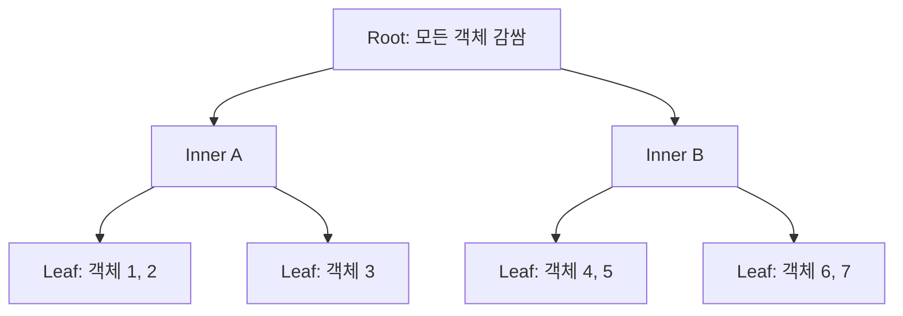
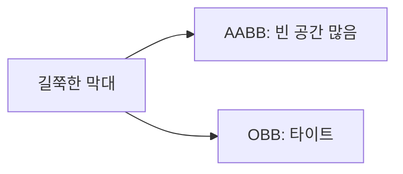
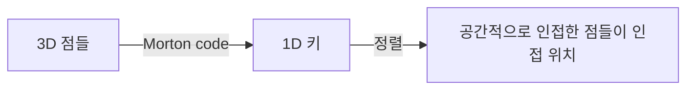
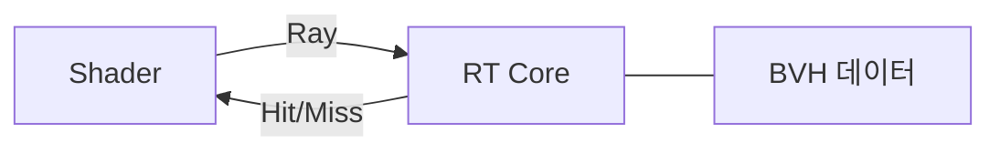

## 들어가며

*공간 분할 (Grid, Quadtree, K-d Tree)* 은 *공간을 미리 쪼갠다*. 객체는 그 분할에 *떨어진다*. *빈 공간* 도 분할에 포함된다.

*BVH (Bounding Volume Hierarchy)* 는 *반대 패러다임*. *객체 자체를 트리* 로 만든다. 각 객체를 *경계 볼륨 (보통 AABB)* 으로 감싸고, 그 볼륨을 *더 큰 볼륨으로 묶고*, 또 묶고 — 결국 *루트 노드 한 개* 가 *모든 객체를 감싼다*. 빈 공간은 *트리에 들어가지 않는다*.



이 트리가 *충돌 검사·레이캐스팅·레이트레이싱* 의 *표준 가속 구조*. RTX 하드웨어가 GPU 에서 *BVH 트래버설* 을 직접 가속할 만큼 핵심.

핵심 토픽들.

1. **BVH 의 정의** — 객체가 트리에 들어간다는 점에서 BSP·Octree 와 구분.
2. **Bounding Volume 선택** — AABB 가 표준. OBB·Sphere·K-DOP 의 트레이드오프.
3. **Top-down 빌드** — 분할 평면 선택. SAH (Surface Area Heuristic) 의 통계적 모델.
4. **Bottom-up·LBVH** — Morton code 생성 + radix sort + 선형 트리 구성. radix sort 기준으로 사실상 $O(n)$, comparison sort 면 $O(n \log n)$.
5. **Refit vs Rebuild** — 동적 씬에서 *트리 구조 유지 + 박스만 갱신*.
6. **충돌 트래버설** — 두 BVH 동시 트래버설로 broad phase.
7. **레이 트래버설** — 광선이 BVH 따라 가지치기. RTX 표준.

이 글의 목표는 *BVH 가 어떤 자료구조이고, 어떻게 만들고, 어떻게 쓰는가* 다. *레이캐스팅* 은 *BVH 위로 광선이 흐르는* 핵심 활용이다.


---

## 목차
1. [BVH의 정의와 종류](#1-bvh의-정의와-종류)
2. [Bounding Volume 선택](#2-bounding-volume-선택)
3. [Top-down 빌드](#3-top-down-빌드)
4. [SAH 비용 함수](#4-sah-비용-함수)
5. [Bottom-up과 LBVH](#5-bottom-up과-lbvh)
6. [Refit vs Rebuild](#6-refit-vs-rebuild)
7. [충돌 검사 트래버설](#7-충돌-검사-트래버설)
8. [레이 트래버설과 GPU BVH](#8-레이-트래버설과-gpu-bvh)


---

## 1. BVH의 정의와 종류

자료구조의 정의와 *공간 분할 구조* 와의 차이.

### 1.1 정의

BVH 는 *이진 (또는 다진) 트리* 로, 각 노드가 *경계 볼륨 (bounding volume)* 을 가지고, 자식 노드들의 *볼륨이 부모 볼륨에 완전히 포함*.

```cpp
struct BVHNode {
    AABB     bounds;
    int      leftChild;       // -1 면 leaf
    int      rightChild;
    // leaf 인 경우
    int      firstObject;     // 객체 배열 인덱스
    int      objectCount;
};
```

leaf 가 *객체* (또는 객체 묶음), inner 가 *자식들의 합집합 박스*. 트리의 *불변식*: 부모의 박스가 자식의 박스를 포함.

### 1.2 BVH vs 공간 분할

| | 공간 분할 (Grid, Quadtree) | BVH |
|---|---|---|
| 분할 대상 | 공간 | 객체 |
| 빈 공간 | 분할에 포함 | 무시 |
| 객체 변경 | 셀만 갱신 | 박스 갱신 (refit) 또는 재빌드 |
| 객체 중복 | 여러 셀에 등록 가능 | 한 leaf 에 한 번 |
| 동적 적응 | 약함 (분할 고정) | 좋음 (트리 변형) |

BVH 가 *객체 분포에 정확히 맞춤*. 빈 공간이 *낭비되지 않는다*.

### 1.3 트리 차수

- **이진 BVH**: 가장 흔함. 모든 inner 노드가 *자식 2개*. 트래버설 코드 간단.
- **4-wide / 8-wide BVH**: 자식 4개 또는 8개. SIMD 친화 (한 노드 = 4 또는 8 박스 비교 한 번).
- **n-wide**: GPU 에서 흔함. 한 워프 (32 스레드) 가 n 자식 박스를 *병렬 검사*.

게임 엔진은 보통 *이진 BVH 또는 4-wide*. 레이트레이싱은 *4-wide 이상*.

### 1.4 leaf 의 객체 수

leaf 가 *1개 객체* 만 가지면 트리 깊이 깊고 메모리 큼. *여러 객체 (보통 2~8)* 를 leaf 에 묶으면 트리 얕아지고 캐시 친화.

```cpp
constexpr int LEAF_THRESHOLD = 4;  // leaf 의 최대 객체 수
```

빌드 알고리즘이 *leaf 임계값* 을 보고 분할 멈춤.

### 1.5 메모리 레이아웃

BVH 노드를 *배열로 평탄화* — 포인터 대신 *인덱스*.

```cpp
std::vector<BVHNode> nodes;        // 배열에 평탄화
std::vector<int>     objectIndices;  // leaf 가 가리키는 객체 배열
```

장점: *연속 메모리 → 캐시 친화*, *직렬화·GPU 전송 쉬움*. RTX BVH 는 *압축된 노드 형식 (NVIDIA · AMD 자체 포맷)*.

### 1.6 BVH 의 응용

- **충돌 검사 broad phase**: 두 BVH를 동시에 순회하며 겹치지 않는 노드 쌍을 가지치기한다.
- **레이캐스팅 / 레이트레이싱**: 광선이 교차하는 노드만 따라가며 primitive 검사를 줄인다.
- **Frustum Culling**: 카메라 frustum 과 BVH 노드 박스 비교.
- **occlusion culling 보조**: 큰 객체가 작은 객체 가림 검사.

이 모든 활용이 *같은 BVH 구조 한 번 빌드 후 다양한 쿼리*. 자료구조의 *다재다능함* 이 핵심 강점.

## 2. Bounding Volume 선택

각 노드가 *어떤 모양의 볼륨* 으로 자식들을 감싸는가. 트레이드오프 명확하다.

### 2.1 후보 볼륨

| 볼륨 | 메모리 | 갱신 비용 | 타이트 | 교차 검사 |
|---|---|---|---|---|
| Sphere | 16 B | 빠름 (회전 불변) | 헐거움 | 매우 빠름 |
| AABB | 24 B | 빠름 (변환마다 재계산) | 보통 | 빠름 |
| OBB | 60+ B | 느림 (회전 따라 갱신) | 타이트 | 느림 |
| K-DOP | 가변 | 보통 | 가변 | 보통 |
| Slab | 가변 | 보통 | 보통 | 보통 |

### 2.2 AABB — 표준

대부분 게임 BVH 가 *AABB 노드*. 이유.

- *교차 검사가 빠름* (비교 6번).
- *합집합 계산이 즉각* (per-component min/max).
- *변환 후 재계산이 단순* (8 코너 변환).

타이트하지 않은 단점이 있지만 *빠른 거리치 + 갱신* 이 더 중요.

### 2.3 OBB — 타이트하지만 비쌈

회전한 박스. *얇은 / 길쭉한 객체* 에 AABB 보다 훨씬 타이트.



문제: 객체가 *움직이거나 회전* 할 때 OBB 갱신이 *비쌈*. 회전 행렬 + extents 재계산. 매 프레임 갱신이 부담.

활용: *드물게 변하는 정적 객체*. 또는 *narrow phase 의 입력* 으로 (다음 단계 SAT 가 OBB 받음).

### 2.4 Sphere — 회전 불변

구는 *어떤 회전에도 같은 볼륨*. 갱신이 *위치 + 반지름만*.

문제: *대각선이 긴 객체* 를 감싸면 *빈 공간이 너무 많음*. 충돌 후보가 *false positive 폭증*.

활용: *대칭 객체* (구체 자체, 일부 캐릭터). 또는 *broad phase 의 매우 거친 1차 컷*.

### 2.5 K-DOP

*k-Discrete Oriented Polytope*. AABB 가 *6 평면 (axis-aligned)* 이라면, K-DOP 는 *k 개의 평면 (방향 정해짐)* — 보통 18-DOP, 26-DOP.

AABB (6-DOP) 보다 타이트, OBB 보다 빠른 갱신. *중간 트레이드오프*. 게임 엔진의 일부에서 활용 (Crysis 의 일부 시스템 등).

### 2.6 Slab

*평행한 두 평면 사이* 영역. AABB 가 *3 쌍 슬랩*. OBB 도 *3 쌍 슬랩 (회전된)*. 광선 트래버설의 *Slab Test* 가 이 표현을 활용한다.

### 2.7 게임의 표준 선택

대부분 게임 엔진:

- **물리 BVH**: AABB 노드.
- **렌더 BVH**: AABB 노드.
- **레이트레이싱**: AABB 노드. RTX 도 AABB 만 직접 가속.

*AABB 가 압도적 표준*. OBB·Sphere·K-DOP 는 *특수 상황* 또는 *narrow phase 입력* 으로 등장.

## 3. Top-down 빌드

전체 객체에서 시작해 *분할 평면* 을 골라 좌·우 자식으로 나누고, 재귀.

### 3.1 알고리즘 골격 (median 분할)

가장 단순한 *median split* 버전. 분할 위치가 *고정 인덱스 (중앙값)* 라 `nth_element` 로 partition.

```cpp
int BuildBVH_Median(std::vector<int>& objs, int begin, int end) {
    BVHNode node;
    node.bounds = ComputeBoundsOfObjects(objs, begin, end);

    int count = end - begin;
    if (count <= LEAF_THRESHOLD) {
        node.firstObject = begin;
        node.objectCount = count;
        node.leftChild = node.rightChild = -1;
        nodes.push_back(node);
        return nodes.size() - 1;
    }

    int axis = LongestAxis(node.bounds);
    int splitIdx = (begin + end) / 2;

    // median: nth_element 가 axis 좌표 기준 splitIdx 위치에 중앙값을 둔다.
    std::nth_element(objs.begin() + begin, objs.begin() + splitIdx, objs.begin() + end,
        [&](int a, int b) {
            return ObjectCenter(a)[axis] < ObjectCenter(b)[axis];
        });

    int nodeIdx = nodes.size();
    nodes.push_back(node);
    int left  = BuildBVH_Median(objs, begin, splitIdx);
    int right = BuildBVH_Median(objs, splitIdx, end);
    nodes[nodeIdx].leftChild  = left;
    nodes[nodeIdx].rightChild = right;
    return nodeIdx;
}
```

객체 배열을 *in-place partition*. 재귀 빌드.

*centroid midpoint* 또는 *SAH* 분할은 *고정 인덱스* 가 아니라 *값 (분할 평면 좌표)* 으로 partition — `nth_element` 대신 `std::partition` 사용. 코드 형태가 다르다 (3.4·4.5 절).

### 3.2 분할 축 선택

가장 단순: *현재 노드의 가장 긴 축*.

```cpp
int LongestAxis(AABB box) {
    vec3 size = box.max - box.min;
    if (size.x >= size.y && size.x >= size.z) return 0;
    if (size.y >= size.z) return 1;
    return 2;
}
```

*가장 긴 축으로 자르면* 자식들의 *상대적 크기 차이* 가 줄어 균형 잡힘.

### 3.3 분할 위치 — Median

*객체 중심점의 중앙값* 으로 분할.

```cpp
// std::nth_element 가 partition 까지 해줌 — 정렬 안 함, O(n)
int splitIdx = (begin + end) / 2;
```

단순하고 *균형 잡힘*. 하지만 *객체 분포* 를 고려 안 함.

### 3.4 분할 위치 — Centroid Midpoint

객체 중심들의 *AABB 의 중점* 을 기준으로 분할.

```cpp
AABB centroidBounds = ComputeCentroidBounds(objs, begin, end);
float midpoint = 0.5f * (centroidBounds.min[axis] + centroidBounds.max[axis]);

// 분할 평면 (midpoint) 기준 partition — std::partition 이 적합
auto mid = std::partition(objs.begin() + begin, objs.begin() + end,
    [&](int id) { return ObjectCenter(id)[axis] < midpoint; });
int splitIdx = (int)(mid - objs.begin());

// 한쪽이 비어 버리는 케이스 (모든 객체가 평면 한쪽에 몰림) → median fallback
if (splitIdx == begin || splitIdx == end) splitIdx = (begin + end) / 2;
```

분포가 *치우쳐 있으면* median 보다 좋다. 단순 평균보다 robust. 한쪽 자식이 *0 객체* 가 되는 함정 — *median fallback* 으로 회피.

### 3.5 분할 위치 — SAH (4절)

Surface Area Heuristic은 자식 경계 상자의 표면적 비율을 광선이 그 자식을 방문할 확률의 근사로 사용하고, traversal 비용과 primitive 교차 비용의 기대값이 가장 작은 split을 선택한다.

### 3.6 빌드 비용

- *Median 분할*: $O(n \log n)$ 평균 (nth_element 가 $O(n)$ 이지만 재귀 깊이 $\log n$).
- *SAH*: $O(n^2)$ naive, $O(n \log n)$ binned SAH.

큰 씬은 *binned SAH*. 작은 씬은 *median* 도 충분.

### 3.7 빌드 품질의 영향

분할 품질이 *쿼리 비용에 직접 영향*. 나쁜 분할은:

- *겹치는 자식 박스* — 쿼리가 양쪽 자식 모두 탐색 → 비용 ↑.
- *불균형 트리* — 깊이 ↑.

좋은 분할은:

- *겹치지 않는 자식 박스*.
- *둘로 균등하게 객체 나뉨*.

이 둘을 *수치화* 한 것이 *SAH*.

## 4. SAH 비용 함수

*Surface Area Heuristic*. BVH 빌드 품질의 *통계적 모델*. PBRT 의 표준.

### 4.1 핵심 직관

고전적인 ray SAH는 광선의 위치와 방향이 공간에서 균일하고 등방적이며, 자식 경계가 부모 안에 들어 있다는 모델을 둔다. 이 모델에서는 부모를 통과한 광선이 자식 경계를 통과할 조건부 확률을 표면적 비율로 근사한다.

$$
P(\text{node 방문}) \propto \text{SA}(\text{node})
$$

이 통계적 가정 하에서, *분할의 비용* 을 정량화.

### 4.2 SAH 비용 함수

분할 후보의 비용:

$$
C(\text{split}) = C_T + \frac{\text{SA}(L)}{\text{SA}(P)} \cdot N_L \cdot C_I + \frac{\text{SA}(R)}{\text{SA}(P)} \cdot N_R \cdot C_I
$$

- $C_T$: 트래버설 비용 (이 노드의 박스 검사).
- $C_I$: leaf 객체 검사 비용.
- $N_L, N_R$: 좌·우 자식의 객체 수.
- $\text{SA}(X)$: 박스 X 의 표면적.
- $\text{SA}(P)$: 부모 박스의 표면적.

*표면적 비율* 은 위 광선 분포 모델에서의 조건부 방문 확률 근사다. 박스 overlap, frustum, 특정 카메라에서 발사되는 ray처럼 쿼리 분포가 다르면 이 비율은 정확한 확률이 아니지만, 트리 품질을 비교하는 유용한 heuristic으로 남는다. *그 노드 안의 객체 수* 와 primitive별 교차 비용을 곱해 기대 비용을 근사한다.

### 4.3 분할 vs Leaf 결정

*분할하는 비용 vs leaf 로 두는 비용* 비교.

$$
C(\text{leaf}) = N \cdot C_I
$$

*분할 비용이 leaf 비용보다 작으면* 분할. 아니면 leaf.

### 4.4 SAH 의 함의

위 공식의 함의들.

- **자식 박스 표면적 작아야** — 좌·우 자식이 *타이트* 할수록 좋음.
- **면적과 객체 비용의 결합** — 객체 수가 한쪽에 많아도 그 자식의 면적과 primitive 비용이 충분히 작으면 좋은 분할일 수 있다. 단순한 count 균형이 목적은 아니다.
- **자식 표면적 합 < 부모 표면적** — 자식이 *겹쳐도* OK 일 수 있다 (객체 수가 균형 잡히면).

단순 median 분할이 *항상 최적은 아님*. *겹쳐도 객체 분포 적합* 한 분할이 더 좋을 수 있다.

### 4.5 Binned SAH

각 노드에서 모든 primitive 경계를 후보로 삼고 매 후보의 bounds를 다시 계산하는 naive 구현은 $O(n^2)$ 이 될 수 있다. 정렬된 prefix/suffix bounds는 한 축의 후보 평가를 $O(n)$으로 줄일 수 있고, 고정 개수 bin은 후보 수와 메모리를 제한한다. 전체 재귀 빌드 복잡도는 분할 균형과 정렬·partition 방식에 따라 달라진다.

```cpp
constexpr int NUM_BINS = 16;

struct Bin {
    AABB bounds = MakeEmptyAABB();   // 명시적 empty 초기화 (vec3 ±INF)
    int  count  = 0;
};

bool EvaluateSplitsBinned(std::vector<int>& objs, int begin, int end,
                           int axis, AABB centroidBounds, int& outSplitBin) {
    float extent = centroidBounds.max[axis] - centroidBounds.min[axis];
    if (extent < 1e-8f) return false;   // 모든 중심이 한 평면 위 — leaf 또는 median fallback

    Bin bins[NUM_BINS] = {};
    float k = NUM_BINS / extent;

    // 객체들을 bin 에 분류
    for (int i = begin; i < end; ++i) {
        int b = std::clamp((int)((ObjectCenter(objs[i])[axis] -
                                     centroidBounds.min[axis]) * k),
                            0, NUM_BINS - 1);
        bins[b].count++;
        bins[b].bounds = Union(bins[b].bounds, ObjectAABB(objs[i]));
    }

    // 모든 분할 위치 평가 (NUM_BINS - 1)
    float bestCost = INFINITY;
    int   bestSplit = -1;
    for (int s = 1; s < NUM_BINS; ++s) {
        AABB leftBox  = MakeEmptyAABB();
        AABB rightBox = MakeEmptyAABB();
        int  leftCount = 0, rightCount = 0;
        for (int i = 0; i < s; ++i)             { leftBox = Union(leftBox, bins[i].bounds);  leftCount  += bins[i].count; }
        for (int i = s; i < NUM_BINS; ++i)      { rightBox = Union(rightBox, bins[i].bounds); rightCount += bins[i].count; }

        if (leftCount == 0 || rightCount == 0) continue;   // 한쪽 자식이 비면 skip

        float cost = SurfaceArea(leftBox)  * leftCount
                   + SurfaceArea(rightBox) * rightCount;
        if (cost < bestCost) { bestCost = cost; bestSplit = s; }
    }
    if (bestSplit < 0) return false;
    outSplitBin = bestSplit;
    // 호출자가 std::partition 으로 bin 경계 평면 기준 객체 partition
    return true;
}
```

*16 ~ 32 bin* 이 일반적. 정확도와 속도의 균형. *centroid extent 가 0* (모든 중심이 같은 평면) 이면 *leaf 또는 median fallback*. *bin bounds* 는 *명시적 empty AABB* (min = +∞, max = -∞) 로 초기화 — Union 결과가 정확.

### 4.6 PBRT 와 산업

*PBRT* (Physically Based Rendering Toolkit) 가 *binned SAH* 의 교과서적 구현. NVIDIA OptiX, Embree, RTX BVH 가 모두 *binned SAH* 또는 변형 사용.

게임 엔진의 BVH 빌드는 *binned SAH* 가 거의 표준. *오프라인 빌드* 는 *전체 SAH (n²)*, *런타임 빌드* 는 *binned*.

### 4.7 SAH 의 한계

SAH 는 *통계적 모델*. *특정 쿼리 분포* 가정. 실제 게임의 *카메라 frustum* 이 임의 분포가 아니라 *카메라 시야* 라 *SAH 가 항상 최적 아님*. 그래도 *실용적으로 매우 좋음*.

## 5. Bottom-up과 LBVH

Top-down 의 *재귀 빌드* 대신 *Bottom-up* — 작은 leaf 부터 묶어 올라간다.

### 5.1 Bottom-up 의 핵심

*가장 가까운 두 leaf 를 묶어 부모 만들기* 를 반복.

```cpp
// 단순 bottom-up — pairwise nearest 묶기
void BuildBottomUp(std::vector<BVHNode>& leaves) {
    while (leaves.size() > 1) {
        // 모든 쌍 중 묶었을 때 박스 가장 작은 쌍 찾기
        // 묶고, 묶인 둘 제거, 부모 추가
        ...
    }
}
```

문제: $O(n^3)$ 비용. 큰 씬에 부적합. *LBVH* 가 이 문제를 푼다.

### 5.2 Morton Code

*공간을 1D 로 매핑하는 trick*. 객체 중심점의 (x, y, z) 를 *비트 인터리브* 해 *단일 정수*.

```cpp
uint32_t Morton3D(uint32_t x, uint32_t y, uint32_t z) {
    // 각 좌표를 10 bit 로 가정. 인터리브로 30 bit.
    auto expand = [](uint32_t v) {
        v = (v | (v << 16)) & 0x030000FF;
        v = (v | (v << 8))  & 0x0300F00F;
        v = (v | (v << 4))  & 0x030C30C3;
        v = (v | (v << 2))  & 0x09249249;
        return v;
    };
    return expand(x) | (expand(y) << 1) | (expand(z) << 2);
}
```

*공간적으로 가까운 점* 이 *Morton code 도 가까움* (Z-order curve). *1D 정렬 = 3D 공간 군집*.



### 5.3 LBVH 알고리즘

Tero Karras 의 *Linear BVH* (2012). GPU 친화적 $O(n)$ 빌드.

1. 각 객체 중심점 → *Morton code*.
2. Morton code 순으로 *정렬*.
3. 정렬된 배열의 *공통 접두사* 로 *트리 구조 결정*.
4. 박스 *bottom-up 갱신*.

```text
Morton 정렬된 배열:
    obj_0  obj_1  obj_2  obj_3  obj_4  obj_5  obj_6  obj_7
    ↓ 공통 접두사 길이로 트리 만듦 ↓
              [Root]
             /      \
         [0..3]    [4..7]
         /  \      /  \
       [..]  [..] [..] [..]
```

병렬 radix sort와 트리 구성은 GPU에 잘 맞는다. 실제 build 시간은 primitive 수, key bit 수, 메모리 대역폭과 생성할 노드 형식에 따라 측정한다.

### 5.4 LBVH 품질

LBVH 가 *빠르지만 SAH 보다 품질 약간 낮음*. *AAC (Approximate Agglomerative Clustering)* 또는 *PLOC (Parallel Locally-Ordered Clustering)* 같은 변형이 *품질 + 속도* 절충.

### 5.5 게임에서의 LBVH

동적 레이트레이싱에서는 acceleration structure를 refit/update하거나 rebuild한다. API와 드라이버는 내부 빌드 알고리즘을 공개하지 않을 수 있으므로 BLAS/TLAS가 반드시 LBVH라고 가정하면 안 된다. build/update flag와 실제 시간·trace 성능을 측정한다.

## 6. Refit vs Rebuild

동적 씬: 객체가 매 프레임 움직인다. BVH 가 *어떻게 따라가는가*.

### 6.1 Refit — 박스만 갱신

트리 구조 *유지*, 각 노드의 *박스만 자식 박스 합집합으로 다시 계산*.

```cpp
void Refit(BVHNode& node) {
    if (node.leftChild < 0) {
        // leaf — 객체들의 현재 박스 합집합
        node.bounds = ComputeBoundsOfLeafObjects(node);
        return;
    }
    Refit(nodes[node.leftChild]);
    Refit(nodes[node.rightChild]);
    node.bounds = Union(nodes[node.leftChild].bounds,
                          nodes[node.rightChild].bounds);
}
```

비용: $O(n)$. 매 프레임 OK.

### 6.2 Refit 의 한계

핵심: *Refit 은 각 노드의 bounds 를 자식 합집합으로 정확히 다시 맞춘다*. 박스 자체는 *헐거워지지 않는다*. 문제는 *트리 위상 (topology) 이 빌드 시점의 객체 분포에 맞춰 굳어 있다는 것* — 객체가 크게 움직이면 *형제 노드 사이 박스 overlap* 이 커져 쿼리가 양쪽 자식을 모두 들어가게 된다.


이동이 누적되면 *겹치는 자식 박스* 가 늘어나 *쿼리에 양쪽 자식 모두 탐색* 빈도 ↑. 일정 임계점 넘으면 *재빌드*.

### 6.3 Rebuild

*트리 처음부터 다시 빌드*. $O(n \log n)$. 매 프레임은 부담, *주기적으로* 또는 *품질이 떨어진 후*.

재빌드 판정은 고정된 보편 상수가 아니라 품질과 비용의 측정 계약이다.

- *현재 SAH 또는 내부 노드 표면적 / 빌드 직후 값* 으로 트리 열화를 추적한다.
- 실제 query당 방문 노드 수, refit 시간, rebuild 시간과 프레임 예산을 함께 기록한다.
- 임계값을 넘는 즉시 매번 재빌드하지 않도록 상·하한 또는 최소 유지 시간을 둔다.
- `2배`, `30~60프레임` 같은 값은 특정 워크로드의 시작점일 뿐이며 객체 이동성·쿼리 분포·빌드 방식에 맞춰 프로파일링한다.

### 6.4 점진적 재구성

*Incremental Rebuild*. 한 프레임에 *전체 트리 재빌드 비용을 분산*.

```cpp
struct IncrementalBVH {
    int rebuildCursor = 0;     // 다음 재빌드 노드 인덱스
};
```

매 프레임 *일부 노드만* 재구성. 스파이크 회피. 산업 구현의 흔한 패턴.

### 6.5 BLAS / TLAS 분리 (RTX 패턴)

레이트레이싱의 표준 패턴.

- **BLAS (Bottom-Level Acceleration Structure)**: *객체별 BVH*. 정점·삼각형의 트리. 객체가 변형 안 하면 빌드 1번 + 평생.
- **TLAS (Top-Level Acceleration Structure)**: *객체들의 BVH*. 객체의 *AABB 와 변환 행렬* 을 노드로. 매 프레임 갱신.

객체가 *위치만 바뀌면* TLAS 만 *refit*. BLAS 는 *그대로*. 효율적.

게임 엔진의 *물리 BVH* 도 비슷한 패턴 — *static BVH* 와 *dynamic BVH* 분리.

### 6.6 Bullet 의 btDbvt

Bullet Physics 의 *Dynamic BVH*. *불완전한 균형 + refit + 점진적 재구성* 의 산업 구현. 게임의 *수만 동적 객체* 를 효율적으로.

소스 (`btDbvt.cpp`) 가 동적 BVH 의 표준 참고서.

## 7. 충돌 검사 트래버설

BVH 의 *broad phase 활용*. 두 BVH 를 *동시에 트래버설* 해 충돌 후보 추출.

### 7.1 두 BVH 트래버설

```cpp
void Collide(int aIdx, int bIdx, std::vector<std::pair<int,int>>& pairs) {
    BVHNode& a = nodesA[aIdx];
    BVHNode& b = nodesB[bIdx];

    if (!Intersects(a.bounds, b.bounds)) return;  // 분리 — 가지치기

    if (a.leftChild < 0 && b.leftChild < 0) {
        // 둘 다 leaf — 객체끼리 비교
        for (int i = 0; i < a.objectCount; ++i)
            for (int j = 0; j < b.objectCount; ++j)
                pairs.emplace_back(objectsA[a.firstObject + i],
                                    objectsB[b.firstObject + j]);
        return;
    }

    // 하나라도 inner — leaf/inner 조합은 inner 쪽만 자식으로 내려간다.
    // 둘 다 inner 면 네 자식 조합을 모두 검사한다.
    if (a.leftChild < 0) {
        Collide(aIdx, b.leftChild,  pairs);
        Collide(aIdx, b.rightChild, pairs);
    } else if (b.leftChild < 0) {
        Collide(a.leftChild,  bIdx, pairs);
        Collide(a.rightChild, bIdx, pairs);
    } else {
        Collide(a.leftChild,  b.leftChild,  pairs);
        Collide(a.leftChild,  b.rightChild, pairs);
        Collide(a.rightChild, b.leftChild,  pairs);
        Collide(a.rightChild, b.rightChild, pairs);
    }
}
```

*두 박스가 분리되면 즉시 컷*. 후보 쌍이 *크게 줄어든다*. 산업 구현은 *어느 자식부터 재귀하는가* 의 휴리스틱 (*큰 박스부터 + small-batch 처리*) 등을 추가.

### 7.2 자가 충돌 (self collision)

*하나의 BVH 안* 에서 *모든 충돌 쌍* 찾기.

```cpp
void SelfCollide(int idx, std::vector<std::pair<int,int>>& pairs) {
    BVHNode& n = nodes[idx];
    if (n.leftChild < 0) {
        // leaf 안 모든 쌍
        for (int i = 0; i < n.objectCount; ++i)
            for (int j = i + 1; j < n.objectCount; ++j)
                pairs.emplace_back(objects[n.firstObject + i],
                                    objects[n.firstObject + j]);
        return;
    }
    SelfCollide(n.leftChild,  pairs);
    SelfCollide(n.rightChild, pairs);
    // 좌·우 자식 사이의 cross 충돌
    Collide(n.leftChild, n.rightChild, pairs);
}
```

*같은 자식 안의 쌍 + 좌·우 자식 사이 쌍*. 이중 재귀.

### 7.3 Sweep and Prune (대안)

BVH 의 broad phase 대안. *AABB 의 한 축 (보통 x) 으로 정렬* 후 *겹치는 구간만* 비교.

```cpp
void SweepAndPrune(std::vector<AABB>& boxes,
                    std::vector<std::pair<int,int>>& pairs) {
    // x 축으로 정렬 (객체 인덱스 기억)
    std::vector<int> indices(boxes.size());
    std::iota(indices.begin(), indices.end(), 0);
    std::sort(indices.begin(), indices.end(), [&](int a, int b) {
        return boxes[a].min.x < boxes[b].min.x;
    });

    // active list — 현재 x 구간이 겹치는 객체들
    std::vector<int> active;
    for (int i : indices) {
        // active 에서 끝난 객체 제거
        active.erase(std::remove_if(active.begin(), active.end(),
            [&](int j) { return boxes[j].max.x < boxes[i].min.x; }),
            active.end());
        for (int j : active) {
            if (Intersects(boxes[i], boxes[j])) pairs.emplace_back(i, j);
        }
        active.push_back(i);
    }
}
```

*객체 분포가 한 축으로 잘 나뉘면* 매우 효율적. *동적 갱신* 도 *증분 정렬* 로 빠름. Bullet · Box2D 등에서 *대안 broad phase*.

### 7.4 BVH vs Sweep and Prune

| | BVH | SAP |
|---|---|---|
| 빌드 | $O(n \log n)$ | $O(n \log n)$ 정렬 |
| 동적 갱신 | refit + rebuild | 증분 정렬 |
| 메모리 | 트리 노드 | 정렬 배열 |
| 친화 분포 | 임의 | 한 축 분포 좋음 |
| 트래버설 | 캐시 미스 잦음 | 선형 순회 |

게임 엔진은 둘 다 또는 *상황별 선택*. 일반적으로 BVH 가 *대규모 임의 분포* 에 강하고, SAP 가 *선형 분포 (도시·트랙)* 에 강함.

### 7.5 Octree + BVH 결합

Octree 로 *공간 분할* 후 각 셀 안에 *BVH* — 두 패러다임의 결합. 큰 환경의 *정적 BVH + 영역별 동적 BVH*.

UE5 의 *Lumen* 같은 시스템이 이런 *계층적 가속 구조*. 각 LOD 별 BVH, 각 노드 안에 하위 BVH.

## 8. 레이 트래버설과 GPU BVH

광선이 BVH 를 따라 가지치기. 게임의 *시야·사격·피킹·레이트레이싱* 표준.

### 8.1 광선 vs AABB

광선 $\vec{r}(t) = \vec{o} + t \vec{d}$ 와 AABB 의 교차. *Slab Test*.

```cpp
bool RayAABB(vec3 ro, vec3 invRd, AABB box, float& tNear, float& tFar) {
    vec3 t1 = (box.min - ro) * invRd;
    vec3 t2 = (box.max - ro) * invRd;
    vec3 tMin = min(t1, t2);
    vec3 tMax = max(t1, t2);

    tNear = std::max({ tMin.x, tMin.y, tMin.z, 0.0f });
    tFar  = std::min({ tMax.x, tMax.y, tMax.z });
    return tNear <= tFar;
}
```

*역방향 미리 계산 (`invRd = 1/rd`)* 으로 분기 없는 SIMD 코드를 만들 수 있다.

### 8.2 BVH 광선 트래버설

```cpp
bool TraceRay(vec3 ro, vec3 rd, RayHit& bestHit) {
    vec3 invRd = 1.0f / rd;
    std::stack<int> stack;
    stack.push(rootIdx);

    bool hit = false;
    bestHit.t = INFINITY;

    while (!stack.empty()) {
        int idx = stack.top(); stack.pop();
        BVHNode& node = nodes[idx];

        float tNear, tFar;
        if (!RayAABB(ro, invRd, node.bounds, tNear, tFar)) continue;
        if (tNear > bestHit.t) continue;  // 이미 가까운 hit 가 있음

        if (node.leftChild < 0) {
            // leaf — 객체들과 정밀 교차
            for (int i = 0; i < node.objectCount; ++i) {
                int objId = objects[node.firstObject + i];
                RayHit h;
                if (RayObject(ro, rd, objId, h) && h.t < bestHit.t) {
                    bestHit = h; hit = true;
                }
            }
        } else {
            // inner — 두 자식 push (가까운 자식을 나중에 push 해서 먼저 pop)
            stack.push(node.rightChild);
            stack.push(node.leftChild);
        }
    }
    return hit;
}
```

스택 기반 트래버설. *현재 best hit 보다 먼 노드는 가지치기*.

### 8.3 가까운 자식 우선

```cpp
// 두 자식 박스의 t_near 비교 후 가까운 자식부터 push
float tL_near, tL_far, tR_near, tR_far;
bool hitL = RayAABB(ro, invRd, nodes[left].bounds,  tL_near, tL_far);
bool hitR = RayAABB(ro, invRd, nodes[right].bounds, tR_near, tR_far);

if (tL_near < tR_near) {
    if (hitR) stack.push(right);
    if (hitL) stack.push(left);   // 먼저 pop 됨
} else {
    if (hitL) stack.push(left);
    if (hitR) stack.push(right);
}
```

*가까운 자식 먼저 탐색* → 빠르게 *가까운 hit* 잡고 *먼 자식 가지치기*. 트래버설의 표준 최적화.

### 8.4 Stack-less 트래버설 (GPU)

GPU 의 *워프 단위 실행* 에서 스택 메모리 부담. *Stack-less* 또는 *Short stack* 트래버설.

핵심 트릭: 노드에 *parent / sibling 인덱스* 를 저장. 스택 없이 *현재 위치 + 방향* 으로 트래버설.

NVIDIA OptiX, AMD Radeon Rays, RTX 하드웨어가 모두 이 패턴. *상수 메모리* 로 트래버설.

### 8.5 RTX 하드웨어 BVH

NVIDIA RTX (Turing, 2018+) 가 *BVH 트래버설 + 광선-삼각형 교차* 를 *전용 하드웨어 유닛 (RT Core)* 으로.



소프트웨어 BVH 트래버설 대비 *5~10x 가속*. 게임의 실시간 레이트레이싱 가능.

API: DXR (DirectX Raytracing), Vulkan Ray Tracing, OptiX. 모두 *BLAS + TLAS* 패턴 (6.5절).

### 8.6 게임 응용

- **시야 검사**: 적이 플레이어를 보는가? — 한 광선.
- **사격 hit-scan**: 총알 *광선* + BVH.
- **마우스 피킹**: 화면 좌표 → 광선 → BVH → 최초 객체.
- **그림자 광선**: 광원에서 표면까지 광선이 가려지는가.
- **레이트레이싱 GI / 반사**: 매 픽셀 *수십 광선*. RTX 표준.

이 모든 활용이 *같은 BVH + 같은 트래버설 코드*. 자료구조의 *통일성* 이 BVH 의 진짜 능력.


---

## 결론

BVH 는 *객체 자체를 트리로 묶는* 가속 구조. 빈 공간을 분할에 포함하지 않고 *객체 분포에 정확히 맞춤*. 충돌·레이캐스팅·레이트레이싱의 표준 도구.

이 글에서 정리한 핵심.

1. **AABB 노드 표준** — OBB·Sphere 는 특수 케이스. 빠른 갱신 + 빠른 교차 검사 = AABB.
2. **Top-down + SAH** — 통계적 비용 모델로 분할 품질을 결정한다. binned SAH는 후보 분할 수를 제한해 빌드 비용과 트래버설 품질을 절충하는 널리 쓰이는 방법이다.
3. **LBVH** — Morton code 정렬로 GPU 에서 $O(n)$ 빌드. 레이트레이싱의 매 프레임 빌드.
4. **Refit + Rebuild 결합** — 동적 씬에서 박스만 갱신하다 트래버설 비용이나 SAH 추정치가 임계값을 넘으면 일부 또는 전체를 재빌드할 수 있다.
5. **충돌 트래버설** — 두 BVH 동시 재귀. broad phase 의 표준.
6. **레이 트래버설** — Slab test + 가까운 자식 우선. RTX 하드웨어 가속.

*레이캐스팅* 은 광선과 도형의 교차 알고리즘들(Slab, Möller-Trumbore, Ray-Sphere)을 BVH 위에서 실행하는 방식이다. 이 교차 알고리즘들이 BVH 트래버설의 *프리미티브 단위* 다.

## 더 읽을거리

- Tero Karras, "Maximizing Parallelism in the Construction of BVHs, Octrees, and k-d Trees" (HPG, 2012) — LBVH 원전.
- Ingo Wald, "On Fast Construction of SAH-based Bounding Volume Hierarchies" (IEEE Symposium on Interactive Ray Tracing, RT07, 2007) — binned SAH 표준.
- Pharr, Jakob, Humphreys, *Physically Based Rendering* (PBRT), Ch. 4 — SAH BVH 의 교과서.
- *Real-Time Rendering*, 4th ed., Ch. 19, 26 — BVH 와 레이트레이싱.
- NVIDIA OptiX 7 Programming Guide — BLAS/TLAS 산업 패턴.
- DXR Spec (Microsoft) — DirectX Raytracing API.
- Bullet Physics 소스 (`btDbvt.cpp`) — 동적 BVH 산업 구현.
- Embree (Intel) — 산업 표준 CPU BVH 라이브러리.
- AMD Radeon Rays — GPU BVH 오픈소스.
