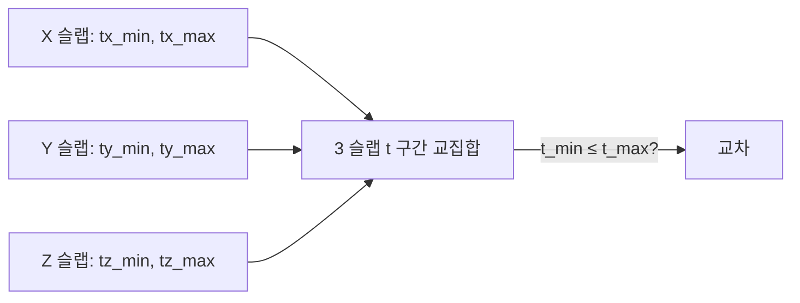

## 들어가며

광선 (ray) 과 도형의 교차 — *시야 검사·사격·마우스 피킹·그림자·레이트레이싱*. 게임의 무수한 기능이 *광선 한 줄을 쏘고 처음 만나는 표면을 찾는다*. 이 글은 그 *광선-도형 교차* 알고리즘들을 정리한다.


핵심 알고리즘들.

1. **광선의 표현** — $\vec{r}(t) = \vec{o} + t \hat{d}$ — 가장 단순한 1차 매개변수.
2. **Ray-Plane** — 1번 나눗셈. 가장 단순.
3. **Ray-Sphere** — 2차 방정식 + 판별식.
4. **Ray-AABB Slab Test** — *현대 게임의 광선 hot path*.
5. **Ray-Triangle (Möller-Trumbore)** — 메쉬 광선 트래버설의 표준.
6. **Ray-OBB / Ray-Capsule** — 일반 도형으로 확장.
7. **Ray-Mesh + BVH** — BVH 와 결합.
8. **수치 안정성** — self-intersection (acne), epsilon, 부호 일관성.

이 글의 알고리즘들은 *닫힌 형태 (closed form)* 가 대부분. 한 줄 ~ 십 줄 코드. 정확하게 구현해 두면 *게임의 거의 모든 시야 / 사격 / 피킹* 이 같은 함수 호출.

*BVH (트래버설 가속)* + 이 글의 *광선-도형 교차 (leaf 처리)* 가 결합해 *대규모 메쉬에서도 실시간 광선 쿼리* 를 만든다. 카메라와 투영까지 결합하면 *광선이 나오는 출처와 부딪히는 대상* 을 함께 다룰 수 있다.


---

## 목차
1. [광선의 표현](#1-광선의-표현)
2. [Ray-Plane](#2-ray-plane)
3. [Ray-Sphere](#3-ray-sphere)
4. [Ray-AABB Slab Test](#4-ray-aabb-slab-test)
5. [Ray-Triangle Möller-Trumbore](#5-ray-triangle-möller-trumbore)
6. [Ray-OBB와 Ray-Capsule](#6-ray-obb와-ray-capsule)
7. [Ray-Mesh와 BVH 트래버설](#7-ray-mesh와-bvh-트래버설)
8. [수치 안정성과 self-intersection](#8-수치-안정성과-self-intersection)


---

## 1. 광선의 표현

광선의 *수학적 표현* 과 코드 형태.

### 1.1 매개변수 표현

광선:

$$
\vec{r}(t) = \vec{o} + t \vec{d}, \quad t \ge 0
$$

- $\vec{o}$: 광선 원점 (origin).
- $\vec{d}$: 광선 방향. *단위 벡터일 수도 아닐 수도*.
- $t$: 매개변수. *진행 거리 또는 그 비례량*.

```cpp
struct Ray {
    vec3  origin;
    vec3  direction;
    float tMin = 0.001f;     // 최소 거리 (self-intersection 회피)
    float tMax = INFINITY;   // 최대 거리
};
```

`tMin`, `tMax` 가 *유효 구간*. 이 구간 밖의 hit 는 *무시*.

이 글의 대부분의 hit 함수는 `tMin`/`tMax`를 받아 유효 광선 구간을 검사한다. 단순화된 `RaySphereNormalized`와 `RayAABB` 예제처럼 `t >= 0`만 확인하는 변형을 산업 코드에 옮길 때는 반드시 `ray.tMin <= t && t <= ray.tMax` 계약을 추가해야 한다.

### 1.2 정규화 vs 비정규화

광선 방향 $\hat{d}$ 가 *단위 벡터* 이면 *t 가 진짜 거리*. 비정규화면 *t 는 거리의 비례량*.

```cpp
ray.direction = normalize(target - origin);  // 정규화 — t = 진짜 거리
ray.direction = target - origin;              // 비정규화 — t ∈ [0, 1] 이 origin → target
```

상황에 따라 다른 패턴.

- *시야 검사·사격*: 정규화. *거리 비교* 가 의미 있음.
- *경로 검사 (origin → target)*: 비정규화. *t < 1* 이면 도착 전 충돌.

### 1.3 광선 vs 선분 vs 직선

| 형태 | 매개변수 범위 | 활용 |
|---|---|---|
| 직선 (line) | $t \in (-\infty, \infty)$ | 수학적 분석 |
| 광선 (ray) | $t \in [0, \infty)$ | 시야 / 사격 |
| 선분 (segment) | $t \in [0, 1]$ (또는 $[0, L]$) | A→B 경로 |

대부분 게임 활용은 *광선* (시야·사격) 또는 *선분* (A→B 검사).

### 1.4 광선의 수학적 위치

광선 = *점 + 방향 + 매개변수*. *변환* 이 명확:

$$
\vec{r}'(t) = M \vec{r}(t) = (M \vec{o}) + t (M \vec{d})
$$

행렬 M 으로 *광선의 origin 변환 + direction 변환 (translation 무시 — direction 은 vec4(d, 0))*. *광선을 객체 로컬 좌표계로 가져와 검사* 패턴 (Ray-OBB) 의 토대.

### 1.5 광선의 결과

광선-도형 교차 결과:

```cpp
struct RayHit {
    bool   hit;
    float  t;          // 광선 매개변수
    vec3   point;      // 충돌 점 (= origin + t * direction)
    vec3   normal;     // 표면 법선
    int    objectId;   // (선택) 충돌 객체
    vec2   uv;         // (선택) 표면 매개변수 — 삼각형이면 barycentric (u, v). 텍스처 좌표는 정점 UV 를 이것으로 보간해 얻는다
};
```

게임 활용에 따라 *모두 또는 일부*.

## 2. Ray-Plane

가장 단순한 광선-도형 교차. *1번 나눗셈*.

### 2.1 식

평면은 $\hat{n} \cdot \vec{p} = d$ 로 둔다 ($\hat{n}$ 단위 벡터, $d$ 는 원점에서 평면까지의 부호 거리). 광선 $\vec{r}(t) = \vec{o} + t \hat{d}$ 가 평면 위의 점이려면:

$$
\vec{n} \cdot (\vec{o} + t \hat{d}) = d \implies t = \frac{d - \vec{n} \cdot \vec{o}}{\vec{n} \cdot \hat{d}}
$$

```cpp
bool RayPlane(vec3 ro, vec3 rd, vec3 n, float d,
              float tMin, float tMax, float& t) {
    float denom = dot(n, rd);
    if (std::fabs(denom) < 1e-6f) return false;  // 광선이 평면과 평행
    t = (d - dot(n, ro)) / denom;
    return tMin <= t && t <= tMax;
}
```

분모 0 (광선이 평면과 평행) 은 *교차 없음*. *tMin / tMax 구간 검사* 로 광선 뒤쪽 + 너무 먼 hit 제외. 평행 판정 임계값 `1e-6` 도 방향의 정규화 여부에 따라 의미가 달라지므로, 4.5 절의 AABB 평행 분기와 같은 *단위·축척 정책* 을 쓴다 — 유한 `tMax` 아래에서는 작은 denom 이 낳는 큰 t 가 구간 검사로 걸러지므로 임계값과 구간 계약을 함께 정한다.

### 2.2 Plane 의 부호 관례

평면의 식이 두 형식으로 돌아다닌다.

| 형식 | 상수항의 뜻 | 부호 거리 |
|---|---|---|
| $\hat{n} \cdot \vec{p} = d$ (Hessian) | 원점에서 평면까지의 부호 거리 *d* | $\hat{n} \cdot \vec{p} - d$ |
| $\hat{n} \cdot \vec{p} + D = 0$ (일반형) | 그 거리의 *부호 반대* 값 $D = -d$ | $\hat{n} \cdot \vec{p} + D$ |

*이 시리즈는 Hessian 쪽으로 통일한다* — 위 `RayPlane` 의 `d` 도 그것이다. 행렬 행 조합이나 외부 라이브러리에서 온 평면은 흔히 일반형 $(A, B, C, D)$ 이므로, 담기 전에 $d = -D / \|(A,B,C)\|$ 로 바꾸고 법선도 같은 길이로 나눈다.

*틀려도 컴파일은 된다.* 일반형의 $D$ 를 그대로 `d` 에 넣으면 `RayPlane` 은 원점을 사이에 둔 *반대편 평면* 과 교차한다. $\hat{n} = (0,0,1)$, 진짜 평면이 $z = 5$ 인데 $d = -5$ 로 들어가면, $\vec{o} = (0,0,0)$, $\hat{d} = (0,0,1)$ 광선에 대해 $t = (-5 - 0)/1 = -5$ — 앞쪽 5 에서 맞아야 할 것이 뒤쪽 5 로 나온다. `tMin = 0` 구간 검사에 걸려 *교차 없음* 으로 조용히 사라진다. 부호 실수의 전형적 증상이 "가끔 아무것도 안 맞는다" 인 이유다.

### 2.3 양면 vs 단면

광선이 *평면 뒤에서 hit* 되는 케이스. $\vec{n} \cdot \hat{d}$ 의 부호로 판단:

- 음수: 광선이 평면을 *앞에서 뒤로* 통과 — 외부에서 hit.
- 양수: 광선이 평면을 *뒤에서 앞으로* 통과 — *backface*.

게임에서 *backface culling* — 양수면 hit 무시.

```cpp
if (denom > -1e-6f) return false;  // backface 또는 평행
```

### 2.4 활용

- **카메라 벽 평면 컷**: 카메라가 벽을 뚫는지 검사.
- **무한 바닥 광선 검사**: y = 0 평면에 광선이 닿는 점 (간단 시작 코드).
- **다음 단계 (BVH 빌드)** 의 *분할 평면 검사*.

평면 자체는 *경계 없음* — 무한. 유한 도형 (사각형, 디스크) 은 *평면 hit + 경계 검사* 두 단계.

## 3. Ray-Sphere

가장 흔한 *유한 도형 광선 교차*. *2차 방정식*.

### 3.1 식 유도

구 $|\vec{p} - \vec{c}| = r$ 위의 점 $\vec{p} = \vec{r}(t)$:

$$
|\vec{o} + t \hat{d} - \vec{c}|^2 = r^2
$$

$\vec{m} = \vec{o} - \vec{c}$ 두면:

$$
|\vec{m} + t \hat{d}|^2 = r^2
$$

$$
|\hat{d}|^2 t^2 + 2 (\hat{d} \cdot \vec{m}) t + |\vec{m}|^2 - r^2 = 0
$$

*2차 방정식*. 판별식 $\Delta$ 으로 풀이.

### 3.2 코드

```cpp
bool RaySphere(vec3 ro, vec3 rd, vec3 center, float radius,
                float tMin, float tMax, float& t) {
    vec3 m = ro - center;
    float a = dot(rd, rd);          // |rd|² (정규화면 1)
    float b = 2.0f * dot(m, rd);
    float c = dot(m, m) - radius * radius;

    float disc = b * b - 4 * a * c;
    if (disc < 0) return false;     // 교차 없음

    float sqrtD = std::sqrt(disc);
    float t0 = (-b - sqrtD) / (2 * a);   // 가까운 해
    float t1 = (-b + sqrtD) / (2 * a);   // 먼 해

    if (tMin <= t0 && t0 <= tMax) { t = t0; return true; }
    if (tMin <= t1 && t1 <= tMax) { t = t1; return true; }   // 광선이 구 안에서 시작
    return false;
}
```

판별식 음수 → 교차 안 함. 두 해 중 *유효 구간 안의 가장 작은 t (= 가까운 hit)* 선택.

*수치 범위의 한계.* 이 교과서 형태는 `b² - 4ac` 에서 상쇄가 생길 수 있다 — 원점과 중심이 모두 큰 좌표이고 반지름이 작으면 두 큰 수의 차가 유효숫자를 잃고, 근 계산 `(-b ± √Δ)/(2a)` 자체도 서로 가까운 큰 근에서 자릿수를 잃는다. 실무에서는 (1) 원점을 구 중심 기준으로 재기준화한 뒤 계산, (2) 중간값을 double 로, (3) 안정 근 공식 $q = -\tfrac{1}{2}(b + \operatorname{sign}(b)\sqrt{\Delta})$, $t_0 = q/a$, $t_1 = c/q$ 를 쓴다. 다만 이 재배치도 접선 근처나 극단적 스케일에서는 오차 경계를 보장하지 않으며, 그 한계는 Part20 에서 다룬다.

### 3.3 광선이 구 안에서 시작

origin 이 *구 내부* 에 있으면 $t_0 < 0$ 이 되고 $t_1$ 만 양수. 그 케이스는 *광선이 구 밖으로 나가는 점*. 게임 상황에 따라 무시 또는 활용 (*구 내부 탈출 점*).

### 3.4 단순화 형식

$\hat{d}$ 가 *정규화* 되어 있으면 $a = 1$.

```cpp
bool RaySphereNormalized(vec3 ro, vec3 rd, vec3 center, float radius, float& t) {
    vec3 m = ro - center;
    float b = dot(m, rd);
    float c = dot(m, m) - radius * radius;
    if (c > 0 && b > 0) return false;   // 광선이 멀어지는 방향
    float disc = b * b - c;
    if (disc < 0) return false;
    t = -b - std::sqrt(disc);
    if (t < 0) t = -b + std::sqrt(disc);
    return t >= 0;
}
```

Ericson *Real-Time Collision Detection* Ch. 5.3 의 표준 형태. early-out + 정규화 가정.

### 3.5 법선

구의 법선:

```cpp
vec3 normal = normalize(hitPoint - center);
```

자명. 구의 모든 표면 점에서 *중심에서 표면 점 방향* 이 외향 법선.

### 3.6 활용

- **광원 충돌 효과**: bullet 광원의 lens flare 효과를 위한 광선 검사.
- **입자 픽업**: 보석·item 의 클릭 / 자동 픽업.
- **간이 캐릭터 발견**: AI 의 1차 가시성 검사.

구는 *충돌 도형* 으로도 *광선 도형* 으로도 게임에서 매우 흔하다.

## 4. Ray-AABB Slab Test

*가장 hot 한 광선-도형 교차*. BVH 트래버설의 매 노드에서 한 번. 분기 없는 SIMD 코드.

### 4.1 Slab 의 정의

AABB 는 *3 쌍의 평행 평면 (slab)*. 각 축에서 *광선이 슬랩에 들어오고 나가는 t* 구간이 있다.



세 슬랩의 *교집합* 이 *광선이 AABB 안에 있는 t 구간*. 비어 있지 않으면 교차.

### 4.2 식

각 축의 슬랩에 들어오고 나가는 t:

$$
t_x^{(\min, \max)} = \frac{(\text{box.min, box.max})_x - o_x}{d_x}
$$

(주의: $d_x < 0$ 이면 min/max 가 뒤집힘.)

세 축의 교집합:

$$
t_{\min} = \max(t_x^{\min}, t_y^{\min}, t_z^{\min}), \quad t_{\max} = \min(t_x^{\max}, t_y^{\max}, t_z^{\max})
$$

$t_{\min} \le t_{\max}$ 이고 $t_{\max} \ge 0$ 이면 교차 (광선은 $t \ge 0$ 이므로 박스가 원점 뒤에 있으면 제외 — 아래 코드의 `0.0f` 가 이 조건이다).

### 4.3 분기 없는 SIMD 코드

```cpp
bool RayAABB(vec3 ro, vec3 invRd, AABB box, float& tNear, float& tFar) {
    vec3 t0 = (box.min - ro) * invRd;
    vec3 t1 = (box.max - ro) * invRd;

    vec3 tMin = min(t0, t1);    // 성분별 min
    vec3 tMax = max(t0, t1);

    tNear = std::max({ tMin.x, tMin.y, tMin.z, 0.0f });
    tFar  = std::min({ tMax.x, tMax.y, tMax.z });

    return tNear <= tFar;
}
```

`invRd = 1.0f / rd` 미리 계산 → 매 노드 *나눗셈 회피*. *분기 없음* (`min/max` 만) → SIMD 유리.

### 4.4 광선 방향 0 케이스

`rd.x == 0` 이면 `invRd.x = ±inf`. *그 축으로 광선이 평행*. IEEE 754 환경에서 위 분기 없는 코드가 *대부분 동작* 하지만 *NaN 가능성 남는다*:

- `box.min.x - ro.x == 0` 이고 `invRd.x == ±inf` → `0 * ±inf = NaN`.
- `min`/`max` 의 *NaN 처리* 가 IEEE 754 정의에 따라 다름 (quiet NaN propagation).

산업 코드는 *명시적 NaN 처리* 또는 *축별 분기* 가 안전하다. 4.3 의 분기 없는 코드는 *IEEE 환경에서 자주 쓰이지만 NaN 케이스 별도 주의*.

### 4.5 NaN-safe 분기 버전

각 축에서 *광선이 평행 (rd ≈ 0)* 이면 *ro 가 slab 안에 있는지* 직접 검사, 아니면 나눗셈으로 t0/t1.

```cpp
bool RayAABBSafe(vec3 ro, vec3 rd, AABB box, float& tNear, float& tFar) {
    tNear = -INFINITY;
    tFar  = +INFINITY;

    for (int i = 0; i < 3; ++i) {
        if (rd[i] == 0.0f) {
            // 광선이 i 축에 정확히 평행. ro[i] 가 slab 밖이면 miss.
            if (ro[i] < box.min[i] || ro[i] > box.max[i]) return false;
            // 안에 있으면 그 축의 t 구간이 [-∞, +∞] — 다른 축으로 결정.
        } else {
            // double에서 나눠 작은 float 방향의 역수가 먼저 overflow하지 않게 한다.
            auto toFloat = [](double t) {
                if (t > std::numeric_limits<float>::max()) return INFINITY;
                if (t < -std::numeric_limits<float>::max()) return -INFINITY;
                return float(t);
            };
            float t0 = toFloat((double(box.min[i]) - ro[i]) / double(rd[i]));
            float t1 = toFloat((double(box.max[i]) - ro[i]) / double(rd[i]));
            if (t0 > t1) std::swap(t0, t1);
            tNear = std::max(tNear, t0);
            tFar  = std::min(tFar,  t1);
            if (tNear > tFar) return false;
        }
    }
    tNear = std::max(tNear, 0.0f);
    return tNear <= tFar;
}
```

유한 입력과 비영 방향에서 0에 무한대를 곱하는 NaN을 피한다. 극단적 범위에서는 결과의 float 변환이 무한대가 될 수 있으므로 실제 유효 거리 범위와 입력을 함께 관리한다. 축별 분기의 비용은 대상에서 측정한다. BVH에서도 평행 경계의 false negative를 피하려면 이 버전이나 해당 경계를 처리하는 검증된 SIMD 버전을 사용한다.

평행 판정은 *정확한 0* 으로만 한다. 방향이 비정규화되어도 된다는 계약에서 `fabs(rd[i]) < 1e-8` 같은 임계값은 방향을 *스케일만 바꿔도* 교차 판정을 뒤집는다 — 축 방향 성분이 작지만 0 이 아니면 슬랩을 언젠가 지나므로 교차가 존재할 수 있는데, 임계값이 그 축을 평행으로 오인하면 miss 로 사라진다. 정확한 0 분기에서는 그 축을 건너뛰고 나머지 축이 t 구간을 결정하며, 0 이 아닌 작은 성분은 큰 t 를 낳을 뿐 *유한 tMax* 구간 검사가 걸러낸다. 즉 이 함수의 유효성은 *유한 tMax* 와 *허용 이동 오차* 계약 위에서 읽어야 하고, RayPlane 의 분모 임계값도 같은 단위·축척 정책을 따른다.

### 4.6 BVH 트래버설의 hot path

이 함수가 *BVH 트래버설마다 한 번* 호출. 광선 하나에 *수백 ~ 수천 노드 검사*. SIMD 4-wide BVH 는 *한 번에 4개 박스 검사* — 4-way SoA layout.

```cpp
// 4-wide BVH 를 위한 4 박스 동시 검사 (의사 코드)
__m128 t0x = _mm_mul_ps(_mm_sub_ps(box4Min.x, _mm_set1_ps(ro.x)), _mm_set1_ps(invRd.x));
// ...
```

산업 레이트레이서 (Embree, OptiX) 의 hot path.

## 5. Ray-Triangle Möller-Trumbore

메쉬 광선 트래버설의 *표준 알고리즘*. 1997년 발표 후 *현재까지 표준*.

### 5.1 알고리즘 핵심

삼각형 위의 점은 *barycentric 좌표 (u, v)* 로:

$$
\vec{p}(u, v) = (1 - u - v) \vec{v_0} + u \vec{v_1} + v \vec{v_2}, \quad u, v \ge 0, \, u + v \le 1
$$

광선의 점 = 삼각형의 점:

$$
\vec{o} + t \hat{d} = (1 - u - v) \vec{v_0} + u \vec{v_1} + v \vec{v_2}
$$

정리:

$$
\vec{o} - \vec{v_0} = -t \hat{d} + u (\vec{v_1} - \vec{v_0}) + v (\vec{v_2} - \vec{v_0})
$$

3 미지수 (t, u, v), 3 식. 행렬 형태:

$$
\begin{pmatrix} -\hat{d} & \vec{e_1} & \vec{e_2} \end{pmatrix} \begin{pmatrix} t \\ u \\ v \end{pmatrix} = \vec{o} - \vec{v_0}
$$

*Cramer's rule* 로 $t, u, v$ 동시 추출.

### 5.2 코드

```cpp
bool RayTriangle(vec3 ro, vec3 rd, vec3 v0, vec3 v1, vec3 v2,
                  float tMin, float tMax,
                  float& t, float& u, float& v) {
    vec3 e1 = v1 - v0;
    vec3 e2 = v2 - v0;
    vec3 pvec = cross(rd, e2);
    float det = dot(e1, pvec);

    if (std::fabs(det) < 1e-8f) return false;  // 광선이 삼각형 평면에 평행
    float invDet = 1.0f / det;

    vec3 tvec = ro - v0;
    u = dot(tvec, pvec) * invDet;
    if (u < 0 || u > 1) return false;

    vec3 qvec = cross(tvec, e1);
    v = dot(rd, qvec) * invDet;
    if (v < 0 || u + v > 1) return false;

    t = dot(e2, qvec) * invDet;
    return tMin <= t && t <= tMax;
}
```

Cramer 의 분모 = `dot(e1, cross(rd, e2))` (삼중곱). 분자도 비슷한 식. *cross 두 번 + dot 네 번* — 매우 효율적.

### 5.3 u, v 의 의미

```cpp
vec3 hitPoint     = ro + t * rd;
vec3 baryHit      = (1 - u - v) * v0 + u * v1 + v * v2;  // 같음
vec3 normal       = (1 - u - v) * n0 + u * n1 + v * n2;  // 정점 법선 보간
vec2 texCoord     = (1 - u - v) * uv0 + u * uv1 + v * uv2;  // 텍스처 좌표 보간
```

*barycentric 보간* 으로 정점 attribute (법선·UV·color) 를 *hit point 에 자연스럽게 보간*. 게임의 *부드러운 그림자·노멀·텍스처* 의 토대.

### 5.4 backface culling

`det > 0` 만 유효로 두면 *backface 무시*.

```cpp
if (det < 1e-8f) return false;  // backface 또는 평행
```

게임 렌더링은 보통 backface 무시. 레이트레이싱 그림자 광선 등에서는 *양면 검사* 가 정확.

### 5.5 산업 변형

- **Watertight 교차 (Woop 외, 2013)**: 삼각형 *모서리에서 광선이 새는* 함정 해결. Möller-Trumbore 와 별개 알고리즘. PBRT 의 표준.
- **Pluecker coordinates**: 다른 표현. 메모리 ↑ 속도 ↑.
- **Triangle preprocessing**: 사전에 정점 변환 후 저장 (정적 메쉬 가속).

게임 엔진은 *기본 Möller-Trumbore*, RTX 하드웨어는 *고정 함수* (사실상 watertight).

### 5.6 게임 활용

- **마우스 피킹**: 화면 좌표 → 광선 → BVH → leaf 의 삼각형 → Möller-Trumbore.
- **사격 hit-scan**: 총알 광선 + 삼각형.
- **간접 조명**: 광선 → 표면 → 텍스처 lookup → 색.

`RayTriangle` 한 함수가 *게임 시각화의 백엔드*.

## 6. Ray-OBB와 Ray-Capsule

기본 도형 외의 광선 교차. *변환* 또는 *조합*.

### 6.1 Ray-OBB

가장 간단한 방법: *광선을 OBB 의 로컬 좌표계로 변환* 후 *AABB 검사*.

```cpp
bool RayOBB(vec3 ro, vec3 rd, OBB box, float& t) {
    // OBB 의 로컬 좌표계로 변환
    vec3 d = ro - box.center;
    vec3 localRO = vec3(dot(d, box.axes[0]),
                          dot(d, box.axes[1]),
                          dot(d, box.axes[2]));
    vec3 localRD = vec3(dot(rd, box.axes[0]),
                          dot(rd, box.axes[1]),
                          dot(rd, box.axes[2]));

    AABB localAABB { -box.extents, box.extents };
    float tNear, tFar;
    if (!RayAABBSafe(localRO, localRD, localAABB, tNear, tFar)) return false;

    // tNear/tFar 는 광선이 볼륨 안에 있는 *구간* 이다. 원점이 상자 안이면
    // tNear = 0 이므로, 표면 질의로 쓰려면 출구면 tFar 를 골라야 한다 —
    // RaySphere·RayCapsule 의 "내부 시작이면 출구 표면" 규약과 맞춘다.
    bool inside = localRO.x > localAABB.min.x && localRO.x < localAABB.max.x &&
                  localRO.y > localAABB.min.y && localRO.y < localAABB.max.y &&
                  localRO.z > localAABB.min.z && localRO.z < localAABB.max.z;
    t = inside ? tFar : tNear;
    return true;
}
```

OBB 의 *로컬 = AABB*. 광선만 변환 후 *Slab Test*. 추가 비용은 *변환 6 dot*.

`RayAABBSafe` 가 돌려주는 `tNear`/`tFar` 는 *광선이 볼륨 안에 머무는 구간* 이지 표면 hit 가 아니다. 외부에서 시작하면 `tNear` 가 첫 표면이지만, 내부에서 시작하면 `tNear = 0` 이 원점 자신을 가리킨다. 그래서 `RayOBB` 는 원점이 상자 안인 경우 출구 `tFar` 를 골라 `RaySphere`·`RayCapsule` 과 같은 *출구 표면 규약* 을 유지한다. 볼륨 구간 자체가 필요한 호출자는 `tNear`/`tFar` 를 그대로 받는 별도 함수를 쓴다 — 두 용도를 한 반환값에 섞지 않는다.

### 6.2 Ray-Cylinder

Y축 정렬 *capped cylinder*, 반지름 r, 반(半) 높이 h (전체 높이 2h). *측면 (side) + 위 / 아래 cap* 세 후보 중 *유효 구간의 최소 t*.

```cpp
bool RayCylinderYCapped(vec3 ro, vec3 rd, float r, float h,
                         float tMin, float tMax, float& tOut) {
    float bestT = INFINITY;

    // (1) 측면 — 무한 cylinder 교차 후 Y 범위 클리핑
    float a = rd.x * rd.x + rd.z * rd.z;
    if (a > 1e-8f) {
        float b = 2 * (ro.x * rd.x + ro.z * rd.z);
        float c = ro.x * ro.x + ro.z * ro.z - r * r;
        float disc = b * b - 4 * a * c;
        if (disc >= 0) {
            float sqrtD = std::sqrt(disc);
            float t0 = (-b - sqrtD) / (2 * a);
            float t1 = (-b + sqrtD) / (2 * a);
            for (float t : { t0, t1 }) {
                if (t < tMin || t > tMax) continue;
                float y = ro.y + t * rd.y;
                if (y < -h || y > h) continue;
                if (t < bestT) bestT = t;
            }
        }
    }

    // (2) 위 / 아래 cap (y = +h, y = -h 평면 + 디스크 반경 검사)
    auto checkCap = [&](float planeY) {
        if (std::fabs(rd.y) < 1e-8f) return;
        float t = (planeY - ro.y) / rd.y;
        if (t < tMin || t > tMax || t > bestT) return;
        float x = ro.x + t * rd.x;
        float z = ro.z + t * rd.z;
        if (x * x + z * z <= r * r) bestT = t;
    };
    checkCap(+h);
    checkCap(-h);

    if (bestT == INFINITY) return false;
    tOut = bestT;
    return true;
}
```

*세 후보 (측면 t0, t1, 위 cap, 아래 cap)* 모두 검사 + 가장 작은 유효 t. 측면이 *Y 범위 밖* 이거나 cap 이 *디스크 반경 밖* 이면 그 후보 무시. 광선이 측면을 통과해 cap 으로 나가는 케이스도 정확히 처리.

### 6.3 Ray-Capsule

캡슐 = *cylinder side (선분 a→b 따라) + 양 끝 hemisphere*. *세 후보의 최소 유효 t*.

```cpp
bool RayCapsule(vec3 ro, vec3 rd, vec3 a, vec3 b, float r,
                 float tMin, float tMax, float& tOut) {
    vec3 ab = b - a;
    float abLenSq = dot(ab, ab);
    if (abLenSq < 1e-8f) {
        // 퇴화: a == b → 그냥 sphere
        return RaySphere(ro, rd, a, r, tMin, tMax, tOut);
    }

    float bestT = INFINITY;

    // (1) 무한 cylinder 측면 — 선분 a→b 축. 후보 두 해 t0, t1 모두 검사.
    //     축 단위 벡터 ahat 와 perpendicular 성분으로 2차 방정식.
    {
        vec3 m  = ro - a;
        float md = dot(m, ab);
        float nd = dot(rd, ab);
        float dd = abLenSq;
        float A = dd * dot(rd, rd) - nd * nd;
        float B = dd * dot(m, rd)  - nd * md;
        float C = dd * dot(m, m)   - md * md - r * r * dd;
        if (std::fabs(A) > 1e-8f) {
            float disc = B * B - A * C;
            if (disc >= 0) {
                float sqrtD = std::sqrt(disc);
                for (float t : { (-B - sqrtD) / A, (-B + sqrtD) / A }) {
                    if (t < tMin || t > tMax) continue;
                    // 선분 [a, b] 범위 안인지 (캡 영역은 sphere 가 처리)
                    float h = (md + t * nd) / dd;   // 0 ~ 1 이어야 측면
                    if (h < 0 || h > 1) continue;
                    if (t < bestT) bestT = t;
                }
            }
        }
    }

    // (2) 양 끝 sphere — 두 근을 모두 보고 *바깥 반구* 후보만 채택한다.
    //     캡슐 경계는 각 캡의 외향 반구뿐이고, 내향 반구는 원통 안에 묻혀 있다.
    auto checkCapSphere = [&](vec3 center, bool capA) {
        float rr = dot(rd, rd);
        if (!(rr > 0.0f)) return;
        vec3  m = ro - center;
        float bq = dot(m, rd);
        float cq = dot(m, m) - r * r;
        float disc = bq * bq - rr * cq;
        if (disc < 0) return;
        float sqrtD = std::sqrt(disc);
        for (float t : { (-bq - sqrtD) / rr, (-bq + sqrtD) / rr }) {
            if (t < tMin || t > tMax || t > bestT) continue;
            float proj = dot(ro + t * rd - center, ab);
            // a 캡은 ab 반대쪽(투영 ≤ 0), b 캡은 ab 방향(투영 ≥ 0)만 표면이다.
            if (capA ? proj <= 0.0f : proj >= 0.0f) bestT = t;
        }
    };
    checkCapSphere(a, true);
    checkCapSphere(b, false);

    if (bestT == INFINITY) return false;
    tOut = bestT;
    return true;
}
```

측면 두 해와 양 끝 구의 *바깥 반구* 후보를 모두 모은 후 *광선 구간 안의 최소 유효 t* 를 고른다. 각 캡 구의 두 근을 모두 검사하되 끝점 축 투영이 해당 외향 반구에 속하는 후보만 채택하므로, 캡슐 내부에서 시작하면 내부에 묻힌 구의 진입점이 아니라 실제로 나가는 출구 표면이 선택된다 — `RaySphere`·`RaySphereNormalized` 의 "내부 시작이면 출구" 규약과 같다. 후보 선택은 모두 `[tMin, tMax]` 구간 검사를 거친다. *a == b 퇴화* 케이스에 sphere 폴백. 캐릭터 캡슐 광선 검사에 활용.

### 6.4 Ray-Quad

평면 위 직사각형. *평면 hit + 직사각형 경계 검사*.

```cpp
// 전제: e1 ⟂ e2 (직교) — 직사각형. corner 가 origin, e1·e2 가 두 변.
// e1 과 e2 가 직교가 아닌 일반 parallelogram 이면 위 단순 dot 으로 (u, v) 가
// 잘못된다 (e1 방향 투영이 e2 성분도 포함). 일반 case 는 2D 좌표계 풀이 또는
// 삼각형 두 개 (corner-e1-e2, e1-(e1+e2)-e2) 로 분해 후 Möller-Trumbore.
bool RayRect(vec3 ro, vec3 rd, vec3 corner, vec3 e1, vec3 e2,
              float tMin, float tMax,
              float& t, float& u, float& v) {
    vec3 normal = normalize(cross(e1, e2));
    float dPlane = dot(normal, corner);
    if (!RayPlane(ro, rd, normal, dPlane, tMin, tMax, t)) return false;

    vec3 hit = ro + t * rd - corner;
    u = dot(hit, e1) / dot(e1, e1);   // 직교 e1·e2 가정의 단순 풀이
    v = dot(hit, e2) / dot(e2, e2);
    return u >= 0 && u <= 1 && v >= 0 && v <= 1;
}
```

*직교 사각형 (axis-aligned 또는 직교 변)* 기준. 일반 *parallelogram / 비직교 quad* 는 *삼각형 둘로 분해 후 Möller-Trumbore* 가 안전. UI 광선 검사, 트리거 면 등에 활용.

### 6.5 Ray vs Convex Hull

임의 볼록 도형의 광선 교차는 *모든 면에 대해 광선-평면 교차 후 가장 멀리 있는 진입 / 가장 가까이 있는 출구*. 또는 *지원 함수 + GJK 기반 광선 검사*. 게임에선 보통 *triangle mesh 로 분해 후 BVH*.

## 7. Ray-Mesh와 BVH 트래버설

게임의 *큰 메쉬* 와 광선 검사. *BVH* 와 결합.

### 7.1 Naive Ray-Mesh

```cpp
bool RayMeshNaive(Ray ray, Mesh& mesh, RayHit& bestHit) {
    bestHit.t = INFINITY;
    bool any = false;
    for (int i = 0; i < mesh.triCount; ++i) {
        vec3 v0 = mesh.v[mesh.idx[i*3]];
        vec3 v1 = mesh.v[mesh.idx[i*3+1]];
        vec3 v2 = mesh.v[mesh.idx[i*3+2]];
        float t, u, v;
        if (RayTriangle(ray.origin, ray.direction,
                          v0, v1, v2,
                          ray.tMin, std::min(ray.tMax, bestHit.t),
                          t, u, v)
            && t < bestHit.t) {
            bestHit = {true, t, ray.origin + t * ray.direction,
                       normalize(cross(v1 - v0, v2 - v0)), i, vec2(u, v)};
            any = true;
        }
    }
    return any;
}
```

*모든 삼각형 검사*. 1만 삼각형 × 1만 광선 = 1억 검사 → 느림.

### 7.2 BVH 가속

BVH 트래버설을 *광선 트래버설 코드* 로.

```cpp
bool RayMeshBVH(Ray ray, BVH& bvh, RayHit& bestHit) {
    bestHit.t = ray.tMax;
    bool any = false;

    std::stack<int> stack;
    stack.push(bvh.rootIdx);
    while (!stack.empty()) {
        int idx = stack.top(); stack.pop();
        BVHNode& node = bvh.nodes[idx];

        float tNear, tFar;
        if (!RayAABBSafe(ray.origin, ray.direction, node.bounds, tNear, tFar)) continue;
        if (tNear > bestHit.t || tFar < ray.tMin) continue;  // 가지치기

        if (node.leftChild < 0) {
            // leaf — 삼각형들 검사. 현재 best 까지의 구간만 유효.
            for (int i = 0; i < node.objectCount; ++i) {
                int triIdx = bvh.objects[node.firstObject + i];
                float t, u, v;
                if (RayTriangle(ray.origin, ray.direction,
                                  GetTriV0(triIdx), GetTriV1(triIdx), GetTriV2(triIdx),
                                  ray.tMin, bestHit.t,
                                  t, u, v)) {
                    bestHit = { true, t, ray.origin + t * ray.direction,
                                GetTriNormal(triIdx, u, v), triIdx, vec2(u, v) };
                    any = true;
                }
            }
        } else {
            stack.push(node.rightChild);
            stack.push(node.leftChild);
        }
    }
    return any;
}
```

대부분 노드는 *AABB 검사에서 컷*. *leaf 의 삼각형들만 정밀 교차*. 1만 삼각형이 *수십 검사* 로 줄어든다.

### 7.3 가까운 자식 우선

가까운 자식부터 push 해서 *가까운 hit 빨리 찾기*. 그러면 *먼 자식 가지치기* 더 자주 발생.

```cpp
// 두 자식 박스 각각 광선 검사 후 t_near 정렬
float tL_near, tL_far, tR_near, tR_far;
bool hL = RayAABBSafe(ray.origin, ray.direction, leftNode.bounds,  tL_near, tL_far);
bool hR = RayAABBSafe(ray.origin, ray.direction, rightNode.bounds, tR_near, tR_far);

if (tL_near < tR_near) {
    if (hR) stack.push(right);
    if (hL) stack.push(left);
} else {
    if (hL) stack.push(left);
    if (hR) stack.push(right);
}
```

### 7.4 Any-hit vs Closest-hit

광선 쿼리의 두 모드.

| 모드 | 종료 조건 | 활용 |
|---|---|---|
| **Closest hit** | 모든 가능 노드 검사 후 가장 가까운 hit | 시각화·렌더링 |
| **Any hit** | 첫 hit 발견 즉시 종료 | 그림자 광선 |

그림자 광선은 *어떤 표면이든 가려지면 OK* — *any hit*. 즉시 종료로 *수십 % 빠름*. RTX API 도 두 모드 분리.

### 7.5 RTX 하드웨어 트래버설

RT Core 가 BVH 트래버설 + 삼각형 교차를 *전용 하드웨어* 로. 매 픽셀 *수십 광선* 도 가능.

## 8. 수치 안정성과 self-intersection

광선의 *수치적 함정* 들. 산업 구현의 *대부분 코드가 안정성 처리*.

### 8.1 Self-intersection (acne)

광선이 *시작한 표면* 에 *바로 다시 교차* 하는 함정.

```mermaid
flowchart LR
    Start[광선이 표면에서 시작] -->|새 광선 (반사)| Self[같은 표면에 재교차]
    Self -->|잘못 hit 처리| Acne[검은 점 패턴]
```

*그림자 광선*: 표면에서 *광원 향한 광선* 이 *그 표면 자신* 에 또 hit → 자기 그림자 (self-shadowing acne).

### 8.2 epsilon 시작 offset

```cpp
ray.tMin = 0.001f;  // 광선 시작 후 0.001 거리 이전은 무시
// 또는
ray.origin = hitPoint + 0.001f * surfaceNormal;  // origin 을 표면 밖으로
```

*epsilon 만큼 광선 시작점 띄움*. 둘 중 하나 또는 둘 다.

문제: epsilon 너무 작으면 *acne 여전히 남음*, 너무 크면 *얇은 객체 통과*. *씬 스케일 의존* — 1m 단위 게임은 0.001, mm 단위는 0.000001.

### 8.3 광선 시작점 보정

아래는 *휴리스틱* 이다 — hit point 좌표 크기에 비례해 epsilon 을 키우는 근사적 회피책이다. PBRT 의 정식 오차 처리와 같지 않고, 원점이 0 에 가까우면 offset 도 0 이 되어 acne 가 남으며 큰 좌표에서는 offset 이 필요 이상으로 커져 *얇은 물체를 건너뛸* 수 있다.

```cpp
float epsilon = std::max(std::fabs(hitPoint.x),
                          std::max(std::fabs(hitPoint.y),
                                    std::fabs(hitPoint.z))) * 1e-5f;
ray.origin = hitPoint + epsilon * surfaceNormal;
```

씬 좌표가 *큰 값* 일수록 부동소수점 오차도 큼. *비례 epsilon* 으로 *씬 스케일 자동 조정*.

PBRT 4판 Ch. 6.8 (Managing Rounding Error) 의 `OffsetRayOrigin` 은 이 근사와 다르다. 부동소수점 연산 오차 상한 `pError` (대략 $\gamma(7) \cdot |p|$ 꼴) 를 구해 법선에 투영한 크기 `d = dot(|n|, pError)` 로 offset 을 정하고, 다시 각 성분을 *다음 representable float* (`nextFloatUp` / `nextFloatDown`) 으로 밀어 실제 반올림 오차까지 보정한다. 스칼라 epsilon 하나로 대체할 수 없는 절차이며, 그래서 위 코드는 *정확한 PBRT 방식* 이 아니라 휴리스틱으로 읽어야 한다.

### 8.4 Möller-Trumbore 의 수밀성 (watertight)

기본 Möller-Trumbore 는 *삼각형 모서리에서 광선이 새는* 함정. 두 인접 삼각형의 *공유 모서리* 에서 광선이 *둘 다 miss* 또는 *둘 다 hit*.

PBRT 가 채택한 *watertight 교차* (Woop·Benthin·Wald, 2013 — Möller-Trumbore 와 별개 알고리즘) 는 *인접 삼각형이 공유 모서리를 같은 규칙으로 판정* 하도록 만들어 수밀성을 보장한다. 핵심은 *일관된 경계 소유 규약* 과 *정밀도 fallback* 이지 "정밀 정수 산술" 자체가 아니다. 광선 방향에서 가장 큰 성분 축 'k' 를 골라 나머지 두 축을 정렬하고, 2D ij 평면에서 공유 변의 어느 쪽이 hit 를 소유하는지를 부호 일관 신호 검사로 정한다. 경계 근처에서 부동소수점 계산이 부족하면 *double 로 fallback* 해 두 삼각형이 같은 판정을 내리도록 한다.

```text
# 의사 코드:
1. 광선 방향에서 가장 큰 성분 축을 'k' 로 선택, 다른 두 축이 'i', 'j'.
2. 정점들을 광선 좌표로 변환 (원점 → 광선 origin, k 축 → 광선 방향).
3. 2D ij 평면에서 *부호 일관성을 보장하는 신호 검사* 로 hit 판정.
4. 오차 한계를 넘는 경계 계산은 double fallback 으로 재평가.
```

PBRT 4판의 표준. 산업 레이트레이서는 모두 watertight 변형.

### 8.5 부호 일관성

`det == 0` 또는 `det ≈ 0` 의 처리. 광선이 삼각형 평면과 *거의 평행* 일 때 부동소수점 오차로 *false positive* 또는 *false negative*.

대응: *epsilon 비교* 로 평행·접선을 명시적으로 분기하고, watertight 교차에서는 *공유 경계 소유 규약 + double fallback* 을 일관되게 적용한다. 광선 방향을 epsilon 만큼 흔드는 jitter 는 *경계를 이동시킬 뿐* 수밀성을 만들지 못하므로, 그것으로 문제를 덮지 않는다.

### 8.6 멀티스레드와 결정론

레이트레이싱이 *멀티스레드* 일 때, *부동소수점 비결정론* 이 미세한 *프레임별 차이*. 한 광선이 *어떤 leaf 들을 어떤 순서로 검사* 하느냐에 따라 *비등가 부동소수점 결과*.

게임 응답성에는 무시 가능, *재현 가능 빌드* 가 필요한 일부 시스템 (디버깅·테스트) 은 *결정적 트래버설* 로 분리.

### 8.7 ray.tMax 활용

*최대 검사 거리* 설정. 그림자 광선의 *광원 거리만큼*. 시야 검사의 *시야 반경*. 검사 종료 빠름 + 가지치기 자주.

```cpp
ray.tMax = length(lightPos - hitPoint);  // 그림자: 광원까지만
ray.tMax = enemy.detectRadius;            // 시야: 탐지 반경까지만
```

### 8.8 디버깅 시각화

광선 코드의 디버깅. 방문한 BVH 노드 수, 검사한 삼각형 수, hit point 시각화.

```cpp
struct RayDebug {
    int  nodesVisited;
    int  trianglesTested;
    std::vector<vec3> nodeBoxesVisited;
};
```

*hot ray* (특정 픽셀의 광선) 의 트래버설을 *재생* 하면 BVH 의 *비효율적 영역* 을 발견. 빌드 품질 진단.


---

## 결론

광선과 도형의 교차는 *닫힌 형태 알고리즘들의 모음*. 한번 정확히 구현해 두면 *시야·사격·피킹·그림자·레이트레이싱* 모두 같은 함수 호출로.

이 글에서 정리한 핵심.

1. **광선의 표현** — $\vec{r}(t) = \vec{o} + t \vec{d}$. 정규화·tMin·tMax 로 의도 명시.
2. **Ray-Plane / Sphere / AABB / Triangle** — 닫힌 형태 4가지. 게임의 거의 모든 광선 검사가 이 넷.
3. **Slab Test** — BVH 트래버설의 hot path. invRd + SIMD.
4. **Möller-Trumbore** — 메쉬 광선 트래버설의 표준. barycentric 으로 attribute 보간.
5. **OBB·Capsule** — 광선 변환 또는 도형 조합으로 확장.
6. **BVH 결합** — 큰 메쉬에서도 실시간. closest-hit / any-hit 분리.
7. **수치 안정성** — self-intersection (acne) 의 epsilon, watertight 변형.

*카메라와 투영* 은 광선이 *어디서 나오는가* 의 수학이다. View / Projection / NDC / Screen 변환과 광선 발사 응용이 결합되면, 기하 프리미티브와 수치 안정성까지 하나의 게임 수학 흐름으로 이어진다.

## 더 읽을거리

- Möller, Trumbore, "Fast, Minimum Storage Ray-Triangle Intersection" (Journal of Graphics Tools, 1997) — 표준 알고리즘 원전.
- Christer Ericson, *Real-Time Collision Detection*, Ch. 5.3 — 광선 도형 교차 종합.
- Pharr, Jakob, Humphreys, *Physically Based Rendering* (PBRT 4th), Ch. 6 — watertight 광선-삼각형 교차 (Woop, Benthin, Wald, JCGT 2013 의 알고리즘) + 광선 robust 처리.
- *Real-Time Rendering*, 4th ed., Ch. 22 — 레이/도형 교차 알고리즘.
- Amy Williams et al., "An Efficient and Robust Ray-Box Intersection Algorithm" (2005) — Slab test 변형.
- DXR Spec / Vulkan Ray Tracing — 산업 광선 API.
- Inigo Quilez, "Intersectors" (https://iquilezles.org/articles/intersectors/) — analytic 도형 광선 교차 카탈로그.
- Embree (Intel) 소스 — 산업 표준 CPU 레이 트래버설 구현.
