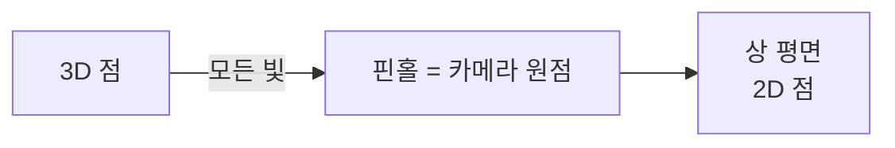
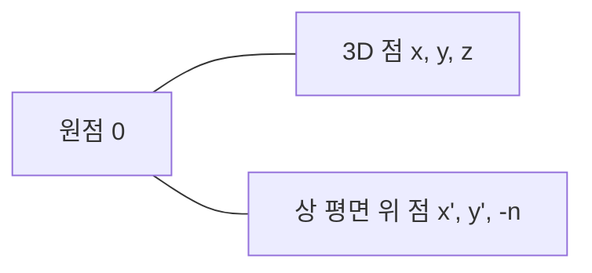
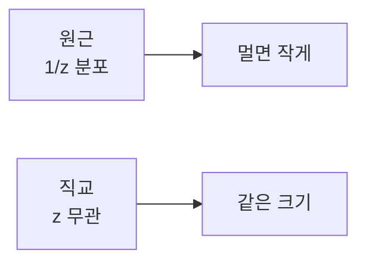
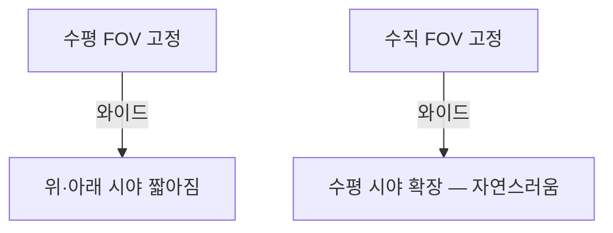
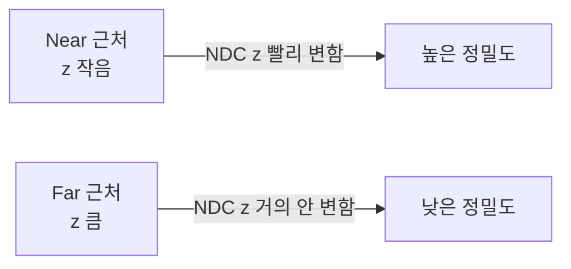

## 들어가며

좌표계 변환에서 *MVP 파이프라인* 의 큰 흐름을 다뤘다 — Local → World → View → Clip → NDC → Screen. 이 글은 그 파이프라인의 *마지막 결정적 행렬* — *투영 (Projection)* 의 디테일이다.

투영의 역할: *3D View 공간 점을 2D 화면* 에 매핑. 그런데 단순한 매핑이 아니라 *깊이 정보* 도 함께 보존해야 한다 (depth buffer 가 그 위에서 가시성을 결정). 이 *깊이의 정밀도 분포* 가 게임 그래픽의 *Z-fighting, 파티클 정밀도, 그림자 품질* 을 좌우.

핵심 토픽들.

1. **원근 투영의 기하학** — 핀홀 카메라 모델, 닮은꼴 삼각형, $1/z$ 의 자연스러운 등장.
2. **원근 투영 행렬** — 닫힌 형식과 OpenGL/DirectX/Vulkan 관례 차이.
3. **직교 투영** — UI·2D·RTS 의 표준.
4. **FOV와 종횡비** — 수직 FOV 와 수평 FOV 의 변환.
5. **Near/Far Plane과 깊이 정밀도** — $1/z$ 분포의 함의. Near 가 *훨씬 큰 영향*.
6. **Reverse-Z** — 부동소수점 depth 표현과 $1/z$ 매핑을 더 잘 맞추고, 개선 폭이 near/far와 format에 어떻게 의존하는지 본다.
7. **무한 Far Plane** — far → ∞ 의 닫힌 형식.
8. **Frustum 추출** — VP 행렬의 행 조합으로 6평면.

이 글의 목표는 *왜 게임 엔진이 reverse-Z 를 쓰는가, 왜 near 를 *너무 작게* 두면 안 되는가, 왜 frustum culling 이 VP 행렬에서 직접 평면을 뽑을 수 있는가* — 그 *수학적 이유* 를 명확히.

*MVP 흐름* + *투영 디테일* + *광선 발사* 가 합쳐지면 *카메라가 어떻게 동작하고 그 위에서 광선이 어떻게 흐르는가* 의 전체 그림이 완성된다.


---

## 목차
1. [원근 투영의 기하학](#1-원근-투영의-기하학)
2. [원근 투영 행렬 유도](#2-원근-투영-행렬-유도)
3. [직교 투영](#3-직교-투영)
4. [FOV와 종횡비](#4-fov와-종횡비)
5. [Near/Far Plane과 깊이 정밀도](#5-nearfar-plane과-깊이-정밀도)
6. [Reverse-Z](#6-reverse-z)
7. [무한 Far Plane](#7-무한-far-plane)
8. [Frustum 추출과 Culling](#8-frustum-추출과-culling)


---

## 1. 원근 투영의 기하학

핀홀 카메라 모델과 *닮은꼴 삼각형* 의 수학.

### 1.1 핀홀 카메라

모든 빛이 *한 점 (focal point)* 을 통과해 *상 평면 (image plane)* 에 닿는 모델.



실제 카메라의 *렌즈 + 조리개* 를 *수학적으로 단순화* 한 모델. 게임 그래픽의 표준.

### 1.2 닮은꼴 삼각형

카메라 원점 + 3D 점 $(x, y, z)$ + 상 평면 (z = -n, n > 0 인 카메라 시야 앞) 의 *세 점이 만드는 두 삼각형* 이 닮은꼴.



비례식:

$$
\frac{x'}{n} = \frac{x}{-z}, \quad \frac{y'}{n} = \frac{y}{-z}
$$

(View 공간 관례에 따라 카메라가 -Z 향함 — z < 0 이 시야 앞.)

$$
x' = \frac{n \cdot x}{-z}, \quad y' = \frac{n \cdot y}{-z}
$$

핵심: *스크린 좌표가 z 에 반비례*. 이게 *원근감* 의 수학적 정의.

### 1.3 1/z 의 자연스러운 등장

$x' = nx/(-z)$ 의 형태에서 *분모 z* 가 핵심. *멀리 있는 객체 (z 큼)* 가 *작게 보임 (x' 작음)*.

게임의 모든 원근 효과 — *멀어지면 작아짐, 가까워지면 큼, 평행선이 한 점에 모임* — 이 단순한 *1/z 분포* 의 시각적 결과.

### 1.4 동차 좌표의 필요

위 식 $x' = nx/(-z)$ 가 *나눗셈* 을 포함. 행렬 곱은 *나눗셈을 직접 표현 못 함*. 동차 좌표 $(x, y, z, w)$ 와 *w 나눗셈* 으로 우회:

- 행렬 곱 결과의 *w 성분에 -z* 저장.
- 마지막에 *w 로 나누기 (perspective divide)* 로 1/z 효과.

이 메커니즘이 *동차 좌표의 의미* 와 정확히 맞물린다.

### 1.5 NDC와 Clip 공간

투영 행렬의 출력은 *Clip 공간* (w 나눗셈 전). w 나눗셈 후 *NDC (Normalized Device Coordinates)*.

| 공간 | 좌표 범위 | 형태 |
|---|---|---|
| Clip | (x, y, z, w) | 행렬 곱 결과 |
| NDC | (x/w, y/w, z/w) | w 나눗셈 후 |
| NDC X, Y | [-1, 1] | OpenGL/DX/Vulkan 동일 |
| NDC Z | [-1, 1] OpenGL / [0, 1] DX,Vulkan | API 차이 |

OpenGL이 z [-1, 1], DirectX·Vulkan 이 [0, 1]. 행렬 형태가 *그 매핑에 맞춰* 다르다.

## 2. 원근 투영 행렬 유도

행렬을 *처음부터 유도*. 각 항이 *왜 그 값* 인지.

### 2.1 목표

View 공간 점 $(x, y, z, 1)$ → Clip 공간 점 $(x_c, y_c, z_c, w_c)$ 로 변환. 이후 w 나눗셈으로 NDC.

요구 사항.

1. **X, Y**: $x_c / w_c = $ NDC x. 닮은꼴 삼각형 비례 적용 + 화면 사이즈 정규화.
2. **Z**: $z_c / w_c = $ NDC z. near 가 -1 또는 0 (API 따라), far 가 1 에 매핑.
3. **W**: 닦임 위해 *원본 -z* 가 들어가야 함.

### 2.2 W 행: 원본 -z 보존

행렬의 *w 행* 이 *결과 w 를 결정*. 우리가 원하는 결과 $w_c = -z$:

$$
\text{w 행} = \begin{pmatrix} 0 & 0 & -1 & 0 \end{pmatrix}
$$

### 2.3 X, Y 행: 닮은꼴 비례

$x_c = \frac{n \cdot x}{r}$ 형태가 되도록 (r = right plane 좌표). NDC 후 $x_c / w_c = nx / (-z \cdot r)$ — *w 나눗셈* 으로 $1/(-z)$ 효과 생기니 *행렬에는 n/r 만*.

$$
\text{x 행} = \begin{pmatrix} \frac{n}{r} & 0 & 0 & 0 \end{pmatrix}, \quad \text{y 행} = \begin{pmatrix} 0 & \frac{n}{t} & 0 & 0 \end{pmatrix}
$$

(t = top plane 좌표.)

대칭 frustum (left = -right, bottom = -top) 가정. 비대칭 frustum 은 *추가 시프트 항*.

### 2.4 Z 행: near → −1, far → +1 매핑 (OpenGL)

z 매핑이 *비선형* — $1/z$ 효과 때문에 *-z 의 1차식 / w 나눗셈* 형태.

$$
\frac{z_c}{w_c} = \frac{Az + B}{-z}
$$

z = -n → -1, z = -f → 1 의 두 조건:

- $\frac{-An + B}{n} = -1 \implies -An + B = -n$
- $\frac{-Af + B}{f} = 1 \implies -Af + B = f$

연립:

$$
A = -\frac{f + n}{f - n}, \quad B = -\frac{2fn}{f - n}
$$

따라서 z 행:

$$
\text{z 행} = \begin{pmatrix} 0 & 0 & -\frac{f+n}{f-n} & -\frac{2fn}{f-n} \end{pmatrix}
$$

### 2.5 OpenGL 투영 행렬 완성

$$
P_{\text{GL}} = \begin{pmatrix} \frac{n}{r} & 0 & 0 & 0 \\ 0 & \frac{n}{t} & 0 & 0 \\ 0 & 0 & -\frac{f+n}{f-n} & -\frac{2fn}{f-n} \\ 0 & 0 & -1 & 0 \end{pmatrix}
$$

NDC z ∈ [-1, 1] 매핑. 좌표계 *우수 (right-handed, View 공간 -Z 향함)*.

### 2.6 DirectX / Vulkan 변형

NDC z ∈ [0, 1]. z 행만 다름:

z = -n → 0, z = -f → 1 조건.

$$
A = -\frac{f}{f - n}, \quad B = -\frac{fn}{f - n}
$$

$$
\text{z 행} = \begin{pmatrix} 0 & 0 & -\frac{f}{f-n} & -\frac{fn}{f-n} \end{pmatrix}
$$

DirectX 는 *왼손 좌표계* (View 공간 +Z 향함) — 부호 반대 추가. Vulkan 은 *우수 + Z [0, 1]*. API 별 미묘한 차이를 알고 있어야 한다.

### 2.7 정리

| API | 좌표계 (View) | NDC Z | Y 방향 |
|---|---|---|---|
| OpenGL | 우수 (-Z 시야) | [-1, 1] | 위 (+) |
| DirectX 11/12 | 좌수 (+Z 시야) | [0, 1] | 위 (+) |
| Vulkan | 우수 (-Z 시야) | [0, 1] | *아래 (+)* |

Vulkan 의 *Y 뒤집힘* 이 흔한 함정 — 텍스처가 거꾸로 보이는 이유.

## 3. 직교 투영

원근 효과 *없이* 평행 투영. UI·2D·RTS 의 표준.

### 3.1 핵심 차이

원근: *멀수록 작음* ($1/z$). 직교: *거리에 무관*.



수학적으로 *w 나눗셈이 의미 없는* 행렬. w 행이 *(0, 0, 0, 1)* — 결과 w = 1.

### 3.2 직교 투영 행렬 (OpenGL)

view 공간 박스 *(left, right) × (bottom, top) × (-near, -far)* 를 NDC *[-1, 1]³* 에 매핑.

$$
P_{\text{ortho}} = \begin{pmatrix}
\frac{2}{r-l} & 0 & 0 & -\frac{r+l}{r-l} \\
0 & \frac{2}{t-b} & 0 & -\frac{t+b}{t-b} \\
0 & 0 & -\frac{2}{f-n} & -\frac{f+n}{f-n} \\
0 & 0 & 0 & 1
\end{pmatrix}
$$

각 행이 *스케일 + 시프트*. 단순한 *선형 변환*.

대칭 frustum (l = -r, b = -t):

$$
P_{\text{ortho, sym}} = \begin{pmatrix}
\frac{1}{r} & 0 & 0 & 0 \\
0 & \frac{1}{t} & 0 & 0 \\
0 & 0 & -\frac{2}{f-n} & -\frac{f+n}{f-n} \\
0 & 0 & 0 & 1
\end{pmatrix}
$$

### 3.3 게임 활용

- **2D 게임**: 직교 투영으로 *원근 없이 평면 그리기*. 거리 무관 같은 픽셀 크기.
- **UI**: 화면 좌표 직접 매핑. 직교 + 스크린 사이즈.
- **RTS**: 탑다운 시점에서 직교 (또는 *경사진 직교*).
- **그림자 맵**: 방향성 광원 (sun) 의 그림자가 *직교 투영* — 모든 광선이 평행.
- **CAD / 모델링 툴**: 정확한 측정이 필요해 직교.

### 3.4 깊이는 여전히 의미

직교 투영에서도 *Z 매핑* 있음. *Depth buffer 는 같이 동작*. 차이: *Z 분포가 선형* ($1/z$ 아님). near/far 사이가 *균등하게 분포* — 정밀도가 *모든 깊이에 균등*.

### 3.5 원근 + 직교 혼용

게임은 보통 *World 객체는 원근 + UI 는 직교*. 두 카메라의 결과를 합성.

```cpp
// 원근 카메라로 World 그림
view = LookAt(...); proj = Perspective(...);
RenderWorld();

// 직교 카메라로 UI 그림 (Depth test off)
proj = Ortho(0, screenW, screenH, 0, -1, 1);
RenderUI();
```

UI 가 *World 위에 깔끔하게* 그려진다.

## 4. FOV와 종횡비

원근 투영의 *물리적 의미* 가 FOV (Field of View, 시야각).

### 4.1 FOV 와 near plane

수직 FOV $\theta_v$, near 거리 n 에서 top plane 좌표 t:

$$
t = n \cdot \tan\left(\frac{\theta_v}{2}\right)
$$

투영 행렬의 $\frac{n}{t}$ 항이:

$$
\frac{n}{t} = \frac{n}{n \tan(\theta_v / 2)} = \frac{1}{\tan(\theta_v / 2)} = \cot\left(\frac{\theta_v}{2}\right)
$$

FOV 만 결정되면 *near 와 무관*. 게임 코드의 일반적 형태:

```cpp
float fovTerm = 1.0f / std::tan(fovY * 0.5f);
P[0][0] = fovTerm / aspect;  // aspect = w / h
P[1][1] = fovTerm;
```

### 4.2 종횡비

수직 FOV → 수평 FOV (또는 반대). 종횡비 $a = w/h$.

$$
\tan\left(\frac{\theta_h}{2}\right) = a \cdot \tan\left(\frac{\theta_v}{2}\right)
$$

```cpp
float fovX = 2.0f * std::atan(aspect * std::tan(fovY * 0.5f));
```

게임이 *수직 FOV 를 고정* 하는 게 일반적. *모니터 종횡비가 바뀌어도* 위·아래 시야 같음 (수평이 늘어남). *수평 FOV 고정* 은 와이드 모니터에서 *위·아래 시야가 줄어 답답*.



### 4.3 FOV 관례

| 시점 | 일반 FOV |
|---|---|
| 1인칭 슈터 (FPS) | 90° ~ 110° (수직 60~75°) |
| 3인칭 액션 | 60° ~ 80° |
| RPG / RTS | 30° ~ 60° (또는 직교) |
| 시네마틱 컷씬 | 20° ~ 40° (망원 효과) |
| VR | 90° 이상 (헤드셋 따라) |

FPS 가 큰 FOV 인 이유: *주변 시야 인식* + *멀미 감소*. RTS 가 작은 FOV 인 이유: *왜곡 최소화* + *전략적 가시성*.

### 4.4 FOV 변경의 효과

작은 FOV: *망원 효과* — 멀리 있는 객체가 *크게 + 평면적*. 시야 좁음. 시네마틱.

큰 FOV: *광각 효과* — 가까이 있는 객체가 *왜곡 + 늘어남*. 시야 넓음. 멀미 유발 가능.

게임 옵션의 *FOV 슬라이더* 가 사용자가 직접 조정. 너무 작으면 답답, 너무 크면 어지러움.

### 4.5 프로젝션 행렬의 FOV 형태

게임 코드의 흔한 함수:

```cpp
mat4 Perspective(float fovY, float aspect, float n, float f) {
    float t = std::tan(fovY * 0.5f);
    mat4 P = {0};
    P[0][0] = 1.0f / (aspect * t);
    P[1][1] = 1.0f / t;
    P[2][2] = -(f + n) / (f - n);
    P[2][3] = -(2 * f * n) / (f - n);
    P[3][2] = -1;
    return P;
}
```

FOV·aspect 를 입력 받아 *행렬 직접 생성*. GLM, DirectXMath 가 이런 helper 제공.

## 5. Near/Far Plane과 깊이 정밀도

투영 행렬의 *깊이 매핑* 이 *Z-buffer 정밀도* 를 결정. 게임 그래픽의 *결정적 함정*.

### 5.1 Z-buffer 의 분포

원근 투영 + w 나눗셈 후 NDC z:

$$
z_{\text{NDC}} = \frac{Az + B}{-z}, \quad A = -\frac{f+n}{f-n}, \, B = -\frac{2fn}{f-n}
$$

z (View 공간) 의 함수로 *비선형*. *z 가 작을수록 (가까움) NDC z 가 빨리 변함*. 즉 *near 근처에 정밀도 집중*.



### 5.2 1/z 분포의 함의

NDC z 는 $-A-B/z$ 꼴이다. 따라서 깊이에 대한 국소 기울기 크기는

$$
\left|\frac{d z_{\mathrm{ndc}}}{dz}\right| = \frac{|B|}{z^2}
$$

이고, 같은 크기의 view-space 깊이 변화 $\Delta z$ 를 비교하면 기준 깊이 $|z|$가 두 배일 때 NDC 변화량은 국소적으로 약 1/4이 된다. 서로 다른 유한 구간의 끝점 차이를 무조건 1/4로 만든다는 뜻은 아니다.

| View Z | NDC Z (OpenGL, n=0.1, f=1000) |
|---|---|
| -0.1 (near) | -1.0 |
| -1 | 약 0.800 |
| -10 | 약 0.980 |
| -100 | 약 0.998 |
| -1000 (far) | 1.0 |

*near 부터 1m 까지의 좁은 view 거리* 가 *NDC [-1, 0.8]* — *NDC 의 90%* 를 차지. 1m → 1000m 의 1000 배 거리가 *NDC 의 나머지 10%* 에만 들어간다. far 근처는 *NDC 의 좁은 구간* 에 압축 — 정밀도 폭증 손실.

### 5.3 Z-fighting

두 표면이 *비슷한 깊이* 에 있을 때 *z buffer 정밀도 부족* 으로 *어느 게 앞인지* 결정 못 함 → 깜빡거림.


원인: *far 근처에서 NDC z 차이가 ULP 미만*. depth buffer 의 *하위 비트가 의미를 잃음*.

### 5.4 Near 가 더 큰 영향

직관에 반해 *far 가 깊이 정밀도에 미치는 영향이 작다*. *near* 가 더 결정적.

near = 0.1 vs near = 1 (far = 1000 고정):

- near = 0.1: 0.1 ~ 1m 가 NDC 의 *90%* 차지. 1m ~ 1000m 가 *10%*.
- near = 1: 1 ~ 10m 가 NDC 의 *90%*. 10m ~ 1000m 가 *10%*.

near 를 *10x 줄이면* 정밀도가 *멀리에서 10x 떨어진다*. 더 정확한 표현: *near 부근의 정밀도는 좋아지지만 멀리는 나빠진다*.

### 5.5 게임 엔진의 near 선택

흔한 함정: *near = 0.001 같은 작은 값* 으로 *혹시 모르는 깜박거림 방지*.

문제: *멀리에서 Z-fighting 폭주*. 정확한 선택은 *near 를 게임에 필요한 최소* (캐릭터가 절대 가까워지지 않을 거리) 로.

```cpp
// 1인칭 게임: near = 0.05 ~ 0.1 (캐릭터 손에서 시작)
// 3인칭 액션: near = 0.3 ~ 0.5
// RTS: near = 1 ~ 5 (탑다운 시점, 카메라 멀리)
```

### 5.6 Depth Bias (Polygon Offset)

Z-fighting 임시 처방: *한 표면을 약간 앞으로* (depth bias).

```glsl
glPolygonOffset(1.0f, 1.0f);  // 약간 앞으로
```

그림자 맵의 *self-shadowing* 방지에 표준. 하지만 *근본 해결 아님* — *near 조정 + reverse-Z* 가 정공법.

## 6. Reverse-Z

깊이 매핑을 *뒤집어* 부동소수점 분포와 *시너지*. 게임 엔진의 표준 기법.

### 6.1 부동소수점의 분포

float32의 한 binade $[2^e,2^{e+1})$ 에는 정규화된 유효숫자 패턴이 $2^{23}$개 있다. 따라서 $[1,2)$의 간격은 $2^{-23}$이고, 0 쪽으로 갈수록 binade 자체가 작아져 절대 간격도 작아진다. $[0,1)$에는 여러 지수 구간과 subnormal이 함께 있으므로 단일 개수만으로 정밀도를 설명하기보다 각 깊이의 `nextafter` 간격을 보는 편이 정확하다.


### 6.2 표준 vs Reverse-Z

| | 표준 Z | Reverse-Z |
|---|---|---|
| Near | 0 (DX/Vulkan) 또는 -1 (GL) | 1 |
| Far | 1 | 0 |
| Far 정밀도 | 낮음 ($1/z$ 효과) | 높음 (float 0 근처 + 1/z 결합) |

표준에서는 *far 가 1 에 매핑* — 부동소수점 0 근처 정밀도가 *Near 에만 작용* + $1/z$ 효과로 Near 에 정밀도 *두 번 집중* + Far 에 정밀도 *두 번 손실*.

Reverse-Z는 far를 0 쪽에 매핑해 float의 절대 간격 감소가 perspective 깊이 압축을 상당 부분 상쇄하게 한다. 분포가 완전히 균등해지는 것은 아니며 near, 유한·무한 far, depth format과 projection convention에 따라 오차 곡선이 달라진다.

### 6.3 Reverse-Z 행렬

원본 행렬의 z 행 부호 + B 항 변경.

표준 [0, 1] depth (DX / Vulkan) — *near plane (view z = -n) 이 depth 0 에 매핑*:

$$
A = -\frac{f}{f-n}, \quad B = -\frac{fn}{f-n}
$$

Reverse: *near plane 이 depth 1, far plane 이 depth 0 에 매핑*. z = -n → 1, z = -f → 0:

$$
A = \frac{n}{f-n}, \quad B = \frac{fn}{f-n}
$$

```cpp
mat4 PerspectiveReverseZ(float fovY, float aspect, float n, float f) {
    float t = std::tan(fovY * 0.5f);
    mat4 P = {0};
    P[0][0] = 1.0f / (aspect * t);
    P[1][1] = 1.0f / t;
    P[2][2] = n / (f - n);
    P[2][3] = (f * n) / (f - n);
    P[3][2] = -1;
    return P;
}
```

### 6.4 Reverse-Z 의 부수 효과

- **Depth test 반전**: `GL_LESS` → `GL_GREATER`. 가까운 = z 큼.
- **Depth clear 값**: 1.0 → 0.0.
- **Depth bias 부호**: 반대.
- **셰이더 코드의 z 사용**: 직접 z 값 다룰 때 의미 반대.

코드 전체에 영향. 신중히 도입.

### 6.5 정밀도 개선 측정

특정 거리의 world-space 해상도는 depth 값을 한 ULP 움직인 뒤 projection의 역함수로 되돌려 계산한다.

```cpp
float DepthResolutionAt(float viewZ, const Projection& p) {
    float d0 = ProjectDepth(viewZ, p);
    float d1 = std::nextafter(d0, 1.0f);
    float z1 = UnprojectDepth(d1, p);
    return std::fabs(z1 - viewZ);
}
```

표준 Z와 reverse-Z를 비교할 때는 같은 near/far, `D32_FLOAT` 또는 `D24_UNORM` 같은 동일 format, 같은 viewport mapping을 사용한다. reverse-Z의 큰 이득은 float depth에서 두드러지며, 고정소수점 UNORM depth에서는 값을 뒤집는 것만으로 quantization 간격이 달라지지 않는다.

### 6.6 도입 계약

reverse-Z 지원 여부는 API 이름보다 depth format과 projection·viewport 기능, depth compare/clear, shadow pass와 depth reconstruction 코드에 달려 있다. 엔진 전체에서 다음 계약을 함께 바꾼다.

- near/far depth mapping과 projection matrix
- compare op와 clear value
- depth bias 부호
- Hi-Z reduction 방향과 depth linearization
- shadow map처럼 표준 Z를 유지하는 pass와의 구분

## 7. 무한 Far Plane

far → ∞ 의 극한이 *닫힌 형식* 으로 정의. 우주·오픈 월드에 적합.

### 7.1 극한

OpenGL 표준 z, far → ∞:

$$
A = -\frac{f+n}{f-n} \xrightarrow{f \to \infty} -1, \quad B = -\frac{2fn}{f-n} \xrightarrow{f \to \infty} -2n
$$

z 행:

$$
\text{z 행}_{\text{infinite}} = \begin{pmatrix} 0 & 0 & -1 & -2n \end{pmatrix}
$$

### 7.2 Reverse-Z + 무한 Far

Reverse-Z + far → ∞:

$$
A = \frac{n}{f-n} \xrightarrow{f \to \infty} 0, \quad B = \frac{fn}{f-n} \xrightarrow{f \to \infty} n
$$

z 행:

$$
\text{z 행}_{\text{rev, inf}} = \begin{pmatrix} 0 & 0 & 0 & n \end{pmatrix}
$$

매우 단순한 형식. NDC z 가 *$n / (-z)$* — 그냥 *near × (1/z)*.

### 7.3 코드

```cpp
mat4 PerspectiveReverseZInfinite(float fovY, float aspect, float n) {
    float t = std::tan(fovY * 0.5f);
    mat4 P = {0};
    P[0][0] = 1.0f / (aspect * t);
    P[1][1] = 1.0f / t;
    P[2][2] = 0;
    P[2][3] = n;
    P[3][2] = -1;
    return P;
}
```

far parameter가 행렬에서 사라지고 모든 유한한 음의 view-space z가 $(0,1]$에 매핑된다. 수학적 $z=-\infty$는 depth 0으로 clear value와 같아지며, 실제로 “무한 거리 객체”를 유한 좌표처럼 저장하고 그리는 기능은 아니다.

### 7.4 정밀도

Reverse-Z + 무한 far + float depth buffer 의 조합이 *깊이 정밀도의 극한*. Nathan Reed 의 *"Depth Precision Visualized"* (NVIDIA Developer Blog, 2015) 가 표준 참조.

전체 깊이 범위에서 *정밀도 분포가 훨씬 균등* 해진다. 실제 오차 단위는 near 값, depth format, 월드 스케일에 따라 달라지지만, 표준 Z 처럼 far 근처에서 급격히 무너지는 현상이 크게 줄어든다.

### 7.5 활용

- **우주 게임**: 렌더링 구간의 far clipping을 없앨 수 있지만, 행성·항성 규모의 world 좌표 정밀도는 camera-relative 좌표·분할 원점·double 등으로 별도 해결.
- **오픈 월드**: 멀리 보이는 산·구름 까지 깊이 안정.
- **항공 시뮬**: 수십 km 떨어진 항공기·지형.

far 를 *임의의 큰 값* 으로 잡아 깊이 정밀도를 낭비하지 않아도 된다. 다만 무한 far 는 투영 행렬·깊이 비교·셰이더 코드가 그 관례를 모두 이해할 때 안전하다.

### 7.6 함정

- **극단 깊이값 처리**: 무한 far 에서 매우 먼 점은 NDC z 가 0 에 가까워진다. 일부 셰이더 코드가 depth 를 다시 선형화하거나 역수로 쓰면 *0 근처 값* 에 대한 명시적 분기가 필요하다.
- **Depth comparison**: 극단적으로 먼 유한 점은 depth가 subnormal 또는 0으로 반올림될 수 있다. `GREATER`와 clear 0 계약에서는 0인 fragment가 통과하지 않을 수 있으므로 표현 가능한 거리 범위를 분석한다.
- **Frustum corner 역변환**: reverse-Z infinite projection에서 far NDC corner는 homogeneous `w=0`인 방향이다. `xyz/w`로 나눌 수 없으므로 CSM·cluster용으로는 별도의 유한 slice 거리를 정해 ray 방향을 scale한다.

## 8. Frustum 추출과 Culling

VP 행렬에서 *6평면을 직접 추출*. *frustum culling 의 표준 방법*.

### 8.1 Gribb-Hartmann 방법

Gil Gribb, Klaus Hartmann, "Fast Extraction of Viewing Frustum Planes" (2001).

핵심: VP 행렬의 *행 합 / 차* 가 *frustum 평면 식 (Ax + By + Cz + D = 0)*.

$$
\text{plane}_{\text{Left}} = \text{row}_4 + \text{row}_1, \quad \text{plane}_{\text{Right}} = \text{row}_4 - \text{row}_1
$$

$$
\text{plane}_{\text{Bottom}} = \text{row}_4 + \text{row}_2, \quad \text{plane}_{\text{Top}} = \text{row}_4 - \text{row}_2
$$

$$
\text{plane}_{\text{Near}} = \text{row}_4 + \text{row}_3, \quad \text{plane}_{\text{Far}} = \text{row}_4 - \text{row}_3
$$

(z [-1, 1] OpenGL 관례. DX/Vulkan z [0, 1] 은 Near 가 *row_3* 만으로 (`row_3` 자체).)

### 8.2 코드

```cpp
struct Plane {
    vec3  normal;
    float d;
};

void ExtractFrustumPlanes(mat4 viewProj, Plane planes[6]) {
    // 행 = 열의 의미가 행렬 메모리 레이아웃에 따라 다름
    auto row = [&](int i) {
        return vec4(viewProj[0][i], viewProj[1][i], viewProj[2][i], viewProj[3][i]);
    };
    vec4 r0 = row(0), r1 = row(1), r2 = row(2), r3 = row(3);

    auto makePlane = [](vec4 v) {
        Plane p;
        float len = length(vec3(v));
        p.normal = vec3(v) / len;
        p.d      = v.w / len;
        return p;
    };

    planes[0] = makePlane(r3 + r0);  // Left
    planes[1] = makePlane(r3 - r0);  // Right
    planes[2] = makePlane(r3 + r1);  // Bottom
    planes[3] = makePlane(r3 - r1);  // Top
    planes[4] = makePlane(r3 + r2);  // Near (GL 관례)
    planes[5] = makePlane(r3 - r2);  // Far  (GL 관례)
}
```

*행렬 한 번 계산* 으로 *6 평면 동시 추출*. 매 프레임 카메라가 변하면 다시.

### 8.3 평면 정규화

`makePlane` 의 *normal 정규화*. 분기 후 *normal 단위 벡터* 로 만들고 d 도 같이 나눔. *AABB 검사에서 거리 비교가 의미* 있도록.

정규화 안 하면 *각 평면의 normal 길이 다름* → AABB 검사 시 *부호만 검사 OK*, *거리 검사는 정규화 필요*.

### 8.4 AABB vs Frustum

*p-vertex / n-vertex 트릭*. 평면 6개에 대해:

```cpp
bool AABBOutsideFrustum(AABB box, Plane planes[6]) {
    for (int i = 0; i < 6; ++i) {
        // p-vertex: 평면 외향 방향 코너
        vec3 p = vec3(
            planes[i].normal.x >= 0 ? box.max.x : box.min.x,
            planes[i].normal.y >= 0 ? box.max.y : box.min.y,
            planes[i].normal.z >= 0 ? box.max.z : box.min.z
        );
        if (dot(planes[i].normal, p) + planes[i].d < 0) return true;
    }
    return false;
}
```

AABB 의 *p-vertex 한 점만 검사*. 6개 평면 × 1점 = *6 dot + 6 비교*. 매우 빠름.

### 8.5 Frustum 8 코너 추출

평면 외에 *8 코너 좌표* 도 종종 필요 (그림자 맵 영역 결정 등). VP⁻¹ 로 NDC 의 8 코너를 *world 공간으로 역변환*.

```cpp
// nearZ, farZ: API 별 NDC z 범위.
//   OpenGL 표준        : nearZ = -1, farZ = 1
//   DX / Vulkan 표준   : nearZ =  0, farZ = 1
//   Reverse-Z          : nearZ =  1, farZ = 0
std::array<vec3, 8> FrustumCornersWorld(mat4 viewProj, float nearZ, float farZ) {
    mat4 invVP = inverse(viewProj);
    std::array<vec3, 8> corners;
    for (int i = 0; i < 8; ++i) {
        vec4 ndc = vec4(
            (i & 1) ? 1.0f : -1.0f,
            (i & 2) ? 1.0f : -1.0f,
            (i & 4) ? farZ : nearZ,
            1.0f
        );
        vec4 world = invVP * ndc;
        corners[i] = vec3(world) / world.w;
    }
    return corners;
}
```

NDC 의 *8 정점을 world 로 역변환*. API · convention 에 따라 *nearZ, farZ 매개변수* 로 분리. 그림자 맵의 *cascade frustum* 결정 등에 활용.

### 8.6 Cascaded Shadow Map (CSM)

게임의 그림자 맵 표준. *카메라 frustum 을 거리별로 분할* 후 각 부분에 *별도 그림자 맵*.

가까운 거리: *고해상도 그림자*. 먼 거리: *저해상도 그림자*. 분할 경계가 frustum 의 *near/far 슬라이스*.

8.5 의 코드가 *각 cascade 의 8 코너* 를 결정 → 그 영역을 *광원 카메라 frustum* 으로 → 그림자 카메라 투영 행렬 결정.

### 8.7 Occlusion Culling 보조

Frustum culling 외 *가려짐 (occlusion)* 컬링. 큰 객체 (벽, 산) 가 *작은 객체* 를 가리면 안 그림.

GPU의 *Hierarchical Z-buffer*, *Hardware Occlusion Query*, *Software Rasterizer* (Frostbite, Insomniac) 등 다양한 방법. Frustum culling 은 *반드시 하고*, occlusion 은 *부가적*.


---

## 결론

투영은 *카메라의 마지막 결정* — 3D 공간 점이 어떻게 *2D 화면과 깊이* 가 되는가. 행렬 한 줄의 차이가 *Z-fighting, 정밀도, 우주적 거리 처리* 를 결정.

이 글에서 정리한 핵심.

1. **닮은꼴 삼각형 + 1/z** — 원근의 수학적 본질. w 나눗셈이 그 메커니즘.
2. **API 별 NDC 차이** — OpenGL z [-1, 1], DX/Vulkan z [0, 1], Vulkan Y 뒤집힘.
3. **직교 vs 원근** — UI·2D 는 직교. 그림자 맵의 sun 도 직교.
4. **Near 가 정밀도의 결정자** — far 보다 near 가 훨씬 영향 큼.
5. **Reverse-Z** — float depth와 reverse mapping의 조합은 넓은 원근 구간의 정밀도 분포를 크게 개선하며, 실제 이득은 역투영한 한 ULP 간격으로 측정한다.
6. **무한 Far Plane** — far clipping parameter를 제거하지만 world 좌표 정밀도와 수학적 무한점 처리는 별도 문제다.
7. **Frustum 추출** — Gribb-Hartmann 으로 VP 행렬에서 6평면 직접.

*기하 프리미티브* 는 점·선·평면·다각형의 *수학적 도구*(면적·무게중심·convex hull·triangulation)를 다룬다. 광선·행렬·기하 프리미티브·수치 안정성이 합쳐져 게임 수학의 구현 기반을 이룬다.

## 더 읽을거리

- Eric Lengyel, *Foundations of Game Engine Development*, Vol. 2, Ch. 6 — 투영 수학의 표준 참조.
- *Real-Time Rendering*, 4th ed., Ch. 4.7 — 투영과 카메라.
- Nathan Reed, ["Depth Precision Visualized"](https://developer.nvidia.com/content/depth-precision-visualized) — Reverse-Z와 깊이 정밀도의 시각적 해설.
- Gil Gribb, Klaus Hartmann, "Fast Extraction of Viewing Frustum Planes" (2001) — 평면 추출 원전.
- Microsoft DirectX 12 Spec — DX 의 NDC 관례.
- Vulkan Spec, Section 23.5 — Vulkan 의 좌표계.
- *Frostbite Cascaded Shadow Maps* (GDC) — 산업 CSM 구현.
