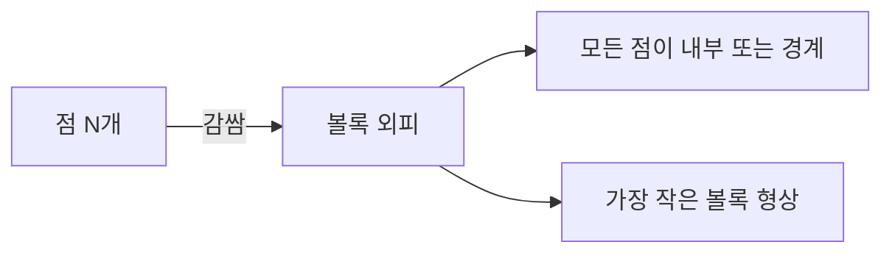
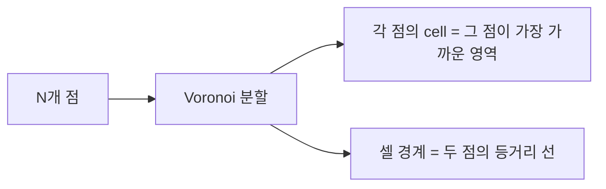

## 들어가며

게임의 *절차적 형상, 충돌 단순화, 디버그 시각화, 내비메쉬 빌드, UI 마스크* — 이 모든 게 *점·선·평면·다각형·메쉬* 의 조합 위에서 돌아간다. 광선 교차, 충돌 검사, 공간 분할 같은 시스템도 결국 작은 기하 연산들을 조합해 만든다. 이 글은 그 바닥을 이루는 *자주 쓰이는 기하 도구들* 을 정리한다.

핵심 토픽들.

1. **평면의 표현** — 법선 + 거리, 점 + 법선, 세 점. 어떤 표현이 어떤 연산에 좋은가.
2. **직선과 광선** — 매개변수 폼의 통일.
3. **점-평면, 점-직선 거리** — 부호 거리와 외적 표현.
4. **다각형 면적** — Shoelace 공식. 부호로 winding 판정.
5. **무게중심 좌표 (barycentric)** — Möller-Trumbore 의 출력. 보간의 표준.
6. **Convex Hull** — 점들을 감싸는 가장 작은 볼록 외피. Graham scan, QuickHull.
7. **Triangulation** — 다각형의 삼각형 분해. Ear clipping, Delaunay.
8. **Voronoi와 Delaunay** — 점 집합의 *영역 분할*. 절차적 던전, Worley noise 의 토대.

이 글의 알고리즘들은 *대부분 닫힌 형태* (한 줄 ~ 십 줄)다. 하지만 *부동소수점 함정* 이 많아 *수치 안정성* 의 절반이 여기서 결정된다.

게임 코드의 *곧 손에 든 도구* — 면적·거리·무게중심·convex hull·triangulation 이 *손에 있으면* 절차적 형상부터 충돌 단순화까지 *같은 도구로* 풀린다.


---

## 목차
1. [평면의 표현](#1-평면의-표현)
2. [직선과 광선](#2-직선과-광선)
3. [점-평면, 점-직선 거리](#3-점-평면-점-직선-거리)
4. [다각형 면적](#4-다각형-면적)
5. [무게중심 좌표](#5-무게중심-좌표)
6. [Convex Hull](#6-convex-hull)
7. [다각형 Triangulation](#7-다각형-triangulation)
8. [Voronoi와 Delaunay](#8-voronoi와-delaunay)


---

## 1. 평면의 표현

평면을 표현하는 *세 가지 형식* 과 그 사용처.

### 1.1 법선 + 원점 거리 (Hessian Normal Form)

가장 흔한 표현.

$$
\hat{n} \cdot \vec{p} = d
$$

```cpp
struct Plane {
    vec3  normal;     // 단위 벡터
    float d;          // 원점에서 평면까지의 부호 거리 (n·p = d)
};
```

장점: *부호 거리 검사* 가 한 줄. 정규화된 법선 가정으로 *거리 = dot(n, p) - d*.

*이 시리즈 전체가 이 관례를 쓴다.* `d` 는 *원점에서 평면까지의 부호 거리* 이고, 점의 부호 거리는 `dot(normal, p) - d` 다. 양수면 법선이 향하는 쪽, 음수면 반대쪽이다.

손으로 확인해 두는 편이 낫다. $\hat{n} = (0, 0, 1)$, $d = 5$ 인 평면은 $z = 5$ 다. 점 $(0, 0, 7)$ 의 부호 거리는 $7 - 5 = +2$ — 법선 쪽으로 2. 점 $(0, 0, 1)$ 은 $1 - 5 = -4$ — 반대쪽으로 4. `d` 를 그대로 쓰면 평면의 위치가 곧 `d` 이므로 디버거에서 값만 보고도 평면이 어디 있는지 안다.

*부호 관례를 섞으면 컴파일은 되고 결과만 틀린다.* 다른 관례로 만든 평면을 이 구조체에 그대로 담으면 평면이 *원점 반대편으로 옮겨 앉는다* — $d = 5$ 여야 할 것이 $-5$ 가 되어 $z = 5$ 대신 $z = -5$ 를 가리킨다. 안팎 판정, 반사, 컬링이 전부 그 옮겨진 평면 기준으로 조용히 계산된다. 관례가 다른 값을 받을 때는 담기 전에 변환한다 — 변환식은 1.5절에 있다.

### 1.2 점 + 법선

$$
\hat{n} \cdot (\vec{p} - \vec{p_0}) = 0
$$

```cpp
struct PlanePointNormal {
    vec3 point;
    vec3 normal;
};
```

평면이 *지나는 한 점 + 법선*. *기하학적으로 직관적*. 변환 시 *점은 transformation*, *법선은 inverse-transpose* 를 사용한다.

### 1.3 세 점

$$
\hat{n} = \frac{(\vec{v_1} - \vec{v_0}) \times (\vec{v_2} - \vec{v_0})}{|...|}
$$

```cpp
bool PlaneFromTriangle(vec3 v0, vec3 v1, vec3 v2, Plane& out) {
    vec3 c = cross(v1 - v0, v2 - v0);
    float lenSq = dot(c, c);
    if (lenSq < 1e-12f) return false;   // degenerate: 세 점이 같은 직선 위
    vec3 n = c / std::sqrt(lenSq);
    out = { n, dot(n, v0) };
    return true;
}
```

삼각형 메쉬에서 *각 face 의 평면 추출*. 핸드니스에 따라 외적의 *법선 방향* 이 결정. 세 점이 *공선 (collinear)* 이면 외적이 영벡터 → `normalize` 가 NaN. *길이 검사 + 실패 신호* 로 회피.

### 1.4 핸드니스와 법선 방향

오른손 좌표계 + CCW winding → 외적의 *오른손 법칙* 으로 *외향 법선*. CW winding 이면 부호 반대.

front face의 CW/CCW는 화면에 투영된 winding과 rasterizer 설정의 계약이고, 외적 성분식과 월드 좌표계의 손잡이는 별도다. 메쉬 임포트 때 축 반전이 있으면 winding과 법선 변환을 함께 확인한다. 같은 엔진이나 API라도 설정·변환에 따라 결과가 달라질 수 있다.

### 1.5 표현 변환

세 표현 사이는 *상호 변환 가능*.

```cpp
// 점 + 단위 법선 → Hessian (비단위 법선은 먼저 정규화)
Plane HessianFromPointNormal(PlanePointNormal pn) {
    return { pn.normal, dot(pn.normal, pn.point) };
}

// Hessian → 점 + 법선 (대표 점 = 원점에 가장 가까운 점)
PlanePointNormal PointNormalFromHessian(Plane p) {
    return { p.normal * p.d, p.normal };
}
```

연산에 따라 *유리한 표현* 다름. Hessian 이 *부호 거리 검사* 에, 점 + 법선이 *변환* 에 좋다.

*일반형과의 변환* 도 여기 둔다. 행렬 행 조합이나 외부 라이브러리에서 오는 평면은 흔히 *4 성분 일반형* $(A, B, C, D)$ 로 온다 — 평면 위의 점이 $Ax + By + Cz + D = 0$ 을 만족한다는 뜻이다. $\hat{n} \cdot \vec{p} = d$ 와 비교하면 *법선은 그대로, 상수항은 부호가 반대* 다.

$$
\hat{n} = \frac{(A, B, C)}{\|(A, B, C)\|}, \qquad d = \frac{-D}{\|(A, B, C)\|}
$$

```cpp
// (A, B, C, D) with Ax + By + Cz + D = 0  →  Hessian (n·p = d)
// 진짜 0 법선 (퇴화) 이면 false 를 돌려 비활성 평면으로 표시한다.
bool PlaneFromGeneralForm(vec4 abcd, Plane& out) {
    vec3 n = vec3(abcd);
    float m = std::max({ std::fabs(n.x), std::fabs(n.y), std::fabs(n.z) });
    if (!(m > 0.0f) || !std::isfinite(m)) return false;   // 비활성/비정상 법선
    vec3 s = n / m;                       // 최대 성분으로 먼저 스케일 (동차 스케일 불변)
    float len = std::sqrt(dot(s, s));
    out = { s / len, -abcd.w / (m * len) };   // -D / |(A,B,C)|
    return true;
}
```

검산. $z = 5$ 평면을 일반형으로 쓰면 $z - 5 = 0$, 즉 $(A, B, C, D) = (0, 0, 1, -5)$. 변환하면 $\hat{n} = (0, 0, 1)$, $d = -(-5) / 1 = 5$ — 1.1절의 예와 같은 평면이다.

동차 계수는 *전체를 같은 배수로 스케일해도 같은 평면* 이다. $(0, 0, 10^{-13}, -5 \cdot 10^{-13})$ 도 $z = 5$ 인데, `len` 의 절대 크기만 보고 작다고 판단해 기본 평면을 돌려주면 *유효한 평면이 전혀 다른 기하로 바뀐다*. 그래서 최대 성분 $m$ 으로 먼저 나눠 크기를 1 근처로 올린 뒤 정규화한다 — 이 스케일링은 결과 평면을 바꾸지 않는다. 진짜 0 법선 $(0,0,0,D)$ 만 `false` 로 거부해 *비활성 평면* 으로 넘긴다.

*부호를 빠뜨리면* $d = -5$ 가 되어 평면이 $z = -5$ 로 옮겨가고, 원점을 사이에 둔 정반대 위치가 된다. 길이로 나누는 정규화를 빠뜨리면 *부호는 맞지만 거리가 배율만큼 틀린다*. 안팎 판정 (부호만) 은 통과하고 "몇 미터 밖" 같은 거리 비교만 조용히 어긋나므로, 정규화 누락은 부호 실수보다 늦게 발견된다.

### 1.6 평면-평면 교차 (직선)

두 평면의 교차 = *직선*. 외적으로 직선 방향, 한 점 결정 후 매개변수 폼.

```cpp
bool PlanePlaneIntersect(Plane a, Plane b, vec3& origin, vec3& direction) {
    direction = cross(a.normal, b.normal);
    float denom = dot(direction, direction);
    if (denom < 1e-8f) return false;  // 평행

    // 두 평면 (n_a · p = a.d, n_b · p = b.d) 모두 만족하는 한 점.
    origin = (cross(b.normal, direction) * a.d +
              cross(direction, a.normal) * b.d) / denom;
    direction = normalize(direction);
    return true;
}
```

검증: $\hat{n}_a \cdot \text{origin}$ 이 `a.d`, $\hat{n}_b \cdot \text{origin}$ 이 `b.d` 가 되도록 부호가 조합됨. 실제로 $\hat{n}_a \cdot (\hat{n}_b \times \vec{v}) = \vec{v} \cdot (\hat{n}_a \times \hat{n}_b) = |\vec{v}|^2$ 이고 $\hat{n}_a \cdot (\vec{v} \times \hat{n}_a) = 0$ 이라 첫 항만 살아남는다 ($\vec{v}$ = `direction`). 이 유도는 `a.d, b.d` 가 1.1절의 Hessian 관례일 때만 성립하므로, 일반형으로 받은 평면은 1.5절의 변환을 먼저 거친다.

세 평면의 교차 = *점*. 행렬 풀이로 (3 식 3 미지수).

## 2. 직선과 광선

매개변수 표현의 *통일*. 광선과 같은 식이며, 매개변수 범위만 다르다.

### 2.1 매개변수 표현

$$
\vec{p}(t) = \vec{p_0} + t \vec{d}
$$

| 형태 | t 범위 | 활용 |
|---|---|---|
| 직선 (line) | $(-\infty, \infty)$ | 수학적 분석, 평면 교차 |
| 광선 (ray) | $[0, \infty)$ | 시야·사격 |
| 선분 (segment) | $[0, 1]$ 또는 $[0, L]$ | A → B 경로 |

```cpp
struct Line     { vec3 origin, direction; };           // t ∈ ℝ
struct Ray      { vec3 origin, direction; };           // t ≥ 0
struct Segment  { vec3 a, b; };                          // p = a + t*(b-a), t ∈ [0,1]
```

자료구조는 같은 것 두 개 (origin + direction) 또는 두 점. 의미상 *t 범위* 만 다르다.

### 2.2 직선의 표현 둘

- **점 + 방향**: 가장 흔함.
- **두 점**: 사용자 입력 (마우스 드래그) 에 자연스러움.

```cpp
Line LineFromTwoPoints(vec3 a, vec3 b) {
    return { a, normalize(b - a) };
}
```

### 2.3 직선의 일반식 (2D)

2D 평면의 직선: $ax + by + c = 0$. *법선 (a, b) + 부호 거리 -c*. 평면 (3D) 의 *Hessian form 과 같은 패턴*.

```cpp
struct Line2D {
    vec2  normal;    // (a, b) 단위 벡터
    float d;          // -c / sqrt(a²+b²)
};

// 직선까지 부호 거리
float SignedDistance(Line2D L, vec2 p) {
    return dot(L.normal, p) - L.d;
}
```

게임의 2D 충돌·UI 검사에서 자주.

### 2.4 매개변수 ↔ 일반식 변환

매개변수 $\vec{p}(t) = \vec{p_0} + t \vec{d}$ 에서 일반식:

```cpp
Line2D ParamToGeneral2D(vec2 origin, vec2 dir) {
    vec2 normal = vec2(-dir.y, dir.x);   // 90° 회전 — 직선의 법선
    float lenSq = dot(normal, normal);
    if (lenSq < 1e-12f) return { vec2(0, 0), 0 };  // 퇴화: 방향 없음
    vec2 n = normal / std::sqrt(lenSq);
    return { n, dot(n, origin) };
}
```

3D 직선은 *일반식이 두 평면의 교차* 로 표현 — 한 식만으론 부족.

### 2.5 직선 vs 직선 거리 (3D)

두 직선이 *비스듬* 한 경우 (skew). 두 직선 위 *가장 가까운 두 점* 사이 거리.

```cpp
// 두 직선의 최단 거리
float LineLineDistance(vec3 p1, vec3 d1, vec3 p2, vec3 d2) {
    vec3 cross_d = cross(d1, d2);
    float crossLen = length(cross_d);
    if (crossLen < 1e-6f) {
        // 평행 — 점-직선 거리로
        return PointLineDistance(p1, p2, d2);
    }
    return std::fabs(dot(p2 - p1, cross_d)) / crossLen;
}
```

`cross(d1, d2)` 이 *공통 수직축*. 그 축으로의 *연결선 길이* 가 거리. 평행 직선은 *외적 0* — 점-직선 거리로 폴백.

### 2.6 매개변수의 활용

- **t 비교**: 광선의 가까운 hit.
- **t = 0~1 클램프**: 선분 위 closest point.
- **t 보간**: A → B 의 중간 점.

매개변수 $t$ 의 *값 자체* 가 의미를 가진다 — 거리·비율·진행도.

## 3. 점-평면, 점-직선 거리

가장 자주 쓰이는 *기하 함수 두 개*. 게임 코드 어디에나.

### 3.1 점-평면 부호 거리

Hessian form 의 평면 $\hat{n} \cdot \vec{p} = d$:

$$
\text{dist}(p) = \hat{n} \cdot p - d
$$

```cpp
float SignedDistanceToPlane(Plane plane, vec3 point) {
    return dot(plane.normal, point) - plane.d;
}
```

*부호로 어느 쪽인지* 판정. 양수면 *법선 방향 쪽*, 음수면 *반대*. *0 이면 평면 위*.

### 3.2 평면 위 closest point

```cpp
vec3 ClosestPointOnPlane(Plane plane, vec3 point) {
    float d = SignedDistanceToPlane(plane, point);
    return point - d * plane.normal;
}
```

점에서 *법선 방향으로 부호 거리만큼 빼면* 평면 위 closest. 반사·투영 패턴의 토대.

### 3.3 점-직선 거리 (3D)

$$
\text{dist}(p) = \frac{|(p - p_0) \times \vec{d}|}{|\vec{d}|}
$$

```cpp
float PointLineDistance(vec3 point, vec3 p0, vec3 dir) {
    vec3 cross_v = cross(point - p0, dir);
    return length(cross_v) / length(dir);
}
```

외적의 크기 = *평행사변형 면적*. 그 면적을 *밑변 (dir 길이)* 으로 나누면 *높이 = 거리*.

### 3.4 점-직선 위 closest point

```cpp
vec3 ClosestPointOnLine(vec3 p0, vec3 dir, vec3 point) {
    float t = dot(point - p0, dir) / dot(dir, dir);
    return p0 + t * dir;
}
```

*점에서 직선으로 투영* — t 매개변수. *내적 / 길이²* 가 비례 매개변수.

선분이면 *t 를 클램프* 한다. 클램프 범위는 *dir 의 정의* 에 달려 있다 — `dir = B - A` (비정규화) 이면 $[0, 1]$ 이고, `dir` 이 *단위 벡터* 이면 $[0, L]$ ($L = |B-A|$) 다. 위 `ClosestPointOnLine` 의 `t` 는 `dot(point-p0, dir)/dot(dir, dir)` 로 *정규화와 무관한 비례 매개변수* 이므로 `dir = B - A` 인 선분에 그대로 $[0,1]$ 클램프를 쓴다. 만약 단위 방향 직선 함수와 같은 `dir` 을 재사용하면 *길이가 1 인 선분* 이 되어 원래 선분을 놓친다.

### 3.5 점-삼각형 거리

7개 Voronoi 영역 분류는 최근접점 계산에 쓰인다. 정점 3 + 변 3 + 면 1.

```cpp
float PointTriangleDistance(vec3 p, vec3 v0, vec3 v1, vec3 v2) {
    vec3 closest = ClosestPointOnTriangle(p, v0, v1, v2);
    return length(p - closest);
}
```

*어느 영역에 속하는가* 분류 + 그 영역의 *closest point*.

### 3.6 어느 쪽 판정 (signed area)

2D 삼각형의 *signed area*:

$$
A_{\text{signed}} = \frac{1}{2} \det \begin{pmatrix} v_1 - v_0 \\ v_2 - v_0 \end{pmatrix} = \frac{1}{2} ((v_1 - v_0)_x (v_2 - v_0)_y - (v_1 - v_0)_y (v_2 - v_0)_x)
$$

부호로 *winding 방향*: 양수면 CCW, 음수면 CW.

```cpp
float SignedArea2D(vec2 a, vec2 b, vec2 c) {
    return 0.5f * ((b.x - a.x) * (c.y - a.y) - (b.y - a.y) * (c.x - a.x));
}

bool IsLeftOf2D(vec2 a, vec2 b, vec2 p) {
    // 점 p 가 직선 ab 의 왼쪽인가?
    return SignedArea2D(a, b, p) > 0;
}
```

다각형의 *내부 / 외부 판정*, *볼록 hull* 알고리즘의 핵심 연산.

## 4. 다각형 면적

다각형의 *면적과 winding 방향*. 한 식에서 둘 다.

### 4.1 Shoelace 공식

n각형 $v_0, v_1,..., v_{n-1}$ 의 *부호 면적*:

$$
A_{\text{signed}} = \frac{1}{2} \sum_{i=0}^{n-1} (x_i y_{i+1} - x_{i+1} y_i)
$$

(인덱스 mod n.)

```cpp
float SignedAreaPolygon2D(const std::vector<vec2>& verts) {
    float area = 0;
    int n = verts.size();
    for (int i = 0; i < n; ++i) {
        int j = (i + 1) % n;
        area += verts[i].x * verts[j].y - verts[j].x * verts[i].y;
    }
    return area * 0.5f;
}

float AreaPolygon2D(const std::vector<vec2>& verts) {
    return std::fabs(SignedAreaPolygon2D(verts));
}
```

*Shoelace (신발끈)* 라는 이름은 *대각선으로 곱하는 패턴* 이 신발끈을 묶는 것 같다는 의미.

이 공식은 *단순 다각형 (self-intersection 없음)* 의 부호 면적이다. 자기 교차 다각형에서는 `fabs` 값이 *채워진 면적* 이 아니라 winding 을 부호로 센 대수적 합이므로, 채워진 면적이 필요하면 단순 다각형들로 분해하거나 winding rule 을 먼저 정해야 한다. `AreaPolygon2D` 의 절댓값도 같은 전제 위에서만 면적이다. 다각형에 *구멍 (hole)* 이 있으면 바깥 링은 CCW, 구멍 링은 CW 로 두고 부호 면적을 합산하는 규약을 API 계약으로 고정한다.

### 4.2 부호 = winding

- *부호 양수* → CCW (반시계).
- *부호 음수* → CW (시계).

```cpp
bool IsCCW(const std::vector<vec2>& verts) {
    return SignedAreaPolygon2D(verts) > 0;
}
```

다각형의 *winding 일관성* 검사. *triangulation*, *볼록 검사*, *texture coordinate generation* 에서 자주.

### 4.3 3D 다각형의 면적

3D 평면 위의 다각형. *법선과 외적의 합* 으로:

$$
\vec{N} = \frac{1}{2} \sum_{i=0}^{n-1} \vec{v_i} \times \vec{v_{i+1}}
$$

면적 = $|\vec{N}|$, 방향 = $\hat{N}$.

```cpp
vec3 PolygonNormalArea3D(const std::vector<vec3>& verts) {
    vec3 N(0);
    int n = verts.size();
    for (int i = 0; i < n; ++i) {
        int j = (i + 1) % n;
        N += cross(verts[i], verts[j]);
    }
    return N * 0.5f;  // length = 면적, direction = 법선
}
```

벡터 한 번에 *면적 + 법선*. *임의 평면 위 임의 다각형* 에 동작.

### 4.4 점-다각형 내부 판정

2D 다각형 내부 판정. *Ray casting* 또는 *winding number*.

**Ray casting** (Jordan curve theorem):

```cpp
bool PointInPolygon(vec2 p, const std::vector<vec2>& verts) {
    bool inside = false;
    int n = verts.size();
    for (int i = 0, j = n - 1; i < n; j = i++) {
        if (((verts[i].y > p.y) != (verts[j].y > p.y)) &&
            (p.x < (verts[j].x - verts[i].x) * (p.y - verts[i].y) /
                    (verts[j].y - verts[i].y) + verts[i].x)) {
            inside = !inside;
        }
    }
    return inside;
}
```

*수평 광선이 다각형 변과 교차하는 횟수*. 홀수면 내부, 짝수면 외부. 이 규칙은 *단순 다각형* 을 전제로 하고, 변 위에 정확히 놓인 점의 분류는 위 부등호 비교의 세부에 따라 달라진다. 경계를 내부로 볼지 외부로 볼지는 *API 계약으로 고정* 해야 하며, 경계 포함이 필요하면 변-점 거리를 먼저 검사한다.

**Winding number** 는 각 영역을 감은 횟수를 사용한다. 자기 교차 경로도 parity (even-odd) 또는 nonzero winding 규칙으로 채울 수 있지만 두 규칙의 결과는 다를 수 있으므로 원하는 채움 규칙을 명시한다.

### 4.5 게임 응용

- **UI 마스크**: 다각형 영역 안 클릭 검사.
- **트리거 영역**: 임의 다각형 트리거.
- **절차적 텍스처**: 다각형 영역의 *면적 비율*.
- **메쉬 변형 디버그**: 삼각형 면적이 0 (degenerate) 인지 검사.

## 5. 무게중심 좌표

삼각형 위 점의 *세 정점에 대한 가중치*. 게임 그래픽의 *가장 중요한 보간 도구*.

### 5.1 정의

삼각형 $v_0, v_1, v_2$ 의 점 $p$:

$$
p = u v_0 + v v_1 + w v_2, \quad u + v + w = 1, \, u, v, w \ge 0
$$

$(u, v, w)$ = barycentric 좌표. 정점 자신은 *(1, 0, 0), (0, 1, 0), (0, 0, 1)*. 무게중심 (centroid) 은 *(1/3, 1/3, 1/3)*.

### 5.2 계산

면적 비율 또는 *Cramer's rule*.

```cpp
vec3 Barycentric(vec3 p, vec3 v0, vec3 v1, vec3 v2) {
    vec3 e0 = v1 - v0;
    vec3 e1 = v2 - v0;
    vec3 e2 = p - v0;

    float d00 = dot(e0, e0);
    float d01 = dot(e0, e1);
    float d11 = dot(e1, e1);
    float d20 = dot(e2, e0);
    float d21 = dot(e2, e1);

    float denom = d00 * d11 - d01 * d01;   // |e0|²|e1|² - (e0·e1)², 단위는 길이⁴
    // denom 은 두 변 길이의 네제곱에 비례하므로 고정 절대 임계값은 단위·스케일을
    // 바꾸면 정상 삼각형을 퇴화로 만든다. 무차원 비율 sin²θ = denom/(d00*d11) 로 판정한다.
    if (!(denom > 1e-12f * d00 * d11)) return vec3(-1);  // 사실상 collinear

    float v = (d11 * d20 - d01 * d21) / denom;
    float w = (d00 * d21 - d01 * d20) / denom;
    float u = 1.0f - v - w;
    return vec3(u, v, w);
}
```

Cramer's rule 형태. Möller-Trumbore가 *광선 매개변수* 와 *barycentric* 을 동시 추출. 판정 임계값은 길이⁴ 차원의 절대값이 아니라 `denom/(d00·d11) = sin²θ` 라는 *무차원 비율* 이므로, 변 길이 단위를 mm 로 바꿔도 같은 삼각형이 같은 판정을 받는다.

### 5.3 보간

barycentric (u, v, w) 가 있으면 *정점 attribute 보간*:

```cpp
// T 는 스칼라 곱과 덧셈이 정의되면 된다 (vec2, vec3, 색 등).
template<class T>
T InterpolateBary(T a0, T a1, T a2, vec3 bary) {
    return bary.x * a0 + bary.y * a1 + bary.z * a2;
}

// 정점 법선 보간
vec3 normal = InterpolateBary(n0, n1, n2, bary);

// UV 보간
vec2 uv = InterpolateBary(uv0, uv1, uv2, bary);

// 색 보간 (Gouraud shading)
vec3 color = InterpolateBary(c0, c1, c2, bary);
```

GPU 의 *fragment shader* 가 자동으로 barycentric 보간 해 attribute 를 *fragment 에 전달*. 게임 그래픽의 *모든 보간* 토대.

### 5.4 내부 판정

```cpp
bool PointInTriangle(vec3 p, vec3 v0, vec3 v1, vec3 v2) {
    vec3 b = Barycentric(p, v0, v1, v2);
    return b.x >= 0 && b.y >= 0 && b.z >= 0;
}
```

세 좌표가 *모두 비음수* 면 내부. 모서리 위 (한 좌표 0) 도 내부로 봄. `Barycentric` 은 p 를 삼각형 평면에 정사영한 점의 좌표를 돌려주므로 평면 밖의 p 도 통과한다 — 3D 점은 먼저 평면 거리로 거른다.

### 5.5 perspective-correct 보간

원근 투영 후 *2D 화면의 barycentric* 이 *3D 의 barycentric* 과 *다르다*. 단순 *화면 공간 선형 보간* 이면 *깊이 무시* — 텍스처가 왜곡 (affine texture mapping, PS1 시절 그래픽).

해결: *attribute 를 w 로 나눈 attribute/w 를 보간하고, 1/w 도 함께 보간한 뒤 그 비율로 나눈다*. *Perspective-Correct Interpolation*. 즉 $a/w$ 와 $1/w$ 의 선형 보간값을 구해 `interpolated_per_w / inv_w_interpolated` 로 원래 attribute 를 복원한다 — "1/w 로 나눈 뒤 보간" 이 아니라 "attribute/w 를 보간한 뒤 1/w 의 보간값으로 나누는" 순서다.

```cpp
// 셰이더 의사 코드
attribute_per_w = attribute / w;
interpolated_per_w = bary.x * a0_per_w + bary.y * a1_per_w + bary.z * a2_per_w;
inv_w_interpolated = bary.x / w0 + bary.y / w1 + bary.z / w2;
attribute = interpolated_per_w / inv_w_interpolated;
```

GPU 의 *기본 동작*. 셰이더에 `noperspective` 키워드로 *비활성화* 가능 (UI 처럼 직교 투영에).

### 5.6 광선-삼각형 교차 (재검토)

Möller-Trumbore가 *barycentric (u, v) + 매개변수 t* 를 동시 추출한다. 이후 정점 attribute 가 *barycentric 보간* 으로 hit point 의 정확한 값이 된다.

## 6. Convex Hull

n 개 점을 감싸는 *가장 작은 볼록 도형*. 게임의 *충돌 단순화* 의 표준 도구.

### 6.1 정의



수학적으로 *모든 점들의 볼록 결합 (convex combination) 의 집합*. 시각적으로 *고무줄을 점들 주위에 둘러* 만든 모양.

### 6.2 2D Graham Scan

R. Graham (1972). 2D 의 표준 알고리즘.

1. y 좌표 가장 작은 점 $p_0$ (가장 아래).
2. 다른 점들을 $p_0$ 기준 *각도 순으로 정렬*.
3. 스택에 점 추가, *오른쪽 회전 (CW) 검사* — 그러면 이전 점 pop.

$O(n \log n)$ — 정렬이 dominant.

### 6.3 2D Andrew's Monotone Chain

A. Andrew (1979). 더 단순한 구현.

1. 점들을 x, y 순으로 정렬.
2. *lower hull* (왼쪽 → 오른쪽, 아래쪽) 만들기.
3. *upper hull* (오른쪽 → 왼쪽, 위쪽) 만들기.
4. 둘을 합침.

```cpp
// 교육용 코드. 산업 구현은 추가로 (1) 중복점 제거,
// (2) collinear 케이스의 strict / non-strict 정책,
// (3) orientation(Cross2D) 판정을 robust predicate 또는
//     스케일 있는 오차 모델로 강화하는 것이 필요.
float Cross2D(vec2 o, vec2 a, vec2 b);   // 정의는 아래

std::vector<vec2> ConvexHull2D(std::vector<vec2> points) {
    int n = (int)points.size();
    if (n <= 1) return points;             // 0 또는 1 점 — 그대로 반환
    if (n == 2) return points;             // 2 점 — 선분 자체가 hull

    std::sort(points.begin(), points.end(), [](vec2 a, vec2 b) {
        return a.x < b.x || (a.x == b.x && a.y < b.y);
    });

    std::vector<vec2> hull(2 * n);
    int k = 0;

    // Lower hull
    for (int i = 0; i < n; ++i) {
        while (k >= 2 && Cross2D(hull[k-2], hull[k-1], points[i]) <= 0) k--;
        hull[k++] = points[i];
    }

    // Upper hull
    for (int i = n - 2, t = k + 1; i >= 0; --i) {
        while (k >= t && Cross2D(hull[k-2], hull[k-1], points[i]) <= 0) k--;
        hull[k++] = points[i];
    }

    hull.resize(std::max(k - 1, 0));
    return hull;
}

// CCW 회전이면 양수
float Cross2D(vec2 o, vec2 a, vec2 b) {
    return (a.x - o.x) * (b.y - o.y) - (a.y - o.y) * (b.x - o.x);
}
```

20여 줄. 게임 코드의 표준 사이즈. *교육용* — 중복점 / 모든 점이 한 직선 위 / float 동등성 비교 같은 함정은 *상용 라이브러리* (Boost.Geometry, CGAL) 가 처리.

여기서 *정렬 비교자* 와 *orientation 판정* 을 구분해야 한다. 정렬 비교자 (`a.x < b.x || (a.x == b.x && a.y < b.y)`) 는 *일관된 전순서 (strict weak ordering)* 를 만족해야 하므로 epsilon 을 끼워 넣으면 안 된다 — `|a.x - b.x| < eps` 를 동등으로 취급하는 비교자는 추이성 (transitivity) 을 깨뜨려 `std::sort` 의 전제를 무너뜨린다. 반면 orientation 판정 (`Cross2D` 의 부호) 은 *robust predicate 또는 스케일 있는 오차 모델* 이 필요한 곳이다. "float 비교에는 epsilon" 이라는 조언을 정렬에 그대로 옮기지 말고, 정렬은 *정확한 순서*, 방향 판정은 *오차 모델 있는 부호* 로 분리한다.

### 6.4 3D QuickHull

3D 의 표준. 재귀적.

1. 차원을 먼저 판정한다 — 점들이 한 직선 위면 hull 은 선분, 한 평면 위면 2D hull (lower/upper), 그렇지 않을 때만 3D 로 진행.
2. 3D 이면 *비공면 (non-coplanar)* 인 4 점으로 *시작 사면체* 를 만든다. 가장 멀리 떨어진 4 점이 우연히 공면일 수 있으므로, 공면이면 다른 점을 골라 *비공면 기저* 를 확보한다.
3. 사면체 밖의 점들 → *각 면의 가장 먼 점* 으로 사면체 확장.
4. 새 점이 보이는 *기존 면들 제거 + 경계 모서리들로 새 면*.
5. 더 이상 밖에 점 없을 때까지 반복.

평균 $O(n \log n)$, 최악 $O(n^2)$. 실용 구현은 *Qhull* 라이브러리.

결과는 *볼록 외피 (convex hull)* 다 — 입력이 오목한 형상이어도 hull 은 그것을 감싼 볼록 껍질이지 원래의 오목한 외표면이 아니다.

### 6.5 게임 응용

- **충돌 형상 단순화**: 복잡한 메쉬 → convex hull → SAT/GJK 검사.
- **Bounding shape**: 객체의 *가장 타이트한 볼록 경계*.
- **Voxel → mesh 변환**: voxel cluster 의 *볼록 외피* — 오목한 원래 외표면을 그대로 복원하는 것이 아니라 볼록 껍질을 취한다.
- **점 군집의 영역**: 적의 *분포 영역* 시각화.

게임 엔진 (Unity, Unreal) 의 *임포트 파이프라인* 이 자동 convex hull 생성. 디자이너가 *복잡한 메쉬* 를 *간단한 hull* 로 충돌 사용.

### 6.6 Convex Decomposition

오목 메쉬는 *여러 convex hull 로 분해* 한다(V-HACD). 각 부분이 convex 면 SAT/GJK 그대로.

## 7. 다각형 Triangulation

n 각형을 *(n-2) 개 삼각형* 으로 분해. 렌더링·내비메쉬·UI 마스크의 토대.

### 7.1 왜 필요한가

GPU 가 *삼각형만 그린다*. n각형 (정확히는 fan, strip 외) 은 *삼각형들로 분해* 해야 렌더링.

내비메쉬 빌드도 같은 패턴 — *복잡한 영역을 삼각형 net 으로*.

### 7.2 Convex 다각형의 fan

Convex n각형은 *한 정점 (예: v_0) 에서 fan 형태* 로 분해.

```cpp
std::vector<std::array<int, 3>> FanTriangulation(int n) {
    std::vector<std::array<int, 3>> tris;
    for (int i = 1; i < n - 1; ++i) {
        tris.push_back({0, i, i + 1});
    }
    return tris;
}
```

(n-2) 개 삼각형. *볼록만 OK*.

### 7.3 Ear Clipping

*오목 다각형* 도 OK. *Ear* = *세 연속 정점이 만드는 삼각형이 다각형 내부*. ear 를 잘라내고 반복.


$O(n^2)$. 단순한 알고리즘으로 게임의 *대부분 케이스* 충분.

### 7.4 Delaunay Triangulation

*가장 균형 잡힌 삼각형 분해*. 어떤 점도 *다른 삼각형의 외접원 안에 없음*.


특성: 가능한 한 *동등삼각형 (equilateral)* 에 가깝게. 가는 sliver 가 적음.

이 *최소각 최대화* 성질은 *2D* 의 정리다 — 2D Delaunay 는 가능한 삼각화 중 최소각을 최대화한다. *3D tetrahedralization* 에서는 같은 보장이 성립하지 않아 *sliver (거의 평면인 tetrahedron)* 가 생길 수 있다. 또 점들이 *한 원 위* 에 있으면 외접원 조건을 만족하는 삼각화가 유일하지 않을 수 있다 (3D의 대응 퇴화는 한 구 위의 점들). 일관된 tie-break 규약이 필요하다.

활용: *내비메쉬* (균형 잡힌 메쉬가 path-finding 에 좋음), *terrain* 메쉬, *FEM (Finite Element Method)* 메쉬.

### 7.5 Constrained Delaunay

원본 다각형 *경계를 보존* 하는 Delaunay. 다각형 내부만 분해 + 경계 변 (constraint edge) 을 삼각형 변으로 강제하고, 내부의 나머지 변은 Delaunay 조건을 따른다. 여기서도 *2D* 결과이며, 경계 변이 교차하거나 퇴화하면 별도 처리가 필요하다.

게임 내비메쉬 빌드의 표준인 *Recast & Detour* 는 한 번의 constrained Delaunay 로 끝나지 않는다. `RecastMesh` 단계는 솔리드 복셀화 → walkable 영역 → region 분할 → contour 추출 → *contour polygonization* (`rcBuildPolyMesh`, 볼록 다각형 메쉬) 순서이고, 이 polygonization 은 일반 constrained Delaunay 가 아니다. `RecastMeshDetail` 단계가 그 볼록 폴리곤을 *detail triangle mesh* 로 세분한다. "Recast = constrained Delaunay" 라고 뭉뚱그리면 이 두 구현 단계가 섞인다.

### 7.6 알고리즘 선택

| 다각형 | 추천 |
|---|---|
| Convex | Fan ($O(n)$) |
| Simple (자기 교차 없음) | Ear clipping ($O(n^2)$) |
| 점 집합 → 삼각화 | Delaunay |
| 내비메쉬 | Recast 의 contour 폴리곤화 + detail 메쉬 |

대부분 게임 UI·메쉬는 *ear clipping* 또는 *fan*. 내비메쉬만 *Delaunay 변형*.

### 7.7 게임 활용

- **메쉬 임포트**: n각형 face → 삼각형들.
- **UI 마스크**: 다각형 영역 → 삼각형으로 GPU 에 전송.
- **내비메쉬 빌드**: 영역 → Recast 의 contour 폴리곤화·detail 메쉬 → path-finding.
- **절차적 형상**: 점 분포 → Delaunay → mesh.

## 8. Voronoi와 Delaunay

점 집합의 *공간 분할* 두 표현. 서로 *쌍대 (dual)*.

### 8.1 Voronoi Diagram

각 점에 대해 *그 점이 가장 가까운 영역* 을 그리면 *Voronoi 셀*. 모든 셀의 모음 = Voronoi diagram.



수학적으로:

$$
\text{Cell}(p_i) = \{ q \mid \forall j \ne i, |q - p_i| \le |q - p_j| \}
$$

### 8.2 셀 경계

두 점 $p_i, p_j$ 의 *등거리 선* (perpendicular bisector) 은 두 셀 경계의 *후보* 다. 실제 경계는 그 선 중 *다른 site 들에 의하여 잘려나가지 않은 부분*, 즉 다른 점들과의 반평면 제약까지 모두 만족하는 조각이다. bisector 전체가 항상 두 셀의 경계가 되는 것은 아니다.

```cpp
vec2 BisectorMidpoint(vec2 a, vec2 b) {
    return 0.5f * (a + b);
}

vec2 BisectorDirection(vec2 a, vec2 b) {
    vec2 d = b - a;
    return vec2(-d.y, d.x);  // 90° 회전
}
```

3개 점의 등거리 점 (셀 코너) = *외접원 중심*. Delaunay 와의 *쌍대성* 토대.

### 8.3 Delaunay 와의 쌍대 관계

Voronoi diagram 의 *각 셀에 대응하는 생성점 (site) 을 변으로 잇기* 가 Delaunay triangulation.


수학적 사실: *Voronoi 셀의 코너 = Delaunay 삼각형의 외접원 중심*. Voronoi diagram 의 *변* = Delaunay 의 *쌍대 변*.

여기서 *생성점 (site)* 과 *셀의 centroid* 를 구분해야 한다. Delaunay 정점은 *site* $p_i$ 에 대응하고, 셀의 centroid 는 셀 모양의 무게중심으로 일반적으로 $p_i$ 와 다르다 (위 다이어그램의 "셀의 중심 = 점" 은 *site* 를 뜻하는 것으로 읽어야 한다). site 와 centroid 가 같다는 전제는 *Lloyd 이완이 이미 수렴한* 특수 상태일 뿐, 일반 Voronoi 의 성질이 아니다.

### 8.4 알고리즘

- **Fortune's Algorithm** (Voronoi): $O(n \log n)$ sweep line.
- **Bowyer-Watson** (Delaunay): incremental insert.
- **Lloyd's Algorithm**: Voronoi 반복 — *centroid 로 점 옮기고 다시 Voronoi* 반복 → *균등 분포* 로 수렴. 여기서 *각 site 를 자기 셀의 centroid 로 옮기는 한 단계* 가 Lloyd 이완이며, 반복하면 site 와 centroid 의 차이가 줄어 균등 분포로 수렴한다. 한 번의 Voronoi 계산에서 site = centroid 라는 뜻이 아니다.

게임 코드는 보통 *외부 라이브러리* (CGAL, Triangle).

### 8.5 게임 응용

- **절차적 던전**: 점들을 Voronoi 분할 → 각 셀 = 방. *주제별 던전 생성*.
- **적 분포**: Voronoi 영역으로 *균등 분포 + 자연스러운 클러스터*.
- **Worley Noise**: 점들의 *가장 가까운 거리* 기반 노이즈.
- **Lloyd 로 균등 분포**: 점 집합 → Lloyd → *가장 균등한 분포*. 잔디·나무 배치.

### 8.6 Worley Noise (재검토)

Worley noise 가 *Voronoi 거리 함수* 다. 한 점에서:

- *가장 가까운 점까지 거리 $f_1$*.
- *두 번째 가까운 점까지 거리 $f_2$*.

$f_1$ → 점박이 패턴, $f_2 - f_1$ → 셀 경계 강조 (석조·tile 텍스처). Voronoi 의 *알고리즘 풀버전 없이* *주변 셀만 검사* 로 효율 구현.

### 8.7 Lloyd's Relaxation

Voronoi 의 *반복 균등화*.


5 ~ 20 회 반복으로 *거의 균등 분포* 수렴. 게임의 *자연스럽지만 균등한 객체 배치* 표준.


---

## 결론

기하 원시는 *복잡한 알고리즘의 부품*. 평면·직선·다각형·convex hull·triangulation·Voronoi 가 *손에 있으면* 게임의 *절차적 형상부터 충돌 단순화까지 같은 도구* 로.

이 글에서 정리한 핵심.

1. **평면 표현 셋** — Hessian, 점+법선, 세 점. 연산에 따라 유리한 게 다름.
2. **거리 함수들** — 점-평면, 점-직선, 점-삼각형. 외적·내적으로 닫힌 형태.
3. **Shoelace 면적** — 부호로 winding 판정. 한 식이 두 정보.
4. **Barycentric** — Möller-Trumbore 의 출력. 게임 그래픽의 *모든 보간*.
5. **Convex Hull** — Graham scan / Andrew (2D), QuickHull (3D). 충돌 단순화.
6. **Triangulation** — Ear clipping, Delaunay. 메쉬·내비메쉬 빌드.
7. **Voronoi 와 Delaunay** — 쌍대 관계. 절차적 던전, Worley noise.

이 모든 알고리즘은 부동소수점 위에서 실행되므로, 퇴화 입력과 거의 평행한 선, 큰 좌표, 작은 차이를 다룰 때 수치 안정성을 별도로 점검해야 한다.

## 더 읽을거리

- de Berg, Cheong, van Kreveld, Overmars, *Computational Geometry: Algorithms and Applications*, 3rd ed. — 표준 교과서.
- Joseph O'Rourke, *Computational Geometry in C*, 2nd ed. — 게임 친화적 구현 위주.
- Christer Ericson, *Real-Time Collision Detection* — 점-도형 거리, closest point 의 종합.
- Eric Lengyel, *Foundations of Game Engine Development*, Vol. 1 — 게임 수학의 기하 부분.
- Inigo Quilez, "Distance functions" — closest point 함수의 카탈로그.
- Mikola Lysenko, "Collision detection (part 1~3)" (0fps.net, 2015) — 박스 교차 알고리즘 공학과 벤치마크.
- CGAL (https://www.cgal.org/) — C++ 계산 기하 라이브러리.
- Triangle (https://www.cs.cmu.edu/~quake/triangle.html) — 산업 표준 2D Delaunay.
- Recast & Detour — 게임 내비메쉬의 표준.
- Adrian Secord, "Weighted Voronoi Stippling" (NPAR 2002) — Lloyd 이완의 균등 분포 응용.
