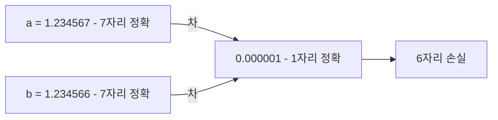
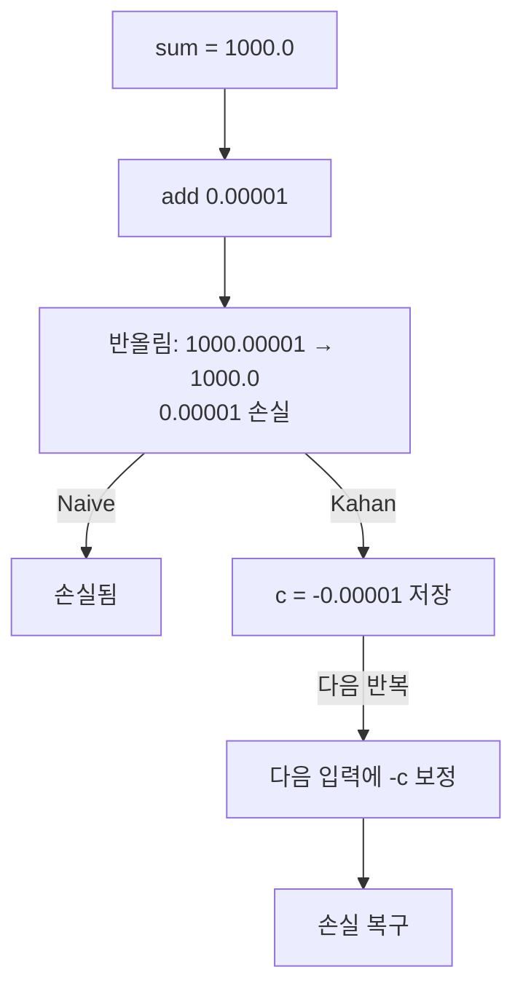
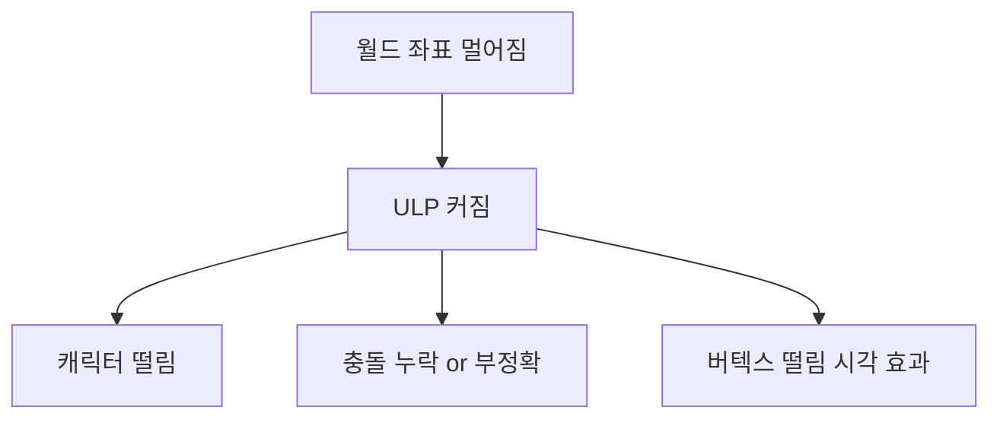
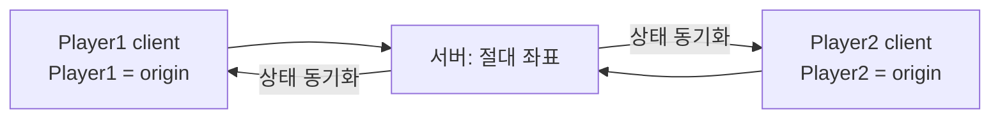

## 들어가며

벡터·행렬·쿼터니언, 좌표계, 보간·스플라인, 노이즈, 충돌, 공간 분할, 광선 같은 게임 수학 알고리즘은 대부분 *부동소수점 위에서 굴러간다*. 한 식이 *수학적으로 옳다* 는 것과 *수십만 프레임 누적된 후에도 옳다* 는 것은 다르다.

게임이 *한 번의 프레임이 아니라 수십만 프레임 누적되는 시스템* 이라는 사실에서, *수치 안정성 (Numerical Stability)* 이 결정적이다. 매 프레임 ULP 단위 오차가 *한 시간 후 캐릭터를 보이지 않는 곳* 으로 보낸다. 매 프레임 작은 비단위가 *수십 분 후 회전을 망가뜨린다*. 매 프레임 작은 시간 누적이 *몇 시간 후 결정론을 깬다*.

이 글의 목표.

1. **오차의 두 종류** — 반올림 (round-off) vs 절단 (truncation). 서로 다른 메커니즘.
2. **Catastrophic Cancellation** — 거의 같은 두 큰 수의 차. 가장 흔한 정밀도 함정.
3. **Kahan Summation** — 단순 합산의 $n$ 의존 오차를 보상 변수로 크게 줄이고, 그 경계가 입력 조건수에 어떻게 의존하는지 본다.
4. **거대 월드 좌표 폭주** — 좌표가 클수록 ULP 가 커지는 함정.
5. **Floating Origin** — 플레이어 주변을 항상 원점에 두기. 우주·오픈 월드의 표준.
6. **시간 누적과 dt** — `time += dt` 의 함정. 결정론적 fixed timestep.
7. **스케일 정규화** — 단위 벡터·쿼터니언·회전 행렬의 *비단위 누적* 회피.
8. **체크리스트** — 게임 코드에서 자주 만나는 패턴 점검.

수치 안정성은 개별 알고리즘 바깥의 부가 주제가 아니다. 모든 알고리즘이 게임의 *수십만 프레임 약속* 을 지키기 위한 공통 조건이다.


---

## 목차
1. [오차의 두 종류](#1-오차의-두-종류)
2. [Catastrophic Cancellation](#2-catastrophic-cancellation)
3. [Kahan Summation](#3-kahan-summation)
4. [거대 월드 좌표 폭주](#4-거대-월드-좌표-폭주)
5. [Floating Origin](#5-floating-origin)
6. [시간 누적과 dt](#6-시간-누적과-dt)
7. [스케일 정규화](#7-스케일-정규화)
8. [수치 안정성 체크리스트](#8-수치-안정성-체크리스트)


---

## 1. 오차의 두 종류

수치 계산의 오차는 *두 다른 메커니즘*. 이해해야 *어디서 오는지* 알 수 있다.

### 1.1 Round-off Error (반올림 오차)

각 부동소수점 연산 (+, -, *, /, sqrt) 이 *결과를 가장 가까운 표현 가능 값에 반올림*. 그 반올림 차이가 *machine epsilon (ULP)* 단위.


float (32-bit) 의 *machine epsilon* ≈ $1.19 \times 10^{-7}$. 한 연산의 오차 *작음*. 하지만 *누적* 되면 큰 문제.

### 1.2 Truncation Error (절단 오차)

알고리즘 자체의 *근사*. 무한 급수를 *유한 항* 까지만 계산. Taylor 시리즈, Newton's method 의 한정된 반복, 시뮬레이션의 dt 단위 시간 분할.

예: $\sin(x) \approx x - x^3/6 + x^5/120$ 는 항이 셋뿐이지만 최고차가 $x^5$ 인 *5차 근사* 다. 이어지는 항을 잘라낸 *나머지 항* 이 truncation error이고, 7차 도함수가 $\cos$ 로 유계이므로 잔차는 $|R| \le |x|^7/7!$ 로 한정된다.

```cpp
// |x| <= 0.3 에서만 쓴다. 더 넓은 입력은 range reduction 후에 넣는다.
float SinApprox(float x) {
    float x2 = x * x;
    return x * (1 - x2 / 6 * (1 - x2 / 20));   // x - x^3/6 + x^5/120 (5차 근사)
}
```

게임의 *물리 적분* (Euler, RK4 등) 도 *시간 분할의 절단 오차*. dt 가 작을수록 작은 오차.

### 1.3 두 오차의 결합

게임 코드의 실제 오차 = *두 오차의 합*.


알고리즘 정확성 향상 (RK4 → 더 작은 절단) 은 *반올림 오차의 한도* 까지만 의미. 그 이하는 *부동소수점 정밀도* 가 결정.

### 1.4 Forward vs Backward Error

오차 분석의 두 시점.

- **Forward error**: *입력은 정확*, 결과가 *얼마나 부정확*.
- **Backward error**: *결과는 정확*, *입력이 얼마나 다른* 입력의 정확한 답인가.

게임에선 *forward error* 가 더 직관적. *카메라 위치가 ULP 만큼 다르다* 는 관측이 *forward error*.

### 1.5 오차의 누적

가장 중요한 함의. *한 프레임의 작은 오차* 가 *수십만 프레임 후 큰 차이*.

오차는 `machine epsilon × 연산 수`를 거리로 바로 환산할 수 없다. ULP는 현재 값의 크기에 따라 달라지고 반올림 오차의 부호도 입력에 의존한다. 예를 들어 round-to-nearest에서 순차 합산의 표준 전진 오차 경계는 $nu<1$일 때

$$
\left|\operatorname{fl}\left(\sum_{i=1}^{n}x_i\right)-\sum_{i=1}^{n}x_i\right|
\le \gamma_n \sum_{i=1}^{n}|x_i|,
\qquad
\gamma_n=\frac{nu}{1-nu}
$$

꼴이다. 이는 보수적 상한이며 실제 오차는 상쇄될 수도 편향되어 누적될 수도 있다. 중요한 것은 프레임 수만이 아니라 값의 scale, 합의 조건수, 연산 순서와 알고리즘 안정성을 함께 추적하는 것이다.

이 누적 메커니즘이 *수치 안정성 알고리즘 (Kahan, fixed dt, 정규화)* 의 *존재 이유*.

## 2. Catastrophic Cancellation

가장 *치명적인 함정*. 거의 같은 두 큰 수의 *차* 가 *유효 자리수 거의 모두 잃음*.

### 2.1 메커니즘

두 수 $a = 1.234567$, $b = 1.234566$. 차 $a - b = 0.000001$.

float 정밀도가 *7 자리 정도*. 십진 표기를 float 로 저장하는 순간 $a, b$ 에는 각각 상대 오차 $\sim u$ 가 이미 들어 있다. 그런데 뺄셈 자체는 2.4 대로 반올림 없이 정확하다. 문제는 이 상쇄가 *입력의 표현 오차* 에 대한 조건수를 키운다는 것이다 — $|a|/\lvert a-b\rvert \sim 10^6$ 배 증폭되어 차이 결과 *0.000001* 의 *유효 자리수* 가 *1 자리만 보장* 된다.



*유효 자리수의 폭발적 손실*. 후속 연산에 *오차 폭증*.

### 2.2 게임의 흔한 사례

- **충돌의 분리 거리**: 두 객체의 거리가 *0 에 가까워지면* 차분 결과 정밀도 폭발 손실.
- **시간 차분**: $t_1 - t_0$ 가 두 *큰 시간 값* 의 차이면 dt 정밀도 손실.
- **삼각함수의 차**: $\sin(a) - \sin(b)$ 가 a, b 가까울 때.
- **벡터 정규화**: 작은 벡터 + 큰 origin 에서 정규화 시.

### 2.3 대수적 변형으로 회피

함수 형태를 *바꿔서* 차분을 회피.

**예 1**: $\sqrt{x+1} - \sqrt{x}$ 의 정밀도 폭발 (x 큼). 분자유리화:

$$
\sqrt{x+1} - \sqrt{x} = \frac{(\sqrt{x+1} - \sqrt{x})(\sqrt{x+1} + \sqrt{x})}{\sqrt{x+1} + \sqrt{x}} = \frac{1}{\sqrt{x+1} + \sqrt{x}}
$$

```cpp
// 나쁜 코드: catastrophic cancellation
float bad = std::sqrt(x + 1) - std::sqrt(x);

// 좋은 코드: 분자유리화
float good = 1.0f / (std::sqrt(x + 1) + std::sqrt(x));
```

x = 1억일 때 *bad 가 0 에 가까운 잘못된 값*, *good 이 정확한 값*.

**예 2**: $1 - \cos(x)$ (x 작음). $1 - \cos$ 가 *0 에 가까운 두 1 의 차*. *반각 공식*:

$$
1 - \cos(x) = 2 \sin^2(x/2)
$$

```cpp
float oneMinusCos = 2 * std::pow(std::sin(x * 0.5f), 2);
```

작은 x 에서 *훨씬 정확*.

### 2.4 차의 부호는 정확하다

`a - b > 0` 을 `a > b` 로 바꾸면 안전해진다는 조언이 흔하다. 틀린 조언이다.

유한한 `float` 는 모두 최소 비정규수 $2^{-149}$ 의 정수배다. 서로 다른 두 float 의 정확한 차는 크기가 최소 $2^{-149}$ 이고 $2^{-149}$ 자체가 표현 가능하므로, 반올림은 그 차를 0 으로 접지도 부호를 뒤집지도 못한다. `fl(a - b)` 의 부호는 언제나 정확한 $a - b$ 의 부호와 같다. 같은 부호이고 서로 2 배 이내면 (Sterbenz) 차는 반올림조차 없이 *정확* 하다.

```cpp
// a, b 가 유한 float 인 한 두 식은 언제나 같은 답을 낸다
if (a - b > 0) { ... }
if (a > b)     { ... }
```

cancellation 이 파괴하는 것은 부호가 아니라 *차의 유효 자리* 다. 그 손실은 뺄셈이 아니라 *a 와 b 를 만든 앞 연산* 에서 이미 일어났고, 뺄셈은 숨어 있던 오차를 드러낼 뿐이다.

```cpp
// 원점에서 16 km 떨어진 지점. 이 크기대의 ULP 는 2^-9 = 1.95 mm
float p0 = 16384.0f;
float p1 = 16384.0f + 0.001f;  // 참값 16384.001 → 저장은 16384.001953125

float d = p1 - p0;             // 0.001953125 — 뺄셈은 정확, 참값은 0.001
float v = d * 60.0f;           // 0.1171875 m/s — 참값 0.06 m/s. 약 95% 오차
```

위험 신호는 `a - b` 라는 *형태* 가 아니라 *차의 크기를 쓰는 패턴* 이다.

- `(a - b) / c` — 속도·기울기·중심 차분. 죽은 자리가 나눗셈으로 증폭된다. 위 예의 95% 가 그 결과다.
- `std::fabs(a - b) < eps` — eps 가 그 크기대의 ULP 보다 가늘면 판정을 eps 가 아니라 격자가 내린다 (2.5).
- `(a - b) * k` — 절대 오차는 $|k|$ 배가 되지만 정확한 상수 $k$ 를 곱하는 한 상대 오차는 그대로다. 다만 추가 반올림, 특히 overflow·underflow 가 끼면 그때는 다시 커진다.

대응은 비교 형태가 아니라 *큰 오프셋이 더해지기 전에 빼는 것* 이다. 좌표는 국소 원점 기준으로, 시간은 시작 시각이 아니라 직전 프레임 기준으로 두면 차가 큰 값 위에 얹히지 않는다. 그것이 불가능한 구간만 `double` 로 올려 차를 만든다.

한 가지 단서. FTZ (flush-to-zero) 가 켜진 환경에서는 비정규수 결과가 0 으로 밀리므로, 차가 $10^{-38}$ 아래로 내려가는 극단에서만 `fl(a - b)` 가 부호를 잃는다. 게임 좌표·시간의 크기대에서는 만날 일이 없지만 `-ffast-math` 계열이 이 모드를 켠다.

### 2.5 epsilon 비교의 함정

```cpp
// 나쁜 코드: 절대 epsilon
if (std::fabs(a - b) < 1e-6f) { ... }   // a, b 큰 값이면 의미 없음

// 순수 상대 epsilon — a, b 가 0 근처면 허용 오차도 0 → 너무 엄격
// if (std::fabs(a - b) < 1e-6f * std::max(std::fabs(a), std::fabs(b))) { ... }

// 좋은 코드: 절대 + 상대 혼합
bool AlmostEqual(float a, float b) {
    float diff  = std::fabs(a - b);
    float scale = std::max(std::fabs(a), std::fabs(b));
    return diff <= std::max(1e-6f, 1e-6f * scale);
}
```

*절대 epsilon* 은 큰 값에서 오히려 너무 엄격해질 수 있다. 허용오차가 그 크기의 한 ULP보다 작으면 서로 다른 인접 표현값조차 같다고 판정하지 못한다. 반대로 좌표 단위보다 지나치게 큰 절대 epsilon을 고르면 0 근처에서 구별해야 할 값까지 같아진다. *순수 상대 epsilon* 은 *0 근처* 에서 허용 오차가 0 으로 수축한다. 둘의 `max`를 쓰면 0 근처의 절대 바닥값과 큰 값의 상대 비율을 함께 표현할 수 있지만, 두 상수는 문제의 단위와 오차 예산에서 정해야 한다.

ULP 단위 비교는 동일한 수치 구현의 회귀 검사에 유용하지만 보편적으로 더 강건한 비교는 아니다. 부호를 가로지르는 0, subnormal, NaN·무한대 처리와 값의 크기에 따른 물리 단위 변화를 고려해야 한다. 거리·시간·각도처럼 단위가 있는 값에는 대개 혼합 epsilon이 더 직접적인 계약이다.

### 2.6 2차 방정식의 함정

$ax^2 + bx + c = 0$ 의 해 $x = (-b \pm \sqrt{b^2 - 4ac}) / (2a)$.

$b^2 \gg 4ac$ 이면 *판별식이 b² 와 거의 같음* — 한 해가 *catastrophic cancellation*.

대안: *Vieta's formulas* 활용. 한 해 $x_1$ 을 안정적으로 풀고, 다른 해 $x_2 = c / (a x_1)$.

```cpp
// 해의 개수를 반환한다. 2: 서로 다른 두 실근, 1: 중근, 0: 실근 없음,
// -1: 항등식(모든 x 가 해), -2: 불능(해 없음) — 선형 퇴화 a=0 분기.
int SolveQuadratic(float a, float b, float c, float& x1, float& x2) {
    // 유한 계수만 받는다. inf/NaN 은 호출부 계약 위반이다.
    if (!std::isfinite(a) || !std::isfinite(b) || !std::isfinite(c)) return -2;

    float scale = std::max({std::fabs(a), std::fabs(b), std::fabs(c)});
    if (scale == 0.0f) { x1 = x2 = 0.0f; return -1; }   // 0 = 0 항등식

    // 스케일링은 계수 overflow 를 줄이는 보강이지, 계수가 극단으로 갈 때
    // exact discriminant 부호 판별을 보장하지는 않는다.
    a /= scale; b /= scale; c /= scale;

    if (a == 0.0f) {                       // 선형 b x + c = 0
        if (b == 0.0f) return (c == 0.0f) ? -1 : -2;
        x1 = x2 = -c / b;
        return 1;
    }
    float disc = b * b - 4.0f * a * c;
    if (disc < 0.0f) return 0;
    if (disc == 0.0f) {                    // 중근: q = 0 이 되어 c/q 가 NaN 이 된다
        x1 = x2 = -b / (2.0f * a);
        return 1;
    }
    float sqrtD = std::sqrt(disc);
    // 부호로 catastrophic cancellation 회피
    float q = -0.5f * (b + std::copysign(sqrtD, b));
    x1 = q / a;
    x2 = c / q;                            // disc > 0 이므로 q != 0
    return 2;
}
```

*Numerical Recipes* 의 표준 형태다. $b^2 \gg 4ac$ 에서 큰 쪽 근을 $\lvert q\rvert$ 로 골라 $x_1=c/q$ 로 다른 근을 얻으므로 두 근이 모두 안정적이고, 중근은 $q$ 가 0 이 되기 전에 분기해 NaN 을 막는다. $a=0$ 선형 입력은 별도 분기로 처리하며, 계수 크기 차이가 극단일 때 $disc=0$ 접선 판정은 스케일링으로도 부호가 흔들릴 수 있어 정확한 tangent 판정이 필요한 호출부는 추가 정책을 둔다. Ray-sphere 교차도 이 패턴을 활용한다.

## 3. Kahan Summation

*N 개 수 합산* 의 오차를 단순 순차 합산보다 크게 줄이는 표준 알고리즘이다. round-to-nearest와 재배열되지 않은 연산에서 대표적인 1차 경계는 대략 $(2u+O(nu^2))\sum|x_i|$ 꼴이다. $n$의 1차 항을 제거하지만 입력 합이 심하게 상쇄되면 결과에 대한 상대 오차는 여전히 클 수 있다.

### 3.1 Naive 합산의 오차

```cpp
float SumNaive(const std::vector<float>& xs) {
    float sum = 0;
    for (float x : xs) sum += x;
    return sum;
}
```

각 덧셈의 상대 오차는 정상 범위와 round-to-nearest 가정에서 unit roundoff로 제한되지만, 절대 오차는 더하는 값과 부분합의 크기에 좌우된다. 따라서 N회라는 사실만으로 `0.1`이나 `10cm` 같은 물리 오차를 계산할 수 없다. $\gamma_n\sum|x_i|$와 실제 입력 trace의 고정밀 기준값을 함께 사용한다.

### 3.2 Kahan 알고리즘

William Kahan (1965). *보상 변수 c* 로 *손실된 하위 비트* 추적.

```cpp
float SumKahan(const std::vector<float>& xs) {
    float sum = 0;
    float c   = 0;       // 보상 변수
    for (float x : xs) {
        float y = x - c;        // 이전에 손실된 분량 보정
        float t = sum + y;
        c = (t - sum) - y;      // 새로 손실된 분량 (보통 0이 아님)
        sum = t;
    }
    return sum;
}
```

각 반복은 *이전 손실분 c 만큼 입력을 보정* 하고 *새 손실분을 c에 저장* 한다. 1차 오차 경계의 N 의존성이 크게 줄지만, 정확한 결과에 가까운 정도는 $\sum|x_i|/|\sum x_i|$라는 합산 조건수, overflow·underflow, 반올림 모드와 컴파일러 재배열에 의존한다.

*주의*: `-ffast-math` (GCC/Clang) 같은 컴파일러 플래그가 *결합법칙 / 항 재배열* 을 허용하면 *컴파일러가 보상 변수 c 를 0 으로 단순화* 해 Kahan 이 망가진다. 보상합 코드는 *fast-math 를 끄거나*, `volatile` / `[[gnu::optimize("no-fast-math")]]` 같은 격리가 필요.

### 3.3 시각화



*sum 이 큼 + 더해지는 값이 작음* 의 패턴에서 가장 효과적.

### 3.4 변형들

- **Neumaier's algorithm**: Kahan의 변형. *새 입력의 절댓값이 현재 누적합보다 큰 경우*까지 크기 비교로 보정한다.
- **Pairwise summation**: *재귀 분할 + 합* — *O(log N · ε)*. Cache 친화.
- **Compensated multiplication**: 곱셈에도 같은 패턴.

### 3.5 게임 응용

- **파티클 위치 누적**: *수만 프레임 동안 같은 파티클* 의 누적 위치.
- **시뮬레이션 평균**: 평균 계산용 누적.
- **삼각형 면적 합 / 메쉬 부피**: 면적 합의 차원은 길이² 라 부피가 아니다. 부피가 필요하면 일관된 winding 의 폐메시에서 각 삼각형의 원점 기준 signed tetrahedron 부피 $\frac{1}{6}\,\vec a\cdot(\vec b\times\vec c)$ 를 합한다. 부호가 섞여 상쇄되므로 Kahan 누적이 특히 유용하다.
- **Energy/momentum 추적**: 물리 시뮬레이션의 *보존 양 추적*.

### 3.6 Kahan 가 항상 필요한가

*아니다*. 대부분 게임 코드는 *Naive 합* 으로 충분. Kahan 이 필요한 케이스:

- N 이 *수만 ~ 수백만*.
- 누적값과 입력값의 *크기 차이가 큼* (예: 큰 sum + 작은 dx).
- 결과 정확도가 *시각적·물리적으로 보임*.

평범한 게임 코드는 *Naive*. 시뮬레이션·과학 계산 부분에 Kahan.

## 4. 거대 월드 좌표 폭주

월드 좌표가 *원점에서 멀어지면* float 정밀도 *폭발적 손실*. 우주·오픈 월드의 *결정적 함정*.

### 4.1 Float 정밀도와 좌표

float (32-bit) 의 정밀도는 *지수에 따라 변함*. 가수 23 비트 + 지수 8 비트.

| 좌표 크기 | 표현 가능한 가장 작은 차이 (ULP) |
|---|---|
| 1 (1m) | $1.19 \times 10^{-7}$ (0.1 μm) |
| 1,000 (1 km) | $6.1 \times 10^{-5}$ (0.06 mm) — $1000 \in [2^9, 2^{10})$ 이라 ULP $= 2^{-14}$ |
| 1,000,000 (1000 km) | $0.0625$ (6.25 cm) |
| 10,000,000 (1만 km) | $1$ (1 m) |

*1만 km* 떨어지면 *1m 단위 정밀도* 만 보장. *그 이하의 모든 동작이 단계적*.

### 4.2 게임에서의 증상



*Star Citizen* 의 우주, *No Man's Sky* 의 행성 간 이동에서 흔한 함정.

### 4.3 64-bit 좌표

해결책 1: *double precision*. 64-bit. ULP 가 ~16 자리 보장.

```cpp
struct WorldPosition {
    double x, y, z;     // 큰 좌표
};
```

문제: *GPU 와의 인터페이스*. Vulkan/DirectX 가 *float 4 vec* 표준. CPU 에서 double, GPU 전송 시 *float 캐스팅*. 그 캐스팅 단계에서 정밀도 손실.

또한 *물리 엔진* 은 기본 구성이 float 다. Bullet 은 `BT_USE_DOUBLE_PRECISION` 빌드 옵션으로 double 로 구성할 수 있지만, 그 경우도 저장 형식·플러그인 호환·성능을 따로 검토해야 하므로 전체 시스템 재설계에 준하는 비용이 든다.

### 4.4 32-bit + 청크

해결책 2: *공간을 청크로 분할 + 각 청크 안에서만 32-bit*. 청크 간 *정수 인덱스 + 청크 내부 float*.

```cpp
struct ChunkedPosition {
    ivec3  chunkCoord;     // 어느 청크
    vec3   localOffset;    // 청크 안 위치 (0 ~ chunkSize)
};
```

장점: *각 청크가 작아 정밀도 보장*. *Minecraft* 가 이 패턴.
단점: *청크 경계 처리* 복잡.

### 4.5 Floating Origin (5절)

해결책 3은 플레이어 주변을 원점 가까이에 유지하는 floating origin이다. 월드의 기준점을 일정 거리마다 옮기고, 물리·렌더링·파티클·네트워크 좌표에 동일한 offset 전이를 원자적으로 적용한다.

### 4.6 GPU 측의 정밀도

CPU 가 *어떻게 처리하든* 그래픽스 파이프라인의 정점·텍스처 저장 형식은 대개 32-bit float 다. GPU 에도 FP64 연산 경로가 있지만 장치·연산 종류별 처리량이 FP32 보다 훨씬 낮고 저장 형식이 double 로 바뀌는 것도 아니다. 큰 좌표가 float 로 전송되면 *셰이더 안에서 폭발 손실*.

해결: *GPU 에 전송하기 전 좌표를 카메라 기준으로 보정*. *World - Camera* 또는 *World - PivotChunk*. 이게 floating origin 의 *부수 효과*.

### 4.7 게임 엔진의 대응

| 엔진 | 대응 |
|---|---|
| Unity | 기본 float, *Floating Origin asset* 으로 사용자가 구현 |
| Unreal | UE5 의 *Large World Coordinates* — double 좌표 자동 처리 |
| Bevy (Rust) | *Big Space* plugin — 청크 기반 |
| Star Citizen | 자체 64-bit + relative-to-camera |

UE5 의 LWC 는 *현대 게임 엔진의 진보*. 엔진 좌표는 double, 렌더 측은 타일 오프셋·카메라 상대 좌표로 처리한다 — 내장 머티리얼 그래프는 자동이지만 사용자 HLSL 은 LWC 타입으로 직접 옮겨야 하고 비용도 붙는다.

## 5. Floating Origin

*플레이어 주변을 항상 원점에 두는* 패턴. 우주·오픈 월드의 표준.

### 5.1 핵심 아이디어

플레이어가 멀리 가면 *월드 전체를 시프트* 해서 *플레이어가 다시 원점 근처*.


물리·렌더의 지역 계산을 원점 근처에 두면 해당 계산의 float 간격을 작게 유지할 수 있다. 다만 멀리 떨어진 두 객체 사이의 계산, 원점 이동 순간의 캐시·보간 상태, 지역 좌표로 바꾸기 전 이미 소실된 정보까지 자동으로 복구되지는 않는다.

### 5.2 알고리즘

```cpp
struct FloatingOriginManager {
    dvec3 worldOffset; // 게임 원점 (현실 좌표). 4.3 의 큰 좌표라 float 에 누적하지 않는다
    float threshold;   // 시프트 트리거 거리 (예: 1000m)

    void Update(World& world, vec3 playerPos) {
        if (length(playerPos) > threshold) {
            // 모든 객체를 -playerPos 방향으로 시프트
            for (auto& obj : world.objects) {
                obj.position -= playerPos;
            }
            worldOffset += playerPos;   // 누적 (논리적 위치 추적)
        }
    }
};
```

이 시프트가 *물리에 영향 없음* (모든 게 같이 움직임). 충돌 검사·렌더 모두 *원점 근처*.

### 5.3 멀티 캐릭터의 함정

여러 플레이어 (멀티플레이) 면 *원점을 누구 기준* 으로? 각 플레이어가 자기 *로컬 floating origin* 갖기 + *서버는 절대 좌표*.



각 클라이언트가 *자기 기준 로컬 좌표* 로 렌더. 네트워크는 *절대 좌표 또는 청크 인덱스*.

### 5.4 시프트 시점

- **임계 거리 초과**: 1000m 같은 임계 넘으면 시프트.
- **매 프레임**: 매번 *플레이어를 원점으로*. 가장 안전. 비용 약간.

매 프레임 시프트 비용은 *모든 객체 위치 갱신* — 객체 수 만큼. 게임이 크면 *임계 거리* 가 일반적.

### 5.5 셰이더 측 처리

*Floating origin + GPU 정밀도* 의 결합. World - Camera 변환을 *CPU 측 double* 로 계산 후 *result 만 float* 으로 GPU 에.

```cpp
// CPU 측 (double)
dvec3 worldPos = obj.absoluteWorldPos;
dvec3 cameraPos = camera.absoluteWorldPos;
vec3 relativePos = vec3(worldPos - cameraPos);  // float 캐스팅

// GPU 측: 카메라 기준 상대 좌표만
gl_Position = projection * view_local * vec4(relativePos, 1);
```

이 패턴이 *Star Citizen* 의 우주 정밀도 비결. 행성 표면 cm 정밀도 + 광년 단위 우주.

### 5.6 floating origin 의 한계

- **물리 엔진 호환성**: 시프트 시점에 *물리 엔진 상태도 갱신*. 일부 엔진은 *연속 시뮬레이션 중 시프트 어려움*.
- **AI 경로 캐싱**: navmesh 가 *절대 좌표* 면 시프트마다 *재캐시*.
- **저장 / 복원**: 게임 저장 시 *절대 좌표 또는 시프트 누적값* 저장.

산업 구현은 이 한계들을 *엔진 차원에서 추상화*. 사용자 코드는 *절대 좌표만* 다룸.

## 6. 시간 누적과 dt

`time += dt`의 함정은 누적 오차와 시간 해상도 저하다. 고정 시간 간격은 이 문제를 줄이는 한 요소이지만, 시뮬레이션 전체의 결정론을 단독으로 보장하지 않는다.

### 6.1 누적의 함정

```cpp
float time = 0;
while (running) {
    time += dt;     // 누적
    Update(time);
}
```

매 프레임 `float` 시간에 작은 `dt`를 더하면 값이 커질수록 증가량이 격자에 양자화된다. 먼저 실제 `dt`와 다른 간격으로 전진하기 시작하고, 더 커지면 덧셈이 같은 값으로 반올림되어 시간이 멈출 수 있다.

정규 `float`가 $v\in[2^e,2^{e+1})$에 있을 때 인접 표현값 간격은 $2^{e-23}$이다. `dt ≈ 1/60`에서 $v=2^{17}$초가 되면 ULP가 `0.015625`초라 60Hz 시간 해상도와 비슷해지고, 증가량이 왜곡되기 시작한다.

$$
\operatorname{ULP}(2^{17})=2^{-6}=0.015625\text{ 초}
$$

이는 36시간 무렵에 시간이 즉시 멈춘다는 뜻이 아니다. round-to-nearest에서는 `dt`가 반 ULP보다 작을 때 같은 값으로 반올림될 수 있다. `1/60`을 반복 가산하는 구체적 루프는 표현된 `dt`, 반올림 모드와 시작값에 따라 경계가 달라지지만, 이 조건은 $2^{19}$초 부근(약 6.1일)에서 확실히 문제가 된다. 중요한 계약은 “몇 시간에 멈춘다”는 상수가 아니라, 장시간 절대 시간을 좁은 `float` 하나에 누적하지 않는 것이다.

### 6.2 결정론

게임의 *결정론* 이 중요한 케이스 (멀티플레이, 리플레이, 디버깅 재현). *같은 입력이 같은 결과* 보장.

반올림 오차 자체가 곧 비결정성은 아니다. 같은 초기 비트, 같은 `dt`열, 같은 연산 순서와 부동소수점 환경이면 반복 덧셈도 같은 결과를 낸다. 문제는 variable timestep이 실행마다 다른 `dt`열을 만들고, 플랫폼·컴파일 옵션·FMA·병렬 합산 순서가 연산 계약을 바꿀 수 있다는 점이다. 누적 상태는 이렇게 생긴 작은 차이를 이후 모든 프레임으로 운반하고 비선형 분기에서 확대한다.

### 6.3 정수 tick 을 권위 있는 상태로

해결: *시뮬레이션의 권위 있는 시간 = 정수 tick (frameCount)*. 표시 / 쿼리용 시간은 *frameCount × fixedDt* 로 계산.

```cpp
int64_t frameCount = 0;                   // authoritative — 정수 tick
const double fixedDt = 1.0 / 60.0;        // double 로 1/60 표현 정밀도 ↑

while (running) {
    ++frameCount;
    double time = (double)frameCount * fixedDt;   // 표시 / 쿼리용
    Update((float)time, (float)fixedDt);
}
```

권위 있는 tick은 시간의 순서와 간격을 정수로 보존해 누적 시간 상태의 드리프트를 제거한다. 표시용 시간은 한 번의 곱셈으로 얻으므로 반복 가산 오차도 없다. 단, `1/60` 자체가 이진 부동소수점으로 정확히 표현되지 않고 큰 `frameCount`의 곱셈도 반올림된다. 시뮬레이션 전체의 bit-exact 결정론은 입력·초기 상태·난수 소비 순서·FMA 사용 여부·연산 순서·멀티스레드 스케줄·플랫폼 수학 함수까지 별도 계약으로 통제해야 한다.

### 6.4 Variable vs Fixed Timestep

게임의 두 시간 모델.

- **Variable**: 매 프레임 측정한 실제 `dt`를 사용한다. 실행마다 프레임 시간이 달라지면 입력 시간열도 달라지고, 큰 `dt`에서 적분·충돌 오차가 커질 수 있다.
- **Fixed**: 고정 `dt`로 시뮬레이션한다. 렌더 프레임이 늦으면 여러 fixed step을 처리하되, 한 프레임의 최대 step 수와 시간 부채 정책이 필요하다.

실시간 강체 물리는 일정한 solver 조건과 튜닝 가능성을 얻기 위해 fixed timestep을 흔히 사용한다. 렌더는 두 시뮬레이션 상태 사이를 보간할 수 있다.

```cpp
const float fixedDt = 1.0f / 60;
float accumulator = 0;

while (running) {
    float frameDt = MeasureFrameTime();
    accumulator += frameDt;

    while (accumulator >= fixedDt) {
        UpdatePhysics(fixedDt);
        accumulator -= fixedDt;
    }

    float alpha = accumulator / fixedDt;
    InterpolateRender(alpha);   // 보간 렌더
}
```

이 accumulator 패턴은 시뮬레이션 step을 렌더 주기에서 분리하고 보간 계수 `alpha`를 제공한다. 고정 step은 결정론의 필요조건이 될 수 있지만 충분조건은 아니다. 또한 업데이트가 실시간보다 느려 step 부채가 계속 늘어나는 “spiral of death”를 막으려면 입력 `frameDt`와 프레임당 step 수를 제한하고, 남은 시간 부채를 버리거나 품질을 낮추는 정책을 명시해야 한다.

### 6.5 결정론 vs 멀티스레드

멀티스레드 물리가 *비결정론* 의 흔한 원인. 두 스레드가 *다른 순서로 합산* 해 *부동소수점 결과 다름*.

대응: *결정적 reduce* (트리 합), 또는 *lockstep + 직렬 reduce*.

멀티스레드 물리의 결정성은 엔진과 실행 계약에 따라 다르다. 서버 권위 모델은 모든 참가자가 독립적으로 같은 물리 결과를 계산할 필요를 줄이고 오차를 교정하지만, 서버 내부의 재현성·리플레이·롤백 요구까지 없애지는 않는다.

### 6.6 큰 dt 의 함정과 클램프

극단 케이스: *프레임 드랍·디버깅 일시정지 회복 후 첫 프레임의 dt 가 매우 큼* — 시뮬레이션이 *큰 step 으로 폭주* (캐릭터가 벽 통과, 발사체 워프 등).

대응: *dt 클램프*.

```cpp
dt = std::min(dt, 0.1f);   // 0.1s 보다 큰 dt 는 0.1s 로 (slowdown)
```

0.1s 보다 큰 dt 는 *시뮬레이션 폭주* — slowdown 처리.

## 7. 스케일 정규화

*단위 벡터·쿼터니언·회전 행렬* 의 *비단위 누적* 회피. 매 프레임 *작은 비단위* 가 *수십 분 후 회전 망가짐*.

### 7.1 쿼터니언의 단위 보존

쿼터니언 회전은 *단위 쿼터니언* (norm = 1) 가정. 매 프레임 *회전 곱*:

$$
q_{n+1} = q_n \cdot \Delta q
$$

각 곱에 *반올림 오차* → norm 이 *조금씩 1 에서 멀어짐*. 누적되면 *회전이 늘어나거나 줄어듦*.

```cpp
quat q = identity;
for (int i = 0; i < 1000000; ++i) {
    q = q * deltaRotation;
    // q 의 norm 이 점점 1 에서 멀어짐
}
```

대응: *주기적 정규화*.

```cpp
// 매 프레임 또는 N 프레임 마다
q = normalize(q);
```

비용: 1 sqrt + 4 division. 매 프레임 OK.

### 7.2 회전 행렬의 직교성 보존

회전 행렬은 *직교 행렬* — *행과 열이 정규 직교*. 매 프레임 곱이 *직교성 손실*.

```cpp
mat3 R = identity;
for (...) R = R * deltaR;
// R 의 행이 더 이상 직교가 아님 — *전단 (shear)* 효과 등장
```

대응: *Gram-Schmidt 직교화*.

```cpp
mat3 Orthonormalize(mat3 R) {
    vec3 x = normalize(R.col[0]);
    vec3 y = normalize(R.col[1] - dot(R.col[1], x) * x);
    vec3 z = cross(x, y);   // 자동 직교
    return mat3(x, y, z);
}
```

*비싼 연산* (sqrt 두 번 + dot/cross). *주기적으로만* 호출.

### 7.3 쿼터니언 vs 행렬 누적

| 형태 | 누적 비용 | 비단위 누적 | 정규화 비용 |
|---|---|---|---|
| 쿼터니언 | 16 mul + 12 add | 느림 | 1 sqrt |
| 회전 행렬 | 27 mul | 빠름 | 직교화 비쌈 |

쿼터니언이 *누적에 강함* — 정규화 비용도 작음. 게임 엔진의 *주력 회전 표현*.

### 7.4 단위 벡터의 정규화

법선·방향 벡터. 매 프레임 변형 후 *길이가 1 이 아닌 경우*. 셰이딩이 잘못됨.

```cpp
// 변형 후 정규화
vec3 normal = transformNormal(originalNormal);
normal = normalize(normal);
```

GPU의 varying 보간은 일반적으로 vector 길이를 보존하지 않는다. fragment shader가 자동 정규화해 주지 않으므로 조명 계산 전에 명시적으로 `normalize`해야 한다.

### 7.5 정규화 시점

“매 N 프레임”은 오차의 크기와 무관한 정책이다. 단위 벡터·quaternion 불변식이 필요한 연산 경계에서 정규화하고, hot loop에서는 길이 오차가 허용 범위를 넘었는지 검사해 조건부로 수행할 수 있다. 보간 뒤의 normal, 누적 회전 뒤의 quaternion, 입력 방향은 서로 다른 오차·비용 계약을 가지므로 각각 측정한다.

### 7.6 NaN 의 전파

*0 으로 나누기* 또는 *sqrt(음수)* 에서 NaN 발생. NaN 은 *모든 연산에서 NaN 으로 전파*.

```cpp
vec3 dir = b - a;
vec3 normDir = dir / length(dir);   // a == b 면 NaN
```

대응: *길이 검사 + 폴백*.

```cpp
// 계약: 유한 입력, 단위 벡터 fallback. 0 벡터와 비유한 입력을 숨기지 않는다.
bool SafeNormalize(vec3 v, vec3 fallback, vec3& out) {
    if (!std::isfinite(v.x) || !std::isfinite(v.y) || !std::isfinite(v.z)) return false;
    float m = std::max({std::fabs(v.x), std::fabs(v.y), std::fabs(v.z)});
    if (!(m > 0.0f)) { out = fallback; return false; }   // 0 벡터 = fallback
    vec3 s = v / m;              // 최대 성분으로 나눠 큰 유한 벡터의 dot overflow 방지
    out = s / length(s);
    return true;
}
```

`SafeNormalize` 하나가 모든 입력을 해결하는 만능 해법은 아니다. 작은 norm 만 검사하면 큰 유한 벡터의 `length` 가 dot overflow 로 inf 가 될 수 있으므로, 최대 성분으로 스케일한 뒤 정규화하고 유한성을 먼저 검증한다. 0·비정상 입력은 fallback 으로 접되 실패 상태를 호출부에 알리고, fallback 자체도 단위성·의미를 계약으로 정한다. 정규화 전제로 0 을 배제하는 API 선택도 가능하다. 게임 코드의 *모든 normalize* 가 이 계약을 지켜야 *수십만 프레임 후* 도 안정.

## 8. 수치 안정성 체크리스트

게임 코드의 *수치 안정성 자가 점검*. 발행 / 출시 전 확인.

### 8.1 분모 0 검사

```cpp
[ ] 모든 나눗셈에서 분모 0 가능성 검사
[ ] normalize() 가 0-vector 에서 NaN 안 만드는가
[ ] cross() 결과가 0-vector 일 때 후속 normalize 안전한가
[ ] 평면-광선 교차에서 dot(n, d) 가 0 일 때 처리하는가
```

### 8.2 Catastrophic Cancellation 패턴

```cpp
[ ] sqrt(x+1) - sqrt(x) 같은 식이 있는가 (분자유리화)
[ ] 큰 시간 값의 차분 (t1 - t0) 이 있는가 (정수 tick 또는 double 로 들고 차를 만든다)
[ ] 2차 방정식 풀이가 부호에 따라 cancellation 우려가 있는가
[ ] 1 - cos(x) 같은 작은 차 (반각 공식)
```

### 8.3 누적 합산

```cpp
[ ] N 큰 누적 합산이 있는가 (Kahan summation 검토)
[ ] 파티클 위치가 매 프레임 누적되는가 (Kahan 또는 절대 위치 + 각 프레임 가산)
[ ] 보존량 (energy, momentum) 추적이 누적인가
```

### 8.4 단위성 / 직교성

```cpp
[ ] 쿼터니언 누적 곱 후 정규화 빈도 적절한가
[ ] 회전 행렬 누적 후 직교화 빈도 적절한가
[ ] 단위 벡터의 normalize 가 매 변환 후 호출되는가
[ ] 셰이더의 normal interpolation 후 normalize 가 있는가
```

### 8.5 시간 누적

```cpp
[ ] time += dt 가 수 시간 후도 안전한가 (frame * fixedDt 또는 double)
[ ] dt 클램프 (frame drop 처리) 가 있는가
[ ] 물리가 fixed timestep 으로 도는가
[ ] 멀티 플레이의 시간 동기화 메커니즘이 있는가
```

### 8.6 월드 좌표

```cpp
[ ] 월드 크기가 float 정밀도 한계 (10 km) 이내인가
[ ] floating origin 또는 chunked coordinate 가 있는가
[ ] GPU 에 전송 전 카메라 기준 상대 좌표인가
[ ] navmesh / pathfinding 도 floating origin 적용되는가
```

### 8.7 epsilon 비교

```cpp
[ ] `max(absEps, relEps * scale)` 형태의 절대+상대 혼합 epsilon 사용
[ ] epsilon 값이 씬 스케일에 적절 (1m 게임이면 1e-4 ~ 1e-6, 우주면 더 큼)
[ ] 두 매개변수의 epsilon 비교가 일관되는가
```

### 8.8 NaN / Inf

```cpp
[ ] sqrt(-x), 1/0, 0*Inf 같은 패턴이 NaN 안 만드는가
[ ] NaN 검출 (std::isnan) 이 디버그 빌드에 있는가
[ ] NaN 이 한 번 등장하면 시스템 전체 망가질 수 있다 — 진입점 가드
```

### 8.9 자동화 검증

```cpp
[ ] 단위 테스트가 catastrophic cancellation 케이스 (큰 좌표 + 작은 차이) 검증하는가
[ ] 장시간 시뮬레이션 테스트 (1 시간) 가 있는가
[ ] NaN 발견 시 즉시 중단하는 디버그 가드
[ ] 결정론 검증 (같은 입력 → 같은 출력) 이 있는가
```


---

## 결론

게임 수학의 공식은 실수 위에서 유도되지만 구현은 유한한 표현과 반복 계산 위에서 실행된다. 따라서 좌표·회전·충돌·시간의 계약에는 오차의 크기와 실패 조건이 함께 들어가야 한다.

1. **두 종류 오차** — round-off (부동소수점) + truncation (알고리즘 근사). 결합 누적.
2. **Catastrophic Cancellation** — 거의 같은 큰 수의 차. 부호는 정확하고 유효 자리가 죽는다. 분자유리화·반각·국소 원점으로 회피.
3. **Kahan Summation** — 보상 변수로 손실된 하위 비트를 회수한다. 오차 경계는 입력 조건수, 반올림 모델과 컴파일러의 연산 재배열 여부에 의존한다.
4. **거대 월드 함정** — 좌표가 클수록 ULP 폭증. 1만km 면 1m 단위.
5. **Floating Origin** — 플레이어 주변 항상 원점. 우주·오픈 월드 표준.
6. **정수 tick과 Fixed timestep** — 누적 시간 드리프트와 실행별 `dt` 변화를 줄인다. 전체 결정론은 별도 실행 계약이다.
7. **단위성 / 직교성 보존** — 쿼터니언·회전 행렬·법선의 주기적 정규화.
8. **체크리스트** — 발행 전 자가 점검 8 카테고리.

이 글의 목적은 구현 전에 필요한 수치적 판단 기준을 정리하는 데 있다. 좌표, 회전, 시간, 충돌, 합산은 모두 같은 안정성 원칙 위에서 설계되어야 한다.

게임에 쓰이는 모든 수학은 *이 안정성 위에서만* 장시간 실행의 약속을 지킨다.

## 더 읽을거리

- David Goldberg, "What Every Computer Scientist Should Know About Floating-Point Arithmetic" (ACM Computing Surveys, 1991) — 부동소수점의 표준 참조.
- Nicholas J. Higham, *Accuracy and Stability of Numerical Algorithms*, 2nd ed. — 수치 알고리즘의 안정성 백과사전.
- William Kahan, "Pracniques: Further Remarks on Reducing Truncation Errors" (1965) — Kahan summation 원전.
- Bruce Dawson, "Comparing Floating Point Numbers" 시리즈 — ULPs 비교, 게임 친화적.
- Glenn Fiedler, "Fix Your Timestep!" (https://gafferongames.com/post/fix_your_timestep/) — fixed timestep 표준.
- Tom Forsyth, "Floating-Point Numbers" — 게임 그래픽 관점.
- "Floating-Point Determinism" (Bruce Dawson) — 멀티플레이 동기화.
- *Game Programming Gems* 시리즈 — 게임의 다양한 수치 트릭.
- Unreal Engine 5 *Large World Coordinates* 문서 — 산업 좌표 시스템.
- IEEE 754-2019 표준 — 부동소수점의 정의.
