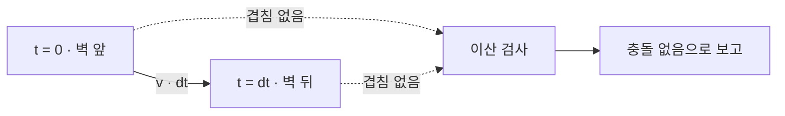
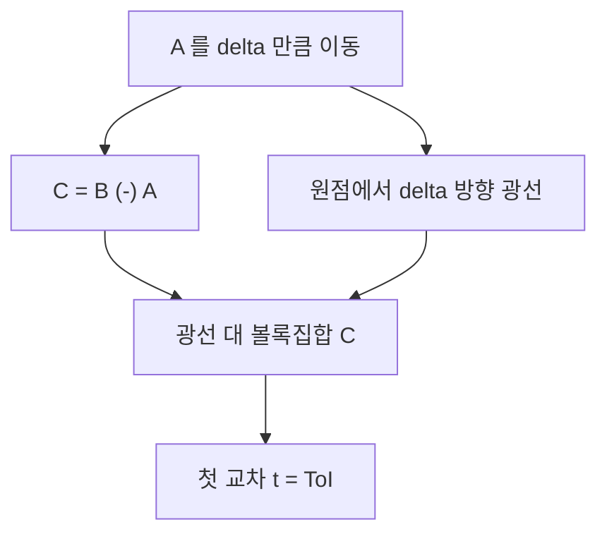
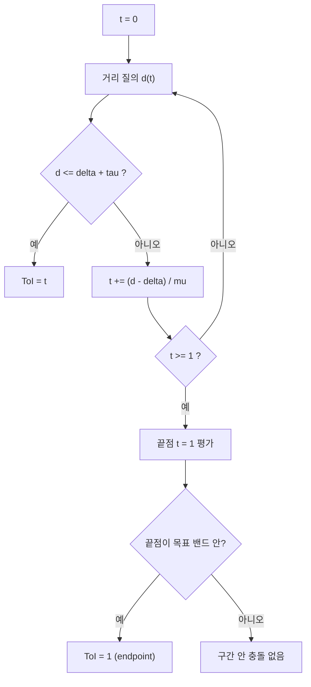

## 들어가며

광선 교차는 *점이 직선을 따라 움직일 때 처음 만나는 표면* 을 찾는다. 게임이 실제로 묻는 질문은 그것보다 넓다. 캐릭터 캡슐이 이번 프레임의 변위만큼 움직이면 어디서 멈추는가. 총알이 벽을 지나갔는가 아니면 벽 앞에서 멈췄는가. 회전하며 날아가는 박스가 얇은 판을 통과했는가. 여기서 움직이는 것은 점이 아니라 *부피를 가진 도형* 이고, 답으로 필요한 것은 교차 여부가 아니라 *처음 닿는 시각* 이다.

이 질의를 형상 캐스트(shape cast, sweep)라 부르고, 그 답을 ToI(time of impact)라 부른다. 이 글은 그 질의를 소유한다. 다루는 것은 다음 다섯 가지다.

1. **왜 이산 검사로는 부족한가** — 터널링이 일어나는 정확한 조건을 속도·시간 스텝·두께로 세운다. 이 부등식이 이후 모든 결정의 기준이 된다.
2. **선형 캐스트의 환원** — 볼록 도형의 이동 질의가 *Minkowski 차 위의 광선 하나* 로 정확히 환원된다. 이 환원이 성립하는 순간 형상 캐스트는 광선 교차의 일반화가 된다.
3. **Conservative advancement** — 거리 질의만으로 ToI 를 조이는 반복. 왜 절대 지나치지 않는지, 왜 수렴하는지, 그리고 그 수렴 논증이 어디서 깨지는지.
4. **종료 조건과 정밀도** — ToI 를 시간 단위로 규정하면 왜 의미가 없는지, 목표 여유와 허용 밴드를 어떻게 정하는지.
5. **비용과 대안** — 연속 검사를 켜는 기준, sub-step·speculative contact 같은 대안이 사는 조건.

전제로 쓰는 것은 볼록 집합의 지원 함수와 Minkowski 차, 그리고 두 볼록 도형 사이의 거리를 반환하는 질의다. 이 글은 그 세 도구의 *정의* 는 다시 적되 심플렉스 진화나 폴리토프 확장의 유도는 반복하지 않는다. 여기서 새로 다루는 실패 조건은 다른 것이다 — 시간을 매개변수로 넣었을 때 거리 함수가 단조가 아니라는 것, 처음부터 겹쳐 있으면 반복이 멈추지 않는다는 것, 스치는 접촉에서 수렴이 임의로 느려진다는 것, 회전이 들어오면 안전 상한이 급격히 헐거워진다는 것.


---

## 목차
1. [이산 검사가 놓치는 것](#1-이산-검사가-놓치는-것)
2. [캐스트 질의의 계약](#2-캐스트-질의의-계약)
3. [선형 캐스트를 Minkowski 차 위의 광선으로](#3-선형-캐스트를-minkowski-차-위의-광선으로)
4. [Conservative advancement와 수렴](#4-conservative-advancement와-수렴)
5. [ToI의 종료 조건과 정밀도](#5-toi의-종료-조건과-정밀도)
6. [지원 함수만으로 캐스트하기](#6-지원-함수만으로-캐스트하기)
7. [가속 구조와 질의 비용](#7-가속-구조와-질의-비용)
8. [연속 검사를 켜는 기준과 대안](#8-연속-검사를-켜는-기준과-대안)


---

## 1. 이산 검사가 놓치는 것

이산 충돌 검사는 시각 $t_n = n \Delta t$ 에서만 도형을 놓고 겹침을 본다. 표본과 표본 사이에 벌어진 일은 보지 않는다.

### 1.1 터널링의 정확한 조건

한 축으로 문제를 세운다. 이동 방향을 $\hat u$ 라 하고, 표적이 그 축에서 두께 $w$ 인 구간 $[0, w]$ 를 차지한다고 두자. 움직이는 도형은 같은 축에서 두께 $s$ 를 가지므로 시각 $t_n$ 에 구간 $[p_n, p_n + s]$ 를 차지한다. 두 구간이 겹칠 조건은

$$
p_n < w \quad \text{그리고} \quad p_n + s > 0
$$

즉 $p_n \in (-s,\; w)$ 다. 이 열린 구간이 *검출 창* 이고, 그 길이는 $w + s$ 다. 표본 사이의 이동량을 $\ell = v_{\text{rel}} \Delta t$ 라 두면, 이산 검사가 겹침을 반드시 한 번은 보려면 검출 창을 건너뛸 수 없어야 한다.

$$
v_{\text{rel}} \, \Delta t \; < \; w + s
$$

이 부등식이 성립하면 놓칠 수 없다. 증명은 한 줄이다. 도형이 창 앞($p_k \le -s$)에서 창 뒤($p_{k+1} \ge w$)로 한 번에 건너뛰었다면 $p_{k+1} - p_k \ge w + s$, 곧 $\ell \ge w+s$ 다. 대우를 취하면 $\ell < w+s$ 일 때 앞에서 뒤로 직행하는 표본 쌍이 없고, 위치가 단조 증가하므로 창 안에 들어가는 표본이 반드시 존재한다.

반대 방향은 보장이 아니라 *가능성* 이다. $\ell \ge w + s$ 이면 창을 건너뛰는 시작 위상이 존재한다. 실제로 뚫리는지는 그 프레임의 위상에 달렸고, 그래서 터널링은 재현이 어려운 버그로 나타난다.

위 보장은 *이동 방향과 표적 두께가 같은 한 축에 놓인 1D 정면 문제* 의 결론이다. 일반 3D 에서 창 역할을 하는 것은 두 도형이 *겹쳐 있는 동안의 상대 경로 길이* 다. 비스듬한 grazing 접촉에서는 그 구간이 임의로 짧아져 $\ell$ 이 직경 합보다 작아도 양 끝 표본은 분리되고 중간만 겹칠 수 있다 — 반지름 0.5 인 두 구(직경 합 2)가 한 프레임에 1 만큼 이동해 시작과 끝이 떨어져 있고 중간에서만 겹치는 배치가 그 예다. 따라서 fixed substep 폭 $\ell < w+s$ 하나로 일반 3D 의 tunneling-free 를 보장할 수 없다. 일반 경우에는 *경로 전체* 에 대한 최소 간격, 상대 운동, 회전까지 포함한 별도 보장이 필요하다.



두 표본 모두 겹치지 않았다는 사실은 사이에 아무 일도 없었다는 뜻이 아니다.

### 1.2 도형의 두께는 지원 함수로 잰다

$s$ 는 도형의 지름이 아니라 *이동 방향에서의 폭* 이다. 볼록 도형 $S$ 의 지원 함수를 $\text{support}_S(\vec d) = \arg\max_{\vec p \in S} \vec d \cdot \vec p$ 로 두면 방향 $\hat u$ 에서의 폭은

$$
s(\hat u) = \hat u \cdot \bigl( \text{support}_S(\hat u) - \text{support}_S(-\hat u) \bigr)
$$

구는 방향과 무관하게 $2r$ 이고, 직립 캡슐은 수평 이동에서 $2r$, 수직 이동에서 $2r + 2h$ 다. 얇고 긴 도형은 방향에 따라 폭이 수십 배 차이 나므로 상수 하나로 판정할 수 없다.

### 1.3 삼각형 메시의 두께는 0이다

$w$ 를 정할 때 흔히 어긋나는 지점이다. 두께 10cm 인 *박스 콜라이더* 는 $w = 0.1$ 이지만, 같은 벽을 삼각형 메시로 표현하면 각 삼각형은 *면* 이지 부피가 아니다. 그 경우 $w = 0$ 이고 조건은

$$
v_{\text{rel}} \, \Delta t < s
$$

로 좁아진다. 움직이는 도형 자신의 두께만이 보호막이다.

### 1.4 숫자로 보기

네 경우를 같은 부등식에 넣는다. 상대 속도는 표적이 정지한 경우이고, 시간 스텝은 명시한 값이다.

| 워크로드 | $v_{\text{rel}}$ | $\Delta t$ | $v\Delta t$ | $w + s$ | 이산으로 충분한가 |
|---|---:|---:|---:|---:|---|
| 총알 vs 박스 콜라이더 0.1m | 400m/s | 1/60s | 6.67m | 0.11m | 아니다 |
| 총알 vs 삼각형 메시 | 400m/s | 1/60s | 6.67m | 0.01m | 아니다 |
| 캐릭터 캡슐 vs 벽 0.2m | 10m/s | 1/60s | 0.167m | 0.8m | 그렇다 |
| 같은 캐릭터, 0.25s 히치 | 10m/s | 0.25s | 2.5m | 0.8m | 아니다 |

총알은 반지름 5mm 구($s = 0.01$m), 캐릭터는 반지름 0.3m 캡슐($s = 0.6$m)로 잡았다. 표에서 읽을 것은 두 가지다.

첫째, **총알은 시간 스텝을 줄여서 풀 수 없다.** 박스 콜라이더 기준으로 $\Delta t < 0.11 / 400 = 275\mu s$, 곧 3,636Hz 가 필요하고, 삼각형 메시 기준이면 $25\mu s$, 40,000Hz 다. 물리 tick 을 그 속도로 돌리는 것은 선택지가 아니다.

둘째, **캐릭터는 속도 때문이 아니라 프레임 히치 때문에 뚫린다.** 정상 프레임에서는 여유가 5배 가까이 있지만, 임계 프레임 시간은 $0.8 / 10 = 0.08$s(12.5Hz)이므로 로딩·GC·창 이동으로 한 프레임이 길어지면 즉시 조건이 깨진다. 캐릭터 이동에서 시간 스텝 상한을 거는 이유가 여기 있다.

### 1.5 회전이 들어오면 속도가 아니다

$v_{\text{rel}}$ 은 질량중심 속도가 아니라 *물질 점의 최대 속력* 이어야 한다. 각속도 $\omega$ 로 회전하고 중심에서 가장 먼 점까지의 거리가 $R$ 이면 그 점의 속력은 $\lVert \vec v \rVert + \omega R$ 까지 간다. 길이 4m 인 판이 초당 2회전($\omega \approx 12.6$rad/s)하면 끝점은 정지 상태에서도 25m/s 로 움직인다. 회전만으로도 터널링 조건이 깨진다.

## 2. 캐스트 질의의 계약

형상 캐스트는 API 하나가 아니라 *계약* 이다. 계약이 문서화되지 않으면 호출부가 조용히 틀린다.

### 2.1 질의의 정의

볼록 도형 $A$ 가 초기 자세에서 변위 $\vec\Delta$ 만큼 선형 이동할 때, 표적 $B$ 와 처음 닿는 시각을 구한다.

$$
t^\ast = \min \{\, t \in [0, 1] \;:\; (A + t\vec\Delta) \cap B \neq \emptyset \,\}
$$

집합이 비면 캐스트는 miss 다. $t$ 는 시간이면서 동시에 *요청 변위에 대한 비율* 이다. 이 이중 의미가 계약의 첫 항목이다.

### 2.2 t 의 단위를 못 박는다

두 관례가 함께 돌아다닌다.

| 관례 | 반환값 | 이동 거리 계산 |
|---|---|---|
| 정규화 | $t \in [0,1]$ | `dir * (t * maxDist)` |
| 거리 | 충돌까지의 거리 | `dir * t` |

섞이면 컴파일도 실행도 정상이고 결과만 틀린다. 거리를 반환하는 API 에 정규화 관례의 호출부를 붙이면, 요청 거리 2m·충돌 거리 0.5m 인 상황에서 $0.5 \times 2 = 1$m 를 이동한다 — 벽을 0.5m 지나쳐 선다. 반대로 섞이면 0.25m 만 이동하고 매 프레임 같은 일이 반복되어 벽 앞에서 기어가는 증상이 된다. 두 증상 모두 캐스트 자체는 정확하다.

이 글은 정규화 관례를 쓴다.

### 2.3 결과 구조와 상태

```cpp
enum class CastStatus {
    Miss,            // 구간 안에서 닿지 않았다
    Hit,             // t 에서 처음 닿았다
    InitialOverlap,  // t = 0 에 이미 겹쳐 있었다
    Failed,          // 반복 상한 도달. 분리도 충돌도 주장하지 않는다
};

struct ShapeCastHit {
    CastStatus status;
    float t;           // [0, 1]. 요청 변위에 대한 비율이다.
    vec3  point;       // 표적 위의 접촉 점
    vec3  normal;      // 표적 표면의 바깥 법선. 이동 방향과 마주 본다.
    float separation;  // 종료 시점의 남은 간격
};
```

`Failed` 를 `Miss` 로 접으면 안 된다. 반복 상한 도달은 *분리에 대한 아무 정보도 주지 않는다*. 그것을 miss 로 접는 순간 그 프레임의 터널링이 정상 경로로 위장된다.

### 2.4 초기 겹침 정책

$t = 0$ 에 이미 겹쳐 있으면 2.1 의 min 은 수학적으로 $t^\ast = 0$ 이다. 정의되지 않는 것은 *겹치기 시작한 과거의 시각* 과 *유일한 접촉 법선* 이지 min 자체가 아니다. API 는 이 상태를 아래 세 정책 중 하나로 노출하며, 셋 다 정당하다.

| 정책 | 반환 | 쓰는 곳 |
|---|---|---|
| 충돌로 보고 | $t = 0$, 침투 법선과 깊이 | 침투를 밀어내야 하는 이동 해소 |
| 무시 | miss | 발사체가 자기 총구 콜라이더에서 출발할 때 |
| 별도 상태로 보고 | `InitialOverlap` | 호출부가 정책을 고르게 한다 |

정책을 고정하지 않으면 이동 해소 코드가 침투 상태에서 빠져나올 경로를 잃는다. 침투 깊이와 방향을 함께 원한다면 캐스트가 아니라 침투 질의를 불러야 한다 — 캐스트의 반복은 겹친 상태에서 진전하지 못한다.

### 2.5 스치는 접촉

거리가 0에 닿았다가 다시 멀어지는 경로가 있다. 수학적으로는 $t^\ast$ 가 존재하지만, 부동소수점에서 그 접점을 안정적으로 잡을 수 없고 잡아도 법선이 퇴화한다. 실무 계약은 *양의 목표 여유* $\delta > 0$ 를 두고 "간격이 $\delta$ 이하로 줄어드는 첫 시각" 을 반환하는 것이다. 이 완화가 4절과 5절의 종료 조건을 가능하게 만드는 장치이기도 하다. 이 완화된 Hit 는 정확한 기하학적 접촉(ToI)과 다른 계약이다. 4절의 반복은 닫힌 구간 $[0,1]$ 에서 이 밴드에 처음 들어가는 시각을 찾고, $t=1$ 끝점도 평가한다.

### 2.6 둘 다 움직이는 경우

$A$ 가 $\vec\Delta_A$, $B$ 가 $\vec\Delta_B$ 만큼 이동하면 상대 운동으로 환원한다.

$$
(A + t\vec\Delta_A) \cap (B + t\vec\Delta_B) \neq \emptyset
\iff (A + t(\vec\Delta_A - \vec\Delta_B)) \cap B \neq \emptyset
$$

양변을 $-t\vec\Delta_B$ 만큼 평행이동한 것뿐이다. 전제는 *둘 다 구간 안에서 $t$ 의 선형 함수* 라는 것이다. 한쪽이 중력으로 가속되거나 회전하면 이 환원은 성립하지 않고, 그 경우 4절의 반복이 필요하다.

## 3. 선형 캐스트를 Minkowski 차 위의 광선으로

볼록 도형의 선형 캐스트는 근사가 아니라 *정확히* 광선 교차 하나로 바뀐다. 이 절이 그 환원이다.

### 3.1 필요한 두 정의

두 집합의 Minkowski 차는

$$
X \ominus Y = \{\, \vec x - \vec y \;\mid\; \vec x \in X,\; \vec y \in Y \,\}
$$

이고, 두 집합이 교차할 조건은 그 차가 원점을 포함하는 것이다.

$$
X \cap Y \neq \emptyset \iff \vec 0 \in X \ominus Y
$$

또한 차의 지원 함수는 두 지원 함수의 조합으로 얻는다.

$$
\text{support}_{X \ominus Y}(\vec d) = \text{support}_X(\vec d) - \text{support}_Y(-\vec d)
$$

세 식 모두 정의에서 바로 나온다. 이 글은 이것을 전제로 쓴다.

### 3.2 환원

$A_t = A + t\vec\Delta$ 로 두면

$$
A_t \cap B \neq \emptyset
\iff \vec 0 \in A_t \ominus B
= (A \ominus B) + t\vec\Delta
\iff -t\vec\Delta \in A \ominus B
$$

이고, $-(A \ominus B) = B \ominus A$ 이므로

$$
A_t \cap B \neq \emptyset \iff t\vec\Delta \in B \ominus A
$$

곧 **$A$ 를 $\vec\Delta$ 만큼 캐스트하는 문제는, 볼록 집합 $C = B \ominus A$ 안으로 원점에서 방향 $\vec\Delta$ 로 쏜 광선 $\vec r(t) = t\vec\Delta$ 의 첫 교차를 찾는 문제와 같다.** ToI 는 그 광선 매개변수다.



움직이는 도형이 사라지고 정지한 볼록 집합과 광선 하나만 남는다.

### 3.3 두 특수 케이스로 검산

**$A$ 가 점일 때.** $C = B \ominus \{\vec p\} = B - \vec p$ 이므로 $\vec p$ 를 원점으로 옮긴 좌표계에서의 광선 교차 그대로다. 광선 교차는 형상 캐스트의 퇴화 케이스다.

**둘 다 구일 때.** $A$ 가 중심 $\vec c_A$ 반지름 $r_A$, $B$ 가 $\vec c_B$, $r_B$ 이면 $C = B \ominus A$ 는 중심 $\vec c_B - \vec c_A$, 반지름 $r_A + r_B$ 인 구다. 원점에서 쏜 광선의 교차 조건은

$$
\lVert t\vec\Delta - (\vec c_B - \vec c_A) \rVert = r_A + r_B
$$

$\vec m = \vec c_A - \vec c_B$ 로 두면 $\lVert \vec m + t\vec\Delta \rVert = r_A + r_B$ — 움직이는 구 대 구의 고전적 2차 방정식과 정확히 같다. 환원이 새 결과를 만드는 것이 아니라 알려진 닫힌 형태들을 하나의 규칙 아래 모은다.

### 3.4 쓸고 간 볼륨의 지원 함수

교차 *여부* 만 필요하다면 시간을 빼고 볼 수도 있다. $A$ 가 $[0,1]$ 동안 쓸고 간 영역은 $A$ 와 선분 $\{t\vec\Delta : t \in [0,1]\}$ 의 Minkowski 합이고, 합의 지원점은 지원점의 합이다. 선분의 지원점이 $\vec d \cdot \vec\Delta > 0$ 이면 $\vec\Delta$, 아니면 $\vec 0$ 이므로

```cpp
// A 가 변위 delta 를 따라 쓸고 간 볼륨의 지원 함수.
vec3 SupportSwept(const Convex& a, vec3 delta, vec3 d) {
    vec3 p = a.Support(d);
    return dot(d, delta) > 0.0f ? p + delta : p;
}
```

지원 함수를 이렇게 감싸면 기존 교차 판정이 그대로 *쓸고 간 볼륨의 겹침* 을 답한다. 다만 답은 불리언이다. *언제* 닿았는지는 나오지 않으므로 이동을 멈출 위치를 구하는 용도로는 쓸 수 없다. 값싼 사전 컷으로만 쓴다.

## 4. Conservative advancement와 수렴

3절의 환원은 *선형* 운동에서만 성립한다. 회전이 섞이면 $C$ 자체가 $t$ 에 따라 모양이 바뀌어 광선 문제가 아니게 된다. 그때 쓰는 것이 conservative advancement 다.

### 4.1 거리 함수는 단조가 아니다

이 절이 전제하는 원시 연산은 하나다. 두 볼록 도형의 자세를 받아 *거리와 최근접 점 쌍* 을 돌려주는 질의다.

```cpp
struct DistanceResult {
    float distance;   // 실제 거리의 정확값(또는 확정 상한). 근사 GJK 의 심플렉스 거리는 대체로 상한이므로 그대로 전진에 쓰면 증명이 깨진다.
    float lowerBound; // 안전 전진에 쓸 검증된 하한. distance 와 함께 오차 범위를 이룬다.
    vec3  pointOnA;
    vec3  pointOnB;
    vec3  normal;     // A 에서 B 를 향하는 단위 분리 방향. distance = 0 이면 정의되지 않는다.
};

DistanceResult Distance(const PosedConvex& a, const PosedConvex& b);
```

`distance = 0` 일 때 `normal` 이 없다는 점이 이후 논증에서 결정적이다. 또 하나의 전제는 이 값이 *실제 거리* 라는 것이다. 심플렉스 최근접 질의가 돌려주는 거리는 대체로 실제 거리의 *상한* 이므로, 그 값을 정확 거리처럼 $(d-\delta)/\mu$ 에 넣으면 4.3 의 안전 전진 증명이 유지되지 않는다. 근사 GJK 를 쓸 때는 *검증된 하한* 을 함께 받아 전진에 쓰거나 지원 평면이 주는 보수 간격으로 전진하고, hit 판정에는 정확 거리나 별도의 상한/witness 확인을 둔다. 근사값이라는 사실만 알리는 것으로는 충분하지 않다 — 하한은 안전한 전진을 돕지만 그 자체로 실제 거리가 작음을 증명하지는 않는다.

$d(t) = \text{dist}(A_t, B_t) \ge 0$ 라 두자. 이 함수는 시간에 대해 단조가 아니다. 가까워졌다 멀어지는 경로에서 골짜기를 그린다. 그래서 "$t_0$ 에서 안 겹치고 $t_1$ 에서 겹친다" 를 전제로 한 이분 탐색을 그냥 쓸 수 없다. 양 끝에서 모두 겹치지 않지만 중간에서 관통한 경로를 이분 탐색은 miss 로 보고한다. 브래킷이 이미 잡힌 뒤의 *정밀화* 에만 이분 탐색이 안전하다.

conservative advancement 는 브래킷을 요구하지 않는다. 단조성 대신 *Lipschitz 상한* 하나만 쓴다.

### 4.2 Lipschitz 상한

모든 물질 점의 상대 변위 상한을 $\mu$ 라 하자. $t$ 가 [0,1] 정규화 비율이므로 $\mu$ 도 *스텝 전체* 변위의 상한이고, 임의의 $t' > t$ 에 대해

$$
d(t') \;\ge\; d(t) - \mu \,(t' - t)
$$

가 성립한다. 순수 병진에서는 증명이 짧다. $\vec u(t)$ 를 상대 평행이동이라 하면 $d(t) = \text{dist}(\vec 0,\; (A_0 \ominus B_0) + \vec u(t))$ 이고, 집합까지의 거리는 평행이동에 대해 1-Lipschitz 이므로

$$
\lvert d(t') - d(t) \rvert \le \lVert \vec u(t') - \vec u(t) \rVert \le \mu \lvert t' - t \rvert
$$

회전이 있으면 스텝 동안 물질 점의 변위가 $\vec\Delta + \vec\Omega \times \vec r$ 이고 $\lVert \vec r \rVert \le R$ 이므로 상한을 다음과 같이 잡는다.

$$
\mu = \lVert \vec\Delta_A - \vec\Delta_B \rVert + \Omega_A R_A + \Omega_B R_B
$$

```cpp
// 모든 물질 점의 상대 변위 상한. t 는 [0,1] 정규화 시간이므로
// 속도(초당)가 아니라 스텝 동안의 displacement/angularDisplacement 를 쓴다.
float MotionBound(const Motion& a, const Motion& b) {
    return length(a.displacement - b.displacement)
         + a.angularDisplacement * a.boundingRadius
         + b.angularDisplacement * b.boundingRadius;
}
```

분리 방향 $\hat n$ 이 이미 있으면 병진 항을 $\hat n \cdot (\vec\Delta_A - \vec\Delta_B)$ 로 투영해 더 조일 수 있다. 상한이 조일수록 반복이 줄어든다.

### 4.3 안전 전진

목표 여유 $\delta > 0$ 를 두고, 현재 시각 $t_k$ 에서 다음처럼 전진한다.

$$
t_{k+1} = t_k + \frac{d(t_k) - \delta}{\mu}
$$

**이 구간에서 간격이 $\delta$ 아래로 내려가지 않는다.** $t \in [t_k, t_{k+1}]$ 에 대해

$$
d(t) \;\ge\; d(t_k) - \mu (t - t_k) \;\ge\; d(t_k) - \bigl(d(t_k) - \delta\bigr) \;=\; \delta
$$

이것이 *conservative* 의 뜻이다. 반복은 첫 접촉을 결코 지나치지 않는다. $t_k$ 는 참 ToI 를 *아래에서* 조여 올라가는 하한 수열이지 구간을 좁히는 브래킷 탐색이 아니다.



흐름도의 `t >= 1` 분기는 끝점을 평가한 뒤의 `Hit`/`Miss` 판정을 생략한 단순화다. 닫힌 구간에서는 `t = 1` 의 간격을 먼저 확인한다.

### 4.4 수렴 속도

수열 $t_k$ 는 증가하고 참 ToI 로 위에서 막혀 있으므로 수렴한다. 문제는 *얼마나 빨리* 다.

목표 초과분을 $e_k = d(t_k) - \delta$ 로 두고, 구간 $[t_k, t_{k+1}]$ 에서의 평균 접근 속도를 $\rho_k$ 라 하자. 정의상 $d(t_{k+1}) = d(t_k) - \rho_k (t_{k+1} - t_k)$ 이므로

$$
e_{k+1} = e_k \left( 1 - \frac{\rho_k}{\mu} \right)
$$

곧 **국소 비 $q = 1 - \rho/\mu$ 의 등비 수렴** 이다. $q_k$ 는 반복마다 달라지므로 고정 $q$ 는 접근 기하가 일정한 국소 구간의 설명이다. 여기서 $\rho/\mu$ 의 의미가 전부다. 순수 병진에서 상대 변위와 분리 방향이 이루는 각을 $\theta$ 라 하면 $\rho = \mu \cos\theta$ 이므로

$$
q = 1 - \cos\theta
$$

- **정면 접근**($\theta = 0$): $q = 0$. 전진 한 번으로 정확한 ToI 가 나온다. 간격을 접근 속도로 나눈 것이 곧 닿기까지의 시간이기 때문이다.
- **스치는 접근**($\theta \to 90^\circ$): $q \to 1$. 임의로 느려진다.

허용 밴드를 10배 줄일 때 늘어나는 반복 수는 $\ln 10 / (-\ln q)$ 다. 국소 법칙을 축소 모형으로 확인한다. 반지름 0.5m 구가 스텝 변위 6m 로 정지한 같은 크기 구에 접근하고, 시작 초과분 $e_0 = 1$m, 목표 여유 $\delta = 5$mm 인 결정적 배치(난수 없음, 접근각은 상대 변위와 분리 방향이 이루는 각)에서 접근각과 허용 밴드를 바꿔가며 거리 질의 호출 수를 세었다.

| 접근각 | $\cos\theta$ | $\tau=0.25$mm | $\tau=0.025$mm | $\tau=0.0025$mm | 10배당 증가(예측) |
|---:|---:|---:|---:|---:|---:|
| 0° | 1.000 | 2 | 2 | 2 | — |
| 30° | 0.866 | 5 | 6 | 7 | 1.1 |
| 60° | 0.500 | 10 | 14 | 17 | 3.3 |
| 84.3° | 0.100 | 34 | 56 | 78 | 21.9 |
| 89.4° | 0.010 | 60 | 173 | 370 | 229.1 |
| 89.9° | 0.001 | 61 | 197 | 619 | 2301.4 |

84.3° 행의 증가분(22, 22)이 예측 21.9 와 맞는다. 극단 각에서 표의 값이 예측보다 작은 것은 초기 단계가 아직 등비 구간에 들어가지 않았기 때문이다 — 멀리 있을 때는 접근이 거의 정면이라 $q$ 가 작고, 접촉이 가까워질수록 각이 벌어져 $q$ 가 커진다. 등비 법칙은 *꼬리* 를 지배한다. 표의 반복 수는 거리 질의 1회 비용과 분리해 세야 하며, 거리 질의 자체의 복잡도는 도형에 따라 달라진다.

읽을 것은 하나다. **반복 수는 접근 기하가 정한다.** 도형의 복잡도나 정점 수가 아니라 스치는 정도가 비용을 결정한다.

### 4.5 회전이 비싼 이유

회전은 $\mu$ 를 키우지만 실제 접근 속도 $\rho$ 를 그만큼 키우지는 않는다. 물체가 접근하지 않는 축으로 돌기만 해도 $\Omega R$ 항은 $\mu$ 에 그대로 들어간다. $\rho/\mu$ 가 작아지고 $q$ 가 1에 가까워진다. 회전 CCD 가 비싼 것은 도형이 복잡해서가 아니라 안전 상한이 헐거워지기 때문이다.

그래서 실무의 절충이 갈린다. 질의 API 의 sweep 은 대체로 자세 하나와 방향·거리를 받는 *선형* 캐스트다 — 회전을 보간하지 않는다. 강체 CCD 경로만 각운동 상한을 포함한 반복을 돌린다.

### 4.6 안전 거리가 0이면 멈춘다

수렴 논증은 전진량 $(d - \delta)/\mu$ 가 양수라는 데 의존한다. 그 가정이 깨지는 경우가 넷이다.

**초기 침투.** $t = 0$ 에 이미 겹쳐 $d(0) = 0$ 이면 전진량이 음수이거나 0이다. 반복은 진전하지 못하고, 상한까지 돌다 `Failed` 로 끝나거나 $t$ 가 뒤로 간다. 이것은 튜닝으로 고칠 수 있는 성능 문제가 아니라 *전제 위반* 이다. 루프 밖에서 걸러야 한다.

**정확한 접촉.** $d = 0$ 이지만 침투는 아닌 경우도 같은 정지에 걸린다. $\delta > 0$ 라는 목표 여유가 이것을 막는다. $d$ 가 $\delta + \tau$ 이하로 내려오면 종료하므로 $d = 0$ 에 도달할 일이 없고, 종료하지 않은 반복의 전진량은 $(d-\delta)/\mu > \tau/\mu$ 로 0에서 떨어져 있다.

**상대 운동 없음.** $\mu = 0$ 이면 0으로 나눈다. 시작 간격이 목표 밴드 밖일 때만 즉시 miss 로 반환하고, 밴드 안이면 $t=0$ 에서 Hit 다.

**상한이 진짜 상한이 아님.** 등속을 가정하고 $\mu$ 를 잡았는데 스텝 안에서 중력이 적용되거나, 회전 반경 $R$ 을 잘못된 중심에서 쟀거나, 스케일된 형상의 $R$ 을 스케일 전 값으로 두면 4.3 의 부등식이 무너진다. 그러면 반복은 *첫 접촉을 지나친다*. 조용한 정확성 실패이고, 겹침 상태로 끝난 캐스트 결과로만 드러난다.

앞의 셋은 코드로 막는다.

```cpp
struct CastConfig {
    float target    = 0.005f;    // 목표 여유 delta. 0 이면 안 된다.
    float tolerance = 0.00025f;  // 종료 밴드 tau. 0 < tau < delta 여야 한다.
    int   maxIter   = 32;
};

ShapeCastHit ConservativeAdvance(const Motion& a, const Motion& b,
                                 const CastConfig& cfg) {
    // 전제: 시작 시점에 분리돼 있어야 한다. 루프가 아니라 여기서 막는다.
    DistanceResult d0 = Distance(a.PosedAt(0.0f), b.PosedAt(0.0f));
    if (d0.distance <= 0.0f) return {CastStatus::InitialOverlap, 0.0f};

    // 닫힌 구간 [0,1]. t=0 이 이미 목표 밴드 안이면 그 자리에서 Hit 다.
    if (d0.distance <= cfg.target + cfg.tolerance) {
        return {CastStatus::Hit, 0.0f, d0.pointOnB, -d0.normal, d0.distance};
    }

    const float mu = MotionBound(a, b);
    if (mu <= 0.0f) return {CastStatus::Miss, 1.0f};   // 밴드 밖 정지 = 접촉 없음

    float t = 0.0f;
    DistanceResult dr = d0;
    for (int iter = 0; iter < cfg.maxIter; ++iter) {
        if (dr.distance <= cfg.target + cfg.tolerance) {
            return {CastStatus::Hit, t, dr.pointOnB, -dr.normal, dr.distance};
        }
        float next = t + (dr.distance - cfg.target) / mu;   // tau/mu 이상 전진한다
        if (next > 1.0f) {
            // 끝점 t=1 을 평가한다. 정확히 여기서 밴드에 들어오면 Hit 다.
            DistanceResult d1 = Distance(a.PosedAt(1.0f), b.PosedAt(1.0f));
            return (d1.distance <= cfg.target + cfg.tolerance)
                 ? ShapeCastHit{CastStatus::Hit, 1.0f, d1.pointOnB, -d1.normal, d1.distance}
                 : ShapeCastHit{CastStatus::Miss, 1.0f};
        }
        if (next <= t) return {CastStatus::Failed, t};
        t = next;                                   // t == 1 이면 다음 반복의 밴드 검사가 끝점을 평가한다
        dr = Distance(a.PosedAt(t), b.PosedAt(t));
    }
    return {CastStatus::Failed, t};
}
```

네 번째는 코드로 막을 수 없다. 검증으로 잡는다 — 반환된 $t$ 직전의 여러 시각을 이산 검사로 표본 추출해 겹침이 없는지 확인하면 상한 위반이 드러난다.

## 5. ToI의 종료 조건과 정밀도

### 5.1 정밀도는 시간이 아니라 거리로 규정한다

"ToI 를 $10^{-4}$ 초 정밀도로" 같은 요구는 그 자체로 의미가 있다. 다만 *거리 허용오차 하나* 로 균일한 시간 오차를 보장할 수 없다는 것이 문제다. 반복이 실제로 조이는 것은 *간격* 이고, 간격 오차 $\tau$ 와 시간 오차의 관계는

$$
\Delta t_{\text{err}} \approx \frac{\tau}{\rho}
$$

접근 속도 $\rho$ 에 반비례한다. 같은 $\tau$ 가 정면 충돌에서는 미세한 시간 오차지만 스치는 접촉에서는 프레임 전체에 해당하는 오차가 된다. 그래서 종료 조건은 거리 단위로 쓴다. 시간 오차를 보장하려면 접근 속도에 하한 $\rho \ge \rho_{\min}$ 을 두어 $\Delta t_{\text{err}} \le \tau/\rho_{\min}$ 을 만들거나, 반환된 $t$ 를 시간으로 환산할 때 별도 검사를 둔다. 시작 간격이 이미 $\delta$ 미만이면 아래쪽 밴드 보장의 예외이므로 $t=0$ 처리로 따로 다룬다. 거리 단위 종료는 편의이지 시간 정밀도 요구를 무의미하게 만드는 것이 아니다.

$$
\delta \;\le\; d(t_k) \;\le\; \delta + \tau, \qquad 0 < \tau < \delta
$$

윗쪽 부등식만 검사하면 된다. 아래쪽은 4.3의 안전 전진이 이미 보장한다 — 반복은 간격을 $\delta$ 아래로 내리지 않는다. 다만 시작부터 $d < \delta$ 인 경우는 예외이고 $t=0$ Hit 로 처리한다.

$\delta$ 는 캐스트가 끝난 뒤 남길 여유(스킨)이고, $\tau$ 는 그 여유를 얼마나 정확히 맞출지다. 둘을 같은 값으로 두면 종료 조건이 $d \le 2\delta$ 가 되어 접촉이 눈에 띄게 떠 보인다.

### 5.2 종료 분기는 다섯이다

여기서 `Hit` 는 2.5 의 *완화된 목표 밴드 접촉* 이지 정확한 기하 접촉이 아니다. 반복 구간은 닫힌 $[0,1]$ 이고 끝점 $t=1$ 을 평가한다. 아래 분기는 모두 이 규약을 따른다.

| 조건 | 결과 | 근거 |
|---|---|---|
| $d(t_k) \le \delta + \tau$ | `Hit` at $t_k$ | 목표 밴드 도달. $k=0$ 이면 시작부터 밴드 안 |
| $\mu = 0$ 이고 밴드 밖 | `Miss` | 정지 분리. 남은 구간에 접촉 없음 |
| $t_{k+1} > 1$ | `Hit`(끝점이 밴드 안) 또는 `Miss` | 닫힌 구간. 끝점 $t=1$ 을 건너뛰지 않는다 |
| $k = k_{\max}$ | `Failed` | 판정 실패. 분리도 충돌도 주장하지 않는다 |

`Failed` 를 `Miss` 로 접는 것이 실무에서 가장 흔한 오류다. 반복 상한은 스치는 접근에서 정상적으로 도달하는 상태이고, 그때가 바로 터널링이 일어나는 상황이다. 상한 도달을 계측하지 않으면 어떤 프레임에서 몇 번이나 판정을 포기했는지 알 수 없다.

### 5.3 왜 여유를 남기고 끝내는가

캐스트가 $d = 0$ 에서 정확히 멈추면 다음 스텝의 충돌 검사가 *이미 접촉* 상태에서 시작한다. 부동소수점 오차 한 번이면 침투로 넘어가고, 침투 상태의 캐스트는 4.6 의 초기 겹침 경로로 빠진다. $\delta$ 만큼 띄우고 끝내면 다음 스텝이 분리 상태에서 시작한다.

$\delta$ 는 씬 스케일에 묶인 값이다. 1 unit = 1m 인 게임에서 몇 mm 가 흔한 출발점이지만, cm 단위나 km 단위 씬으로 옮기면 같이 옮겨야 한다.

### 5.4 좌표 크기가 밴드를 삼킨다

$\tau$ 를 아무리 작게 잡아도 좌표의 부동소수점 해상도보다 작을 수 없다. float32 는 유효 24비트이므로 크기 $x$ 근처의 ULP 는 대략 $2^{\lfloor \log_2 x \rfloor - 23}$ 다. 원점에서 10,000m 떨어진 지점에서 이 값은 0.98mm 이고, 0.25mm 짜리 종료 밴드는 표현 자체가 불가능하다. 반복은 밴드에 들어가지 못한 채 상한까지 돌고 `Failed` 로 끝난다.

증상이 위치 의존적이라는 점이 진단의 실마리다. 맵 중앙에서는 멀쩡하고 가장자리에서만 캐스트가 실패한다면 알고리즘이 아니라 좌표 크기를 본다.

### 5.5 $t$ 로부터 위치를 다시 계산한다

반복 안에서 자세를 조금씩 누적 이동시키면 오차가 쌓인다. 매 반복에서 $t$ 만 갱신하고 자세는 항상 시작 자세와 $t$ 로부터 다시 계산한다.

```cpp
// 4.6 의 PosedAt 이 부르는 자세 계산. t 만 갱신하고 자세는 매번 다시 세운다.
Transform PoseAt(float t) const {
    return Transform{ start.position + t * displacement,
                      start.rotation };     // 선형 캐스트는 자세를 돌리지 않는다
}
```

반환 직전에 $t$ 를 $[0, 1]$ 로 클램프한다. 위 부등식들은 $t \le t^\ast$ 를 보장하지만 마지막 나눗셈의 반올림이 경계를 아주 조금 넘길 수 있다.

### 5.6 한 프레임에 여러 ToI

가장 이른 ToI 로 진행한 뒤 남은 시간에 대해 다시 캐스트하는 루프에서는 최소 전진량을 강제한다. 접촉면에서 다시 캐스트하면 $t = 0$ 근처가 반복 반환되어 남은 시간이 줄지 않는다.

```cpp
constexpr float kMinAdvance = 1e-5f;   // 남은 시간 비율 기준
float used = std::max(hit.t, kMinAdvance);
remaining *= (1.0f - used);
```

여기서 `kMinAdvance` 는 *기하 질의가 보장하는 하한* 이 아니라 *solver 가 진행을 위해 의도적으로 소비하는 시간* 이다. `max(hit.t, kMinAdvance)` 는 최초 접촉 뒤로 시간을 건너뛸 수 있으므로, 그 구간에서 충돌 응답이 실제로 진행 가능한 궤적을 확보했는지, 시간을 버리는지, 위치도 적분하는지 규약으로 정한다. 응답이 궤적을 진전시키지 못하면 전진량 대신 이벤트 수 상한으로 루프를 닫는다.

전진량 하한과 이벤트 수 상한을 함께 둔다. 둘 중 하나만 두면 프레임 예산이 특정 기하에서 터진다.

## 6. 지원 함수만으로 캐스트하기

3절의 환원은 광선 대 볼록 집합 문제를 만들었다. 그 집합은 명시적으로 만들 수 없다 — 두 도형의 정점 곱만큼 커진다. 필요한 것은 지원 함수뿐이다.

### 6.1 필요한 인터페이스

$C = B \ominus A$ 의 지원 함수는 3.1의 항등식 그대로다.

```cpp
// C = B (-) A 의 지원 함수.
vec3 SupportDifference(const Convex& a, const Convex& b, vec3 d) {
    return b.Support(d) - a.Support(-d);
}
```

이 함수 하나가 있으면 $C$ 를 만들지 않고 필요한 극점만 그때그때 얻는다.

### 6.2 지지 평면으로 전진한다

현재 광선 위의 점을 $\vec x = t\vec\Delta$ 라 하고, $C$ 에서 $\vec x$ 를 향하는 방향을 $\vec v$ 라 하자. $\vec p = \text{support}_C(\vec v)$ 를 얻으면 $C$ 전체가 반공간

$$
\{\, \vec y \;:\; \vec v \cdot \vec y \le \vec v \cdot \vec p \,\}
$$

안에 있다. $\vec w = \vec x - \vec p$ 라 두면 $\vec v \cdot \vec w > 0$ 일 때 $\vec x$ 는 그 반공간 밖이고, 따라서 아직 $C$ 안일 수 없다. 광선이 그 반공간에 들어가는 시각까지는 전진해도 안전하다. $\vec v \cdot (t' \vec\Delta) = \vec v \cdot \vec p$ 를 풀면

$$
t' = t - \frac{\vec v \cdot \vec w}{\vec v \cdot \vec\Delta}
$$

$\vec v \cdot \vec\Delta \ge 0$ 이면 광선은 그 반공간에 영원히 들어가지 않는다 — 즉시 miss 다. $\vec v \cdot \vec\Delta < 0$ 이면 위 분수가 음수이므로 $t$ 는 증가한다.

이것도 conservative advancement 다. 다만 상한이 *구* 가 아니라 *반공간* 이다. 그 차이가 수렴 속도를 뒤집는다.

심플렉스가 실제 최근접 방향에 수렴한 뒤에는 $\hat v$ 가 분리 방향이므로 $\vec v \cdot \vec w = \lVert \vec v \rVert \, d$ 이고, $\theta$ 를 4.4와 같은 각 — 이동 방향과 분리 방향 사이의 각 — 이라 하면 $-\vec v \cdot \vec\Delta = \lVert \vec v \rVert \lVert \vec\Delta \rVert \cos\theta$ 다. 따라서 전진량은

$$
t' - t = \frac{\vec v \cdot \vec w}{-\vec v \cdot \vec\Delta} = \frac{d}{\lVert \vec\Delta \rVert \cos\theta}
$$

목표 여유를 뺀 형태로 비교하면 4.3의 전진량 $d / \mu = d / \lVert \vec\Delta \rVert$ 보다 정확히 $1/\cos\theta$ 배 크다. **4절에서 최악이던 스치는 각이 여기서는 오히려 큰 전진을 준다.** 4.4의 표에서 89.4° 가 수백 반복이던 자리가 여기서는 한 번에 100배 거리를 건너뛴다. 선형 캐스트에 일반 conservative advancement 를 쓰면 안 되는 이유다.

### 6.3 알고리즘

```cpp
// C 의 지원 함수만으로 광선 x(t) = t*delta 를 캐스트한다.
// 반환은 2.3 의 CastStatus 다. bool 로 접으면 5.2 의 Failed 가 사라진다.
CastStatus ConvexRayCast(const Convex& C, vec3 delta, float& tOut, vec3& normalOut) {
    float t = 0.0f;
    vec3  x = vec3(0.0f);
    vec3  n = vec3(0.0f);
    Simplex W;                              // C 위의 점들

    tOut = 1.0f;                            // miss 경로의 t. 4.6 의 Miss 와 같은 값이다
    normalOut = vec3(0.0f);

    vec3 v = x - C.Support(-delta);         // C 에서 x 를 향하는 방향
    if (length_squared(v) < kEpsSq) v = vec3(1.0f, 0.0f, 0.0f);

    for (int iter = 0; iter < kMaxIter && length_squared(v) > kEpsSq; ++iter) {
        vec3 p = C.Support(v);
        vec3 w = x - p;
        if (dot(v, w) > 0.0f) {             // x 가 지지 평면 바깥이다
            float vd = dot(v, delta);
            if (vd >= 0.0f) return CastStatus::Miss;   // 광선이 이 반공간에 못 들어간다
            t -= dot(v, w) / vd;            // 평면까지만 전진한다
            if (t > 1.0f) return CastStatus::Miss;
            x = t * delta;
            n = v;                          // 마지막 전진의 방향이 법선 후보다
            W.Clear();                      // x 가 바뀌어 최근접 계산을 다시 한다
        }
        W.Add(p);
        v = x - ClosestPointTo(W, x);       // conv(W) 위의 x 최근접 점
        W.ReduceToSupporting();
    }
    tOut = std::clamp(t, 0.0f, 1.0f);
    if (length_squared(v) > kEpsSq) {       // v 가 수렴하지 못한 채 반복 상한에 걸렸다
        return CastStatus::Failed;          // 5.2 의 Failed. 이때의 t 는 t* 의 하한이다
    }
    if (length_squared(n) < kEpsSq) {       // 전진이 한 번도 없었다 = 원점이 처음부터 C 안
        tOut = 0.0f;
        return CastStatus::InitialOverlap;  // 호출부가 2.4절 정책으로 처리
    }
    normalOut = normalize(n);
    return CastStatus::Hit;
}
```

`W.Clear()` 는 단순화다. 전진 후에도 기존 점들은 여전히 $C$ 의 점이므로 유지할 수 있지만, $\vec x$ 가 바뀌었으니 최근접 계산은 반드시 다시 해야 한다. 유지하면 지원 함수 호출이 줄고, 비우면 코드가 단순해진다.

이 코드는 $d = 0$ 에서 멈춘다. 2.5 의 목표 여유 $\delta$ 를 남기려면 $C$ 를 $\delta$ 만큼 팽창시킨다. 이때 *스칼라 여유* `skinDistance` 와 *변위 벡터* `displacement` 를 분리해 표기해야 한다 — 함수 인자 `delta` 는 변위이므로 `C.Support(v) + delta * normalize(v)` 처럼 같은 이름을 쓰면 성분별 곱이 되어 타입이 어긋난다. 두 지원 호출(`C.Support(-delta)` 와 `C.Support(v)`)에 동일한 팽창 형상을 제공하면 반환되는 $t$ 가 간격이 $\delta$ 로 줄어드는 첫 시각이 되고, 5.3 이 요구하는 분리 상태 종료를 얻는다.

반환 법선은 마지막 전진에서의 $\hat v$ 다. 그것은 $C$ 의 그 점에서의 바깥 법선이고, $C = B \ominus A$ 의 구성상 표적 $B$ 표면의 바깥 법선과 같다. 구 대 구로 검산하면 $C$ 는 중심 $\vec c_B - \vec c_A$ 인 구이고 원점 쪽 표면의 바깥 법선은 $B$ 가 $A$ 를 마주 보는 면의 법선과 일치한다.

### 6.4 검산

이 알고리즘을 구 대 구의 닫힌 형태와 대조했다. 무작위 배치 3,000개 중 유효 hit 118건에서 존재 판정 불일치 0건, $t$ 의 최대 오차 $3.7 \times 10^{-6}$, 법선의 최대 오차 $3.9 \times 10^{-3}$ 였다. 법선 오차가 $t$ 오차보다 큰 것은 법선이 *마지막 전진 시점* 의 방향이라 한 반복 뒤처지기 때문이다. 정밀한 법선이 필요하면 종료 후 최종 자세에서 거리 질의를 한 번 더 부른다. 이 수치를 검증 근거로 재사용하려면 seed·초기 좌표·대조 코드를 함께 저장해야 한다. 하네스가 없으면 재현되지 않은 축소 실험으로만 남긴다.

### 6.5 어떤 캐스트에 무엇을 쓰는가

| 상황 | 방법 | 근거 |
|---|---|---|
| 볼록 대 볼록, 순수 병진 | 6.3의 지지 평면 전진 | 반공간 상한이 방향 정보를 쓴다 |
| 회전이 섞임 | 4.3의 거리 기반 반복 | 광선 환원이 성립하지 않는다 |
| 볼록 대 삼각형 메시 | 가속 구조로 후보 추출 후 삼각형별 6.3 | 삼각형이 볼록이다 |
| 오목 도형이 움직임 | 볼록 분해 후 조각별 캐스트, 최소 $t$ | 지원 함수가 오목을 표현하지 못한다 |

오목 도형을 그대로 캐스트할 수 없다는 것이 지원 함수 추상의 대가다. 분해 조각 수만큼 캐스트가 늘어난다.

## 7. 가속 구조와 질의 비용

### 7.1 스윕 경계 볼륨

캐스트도 먼저 후보를 좁힌다. 문제는 *움직이는* 도형의 경계 볼륨이다.

순수 병진이면 시작과 끝의 AABB 합집합이 타당한 상한이다. 각 물질 점이 자기 시작 위치와 끝 위치를 잇는 *선분* 위를 움직이고, 선분의 AABB 는 두 끝점의 성분별 min/max — 곧 두 끝점 AABB 의 합집합 — 이기 때문이다.

```cpp
AABB SweptBounds(const AABB& atStart, vec3 delta, float slop) {
    AABB moved{atStart.min + delta, atStart.max + delta};
    return Expand(Union(atStart, moved), slop);
}
```

**회전이 있으면 이 합집합은 상한이 아니다.** 중간 자세의 AABB 가 양 끝 AABB 밖으로 나갈 수 있다. 안전한 대안은 중심 경로를 감싸는 것이다. 모든 물질 점이 중심에서 $R$ 이내에 있으므로, 쓸고 간 영역은 *중심 선분을 반지름 $R$ 로 부풀린 영역* 안에 있다. 이 보장은 중심이 두 끝점을 잇는 선분을 따라 *선형으로* 움직인다는 전제 위에 있다. 중심이 가속되어 곡선 궤적을 그리면 끝점 선분을 벗어나므로, 가속이 있으면 스텝 동안의 중심 위치 표본을 감싸는 보수 AABB 를 먼저 구해 같은 방식으로 $R$ 만큼 부풀린다.

```cpp
AABB SweptBoundsWithRotation(vec3 centerStart, vec3 centerEnd,
                             float boundingRadius, float slop) {
    AABB box{min(centerStart, centerEnd), max(centerStart, centerEnd)};
    return Expand(box, boundingRadius + slop);
}
```

느슨하지만 상한이다. 상한이 아닌 경계 볼륨은 후보를 조용히 빠뜨려 캐스트를 miss 로 만든다 — 이 종류의 터널링은 캐스트 자체를 아무리 정확히 만들어도 잡히지 않는다.

### 7.2 파이프라인과 비용


비용은 시간이 아니라 *호출 수* 로 세는 편이 이식성이 있다.

| 단계 | 광선 | 형상 캐스트 |
|---|---|---|
| 트리 트래버설 | 방문 노드당 slab test 1회 | 같음. 다만 경계가 부풀어 후보가 늘어난다 |
| leaf 처리 | 닫힌 형태 1회 | 반복당 지원 함수 2회 × 수 회 반복 |
| 조기 종료 | 현재 최선 $t$ 로 구간 축소 | 같음. 후보 캐스트에 $t_{\max}$ 를 넘긴다 |

leaf 하나의 비용 차이가 크다. 광선-삼각형은 외적 두 번과 내적 네 번이고, 볼록 캐스트는 반복 한 번마다 두 도형의 지원 함수를 부른다. 후보를 얼마나 줄이느냐가 광선보다 형상 캐스트에서 더 중요하다.

### 7.3 캐스트 예산은 프레임당 호출 수로 잡는다

벽을 따라 미끄러지는 이동 해소는 캐스트를 여러 번 부른다. 반복 상한 4회에 접지 확인 1회, 턱 오르기 3회면 캐릭터 하나가 프레임당 8회다. 군중 200명이면 1,600회이고, 각 캐스트가 후보 20개를 정밀 검사하면 leaf 캐스트 32,000회다. 여기에 발사체와 게임 로직 질의가 더해진다.

예산을 세울 때 세는 단위를 고정한다. 캐스트 호출 수, 후보 수, 지원 함수 호출 수, 반복 상한 도달 횟수. 마지막 항목은 성능이 아니라 정확성 지표다.

### 7.4 같은 스냅숏을 본다

한 프레임 안의 모든 캐스트가 같은 충돌 스냅숏을 봐야 한다. 질의 도중 월드를 수정하면 어떤 캐스트는 이동 전 자세를, 어떤 캐스트는 이동 후 자세를 보고 서로 모순된 $t$ 를 낸다. 이 모순은 재현이 어렵고 호출 순서에 의존한다.

## 8. 연속 검사를 켜는 기준과 대안

### 8.1 기준은 1절의 부등식이다

연속 검사를 켤지는 취향이 아니라 계산이다.

```cpp
bool NeedsContinuousTest(float maxRelativeSpeed, float dt,
                         float shapeThicknessAlongMotion,
                         float thinnestColliderOnPath) {
    return maxRelativeSpeed * dt
        >= thinnestColliderOnPath + shapeThicknessAlongMotion;
}
```

`thinnestColliderOnPath` 가 레벨의 성질이라는 점이 중요하다. 같은 발사체가 두꺼운 벽만 있는 레벨에서는 이산으로 충분하고 삼각형 메시 난간이 있는 레벨에서는 아니다. 전역 상수 하나로 정할 수 있는 값이 아니다.

`maxRelativeSpeed` 에는 표적의 속도와 회전 항까지 넣는다. 정지한 벽을 기준으로 잡으면 움직이는 플랫폼이나 회전하는 톱날에서 조건이 어긋난다. 이 판정은 1절의 1D 정면 부등식을 그대로 쓴 *보수적 휴리스틱* 이다. 일반 3D grazing 경로에서는 겹침 구간이 짧아져 같은 값이 충분조건이 되지 않으므로, 경계 볼륨·경로 전체 검사와 함께 쓰고 놓치지 않는지 검증한다.

### 8.2 대안 넷

| 대안 | 비용 | 사는 조건 | 실패 방식 |
|---|---|---|---|
| 시간 스텝 축소 | 전체 시뮬이 $1/\Delta t$ 배 | 히치 흡수 | 총알 급 속도에서는 필요 주파수가 수천~수만 Hz |
| 캐스트 + ToI 진행 | 캐스트 수 × ToI 이벤트 수 | 소수의 빠른 물체 | 이벤트 수 폭증. 전진량 하한 필요 |
| Speculative contact | ToI 반복 없음(후보·접촉·제약 수 증가) | 다수의 중간 속도 물체 | 유령 접촉 |
| 광선으로 대체 | 가장 쌈 | $s \ll w$ 인 작은 물체 | 부피를 잃는다 |

셋은 여기서 정리하고, speculative contact 만 기하가 달라 8.3에 따로 둔다.

**시간 스텝 축소** 는 1.4 의 숫자가 이미 답한다. 히치에는 유효하고 고속 발사체에는 무효다. 전역 비용이라 빠른 물체 하나 때문에 전체 시뮬이 느려지는 것도 문제다.

**캐스트 + ToI 진행** 은 가장 정확하다. 가장 이른 ToI 까지 진행하고, 그 접촉을 처리하고, 남은 시간에 다시 캐스트한다. 대가는 이벤트 수가 미리 정해지지 않는다는 것이다. 5.6 의 전진량 하한과 이벤트 수 상한이 예산을 닫는다.

**광선으로 대체** 는 모델링 결정이다. 총알을 점으로 보면 $s = 0$ 이 되어 1절의 조건이 $v\Delta t < w$ 로 나빠지지만, 광선 캐스트는 형상 캐스트가 아니라 경로 전체를 한 번에 검사하므로 터널링 자체가 사라진다. 잃는 것은 부피다 — 벽 모서리를 스쳐야 할 로켓이 통과한다.

### 8.3 Speculative contact 의 기하

ToI 를 구하는 대신, *닿기 전에* 접촉을 만들어 두고 그 스텝 안에서 간격을 넘지 못하게 막는 접근이다. 기하 쪽 내용은 두 줄이다.

접촉 생성 반경을 $r_{\text{spec}}$ 로 키워 간격 $d \ge 0$ 인 쌍에도 접촉을 만든다. 이 접촉이 실제 관통을 잡으려면 한 스텝의 상대 이동을 덮어야 하므로

$$
r_{\text{spec}} \;\ge\; v_{\text{rel}} \,\Delta t
$$

1절에 나온 것과 같은 양이다. 그리고 접촉의 분리 속도 $v_n$($\hat n$ 방향, 양수가 분리)에 걸어야 할 하한은 간격을 다 쓰지 못하게 하는 조건에서 나온다.

$$
d + v_n \Delta t \ge 0 \quad\Longrightarrow\quad v_n \ge -\frac{d}{\Delta t}
$$

```cpp
// 간격 d >= 0 인 접촉에 걸 분리 속도 하한.
float SpeculativeNormalVelocityBound(float separation, float dt) {
    return -separation / dt;
}
```

이 하한을 실제로 만족시키는 것 — 임펄스를 얼마나 주고 다른 제약과 어떻게 함께 푸는지 — 은 동역학의 문제이고 이 글의 범위 밖이다. 여기서 닫히는 것은 *어떤 기하량이 그 제약의 입력인가* 까지다.

비용 구조가 캐스트와 근본적으로 다르다. 별도의 ToI 반복은 없지만 접촉 생성 반경을 키우면 broad phase 후보 수, 거리 기반 접촉 생성 수, solver 제약 수가 함께 늘어나므로 공짜가 아니다. 그 대신 물체 수에 비례해 잘 확장된다. 대가는 정확성이다. $r_{\text{spec}}$ 이 크면 실제로는 스쳐 지나갔을 물체가 접촉으로 잡혀 허공에서 멈추는 유령 접촉이 생기고, 빠른 접선 이동에서는 예측된 법선이 실제 접촉 법선과 달라 잘못된 방향으로 막는다.

### 8.4 검증

캐스트 구현은 눈으로 보고 맞다고 판단할 수 있는 대상이 아니다. 다음을 자동 검사로 둔다.

- **닫힌 형태 대조.** 구 대 구, 구 대 평면처럼 해석해가 있는 쌍으로 무작위 배치를 돌려 $t$ 와 법선을 대조한다. 6.4 가 그 형태다.
- **보수성.** 반환한 $t$ 이전 시각들을 촘촘히 표본 추출해 겹침이 없는지 확인한다. 겹침이 나오면 4.6 의 상한 위반이다.
- **시간 스텝 불변.** 같은 궤적을 $\Delta t$ 와 $\Delta t / 2$ 로 돌려 최종 위치가 $\delta$ 안에서 일치하는지 본다. 어긋나면 ToI 가 스텝 경계에 의존하고 있다.
- **터널링 스캔.** $v \Delta t$ 를 $w + s$ 임계 주변에서 훑으며 miss 율을 센다. 임계 아래에서 miss 가 나오면 경계 볼륨이나 후보 추출이 상한을 어겼다.
- **초기 겹침.** 겹친 상태에서 시작하는 케이스를 명시적으로 넣어 정책대로 동작하는지 확인한다. 이 경로는 자연 발생 빈도가 낮아 무작위 테스트로는 거의 안 걸린다.
- **상태 분포 계측.** `Hit` / `Miss` / `InitialOverlap` / `Failed` 의 비율과 반복 수 히스토그램을 남긴다. `Failed` 비율이 0이 아니면 그만큼 판정을 포기한 것이다.

마지막 항목이 특히 중요하다. 캐스트의 실패는 예외를 던지지 않고 조용히 통과로 나타난다. 계측하지 않으면 실패했다는 사실 자체가 관측되지 않는다.


---

## 결론

형상 캐스트는 광선 교차의 특수 케이스가 아니라 그 반대다. 광선 교차는 움직이는 도형이 점으로 퇴화한 경우이고, 볼록 도형의 선형 캐스트는 Minkowski 차 위의 광선 하나로 정확히 환원된다. 이 환원 덕분에 움직이는 도형이라는 문제가 정지한 볼록 집합과 광선이라는 이미 아는 문제로 바뀐다.

환원이 성립하지 않는 곳 — 회전이 섞이는 경우 — 에서는 거리 함수의 Lipschitz 상한만으로 전진하는 conservative advancement 가 답한다. 이 반복은 단조성을 요구하지 않고 첫 접촉을 지나치지 않지만, 수렴 속도가 접근 기하에 지배된다. 비 $q = 1 - \cos\theta$ 의 등비 수렴이므로 정면 접근은 한 번, 스치는 접근은 수백 번이다. 그리고 그 논증 전체가 *시작 시점의 간격이 양수* 라는 전제 위에 서 있다. 초기 겹침, 정확한 접촉, 상대 운동 없음, 잘못 잡은 운동 상한 — 이 넷 중 앞의 셋은 목표 여유와 사전 검사로 막고, 마지막 하나는 보수성 검증으로만 잡힌다.

실무 결정은 1절의 부등식 하나로 정리된다. collinear 1D 에서는 $v_{\text{rel}} \Delta t < w + s$ 이면 이산 검사로 충분하고, 아니면 연속 검사가 필요하다. 일반 3D 에서는 이 조건이 보수적 휴리스틱이며 경로 전체에 대한 보장은 따로 둔다. $w$ 는 레벨의 성질이고 $s$ 는 이동 방향에서 잰 도형의 폭이며, 삼각형 메시에서 $w$ 는 0이다. 이 세 값을 계측하면 어떤 물체에 연속 검사를 켤지, 시간 스텝 축소로 충분한지, speculative contact 로 갈아탈지가 취향이 아니라 계산이 된다.

## 더 읽을거리

- Brian Mirtich, *Impulse-based Dynamic Simulation of Rigid Body Systems* (PhD thesis, UC Berkeley, 1996) — conservative advancement 의 원형과 운동 상한의 유도.
- Gino van den Bergen, "Ray Casting against General Convex Objects with Application to Continuous Collision Detection" (2004) — 지원 함수만으로 하는 볼록 캐스트의 원전.
- Gino van den Bergen, *Collision Detection in Interactive 3D Environments* — 지원 함수 추상과 캐스트의 종합.
- Christer Ericson, *Real-Time Collision Detection*, Ch. 5.5 "Dynamic Intersection Tests" — 움직이는 구·AABB 의 닫힌 형태와 퇴화 케이스.
- Erin Catto, "Continuous Collision" (GDC 2013) — 목표 여유·허용 밴드·반복 상한의 실무 설정과 ToI 이벤트 순서.
- Stephane Redon, Abderrahmane Kheddar, Sabine Coquillart, "Fast Continuous Collision Detection between Rigid Bodies" (Eurographics 2002) — 회전을 포함한 연속 검출과 구간 산술.
- Paul Firth, "Speculative Contacts" (2011) — 접촉을 미리 만들어 관통을 막는 접근의 설명.
- Bullet Physics 소스 (`btContinuousConvexCollision.cpp`, `btGjkConvexCast.cpp`) — 각운동 상한을 포함한 산업 구현.
- Jolt Physics 소스 (`ShapeCast.h`, `CastConvexVsTriangles.cpp`) — 모던 엔진의 캐스트 계약과 초기 겹침 처리.
- PhysX SDK Guide, "Geometry Queries" — sweep 질의의 초기 겹침 플래그와 정밀도 옵션.
