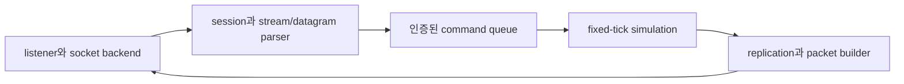
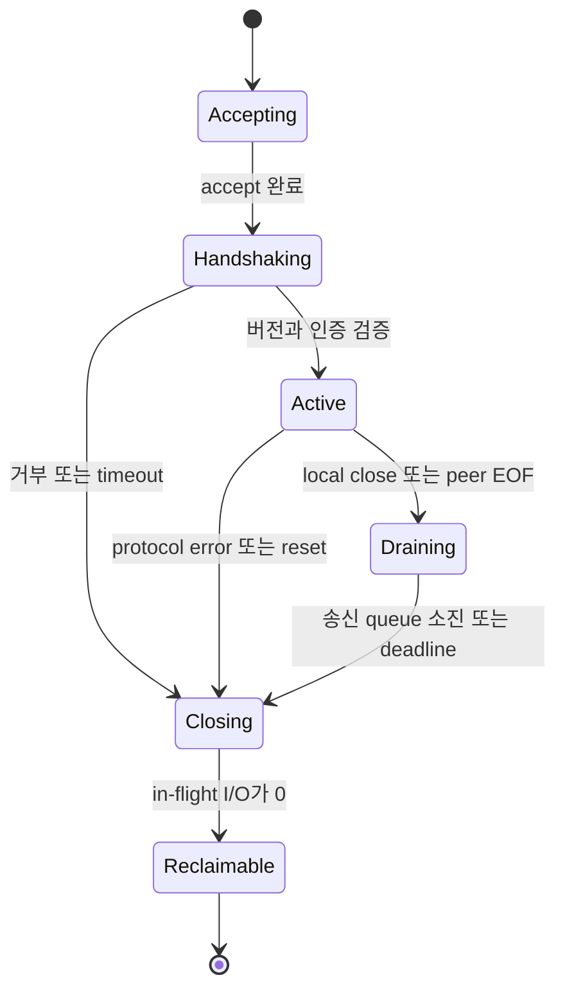

## 들어가며

게임 서버는 `socket()`을 호출한 코드가 아니라 연결과 패킷을 게임 틱의 명령으로 바꾸는 런타임이다. listener가 연결을 받아 session을 만들고, I/O backend가 byte를 전달하고, parser가 message 경계를 복원하고, bounded queue가 simulation에 명령을 넘긴다. 어느 한 경계라도 수명과 과부하 정책이 없으면 정상 부하에서는 동작해도 연결 종료나 burst에서 무너진다.

네트워크 병목은 암호화나 패킷 파싱보다 먼저 *바이트의 소유권과 대기열* 에서 발생할 수 있다. NIC가 받은 패킷은 커널 버퍼를 거쳐 애플리케이션으로 전달되고, 시뮬레이션 결과는 반대 방향으로 이동한다. 이 경로에서 복사와 시스템 호출이 늘어나면 CPU를 쓰고, 소비 속도보다 생산 속도가 빠르면 큐가 자라며, 큐가 가득 차면 손실이나 지연으로 나타난다.

Zero-copy, ring buffer, buffer pool은 그 자체로 목표가 아니다. 실제 목표는 세 가지다.

1. 패킷 바이트를 누가 소유하며 언제 재사용할 수 있는가?
2. 순간적인 burst를 흡수하되 낡은 데이터를 오래 쌓지 않는가?
3. 과부하가 왔을 때 어느 데이터를 버리고 어느 작업을 늦출지 결정했는가?

이 글은 listener·session·message framing의 상태 기계부터 소켓 버퍼와 게임 스레드 사이의 데이터 경로, copy와 zero-copy의 정확한 경계, batching, 패킷 풀, 용량 산정, backpressure, 틱 통합, 종료와 장애 검증까지 다룬다.


---

## 목차

1. [서버 런타임과 소유권](#1-서버-런타임과-소유권)
2. [복사와 Zero-Copy의 경계](#2-복사와-zero-copy의-경계)
3. [Batching과 시스템 호출](#3-batching과-시스템-호출)
4. [패킷 버퍼와 풀](#4-패킷-버퍼와-풀)
5. [버퍼 용량 산정](#5-버퍼-용량-산정)
6. [Backpressure와 과부하 정책](#6-backpressure와-과부하-정책)
7. [게임 틱과 I/O 통합](#7-게임-틱과-io-통합)
8. [측정과 장애 검증](#8-측정과-장애-검증)


---

## 1. 서버 런타임과 소유권

### 서버 프로세스의 경계

실시간 게임 서버의 hot path는 다음 다섯 실행 경계로 나눌 수 있다.



socket backend는 운영체제의 readiness 또는 completion을 회수하지만 게임 규칙을 실행하지 않는다. session 계층은 byte를 message로 바꾸고 sequence·암호 상태·송신 대기열을 소유한다. simulation은 틱 경계에서 검증된 command만 소비하며 socket이나 OS handle을 직접 만지지 않는다. replication은 권위 상태를 수신자별 packet으로 바꾸되 실제 전송 완료 수명은 backend에 넘긴다.

이 분리는 추상화 취향이 아니라 deadline 격리다. I/O worker에서 경로 탐색이나 DB 요청을 실행하면 completion queue가 막히고 모든 연결의 지연이 함께 증가한다. simulation thread에서 blocking `recv`를 실행하면 한 peer의 침묵이 전체 틱을 멈춘다.

### Listener와 Session 상태 기계

TCP listener는 연결 수락만 소유한다. accepted socket은 독립 session으로 이동하며 listener의 parser나 send queue를 공유하지 않는다. UDP socket에는 커널 connection table이 없으므로 인증된 endpoint와 session ID를 응용이 연결해야 한다.

TCP session의 최소 상태는 다음과 같다.



socket이 닫혔다고 session 메모리를 즉시 해제할 수 있는 것은 아니다. completion backend에는 취소된 receive·send의 결과가 남을 수 있고 readiness backend의 worker가 session handle을 이미 꺼냈을 수 있다. `Closing`은 새 작업 제출을 막는 논리 상태이고, `Reclaimable`은 모든 in-flight 참조가 사라진 물리 상태다.

UDP session은 endpoint 주소만으로 신원을 판단하지 않는다. NAT rebinding이나 이동망 전환으로 주소가 바뀔 수 있고 출발지 주소는 스푸핑될 수 있다. 암호학적으로 검증된 connection ID와 monotonic packet sequence를 session key로 사용하고, 주소 변경은 인증 성공 뒤에만 반영한다.

### Readiness와 Completion Backend

플랫폼 backend는 같은 사건을 다른 계약으로 전달한다.

| 모델 | 대표 API | 응용이 받는 사실 | 응용의 다음 작업 |
|---|---|---|---|
| readiness | `epoll`, `kqueue` | nonblocking I/O가 진행할 가능성 | `recv`/`send`를 시도하고 `EAGAIN`까지 처리 |
| completion | IOCP, `io_uring` | 제출한 operation이 결과와 함께 완료 | operation을 회수하고 다음 작업 제출 |

공통 인터페이스를 `OnReadable(socket)` 하나로 고정하면 completion backend가 가짜 readiness를 만들어야 하고, `OnComplete(operation)` 하나로 고정하면 readiness backend가 가짜 operation을 만들어야 한다. 서버 core에는 두 모델보다 한 단계 위의 결과를 전달하는 편이 낫다.

```cpp
struct ReceiveCompletion {
    SessionHandle session;
    BufferHandle buffer;
    std::uint32_t bytes;
    NetError error;
};

struct SendCompletion {
    SessionHandle session;
    PacketHandle packet;
    std::uint32_t bytes;
    NetError error;
};
```

backend는 이 결과를 만들기까지의 준비·제출 차이를 소유하고, session core는 부분 완료·오류·종료를 동일한 상태 기계로 처리한다. backend별 batch 크기, registered buffer, worker concurrency는 최소 공통분모에 숨기지 않고 capability와 설정으로 남긴다.

### TCP Message Framing

TCP는 message가 아니라 ordered byte stream을 제공한다. `send` 한 번이 `recv` 한 번과 대응하지 않으며 header 자체도 여러 receive에 나뉠 수 있다. parser는 누적 buffer에서 header가 완성됐는지 확인하고, 길이를 검증한 뒤 payload 전체가 도착할 때까지 기다린다.

```cpp
enum class ParseResult {
    NeedMore,
    MessageReady,
    ProtocolError,
};

ParseResult TryParseFrame(ByteQueue& input, MessageView& out) {
    constexpr std::size_t kHeaderBytes = 8;
    if (input.Size() < kHeaderBytes) return ParseResult::NeedMore;

    FrameHeader header = DecodeHeader(input.Peek(kHeaderBytes));
    if (header.magic != kProtocolMagic) return ParseResult::ProtocolError;
    if (header.payloadBytes > kMaxPayloadBytes) return ParseResult::ProtocolError;

    std::size_t frameBytes = kHeaderBytes + header.payloadBytes;
    if (input.Size() < frameBytes) return ParseResult::NeedMore;

    out = input.View(kHeaderBytes, header.payloadBytes);
    return ParseResult::MessageReady;
}
```

길이 필드를 읽자마자 그 크기로 할당하면 공격자가 수 GB 길이를 선언해 메모리를 소모시킬 수 있다. protocol magic, version, message type, 최대 payload를 고정 크기 header에서 먼저 검증한다. `headerBytes + payloadBytes` 계산은 overflow를 검사하고, connection별 누적 미완성 frame byte에도 상한과 deadline을 둔다.

message를 소비한 뒤 queue의 앞부분을 매번 `memmove`하면 작은 frame에서 복사 비용이 커진다. ring buffer, segmented byte queue, read/write cursor를 사용해 이미 소비한 prefix를 논리적으로 제거한다. parser가 반환한 `MessageView`는 underlying buffer가 compact되거나 재사용되기 전에 처리를 끝내거나 별도 소유권으로 승격해야 한다.

### Partial Send

TCP send는 요청한 byte보다 적게 완료될 수 있다. send operation은 packet과 offset을 보존하고 남은 suffix를 다시 제출한다.

```cpp
void OnSendComplete(Session& session,
                    SendOperation& op,
                    std::uint32_t bytes) {
    op.offset += bytes;
    if (op.offset < op.packet->Size()) {
        session.Backend().SubmitSend(op, op.packet->Subspan(op.offset));
        return;
    }

    session.SendQueue().PopFront();
    session.TryStartNextSend();
}
```

연결당 head packet 하나만 in-flight로 두면 응용 message 순서와 packet 수명이 단순해진다. 여러 send를 동시에 제출하는 최적화는 backend의 순서 보장, completion 재정렬, 종료 경쟁을 증명한 뒤 적용한다. 느린 receiver의 send queue에는 byte 상한과 deadline을 두며, 상한을 넘겼을 때 무한 재시도하지 않는다.

### 수신 경로

일반적인 UDP 수신 경로를 단순화하면 아래와 같다.

```text
NIC RX descriptor
  -> 커널 packet buffer
  -> IP/UDP 처리
  -> socket receive queue
  -> recv 계열 호출
  -> 애플리케이션 packet buffer
  -> 인증·복호화·파싱
  -> 시뮬레이션 command queue
```

각 화살표가 항상 바이트 복사를 뜻하지는 않는다. 커널은 페이지나 fragment의 참조를 넘길 수 있고, NIC는 DMA로 메모리에 쓴다. 하지만 일반적인 `recvfrom`은 최종적으로 소켓 큐의 payload를 사용자가 제공한 버퍼로 복사한다.

### 송신 경로

```text
게임 상태
  -> 직렬화 buffer
  -> send 계열 호출
  -> socket send queue
  -> IP/UDP 처리
  -> NIC TX descriptor
  -> wire
```

`send`가 성공했다고 상대에게 도착한 것은 아니다. 일반적으로 커널이 데이터를 받아 송신 경로에 넣었다는 뜻이다. nonblocking 소켓에서 송신 큐가 가득 차면 `EAGAIN`/`EWOULDBLOCK`, 일부 UDP 경로에서는 `ENOBUFS` 같은 오류가 발생할 수 있다. 이때 무조건 재시도하면 과부하를 더 키운다.

### 스트림과 데이터그램의 경계

TCP는 바이트 스트림이다. 한 번의 `send`와 한 번의 `recv`가 대응한다는 보장이 없으므로 애플리케이션 프레이밍이 필요하다.

```text
send: [header|payload] [header|payload]
recv: [hea] [der|payload|hea] [der|payload]
```

UDP는 데이터그램 경계를 보존하지만, 수신 버퍼가 데이터그램보다 작으면 운영체제 API에 따라 잘림이 발생하고 원래 길이를 별도로 알려 줄 수 있다. "최대 패킷 크기보다 큰 입력은 오지 않는다"가 아니라, 잘림을 탐지하고 폐기하는 코드가 필요하다.

### 소유권 상태 기계

패킷 버퍼는 포인터보다 상태로 관리하는 편이 안전하다.

```text
FREE
  -> RX_OWNED
  -> PARSE_OWNED
  -> SIM_OWNED
  -> TX_OWNED
  -> IN_FLIGHT
  -> FREE
```

모든 패킷이 이 전체 경로를 지나지는 않는다. 수신 전용 버퍼는 parse 뒤 바로 free될 수 있고, scatter-gather 송신은 여러 조각을 in-flight 상태로 보유할 수 있다. 중요한 불변식은 아래와 같다.

- 한 시점에 mutable owner는 하나다.
- 비동기 I/O에 제출한 버퍼는 완료 통지 전에 재사용하지 않는다.
- 참조를 공유한다면 마지막 참조가 끝난 뒤 풀로 반환한다.
- 풀 슬롯을 재사용할 때 generation을 올려 오래된 handle을 탐지한다.

## 2. 복사와 Zero-Copy의 경계

### 복사는 종류가 다르다

네트워크 경로의 이동을 모두 "복사"라고 부르면 최적화 목표를 잘못 잡기 쉽다.

| 이동 | 수행 주체 | CPU 데이터 이동인가 |
|---|---|---|
| NIC -> 메모리 | DMA 엔진 | 아니오 |
| 커널 버퍼 -> 사용자 버퍼 | CPU 또는 copy 엔진 | 보통 예 |
| 사용자 버퍼 -> 커널 송신 버퍼 | CPU | 보통 예 |
| 페이지 참조를 descriptor에 연결 | 커널 메타데이터 | payload 복사는 아님 |
| 직렬화 구조체 -> wire format | 애플리케이션 CPU | 예, 동시에 표현 변환 |

직렬화는 단순 복사와 다르다. 엔디언, bit packing, 암호화, 인증 태그 생성이 필요하면 payload를 한 번도 만지지 않는 zero-copy는 불가능하거나 이득이 줄어든다.

### Zero-copy는 절대적인 용어가 아니다

`sendfile`은 파일의 페이지 캐시를 사용자 공간으로 복사하지 않고 소켓으로 보낼 수 있다. 정적 패치 파일이나 리플레이 다운로드에는 유용하지만, 매 틱 새로 직렬화하는 게임 상태에는 직접 적용하기 어렵다.

Linux의 `MSG_ZEROCOPY` 같은 기능은 사용자 페이지를 송신 완료까지 고정하고 완료 알림을 처리하는 대가로 큰 송신의 복사를 줄인다. 작은 데이터그램에서는 페이지 pin, bookkeeping, completion 처리 비용이 복사보다 클 수 있다.

`io_uring`은 제출·완료 링과 등록 버퍼로 시스템 호출 및 등록 비용을 줄일 수 있지만, 그 이름만으로 payload zero-copy를 보장하지 않는다. 커널 네트워크 스택도 그대로 통과한다. DPDK류 kernel bypass는 NIC queue를 사용자 공간에서 직접 다루지만, 코어 점유·hugepage·NIC 전용·보안 격리·운영 복잡성을 대가로 낸다.

따라서 선택 순서는 보통 아래와 같다.

1. 패킷 수와 바이트, 시스템 호출 시간을 측정한다.
2. 작은 패킷을 batch한다.
3. 버퍼 재사용으로 할당을 없앤다.
4. scatter-gather로 조립 복사를 줄인다.
5. 복사가 실제 병목일 때 등록 버퍼나 zero-copy 송신을 검토한다.
6. 커널 스택 자체가 병목이고 운영 제약을 감당할 수 있을 때만 bypass를 검토한다.

### Scatter-gather

헤더, 암호화된 payload, 선택적 조각을 한 연속 버퍼로 합치지 않고 `iovec`/`WSABUF` 같은 배열로 넘길 수 있다.

```cpp
struct Segment {
    const std::byte* data;
    std::size_t size;
};

struct PacketView {
    std::array<Segment, 4> segments;
    std::size_t count;
};
```

scatter-gather는 조립 복사를 줄이지만 버퍼 수명을 복잡하게 만든다. 모든 segment가 송신 완료까지 살아 있어야 한다. 또한 장치와 OS가 처리할 수 있는 segment 수에 한도가 있고, 너무 잘게 나누면 descriptor와 캐시 접근 비용이 커진다.

### In-place headroom

payload 앞에 헤더 공간을 미리 남기면 레이어마다 새 버퍼를 만들지 않고 앞쪽으로 헤더를 확장할 수 있다.

```text
| reserved headroom | payload                   | tailroom |
                     ^data                      ^data+len
```

버퍼는 `base`, `capacity`, `dataOffset`, `dataLength`를 가진다. 헤더 $h$바이트를 prepend하려면 `dataOffset >= h`를 확인한 뒤 offset을 줄인다. 암호화 태그나 padding을 뒤에 붙이려면 tailroom도 확인한다.

## 3. Batching과 시스템 호출

### 비용 모델

한 패킷당 고정 호출 비용을 $C_s$, 바이트당 처리 비용을 $C_b$, 패킷 크기를 $m$, batch 크기를 $k$라 두면 패킷당 비용은 대략

$$
C_{\text{packet}}(k)
=
\frac{C_s}{k} + mC_b + C_{\text{queue}}(k)
$$

이다. $k$를 키우면 시스템 호출 고정 비용은 줄지만 batch가 찰 때까지 기다리는 지연과 한 번에 처리하는 CPU burst가 늘어난다.

실시간 서버의 목표는 최대 throughput이 아니라 틱 deadline 안에서 충분한 throughput을 얻는 것이다. batch가 가득 찰 때까지 기다리지 않고, 현재 도착한 패킷을 최대 $k$개까지 한 번에 가져오는 방식이 적합하다.

### Batch API

Linux의 `recvmmsg`/`sendmmsg`, Windows의 registered I/O 또는 overlapped completion, BSD 계열의 이벤트 API는 호출 형태가 다르지만 공통 질문은 같다.

- 한 번에 몇 packet descriptor를 넘길 수 있는가?
- 각 버퍼의 수명은 언제 끝나는가?
- partial completion을 어떻게 처리하는가?
- 오류 하나가 batch 전체에 어떤 영향을 주는가?
- timestamp와 원격 주소가 패킷별로 보존되는가?

송신 batch가 일부만 성공하면 성공한 항목만 in-flight로 넘기고 나머지는 의미론에 따라 재큐잉하거나 폐기한다. batch 전체를 재시도하면 중복 송신이 생길 수 있다.

### Batch 크기의 상한

batch 크기는 처리량 벤치마크 하나로 정하지 않는다. 다음 제약의 최솟값에 가깝다.

$$
k_{\max}
=
\min(
k_{\text{API}},
k_{\text{CPU budget}},
k_{\text{latency}},
k_{\text{pool}})
$$

- API descriptor 한도
- 틱에서 네트워크 펌프에 허용한 CPU 시간
- 가장 오래 기다려도 되는 패킷 시간
- 풀에서 동시에 빌릴 수 있는 버퍼 수

64개 batch가 PPS는 높여도 2 ms 틱의 절반을 독점한다면 16개 batch를 여러 번 처리하는 편이 낫다.

### Receive drain의 함정

nonblocking 소켓을 `EWOULDBLOCK`까지 무제한으로 비우면 공격이나 과부하 때 시뮬레이션이 영원히 실행되지 않을 수 있다. 패킷 개수 또는 시간 예산을 둔다.

```cpp
void PumpReceive(Socket& socket, Clock::time_point deadline) {
    constexpr std::size_t kMaxPackets = 2048;
    std::size_t processed = 0;

    while (processed < kMaxPackets && Clock::now() < deadline) {
        auto count = ReceiveBatch(socket, receiveViews_);
        if (count == 0) {
            break;
        }
        for (std::size_t i = 0; i < count; ++i) {
            RoutePacket(receiveViews_[i]);
        }
        processed += count;
    }
}
```

예산 때문에 남은 패킷은 커널 큐에 머문다. 이 상태가 반복되면 수신 지연과 drop이 증가하므로 계측을 통해 admission control이나 sharding으로 넘어가야 한다.

## 4. 패킷 버퍼와 풀

### 버퍼 구조

패킷 객체는 payload와 hot metadata를 분리할 수 있다.

```cpp
struct PacketMeta {
    Endpoint peer;
    std::uint64_t receiveTimeNs;
    std::uint32_t connectionId;
    std::uint16_t length;
    std::uint16_t flags;
    std::uint32_t slot;
    std::uint32_t generation;
};

struct alignas(64) PacketStorage {
    std::array<std::byte, 2048> bytes;
};
```

라우팅 단계는 metadata만 읽고, 인증·파싱 단계에서 payload를 읽는다. 모든 필드를 하나의 큰 구조체로 묶으면 큐를 옮길 때 불필요한 cache line을 만질 수 있다. 반대로 작은 패킷 수에서 지나친 분리는 포인터 추적을 늘리므로 실제 접근 패턴으로 판단한다.

### 크기 클래스

모든 패킷에 64 KiB 버퍼를 주면 UDP 최대 크기는 수용할 수 있어도 메모리와 캐시가 낭비된다. 경로 MTU를 고려한 일반 게임 데이터그램은 작은 클래스로 처리하고, 예외적인 큰 메시지는 조각화 계층이나 별도 큰 버퍼로 보낸다.

```text
small:  512 B
normal: 2 KiB
large:  16 KiB
```

이 값은 예시다. 실제 packet size histogram과 프로토콜 상한에서 정한다. 수신 API가 truncation을 알려 주는지 확인하고, 큰 입력을 작은 버퍼에 조용히 잘라 파싱하지 않는다.

### Free list와 ABA

단일 스레드 풀은 슬롯 인덱스 stack이면 충분하다. 여러 스레드가 공유하는 lock-free free list는 ABA와 메모리 reclamation을 해결해야 한다. 패킷 할당이 병목이라는 근거가 없다면 스레드별 풀, 고정 owner, mutex 보호 풀처럼 검증하기 쉬운 구조가 낫다.

Handle은 슬롯과 generation을 함께 가진다.

```cpp
struct PacketHandle {
    std::uint32_t slot;
    std::uint32_t generation;
};
```

반환 시 generation을 증가시키면 지연된 작업이 재사용된 슬롯을 자신의 패킷으로 오인하는 문제를 탐지할 수 있다. 32비트 generation도 유한하므로 wrap 가능성을 계약에 포함하되, 정상 수명에서 같은 슬롯이 $2^{32}$번 재사용되기 전에 오래된 handle이 모두 사라진다는 가정을 검증한다.

### 참조 계수와 소유권 이전

한 패킷을 로깅, replay, simulation이 동시에 참조하면 reference count를 쓸 수 있다. 하지만 모든 패킷에 원자 참조 계수를 두면 cache line 경합이 생긴다. 기본은 queue 간 소유권 이전으로 두고, 실제 공유가 필요한 경로만 immutable view와 명시적 shared storage를 사용한다.

### 풀 고갈

풀 고갈 시 힙으로 조용히 fallback하면 지연과 메모리 사용이 가장 위험한 순간에 증가한다. 선택지는 명시적이어야 한다.

- 낮은 우선순위 데이터그램 폐기
- 연결별 수신 quota 적용
- 전체 admission 제한
- 제한된 emergency pool 사용
- 신뢰 명령은 별도 bounded queue에 넣고 읽기 중단

고갈 횟수, 지속 시간, peer별 점유량을 기록한다. 한 peer가 모든 버퍼를 독점할 수 있다면 풀 크기 확대보다 공정성 정책이 먼저다.

## 5. 버퍼 용량 산정

### Bandwidth-delay product

전송 중인 데이터를 충분히 유지하려면 대역폭-지연 곱(BDP)이 출발점이 된다.

$$
\text{BDP} = \text{bandwidth} \times \text{RTT}
$$

100 Mbit/s 경로와 50 ms RTT라면

$$
100 \times 10^6 / 8 \times 0.05
= 625{,}000\ \text{bytes}
$$

이다. TCP가 해당 경로를 채우려면 흐름·혼잡 윈도와 소켓 버퍼가 이 규모를 수용해야 한다. 그러나 게임 UDP 수신 버퍼를 무조건 BDP로 잡는 것은 잘못이다. UDP 게임 트래픽은 링크를 채우지 않는 경우가 많고, 버퍼가 너무 크면 과부하 시 낡은 패킷의 지연만 숨긴다.

### Burst 흡수

수신 버퍼에 필요한 바이트를 단순화하면

$$
B_{\text{recv}}
\ge
R_{\text{peak}} \cdot T_{\text{stall}} + M
$$

이다. $R_{\text{peak}}$는 짧은 구간의 최대 수신률, $T_{\text{stall}}$은 애플리케이션이 소켓을 비우지 못할 수 있는 최대 시간, $M$은 스케줄링·측정 오차를 위한 여유다.

평균 2 Mbit/s라도 100 ms 로딩 stall과 순간 20 Mbit/s burst가 겹치면 $20\times10^6\times0.1/8=250{,}000$바이트, 즉 약 250 KB 또는 244 KiB가 필요하다. 중요한 것은 평균률이 아니라 관측된 burst 분포와 stall 상한이다.

### Little의 법칙

안정 상태에서 평균 큐 길이 $L$, 도착률 $\lambda$, 큐에 머무는 평균 시간 $W$는

$$
L = \lambda W
$$

관계를 가진다. 초당 20,000패킷이 들어오고 애플리케이션 큐에서 평균 5 ms를 기다리면 평균 100개가 대기한다. 평균만으로 burst 상한을 정할 수는 없지만, 큐 길이와 지연 측정이 서로 모순되지 않는지 확인하는 데 유용하다.

### OS가 실제로 적용한 크기

`setsockopt`에 요청한 값이 실제 값과 같다고 가정하지 않는다. 운영체제는 최소·최대 범위를 적용하고 bookkeeping 공간을 포함하거나 값을 배수로 조정할 수 있다. 설정 뒤 `getsockopt`로 실제 값을 읽고 로그에 남긴다. 플랫폼별 의미가 다르므로 요청값 하나를 성능 표의 "버퍼 크기"로 쓰지 않는다.

## 6. Backpressure와 과부하 정책

### 무한 큐는 실패를 지연으로 바꾼다

생산률 $\lambda$가 소비률 $\mu$보다 오래 큰 상태에서는 큐가 계속 자란다.

$$
\frac{dQ}{dt} = \lambda - \mu
$$

$\lambda > \mu$인 동안 메모리를 늘려도 안정 상태는 오지 않는다. 무한 큐는 손실을 없애는 대신 메모리 고갈과 매우 오래된 응답으로 바꾼다. 모든 queue는 용량과 가득 찼을 때의 정책을 가져야 한다.

### 데이터 의미에 따른 정책

| 데이터 | 과부하 정책 |
|---|---|
| 최신 위치 snapshot | 오래된 대기 항목을 새 값으로 대체 |
| 입력 command | 제한된 시간창 안에서 순서 보존, 초과 시 연결 품질 판정 |
| 음성 frame | deadline을 넘은 frame 폐기 |
| 채팅·구매 명령 | 폐기하지 않고 admission 제한 또는 연결 종료로 실패를 명시 |
| telemetry | 샘플링·집계·낮은 우선순위부터 폐기 |
| 패치 chunk | 전송 속도 제한과 재개 가능한 offset |

신뢰성이 필요한 명령을 실시간 snapshot과 같은 큐에 넣으면 snapshot burst가 구매·채팅을 밀어낼 수 있다. 채널별 queue와 예산을 분리한다.

### Coalescing

동일 엔티티의 상태 갱신이 여러 개 쌓였다면 마지막 값만 남길 수 있다. 이때 sequence와 baseline 의존성을 확인해야 한다. delta snapshot은 중간 baseline을 버리면 해석할 수 없을 수 있으므로, 단순한 "최신 것 우선"이 항상 안전하지 않다.

### 공정성

전역 큐 하나는 트래픽이 많은 연결이 다른 연결의 지연을 키우게 한다. 연결별 token bucket이나 deficit round robin으로 CPU·송신 바이트를 나눈다.

Token bucket을 용량 $b$, 초당 보충률 $r$로 두면 길이 $b$까지의 burst를 허용하면서 장기 평균을 $r$로 제한할 수 있다. 패킷당 비용이 크게 다르면 packet count보다 예상 CPU cost나 바이트를 token으로 사용한다.

### 재시도 증폭

큐가 가득 찼을 때 모든 생산자가 즉시 재시도하면 같은 작업이 반복되어 소비 여력을 더 줄인다. 신뢰 요청은 deadline, 지수 backoff, jitter, 최대 시도 횟수를 가진다. 실시간 상태는 재시도보다 최신 상태로 교체하는 편이 보통 낫다.

## 7. 게임 틱과 I/O 통합

### 단계 분리

한 틱의 네트워크 처리를 아래처럼 분리하면 시간 예산과 소유권이 보인다.

```text
Receive
  -> cheap reject
  -> authenticate/decrypt
  -> parse
  -> connection queue
  -> simulation consume
  -> replication build
  -> serialize/encrypt
  -> send batch
```

크기, protocol magic, endpoint quota처럼 싼 검사는 앞에 둔다. 암호학적 인증 전에 신뢰할 수 없는 길이로 메모리를 할당하거나 복잡한 파서를 실행하지 않는다. 인증되지 않은 endpoint가 비싼 연결 상태를 만들지 못하게 cookie나 검증 단계를 둔다.

### 시간 예산

60 Hz 서버의 틱 간격은 약 16.67 ms지만 네트워크가 전부 쓸 수 있는 시간은 아니다. receive와 send에 각각 시간·packet budget을 두고 초과를 기록한다.

```cpp
struct NetworkBudget {
    std::chrono::microseconds receiveCpu;
    std::chrono::microseconds sendCpu;
    std::uint32_t maxReceivePackets;
    std::uint32_t maxSendPackets;
};
```

예산 초과가 반복되면 단순히 한도를 높이지 않는다. 어느 peer, message type, 단계가 CPU를 쓰는지 분해한다.

### Timestamp

패킷이 simulation에 도착한 시간만 기록하면 커널 큐에서 기다린 시간을 알 수 없다. 플랫폼이 제공하는 수신 timestamp가 있다면 NIC/커널 수신 시각과 애플리케이션 처리 시각의 차이를 측정한다.

시계의 출처와 단위도 통일한다. wall clock은 시간 보정으로 뛸 수 있으므로 RTT·queue residence time에는 monotonic clock을 사용한다. 다른 머신의 timestamp를 직접 빼려면 시계 동기화 오차를 모델에 포함한다.

### Sharding

한 소켓·한 코어가 한계에 닿으면 연결 ID나 5-tuple hash로 작업을 shard한다. NIC RSS, 여러 receive queue, `SO_REUSEPORT`류 기능은 플랫폼에 따라 분산을 도울 수 있다. 하지만 같은 연결의 패킷이 여러 worker에서 동시에 처리되면 순서와 상태 락이 복잡해진다.

일반적인 목표는 연결 하나의 mutable 상태를 한 worker가 소유하게 하는 것이다. 재분배가 필요하면 packet pointer만 넘기고, buffer pool의 반환 경로와 NUMA node를 명확히 한다.

## 8. 측정과 장애 검증

### 관측 지표

| 계층 | 지표 |
|---|---|
| NIC/OS | RX/TX drop, socket error, queue overflow, interface bytes/packets |
| 시스템 호출 | calls/s, packets/call, bytes/call, partial completion |
| 풀 | 사용량, 고갈, emergency fallback, peer별 점유 |
| 애플리케이션 큐 | 길이, residence p50/p95/p99, drop/coalesce 원인 |
| 틱 | receive/send CPU, budget 초과, simulation 지연 |
| 프로토콜 | packet size 분포, invalid/truncated/auth failure |

drop 총합 하나만으로는 부족하다. 커널 수신 큐에서 버려졌는지, 애플리케이션 admission에서 버렸는지, deadline이 지나 폐기했는지 구분한다.

### 부하 모델

평균률이 같은 두 트래픽도 시스템에 주는 압력이 다르다.

- 일정한 packet rate
- 한 틱 경계에 몰리는 burst
- 작은 패킷 다수
- MTU 근처 패킷
- 소수 연결의 과점
- 연결 전체에 고른 트래픽
- 유효하지 않은 패킷 flood

각 모델에서 처리량뿐 아니라 queue residence와 simulation deadline miss를 측정한다.

### 오류 주입

- 수신 스레드를 의도적으로 10~100 ms 멈춘다.
- socket buffer와 packet pool을 작게 제한한다.
- send를 partial completion과 일시 오류로 반환하게 만든다.
- I/O completion 순서를 바꾼다.
- 패킷을 최대 크기보다 1바이트 작거나 크게 만든다.
- 잘린 데이터그램, 빈 데이터그램, 중복, 재정렬을 넣는다.
- 한 peer가 모든 quota를 소모하도록 flood한다.
- 종료 중 아직 in-flight인 버퍼가 남게 한다.

종료 테스트가 특히 중요하다. 소켓을 닫은 뒤 completion callback이 도착하거나, pool을 파괴한 뒤 커널이 등록 버퍼를 참조하면 use-after-free가 발생한다. shutdown은 새 제출 중단, 미완료 취소 또는 drain, completion 확인, 등록 해제, 버퍼·소켓 파괴 순서를 가진 상태 기계여야 한다.

### 최적화 판단

Kernel bypass나 zero-copy는 아래 조건을 만족할 때 검토한다.

1. 패킷 경로가 CPU 병목이라는 프로파일이 있다.
2. batching과 할당 제거 뒤에도 복사 또는 커널 경로가 지배적이다.
3. 목표 하드웨어와 운영 환경이 고정되어 있다.
4. busy polling이 점유할 전용 코어와 전력 예산이 있다.
5. 보안·관측·배포 복잡성을 감당할 수 있다.

대부분의 게임 서버는 bounded queue, batch I/O, 버퍼 재사용, connection sharding만으로 충분한 범위가 넓다. 극단적 기술을 먼저 도입하면 성능보다 수명 버그와 운영 비용이 먼저 커질 수 있다.


---

## 결론

패킷 I/O의 핵심은 "복사를 0번으로 만들기"가 아니라 **소유권을 잃지 않으면서 deadline 안에 큐를 비우는 것**이다. 버퍼는 mutable owner와 in-flight 수명을 명확히 하고, 시스템 호출은 지연 예산을 해치지 않는 범위에서 batch한다. 소켓 버퍼와 풀 크기는 평균 트래픽이 아니라 burst와 최대 stall에서 산정한다.

과부하는 메모리로 해결되지 않는다. 생산률이 소비률보다 큰 동안 무한 큐는 지연만 키운다. snapshot, 입력, 음성, 신뢰 명령의 의미에 맞춰 drop·coalesce·admission 정책을 분리하고, 연결별 quota로 공정성을 지켜야 한다.

Zero-copy, registered I/O, kernel bypass는 이 모델 위의 선택지다. 복사·호출·큐 대기 중 무엇이 병목인지 계측한 뒤 적용하며, 최종 평가는 PPS보다 queue residence p99, 틱 deadline miss, drop 원인, 풀 고갈, 종료 안전성으로 내린다.

## 더 읽을거리

- W. Richard Stevens 외, *UNIX Network Programming, Volume 1*
- Linux man-pages, [`recvmsg(2)`](https://man7.org/linux/man-pages/man2/recvmsg.2.html), [`recvmmsg(2)`](https://man7.org/linux/man-pages/man2/recvmmsg.2.html), [`sendmmsg(2)`](https://man7.org/linux/man-pages/man2/sendmmsg.2.html)
- Linux kernel documentation, [MSG_ZEROCOPY](https://docs.kernel.org/networking/msg_zerocopy.html)
- Linux kernel documentation, [Scaling in the Linux Networking Stack](https://docs.kernel.org/networking/scaling.html)
- Microsoft Learn, [RIORegisterBuffer](https://learn.microsoft.com/en-us/windows/win32/api/mswsock/nc-mswsock-lpfn_rioregisterbuffer) — Registered I/O의 등록 버퍼 계약과 함수 테이블 획득 방식.
- Jens Axboe, [Efficient IO with io_uring](https://kernel.dk/io_uring.pdf)
- Intel, [DPDK Programmer's Guide](https://doc.dpdk.org/guides/prog_guide/)
- Raj Jain, *The Art of Computer Systems Performance Analysis*
