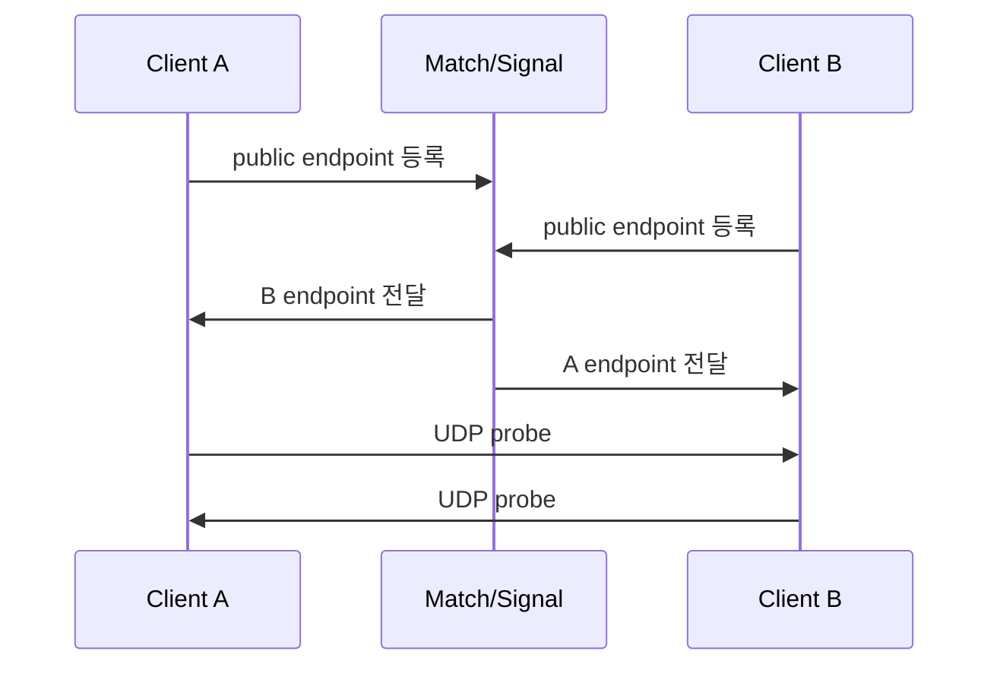
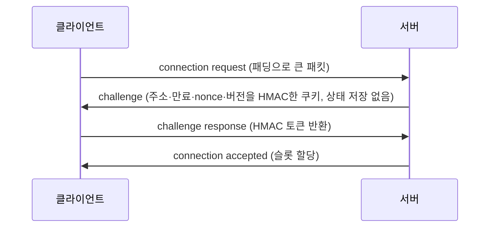

## 들어가며

패킷 형식이 완성되어도 플레이어끼리 또는 서버와 실제로 연결되지 않으면 멀티플레이는 동작하지 않는다. NAT와 방화벽, relay, 인증과 재전송 공격은 연결 수립 단계의 핵심 제약이다.

이 글은 P2P·listen·dedicated·relay 토폴로지, NAT traversal과 연결 이동, 핸드셰이크 인증과 키 수명, replay·amplification 방어를 하나의 연결 경계로 다룬다.

---

## 목차

1. Topology 선택
2. NAT가 연결을 막는 방식
3. STUN과 Hole Punching
4. ICE: 후보 수집과 동시 시도
5. Relay와 TURN 계열 구조
6. Dedicated Server와 Listen Server
7. 지역 배치와 핑의 지리학
8. 배포 구조 선택 기준
9. 연결이라는 추상
10. 핸드셰이크: challenge-response
11. 연결 토큰: 인증의 위임
12. 증폭 공격과 그 차단
13. Keepalive와 타임아웃
14. 패킷 암호화
15. MTU와 단편화

---


## 1. Topology 선택

대표 토폴로지는 네 가지다.

| 구조 | 설명 | 장점 | 단점 |
|---|---|---|---|
| P2P | 클라이언트끼리 직접 통신 | 서버 비용 낮음 | NAT, 치트, 동기화 어려움 |
| Listen server | 한 클라이언트가 서버 역할 | 구축 쉬움 | host advantage, host migration |
| Dedicated server | 별도 서버가 권위 보유 | 공정성, 보안, 확장성 | 서버 비용 |
| Relay | 중계 서버를 거쳐 통신 | 연결 성공률 높음 | 지연, 트래픽 비용 |

경쟁 FPS나 영속 세계는 신뢰 경계 때문에 dedicated server가 강한 후보이고, 협동·소규모 게임은 listen server나 P2P도 평가할 수 있다. 데이터 종류마다 경로가 달라도 된다. 예를 들어 게임 상태는 authoritative server, 음성은 SFU, 파티 초대는 플랫폼 signaling을 사용할 수 있다. SFU는 단순 byte relay가 아니라 media transport를 종단하고 구독에 따라 선택적으로 전달하는 역할이므로 둘을 같은 구성요소로 취급하지 않는다.

P2P의 숨은 차원 하나는 *연결 수*다. N인 full mesh는 client당 N-1 연결, 전체 N(N-1)/2 pair이고, 각 pair가 NAT traversal·암호 상태·keepalive를 따로 가진다. 허용 가능한 N은 고정 인원수가 아니라 client upload, packet rate, relay fallback 비율과 peer IP 노출 정책으로 정한다. 2인 격투처럼 pair가 하나인 구조가 P2P rollback에 잘 맞는 이유도 이 산수와 신뢰 모델에 있다.

## 2. NAT가 연결을 막는 방식

대부분의 가정용 네트워크는 NAT 뒤에 있다. 내부 클라이언트는 사설 IP를 사용하고, 라우터가 외부 주소와 포트를 매핑한다.

```text
client 192.168.0.10:50000
NAT maps to public 203.0.113.5:62001
```

외부 호스트가 `203.0.113.5:62001`로 보낸 패킷이 내부 클라이언트로 들어가려면 mapping과 inbound filtering 조건을 모두 통과해야 한다. NAT 동작은 적어도 이 두 축으로 분리해 기록한다.

| 축 | 성향 | 의미 |
|---|---|---|
| mapping | endpoint-independent | 내부 endpoint가 같으면 목적지가 달라도 같은 외부 mapping을 재사용 |
| mapping | address-dependent | 목적지 IP가 달라지면 다른 mapping을 만들 수 있음 |
| mapping | address-and-port-dependent | 목적지 IP·port pair마다 mapping이 달라질 수 있음 |
| filtering | endpoint-independent | mapping을 안 외부 endpoint의 packet도 허용 |
| filtering | address-dependent | 내부 host가 먼저 보낸 목적지 IP에서 온 packet만 허용 |
| filtering | address-and-port-dependent | 먼저 보낸 목적지 IP·port pair에서 온 packet만 허용 |

전통적인 “symmetric NAT”라는 이름은 보통 address-and-port-dependent mapping/filtering의 조합을 가리키지만 두 축을 숨겨 진단에 불리하다. 목적지마다 외부 port가 달라지고 filtering도 엄격하면 STUN server에서 관측한 endpoint를 다른 peer가 그대로 사용할 수 없어 직접 연결이 어려워진다. 이때 relay candidate가 필요하다.

현실에는 추가 변수가 있다. **CGNAT**는 ISP가 가입자 다수를 공인 주소 뒤에 두는 구조로 NAT 계층과 port 압력을 늘리지만, CGNAT라는 사실만으로 mapping/filtering 동작을 단정할 수는 없다. **mapping lifetime**은 장비·정책·traffic에 따라 다르므로 “수십 초” 같은 상수를 protocol 계약으로 쓰지 않는다. consent/keepalive 주기와 timeout은 target network에서 측정하고, mapping이 사라져도 재수립할 수 있어야 한다. **hairpinning**은 같은 NAT 뒤의 두 기기가 서로의 외부 mapping으로 통신할 수 있는 성질이다. 지원하지 않는 경로도 있으므로 host candidate와 server-reflexive candidate를 모두 검사한다.

## 3. STUN과 Hole Punching

STUN 계열 서버는 클라이언트가 자신의 public endpoint를 알아내는 데 사용된다. 두 클라이언트는 matchmaking 서버를 통해 서로의 endpoint를 교환하고, 동시에 UDP 패킷을 보내 NAT 매핑을 연다. 이를 UDP hole punching이라고 한다.



동작 원리를 한 줄로 줄이면, A가 B 후보로 packet을 보내 A 측 mapping을 만들고 filtering state를 열며 B도 같은 작업을 수행하는 것이다. mapping과 filtering 성향이 이 패턴을 허용하면 connectivity check가 성공한다. 첫 packet이 filtering state가 열리기 전에 버려질 수 있으므로 양쪽 check를 조율하고 transaction timeout과 재시도를 둔다.

Hole punching은 직접 연결 가능성을 높이지만 보장하지 않는다. NAT 정책, host firewall, 기업망, 모바일망과 UDP 차단에 따라 실패한다. 직결 성공률은 지역·ISP·플랫폼·IPv6 보급과 relay 정책의 함수이므로 외부의 단일 비율을 capacity input으로 쓰지 않는다. 후보 유형별 성공률, 연결 수립 시간과 relay 전환 비율을 자기 사용자 분포에서 계측하고 실패를 정상 경로로 설계한다.

## 4. ICE: 후보 수집과 동시 시도

실전 NAT traversal은 단일 기법이 아니라 *후보들의 경쟁* 이다 — IETF가 표준화하고 WebRTC가 채택한 ICE(Interactive Connectivity Establishment)의 골격이고, 게임 자체 구현도 같은 모양이 된다.

1. **후보 수집**: 각 클라이언트가 연결 가능한 주소 후보를 모은다 — 로컬(사설) 주소, STUN으로 알아낸 공인 주소(server-reflexive), relay 주소.
2. **교환**: 시그널링 채널(매치메이커)로 후보 목록을 교환한다.
3. **connectivity check**: candidate pair를 우선순위와 pacing 규칙에 따라 검사한다. 모든 pair를 한꺼번에 무제한 송신하지 않는다.
4. **유지·승격**: 일단 relay로 시작하고 백그라운드에서 직결을 계속 시도해, 성공하면 갈아타는 구현도 있다(연결까지의 체감 시간을 줄이는 요령).

controlling agent는 성공한 pair 가운데 nomination policy에 맞는 경로를 선택한다. type preference는 보통 host·server-reflexive·relay의 비용 차이를 반영하지만 “처음 성공한 경로”나 “항상 local 우선”과 동치가 아니다. 같은 LAN에서도 host firewall이 막을 수 있고, 엄격한 mapping/filtering 조합에서는 relay pair가 선택된다. 브라우저 환경은 제공되는 networking API와 보안 정책 안에서 구현해야 하며, native game이 자체 protocol을 쓰더라도 candidate 수집·검사·nomination·유지라는 ICE의 분리는 좋은 설계 기준이 된다.

## 5. Relay와 TURN 계열 구조

Relay는 양쪽 클라이언트가 모두 접근 가능한 서버를 통해 패킷을 중계한다.

```text
client A -> relay -> client B
client B -> relay -> client A
```

장점은 연결 성공률이다. 양쪽 모두 서버로 outbound 연결만 만들면 된다. 단점은 비용과 지연이다. 모든 P2P 트래픽이 relay egress가 되고, 경로가 길어질 수 있다.

Relay는 두 방식으로 쓴다.

- 직접 연결 실패 시 fallback.
- 보안이나 IP 은닉을 위해 항상 relay.

항상 relay하는 정책은 peer IP를 숨기고 DDoS 표면을 relay edge로 옮긴다. Steam Datagram Relay가 이 구조의 한 사례다. relay는 추가 처리 지점을 만들지만 provider backbone의 ingress·egress 위치와 public Internet 경로에 따라 end-to-end RTT가 직접 경로보다 낮아질 수도, 높아질 수도 있다. 따라서 “추가 hop 수”만으로 지연을 예측하지 않고 candidate pair별 실측 RTT·loss·jitter로 선택한다.

relay는 양방향 packet processing과 각 방향의 outbound traffic을 부담한다. 비용은 payload bitrate뿐 아니라 PPS, 암호화, regional egress와 abuse 방어로 계산한다. 게임 상태까지 상시 relay하는 정책은 dedicated server의 simulation 비용과 별도로 비교해야 한다. relay가 있다고 권위 simulation이 공짜로 생기는 것은 아니며, authoritative server를 둘지는 치트·공정성·host migration 요구로 결정한다.

경쟁 게임의 권위 서버는 relay와 다르다. Dedicated server는 게임 상태를 시뮬레이션하고 판정한다. Relay는 보통 패킷을 중계할 뿐이다. 두 역할을 혼동하면 보안 모델이 틀어진다.

## 6. Dedicated Server와 Listen Server

Listen server는 한 플레이어의 머신이 서버 역할을 한다. 서버 비용이 낮고 개발이 쉽지만, host에게 지연 이점이 생기고 host가 나가면 match가 흔들린다. Host migration은 가능하지만 복잡하다 — 새 host 선출, 권위 상태의 이관, 전원 재연결, 그리고 그 동안의 게임 일시정지까지, "가끔 실행되는 가장 복잡한 코드"가 되어 버그의 온상이 되기 쉽다. migration을 지원할 거라면 매 매치 수십 번 강제 발동하는 테스트 하니스가 필수다.

Dedicated server는 중립적인 process가 권위를 가진다. client는 입력·command를 보내고 server가 허용된 상태 전이를 결정한다. 치트 방어와 host 독립성에 유리하지만 compute, egress, orchestration과 on-call 비용이 생긴다. 용량은 `peak concurrent players / players per match × CPU per match`와 지역별 headroom으로 산출하고, 실제 packet rate와 provider price를 적용한다. 동접만으로 월 비용을 고정 범위에 넣을 수 없으며 topology는 신뢰 모델과 사업 모델을 함께 반영한다.

선택 기준은 장르와 신뢰 모델이다.

| 장르/요구 | 적합 구조 |
|---|---|
| 경쟁 FPS | dedicated server |
| MMO | dedicated server + shard/zone |
| 격투 | P2P rollback 또는 relay 보조 |
| 협동 PvE | listen server 또는 dedicated |
| 소규모 party game | P2P/listen/relay 조합 |

## 7. 지역 배치와 핑의 지리학

같은 dedicated server라도 플레이어가 어느 region에 배치되는지에 따라 RTT가 달라진다. 광섬유 안의 전파 속도는 대략 200km/ms이므로, 경로 길이만 알면 `왕복 광로 길이 / 200km/ms`로 전파 지연의 하한을 추정할 수 있다. 서울↔도쿄의 지리적 거리를 편도 약 1,200km로 잡으면 왕복 전파 지연만 약 12ms이고, 서울↔미국 서부를 편도 약 9,000km로 잡으면 약 90ms다. 실제 광케이블 경로는 대권 거리보다 길고 라우터·전송·큐잉 지연도 더해지므로 이는 달성 가능한 핑이 아니라 낙관적 하한이다.

현실 핑은 하한보다 나쁘다 — BGP가 고르는 경로는 최단이 아니라 *사업적 경로* 이고(통신사 간 피어링), 혼잡 구간의 큐잉이 더해진다. 대형 게임사가 자체 백본·POP(접속 거점)을 까는 이유다: 플레이어를 가까운 POP에서 받아 전용 백본으로 서버까지 나르면, 공인 인터넷 구간이 "집 ↔ 근처 POP"로 줄어든다(Riot Direct, SDR이 이 모델).

매치메이킹은 각 region probe endpoint에 대한 RTT·loss를 측정하고 skill·queue time·party 제약과 함께 최적화한다. client가 보고한 숫자는 조작될 수 있으므로 signed probe result나 server-observed telemetry로 검증하고, 한 번의 ping보다 최근 분포를 사용한다. server 위치는 player 분포와 peak concurrency에서 나오며, 넓은 지역을 섞을 때는 최대 RTT·party cohesion·대기 시간 사이의 목적 함수를 명시한다.

## 8. 배포 구조 선택 기준

Topology 선택은 네 가지 비용을 비교하는 일이다.

- 지연: 플레이어와 서버/relay의 물리적 거리, 경로 품질.
- 연결 성공률: NAT, 방화벽, 모바일망 — 그리고 실패 시의 fallback 경로.
- 보안: 클라이언트를 얼마나 믿는가, IP 노출을 허용하는가.
- 운영비: 서버 CPU, egress, relay 트래픽 — 동접 규모와 곱해지는 항.

결정은 조합으로 내려진다. 게임 상태는 dedicated server, 음성은 SFU, 파티·초대는 platform service를 사용할 수 있고 peer path에는 direct candidate와 relay fallback을 함께 둘 수 있다. 데이터 종류별로 신뢰·지연·privacy·비용 요구를 따로 정의한다.


## 9. 연결이라는 추상

게임의 "연결"은 서버 메모리에 있는 상태 묶음이다.

```cpp
struct Connection {
    Address  remote;          // 상대 주소(IP:port)
    uint64_t clientId;        // 인증된 플레이어 식별자
    uint8_t  sessionKey[32];  // 이 연결 전용 암호화 키
    double   lastRecvTime;    // 마지막 수신 시각 — 타임아웃 판정
    double   lastSendTime;    // 마지막 송신 시각 — keepalive 판정
    ConnState state;          // Connecting / Connected / Disconnecting
    // ... 신뢰 채널, 스냅샷 버퍼 등 전송 계층 상태
};
```

handshake 전에는 source address와 stateless token으로 request를 처리한다. 연결 수립 뒤에는 packet의 connection ID로 후보 connection을 찾되, ID는 routing hint일 뿐 인증 수단이 아니다. AEAD와 replay-window 검증에 성공한 packet만 그 connection의 입력으로 받아들인다. `lastRecvTime` 같은 timer는 wall clock이 아니라 monotonic clock으로 저장한다.

NAT rebinding이나 network handover로 source address가 바뀔 수 있고 같은 public IP 뒤에 여러 player가 있을 수 있다. 새 주소에서 유효한 packet이 왔다고 즉시 큰 응답을 보내지 말고 path challenge로 return reachability를 확인한 뒤 active path를 바꾼다. 기존 경로는 migration timeout 동안 유지할 수 있지만 주소별 amplification budget을 분리한다.

## 10. 핸드셰이크: challenge-response

가장 단순한 접속 — "connect 패킷을 받으면 슬롯을 준다" — 은 출발지 위조에 무너진다. 공격자가 위조된 주소로 connect를 뿌리면 서버 슬롯이 유령으로 가득 찬다. 해법은 *상대가 그 주소에서 실제로 수신할 수 있음을 증명* 하게 하는 것이다.



서버는 challenge를 보낼 때 연결별 상태를 저장하지 않을 수 있다. 검증에 필요한 주소·만료 시각·nonce·프로토콜 버전을 정규 직렬화하고 서버 비밀키로 HMAC한 토큰을 함께 보낸다(TCP SYN cookie와 같은 발상이다). response가 돌아오면 출발지 주소와 만료를 확인하고 MAC을 상수 시간 비교한다. 위조된 주소로 보낸 request의 challenge는 그 주소로 날아가므로, 공격자는 정상적으로 response를 돌려주기 어렵다. 슬롯 할당과 큰 버퍼 생성은 response 검증 뒤에만 수행한다.

```cpp
struct ChallengePayload {
    UInt128  nonce;             // CSPRNG에서 생성한 token ID
    uint64_t expiresUnixSec;    // MAC으로 보호되는 만료 시각
    WireAddress address;        // IP 버전·주소·포트의 정규 인코딩
    uint32_t protocolVersion;
};

ChallengePacket MakeChallenge(
    const Address& from,
    const SecretKey& challengeKey,
    uint64_t nowUnixSec) {
    ChallengePacket p;
    p.payload = {
        CsprngU128(),
        nowUnixSec + challengeLifetimeSec,
        CanonicalWireAddress(from),
        kProtocolVersion
    };
    p.mac = HmacSha256(challengeKey, EncodeCanonical(p.payload));
    return p;
}

bool VerifyChallenge(
    const ChallengePacket& p,
    const Address& from,
    const SecretKey& challengeKey,
    uint64_t nowUnixSec) {
    if (p.payload.protocolVersion != kProtocolVersion) return false;
    if (p.payload.address != CanonicalWireAddress(from)) return false;
    if (p.payload.expiresUnixSec <= nowUnixSec ||
        p.payload.expiresUnixSec > nowUnixSec + challengeLifetimeSec)
        return false;

    Mac expected = HmacSha256(challengeKey, EncodeCanonical(p.payload));
    return ConstantTimeEqual(expected, p.mac);
}
```

이 토큰은 주소 도달성을 증명할 뿐 사용자 신원이나 유일한 접속 시도를 증명하지 않는다. 유효 시간 안에 같은 response를 재생할 수 있으므로, 검증 뒤의 연결 생성은 `(tokenId, clientId)`에 대해 멱등적이어야 하고 접속 수락 단계에는 짧은 replay 캐시와 주소별·계정별 rate limit이 필요하다. challenge 키도 충분한 엔트로피를 가진 바이트 키로 생성하고 key ID를 붙여 순환시킨다.

## 11. 연결 토큰: 인증의 위임

challenge는 "그 주소에서 응답을 받을 수 있다"는 사실만 증명한다. "매치에 참가할 자격이 있는 player다"는 별개의 문제이고, game server가 접속마다 account DB를 동기 조회하면 인증 인프라와 장애가 결합된다. 한 설계 패턴은 backend가 짧은 수명의 *연결 토큰*을 발급하고 game server가 local cryptographic verification으로 입장 권한을 판단하게 하는 것이다. netcode protocol이 이 패턴의 구체적인 예다.

흐름은 이렇다. 클라이언트가 HTTPS로 백엔드(매치메이커·인증 서버)에 로그인하면, 백엔드가 *짧은 수명*의 연결 권한을 발급한다. 서버용 토큰에는 `tokenId`, 발급·만료 시각, 클라이언트와 매치 ID, 대상 서버 또는 audience, 프로토콜 버전, 권한, 세션 키 자료가 들어간다. 이 토큰을 대칭키 AEAD로 암호화·인증하면 게임 서버만 내용을 읽을 수 있다. “서명”만 하면 무결성과 발급자 인증은 얻지만 내용과 세션 키의 기밀성은 얻지 못하므로 두 방식을 같은 말처럼 섞으면 안 된다.

```text
[백엔드] --HTTPS--> [클라이언트] --UDP connect+opaqueServerToken--> [게임 서버]
             |                                             |
             +-- client용 방향별 세션 키                    +-- AEAD 검증
                                                            +-- 만료·audience·버전 확인
                                                            +-- tokenId replay 확인
```

클라이언트는 서버용 토큰을 불투명한 바이트열로 전달하고, HTTPS 응답에서 별도로 받은 자기 방향의 세션 키를 사용한다. 게임 서버는 토큰을 열어 계정 DB를 동기 호출하지 않고도 입장 권한을 판정할 수 있다. 짧은 수명과 audience 바인딩은 탈취 피해를 줄일 뿐 replay를 없애지는 않으므로, `tokenId`를 한 번만 소비하거나 같은 연결에 대한 중복 요청을 멱등 처리해야 한다. 장기 공유키는 서버군 전체에 하나를 배포하지 말고 key ID·회전·범위가 제한된 파생키로 관리한다. 사전 배포한 세션 키 방식은 왕복이 적지만 자체적으로 forward secrecy를 주지 않는다는 점도 위협 모델에 포함한다.

## 12. 증폭 공격과 그 차단

증폭 공격은 위조된 출발지(피해자 주소)로 작은 요청을 보내, 서버가 큰 응답을 피해자에게 쏘게 만드는 반사 공격이다. 응답이 요청보다 클수록 공격자는 자기 대역폭의 몇 배를 피해자에게 퍼붓는다. 게임 서버의 서버 정보 응답·스냅샷이 그 반사판이 되기 쉽다.

차단 원칙은 두 가지다.

1. **주소 검증 전 응답은 요청보다 크지 않게.** challenge 응답은 작은 고정 크기다. 클라이언트의 connection request에는 패딩을 강제해 byte amplification을 1 이하로 제한할 수 있다.
2. **주소·권한 검증 전에는 비싼 일을 하지 않게.** 패킷 크기·고정 헤더·버전·rate limit처럼 싼 검사를 먼저 하고, 그 뒤 MAC이나 AEAD를 검증한다. 큰 메모리 할당·게임 월드 진입·외부 서비스 호출은 마지막이다.

증폭률을 식으로 보면 두 원칙이 왜 그 형태인지 분명해진다. 공격자가 보낸 바이트를 $r$, 서버가 위조된 피해자 주소로 보낸 응답을 $s$라 하면 byte amplification은 $A=s/r$이다. $A>1$이면 공격자의 송신량보다 큰 트래픽을 반사할 수 있다. $A\le1$이어도 출발지 은닉과 다수 반사판을 이용한 1:1 반사는 가능하므로 rate limit과 인프라 방어는 여전히 필요하다. 역사적으로 DNS와 현재는 폐기된 NTP `monlist` 같은 프로토콜은 매우 큰 $A$를 제공해 악용됐다.

예를 들어 1,024바이트 request에 300바이트 challenge만 답하면 $A\approx0.29$다. QUIC은 주소 검증 전에 그 주소에서 받은 바이트의 3배보다 많이 보내지 못하게 해 상한을 두지만, $A\le3$은 무증폭이나 DDoS 안전을 뜻하지 않는다. 제품 프로토콜은 더 낮은 상한, 주소별 토큰 버킷, 전역 수락 예산, MAC 실패 샘플링을 함께 둔다.

볼륨 자체로 회선을 채우는 공격은 프로토콜로 못 막는다 — 그건 인프라(Anycast, 스크러빙, 릴레이 네트워크)의 영역이고, 릴레이 뒤로 서버 IP를 숨기는 토폴로지가 근본 대책이다.

## 13. Keepalive와 타임아웃

UDP에는 연결 종료 신호가 없다. 상대가 사라졌는지는 *침묵의 길이* 로만 안다.

- **타임아웃**: monotonic `Now - lastAuthenticatedReceive > timeout`이면 연결을 dead로 판정한다. 값은 허용 outage, reconnect UX와 slot 회수 SLO로 정하고 state별로 다르게 둘 수 있다.
- **Keepalive**: application traffic이 없을 때만 probe를 보내 liveness와 NAT mapping을 유지한다. 주기는 target path에서 관측한 mapping behavior, battery·radio wakeup과 timeout보다 충분히 짧은지로 정한다.
- **명시적 disconnect**: 정상 종료 신호는 즉시 정리를 돕지만 유실될 수 있다. reliable control channel 또는 제한된 반복 전송을 사용할 수 있고, timeout은 최종 정리 경로로 남긴다.

재접속은 새 연결이다. NAT 리바인딩으로 주소가 바뀐 기존 연결은 새 주소에서 온 패킷이 기존 연결 식별자와 replay window를 만족하고 AEAD 검증까지 통과한 뒤에만 주소를 갱신한다. 새 경로로 큰 응답을 보내기 전에는 별도 path challenge로 반환 경로를 확인하면 반사 위험을 줄일 수 있다.

## 14. 패킷 암호화

평문 UDP는 도청(같은 네트워크의 패킷 스니핑), 위변조(중간자), 그리고 치트 도구의 패킷 조작에 그대로 노출된다. 현대 게임 프로토콜의 기본값은 *전 패킷 AEAD 암호화* 다.

AEAD(Authenticated Encryption with Associated Data)는 기밀성과 무결성을 함께 제공한다. ChaCha20-Poly1305와 AES-GCM은 널리 쓰이는 선택이며 두 방식 모두 보통 16바이트 인증 태그를 붙인다. 전송 오버헤드에는 태그뿐 아니라 연결 ID·패킷 번호·필요하면 명시적 nonce나 key phase도 포함된다.

```cpp
// 송신·수신은 HKDF로 파생한 서로 다른 키를 사용한다.
// 96-bit nonce = 32-bit key epoch || 64-bit 송신 패킷 카운터.
uint64_t packetCounter = connection.NextTxCounter();
EncryptAEAD(payload, len,
            /*nonce=*/MakeNonce(connection.keyEpoch, packetCounter),
            /*ad=*/header,        // 헤더는 평문이지만 MAC 계산에 포함 — 위조 시 검증 실패
            connection.txKey, out);
```

설계 포인트는 네 가지다. 첫째, *nonce 재사용 금지*는 게임 신뢰 채널의 작은 sequence 번호와 분리된 암호 패킷 카운터로 보장한다. 재전송할 reliable 메시지도 새 패킷으로 다시 암호화한다면 새 카운터를 쓴다. 둘째, 송·수신 방향별 키를 HKDF로 분리해 양쪽 카운터가 같은 값이어도 `(key, nonce)`가 겹치지 않게 한다. 셋째, 평문 헤더는 associated data로 인증한다. 넷째, 수신 측은 인증 성공 뒤에도 패킷 카운터의 sliding replay window를 검사한다. AEAD는 위조를 막지만 이전의 유효한 암호문을 다시 보내는 행위 자체는 막지 않는다.

nonce 재사용 금지가 중요한 이유는 숫자로 드러난다. 같은 $(\text{key},\text{nonce})$로 서로 다른 평문을 두 번 암호화하면 스트림 계열 AEAD에서는 두 암호문의 XOR로 평문 관계가 드러나고, GCM에서는 인증까지 심각하게 무너질 수 있다. 카운터 nonce는 무작위 충돌을 없애지만 재시작 후 키를 재사용한 채 카운터를 0으로 되돌리면 즉시 실패한다. 따라서 연결마다 새 키를 파생하고 key epoch를 영속적이거나 충돌 불가능한 키 수명과 묶어야 한다.

96비트 nonce를 무작위로 고르면 $q$개 표본의 충돌 확률이 대략 $q^2/2^{97}$로 증가한다. NIST SP 800-38D는 RBG 기반 IV 구성에 키별 호출 한도를 두므로, 라이브러리와 알고리즘이 정한 사용량 한도 전에 rekey해야 한다. 64비트 카운터가 물리적으로 wrap하지 않는다는 사실만으로 GCM 키를 무기한 써도 된다는 결론은 나오지 않는다. 위조 확률 예산, 처리한 블록 수, 연결 시간과 구현의 key-update 규약도 키 수명을 제한한다.

표준 보안 전송을 쓰는 선택지도 있다. DTLS는 datagram transport에 TLS 계열 인증·키 교환·record 보호를 제공하지만 application의 congestion control까지 대신하지는 않는다. QUIC은 암호화된 연결, stream, 연결 이동과 congestion control을 제공하고, RFC 9221의 QUIC DATAGRAM 확장을 쓰면 비신뢰성 message도 보낼 수 있다. 따라서 “stream만 제공한다”는 이유로 QUIC을 제외할 수는 없다.

선택 기준은 플랫폼 지원, 핸드셰이크와 인증 모델, DATAGRAM 지원, 서버당 연결 수, 커널·유저 공간 I/O, 관측성과 업데이트 책임이다. 자체 UDP+AEAD는 헤더와 상태 복제를 정밀하게 제어할 수 있지만 nonce·replay·키 회전·downgrade·혼잡 제어를 팀이 모두 책임진다. Valve GameNetworkingSockets 같은 검증된 라이브러리는 이 책임을 줄이는 선택이지 “직접 만든 얇은 암호 계층”의 근거가 아니다. 웹에서는 WebRTC DataChannel이나 WebTransport처럼 브라우저가 제공하는 보안 전송을 사용한다.

암호화가 막아 주는 것과 못 막는 것을 구분해야 한다. 막는 것: 도청, 위변조, 제3자의 패킷 주입. 못 막는 것: *클라이언트 자신* 의 조작 — 키는 클라이언트 메모리에 있으므로, 치터는 암호화 이전의 자기 입력을 조작한다. 그쪽 방어는 서버 권위와 검증의 몫이다.

## 15. MTU와 단편화

경로 MTU를 넘는 IPv4 데이터그램은 DF 설정과 경로 장비에 따라 폐기되거나 단편화될 수 있다. IPv6 라우터는 전송 중 단편화하지 않고 `Packet Too Big`을 보내며, 필요하면 송신 호스트가 fragment header를 사용한다. 어느 경우든 IP 단편 하나만 유실되어도 원래 UDP 데이터그램 전체를 재조립할 수 없고, 미들박스가 단편을 버리는 경우도 있어 실시간 상태 패킷에는 불리하다.

실전 규칙은 단순하다.

| 항목 | 권장 |
|---|---|
| 초기 UDP 데이터그램 목표 | 약 1200바이트. effective path payload = PMTU − IP·UDP·보안(AEAD 태그)·게임 헤더 오버헤드 |
| 큰 데이터(맵 상태·에셋) | 게임 계층에서 직접 쪼개고 조립 — 청크 + ack 기반 전송 |
| 스냅샷이 상한을 넘을 때 | 단편화보다 *덜 보내기* — 우선순위·delta·quantization 재조정 |

약 1200바이트는 일반적인 초기 예산이지 모든 경로의 애플리케이션 페이로드 보장값은 아니다. QUIC의 규칙도 “게임 페이로드 1200바이트가 안전하다”가 아니라 Initial을 담은 UDP 데이터그램의 payload가 최소 1200바이트여야 하고, QUIC을 지원하는 경로가 그 크기를 전달할 수 있어야 한다는 계약이다. 게임은 실제 IP 버전과 터널 오버헤드를 고려하고, ICMP에만 의존하지 않는 PLPMTUD 방식으로 더 큰 크기를 탐색하거나 실패 시 낮춰야 한다.

게임 계층 단편화는 청크 ID·전체 길이·메모리 상한·만료를 명시하면 청크별 재전송과 진행률 제어가 가능하다. 반대로 제한 없는 재조립 버퍼는 메모리 고갈 공격이 된다. 이 코드는 대용량 신뢰 전송의 일부이지 매 프레임 상태 채널이 아니다. 매 틱 스냅샷이 데이터그램 예산을 넘는다면 단편화보다 우선순위·delta·quantization과 전송 빈도를 먼저 다시 본다.


---

## 결론

멀티플레이 연결은 주소를 아는 문제가 아니라 경로를 만들고 상대와 세션의 신원을 확인하는 문제다. 직접 연결 성공률, relay 비용, 공격 표면, 장애 시 폴백을 함께 설계해야 한다.

## 더 읽을거리

- Tailscale, [How NAT traversal works](https://tailscale.com/blog/how-nat-traversal-works) — NAT 종류·hole punching·relay 폴백을 가장 명료하게 정리한 글.
- [RFC 4787: NAT Behavioral Requirements for UDP](https://www.rfc-editor.org/rfc/rfc4787), [RFC 7857: Updates to NAT Behavioral Requirements](https://www.rfc-editor.org/rfc/rfc7857) — mapping·filtering·hairpinning·mapping timer를 분리하는 기준.
- [RFC 8445: Interactive Connectivity Establishment (ICE)](https://www.rfc-editor.org/rfc/rfc8445), [RFC 8489: STUN](https://www.rfc-editor.org/rfc/rfc8489), [RFC 8656: TURN](https://www.rfc-editor.org/rfc/rfc8656) — 표준 NAT traversal 3종 세트.
- Valve, [Steam Datagram Relay (SDR) 문서](https://partner.steamgames.com/doc/features/multiplayer/steamdatagramrelay) — 상용 릴레이 네트워크의 실물.
- Riot Games, ["Fixing the Internet for Real-Time Applications"](https://technology.riotgames.com/news/fixing-internet-real-time-applications-part-i) — 자체 백본(Riot Direct) 구축의 동기와 실측.
- Bryan Ford 외, "Peer-to-Peer Communication Across Network Address Translators" (USENIX 2005) — hole punching 의 학술적 정리.
- [netcode 명세 (mas-bandwidth/netcode)](https://github.com/mas-bandwidth/netcode) — 토큰·challenge·패딩 규칙의 레퍼런스 구현과 STANDARD.md.
- [Valve GameNetworkingSockets](https://github.com/ValveSoftware/GameNetworkingSockets) — 암호화된 메시지 지향 연결과 relay를 제공하는 프로덕션 네트워킹 라이브러리.
- [libsodium 문서](https://doc.libsodium.org/) — ChaCha20-Poly1305 AEAD 사용법.
- [RFC 9000 (QUIC)](https://www.rfc-editor.org/rfc/rfc9000) §8.1 — 주소 검증과 증폭 한도(3배 규칙)의 표준화된 형태.
- [RFC 9221 (QUIC DATAGRAM)](https://www.rfc-editor.org/rfc/rfc9221) — QUIC 연결에서 신뢰하지 않는 데이터그램을 전송하는 확장.
- [RFC 8899 (Datagram PLPMTUD)](https://www.rfc-editor.org/rfc/rfc8899) — 데이터그램 전송의 경로 MTU 탐색.
- US-CERT, [TA14-017A: UDP-Based Amplification Attacks](https://www.cisa.gov/news-events/alerts/2014/01/17/udp-based-amplification-attacks) — DNS·NTP 등 반사판별 증폭 계수 실측표.
- NIST, [SP 800-38D: GCM and GMAC](https://csrc.nist.gov/pubs/sp/800/38/d/final) §8.2~8.3 — IV 구성과 무작위 IV의 $2^{32}$ 호출 한도(nonce 충돌 경계).
