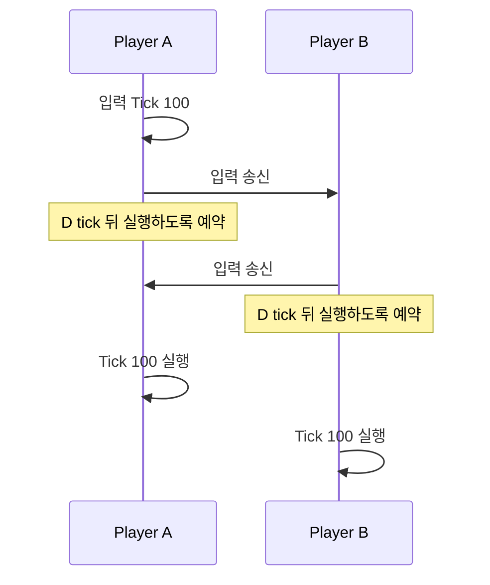
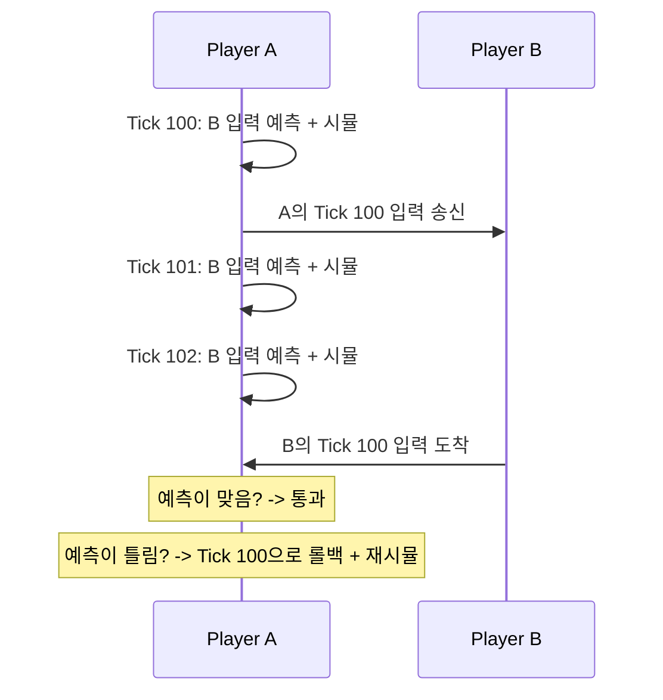
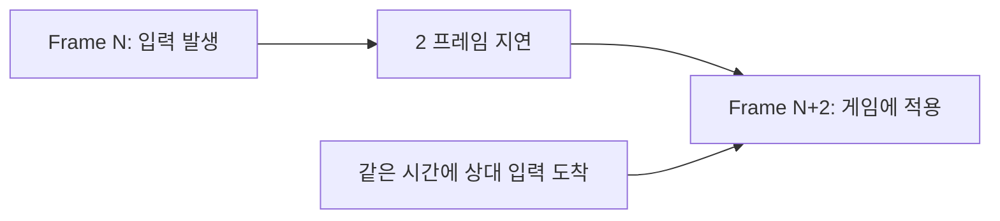
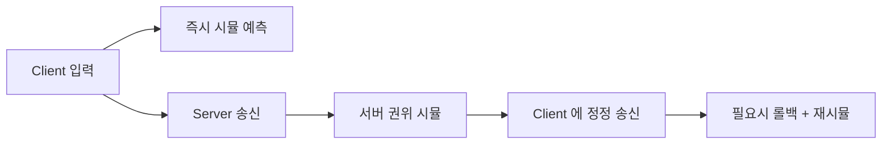
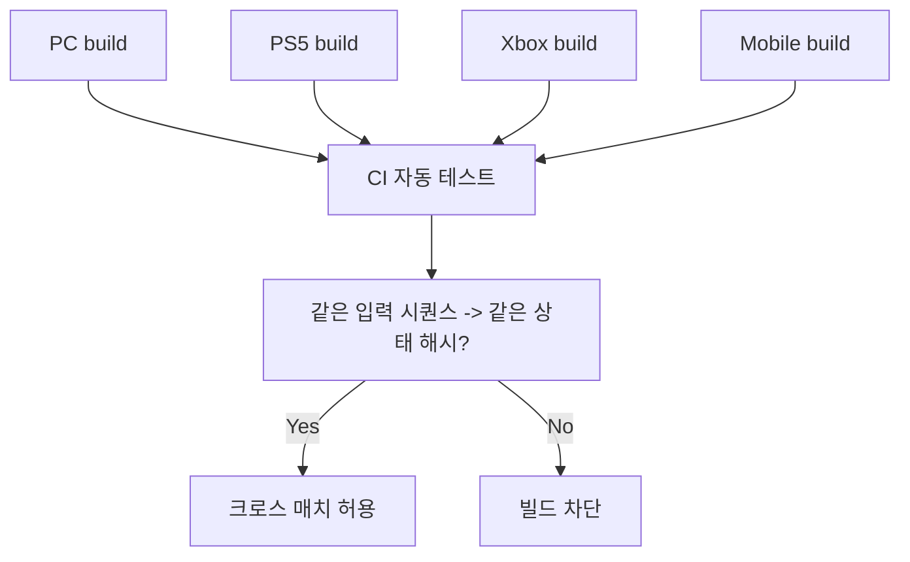

## 들어가며

60Hz 격투 게임의 한 simulation tick은 약 16.67ms다. remote input이 한 tick 늦게 도착하는 것만으로도 frame 단위 판정과 표시 결과가 달라질 수 있다. 왕복 지연의 절반은 대칭 경로에서만 one-way delay의 근사값이며, 실제 설계는 packet 도착 age와 jitter 분포를 tick 단위로 측정해야 한다.

*롤백 넷코드 (Rollback Netcode)* 는 remote input을 기다리는 대신 예측해 현재 tick을 진행하고, 실제 입력이 다르면 과거 상태에서 현재까지 재시뮬레이션한다. 격투·대전 액션에서는 이 방식이 반응성의 표준에 가깝다. FPS는 보통 전체 월드 롤백보다 *클라이언트 예측, 서버 보정, 히트 판정 지연 보상* 을 조합한다. *GGPO*는 격투 게임에 이 패턴을 널리 보급한 대표 구현이다.

이 글의 범위는 delay-based와 rollback의 시간 계약, 결정론적 시뮬레이션, 상태·입력 history, 재시뮬레이션 예산, 시청각 side effect, 부분 rollback과 desync 검증이다.


---

## 목차
1. [지연 보상의 두 접근](#1-지연-보상의-두-접근)
2. [결정론적 시뮬레이션](#2-결정론적-시뮬레이션)
3. [입력 예측과 링 버퍼 히스토리](#3-입력-예측과-링-버퍼-히스토리)
4. [재시뮬레이션 비용과 최적화](#4-재시뮬레이션-비용과-최적화)
5. [시각적 아티팩트 처리](#5-시각적-아티팩트-처리)
6. [부분 롤백과 하이브리드 모델](#6-부분-롤백과-하이브리드-모델)
7. [디싱크 탐지와 디버깅](#7-디싱크-탐지와-디버깅)
8. [플랫폼별 결정론 확보](#8-플랫폼별-결정론-확보)


---

## 1. 지연 보상의 두 접근

### 지연의 정량화

입력부터 화면까지의 총 지연은 controller sampling, local input queue, simulation tick 경계, render queue와 display scanout까지 포함한다. 네트워크 모델이 추가하는 항만 분리하면 다음과 같다.

- delay-based lockstep은 local input을 $D$ tick 뒤의 simulation에 예약한다. $D$는 remote input 도착 age의 목표 분위수를 덮도록 정한다.
- rollback은 local input을 다음 가능한 tick에 적용하고 remote input을 예측한다. 늦게 확정된 입력의 age가 input delay를 넘은 만큼 rollback depth가 생긴다.
- $\text{RTT}/2$는 one-way delay를 직접 측정한 값이 아니라 대칭 경로를 가정한 참고 근사다.

격투의 콤보와 확정 반격은 tick 단위로 갈린다. rollback의 목표는 네트워크를 없애는 것이 아니라 local input 경로에서 remote-input 대기를 제거하는 것이다. controller·simulation·render·display 지연은 그대로 남는다.

### Delay-based — 모두를 기다림



장점은 예측과 state rewind가 필요 없다는 점이다. 그러나 각 peer가 같은 입력을 받더라도 simulation이 결정론적이지 않으면 여전히 desync할 수 있다. lockstep은 결정론 요구를 제거하지 않는다.

단점은 모든 local input에 설정한 $D$ tick의 지연이 붙고, $D$가 덮지 못한 늦은 packet에서는 stall이 생긴다는 점이다. 가장 늦은 peer의 도착 분포가 전체 input-delay 정책을 압박한다.

### Rollback — 예측하고 되돌림



장점은 network wait를 local input 적용 경로에서 제거한다는 점이다. 상대 입력은 예측이 맞으면 rewind가 필요 없다.

단점 — *결정론적 시뮬레이션 필수*, *과거 상태 보존 필요*, *재시뮬레이션 비용*, *시각적 아티팩트 가능*. 구현 복잡도 ↑. 이 네 단점이 이 글의 2~5절 각각의 주제다.

### 비교 표

| 항목 | Delay-based | Rollback |
|---|---|---|
| 네트워크 때문에 추가한 local input delay | 설정한 $D$ tick | 보통 작거나 0 tick |
| 디싱크 위험 | 결정론이 깨지면 발생 | 결정론이 깨지면 발생 |
| CPU 비용 | 매 표시 구간의 정상 tick | 정상 tick + rollback 재시뮬레이션 |
| 메모리 | 작음 | 상태 히스토리 N 프레임 |
| 시각적 아티팩트 | 없음 | 보정 필요 |
| 핑 변동 대응 | 약함 (전체가 묶임) | 강함 (각자 진행) |
| 적합 장르 | RTS, 턴제 | 격투, 대전 액션 |

두 모델의 차이는 RTT 하나가 아니라 one-way arrival age의 tick 분포, jitter, 선택한 $D$, 허용 rollback depth와 예측 실패율로 결정된다. 실전에서는 작은 input delay와 rollback을 함께 사용해 local response와 correction 빈도를 절충한다.

## 2. 결정론적 시뮬레이션

롤백의 *생명선*. 같은 입력 + 같은 시작 상태 → *비트 단위로 같은 결과*. 깨지면 *디싱크* — 두 클라이언트가 다른 게임을 봄. 디싱크는 *조용히 시작* 해 *매치 끝까지 누적* 된다 — 한 비트 차이가 한 프레임 뒤 위치 차이, 그 다음 충돌 판정 차이로 증폭.

### 결정론을 깨는 요인

| 요인 | 원인 | 해결 |
|---|---|---|
| `float` 비결정성 | 컴파일러 / CPU / 명령 순서 | 고정소수점, fast-math 끄기 |
| 미초기화 메모리 | 스택 / heap 의 *우연한 값* | 명시적 0 초기화 |
| 컨테이너 순회 순서 | `unordered_map` 의 구현·rehash 의존 순서(일부 구현은 hash seed를 무작위화) | `vector` + 정렬된 키 |
| 포인터 주소 의존 | 정렬 키로 주소 사용 | 안정적 ID 사용 |
| 시간 의존 | `time(NULL)`, `Random` | 결정론적 PRNG + tick seed |
| 멀티스레드 | 작업 순서 비결정 | 시뮬은 단일 스레드 |
| 외부 라이브러리 | 물리 / AI 의 내부 상태 | 같은 빌드 + 같은 옵션 |

핵심 원칙 — *시뮬레이션에 들어가는 모든 것은 입력이거나 결정론적 함수의 출력이어야 한다*. 외부 비결정 소스(난수, 시간, 스레드 순서, 미초기화 메모리)가 시뮬에 새는 지점이 곧 디싱크 지점.

### Fixed-Point 산술

부동소수의 비결정성을 *피하려면 정수 기반*. 16:16 또는 24:8 fixed-point. 격투처럼 *완전 결정론* 이 절대 조건인 장르가 택한다.

```cpp
using fp = int32_t;     // 16.16 fixed-point: 상위 16비트 정수, 하위 16비트 소수
constexpr fp FP_ONE = 1 << 16;

inline fp Mul(fp a, fp b) {
    return (fp)(((int64_t)a * b) >> 16);     // 64비트로 올려 곱한 뒤 시프트 (오버플로 방지)
}
inline fp Div(fp a, fp b) {
    // C++17에서도 안전하도록 음수 left shift 대신 넓은 곱셈을 쓴다.
    // b != 0은 호출 전 불변식. 결과가 int32 표현 범위를 넘으면 별도 정책으로 처리한다.
    return (fp)(((int64_t)a * 65536) / b);
}
// 전제: x는 [-32768, 32767] 범위다. 곱은 넓은 타입에서 수행한다.
inline fp FromInt(int x)   { return (fp)((int64_t)x * FP_ONE); }
inline int ToInt(fp x)     { return x >> 16; }   // 버림
inline fp FromFloat(float f) { return (fp)(f * FP_ONE); }   // 빌드 시점 상수에만
```

함정 — *Mul 의 64비트 중간값*. `(int32 * int32)` 는 오버플로하므로 `int64` 로 올려 곱한 뒤 시프트해야 한다. 또 `Div` 의 0 나눗셈을 막고, C++17에서는 음수 signed *좌*시프트가 UB이므로 위처럼 넓은 곱셈으로 피해야 한다(음수 *우*시프트의 구현 정의 동작과는 다른 문제다). `sqrt` / `sin` 같은 초월함수는 *룩업 테이블 + 고정소수 보간* 으로 자체 구현한다 — 표준 라이브러리의 float 버전은 플랫폼마다 비트가 다르다.

*트레이드오프* — 코드 가독성 ↓, *기존 float 라이브러리 사용 불가*, 정밀도/범위 수동 관리. 격투 게임은 이 비용을 *전부 감수* 한다. FPS / 액션은 *float + 신중한 컴파일러 옵션* 으로 *대부분 결정론 달성 가능* (단방향 검증 필요).

### Fixed-Point 경계 조건

fixed-point가 결정론을 *보장* 하는 근거는 정수 연산의 의미가 표준에 비트 단위로 고정된다는 데 있다. C++ 정수 나눗셈은 *0 방향 절단(truncate toward zero)* 으로 명세되어(ISO C++ [expr.mul]) 컴파일러·CPU와 무관하게 같은 비트를 낸다. float의 반올림 모드·확장 정밀도·재배열에는 이런 보장이 없다 — 이 대비가 격투 장르가 정밀도를 포기하면서까지 정수를 택하는 이유다.

그러나 *변환 연산의 반올림 방향* 에 함정이 있다. `ToInt(x) { return x >> 16; }` 의 산술 우시프트는 0 방향 절단이 아니라 *바닥 함수(floor, $-\infty$ 방향)* 다. 즉 $\lfloor x / 2^{16} \rfloor$ 을 계산한다. 16.16에서 $-0.5$ 는 $-0.5 \times 2^{16} = -32768$ 로 저장되고 `-32768 >> 16` 은 $\lfloor -0.5 \rfloor = -1$ — 0이 아니다. 반면 같은 값을 정수 나눗셈 `x / FP_ONE` 으로 바꾸면 0 방향 절단이라 $0$ 이 나오고, `FromFloat` 내부의 `(fp)(f * FP_ONE)` 캐스트와 일반적인 `(int)someFloat` 도 0 방향 절단이다. 음수에서 *시프트는 floor, 나눗셈·캐스트는 truncate* 로 갈린다.

```cpp
fp  x = FromFloat(-0.5f);   // = -32768
int a = x >> 16;            // floor    => -1
int b = x / FP_ONE;         // truncate =>  0   (FP_ONE = 1<<16)
// a != b — 음수에서 두 변환 규칙이 1 LSB 어긋난다
```

한 시뮬 경로가 `>> 16` 을, 다른 경로가 `/ FP_ONE` 이나 float 캐스트를 쓰면 음수 좌표에서 1 LSB 차이가 시뮬 상태에 새어 *디싱크의 씨앗* 이 된다. 모든 시뮬 코드가 *한 규칙만* 쓰도록 강제하고, 변환 헬퍼를 단일 함수로 통일해야 한다. 추가 경계 — *부호 있는 정수의 우시프트* 는 C++17까지 음수 피연산자에서 구현 정의 동작이었고, 두 보수와 산술 우시프트가 표준에 명문화된 것은 C++20(P0907)부터다. C++17에서는 음수 signed 좌시프트가 정의되지 않지만, C++20의 좌시프트는 유효한 shift count에서 결과 타입 폭을 기준으로 modulo 규칙을 따른다. 위 `FromInt`와 `Div`는 구 표준 호환성과 표현 범위를 분명히 하기 위해 넓은 곱을 사용한다. 결과가 `fp` 범위에 들어야 narrowing 변환 결과를 의도대로 보존한다. 어떤 shift가 C++20에서 정의되었다는 사실을 signed 덧셈·곱셈·좁히기·fixed-point 전체 계산의 overflow 안전성으로 확대하지 않는다. 실무 컴파일러는 모두 산술 시프트지만, 결정론을 표준 보장으로 받치려면 C++20 이상을 기준 삼는 편이 안전하다. 마지막으로 `Div` 의 0 나눗셈은 UB이므로 호출 전 불변식으로 차단하고, `Mul`·`Div` 결과가 16.16 표현 범위 $\pm 2^{15}$ 를 넘으면 조용히 오버플로하므로 좌표·속도 스케일을 그 범위 안에 설계한다.

### float 결정론의 함정

같은 코드 + 같은 입력 + 다른 컴파일러 → *비트가 다름*. 원인은 *명령 선택의 자유* 다 — FMA(fused multiply-add) 사용 여부, 80비트 x87 확장 정밀도, 재배열 최적화, SIMD 폭.

```cpp
// MSVC
#pragma fp_contract(off)               // FMA 결합 금지
#pragma float_control(precise, on, push)

// Clang/GCC 컴파일 옵션
// -ffp-contract=off -fno-fast-math -fno-unsafe-math-optimizations
```

x86 의 *SSE 모드* (32/64비트 IEEE 754) 강제로 *80비트 x87 확장 정밀도 회피*. `-ffast-math` 는 *결정론의 적* — 결합법칙 재배열을 허용해 같은 식도 다르게 계산한다. PC ↔ 모바일(ARM) ↔ 콘솔 *크로스 플랫폼* 은 *각 플랫폼의 float 동작을 비트 단위로 검증* 해야 하며(8절), 보장이 어려우면 fixed-point로 간다.

### 결정론적 PRNG

```cpp
class DeterministicRNG {
    uint64_t state_;
public:
    void Seed(uint64_t tick) {
        state_ = SplitMix64(tick);     // tick 으로 시드 — 재시뮬에서도 동일
    }
    uint32_t Next() {                  // LCG (MMIX 상수)
        state_ = state_ * 6364136223846793005ULL + 1442695040888963407ULL;
        return (uint32_t)(state_ >> 32);
    }
};
```

매 tick *seed 가 결정* 됨 → 재시뮬에서 *같은 무작위 수열 생성*. `rand` / `std::mt19937` 의 *전역 상태* 는 절대 금지 — 재시뮬이 전역 상태를 또 진행시켜 수열이 어긋난다. 난수 상태도 *시뮬 상태의 일부* 로 스냅샷에 포함해 롤백 시 함께 복원하는 설계가 더 안전하다.

### 결정론 단위 테스트

결정론은 *테스트로 강제* 한다. 같은 입력 시퀀스를 두 번 돌려 매 tick 해시가 같은지 단언한다.

```cpp
void TestDeterminism(const std::vector<Input>& inputs) {
    GameState a = Init(seed), b = Init(seed);
    for (uint32_t t = 0; t < inputs.size(); ++t) {
        Simulate(a, inputs[t]);
        Simulate(b, inputs[t]);
        assert(HashState(a) == HashState(b));   // 같은 입력 → 같은 상태
    }
}
```

이 테스트를 CI에 넣어 *결정론 회귀를 빌드마다 잡는다* (8절). 결정론은 한 번 확보하고 끝이 아니라 *계속 지켜야 하는 불변식* 이다 — 새 코드 한 줄이 unordered_map 순회나 float 분기를 들이면 즉시 깨진다.

## 3. 입력 예측과 링 버퍼 히스토리

### 링 버퍼 히스토리

과거 N 프레임의 *입력 + 게임 상태* 를 *순환 배열* 에 보관. N = *최대 롤백 가능 깊이*.

```cpp
constexpr int HISTORY_SIZE = 16;     // 16 프레임 ≈ 266ms @ 60fps

struct FrameData {
    uint32_t  tick;                  // 검증용 (wrap-around 충돌 방지)
    Input     inputs[MAX_PLAYERS];
    bool      confirmed[MAX_PLAYERS]; // 진짜 입력? 예측?
    GameState state;                 // 직렬화된 상태 (tick 시작 시점)
    uint32_t  stateHash;             // 디싱크 검증용
};

struct History {
    FrameData frames[HISTORY_SIZE];

    FrameData& At(uint32_t tick) { return frames[tick % HISTORY_SIZE]; }

    void Save(uint32_t tick, const GameState& s, const Input* in) {
        FrameData& f = At(tick);
        f.tick = tick;                          // wrap-around 시 덮어쓰기 확인용
        f.state = s;
        memcpy(f.inputs, in, sizeof(Input) * MAX_PLAYERS);
        f.stateHash = HashState(s);
        memset(f.confirmed, 0, sizeof(f.confirmed)); // 슬롯 재사용 시 이전 tick 의 확정 플래그를 지운다
    }
};
```

`tick` 필드를 저장하는 이유 — 링 버퍼는 `tick % SIZE` 로 인덱싱하므로, 너무 오래된 tick을 조회하면 *다른 tick의 데이터* 가 나온다. 조회 시 `f.tick == 요청tick` 인지 확인해 *히스토리 범위를 벗어난 롤백* 을 탐지한다. HISTORY_SIZE는 *최대 핑 + 지터* 를 커버해야 한다 — 부족하면 깊은 롤백 요청 시 복원할 상태가 없다.

### 입력 예측

상대 입력이 *아직 안 도착* 했을 때 — *이전 입력을 그대로 반복* 가정.

```cpp
Input PredictInput(int playerId, uint32_t tick, History& h) {
    for (int back = 1; back <= HISTORY_SIZE; ++back) {
        FrameData& f = h.At(tick - back);
        if (f.tick == tick - back && f.confirmed[playerId])
            return f.inputs[playerId];     // 가장 최근 확정 입력 반복
    }
    return Input{};   // fallback (아무 입력 없음)
}
```

격투에서 *80% 이상의 프레임* 은 입력이 *그대로 유지* (버튼 누르고 있거나, 가만히). "마지막 입력 반복" 예측의 적중률이 높은 이유다. 예측이 맞으면 롤백 비용 0 — 그래서 *예측 적중률* 이 곧 성능이다.

### 입력 지연 (Input Delay) 튜닝

자기 입력에도 *2~3 프레임 의도적 지연* 을 둠 — *예측 실패를 줄이기 위해*.



장점 — *상대 입력이 도착할 시간 확보* → 롤백 빈도 ↓. 단점 — *체감 지연 33~50ms 증가*.

*트레이드오프 최적값* — 격투는 보통 *2~3 프레임*, FPS 는 *0~1 프레임*. 핑이 낮으면 input delay를 줄여 반응성을, 높으면 늘려 안정성을 택하는 *동적 조정* 도 가능. input delay가 *예측 실패를 줄이는 대가로 모두에게 일정 지연을 부과* 하는, Delay-based와 Rollback 사이의 다이얼임에 주목.

### 적응형 버퍼 — Sleep / Speedup

상대 입력이 *너무 빨리 / 너무 늦게 도착* 할 때 *프레임 타이밍 조정*. GGPO 의 *time sync* 는 `localFrame - 마지막으로 받은 상대 tick` 을 그대로 advantage로 쓰지 않는다 — 그 값은 상대의 실제 진행도뿐 아니라 입력 전송 지연까지 포함하므로, 양쪽이 같은 속도로 진행해도 둘 다 ‘앞섰다’고 계산될 수 있다. GGPO는 각 클라이언트가 보고한 local/remote frame advantage를 window로 평균하고, 두 관점이 모두 같은 쪽이 앞섰다고 볼 때만 그 차이의 절반을 `sleep_frames` 로 삼는다. 그 값이 불감대(기본 3프레임) 미만이면 무시하고, 최대 9프레임으로 상한을 둔다.

```cpp
// 학습용 단순 backpressure 예 — 실제 GGPO time sync 구현이 아니다.
// 아래 advantage는 네트워크 지연을 포함하므로 GGPO의 양방향 advantage
// 추정·평균·차이의 절반·불감대(MIN_FRAME_ADVANTAGE)·상한과 다르다.
int delayInclusiveGap = localFrame - lastReceivedRemoteFrame;

if (delayInclusiveGap > kThreshold) {
    SleepThisFrame();      // 로컬이 너무 앞섬 — 한 프레임 쉼 (상대가 따라오게)
} else if (delayInclusiveGap < -kThreshold) {
    RunExtraFrame();       // 로컬이 뒤짐 — 이번에 두 프레임 진행
}
```

핵심은 *한쪽이 너무 앞서면 예측 깊이가 깊어져 롤백이 잦아진다* 는 것. 양쪽을 비슷한 프레임에 두면 예측 깊이가 얕아지고 롤백이 준다. 실제 GGPO는 양측 advantage 추정을 평균해 한쪽만 느리게 만들되, 위 `delayInclusiveGap` 처럼 전송 지연이 섞인 raw 차이를 그대로 slowdown 기준으로 쓰지 않는다. 강한 핑 변동에도 *부드러운 게임 진행* 을 만드는 것이 적응형 버퍼다.

## 4. 재시뮬레이션 비용과 최적화

상대 입력이 *예측과 다른 것* 으로 확정 시 — 그 tick 으로 롤백 + *현재까지 재시뮬*.

재시뮬레이션에서는 입력이 달라진 가장 이른 tick의 **시작 상태**를 복원한다. 먼저 그 tick부터 현재 직전까지 모든 history 슬롯의 tick 태그와 보존 범위를 검증하고, 확정된 입력을 반영한다. 이후 tick마다 이미 확정된 입력은 유지하고 아직 미확정인 입력은 갱신된 과거 입력에 따라 다시 예측한 뒤 시뮬레이션한다. 각 tick의 시작 상태와 해시도 다시 저장하고, 마지막 결과를 현재 시뮬레이션 상태에 적용한다.

가장 이른 입력이 바뀌면 그 뒤의 "마지막 입력 반복" 예측들도 달라질 수 있다. 저장된 예측을 그대로 재사용하면 틀린 상태가 남는다. history가 부족하거나 동일 tick에 충돌하는 확정 입력이 들어오면 조용히 진행하지 않고 재동기화 또는 연결 종료 정책을 적용한다. 여러 늦은 입력은 먼저 모아 가장 이른 tick부터 한 번 재시뮬레이션한다.

### 비용 모델

재시뮬레이션 비용은 tick 비용, 실제 rollback depth와 correction 빈도의 결합이다. depth는 remote input의 도착 age에서 설정한 input delay를 뺀 tick 수에 가깝고, packet batching·jitter·burst loss가 꼬리를 만든다. RTT만으로 depth를 고정 변환하지 않고 telemetry의 depth histogram을 사용한다.

한 표시 프레임에 여러 늦은 입력이 확정되면 가장 이른 수정 tick으로 한 번만 rewind해 현재까지 재시뮬레이션한다. 입력마다 따로 rewind하면 같은 구간을 중복 계산한다.

위 식의 최악과 기대를 분리하면 예산이 왜 그렇게 잡히는지 보인다. 한 표시 프레임에서 클라이언트는 새 tick 1개를 진행하고, 그 프레임에 늦은 입력이 확정되면 깊이 $d$(=최대 롤백 깊이) 이하로 *한 번* 재시뮬한다(같은 프레임의 여러 입력은 가장 이른 tick으로 모아 처리하므로 재시뮬은 프레임당 최대 한 번). $C$ 를 1 tick 시뮬 비용이라 하면 한 프레임의 시뮬 작업량은 다음과 같다.

- 계획한 최대 correction이 한 번 발생하는 프레임: $W_{\max} \approx (1+d)C$ — 정상적인 새 tick 하나와 최대 $d$ tick 재시뮬레이션.
- 기대: $W_{\text{avg}} \approx (1 + p\,\bar d)\,C$ — $p$ 는 상대 입력이 직전 프레임과 달라 '마지막 입력 반복' 예측이 빗나갈 프레임 비율, $\bar d \approx d/2$ 는 평균 재시뮬 깊이.

여기서 $\bar d \approx d/2$도 균일 분포를 둔 설명용 근사일 뿐이다. 실제 $p$와 depth distribution은 캐릭터, 입력 장치, packet pattern과 delay 정책에 따라 달라진다. 표시 예산을 $B$라 하면 계획한 최대 correction을 한 프레임에 끝내기 위한 기본 조건은 $C \le B/(1+d)$다. snapshot restore, hash, event suppression과 render 준비 시간도 같은 $B$를 쓰므로 실제 허용 $C$는 더 작다.

설명용 예로 $C=0.5$ms, $d=4$이면 정상 tick을 포함한 최대 simulation work는 $2.5$ms다. 반면 $C=4$ms면 같은 correction이 $20$ms이므로 60Hz 표시 예산을 넘는다. “모든 격투 simulation은 1ms 이하” 같은 보편 규칙 대신 목표 platform에서 restore와 side-effect 처리를 포함한 correction-depth별 p95/p99를 측정한다.

### 메모리 비용

상태 직렬화 크기 × HISTORY_SIZE. 격투의 *간단한 상태 (캐릭터 2개 × 수백 바이트)* → 16 프레임 = 수 KB. RTS의 *복잡한 상태 (유닛 수백)* → 수백 KB → 매 프레임 전체 복사가 *메모리 대역폭/캐시* 부담.

### 델타 압축

상태 *전체 복사 대신 변경분만 저장*.

```cpp
struct DeltaFrame {
    uint32_t tick;
    std::vector<std::pair<uint32_t, uint8_t>> diffs;   // (offset, newValue)
};
```

RTS / 시뮬레이션은 *프레임 간 변화량이 작아* 압축 효과 큼. 다만 *복원 비용* 이 추가 — 롤백 시 키프레임부터 델타를 순차 적용해야 한다. 격투처럼 상태가 작으면 *전체 복사가 오히려 단순/빠름*. 트레이드오프는 측정으로 정한다.

### 선택적 업데이트

*모든 객체가 매 프레임 변하지 않음*. 재시뮬 대상에서 빼려면 *변경 빈도가 낮다* 가 아니라 *그 window에서 시뮬 결과에 영향이 없거나 event log로 정확히 재구성 가능하다* 는 조건을 만족해야 한다.

```cpp
void SimulateSelective(GameState& s, const Input* inputs) {
    for (auto& obj : s.objects)
        // 시뮬 결과에 영향을 주는 dependency가 있거나 입력과 겹치면 재시뮬한다.
        // '변경 빈도가 낮음'은 제외 근거가 아니다.
        if (obj.isDynamic || AffectedByInput(obj, inputs) || AffectsSimulation(obj))
            obj.Update();
    // 카메라 / 배경 / UI 는 시뮬 외 — 롤백 대상 아님 (6절)
}
```

격투에서 *카메라 / 배경 / UI* 는 입력에 영향 안 받으므로 *시뮬에서 제외* — 재시뮬 비용을 줄이고 롤백 대상도 줄인다. 반대로 문·장애물 같은 collision state는 드물게 바뀐다는 이유만으로 빼지 않는다 — 과거 tick에서는 열려 있었는데 현재 닫혀 있다면 player/physics만 복원해 재시뮬해도 다른 충돌 결과가 나오므로, 영향 영역의 dependency가 window 동안 불변임을 보장하거나 객체 dependency와 collision event를 함께 보존해야 한다.

## 5. 시각적 아티팩트 처리

롤백 직후 *화면이 갑자기 점프* — *플레이어가 인지 가능*. 부드럽게 만들려면 *시뮬 상태 ≠ 렌더 상태* 분리.

### 시뮬 상태 vs 렌더 상태

```cpp
struct GameState {        // 시뮬 — 결정론적, 롤백 대상
    fp posX, posY;
    // ...
};
struct RenderState {      // 시각 — 보간/보정 가능, 롤백 안 함
    float posX, posY;
    float velX, velY;     // 부드러운 보간용
};
```

매 프레임 *시뮬 상태 → 렌더 상태로 부드럽게 수렴*. 롤백으로 시뮬 위치가 점프해도 *렌더는 그 차이를 몇 프레임에 걸쳐 따라잡는다*.

```cpp
void UpdateRender(RenderState& r, const GameState& s, float dt) {
    float blendSpeed = 20.0f;
    float t = 1.0f - std::exp(-blendSpeed * dt);   // 프레임레이트 독립 수렴
    r.posX = Lerp(r.posX, ToFloat(s.posX), t);
    r.posY = Lerp(r.posY, ToFloat(s.posY), t);
}
```

### 텔레포트 임계값

차이가 *너무 크면 lerp 대신 즉시 갱신* — 화면이 *길게 미끄러지는 것보다 한 순간 점프* 가 덜 거슬림.

```cpp
const float TELEPORT_THRESHOLD = 2.0f;   // 게임 단위
if (Distance(r.pos, ToVec(s.pos)) > TELEPORT_THRESHOLD)
    r.pos = ToVec(s.pos);                // 즉시 (실제 텔레포트/큰 보정)
else
    r.pos = Lerp(r.pos, ToVec(s.pos), t);
```

### 애니메이션 / 사운드 / 파티클

- *애니메이션*: 롤백으로 스테이트가 바뀌면 *블렌드로 부드럽게 전환*. 격투 캔슬에서 흔함.
- *사운드*: 이미 *재생된 소리는 되돌릴 수 없음*. 두 패턴 — *N 프레임 지연 재생* (그 사이 롤백되면 취소, 단 소리도 지연) 또는 *즉시 재생 + 부정확 허용* (격투/FPS의 일반 선택, 시각만 정확하면 충분).
- *파티클*: *결정론적 파티클* 을 시뮬에 넣으면 롤백 시 정확 재현 가능하나 비쌈. 대안 — *시뮬 외 시각 효과* 로 분리해 *살짝 어긋남 무시*.

원칙 — *판정에 영향 주는 것(위치·히트박스)은 시뮬에 넣어 정확히 롤백, 보여주기만 하는 것(소리·이펙트)은 시뮬 밖에서 근사*.

## 6. 부분 롤백과 하이브리드 모델

*모든 객체* 를 롤백 대상에 두지 않음. *핵심만* 롤백 + *나머지는 일반 동기화*.

### 객체 분류

| 객체 종류 | 롤백 대상? | 이유 |
|---|---|---|
| 플레이어 / NPC | Yes | 입력에 직접 반응 |
| 발사체 | Yes | 충돌 판정의 핵심 |
| 환경 인터랙티브 (문/상자) | Optional | window 동안 불변 또는 event로 정확 복원 가능할 때만 |
| 배경 / 카메라 | No | 시각 효과 |
| 사운드 / VFX | No | 부정확해도 OK |
| 채팅 / UI | No | 게임 상태 무관 |

### 격투 vs FPS

*격투 — 거의 모든 것이 롤백*. 캐릭터 2개 + 발사체 → 시뮬 비용 작아 *전체 결정론 롤백* 가능.

*FPS — 핵심만 롤백*. 플레이어 위치 + 발사체 + 히트 판정만. *맵 / NPC AI / 환경* 은 *서버 권위 + 클라이언트 보간* 으로 처리. 시뮬 비용 큰 객체를 롤백에서 빼 비용을 관리.

### 서버 권위와의 결합

순수 P2P 롤백은 *치트 취약* (클라이언트가 시뮬 권위를 가짐). *서버 권위 + 클라이언트 예측 + 정정* 모델이 공개 매치의 일반.



*Source Engine / Quake 3* 의 *prediction + reconciliation* 이 이 모델 — 자기 캐릭터만 되감고 서버가 권위다. 격투의 P2P 롤백은 *서버 검증 없이 디싱크 검증 + 사후 신고* 로 치트에 대응한다.

## 7. 디싱크 탐지와 디버깅

### 상태 해시

매 tick의 *게임 상태를 해시* → 상대와 비교. 다르면 *디싱크*.

```cpp
uint32_t HashState(const GameState& s) {
    uint32_t h = 2166136261u;                 // FNV-1a
    auto mix = [&](const void* p, size_t n) {
        const uint8_t* b = (const uint8_t*)p;
        for (size_t i = 0; i < n; ++i) { h ^= b[i]; h *= 16777619u; }
    };
    for (const auto& o : s.objects) {
        mix(&o.posX, sizeof(o.posX)); mix(&o.posY, sizeof(o.posY));
        mix(&o.state, sizeof(o.state));        // 모든 시뮬 상태 멤버
    }
    mix(&s.rngState, sizeof(s.rngState));      // 난수 상태도 포함
    return h;
}
```

*매 N 프레임* 해시를 상대에게 송신해 비교. 해시는 *동일한 확정 입력 frontier* 에서 비교해야 한다 — 같은 tick 번호라도 한쪽이 예측 입력을, 다른 쪽이 확정 입력을 사용했다면 해시 차이는 정상 rollback 상황이다. 직렬화 schema(byte order·padding·포함 필드·container 순서·RNG 상태)를 양쪽이 공유해야 하며, object memory dump는 canonical serialization이 아니다. 이 TickHash가 전체 relevant simulation state를 담는지 일부 진단용 hash인지 명명하고, 보이지 않는 축이 있다고 해시 차이만으로 단정하지 않는다. 다르면 *디싱크 로그 + 강제 재동기화 또는 매치 종료*. 해시에 *모든 시뮬 상태 + 난수 상태* 를 넣는 것이 중요 — 빠뜨린 멤버가 디싱크의 사각이 된다.

### 결정론적 재현과 최초 불일치 탐색

디싱크 발생 시 — *입력 시퀀스 + 시작 상태* 를 기록해 *오프라인 재현*. 같은 입력에 다른 결과면 *결정론 깨짐 위치를 좁힌다*.

```cpp
struct DesyncRecord {
    GameState          initialState;
    std::vector<Input> inputHistory;
    uint32_t           desyncTick;
    uint32_t           expectedHash, actualHash;
};
```

좁히기는 *단일 tick 해시의 이진 탐색* 으로는 안 된다 — 한 tick이 달라도 reset·clamp로 이후 tick이 다시 같아질 수 있어 `같음→다름→같음`이 가능하고, tick 해시의 일치 여부는 단조 술어가 아니다. 기본값은 *처음부터의 선형 최초 불일치 탐색* 이고, 입력·상태 이력을 누적한 prefix digest/checkpoint를 쓰면 prefix 불일치가 보존된다. 해시 일치도 충돌 가능성이 있으므로 확정 입력 frontier와 canonical serialization 위에서만 해석한다. 좁히는 대상은 전체 해시가 아니라 *객체별 해시* 로 어느 객체가, 그 다음 *어느 멤버 변수* 가 갈렸는지다. "tick 1234에서 객체 7의 velX가 한 비트 다름" 까지 좁히면 원인(보통 그 객체를 만지는 float 연산)이 보인다.

### 네트워크 에뮬레이션

`clumsy` (Windows) / `tc-netem` (Linux) 로 *지연 / 손실 / 재정렬 시뮬*.

```bash
# Linux — 200ms 지연 + 3% 손실 + 재정렬
sudo tc qdisc add dev eth0 root netem delay 200ms loss 3% reorder 25%
```

격투 개발은 *수십 가지 핑 / 손실 / 지터 조합* 에서 자동 테스트 — *모든 조합에서 디싱크 0* 이 출시 조건.

### 프로덕션 텔레메트리

라이브에서 *디싱크 빈도 / 평균 핑 / 매치 길이* 를 서버에 보고. 임계 초과 시 *알람 + 디싱크 로그 자동 업로드*. 출시 후 *예상 못 한 GPU / OS / 드라이버 조합* 의 결정론 깨짐이 발견되는 경우가 흔해, 텔레메트리가 *유일한 조기 발견 수단* 이다.

## 8. 플랫폼별 결정론 확보

### Fixed Timestep — 시뮬과 렌더 분리

CPU 클럭 변동 + 가변 fps에도 시뮬은 *정확히 60Hz* 여야 결정론이 선다.

```cpp
constexpr float SIM_DT = 1.0f / 60.0f;
float accumulator = 0.0f;

void Tick(float realDt) {
    accumulator += realDt;
    while (accumulator >= SIM_DT) {
        SimulateOneTick();       // 항상 같은 dt — 결정론
        accumulator -= SIM_DT;
    }
    Render(accumulator / SIM_DT);  // 남은 비율로 보간 렌더
}
```

시뮬은 *고정 dt*, 화면은 *모니터 주사율(144/240Hz)* 로 부드럽게. 가변 dt를 시뮬에 넣으면 *플랫폼/프레임레이트마다 다른 결과* — 결정론이 즉시 깨진다.

### 모바일 / 콘솔 / 크로스 플랫폼

- *모바일*: ARM의 float 동작이 x86과 다를 수 있음. 백그라운드 작업으로 프레임 타이밍 불안정 → fixed timestep 필수.
- *콘솔*: PS / Xbox / Switch 각 SDK의 float 동작 검증. PC와 비트가 다르면 *플랫폼별 분리 매치메이킹* 의 이유가 된다.
- *크로스 플랫폼*: Street Fighter 6와 Tekken 8은 PC와 지원 콘솔 사이의 교차 매치를 제공하지만 모바일까지 포함하지 않는다. 실제 지원 조합마다 *통합 결정론 라이브러리(또는 fixed-point) + CI 비트 검증* 이 출시 전 준비물이다.



이 CI 게이트 — *모든 플랫폼 빌드가 같은 입력에 같은 해시* — 가 크로스 플랫폼 결정론의 *마지막 방어선* 이다. 2절의 결정론 단위 테스트를 *플랫폼 매트릭스* 로 확장한 형태.


---

## 결론

이 구조는 *반응성 - 복잡도의 명시적 트레이드오프* 위에 *프로덕션 수준의 롤백 시스템* 을 구성한다. 결정론적 시뮬레이션 + 상태/입력 히스토리(링 버퍼) + 예측 - 롤백 - 재시뮬 + 시각 보정(시뮬/렌더 분리) + 디싱크 탐지가 한 흐름으로 묶인다. 격투와 대전 액션은 전체 시뮬 롤백이 중심이고, FPS는 클라이언트 예측과 서버 보정을 결합한 부분 롤백이 중심이다.

롤백 넷코드의 가장 큰 비용은 *디버깅* 이다. 결정론 깨짐 한 비트가 매치 끝까지 점진적 디싱크로 누적되므로, *해시 검증 + 입력 기록 + 선형 최초 불일치 좁히기 + 결정론 단위 테스트 + CI 비트 검증* 같은 디버깅·검증 인프라가 게임 코드만큼 중요하다. 출시 후 예상 못 한 하드웨어 조합의 결정론 깨짐은 *프로덕션 텔레메트리* 가 조기에 잡는다.

P2P 롤백은 모든 peer가 같은 입력으로 같은 상태를 재현할 수 있고 참가자 수가 작을 때 강하다. 참가자 수·치트 위험·시뮬레이션 비결정성이 커지면 서버 권위 시뮬레이션에 클라이언트 예측과 정정을 결합하는 편이 적합하다. 두 모델은 반응성, 업로드 fan-out, 신뢰 경계와 서버 비용의 균형점이 다르며 장르와 위협 모델로 선택한다.

## 더 읽을거리

- Tony Cannon, [GGPO 오픈소스 저장소](https://github.com/pond3r/ggpo) — 롤백 넷코드 구현과 문서.
- Michael Stallone, "8 Frames in 16ms: Rollback Networking in Mortal Kombat and Injustice 2" (GDC 2018) — AAA 격투 게임의 롤백 전환 실록(결정론 확보·성능 예산).
- [GGPO 공식 사이트](https://www.ggpo.net/) — 롤백 동작 원리 설명.
- Glenn Fiedler, [Deterministic Lockstep](https://gafferongames.com/post/deterministic_lockstep/) — 롤백의 전제인 결정론적 시뮬레이션의 조건.
- ISO/IEC 14882:2020 (C++) [expr.shift]·[expr.mul] 및 P0907R4 "Signed Integers are Two's Complement"(C++20) — 정수 우시프트(floor)·나눗셈(0 방향 절단)·두 보수 표현의 표준 보장. fixed-point가 비트 단위 결정론을 받치는 근거.
