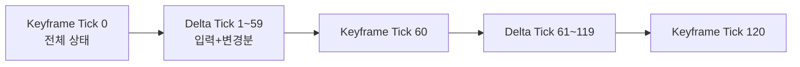
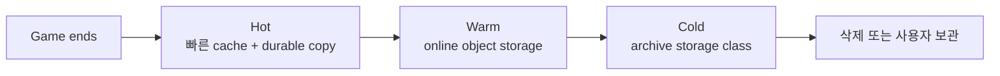

## 들어가며

리플레이 형식은 **무엇을 다시 만들 것인가**와 **어떤 실행 환경을 보존할 것인가**의 계약이다. 표시·분석에 필요한 상태를 frame마다 기록하면 simulation determinism 의존도는 낮아지지만 기록량이 커진다. 입력과 초기 상태만 기록하면 작아질 수 있지만 동일한 simulation contract가 필요하다. hybrid는 keyframe, input, event 또는 state delta를 섞어 seek 비용·호환성·용량을 조정한다.

rollback history와 replay는 state snapshot·input log·determinism을 공유할 수 있지만 목적과 보존 시간이 다르다. rollback은 bounded recent history에서 simulation을 즉시 복원하고, replay는 장시간 기록을 schema·build·asset metadata와 함께 저장해 seek·관전·분석에 사용한다.

이 글은 기록 형식, 결정론 경계, 압축과 저장 계층, seek·관전, 백그라운드 I/O와 분석 활용을 하나의 format contract로 다룬다.


---

## 목차

1. 기록 형식 — 입력 vs 상태
2. 결정론적 재생의 전제조건
3. 데이터 압축 전략
4. 저장 용량 관리
5. 재생 제어 기능
6. 관전 모드와 라이브 방송
7. 성능 최적화
8. 분석과 디버깅 활용
9. Replay와 상태 Hash

---

## 1. 기록 형식 — 입력 vs 상태

### 용량의 정량화 — 먼저 못 박기

형식 선택은 우선 raw budget에서 출발한다. tick 수를 $T=f_{\text{tick}}t$, player 수를 $P$, player당 input bytes를 $I$, 기록 entity 수를 $E$, entity당 canonical state bytes를 $S$라고 하면

$$
B_{\text{input}} = TPI,\qquad
B_{\text{snapshot}} = TES.
$$

예를 들어 60Hz를 **가정**하면 5분은 18,000 tick, 30분은 108,000 tick이다. $I=2$B, $S=32$B라는 단순 payload만 계산한 결과는 다음과 같다. file header, entity ID, event, index와 compression metadata는 제외했다.

| 형식 | 2인·5분 예 | 10인 또는 200 entity·30분 예 |
|---|---:|---:|
| 입력 payload | `18,000×2×2` = 72KB | `108,000×10×2` = 2.16MB |
| snapshot payload | `18,000×2×32` = 1.152MB | `108,000×200×32` = 691.2MB |
| hybrid | $\lceil T/K\rceil S_k + T d$ | keyframe 간격 $K$, 크기 $S_k$, 평균 delta $d$를 측정 |

RLE와 entropy coding의 결과는 input autocorrelation, analog axis, event 빈도와 dictionary에 따라 달라진다. snapshot도 delta·interest filtering·quantization으로 크게 줄 수 있다. 따라서 “격투 input은 1KB”, “FPS replay는 수십 MB”를 형식의 속성으로 가정하지 않고 representative match corpus에서 p50/p95 file size와 encode CPU를 측정한다.

### 입력 기반 (Input Replay)

매 프레임의 *플레이어 입력만* 기록. 재생 시 *결정론적 시뮬* 로 *상태 재생성*.

```cpp
struct InputReplay {
    uint32_t version;
    uint32_t seed;              // 결정론적 PRNG 시드
    GameSetup setup;            // 시작 조건 (캐릭터 / 맵 / 룰)
    uint32_t expectedFinalHash; // 재생 검증용 (2절)

    struct Tick {
        uint32_t tick;
        Input    inputs[MAX_PLAYERS];
    };
    std::vector<Tick> ticks;
};
```

장점.
- state 전체보다 작은 경우가 많고 입력 반복이 길면 RLE 효과가 크다.
- simulation source of truth와 같은 command를 기록하므로 별도 state serializer 범위가 작다.

단점.
- 초기 state, 외부 event, PRNG state와 simulation build를 포함한 deterministic execution contract가 필요하다.
- keyframe이 없으면 처음부터 target tick까지 simulation해야 한다. wall-clock seek 시간은 match 길이 자체가 아니라 headless simulation 처리량과 target tick으로 결정된다.

대표 — *StarCraft 2*, *대부분의 격투 게임*, *오래된 RTS*.

### 상태 기반 (Snapshot Replay)

매 프레임의 *모든 객체 상태* 를 기록. 재생 시 *시뮬 없이 상태 재생*.

```cpp
struct SnapshotReplay {
    uint32_t version;

    struct Frame {
        uint32_t                 tick;
        std::vector<ObjectState> objects;
    };
    std::vector<Frame> frames;
};
```

장점.
- simulation을 다시 실행하지 않고 기록된 state를 표시·분석할 수 있다.
- frame offset index와 독립 decode point가 있으면 target 근처로 직접 seek할 수 있다.
- 카메라와 presentation이 요구하는 state를 기록했다면 자유 시점을 지원할 수 있다.

단점.
- 기록 범위가 넓을수록 serialize·compress·I/O 비용과 용량이 커진다.
- schema, coordinate convention, asset와 animation 의미가 바뀌면 decoder·migration이 필요하다. 결정론과 무관할 뿐 버전 호환 문제가 사라지는 것은 아니다.
- 압축 chunk가 앞 frame의 delta에 의존하면 index가 있어도 해당 keyframe부터 decode해야 하므로 seek가 일반적으로 O(1)은 아니다.

대표 — *MOBA/FPS의 데모 파일과 관전 시스템*. 단, 순수 전체 스냅샷은 드물고 *델타* 와 섞는다 (3절).

### 하이브리드 — 키프레임 + 델타

전체 상태를 *N 프레임마다 한 번* (키프레임), 그 사이는 *입력 + 델타* 만 기록.



Seek는 target 이하의 가장 가까운 keyframe을 load하고 그 뒤 delta를 decode하거나 input을 재시뮬레이션한다. 간격이 K tick이면 target까지 처리할 추가 구간은 최대 K-1 tick이다.

```cpp
struct HybridReplay {
    uint32_t version;
    uint32_t keyframeInterval;     // 60 = 1초 마다

    struct Keyframe {
        uint32_t                 tick;
        std::vector<ObjectState> state;
    };
    struct DeltaFrame {
        uint32_t                 tick;
        Input                    inputs[MAX_PLAYERS];
        std::vector<StateDelta>  changes;
    };

    std::vector<Keyframe>   keyframes;
    std::vector<DeltaFrame> deltas;
};
```

키프레임 간격은 *용량 ↔ Seek 시간의 다이얼* 이다. 간격 K, 매치 T틱, 상태 크기 S, 평균 델타 d.

$$
\text{용량} \approx \frac{T}{K}\cdot S + T\cdot d, \qquad \text{최악 Seek} \approx (K-1)\cdot c_{\text{tick}}
$$

K를 키우면 키프레임 용량($\frac{T}{K}S$)이 줄지만 Seek 시간($(K-1)\cdot c_{\text{tick}}$)이 는다. 격투처럼 S가 작으면 K를 작게(잦은 키프레임) 둬 Seek을 즉시로 만들고, FPS처럼 S가 크면 K를 키워 용량을 아낀다. *측정으로 정하는 다이얼* 이다.

### 비교 표

| 형식 | 용량 경향 | Seek | 기록 비용 | 결정론 요구 |
|---|---|---|---|---|
| 입력 기반 | command 수에 비례 | keyframe 없으면 target까지 재시뮬 | 낮은 state 기록량 | 전체 simulation contract |
| 상태 기반 | 기록 field·entity·sample rate에 비례 | index·keyframe부터 decode | serialization 범위가 큼 | 표시 decoder에는 불필요 |
| hybrid | keyframe + delta/input | 최대 K-1 구간 처리 | 선택한 조합에 따름 | delta 의미에 따름 |

hybrid의 “부분 결정론”은 저절로 생기는 성질이 아니다. input을 재실행하는 구간은 결정론이 필요하고, authoritative state delta를 직접 적용하는 구간은 schema와 conflict rule이 필요하다. 각 chunk가 어떤 방식으로 다음 state를 만드는지 format에 명시하고 keyframe hash로 경계를 검증한다.

## 2. 결정론적 재생의 전제조건

### 입력 기반의 핵심 — 결정론

같은 시드 + 같은 입력 → *비트 단위로 같은 결과*. 깨지는 요인은 *롤백 넷코드와 동일* 하다. 핵심 원칙 — *재생에 들어가는 모든 것은 리플레이에 기록된 입력이거나 결정론적 함수의 출력이어야 한다*. 외부 비결정 소스(난수, 시간, 스레드 순서, 미초기화 메모리)가 시뮬에 새는 지점이 곧 재생 불가 지점.

| 요인 | 원인 | 해결 |
|---|---|---|
| floating-point 실행 차이 | FMA / x87 중간 정밀도 / SIMD 폭 / 수학 라이브러리 | 연산·compiler·target 계약 고정 |
| `time` / `rand` | 전역 가변 상태 | 결정론적 PRNG + 시드 *기록* |
| 컨테이너 순회 순서 | 반복 순서가 표준 계약으로 고정되지 않음(구현·rehash 의존) | `vector` + 정렬 키 |
| 포인터 주소 의존 | 정렬·해시 키로 주소 사용 | 안정적 ID |
| 멀티스레드 | reduction·conflict 적용 순서 비결정 | deterministic partition과 merge order |
| 외부 라이브러리 | 내부 상태·version·build option | 실행 계약 고정 + state hash 검증 |
| 플랫폼 | ABI·FP 환경·수학 함수 차이 | target 조합별 bit-for-bit CI |

floating-point 결정론은 “IEEE 754를 쓴다”만으로 얻어지지 않는다. compiler version·flag, target ISA, FP environment, library implementation과 연산 순서를 하나의 실행 계약으로 고정하고 실제 target끼리 state hash를 비교해야 한다.

```cpp
// 예: MSVC translation unit의 일부 계약
#pragma fp_contract(off)
#pragma float_control(precise, on, push)
// Clang/GCC도 -ffp-contract=off, -fno-fast-math 등을 검토하되
// target별 생성 코드와 math library까지 같아지는 것은 아니다.
```

`-ffast-math` 계열은 NaN·signed zero·결합 순서에 관한 가정을 완화해 replay 계약과 충돌할 수 있다. 반대로 strict flag를 켰다고 서로 다른 compiler·ISA가 자동으로 bit-identical해지는 것도 아니다. fixed-point는 플랫폼별 FP 차이를 제거하는 한 방법이지만 16:16 같은 format은 world range와 오차 budget을 먼저 만족해야 한다. overflow, 음수 나눗셈, rounding, saturation과 transcendental approximation까지 명시하고 테스트해야 결정론적이다.

### 결정론적 PRNG — 상태도 기록한다

```cpp
class DeterministicRNG {
    uint64_t state_;
public:
    void     Seed(uint64_t s) { state_ = SplitMix64(s); }
    uint32_t Next() {                          // LCG (MMIX 상수)
        state_ = state_ * 6364136223846793005ULL + 1442695040888963407ULL;
        return (uint32_t)(state_ >> 32);
    }
    uint64_t Snapshot() const   { return state_; }   // 키프레임에 함께 저장
    void     Restore(uint64_t s){ state_ = s; }      // Seek 시 복원
};
```

문제는 `std::mt19937`라는 알고리즘 자체보다 숨겨진 전역 상태와 호출 순서 결합이다. simulation subsystem별 RNG stream을 명시적으로 소유하고 algorithm/version, state와 stream identity를 keyframe에 저장한다. seek 시 모든 RNG state를 world state와 함께 복원하고, cosmetic RNG가 simulation stream을 소비하지 못하게 분리한다.

### 버전 관리 — 게임 패치와 리플레이

게임 패치 후 *과거 리플레이 재생 가능* 하려면 *옛 버전 코드 보관*. 두 가지 패턴.

- *Pinned Version* — 리플레이마다 *그 시점의 코드 버전* 명시. 재생 시 *해당 버전 코드로 실행*. *StarCraft 2* — `.SC2Replay` 파일에 *패치 버전이 박혀* 있어, 클라이언트가 해당 버전 데이터를 받아 재생한다.
- *Forward Compatible* — 모든 패치가 *과거 결정론을 유지* (매우 어려움) 또는 *상태 기반으로 변환해 보관* (현실적). 밸런스 수치만 바뀌고 시뮬 로직이 그대로면 가능, 로직이 바뀌면 깨진다.

### 버전 호환성 매트릭스

```cpp
struct ReplayHeader {
    uint32_t    engineVersion;     // 1.4.2 → 0x00010402
    uint32_t    gameDataVersion;   // 콘텐츠(밸런스) 버전
    std::string mapHash;           // 맵 파일 SHA-256
    std::string buildHash;         // 게임 빌드 식별자 (결정론 경계)
};

// 호환성 수준: ① 파일 파싱 가능 ② 시각 재생 가능 ③ bit-exact 재시뮬 가능.
// 입력 replay의 재시뮬은 ③이 필요하므로 map/rule/physics/RNG/schema 계약을
// 모두 확인한다. 이름이나 메이저 버전 일치만으로 ③을 통과시키지 않는다.
bool CanReplay(const ReplayHeader& h) {
    // 메이저 버전 + 게임 데이터 + 맵 + 결정론 경계 식별자
    return (h.engineVersion >> 16) == (CURRENT_VERSION >> 16) &&
           h.gameDataVersion       == CURRENT_DATA_VERSION   &&
           h.mapHash               == CURRENT_MAP_HASH       &&
           h.buildHash             == CURRENT_BUILD_HASH;
}
```

함정 — *메이저 버전만 보고 통과시키면 마이너 패치의 결정론 변경을 놓친다*. 시뮬 로직에 영향을 주는 변경은 `buildHash` 같은 *결정론 경계 식별자* 로 명시 차단하는 편이 안전하다. `mapHash`·rule·physics·asset collision·RNG 소비와 schema migration 계약이 바뀌면 protocol이 읽혀도 같은 state를 재현하지 못하므로, 재현 가능 여부를 이름이나 build 이름 하나로 판단하지 않는다. 호환 안 되면 *"옛 패치 빌드 다운로드" 옵션* 또는 *재생 불가 표시*.

### 검증 체크섬

리플레이 끝에 *최종 상태 해시* 저장. 재생 시 *같은 해시 도달* 확인.

```cpp
void ValidateReplay(const InputReplay& r) {
    // 초기 상태 생성이 RNG를 소비할 수 있으므로 seed 복원을 먼저 한다.
    // seed만 같아서는 부족하고 subsystem stream 구성·호출 순서·버전도 맞아야 한다.
    g_rng.Seed(r.seed);
    GameState s = InitFromSetup(r.setup);

    for (const auto& t : r.ticks)
        Simulate(s, t.inputs);

    if (HashState(s) != r.expectedFinalHash)
        LogReplayError("Determinism broken — code change or platform drift");
}
```

`InitFromSetup`이 RNG-free라는 계약이 아니면 seed 복원을 그보다 먼저 끝내거나 initial snapshot을 직접 복원한다. 같은 seed 하나로는 충분하지 않고 subsystem별 stream·호출 순서·build version이 함께 맞아야 한다. hash를 최종 state뿐 아니라 tick 또는 chunk 경계마다 저장하면 최초로 관측된 mismatch 구간을 좁힐 수 있다. 두 실행이 갈라졌다가 같은 canonical state로 다시 수렴할 수도 있으므로 mismatch 여부가 단조롭다는 보장 없이 이진 탐색하지 않는다. 경계 hash를 순서대로 비교해 첫 mismatch를 찾고, 그 chunk를 system→entity→field hash로 세분한다. CI는 같은 build 반복 실행과 target 간 비교를 지속해 결정론 회귀를 잡는다.

## 3. 데이터 압축 전략

### 입력 인코딩

8방향과 중립, 6개 button을 예로 들면 방향 4bit와 button mask 6bit로 10bit가 필요하다. file에서는 이를 16bit word에 명시적으로 pack할 수 있다.

```cpp
uint16_t PackInput(uint8_t direction, uint8_t buttons) {
    assert(direction <= 8 && buttons < 64);
    return static_cast<uint16_t>(direction) |
           (static_cast<uint16_t>(buttons) << 4);
}

void WriteInput(ByteWriter& out, uint8_t direction, uint8_t buttons) {
    out.WriteU16LE(PackInput(direction, buttons));
}
```

bit-field `struct`는 allocation order와 padding이 implementation-defined이므로 file format에 직접 쓰지 않는다. 남은 6bit는 format version에서 0으로 강제해 후속 확장과 손상 검사를 위한 공간으로 둔다.

*변화 없는 프레임* 은 *반복 카운트만 저장* — Run-Length Encoding.

```cpp
void WriteInputRun(ByteWriter& out, uint16_t packedInput,
                   uint16_t repeatCount) {
    assert(repeatCount > 0);
    out.WriteU16LE(packedInput);
    out.WriteU16LE(repeatCount);
}
```

T tick에서 동일 input run이 R개라면 이 고정폭 RLE payload는 `4R` byte다. 예를 들어 R=200이라는 **가정**에서는 800B지만, 매 tick input이 달라져 R=T이면 raw 2B/tick보다 RLE가 두 배 커진다. analog axis, player mask, tick gap과 framing도 추가된다. RLE 적용 여부와 entropy coding 결과는 실제 match corpus의 run-length histogram으로 정한다.

`repeatCount`가 `uint16_t`면 한 run의 최대 길이는 65,535 tick이고 시간은 tick rate $f$에서 $65535/f$초다. 더 긴 run은 여러 record로 나눈다. simulation 재현에는 capture 시각보다 **어느 simulation tick에 어떤 command가 적용됐는지**가 중요하다. network queue 자체를 재현하려는 진단 replay라면 arrival time·sequence·buffer decision도 별도 channel에 기록한다.

### 상태 델타

이전 키프레임(또는 직전 프레임) 대비 *변경된 객체 / 필드* 만 저장.

```cpp
struct StateDelta {
    uint16_t objectId;
    uint8_t  fieldMask;   // 변경된 필드 비트마스크 (8 필드까지)
    // fieldMask 의 set 비트 순서대로 가변 길이 데이터 뒤따름
};
```

변하지 않은 object를 생략하면 delta 크기는 전체 entity 수보다 dirty entity·field 수에 비례한다. 산술 예로 200개 중 20개가 바뀌고 각 delta가 2B ID, 1B mask, 평균 8B payload라면 `20×11=220B`다. 32B state 200개를 기록한 6.4KB와 비교하면 약 29배 작지만, 실제 비율은 ID 폭, change density, entropy와 baseline invalidation을 trace에서 측정해야 한다. 정적 map data는 replay에 반복 기록하지 않고 map/content hash로 참조할 수도 있다.

복원 비용이 대가다. Seek 시 *키프레임부터 델타를 순차 적용* 해야 하므로, 키프레임 간격이 K면 *최대 적용 횟수* 는 K-1. 압축률과 Seek 시간이 K로 맞물린다 (1절).

### 가변 정밀도 위치

위치를 *32-bit float × 3*으로 저장하면 payload가 12바이트다. position을 replay 표시용 local origin에 대한 1cm 단위로 표현하고 필요한 범위가 맞는다는 가정에서는 signed 16-bit × 3으로 6바이트에 담을 수 있다.

```cpp
struct CompactPosition {
    int16_t x;   // 1단위 = 1cm → -327.68m ~ +327.67m
    int16_t y;
    int16_t z;
};   // 6바이트, float 대비 50% 절감
```

양 끝을 모두 표현하려면 필요한 code 수는 `구간 폭 / step + 1`이다(구간 폭이 step의 정수배라는 전제). 따라서 `구간 폭 / step ≤ code count - 1`이어야 한다. signed 16-bit와 1cm step은 local origin 기준 약 `[-327.68m, 327.67m]`를 표현한다. world가 이 범위를 넘으면 chunk/sector origin을 함께 저장하거나 step·bit 수를 바꾼다. 표시 오차 budget은 camera distance, collision 판정 재실행 여부와 downstream interpolation까지 포함해 정한다.

함정 — *양자화 오차의 누적*. 리플레이 표시용 위치는 양자화해도 무방하나, *재생이 결정론적 재시뮬을 한다면* 양자화된 값을 다시 시뮬 입력으로 쓰면 안 된다 — 시뮬은 *원본 정밀도(fixed-point 풀값)*, 저장·표시만 양자화한다. 둘을 섞으면 재생이 원본과 갈린다.

### Quaternion 압축 — Smallest-Three

회전을 *4 float* = 16바이트 → *최대 성분 생략 + 3 × 10-bit* = 4바이트. 단위 쿼터니언은 $x^2+y^2+z^2+w^2=1$ 이므로, *가장 큰 성분* 은 나머지 셋과 부호로 복원된다.

```cpp
uint32_t PackSmallestThree(uint32_t largestIdx,
                           uint32_t qa, uint32_t qb, uint32_t qc) {
    // qa/qb/qc는 [-1/sqrt(2), 1/sqrt(2)]를 [0, 1023]으로 양자화한 값.
    assert(largestIdx < 4 && qa < 1024 && qb < 1024 && qc < 1024);
    return (largestIdx      ) |
           (qa         <<  2) |
           (qb         << 12) |
           (qc         << 22);
}

void WriteCompactQuat(ByteWriter& out, uint32_t packed) {
    out.WriteU32LE(packed);     // byte order를 format에 명시
}
```

C++ bit-field의 bit 배치와 allocation order는 implementation-defined이므로 file/network format으로 `struct`를 그대로 쓰지 않는다. 명시적 mask·shift와 byte order로 serialize한다.

생략된 성분이 최대이므로 그 부호는 *양수로 정규화* (q와 -q는 같은 회전). 나머지 셋의 범위는 최대 성분이 빠진 만큼 $[-\tfrac{1}{\sqrt2}, \tfrac{1}{\sqrt2}]$ 에 들어, 그 폭에 10비트를 다 쓴다.

```cpp
// 복원: 생략 성분 = sqrt(1 - a² - b² - c²)
float DecodeOmitted(float a, float b, float c) {
    return std::sqrt(std::max(0.0f, 1.0f - a*a - b*b - c*c));
}
```

payload는 16바이트에서 4바이트로 줄지만 각오차 허용 여부는 camera·animation workload로 검증해야 한다. `sqrt` 내부는 양자화와 부동소수점 반올림으로 음수가 될 수 있어 0으로 clamp하고, decode 결과가 finite인지 검사한다.

### Smallest-Three의 정밀도 — 양자화 스텝과 각오차

10비트 양자화에서 저장 성분 하나의 최대 오차만 회전각으로 환산하면 약 $0.079°$, 즉 흔히 말하는 $0.1°$ 규모다. 그러나 세 저장 성분과 복원 성분의 오차가 함께 작용하므로 전체 회전의 민감한 방향은 더 클 수 있다. 그 차이를 세 단계로 계산한다.

먼저 *범위 $[-\tfrac{1}{\sqrt2}, \tfrac{1}{\sqrt2}]$가 타이트한 이유*. 생략 성분 $w$가 최대 크기이므로 남은 임의 성분 $a$에 대해 $a^2 \le w^2$이고, 단위 제약에서 $a^2 + w^2 \le a^2+b^2+c^2+w^2 = 1$이라 $a^2 \le 1 - w^2 \le 1 - a^2$, 즉 $|a| \le \tfrac{1}{\sqrt2}$. 등호는 두 성분만 $\pm\tfrac{1}{\sqrt2}$이고 나머지가 0일 때 도달하므로, 양끝이 실제로 쓰여 폭을 더 줄일 수 없다 — 10비트를 이 폭에 다 쓰는 근거다.

다음 *양자화 스텝*. 폭 $\sqrt2$를 $n$비트의 $2^n-1$ 구간으로 나누면 스텝 $\Delta = \frac{\sqrt2}{2^n-1}$, 성분당 최대 오차 $\Delta/2$다. $n=10$이면 $\Delta = \frac{\sqrt2}{1023} \approx 1.38\times10^{-3}$.

마지막으로 *성분 오차를 회전각으로 환산*. 두 단위 쿼터니언 $q,\hat q$가 나타내는 회전 사이의 측지 거리는 $\Delta\varphi = 2\arccos|\langle q,\hat q\rangle|$다(Huynh 2009). 작은 접선 섭동 $\delta q$에 대해 $\langle q, q+\delta q\rangle \approx 1 - \tfrac12\lVert\delta q\rVert^2$이고 $\arccos(1-x) \approx \sqrt{2x}$이므로 $\Delta\varphi \approx 2\lVert\delta q\rVert$다. *인자 2는 반각·이중덮개* — 쿼터니언이 회전을 반각으로 표현하기에 성분 오차가 회전각에 두 배로 실린다. 여기서 $\delta q$는 저장한 세 오차 $\varepsilon_a,\varepsilon_b,\varepsilon_c \in [-\tfrac{\Delta}{2},\tfrac{\Delta}{2}]$뿐 아니라, 복원된 $w=\sqrt{1-a^2-b^2-c^2}$의 오차 $\varepsilon_w \approx -\frac{a\varepsilon_a + b\varepsilon_b + c\varepsilon_c}{w}$도 포함한다. 분모의 $w$는 *생략한 최대 성분*이라 $w \ge \tfrac12$(단위 4-벡터의 최대 성분은 항상 $\ge\tfrac12$)이지만, $w$가 그 하한에 가까울수록 $1/w$가 오차를 증폭한다.

경계 $w=\tfrac12$, $a=b=c=\tfrac12$ 부근에서 세 저장 성분의 오차를 모두 $e=\Delta/2$로 두면 1차 근사로 $\varepsilon_w=-3e=-3\Delta/2$이고 $\lVert\delta q\rVert\approx\sqrt3\Delta$다. 따라서 각오차 scale은 $2\sqrt3\Delta\approx0.00479$rad, 약 $0.27^\circ$다. 이것은 quantizer의 exact global maximum을 증명한 값이 아니라 민감한 경계에서 얻은 1차 worst-direction estimate다. 실제 encoder의 round-to-nearest grid에 대해 exhaustive/Monte Carlo test로 max·p99·RMS를 측정하고, 더 강한 bound가 필요하면 bit 수를 늘린다.

### 압축 알고리즘 — LZ4 / Zstd

semantic encoding으로 불필요한 field와 precision을 줄인 뒤 independently decodable chunk를 범용 압축한다. delta·RLE가 항상 Zstd 같은 compressor의 결과를 개선한다고 단정할 수는 없다. transform metadata와 random access 비용까지 포함해 원본 canonical stream과 비교한다.

| 후보 | 일반적 성격 | 검증할 항목 |
|---|---|---|
| LZ4 계열 | 낮은 encode/decode CPU, 상대적으로 큰 output | game thread budget, disk/network 증가 |
| Zstd 낮은 level | ratio와 CPU의 중간 동작점 | chunk별 p95 encode·decode, dictionary 효과 |
| Zstd 높은 level | 더 많은 offline encode CPU로 작은 output을 탐색 | 실제 절감률, memory, decode throughput |
| Brotli 높은 quality | 배포 asset 같은 offline workload 후보 | replay corpus와 seek latency에 적합한지 |

throughput은 CPU, library version, block size, input entropy와 thread 수에 따라 달라진다. Zstd decompression이 compression level에 비교적 덜 민감한 경향은 있어도 같은 속도를 보장하지 않는다. codec·level은 이름으로 정하지 않고 representative corpus에서 bytes, encode CPU, decode CPU와 peak memory의 Pareto frontier를 구한다.

```cpp
std::vector<uint8_t> CompressReplay(const Replay& r, Tier tier) {
    auto bytes = Serialize(r);   // 이미 RLE/델타/양자화로 줄인 상태
    switch (tier) {
        case Tier::Hot:  return Compress(bytes, measuredHotProfile);
        case Tier::Warm: return Compress(bytes, measuredWarmProfile);
        case Tier::Cold: return Compress(bytes, measuredArchiveProfile);
    }
    return bytes;
}
```

실제 file은 전체 match를 한 blob으로 압축하지 않고 keyframe index와 chunk checksum을 둔다. 그래야 일부 손상에서 나머지 구간을 복구하고, seek 때 target을 포함한 chunk만 읽고 decode할 수 있다. storage tier와 compression profile은 서로 다른 결정이다. 저장 class만 바꾸고 byte stream은 유지할 수도 있으며, 재압축은 절감된 저장비가 read·write·compute 비용보다 클 때만 수행한다.

## 4. 저장 용량 관리

### 규모의 정량화

용량 정책은 **distinct match 수**에서 출발한다. player participation 수를 `DAU × 1인당 match 수`로 구한 뒤, replay를 match당 한 번 저장한다면 평균 참가자 수로 나눠야 한다.

$$
M_{\text{day}} \approx
\frac{\text{DAU}\times\text{matches per player}}{\text{players per match}},
\qquad
B_{\text{day}} = M_{\text{day}}\times \bar B_{\text{replay}}\times R.
$$

$R$은 replica·erasure coding·index overhead를 반영한 저장 증폭이다. 예를 들어 DAU 100만, 1인당 5 match, match당 10명, replay 2MB, $R=1$을 가정하면 50만 distinct match와 하루 1TB다. 10TB가 아니다. party size와 bot, 중도 이탈 때문에 단순 나눗셈에는 오차가 있으므로 production match ID의 cardinality로 닫는다.

| 계층 | 후보 위치 | 비용·성능에서 확인할 항목 |
|---|---|---|
| Hot | local/NVMe cache + durable copy | write latency, node loss, cache hit, replication |
| Warm | standard object storage | request·capacity·egress price, first-byte latency |
| Cold | archive storage class | minimum retention charge, retrieval delay·fee |
| 삭제 | metadata tombstone 포함 | legal hold, user deletion, index consistency |

provider·region·계약마다 price와 retrieval contract가 바뀌므로 문서에 고정 달러 단가를 박지 않는다. access histogram, support·anti-cheat hold, user save 비율과 삭제 의무를 입력해 total cost를 계산한다.

### Hot / Warm / Cold 계층



계층은 access latency·durability·retrieval fee의 구분이다. compression level과 자동으로 짝지어지지 않는다. 최근 replay의 cache hit가 높다면 빠른 cache를 두고 durable object copy를 source of truth로 삼는다. 오래된 replay는 access histogram과 retention policy에 따라 archive로 전환한다.

### 자동 정리 정책

```cpp
struct RetentionPolicy {
    int daysHot  = 7;
    int daysWarm = 90;
    int daysCold = 365 * 2;   // 2년
    int maxUserSaveDays = 365 * 2;
};

void RetentionWorker(const RetentionPolicy& p) {
    for (auto& r : ListAllReplays()) {
        int age = DaysSince(r.recordedAt);
        if (r.mustDelete) { DeleteReplay(r.id); continue; }
        if (r.legalHold) continue;
        if (r.userMarkedSave && age <= p.maxUserSaveDays) continue;

        if      (age > p.daysCold) DeleteReplay(r.id);
        else if (age > p.daysWarm) MoveToCold(r.id);
        else if (age > p.daysHot)  MoveToWarm(r.id);
    }
}
```

위 기간은 예시 configuration이다. 전이 작업은 idempotent해야 하고 batch rate를 제한하거나 storage lifecycle rule에 위임한다. lifecycle rule은 storage class를 바꿀 뿐 replay를 재압축해 주지는 않는다. 사용자의 보관 표시는 quota와 최대 보존 정책 안에서 처리하며 legal deletion·account deletion·security hold가 더 높은 우선순위를 가질 수 있다.

### 하이라이트 자동 추출

매치 *전체 리플레이* 가 너무 크면 — *킬 / 골 / 결정적 순간* 만 *짧은 클립* 으로 추출.

```cpp
std::vector<HighlightClip> ExtractHighlights(const Replay& r) {
    std::vector<HighlightClip> clips;
    for (const auto& e : r.events) {
        if (e.type == EventType::Kill ||
            e.type == EventType::Goal ||
            e.type == EventType::Ace)
        {
            uint32_t before = SecondsToTicks(highlightLeadSeconds, r.tickRate);
            uint32_t after  = SecondsToTicks(highlightTailSeconds, r.tickRate);
            clips.push_back({
                e.tick > before ? e.tick - before : 0,
                std::min(SaturatingAdd(e.tick, after), r.lastTick),
                e.description,
            });
        }
    }
    return MergeOverlapping(clips);   // 겹치는 구간 병합
}
```

`e.tick-before`는 unsigned underflow를 피하고 match 끝도 clamp해야 한다. 겹친 window는 병합하되, 단순 event rule이 실제로 의미 있는 장면을 선택하는지는 precision·recall과 시청 완료율로 검증한다. input 기반 clip을 독립 파일로 만들려면 시작점 이하 keyframe과 build/content metadata를 포함해야 한다.

### 사용자 할당량

사용자 보관은 count, total bytes, 최대 age와 법적 정책을 함께 적용한다. replay 크기가 크게 다르면 개수 quota만으로 storage 상한이 되지 않는다.

```cpp
bool CanSaveReplay(PlayerId pid, uint64_t newFileBytes) {
    SavePolicy p = policyStore.ForAccount(pid);
    Usage u = GetReplayUsage(pid);
    return u.count + 1 <= p.maxCount &&
           newFileBytes <= p.maxFileBytes &&
           newFileBytes <= p.maxBytes &&
           u.bytes <= p.maxBytes - newFileBytes;
}
```

`p.maxBytes - newFileBytes`는 앞 조건이 먼저 평가되어 unsigned underflow를 막는다. check와 실제 저장은 atomic reservation으로 묶어 concurrent upload가 quota를 초과하지 않게 한다. 최대 age는 retention worker가 적용하고, 용량 초과 시 사용자 선택 삭제·oldest eviction·저장 거부 중 제품 정책을 명시한다.

## 5. 재생 제어 기능

### Seeking — 임의 시점 탐색

형식별 비용이 다르다. 입력 기반 — *처음부터 fast-forward*. 하이브리드 — *가장 가까운 키프레임 + 짧은 fast-forward*. 상태 기반 — *해당 프레임 직접 로드*.

```cpp
Expected<GameState, SeekError> SeekTo(
        uint32_t targetTick, const HybridReplay& r) {
    if (r.keyframes.empty() || targetTick > r.lastTick)
        return Unexpected(SeekError::OutOfRange);

    // 1. targetTick 이하의 가장 가까운 키프레임 (upper_bound 후 한 칸 뒤로)
    auto it = std::upper_bound(r.keyframes.begin(), r.keyframes.end(), targetTick,
        [](uint32_t t, const Keyframe& kf) { return t < kf.tick; });
    if (it == r.keyframes.begin())
        return Unexpected(SeekError::MissingKeyframe);
    --it;

    // 2. keyframe payload·checksum을 검증하고 RNG를 포함한 상태 복원
    GameState s = DecodeAndVerify(*it);

    // exact keyframe이면 delta 순회 없이 바로 반환한다.
    if (it->tick == targetTick) return s;

    // delta[t]는 tick t 처리 후의 상태로 전이시키는 record라는 계약.
    // 파일 tick은 단조 index다. keyframe.tick + 1이 UINT_MAX에서 0으로
    // 돌아가므로 더 넓은 counter로 센다.
    for (uint64_t t = uint64_t(it->tick) + 1; t <= uint64_t(targetTick); ++t) {
        const HybridReplay::DeltaFrame* frame =
            r.deltaIndex.Find(static_cast<uint32_t>(t));
        if (!frame) return Unexpected(SeekError::MissingDelta);
        for (const StateDelta& d : frame->changes) ApplyDelta(s, d);
    }

    return s;
}
```

`upper_bound` 뒤의 이전 원소가 target 이하 최대 keyframe이지만, 첫 keyframe보다 앞이면 감소시킬 원소가 없으므로 반드시 검사한다. keyframe tick이 target과 같으면 delta를 하나도 적용하지 않고 그대로 반환한다. delta는 vector 위치가 tick과 같다고 암묵적으로 가정하지 않고 index에서 찾는다. 누락·손상 record를 조용히 건너뛰면 그 뒤 state 전체가 오염되므로 seek를 실패시키거나 다음 독립 keyframe으로 복구한다.

keyframe 간격이 K이고 delta decode 또는 simulation 한 tick의 p95 비용이 c라면 최악 seek 계산량의 1차 근사는 $(K-1)c$다. chunk read·decompress와 cache miss는 별도 항이다. timeline scrubbing의 latency SLO를 먼저 정하고 corpus benchmark에서 K를 선택하며, interactive seek는 취소 가능한 worker job과 generation ID로 오래된 결과가 화면을 덮지 못하게 한다.

### 가변 속도 재생

재생 속도는 game time과 wall time의 비율이다. 지원 범위는 simulation 처리량, audio policy와 presentation 요구로 정한다.

```cpp
class ReplayPlayer {
    float  playSpeed   = 1.0f;
    double accumulator = 0.0;

    void Tick(double realDt) {
        accumulator += realDt * playSpeed;
        int advanced = 0;
        while (accumulator >= SIM_DT && advanced < MAX_TICKS_PER_FRAME) {
            AdvanceOneTick();
            accumulator -= SIM_DT;
            ++advanced;                 // spiral-of-death 방지 상한
        }
    }
};
```

`MAX_TICKS_PER_FRAME`은 render thread stall을 제한하지만 accumulator backlog를 그대로 두면 replay가 요청 속도를 따라가지 못한다. 정확한 every-tick mode는 “처리 불가” 상태를 표시하거나 render frame을 건너뛰고, preview mode는 target replay time에 가까운 state를 seek해 중간 표시 frame만 생략할 수 있다. 느린 재생은 simulation tick 의미를 바꾸지 않고 두 state 사이의 presentation interpolation과 audio time-stretch를 사용한다.

### Free Camera

원래 *플레이어 시점* 으로 기록됐어도, *카메라를 자유 조정* 가능. *상태 기반 / 하이브리드 리플레이* 의 장점이다 — 전체 월드 상태가 있으므로 *어느 각도든* 렌더한다. 입력 기반도 *재시뮬로 전체 상태를 복원* 하면 가능하다.

```cpp
class FreeCam {
    glm::vec3 position, rotation;
    float     fov = 60.0f;

    void Update(float dt, const Input& in) {
        Move(in, dt);     // WASD
        Rotate(in, dt);   // 마우스
    }
};
```

함정 — 입력 기반 리플레이에서 *카메라 입력을 게임 입력과 같은 스트림에 섞으면* 재시뮬이 달라진다. Free cam 입력은 *시뮬 밖의 별도 채널* 이어야 한다 — 시뮬에 들어가는 것은 *기록된 플레이어 입력만*. e스포츠 분석가·캐스터가 각 팀 시점을 본 뒤 공유하는 기능의 표준 패턴.

### UI 오버레이

재생 중 *추가 UI* — *HP 바, 스킬 쿨다운, 미니맵 강조, 데미지 숫자, 이동 히트맵*. *분석 / 코칭 도구* 의 핵심.

```cpp
struct ReplayOverlay {
    bool showHPBars    = true;
    bool showAbilityCD = false;
    bool showDamageOut = true;    // 데미지 숫자
    bool showHeatmap   = false;   // 누적 이동 경로
};
```

overlay가 요구하는 HP·cooldown·visibility·damage event를 replay schema가 보존했다면 추가 raw capture 없이 파생할 수 있다. “game state에 있었던 값”과 “replay에 기록한 값”은 같지 않다. fog-of-war 관전자 권한, 숨은 정보와 event causality를 포함해 overlay별 required-field contract를 둔다.

## 6. 관전 모드와 라이브 방송

### 라이브 vs 지연 관전

*라이브* — 게임 중 실시간 관전. 치트 위험 (관전자가 정보를 플레이어에게 전달 — *ghosting*).
*지연 관전*은 정보가 현재 match 의사결정에 되돌아가는 것을 늦춘다. 필요한 지연은 round 길이, communication channel, map 정보의 유효 시간과 tournament rule로 정하며 “public은 몇 분” 같은 보편값은 없다. 권한별로 볼 수 있는 entity·team 정보도 delay와 별도로 제한한다.

구현은 live replay chunk를 durable sequence로 발행하고 spectator cursor가 configured delay보다 앞서지 못하게 하는 구조다. 단순 client-side timer는 변조할 수 있으므로 server가 허용 가능한 최대 published tick을 강제한다. buffer 장애나 reconnect 뒤에도 미래 chunk를 먼저 전달하지 않도록 authorization과 chunk index가 같은 시간 기준을 사용해야 한다.

### 다중 시점 전환

관전자가 팀·player·free-camera 시점을 전환하려면 해당 시점에서 볼 수 있는 world·visibility·camera anchor가 복원되어야 한다. state/hybrid replay는 이를 직접 기록할 수 있고 input replay도 simulation을 복원하면 가능하다. 어떤 형식이든 local player에게만 있던 presentation state를 기록하지 않았다면 동일 시점은 만들 수 없다.

```cpp
enum class ViewMode {
    PlayerView,
    TeamView,
    FreeCam,
    StrategicView,   // 미니맵 + 거시 정보
    Cinematic,       // 자동 시점 선택
};
```

### 자동 시점 선택 — Auto-Director

매 순간 *가장 흥미로운 카메라* 자동 선택. *킬 / 능력 사용 / 그룹 전투* 같은 *이벤트 기반 점수* 로.

```cpp
ViewTarget AutoDirector(const GameState& s, ViewTarget prev) {
    const bool prevValid = IsStillValid(prev, s);
    if (prevValid && TimeSinceLastSwitch() < minDwellTime)
        return prev;

    float      best = 0;
    ViewTarget target = prev;
    for (const auto& p : s.players) {
        float score = ComputeInterestScore(p);  // 최근 킬·낮은 HP·액티브 스킬 가중
        if (prevValid && p.id == prev.id) score += hysteresisBonus;
        if (score > best) { best = score; target = ViewTarget(p); }
    }
    // prev가 무효면 Score(invalid) 비교 없이 점수만으로 새 target을 고른다.
    if (prevValid && target != prev &&
        best < Score(prev, s) + switchMargin)
        return prev;
    return target;
}
```

직전 대상 bonus는 hysteresis를 만들 뿐 최소 체류 시간을 보장하지 않는다. 명시적 `minDwellTime`, switch margin, target invalidation 예외를 함께 둔다. 이전 target이 소멸·무효면 `prevScore + hysteresis` 비교를 건너뛰고 유효 후보 사이에서만 hysteresis를 적용한다. 유효 후보가 하나도 없을 때의 null/고정 관전 시점 반환 규약을 정한다. camera path도 target point로 순간 이동하기보다 shot type별 transition과 collision 검사를 거친다. 점수 weight와 체류 시간은 시청자 평가와 수동 caster override 횟수로 조정한다.

### 외부 방송 도구 통합

방송 도구의 *화면 캡처 소스* 가 게임 화면을 가져간다. 추가로 *Replay Buffer*는 최근 일정 구간을 메모리의 순환 버퍼에 유지하다 핫키 입력 시 클립으로 확정하는 구조다.

게임 측은 *현재 매치 정보 / 플레이어 상태* 를 *외부 도구에 노출하는 API* 를 제공한다 — Game State Integration 류의 폴링/푸시 엔드포인트.

```json
{
  "provider": { "name": "Game", "appid": 570 },
  "player":   { "name": "Player1", "team": 2 },
  "hero":     { "name": "Storm Spirit", "level": 18, "hp_percent": 0.6 },
  "abilities":{ "0": { "name": "Static Remnant", "cooldown": 0 } }
}
```

이런 API는 *지연 관전 정책과 일관* 되게 노출 범위를 잡아야 한다 — 라이브로 적 정보를 흘리면 ghosting 위험. 공개 방송용 데이터는 *지연 버퍼 너머의 시점* 만 노출한다.

## 7. 성능 최적화

### 백그라운드 기록 — 게임 스레드 보호

compression과 storage I/O는 worker로 넘기되, game thread에서 수행하는 capture·copy·enqueue 비용과 queue overflow 정책까지 설계해야 한다.

```cpp
class ReplayRecorder {
    SpscRing<RecordedFrame, queueCapacity> queue_;
    std::jthread worker_;
    std::atomic<bool> replayValid_{true};

public:
    // single game-thread producer.
    // RecordedFrame은 worker가 소비할 때까지 유효한 immutable snapshot을
    // 소유해야 한다 — GameState 포인터를 얕게 복사하면 안 된다.
    void OnGameTick(uint32_t tick, const GameState& s, const Input* in) {
        RecordedFrame frame = CaptureReplayFields(tick, s, in);
        if (!queue_.try_push(std::move(frame))) {
            replayValid_.store(false, std::memory_order_relaxed);
            RecordQueueOverflow(tick);
        }
    }

private:
    // single worker consumer
    void WorkerThread(std::stop_token stop) {
        RecordedFrame f;
        while (!stop.stop_requested() || !queue_.empty()) {
            if (queue_.try_pop(f)) CompressAndAppend(f);
            else WaitForProducerOrStop(stop);
        }
    }
};
```

SPSC ring은 producer/consumer가 하나씩이라는 ownership 계약에서 bounded memory와 allocation-free enqueue를 만들기 쉽다. lock-free라는 이름만으로 worst-case latency가 사라지는 것은 아니며 cache contention과 retry가 남을 수 있다. queue가 가득 찼을 때 simulation을 block할지, replay를 invalid 처리할지, optional presentation sample만 drop할지를 데이터 종류별로 정한다. authoritative input/event를 조용히 버리고 정상 replay로 표시해서는 안 된다.

queue에 넣는 `RecordedFrame`은 worker가 소비할 때까지 유효한 *immutable snapshot* 을 소유해야 한다. bytes 소유권과 queue의 acquire/release 동기화를 계약으로 두고, 이미 publish한 frame의 buffer를 game thread가 다시 만지지 않는다. 종료는 신규 publish 중단 → worker에 stop 알림·깨움 → 남은 frame drain·flush → join → buffer 회수 순서로 한다. overflow 시 drop·block·stop 중 무엇을 택했는지 데이터 종류별로 명시하고, 조용히 버린 구간은 replay에 표시한다.

입력 기반도 input bytes뿐 아니라 tick, player mask, 외부 event와 integrity metadata를 capture한다. state 기반은 full world copy가 병목이 될 수 있으므로 dirty tracking, immutable snapshot page 또는 replay 전용 canonical buffer를 평가한다. delta 계산을 game thread로 옮기면 copy는 줄어도 CPU가 생기므로 두 경로의 p99를 측정한다.

### 메모리 버퍼 — 일괄 flush

작은 write를 합쳐 chunk 단위로 append하면 syscall과 compression overhead를 줄일 수 있다. threshold는 frame 개수 하나가 아니라 bytes와 elapsed time을 함께 사용한다.

```cpp
constexpr size_t FLUSH_BYTES = 256 * 1024;  // 측정으로 조정
constexpr auto FLUSH_AGE = std::chrono::seconds(1);

void AppendFrame(const RecordedFrame& f) {
    buffer_.Append(f);
    if (buffer_.size_bytes() >= FLUSH_BYTES ||
        Clock::now() - bufferStartedAt_ >= FLUSH_AGE)
        SealAndAppendChunk();
}
```

`write`나 user-space flush가 끝났다고 power-loss durability가 보장되는 것은 아니다. 허용 가능한 손실 구간을 정하고, server evidence처럼 내구성이 필요하면 chunk checksum·commit marker와 주기적 `fsync`/durable object upload를 사용한다. 종료 handler는 정상 종료에는 도움이 되지만 crash·process kill·전원 손실의 보장이 될 수 없다. durability를 높이면 sync stall과 write amplification이 커지므로 recorder worker에서 SLO를 측정한다.

### 디스크 I/O 패턴

- *Sequential append*는 seek가 적고 block device·filesystem이 큰 write를 병합하기 쉬운 기본 후보다.
- *Buffered I/O*는 page cache와 readahead를 활용하지만 replay write/read가 asset cache를 밀어내는지 관찰해야 한다.
- *Memory mapping*은 random read API를 단순화할 수 있지만 page fault가 latency-sensitive thread에서 발생하지 않게 prefetch·worker 경계를 둔다.
- *Direct I/O*는 page cache 복제를 피할 수 있지만 filesystem·kernel별 alignment contract, short I/O와 tail 처리 복잡도가 생긴다. Linux에서는 지원 시 `statx(..., STATX_DIOALIGN, ...)` 같은 interface로 요구 alignment를 조회하고 fallback을 둔다.

어떤 방식도 매체 이름만으로 우월하지 않다. replay chunk size, 동시 asset streaming, OS cache pressure와 crash semantics를 포함한 trace로 buffered/direct/mmap을 비교한다.

### 재생 시 프레임 드롭 방지 — Prefetch

해제 + Seek 비용이 *프레임 예산을 초과* 하면 *재생이 떨린다*. *미래 N 프레임을 미리 디스크에서 읽고 해제* 해 캐시한다.

```cpp
class StreamingReplayPlayer {
    std::deque<GameState> prefetch_;   // 미리 해제한 미래 프레임
    std::thread           prefetcher_;

    GameState GetFrame(uint32_t tick) {
        if (auto* c = FindInPrefetch(tick)) return *c;   // 캐시 hit (빠름)
        return LoadAndDecompress(tick);                  // miss — 동기 로드 (느림, stall)
    }
};
```

prefetch horizon은 `재생 속도 × storage/decode p99 + safety margin`으로 정하되 memory budget으로 제한한다. seek가 발생하면 generation을 증가시켜 이전 worker 결과를 폐기하고 target keyframe 주변을 우선한다. prefetch queue도 단일 소유(worker)와 SPSC/lock 규칙을 정해 producer·consumer가 동시에 만지지 않게 하고, cache에서 반환한 chunk는 immutable handle로 고정해 교체·삭제가 진행 중인 borrow를 무효화하지 않도록 수명을 보장한다. generation은 오래된 결과를 식별해 버리는 표식일 뿐 이미 해제된 메모리를 안전하게 만들지 않는다. input/hybrid replay는 worker에서 keyframe load와 delta 적용 또는 headless simulation까지 수행할 수 있지만, live render state와 공유하는 mutable world를 worker가 직접 수정해서는 안 된다.

## 8. 분석과 디버깅 활용

### 치트 검증 워크플로우

신고된 매치 — *리플레이 자동 재생 + 행동 분석*. 입력 기반 리플레이는 *재시뮬해야 시점·조준 데이터가 나오고*, 상태 기반은 *바로 시계열 분석* 이 된다.

```cpp
struct CheatDetectionMetrics {
    float headshotRatio;       // 머리 적중률
    float avgReactionTimeMs;   // 적 등장 → 첫 사격
    float aimSnapVelocity;     // 0 → 타겟 회전 각속도 (deg/s)
    int   prefireThroughWall;  // 시야 차단된 적을 향한 사격
};

CheatDetectionMetrics AnalyzeReplay(const Replay& r, PlayerId target) {
    // 모든 사격/데미지 이벤트 + 카메라 시점 시계열을 통계로
    // ...
}
```

분석 전에 replay의 provenance를 확인한다. server-authoritative event와 server가 서명한 replay는 evidence가 될 수 있지만 client가 제출한 camera·input stream은 변조 가능성을 포함한다. 높은 headshot ratio, wall prefire와 aim acceleration은 서로 상관될 수 있으므로 단순 곱으로 독립 evidence처럼 취급하지 않는다. skill·input device·weapon·visibility 조건별 정상 분포에서 model을 교정하고, sanction 강도에 맞는 false-positive budget과 appeal 가능한 원본 evidence를 둔다.

### 버그 재현 — 결정론의 가장 큰 가치

QA·플레이어가 *버그 발견* → *리플레이 + 빌드 버전* 첨부 → 개발자가 *결정론적 재생 + 디버거 attach*.

```cpp
void OnBugReport(const BugReport& r) {
    if (!r.replayPath) return;
    if (LoadHeader(*r.replayPath).buildHash != CURRENT_BUILD_HASH) {
        LogWarn("리플레이 빌드 불일치 — 결정론 재현 불가, 상태 기반으로만 관전");
        return;
    }
    ReplayPlayer player(*r.replayPath);
    player.SetBreakpoint(r.suspectedTick);   // 그 tick 진입 시 디버거 중단
    player.Run();
}
```

build hash 확인이 빠지면 다른 simulation contract로 재실행한 결과를 원본 버그로 오인한다. 상태 기반 replay도 현재 decoder가 옛 schema·asset을 이해할 때만 관전할 수 있으므로 compatibility check를 별도로 한다. 재현 가능한 tick과 최초 mismatch state를 확보하면 서술형 신고보다 원인 범위를 훨씬 좁힐 수 있다.

### 밸런스 데이터 마이닝

수십만 매치 리플레이를 *오프라인 분석* → *캐릭터 / 무기 / 아이템 승률*. *데이터 기반 밸런스 패치*.

```sql
SELECT character_id,
       patch_id,
       skill_bucket,
       COUNT(*)                                          AS games,
       SUM(CASE WHEN won = 1 THEN 1 ELSE 0 END) * 1.0
         / COUNT(*)                                      AS winrate
FROM   match_replays
WHERE  recorded_at > NOW() - INTERVAL '30 days'
GROUP  BY character_id, patch_id, skill_bucket
HAVING COUNT(*) >= :minimum_reportable_sample
ORDER  BY patch_id, skill_bucket, winrate DESC;
```

표본 하한만으로 selection bias와 confounding이 사라지지 않는다. patch, skill, map, side, party composition, pick order와 matchup을 분리하고 win-rate interval을 함께 보고한다. rare pick의 높은 win rate는 specialist selection일 수 있고, character가 강해서 pick rate·matchmaking이 변하면 관측 집단도 바뀐다. balance 결정은 고정 45/55% 문턱보다 causal hypothesis, uncertainty, pick/ban·engagement와 targeted experiment를 함께 사용한다.

### AI 학습 데이터셋

리플레이 = *전문가 시연(expert demonstration)*. *모방 학습(Imitation Learning) / 강화학습 사전 학습* 의 데이터.

```python
# 리플레이를 (state, action) 페어로 변환
for replay in load_replays():
    for tick in replay.ticks:
        state  = encode_state(tick.game_state)
        action = encode_input(tick.player_input)
        dataset.append((state, action))

model = ImitationLearner()
model.train(dataset)            # 인간 플레이 모방으로 초기 정책 학습
# 이후 self-play 강화학습으로 인간 수준 초과
```

input replay로 학습 dataset을 만들 때 full game state가 곧 agent observation은 아니다. fog-of-war, camera, latency와 UI를 반영해 당시 player가 볼 수 있었던 observation을 복원하고, raw input을 action space와 정확히 대응시켜야 한다. deterministic simulation은 중간 state 재구성에 유리하지만 replay build·asset·external event가 보존되어야 한다. behavior cloning은 expert 분포 밖에서 error가 누적되는 covariate shift와 player selection bias가 있으므로 validation split을 match/player 단위로 나누고, offline evaluation·DAgger류 보완 또는 안전한 self-play를 검토한다.

### QA 자동화 — 회귀 탐지

핵심 매치 시나리오 *수십 개를 리플레이로 보관* → *매 빌드마다 헤드리스 재생 + 결과 비교*. 게임 코드 변경의 *회귀 자동 탐지*.

```cpp
struct RegressionTest {
    std::string replayPath;
    GameOutcome expectedOutcome;
};

void RunRegressionSuite(const std::vector<RegressionTest>& tests) {
    for (const auto& t : tests) {
        auto replay = LoadReplay(t.replayPath);
        auto runA = ReplayHeadless(replay);
        auto runB = ReplayHeadless(replay);

        ASSERT_EQ(runA.tickHashes, runB.tickHashes); // 같은 build 내부 결정론
        ASSERT_EQ(runA.outcome, t.expectedOutcome);  // 명시한 gameplay 계약
    }
}
```

결정론과 gameplay golden은 분리한다. 같은 candidate build를 같은 입력으로 두 번 실행한 hash가 다르면 결정론 회귀다. 이전 build와 hash가 다른 것은 balance·logic 변경의 자연스러운 결과일 수 있으므로 system별 semantic diff를 검토한다. outcome·invariant golden을 갱신할 때는 자동 re-bless하지 않고 승인된 design change와 diff를 남긴다. cross-platform 계약이 필요하면 각 target의 tick hash artifact를 비교한다.


## 9. Replay와 상태 Hash

게임 시뮬레이션의 간헐적 오류는 입력과 외부 사건을 기록해 replay할 수 있다. 필요한 기록은 플레이어 입력만이 아니다.

```text
초기 상태와 빌드·에셋 버전
난수 seed 또는 난수 결과
네트워크 메시지와 적용 tick
작업 완료 순서
설정과 feature flag
외부 시간·I/O 결과
```

같은 입력에서도 상태가 갈라질 수 있으므로 tick마다 안정된 순서로 핵심 상태를 hash한다.

```cpp
Hash TickHash(const World& world) {
    Hash h;
    for (EntityId id : world.SortedEntityIds()) {
        h.Add(id);
        const SimState& s = world.State(id);
        h.AddU32LE(CanonicalFloatBits(s.position.x));
        h.AddU32LE(CanonicalFloatBits(s.position.y));
        h.AddU32LE(CanonicalFloatBits(s.velocity.x));
        h.AddI32LE(s.health);
        h.AddU64LE(s.rngState);
    }
    return h;
}
```

raw `struct`에는 padding, pointer, uninitialized byte와 host byte order가 섞일 수 있으므로 그대로 hash하지 않는다. simulation-relevant field를 canonical 순서·endianness로 넣고, NaN payload나 `-0/+0`을 같은 값으로 볼지 contract에 명시한다. strict determinism은 exact canonical bits를 비교하고, 허용 오차 metric은 원인 분석용 별도 결과로 둔다. 서로 다른 실행의 tick hash를 비교할 때는 양쪽이 같은 confirmed input prefix와 content/version을 사용해야 하며, 예측 입력이 섞인 tick의 hash 차이는 결정론 실패가 아니다. 이때 `TickHash`가 전체 relevant state인지 부분 진단 hash인지도 명명한다.

두 replay가 처음 다른 hash를 내는 tick을 찾으면, 그 tick의 시스템별 하위 hash로 범위를 좁힐 수 있다.

```text
world hash mismatch at tick 1842
  physics hash: same
  AI hash: mismatch
    blackboard: same
    path state: mismatch
```


---

## 결론

이 구조는 *정확성 - 저장 용량의 트레이드오프* 위에 *프로덕션 리플레이 시스템* 의 전체 구성요소를 정리한다. 입력 / 상태 / 하이브리드 기록 + 결정론적 재생 + 다단 압축(RLE·델타·양자화·범용) + 계층적 저장(Hot/Warm/Cold) + 재생 제어(Seek·가변속도·Free cam) + 관전 + 분석 활용이 결합되면, 리플레이는 부가 기능이 아니라 핵심 인프라가 된다. 형식·키프레임 간격·압축 레벨·계층 전이는 모두 *수치로 정하는 다이얼* 이지 직관으로 정하는 옵션이 아니다.

리플레이는 치트 검증, 버그 재현, balance 분석, AI dataset과 관전의 공통 기록 인프라가 될 수 있다. 입력만 저장한다고 재현성이 생기는 것은 아니다. build·asset, 초기 state, RNG, 외부 event와 적용 tick까지 execution contract에 들어 있어야 최초 divergence를 찾을 수 있다. 상태 기반도 schema migration과 visibility 범위를 소유해야 한다. 형식이 주장하는 보장과 실제 기록 field를 일치시키는 것이 핵심이다.

리플레이 시스템이 안정적으로 동작하면 *플레이어가 게임 외 콘텐츠* — 본인 클립 / 친구 클립 / 프로 경기 분석 — 를 게임과 같이 소비한다. 그 소비가 *대규모 라이브 방송 / 지연 관전 / 코멘터리* 로 확장되면 저장, 전송, 권리 처리, 정보 누설 방지(ghosting)까지 운영 범위가 넓어진다. 리플레이는 단순한 재생 기능이 아니라 라이브 서비스의 콘텐츠 생산 파이프라인이다.

## 더 읽을거리

- Phil Orwig, "Replay Technology in Overwatch: Kill Cam, Gameplay, and Highlights" (GDC 2017) — 상태 스냅샷 + 되감기 기반 리플레이의 AAA 실구현.
- Glenn Fiedler, [Deterministic Lockstep](https://gafferongames.com/post/deterministic_lockstep/) — 입력 기반 리플레이의 전제 조건인 결정론 정리.
- Glenn Fiedler, [Snapshot Compression](https://gafferongames.com/post/snapshot_compression/) — smallest-three 회전 압축과 비트 예산 배분의 실무 정리.
- Du Q. Huynh, "Metrics for 3D Rotations: Comparison and Analysis" (Journal of Mathematical Imaging and Vision 35(2), 2009) — 회전 사이 측지 거리 $2\arccos|\langle q_1,q_2\rangle|$의 표준 해설.
- Factorio 개발 블로그(FFF)의 결정론·리플레이 글 목록 — <https://www.factorio.com/blog/> — 특정 글을 찾는 출발점. 개별 FFF 번호·제목을 특정하지 않으므로 본문 주장의 직접 근거는 아니다.
