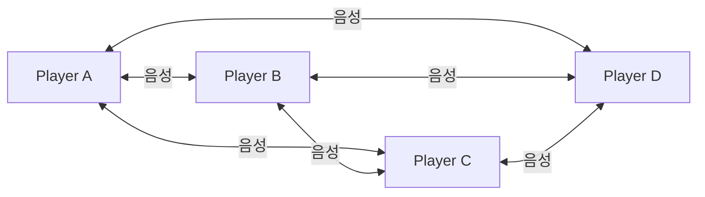
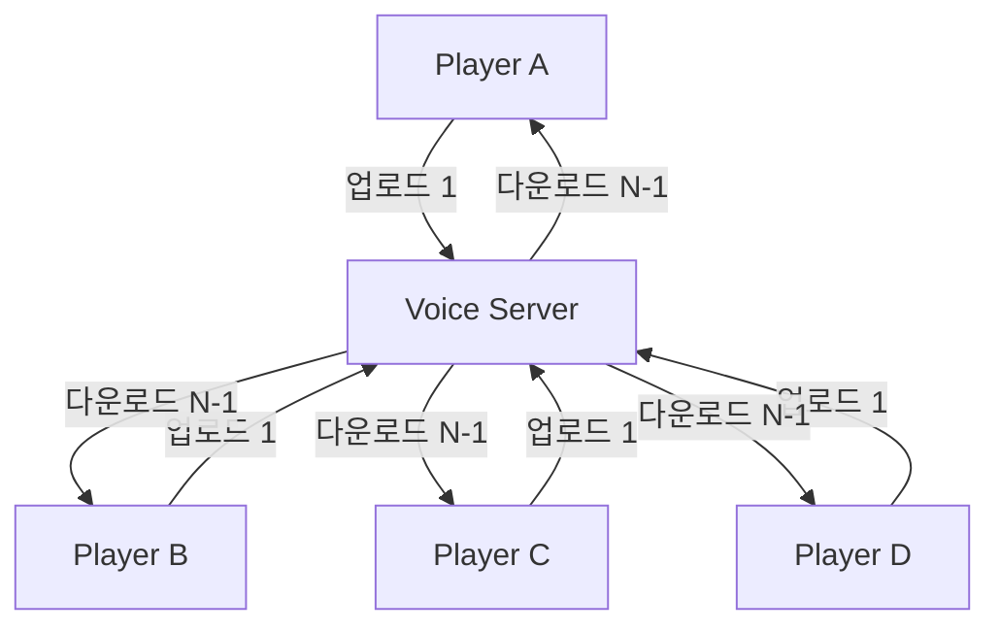
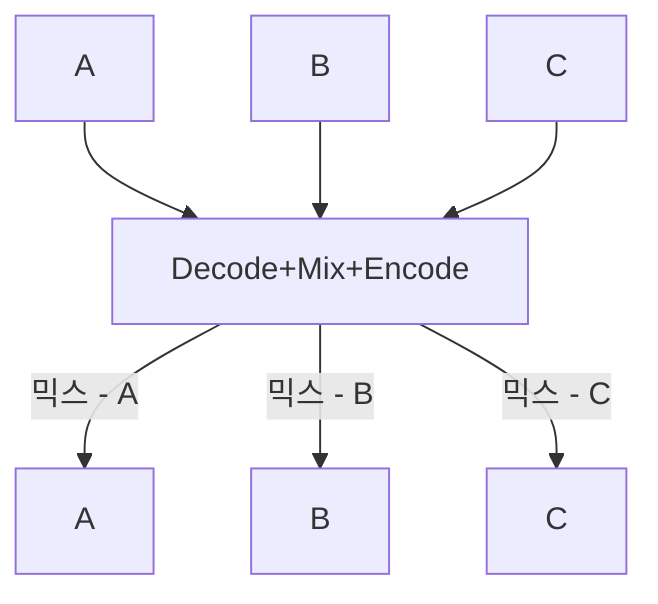
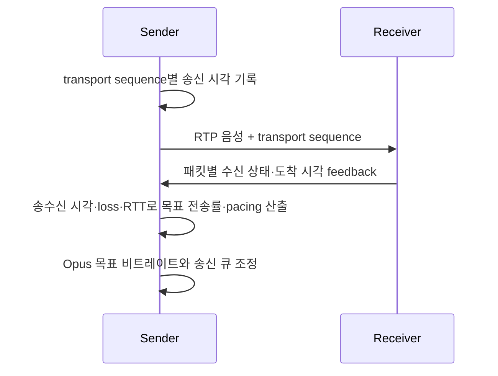
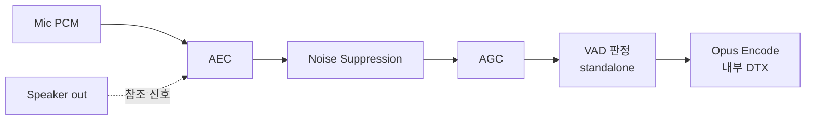
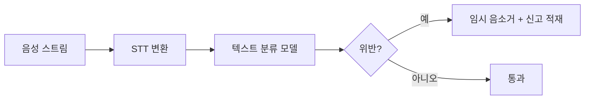

## 들어가며

48kHz·16-bit mono PCM의 payload rate는 $48{,}000\times16=768$kbps이고 stereo는 1.536Mbps다. SFU가 $N$명의 stream을 각 발화자를 제외한 $N-1$명에게 전달하면 media egress는 peak에서 $N(N-1)b$다. $N=50$과 mono PCM이면 약 1.88Gbps, 24kbps Opus면 58.8Mbps다. 각 사용자의 평균 active fraction이 $a=0.2$라는 **독립·동일 활동 가정**을 두면 기대 Opus egress는 11.76Mbps다. 실제 대화의 turn-taking과 동시 발화는 상관되어 있으므로 평균 하나만으로 peak를 산정하지 않는다.

압축만으로 끝나지 않는다. *어디서 믹싱하느냐* (P2P / SFU / MCU), *언제 안 보내느냐* (VAD / DTX), *얼마나 기다리느냐* (지터 버퍼), *무엇을 지우느냐* (AEC / NS / AGC) — 각 결정이 *대역폭·지연·CPU·품질* 의 4축 위 한 점을 고른다. 이 글은 그 4축 위에서 *프로덕션 음성 인프라* 가 어떤 점들을 고르는지, *왜 그렇게 고르는지의 코드와 수치 트레이스* 와 함께 정리한다.

이 글의 범위는 P2P·SFU·MCU topology, Opus와 loss recovery, VAD·DTX·congestion control, jitter buffer, audio processing, channel policy, encryption·moderation과 capacity planning이다.


---

## 목차
1. [음성 채팅 아키텍처](#1-음성-채팅-아키텍처)
2. [코덱 선택과 튜닝](#2-코덱-선택과-튜닝)
3. [대역폭 최적화](#3-대역폭-최적화)
4. [지연 시간 관리](#4-지연-시간-관리)
5. [오디오 품질 향상](#5-오디오-품질-향상)
6. [채널 관리 시스템](#6-채널-관리-시스템)
7. [보안과 안전](#7-보안과-안전)
8. [성능과 운영 모니터링](#8-성능과-운영-모니터링)


---

## 1. 음성 채팅 아키텍처

### 대역폭의 정량화

채널에 $N$명, 말하는 동안의 한 stream bitrate를 $b$, 한 참가자의 평균 active fraction을 $a$라고 하자.

| 토폴로지 | 한 클라이언트의 peak upload | 기대 download | 기대 서버 egress | 서버 media CPU |
|---|---|---|---|---|
| P2P Mesh | $(N-1)b$ | $(N-1)ab$ | 0 | 없음 |
| SFU | $b$ | $(N-1)ab$ | $N(N-1)ab$ | packet 검사·라우팅·암호 경계 |
| MCU | $b$ | $b_{\text{mix}}$ | $Nb_{\text{mix}}$ | active stream decode + mix-minus + client별 encode |

P2P expected upload은 참가자가 말하지 않을 때를 포함하면 $(N-1)ab$지만, 말하는 순간에는 $(N-1)b$를 감당해야 한다. SFU 역시 평균 egress와 동시 발화 peak를 둘 다 용량 계획에 넣는다.

SFU의 all-to-all egress는 고정 $a$에서 $O(N^2)$지만 active-speaker 상한 $K$, team/proximity subscription과 silence suppression을 두면 $O(NK)$로 제한할 수 있다. MCU의 naive한 “각 수신자마다 나머지를 다시 합산”은 $O(N^2)$이지만 전체 합을 한 번 만들고 각 사용자의 신호를 빼는 mix-minus는 sample mixing을 $O(N)$으로 줄일 수 있다. 실제 병목은 decoder·encoder 수, resampling, spatial processing과 암호화다.

### P2P (Peer-to-Peer) — 분산 / 저비용



P2P는 중앙 media egress가 없고 relay hop을 피할 수 있지만 peer-to-peer path가 항상 SFU path보다 짧거나 안정적인 것은 아니다. $N$명 mesh는 $N(N-1)/2$개의 peer pair를 만들고, 한 발화자의 peak upload는 $(N-1)b$다. NAT traversal이 실패해 TURN relay로 fallback하면 중앙 relay 비용이 생긴다. peer address 노출과 abuse surface도 topology 선택에 포함한다.

소규모 trusted party는 P2P 후보가 될 수 있지만 인원 임계만으로 결정하지 않는다. platform network policy, NAT/relay 비율, host privacy와 moderation 요구를 함께 본다.

### 서버 중계 (SFU — Selective Forwarding Unit)



각 클라이언트는 서버에 한 stream만 업로드한다. 일반적인 hop-by-hop SRTP 구성에서 SFU는 SRTP 경계를 종단하고 패킷을 인증·복호화한 뒤, RTP 헤더와 구독 상태를 검사해 수신자별로 다시 보호하고 pacing한다. 오디오 payload를 decode·mix하지 않는다는 뜻이지 CPU 비용이 단순 메모리 복사뿐이라는 뜻은 아니다. 별도의 payload E2EE를 사용하면 SFU가 라우팅용 헤더는 보되 encoded audio 평문은 보지 않는 구성도 가능하다.

장점 — *클라 peak upload가 stream 하나의 비트레이트로 제한*, *peer IP 비공개*, *선택적 포워딩* 가능. N명이 송신해도 수신자별 구독·발화 우선순위로 상위 K개만 보낼 수 있다. 단점 — 구독을 제한하지 않으면 서버 egress가 `N(N-1)a·b`로 증가하고, relay 경로·암호 처리·pacer queue가 지연과 비용을 더한다. 실제 수용 인원은 연결 수 하나가 아니라 PPS, egress, 암호화 CPU와 채널별 동시 발화 분포로 정한다.

mediasoup, Janus, Jitsi, LiveKit 같은 구현을 직접 운영하거나 관리형 음성 서비스를 사용할 수 있다. 제품 선택은 특정 업체의 현재 요금표보다 필요한 토폴로지, 플랫폼 지원, 암호 경계, 모더레이션, 장애 대응과 egress 비용을 기준으로 평가한다.

### MCU (Multipoint Conferencing Unit)

서버가 *N명 음성을 디코드 → 믹스 → 재인코드* → 수신자에게 *한 스트림* 으로 보낸다.



수신자는 하나의 mix stream만 decode할 수 있어 client CPU와 download를 줄일 수 있다. 서버는 active source를 decode하고 mix-minus를 만들며 수신자별 encode를 수행한다. channel/core 용량은 codec complexity, frame size, SIMD, resampling과 audio processing에 따라 benchmark한다. 이미 섞인 stream에서는 client가 발화자별 volume·spatialization을 다시 적용할 수 없으므로 그 기능이 필요하면 server가 개인화 mix를 만들거나 개별 stream을 전달해야 한다.

### 하이브리드 + 동적 전환

소규모 신뢰 파티는 P2P, 공개 매치·큰 채널은 SFU 후보가 된다. 인원뿐 아니라 relay 비율과 privacy policy가 바뀌면 런타임에 경로를 전환할 수 있다.

```cpp
enum class VoiceTransport { P2PMesh, SFUServer };

VoiceTransport ChooseTransport(int participants, bool publicMatch) {
    if (publicMatch) return VoiceTransport::SFUServer;   // IP 노출 금지
    if (participants <= measuredMeshLimit &&
        EstimatedRelayRatio() <= relayBudget)
        return VoiceTransport::P2PMesh;
    return VoiceTransport::SFUServer;
}
```

전환의 함정 — *오디오 글리치 없는 핸드오버*. 새 경로를 먼저 연결해 양쪽 경로의 SSRC·sequence·timestamp를 매핑하고, 새 경로가 재생 가능한 상태가 된 뒤 기존 경로를 끊는 *make-before-break*가 필요하다. 수신측은 중복 패킷을 제거하고 두 경로의 지터 차이를 흡수해야 한다.

### 관리형 서비스와 자체 운영

| 결정축 | 관리형 서비스 | 자체 운영 |
|---|---|---|
| 초기 통합 | SDK·PoP·운영 기능을 빠르게 확보 | signaling·SFU·관측·장애 대응까지 구축 |
| 제어 범위 | 제공 API와 암호·모더레이션 정책에 제한 | topology·packet policy·data residency를 직접 설계 |
| 비용 구조 | 사용량 기반 요금과 vendor egress | 인프라·인력·on-call·capacity 여유를 모두 부담 |
| 플랫폼 인증 | 제공 범위 확인 필요 | 콘솔·모바일별 정책을 직접 충족 |
| 장애 책임 | 공급자 SLA와 지원 체계에 의존 | 전체 장애 예산과 복구 절차를 직접 소유 |

동시 사용자 수 하나로 build-vs-buy를 결정할 수 없다. 관리형 서비스의 실제 분당 비용과 기능 제약을, 자체 운영의 egress·PoP·24시간 대응·보안 업데이트 비용과 같은 트래픽 분포에서 비교한다.

## 2. 코덱 선택과 튜닝

### Opus — 현재 표준

*IETF RFC 6716*. Skype 의 *SILK* (음성 특화 LPC) 와 Xiph 의 *CELT* (저지연 MDCT) 를 *하나로 합친 하이브리드 코덱*. 비트레이트·대역폭에 따라 모드를 자동 전환한다 — 저비트는 SILK, 음악·고대역은 CELT, 중간은 둘을 섞는다. *6kbps ~ 510kbps*, *NB(8kHz) / WB(16kHz) / FB(48kHz)*.

```cpp
#include <opus/opus.h>

int err;
OpusEncoder* enc = opus_encoder_create(
    48000,                   // 입력 sample rate (내부에서 필요한 대역폭으로 다운샘플)
    1,                       // 모노
    OPUS_APPLICATION_VOIP,   // 음성 — SILK 쪽 가중. 음악이면 AUDIO
    &err);

opus_encoder_ctl(enc, OPUS_SET_BITRATE(24000));        // 24kbps 목표
opus_encoder_ctl(enc, OPUS_SET_COMPLEXITY(8));         // 0~10, CPU vs 품질
opus_encoder_ctl(enc, OPUS_SET_SIGNAL(OPUS_SIGNAL_VOICE));
opus_encoder_ctl(enc, OPUS_SET_PACKET_LOSS_PERC(5));   // 5% 손실 가정 — FEC 강도 결정
opus_encoder_ctl(enc, OPUS_SET_INBAND_FEC(1));         // FEC 활성
```

장점 — *광범위 비트레이트* (한 코덱으로 VoIP~음악), *2.5~60ms의 프레임 지속 시간*(적용 header 기준), *오픈소스 무료 라이선스*, *FEC / PLC 내장*. 짧은 상호작용 지연이 중요하면 보통 2.5~20ms 후보부터 평가한다. Opus는 WebRTC의 필수 음성 코덱이다.

### 프레임 인코딩의 실제

`OPUS_SET_BITRATE` 는 *목표* 일 뿐 — VBR 에서는 프레임마다 실제 바이트가 다르다. 인코딩은 PCM 블록을 받아 압축 바이트를 돌려준다.

```cpp
constexpr int FRAME_MS = 20;
constexpr int SR = 48000;
constexpr int FRAME_SAMPLES = SR * FRAME_MS / 1000;    // 960 sample
constexpr int MAX_PACKET = 1276;                       // 구형 API 권장값; v1.5.2 header는 4000 권장

int16_t pcm[FRAME_SAMPLES];                 // 20ms 모노 PCM
uint8_t packet[MAX_PACKET];

int n = opus_encode(enc, pcm, FRAME_SAMPLES, packet, MAX_PACKET);
if (n < 0) HandleOpusError(n);
else SendRtp(packet, n, rtpTimestamp);       // 실제 압축 바이트만 전송
rtpTimestamp += FRAME_SAMPLES;
```

함정 — 한 번의 `opus_encode`에 주는 `frame_size`는 `2.5/5/10/20/40/60ms` 중 하나에 해당해야 한다. 48kHz에서는 각각 `120/240/480/960/1920/2880` 샘플이며, 다른 값을 넣으면 `OPUS_BAD_ARG`다. 이 열거는 적용한 libopus 버전·header의 계약이고, RFC가 다루는 packet duration·encoder `frame_size`·출력 buffer 권장치는 서로 다른 값이다. 검증한 libopus 1.5.2는 10/20ms를 받아들였고 30ms에는 `-1`을 반환했다. 30ms는 WebRTC VAD가 받는 block 길이이지 Opus `frame_size`가 아니며, 80/100/120ms 같은 긴 frame 수용 여부는 구현 시험 결과로만 다루고 다른 버전의 보장으로 쓰지 않는다. 여러 호환 프레임은 repacketizer로 한 패킷에 묶을 수 있지만 전체 패킷 지속 시간은 120ms를 넘을 수 없다. 또 *24kbps × 20ms = 60바이트* 는 장기 목표에서 구한 평균일 뿐이다. VBR에서는 신호에 따라 개별 패킷 크기가 달라지고, DTX가 선택되면 사용 버전 API가 정의한 크기의 패킷(구형 API 기준 1바이트, v1.5.2 header는 2바이트 이하)이 반환될 수 있다.

`frame_size`와 별개로 codec algorithmic lookahead가 존재한다. 현재 encoder 설정의 실제 lookahead는 `opus_encoder_ctl(enc, OPUS_GET_LOOKAHEAD(&samples))`로 읽어 sample rate에 따라 시간으로 환산한다. 프레임 길이만 mouth-to-ear latency로 보고하면 codec 지연을 과소평가한다.

### 레거시 — Speex / AAC

*Speex*는 음성 중심의 이전 세대 코덱이며 Opus와 비트스트림 호환 관계는 아니다. 새 실시간 음성 시스템에서는 더 넓은 동작 범위와 WebRTC 상호운용성 때문에 Opus가 우선 후보지만, 기존 자산과 장치 호환 때문에 Speex를 유지하는 시스템은 있을 수 있다. *AAC*는 음악·방송 생태계와 하드웨어 지원이 강하지만, 대화형 양방향 음성에서는 codec delay, packetization, loss recovery와 라이선스 조건까지 Opus와 비교해야 한다.

### 비트레이트 선택

| 비트레이트 범위 | 평가할 후보 workload |
|---|---|
| 6~12kbps | 강한 bandwidth 제약의 speech |
| 16~32kbps | 일반 mono voice 후보 |
| 32~64kbps | 높은 fidelity의 voice·복잡한 배경음 후보 |
| 64kbps 이상 | music·stereo·full-band 요구 후보 |

bitrate만으로 품질을 보장할 수 없다. packet loss, codec mode, microphone noise, language와 device별 listening test를 통해 operating range를 정한다. positional voice는 발화자별 mono stream과 client spatialization이 일반적이지만, ambience·music을 같은 stream에 넣는 경우 요구가 달라진다.

### 가변 비트레이트 (VBR)

비트레이트를 콘텐츠 복잡도에 맞춰 조정. 무성/단순음 = 낮게, 파열음/음악 = 높게.

```cpp
opus_encoder_ctl(enc, OPUS_SET_VBR(1));               // VBR 활성 (Opus 기본)
opus_encoder_ctl(enc, OPUS_SET_VBR_CONSTRAINT(0));    // unconstrained — 순간 변동 허용
```

VBR의 실제 frame size distribution은 signal, mode와 encoder version에 따라 달라진다. 평균 target만 기록하지 말고 p95/p99 packet size와 MTU, pacer queue를 함께 본다. constrained VBR은 장기 평균 주변의 변동을 더 제한하지만 strict CBR packet size를 보장하는 기능은 아니다.

### FEC — Forward Error Correction

Opus의 *in-band FEC* 는 다음 패킷에 직전 오디오를 복원할 수 있는 저비트레이트 중복 표현을 선택적으로 싣는다. 직전 패킷이 유실되고 다음 패킷이 제시간에 도착하면 디코더가 중복 표현으로 손실 구간을 복원할 수 있다. 이 정보는 목표 비트레이트 안에서 현재 프레임과 비트를 나눠 쓰므로 현재 프레임의 품질과 복원 가능성 사이에 비용이 생긴다. 복원에는 다음 패킷이 필요하므로 재생 시점까지 적어도 다음 프레임이 도착해 있어야 한다. 지터 버퍼가 이미 그만큼 지연되어 있다면 반드시 목표 지연을 한 프레임 더 늘려야 하는 것은 아니다.

```cpp
opus_encoder_ctl(enc, OPUS_SET_INBAND_FEC(1));
opus_encoder_ctl(enc, OPUS_SET_PACKET_LOSS_PERC(10));  // 손실 가정↑ → FEC redundancy↑
```

`PACKET_LOSS_PERC`는 encoder가 loss robustness를 선택할 때 쓰는 기대 손실률 입력이다. FEC 가용성은 Opus mode, bitrate와 packet duration에 따라 달라지며 숫자를 올린 만큼 redundancy가 선형으로 증가하는 단순 다이얼은 아니다. filtered loss와 burst profile을 반영하고 실제 packet size·recovery rate를 측정한다.

### PLC — Packet Loss Concealment

FEC 로도 못 살린 손실은 디코더의 *PLC* 가 메운다 — 직전 프레임의 피치·스펙트럼으로 *그럴듯한 한 프레임을 합성*. 디코더에 `NULL` 패킷을 넣으면 동작한다.

```cpp
OpusDecoder* dec = opus_decoder_create(48000, 1, &err);
int16_t out[FRAME_SAMPLES];

if (gotPacket) {
    opus_decode(dec, packet, packetLen, out, FRAME_SAMPLES, /*fec=*/0);
} else if (haveNextPacketWithFec) {
    // 다음 패킷의 FEC 로 손실분 복원
    opus_decode(dec, nextPacket, nextLen, out, FRAME_SAMPLES, /*fec=*/1);
} else {
    // FEC 도 없음 — PLC 합성
    opus_decode(dec, nullptr, 0, out, FRAME_SAMPLES, /*fec=*/0);
}
```

`opus_decode`에 넘기는 `frame_size`(출력 buffer capacity)와 PLC/FEC가 요구하는 frame duration도 encoder와 마찬가지로 사용 버전 API 계약으로 고정한다. PLC 품질은 codec mode, signal과 연속 손실 길이에 따라 빠르게 나빠진다. 평균 loss rate와 별도로 loss-run histogram과 concealment duration을 측정한다. in-band FEC는 다음 packet이 제시간에 도착한 단일 손실에 주로 도움이 되고, jitter buffer는 늦은 packet을 기다릴 기회를 늘리지만 network loss 자체를 복구하지는 않는다.

### 적응형 비트레이트

네트워크 상태를 런타임에 반영. 혼잡 시 ↓, 여유 시 ↑. 손실률과 RTT 를 같이 본다.

```cpp
void AdaptBitrate(OpusEncoder* enc, float lossRate, float rttMs) {
    int target;
    if (Congested(lossRate, rttMs)) target = lowRate;
    else if (HasSustainedHeadroom(lossRate, rttMs)) target = highRate;
    else target = normalRate;
    opus_encoder_ctl(enc, OPUS_SET_BITRATE(target));
    opus_encoder_ctl(enc, OPUS_SET_PACKET_LOSS_PERC(
        (int)(lossRate * 100.0f + 0.5f)));                      // FEC 강도도 동기 조정
}
```

함정 — 손실에 대응해 비트레이트를 올리면 bottleneck queue를 더 압박할 수 있다. 손실과 함께 queueing delay·pacer backlog가 증가하면 혼잡 가능성이 높고, 전송률을 낮추고 pacing을 조정해야 한다. RTT가 안정적이어도 AQM이나 짧은 burst로 혼잡 손실이 날 수 있고, RTT 상승도 route change·무선 scheduling에서 생길 수 있으므로 한 신호만으로 원인을 단정하지 않는다. FEC는 recovery와 현재-frame quality의 비트 예산을 바꾸는 수단이며 혼잡 제어를 대신하지 않는다.

## 3. 대역폭 최적화

### VAD — Voice Activity Detection

말하지 않을 때 media packet을 줄이는 방식이다. 발화 점유율은 channel 종류, party size, push-to-talk와 VAD aggressiveness에 따라 달라지므로 고정 20~40%를 capacity input으로 쓰지 않는다.

```cpp
// Opus 자체에는 독립 VAD API 가 없다 — WebRTC VAD 등 별도 모듈.
enum VadMode { kQuality=0, kLowBitrate=1, kAggressive=2, kVeryAggressive=3 };

bool IsVoiceActive(VadHandle* vad, const int16_t* pcm, int samples) {
    int decision = WebRtcVad_Process(vad, 48000, pcm, samples);
    if (decision < 0) throw InvalidVadFrame{};
    return decision == 1;
}

// VAD가 받는 10/20/30ms와 Opus frame_size는 같은 집합이 아니다.
// 두 block 크기를 같게 두려면 공유 frame duration을 10 또는 20ms로 고정한다.
void EncodeFrame(const int16_t* pcm, int samples) {
    // samples가 FRAME_SAMPLES(20ms=960)와 다르면(예: VAD의 30ms block)
    // 누적·분할해 codec이 기대하는 sample 수를 넘긴다.
    // 여기서는 20ms 고정 frame이라는 전제만 둔다.
    assert(samples == FRAME_SAMPLES);
    if (SpeechGateAllowsSend(g_vad, pcm, samples)) {
        int n = opus_encode(enc, pcm, samples, packet, MAX_PACKET);
        if (n < 0) HandleOpusError(n);
        else SendRtp(packet, n, rtpTimestamp);
    }
    // packet을 생략해도 media clock은 계속 흐른다.
    rtpTimestamp += samples;
}
```

WebRTC VAD는 독립적으로 사용할 수 있는 경량 구현 후보다. 지원하는 sample rate와 10/20/30ms frame 길이만 받아들이며, 이 10/20/30ms는 Opus encoder의 `frame_size` 집합과 같지 않다. VAD가 30ms block을 허용해도 그 PCM을 같은 크기 그대로 `opus_encode`에 넘길 수 없으므로, 공유 frame을 10 또는 20ms로 고정하거나 VAD/encoder block을 분리해 누적·분할한다. mode 0~3은 false positive와 false negative의 동작점을 바꾼다. 공격적인 mode일수록 저에너지 음성·음악까지 무성으로 분류할 위험이 커진다. 함정은 speech onset이 판정되기 전에 첫 음소가 잘리는 것이다. 보완하려면 활성에서 무성으로 바뀐 뒤 일정 시간 전송을 유지하는 *hangover*와, 활성 진입 직전 PCM을 보존했다가 원래 RTP timestamp로 인코딩하는 *lookback buffer*를 둔다. 길이는 frame 개수 상수가 아니라 onset loss와 무음 대역폭을 함께 측정해 정한다.

패킷을 생략해도 RTP timestamp는 캡처한 샘플 수만큼 전진해야 한다. RTP sequence는 *실제 전송한 packet의 순서* 이고 media timestamp는 capture/playout sample clock이므로, VAD·DTX로 패킷을 생략해도 오디오 시간은 진행한다. 그렇지 않으면 수신측은 무음 구간을 clock discontinuity로 해석하고 jitter·playout 계산이 깨진다. 수신측은 *의도적 무음(DTX gap)* 과 network loss, late packet, reset, epoch/SSRC 변경을 구분할 정보를 가져야 하며, sequence 번호만으로 audio 시간을 계산하지 않는다.

### DTX — Discontinuous Transmission

DTX는 음성이 없는 구간에서 코덱이 전송량을 줄이는 모드다. Opus 인코더가 DTX 패킷(구형 API 기준 1바이트, v1.5.2 header는 2바이트 이하)을 반환하면 애플리케이션은 그 패킷을 보내지 않아도 된다. 반환 크기와 `OPUS_SET_DTX` 동작은 사용하는 libopus 버전의 API 계약으로 고정한다. 장시간 무음에서도 인코더는 상태 갱신을 위해 드물게 일반 패킷을 출력할 수 있으므로, 반환 크기를 보고 실제 전송 여부를 결정한다. 수신측이 겪는 패킷 공백은 디코더의 PLC와 애플리케이션의 comfort-noise 정책으로 처리한다.

```cpp
constexpr int DTX_PACKET_BYTES = 1;      // 구형 API 기준; v1.5.2 header는 2 이하

opus_encoder_ctl(enc, OPUS_SET_DTX(1));
int n = opus_encode(enc, pcm, FRAME_SAMPLES, packet, MAX_PACKET);
if (n < 0) {
    HandleOpusError(n);
} else if (n > DTX_PACKET_BYTES) {
    SendRtp(packet, n, rtpTimestamp);   // 음성 또는 주기적인 상태 갱신
}
// n <= DTX_PACKET_BYTES이면 전송하지 않아도 되는 DTX 패킷이다.
rtpTimestamp += FRAME_SAMPLES;
```

media payload의 active fraction이 $a$라면 이상적인 payload 전송량은 대략 $a$에 비례한다. 실제 절감률은 comfort-noise update, RTP/RTCP·keepalive, VAD false positive, FEC와 encrypted packet overhead를 포함해 측정한다. DTX 갱신을 더하면 이상적인 $1-a$보다 절감률이 커지는 것이 아니라 작아진다.

### 우선순위 기반 포워딩

대규모 채널에서 *수십 명이 동시 발화* 하면 SFU 가 전부 포워딩할 수 없다. *상위 K명만* 내보낸다 — 보통 *최근 활성 + 음량 상위*.

```cpp
struct VoicePacket {
    uint32_t userId, channelId, seq;
    uint8_t  priority;      // 0 일반, 1 캐스터, 2 운영자
    float    activityLevel; // 최근 RMS — 누가 실제로 말하나
    std::vector<uint8_t> opus;
};

// 수신자 r 에게 보낼 K개 선정: 우선순위 우선, 그 안에서 음량순
std::vector<const VoicePacket*> SelectTopK(
        std::vector<VoicePacket>& frame, int K) {
    std::sort(frame.begin(), frame.end(), [](auto& a, auto& b){
        if (a.priority != b.priority) return a.priority > b.priority;
        return a.activityLevel > b.activityLevel;
    });
    std::vector<const VoicePacket*> out;
    for (int i = 0; i < (int)frame.size() && i < K; ++i) out.push_back(&frame[i]);
    return out;
}
```

K는 게임 규칙과 접근성 요구로 정한다. 전술 분대와 공개 로비는 허용해야 할 동시 발화 수가 다르며, caster·운영자·party leader를 단순 음량 순위보다 우선할 수도 있다. 수신자에게 최대 K개 stream만 전달하면 media download의 peak payload는 `K·b`로 제한되지만 RTP/RTCP·FEC·암호·재전송 overhead는 별도로 더해야 한다.

### 혼잡 제어 — REMB / transport-wide feedback

WebRTC 구현에서는 legacy REMB와 transport-wide congestion-control feedback을 볼 수 있다. 둘은 같은 기능이 아니다. REMB는 수신측이 계산한 비트레이트 추정치를 알리고, transport-wide feedback은 수신 패킷의 도착·손실 정보를 보내 송신측 controller가 자신의 송신 시각과 결합해 대역폭을 추정하게 한다.



지연 추세는 bottleneck queue가 차는 징후를 손실 전에 보여 줄 수 있지만, 경로 변경·무선 스케줄링·clock noise도 도착 간격을 바꾼다. 따라서 controller는 delay signal 하나가 아니라 loss, acknowledged rate, RTT와 probe 결과를 함께 사용하고, Opus 비트레이트뿐 아니라 pacer와 application send budget도 조절한다. 상호운용성이 필요한 제품은 검증된 WebRTC stack을 우선 평가하고, 자체 controller라면 실제 경로 trace와 경쟁 트래픽에서 안정성·공정성·queue delay를 검증한다.

## 4. 지연 시간 관리

### 엔드-투-엔드 지연 구성

mouth-to-ear latency는 다음 항의 합으로 측정한다.

| 단계 | 결정축 |
|---|---|
| capture | callback period, device/OS buffer, resampling |
| packetization·codec | frame duration, `OPUS_GET_LOOKAHEAD`, encode queue |
| network·relay | 실제 one-way path, pacer·queue, SFU scheduling |
| playout | jitter-buffer target·late loss, decode, output device buffer |

RTT/2는 clock-synchronized one-way 측정이 없을 때의 대칭 경로 근사일 뿐이다. codec CPU time과 algorithmic lookahead도 구분한다. ITU-T G.114의 수치는 전화망 planning reference이며 게임·언어·대화 형태의 보편적인 자연스러움 경계가 아니다. loopback timestamp, acoustic test와 대화형 user study로 제품 SLO를 정한다.

### 프레임 크기 — 지연의 하한

Opus 프레임 길이가 지연의 바닥이자 헤더 오버헤드를 좌우한다.

frame duration을 $F$, encoder lookahead를 $L$, packet당 network overhead를 $H$ byte라고 하면 packetization+lookahead 하한은 대략 $F+L$, header bitrate는 $8H/F$다. $H=40$은 IPv4+UDP+기본 RTP만 센 예로, IPv6·SRTP·extension·link overhead는 더해야 한다.

| frame $F$ | packet/s | $H=40$B일 때 header rate | latency·overhead 성격 |
|---|---|---|---|
| 5ms | 200 | 64kbps | 낮은 packetization delay, 높은 PPS |
| 10ms | 100 | 32kbps | 중간 |
| 20ms | 50 | 16kbps | 낮은 PPS, 더 긴 packetization |
| 60ms | 약 16.7 | 약 5.3kbps | loss 한 번의 concealment 구간과 지연이 큼 |

작은 frame은 packetization delay를 줄이는 대신 PPS와 header overhead를 늘린다. 큰 frame은 반대이며 packet 하나가 유실될 때 잃는 audio duration도 커진다. operating point는 device latency, packet budget, loss burst와 codec listening test로 정한다.

### RTP multiplexing과 custom aggregation

WebRTC의 BUNDLE은 여러 media description이 하나의 transport 5-tuple을 공유하게 하지만, 여러 RTP packet을 하나의 UDP payload로 합쳐 IP·UDP header를 한 번만 내게 하는 표준 aggregation 기능이 아니다. 각 RTP packet은 자신의 sequence, timestamp, SSRC와 SRTP authentication 경계를 유지한다.

자체 protocol은 여러 encoded subframe을 한 datagram에 넣는 aggregation을 설계할 수 있다. 이 경우 length framing, speaker ID, subframe sequence, authentication과 replay protection을 새로 정의해야 한다. 한 datagram loss가 여러 화자의 같은 시점 audio를 함께 지우고, 첫 subframe을 기다리는 aggregation delay와 MTU 초과 위험도 생긴다. 따라서 header 절감만 계산하지 않고 correlated loss, added latency, standard WebRTC/SRTP interoperability와 parser attack surface를 함께 평가한다.

### 지터 버퍼

UDP 는 *순서 뒤바뀜·지연 변동(jitter)* 이 있다. 디코더 앞에 버퍼를 둬 *순서 정렬 + 일정 간격 재생* 을 만든다.

```cpp
class JitterBuffer {
    using ExtSeq = uint64_t;               // 16-bit RTP seq를 unwrap한 값
    enum class State { Rebuffering, Playing };

    std::map<ExtSeq, OpusPacket> buf_;
    std::optional<ExtSeq> nextSeq_;
    State state_ = State::Rebuffering;
    ExtSeq minAcceptSeq_ = 0;
    int targetMs_ = initialTargetMs;
    int plcRun_ = 0;

    void TryStart() {
        if (state_ == State::Rebuffering &&
            ContiguousAudioMs(buf_) >= targetMs_) {
            nextSeq_ = buf_.begin()->first;
            state_ = State::Playing;
            plcRun_ = 0;
        }
    }

public:
    void OnArrived(OpusPacket p) {
        ExtSeq seq = UnwrapRtpSequence(p.sequenceNumber);
        if (seq < minAcceptSeq_) return;   // 이미 재생·conceal한 오디오
        if (state_ == State::Playing && seq < *nextSeq_) return;
        buf_[seq] = std::move(p);
        TryStart();
    }

    // 한 오디오 프레임마다 호출한다. 이 골격은 1 packet = 1 frame,
    // DTX 없음, seq 연속을 가정한다. 실제 playout 시각은 RTP timestamp/
    // media clock으로 계산하고 DTX gap을 loss와 분리해야 한다.
    DecodeAction Next() {
        if (state_ == State::Rebuffering)
            return {Action::Hold, {}};     // CNG/무음 출력하며 다시 채운다

        ExtSeq seq = *nextSeq_;
        auto it = buf_.find(seq);
        if (it != buf_.end()) {
            OpusPacket p = std::move(it->second);
            buf_.erase(it);
            ++*nextSeq_;
            minAcceptSeq_ = *nextSeq_;
            plcRun_ = 0;
            return {Action::Decode, std::move(p)};
        }

        auto next = buf_.find(seq + 1);
        DecodeAction action = next != buf_.end()
            ? DecodeAction{Action::DecodeFec, next->second}
            : DecodeAction{Action::Plc, {}};

        ++*nextSeq_;
        minAcceptSeq_ = *nextSeq_;
        if (++plcRun_ > maxConcealFrames) {
            state_ = State::Rebuffering;
            nextSeq_.reset();
        }
        return action;
    }
};
```

이 코드는 상태 전이를 드러내기 위한 골격이며 완전한 adaptive jitter buffer 구현이 아니다. `UnwrapRtpSequence`는 16비트 sequence를 순환에 안전한 확장 번호로 바꾸고, `ContiguousAudioMs`는 단순 packet 개수가 아니라 첫 sequence부터 gap 없이 재생 가능한 길이를 계산해야 한다. `expectedSeq++`만으로 매 고정 frame의 재생 시각을 정의하지 않고 playout은 RTP timestamp/media clock을 기준으로 하며, DTX로 생략된 공백은 network loss·late packet과 분리해 처리한다. 시작과 지속 언더런 때는 목표 길이만큼 다시 모은 뒤 재생하고, 이미 PLC로 소비한 sequence는 늦게 와도 재생하지 않는다. 실제 구현은 timestamp discontinuity, codec frame duration 변경, 중복, SSRC 전환과 최대 메모리 한도도 처리한다.

너무 작은 버퍼는 지연을 줄이는 대신 late loss와 concealment를 늘린다. 너무 큰 버퍼는 burst에 강하지만 mouth-to-ear latency를 늘린다. 목표 깊이는 경로 분포와 제품의 late-loss budget에 맞춰 적응시킨다.

### 적응형 지터 버퍼

도착 지연 변동을 측정해 목표 버퍼 길이를 수렴시킨다. *늦은 패킷 비율* 이 임계를 넘으면 키우고, 오래 안정적이면 줄인다.

```cpp
int DesiredTargetMs(float rfcJitterMs, float lateRatio,
                    const JitterPolicy& p) {
    // RFC 3550 J는 표준편차가 아니라 transit 차이 절댓값의 EWMA다.
    float desired = p.baseMarginMs + p.jitterGain * rfcJitterMs;
    if (lateRatio > p.lateLossBudget)
        desired += p.latePenaltyMs;
    return std::clamp((int)std::ceil(desired),
                      p.minTargetMs, p.maxTargetMs);
}
```

`jitterGain`, late-loss budget과 min/max는 예시 상수가 아니라 trace replay와 listening test로 정하는 정책이다. 목표치만 바꾼다고 실제 버퍼 점유량이 순간 이동하지도 않는다. 깊이를 줄일 때는 WSOLA 같은 시간 압축이나 talkspurt 경계의 frame 조정이 필요하고, 늘릴 때는 일시적인 감속·concealment 또는 재버퍼링이 필요하다. 제어기는 일반적으로 위험 증가에는 빠르게, 안정 구간의 지연 감소에는 천천히 반응하되 audible artifact와 oscillation을 함께 측정한다.

### 지터 버퍼의 정량 모델과 경계 조건

전제 — 도착 시각 변동(jitter)과 RTP 타임스탬프는 전송 계층이 주는 입력이다. 여기서는 그 변동을 받아 *버퍼 깊이가 지연과 유실을 어디서 가르는지* 를 식으로 닫는다. 위 적응 코드의 `jitterGain`, `lateLossBudget`, `latePenaltyMs`는 이 모델 위에서 선택하는 동작점이다.

*RFC 3550 jitter 추정.* 패킷 $i$의 RTP 타임스탬프(송신 시각) $S_i$와 도착 시각 $R_i$를 같은 단위로 두면, 연속 두 패킷의 상대 전이는

$$ D(i-1,i) = (R_i - R_{i-1}) - (S_i - S_{i-1}). $$

송신 간격은 프레임 주기로 일정하므로 $D$에는 일방 지연의 변동분 차이만 남는다. 추정 jitter는 그 절댓값의 EWMA다.

$$ J_i = J_{i-1} + \frac{|D(i-1,i)| - J_{i-1}}{16}. $$

게인 $\alpha = 1/16$. EWMA $J_i = (1-\alpha)J_{i-1} + \alpha|D_i|$의 가중치 $w_k = \alpha(1-\alpha)^k$는 무게중심 $\sum_k k\,w_k = (1-\alpha)/\alpha = 15$ — 즉 최근 약 16 패킷(20ms 프레임이면 약 0.32초)을 평균한다. 이 느린 시정수가 잡음에는 강하지만 급변에는 둔하다는 뜻이라, 적응 로직이 "키우긴 빠르게, 줄이긴 천천히"를 비대칭으로 두는 근거가 된다.

*$J$와 표준편차의 관계.* 일방 지연을 $T_i = \mu + n_i$로 두고 $n_i$가 평균 0, 표준편차 $\sigma$인 독립·동일 정규 변수라고 **가정하면** $D_i = n_i - n_{i-1}$이고 $\operatorname{Var}(D) = 2\sigma^2$다. 정상 상태에서

$$ J \approx \mathbb{E}|D| = \sqrt{\tfrac{2}{\pi}}\cdot\sqrt{2}\,\sigma = \frac{2}{\sqrt{\pi}}\,\sigma \approx 1.13\,\sigma. $$

따라서 `jitterGain=2`라면 RFC jitter 항만 일방 지연 기준 약 $2 \times 1.13\sigma \approx 2.3\sigma$에 해당한다. 실제 지연은 독립 정규가 아니므로 이는 설정값의 단위를 해석하는 모델이지 보장식이 아니다.

*버퍼 깊이 ↔ 늦음 확률.* 패킷의 기준 도착 시점을 평균 일방 지연 $\mu$에 맞추고 추가 jitter margin을 $g$로 두면, $T_i > \mu+g$인 패킷은 재생 시점을 지나 *사실상 손실*(late loss)이 된다. 평균과 분산만 아는 경우 Cantelli 부등식은 한쪽 꼬리의 보수적 상한을 준다.

$$ \Pr[\,T-\mu \ge k\sigma\,] \le \frac{1}{1+k^2}. $$

$g=k\sigma$로 잡으면 $k{=}2$에서 늦음 $\le 1/5$, $k{=}3$에서 $\le 1/10$이다. 분포 형태와 무관한 대신 매우 느슨한 상한이다. 독립 정규 모델에서는 $Q(2) \approx 2.3\%$, $Q(3) \approx 0.13\%$다. 예를 들어 $\sigma=10$ms라면 **평균 경로 지연에 더하는 margin** 20ms와 30ms가 각각 이 두 동작점이다. 네트워크 자체의 packet loss는 별도로 합쳐야 한다.

실제 일방 지연은 경로 변경, queue burst와 무선 스케줄링 때문에 비대칭·상관·다봉 분포가 될 수 있다. 같은 $k\sigma$ margin에서도 정규 예측보다 late loss가 많을 수 있으므로 분산 모델만으로 깊이를 고정하지 않는다. 측정한 late-loss ratio와 연속 concealment 길이를 되먹임하고, 정책 변경은 기록된 packet trace로 재생해 검증한다.

*경계 조건 — 클록 스큐와 언더런.* jitter가 0이어도 깨지는 두 경우가 있다. 송수신 클록이 $\delta$ ppm 어긋나면 버퍼가 서서히 차거나 빈다. $\delta = 100$ppm이면 초당 0.1ms 표류 — 20ms 버퍼가 약 200초면 바닥나 무음 또는 가속이 된다. 주기적 리샘플링이나 WSOLA 시간 신축으로 *재생 속도를 미세 보정* 해야 한다. 단순히 20ms마다 한 프레임 꺼내는 위 `Next()`는 이 표류를 누적한다.

지속 언더런에서 sequence를 계속 전진시키기만 하면 새로 도착한 패킷도 이미 늦은 것으로 폐기되어 회복하지 못한다. 위 상태머신은 연속 concealment가 한도를 넘으면 `Rebuffering`으로 돌아가고, 새로운 연속 구간을 목표 길이만큼 채운 뒤 재생을 다시 시작한다. 이때 이미 재생하거나 conceal한 오디오는 `minAcceptSeq_` 이전으로 구분해 되감지 않는다.

RTP sequence 번호는 16비트라 65536에서 순환한다. `p.seq < playSeq_` 같은 단순 비교는 순환 지점에서 뒤집힌다. 수신 시 RFC 직렬번호 산술에 따라 epoch를 붙인 확장 sequence로 변환하고, 매우 오래된 패킷과 재시작·SSRC 변경을 별도 정책으로 구분해야 한다.

### 지역별 음성 서버

voice PoP는 참가자별 one-way delay, packet loss, capacity와 data-residency 정책을 기준으로 선택한다. game server와 같은 region이 항상 최적은 아니며, cross-region party는 최대 지연, 합계 지연 또는 party leader 우선 같은 목적 함수를 명시해야 한다. 지명별 고정 ms 대신 실제 ISP·mobile path telemetry로 placement를 평가한다.

## 5. 오디오 품질 향상

### 처리 파이프라인 순서

캡처 PCM은 여러 처리기를 거쳐 인코더로 들어가지만 모든 구현에 통하는 단일 고정 순서가 있는 것은 아니다. 통합 audio-processing module은 AEC의 선형 추정·잔류 에코 억제, NS와 gain control을 내부 단계로 나눠 교차 적용할 수 있다. 외부에서 지켜야 할 핵심은 **render reference를 AEC에 정확한 시각으로 공급하고**, standalone VAD 판정과 codec 내부 DTX가 실제 송신할 processed capture를 관찰하며, 각 단계의 level·delay 계약을 깨지 않는 것이다.



그림은 개념적 신호 흐름이다. VAD는 별도로 동작하는 판정 모듈이고 DTX는 Opus 인코더 내부 모드라서, 둘을 하나의 stage로 합쳐 그리면 안 된다. 두 단계 모두 공유 frame clock 위에서 packet 생략 여부를 결정하며, packet을 생략해도 media clock은 계속 흐른다. AEC는 마이크 신호와 실제 speaker path에 대응하는 far-end reference의 시간 정렬이 필요하다. NS와 gain control의 세부 순서는 사용한 APM의 계약을 따르고, 단계별 모듈을 조립한다면 gain이 AEC 적응과 noise estimate를 불안정하게 만들지 않는지 double-talk·무음·클리핑 trace로 확인한다.

### AEC — Acoustic Echo Cancellation

스피커 출력이 음향 경로를 거쳐 마이크에 충분히 크게 유입되면 상대는 자기 목소리를 에코로 듣는다. 헤드셋, 장치의 acoustic isolation, speaker volume과 방의 impulse response에 따라 정도가 달라진다. 해법은 마이크 입력에서 speaker reference로 추정한 echo 성분을 제거하는 것이다. 음향 경로의 지연과 다중 반사는 시간에 따라 변하므로 적응 필터와 잔류 에코 억제가 필요하고, reference와 capture의 시간 정렬이 어긋나면 추정이 악화된다.

```cpp
// WebRTC AudioProcessing(APM)
auto apm = webrtc::AudioProcessingBuilder().Create();
webrtc::AudioProcessing::Config cfg;
cfg.echo_canceller.enabled = true;
apm->ApplyConfig(cfg);

// API 인자는 WebRTC revision에 따라 다르다. 핵심은 render/capture 시각 계약이다.
apm->ProcessReverseStream(/*speaker far-end*/ refFrame);
apm->ProcessStream(/*mic near-end*/ micFrame);   // 에코 제거된 결과가 micFrame 에
```

WebRTC AudioProcessing의 AEC3는 널리 쓰이는 오픈소스 구현 후보다. 함정은 *더블토크*, 즉 near-end와 far-end가 동시에 말하는 구간이다. 이때 near-end 음성을 echo로 오인하면 음성이 손상되고, 적응을 지나치게 보수적으로 하면 잔류 echo가 커진다. 구현은 echo-path confidence와 double-talk 상태에 따라 filter adaptation과 suppression gain을 조절한다. 결과는 echo return loss만 아니라 near-end speech distortion도 함께 들어야 한다.

### NS — Noise Suppression

키보드·팬·거리 소음을 줄인다. spectral subtraction·Wiener 계열 추정기와 RNNoise류 학습 기반 억제기가 대표적이다. 정상성, 신호 대 잡음비, 학습 데이터와 장치가 달라지면 어느 계열이 유리한지도 달라지므로 stationary noise와 transient noise를 나눠 평가한다.

```cpp
cfg.noise_suppression.enabled = true;
cfg.noise_suppression.level =
    webrtc::AudioProcessing::Config::NoiseSuppression::kHigh;  // Low~VeryHigh
```

ML NS는 모델 크기·연산량·frame lookahead와 억제 품질을 맞바꾼다. 과한 억제는 자음과 배음을 함께 제거해 로봇 같은 음색을 낼 수 있다. 모델 파일 크기만 보지 않고 audio callback의 worst-case 실행 시간, 추가 algorithmic delay, 대표 언어·마이크의 speech quality를 측정한다.

### AGC — Automatic Gain Control

입력 볼륨 자동 정규화. *작게 말하는 사람 ↑, 크게 ↓* → 일정 레벨. 청취자의 개별 볼륨 조정 부담을 던다.

```cpp
cfg.gain_controller2.enabled = true;
cfg.gain_controller2.adaptive_digital.enabled = true;
// 목표 레벨/최대 게인 한도로 잡음 증폭 폭주를 막는다
```

함정은 무성 구간에서 배경 잡음을 목표 레벨까지 끌어올리는 gain pumping이다. 최대 gain과 상승 속도를 제한하고 speech probability·noise estimate·clipping predictor를 함께 사용한다. NS와 AGC의 상대 순서는 구현에 따라 달라질 수 있으므로, 개별 모듈을 조합할 때는 두 순서를 모두 측정하고 통합 APM을 사용하면 그 모듈의 level contract를 따른다.

### 공간 음향 (Spatial Audio) — HRTF

근접 음성에 *3D 위치* 를 입혀 좌우·앞뒤·거리를 분리. 화자의 상대 위치 + 청자 머리 방향으로 *HRTF(Head-Related Transfer Function)* — 머리·귓바퀴가 만드는 양 귀 간 *시간차(ITD) + 음량/주파수차(ILD)* — 를 컨볼루션한다. 그래서 *모노 한 채널이면 충분* 하다 — 공간감은 수신측에서 만든다 (2절).

```cpp
struct Listener { glm::vec3 pos; glm::quat orient; };
struct Speaker  { glm::vec3 pos; AudioStream stream; };

void RenderSpatial(const Listener& l, const Speaker& s, AudioBuffer& out) {
    glm::vec3 rel = glm::inverse(l.orient) * (s.pos - l.pos);   // 청자 로컬 좌표
    float dist = glm::length(rel);

    float att = 1.0f / (1.0f + dist * 0.1f);   // 거리 감쇠 (역거리 롤오프 — 진폭 1/d 근사)
    if (dist > MAX_HEAR_DIST) { /* 무음 */ return; }

    // HRIR 컨볼루션: rel 방향에 해당하는 좌/우 임펄스 응답을 골라 적용
    const HRIR& h = LookupHRIR(rel);           // 방위/고도로 인덱싱
    ConvolveLR(s.stream, h.left, h.right, att, out);
}
```

*Among Us / VRChat / Sea of Thieves* 의 근접 + 공간 음향. 비용 — HRIR 컨볼루션이 화자 수에 비례한다. 화자가 많으면 *먼 화자는 단순 좌우 패닝*, *가까운 K명만 HRTF* 로 LOD 를 둔다.

## 6. 채널 관리 시스템

### 채널 종류

| 채널 | 범위 | 사용 |
|---|---|---|
| Global | 모든 플레이어 | 로비, 광장 |
| Team | 같은 팀 | 5v5, 6v6 |
| Party | 친구 그룹 | 큐 진입 전/후 |
| Proximity | 인접 거리 | 오픈월드, 호러 |
| Faction | 진영 | MMO 진영전 |
| Whisper | 1:1 | DM |

한 플레이어가 *여러 채널을 동시* 에 듣는 경우가 흔하다 — 파티 + 팀 + 근접. 이때 채널별 우선순위와 *덕킹(ducking)* (운영자 발화 시 다른 채널 음량을 낮춤) 을 둔다.

### 동적 채널

매치 시작 시 팀 채널 자동 생성, 종료 시 자동 소멸.

```cpp
void OnMatchStarted(const Match& m) {
    for (auto& team : m.teams) {
        std::string ch = "match_" + m.id + "_team_" + std::to_string(team.id);
        CreateChannel(ch);
        for (auto& p : team.players) JoinChannel(p.id, ch);
    }
}

void OnMatchEnded(const Match& m) {
    for (auto& team : m.teams)
        DestroyChannel("match_" + m.id + "_team_" + std::to_string(team.id));
}
```

함정 — *재접속 레이스*. 끊겼다 들어온 플레이어가 *DestroyChannel 직후 JoinChannel* 을 호출하면 없는 채널에 붙는다. 채널 생명주기를 매치 상태머신에 묶고, 종료된 매치의 join 요청은 거절한다.

### 근접 음성과 서버 권위

거리 기반 음량 + 차단 임계. *Among Us, Lethal Company, 마인크래프트 모드* 의 핵심 메커니즘.

```cpp
void UpdateProximityVolumes(const Player& listener) {
    for (auto& sp : allSpeakers) {
        float d = glm::distance(listener.pos, sp.pos);
        if (d > MAX_HEAR_DIST) { MuteSpeaker(sp.id); continue; }
        float vol = 1.0f - (d / MAX_HEAR_DIST);
        SetSpeakerVolume(sp.id, vol);
    }
}
```

치트 방지 — *거리 계산은 서버 권위*. 클라가 자기 위치를 조작해 *벽 너머 음성* 을 듣지 못하게, 서버가 *누가 누구를 들을 수 있는지* 를 정하고 그에 맞춰 *SFU 포워딩 자체를 끊는다*. 클라 볼륨 0 으로만 막으면 패킷은 이미 가 있어 메모리 해킹으로 복원 가능하다 — *들으면 안 되는 음성은 애초에 안 보낸다*.

### 권한과 음소거

```cpp
struct ChannelPermissions { bool canSpeak, canListen, canModerate; };

ChannelPermissions GetPermissions(PlayerId p, ChannelId c) {
    if (IsAdmin(p))           return {true, true, true};
    if (IsTeamMember(p, c))   return {true, true, false};
    if (IsObserver(p, c))     return {false, true, false};   // 관전자 청취만
    return {false, false, false};
}
```

음소거 3종 — *Mute* (내가 그만 듣기, 상대는 모름), *Block* (양방향 차단 + 매칭 회피), *Server Mute* (운영자가 모든 채널에서 막기). Mute 도 *서버에서 포워딩을 끊으면* 대역폭까지 아낀다 — 클라 측 무음은 대역폭이 그대로다.

```cpp
void MutePlayer(PlayerId muter, PlayerId target) {
    muteList_[muter].insert(target);
    // SFU 에 알려 muter 로 가는 target 포워딩을 중단 — 대역폭 절감
    sfu_.StopForward(target, /*to=*/muter);
}
```

## 7. 보안과 안전

### 전송 암호화 — SRTP / DTLS-SRTP

WebRTC media transport는 DTLS-SRTP로 키를 합의하고 SRTP로 RTP/RTCP를 보호한다. 협상된 protection profile에 따라 AES counter mode와 HMAC 또는 AEAD AES-GCM 같은 suite를 사용한다. AEAD profile은 암호화와 무결성 태그를 함께 제공하지만, replay window와 key lifetime 정책은 여전히 필요하다.

```cpp
// libsrtp
srtp_policy_t policy{};
srtp_crypto_policy_set_aes_gcm_128_16_auth(&policy.rtp);
srtp_crypto_policy_set_aes_gcm_128_16_auth(&policy.rtcp);
policy.ssrc.type = ssrc_specific;              // 송신용 policy
policy.ssrc.value = localSsrc;
policy.key = outboundMasterKeyAndSalt;         // profile이 요구하는 길이
policy.next = nullptr;

srtp_t session;
Check(srtp_create(&session, &policy));

int len = packetSize;
EnsureTailroom(packet, authTagBytes);
Check(srtp_protect(session, packet, &len));    // 송신 RTP 보호
```

수신에는 별도의 inbound policy와 `srtp_unprotect`를 사용한다. DTLS-SRTP가 내보낸 client/server·송수신 방향별 key material을 정확히 매핑해야 하며, 같은 `(key, nonce)`를 두 방향에서 재사용하면 안 된다. 일반적인 hop-by-hop SFU는 각 leg의 SRTP를 종단하므로 encoded audio payload에 접근할 수 있지만, 이것은 모더레이션을 위해 반드시 평문이어야 한다는 뜻이 아니라 선택한 신뢰 경계의 결과다.

### E2EE — 선택적

서버도 평문에 접근 못 하게 한다. *Insertable Streams / SFrame* 또는 Signal 계열 키 합의로, 페이로드를 *클라끼리만 아는 키* 로 한 번 더 감싸 SFU 는 헤더만 보고 라우팅한다.

장점은 SFU 침해나 운영자 접근으로부터 payload를 분리하는 것이다. 대가는 서버 측 음성 분석·mixing·녹음이 제한되고, membership 변경에 따른 group key 회전과 endpoint 신뢰 문제가 생기는 것이다. client-side moderation, 신고자가 선택한 clip 업로드, key escrow는 일부 기능을 되살리지만 E2EE의 신뢰 모델을 바꾸므로 별도 동의와 위협 모델이 필요하다.

### 신고와 녹음 보관

플레이어가 부적절 음성을 신고하면 *짧은 클립* 을 운영팀이 검토. 핵심은 *항상 녹음이 아니라, 신고 시점 직전 구간만 사후 확보* — 프라이버시·법적 균형.

```cpp
struct VoiceReport {
    PlayerId reporter, target;
    ChannelId channel;
    Timestamp ts;
    ReportReason reason;     // 욕설/위협/사기/미성년자 등
};

void OnReport(VoiceReport r) {
    // 서버가 짧은 롤링 버퍼(예: 최근 N초)를 메모리에 유지하다가
    // 신고 시점에만 그 구간을 영구 저장한다.
    SaveVoiceClip(r.channel, r.ts - 30, r.ts);   // 직전 30초
    QueueForModeration(r);
}
```

*롤링 버퍼* 구조라 신고가 없으면 음성은 *흘러가며 폐기* 된다 — 상시 저장이 아니다. 보관 기간·접근 권한·삭제 정책을 지역 법규에 맞춘다.

### 자동 음성 검열 — ML

STT 로 텍스트화 → 분류 모델로 욕설/위협/혐오를 감지 → 임시 음소거 + 신고 큐.



트레이드오프 — *정밀도(precision) vs 재현율(recall)*. 오탐(정상 대화 차단)은 플레이어 불만이 크고, 미탐은 괴롭힘 방치다. 게임 내 은어·맥락·어조 때문에 단순 키워드 매칭은 오탐이 많다 — *문맥 분류 모델 + 사람 검토 2차 확인* 으로 자동 제재를 *임시 음소거* 까지만 두고 영구 제재는 사람이 판단하는 구성이 흔하다.

### 미성년자 보호

연령 정보, 지역, 보호자 설정과 플랫폼 정책으로 음성 접근을 제한한다. COPPA의 적용 범위와 유럽 각국의 아동 동의 연령은 같지 않고, “18세 미만은 모두 보호자 동의” 같은 하나의 상수로 환원할 수 없다.

```cpp
VoiceCapability ResolveVoiceCapability(const Account& a,
                                       const PolicySnapshot& policy) {
    RuleSet rules = policy.For(a.region, a.platform, a.ageBand);
    if (!rules.voiceAllowed) return VoiceCapability::Disabled;
    if (rules.requiresGuardianConsent && !a.guardianConsent)
        return VoiceCapability::Disabled;
    return rules.friendsOnly
        ? VoiceCapability::FriendsOnly
        : VoiceCapability::MatchVoice;
}
```

정책은 서버가 버전이 붙은 snapshot으로 평가해 클라이언트 변조를 막고, 동의 철회와 지역 이동을 반영한다. 데이터 최소화, 녹음 고지, 보존 기간, 보호자 통제와 신고 escalation은 법무·trust-and-safety 요구를 기술 정책으로 변환해 관리한다. 나이 원문을 모든 게임 서버에 복제하기보다 검증된 age band와 허용 capability만 전달하는 편이 노출 범위를 줄인다.

## 8. 성능과 운영 모니터링

### CPU 사용률

voice CPU는 capture/render callback, resampling, AEC·NS·AGC, codec과 spatialization의 합이다. 비율은 core 수를 분모로 한 process CPU인지 한 audio thread의 deadline utilization인지에 따라 의미도 달라진다. device class, sample rate, channel 수, active speaker 수와 processing model별로 callback deadline miss와 CPU time을 측정한다.

```cpp
opus_encoder_ctl(enc, OPUS_SET_COMPLEXITY(5));    // CPU 예산을 낮춘 후보
opus_encoder_ctl(enc, OPUS_SET_COMPLEXITY(10));   // 더 많은 인코더 연산을 허용한 후보
```

저사양 다이얼은 complexity, 비트레이트, 채널 수, 잡음 억제 모델을 독립적으로 낮추며 음질과 CPU를 측정한다. 출력 장치가 헤드셋으로 보고되어도 개방형 헤드폰의 누설, 잘못된 라우팅, 외부 스피커 때문에 에코가 완전히 사라진다고 단정할 수 없다. 입력-출력 경로가 격리되었다는 플랫폼 신호와 에코 메트릭을 확인할 때만 AEC를 끈다.

### 모바일 배터리

지속 통화의 배터리 비용은 코덱·AEC/NS 연산뿐 아니라 화면 상태, 무선 종류와 신호 세기, 패킷 주기, OS의 오디오 경로에 따라 크게 달라진다. 따라서 시간당 고정 비율을 제품 가정으로 쓰지 않고 대표 기기·망 조합에서 에너지와 온도를 측정한다. DTX는 무음 구간의 미디어 비트를 줄이지만 keepalive와 다른 트래픽이 무선 모뎀의 활성 상태를 유지할 수 있어 배터리 절감률은 경로별로 다르다.

```cpp
void OnAppBackgrounded() {       // 화면 꺼짐/백그라운드
    opus_encoder_ctl(enc, OPUS_SET_BITRATE(12000));
    opus_encoder_ctl(enc, OPUS_SET_COMPLEXITY(3));
    opus_encoder_ctl(enc, OPUS_SET_DTX(1));
}
```

백그라운드에서는 DTX, 낮은 complexity·비트레이트, 플랫폼의 오디오 세션 정책을 조합한다. 패킷을 모으면 무선 활성 전환 횟수를 줄일 수 있지만 음성 지연과 지터 내성을 악화시키며, 이미 연결된 라디오에서는 이득이 작을 수 있다. talk-spurt 시작 지연, mouth-to-ear p95, 배터리 소모를 함께 측정해 묶음 상한을 정한다.

### 콘솔 통합

*시스템 파티 음성* 과 *게임 내 음성* 의 분리. 콘솔은 친구 기반 통합 음성(플랫폼 제공)이 우선이고, 게임 내 별도 음성은 *공개 매치·길드 채널* 에 둔다. 둘이 동시에 열리면 *덕킹* 으로 한쪽을 낮춰 충돌을 막는다.

### 텔레메트리 지표

```cpp
struct VoiceTelemetry {
    int bitsPerSecond;
    int packetLossPercent;
    int burstLossLen;      // 연속 손실 길이 — PLC 가 못 메우는 지표
    int rttMs;
    int jitterMs;
    int jitterBufferMs;    // 현재 적응형 버퍼 길이
    int encodeMs, decodeMs;
    int e2eLatencyMs;      // 캡처→재생 추정 총지연
    int activeListeners;
};
```

대시보드에는 p50/p95/p99와 시간 상관을 함께 둔다. mouth-to-ear latency, jitter-buffer underrun, concealment duration, loss-run length, audio callback miss와 reconnect를 제품 SLO에 연결한다. 200ms·2 frame 같은 임계는 보편값이 아니라 listening test와 support telemetry로 정한 configuration이어야 한다.

### 서버 용량 계획

규모를 수치로 잡는다. SFU 한 대 처리량은 *egress 대역폭* 과 *동시 포워딩 수* 로 제한된다.

| 항목 | 가정 값 |
|---|---|
| 동시 음성 사용자 | 1,000,000 (대형 출시 피크) |
| 평균 채널 크기 | 5명 |
| 평균 비트레이트 | 24kbps |
| 평균 활성 발화율(VAD/DTX 후) | 20% |
| 수신 상한 K(우선순위 포워딩) | 4 |
| SFU 1대 명목 egress 예시 | 10Gbps |

이 표의 값은 특정 서비스의 측정 결과가 아니라 산식을 보이기 위한 가정이다. 5인 채널에서 각 사용자가 독립적으로 20%의 시간 동안 24kbps를 말하고, SFU가 발화자의 stream을 나머지 4명에게만 보낸다면 기대 복제 수는 `N(N-1)q = 5×4×0.2 = 4`다. 채널당 media egress는 약 `4×24kbps = 96kbps`, 100만 사용자가 모두 5인 채널에 있다면 20만 채널이므로 약 19.2Gbps다. 여기에 IP/UDP/암호/protocol header, RTCP·keepalive, FEC와 실제 사용한 복구 트래픽, 지역 간 전달을 더해야 한다. 고정된 주변 발화 확률의 선형 fan-out에서는 발화가 상관되어도 기대 복제 수 `E[(N-1)b ΣX_i] = (N-1)b ΣE[X_i]`가 그대로다. 상관은 peak·분산·동시 발화 분포를 바꾸고, Top-K 절단 같은 비선형 선택이나 VBR와 발화의 결합을 모델에 넣으면 기대값도 그 모델에서 별도로 계산한다. 장비 수는 명목 10Gbps를 단순 나눗셈하지 않고 연결 수, PPS, 암호화 CPU, NIC queue, 장애 여유와 지역별 peak를 포함한 부하 시험으로 정한다.

### 비용 최적화

- *DTX + VAD* — 실제 발화율만큼 무음 미디어 전송을 줄인다. 제어 패킷·keepalive·배경 소음 오검출을 포함해 절감률을 측정한다.
- *우선순위 포워딩 K 상한* — 대형 채널 egress 를 `N(N-1)·b` 에서 `N·K·b` 로(수신자 1인 download 는 `(N-1)·b` 에서 `K·b` 로).
- *지역 분산 + edge PoP* — 광역망 통과 비용·지연 동시 절감.
- *예약 용량 / 장기 약정* — 예측 가능한 기준 부하의 단가를 낮출 수 있지만 공급자·지역·약정 기간·중도 해지 위험을 함께 계산한다.

대규모 음성 서비스에서는 egress가 주요 비용 항목이 될 수 있지만, relay·지역 간 전송·compute·관리형 서비스 요금 구조에 따라 병목은 달라진다. 비용 모델도 평균 bitrate 하나가 아니라 지역별 peak와 복제 fan-out을 입력으로 삼는다.


---

## 결론

이 구조는 *품질·대역폭·지연·CPU 4축의 트레이드오프* 위에 *프로덕션 음성 인프라* 를 구성한다. 토폴로지(P2P/SFU/MCU)가 대역폭의 큰 틀을 정하고, Opus(VBR + FEC/PLC)가 페이로드를, VAD/DTX 와 우선순위 포워딩이 *언제·누구를* 보낼지를, 지터 버퍼와 프레임 크기가 지연을, AEC/NS/AGC/HRTF 가 들리는 음질을, SRTP/E2EE/검열이 안전을 맡는다. 한 흐름으로 묶여야 *현실적 비용으로* 음성 경험이 선다.

AEC의 double-talk, NS의 음성 손상, jitter-buffer 적응과 burst loss는 평균만으로 드러나지 않으므로 분포와 실제 audio sample 평가가 필요하다. build-vs-buy는 사용자 수 임계 하나가 아니라 필요한 topology·moderation·platform 지원, egress bill, codec/audio 전문 인력과 장애 대응 비용을 비교해 결정한다.

음성은 괴롭힘과 privacy 위험이 있는 직접 소통 채널이다. transport encryption은 기본 보안 요구지만 server recording·speech model이 모든 제품의 필수 해법은 아니다. 신고, 차단·mute, 연령·지역별 consent, retention과 human review를 포함한 safety policy를 법규와 threat model에 맞춰 설계하고 자동 분류의 오탐·편향을 측정한다.

## 더 읽을거리

- [RFC 6716: Definition of the Opus Audio Codec](https://www.rfc-editor.org/rfc/rfc6716) — frame duration·packet 한도의 1차 명세. [Opus Encoder API(구형 html_api)](https://www.opus-codec.org/docs/html_api/group__opusencoder.html)와 [libopus v1.5.2 `opus.h`](https://raw.githubusercontent.com/xiph/opus/v1.5.2/include/opus.h) — encoder 제어·출력 buffer 권장치·DTX 반환값은 버전별 API 계약이므로 적용 버전을 고정해 대조한다.
- [RFC 7874: WebRTC Audio Codec and Processing Requirements](https://www.rfc-editor.org/rfc/rfc7874) — WebRTC endpoint의 Opus 필수 지원과 audio-processing 요구.
- Discord Engineering, ["How Discord Handles Two and Half Million Concurrent Voice Users using WebRTC"](https://discord.com/blog/how-discord-handles-two-and-half-million-concurrent-voice-users-using-webrtc) — SFU 운영 규모의 실측 기록.
- [WebRTC 공식 문서](https://webrtc.org/) — AEC/NS/AGC 처리와 SRTP 구현을 찾아보는 출발점. APM pipeline/SRTP의 특정 source·revision을 가리키지 않으므로 본문 주장의 직접 근거는 아니다.
- [RFC 3550: RTP, A Transport Protocol for Real-Time Applications](https://www.rfc-editor.org/rfc/rfc3550) §6.4.1 — interarrival jitter 추정식($J_i$)과 EWMA 게인 1/16 의 원전 정의.
- [RFC 3711: SRTP](https://www.rfc-editor.org/rfc/rfc3711), [RFC 5764: DTLS-SRTP](https://www.rfc-editor.org/rfc/rfc5764), [RFC 9605: SFrame](https://www.rfc-editor.org/rfc/rfc9605) — hop-by-hop media 보호와 payload E2EE의 서로 다른 신뢰 경계.
- [RFC 9143: SDP BUNDLE](https://www.rfc-editor.org/rfc/rfc9143) — 여러 media description의 transport 공유와 RTP packet aggregation의 차이.
- R. Ramjee, J. Kurose, D. Towsley, H. Schulzrinne, "Adaptive Playout Mechanisms for Packetized Audio Applications in Wide-Area Networks," IEEE INFOCOM 1994 — 적응형 지터 버퍼(지연-유실 트레이드오프·재생 시점 추정)의 고전 1차 문헌.
