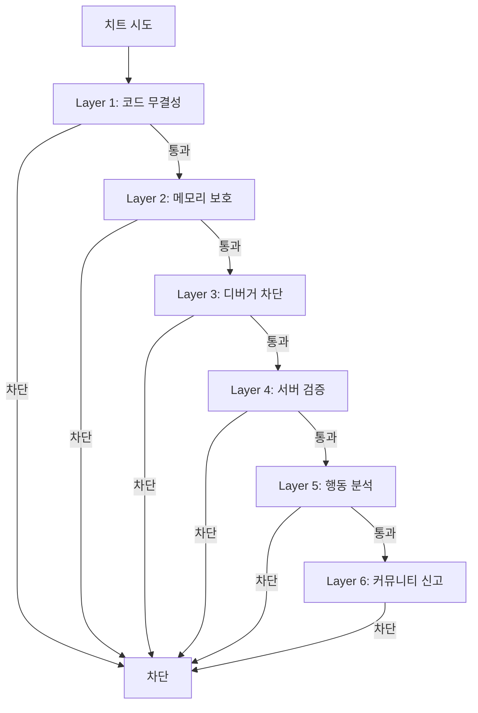
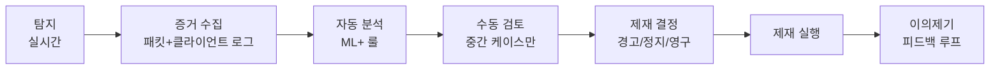
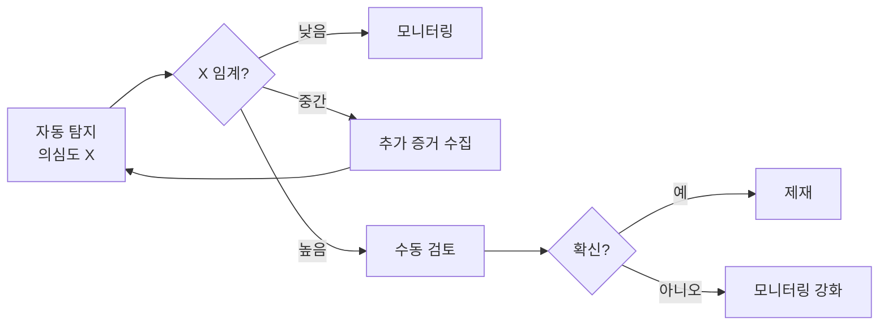
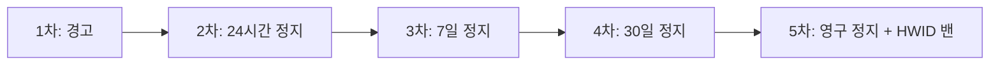
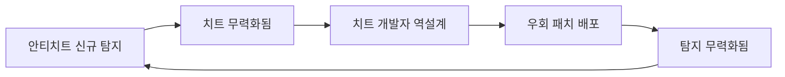

## 들어가며

치트 탐지의 *근본 트레이드오프* — *보안 ↔ 오탐 (False Positive)*. *모든 비정상 행동을 차단* 하면 *정상 플레이어도 잘못 제재*. *오탐 0 보장* 하면 *명백한 치트도 통과*. 추가로 *프라이버시 / 시스템 접근* 의 *사회적 비용* — *Valorant Vanguard* / *Easy Anti-Cheat 커널 드라이버* 논란이 그 예.

오탐의 비용은 *대칭이 아니다*. 치터 한 명을 놓치면 *한 매치가 망가진다*. 정상 플레이어 한 명을 잘못 밴하면 *그 사람의 결제 / 평판 / 커뮤니티 신뢰가 망가진다* — 환불, SNS 폭로, 집단 소송으로 번진다. 그래서 라이브 안티치트는 *재현율 (recall) 보다 정밀도 (precision) 를 먼저* 본다. "치터를 다 잡는 시스템" 이 아니라 "정상 플레이어를 거의 안 잡는 시스템" 이 먼저고, 그 위에서 재현율을 올린다.

이 글은 안티치트 시스템의 *클라이언트 / 서버 / 행동 분석의 다층 방어*, *제재 정책*, *프라이버시*, *치트 개발자와의 군비 경쟁* 을 한 흐름으로 정리한다. *EAC / BattlEye / VAC / Vanguard / Ricochet* 같은 상용·자체 안티치트는 *같은 트레이드오프의 다른 균형점* 에 있다. 코드와 수치 트레이스로, *왜 그렇게 동작하는지* 를 함께 본다.

여덟 단계로 쌓는다.

1. 다층 방어 (Defense in Depth) 설계.
2. 주요 치트 유형 — 에임봇 / 월핵 / 스피드핵.
3. 클라이언트 보안 — 메모리 / 코드 / 디버거 검출.
4. 서버 사이드 검증 — 물리 / 시야 / 입력 패턴.
5. 행동 분석 — ML 기반 이상 탐지.
6. 오탐 최소화 — 신뢰 점수 / 다단계 확인.
7. 제재 정책 — 경고 / 정지 / 영구 + Shadow Ban.
8. 군비 경쟁 + 프라이버시 + 운영.


---

## 목차
1. [다층 방어 설계](#1-다층-방어-설계)
2. [주요 치트 유형](#2-주요-치트-유형)
3. [클라이언트 보안](#3-클라이언트-보안)
4. [서버 사이드 검증](#4-서버-사이드-검증)
5. [행동 분석 시스템](#5-행동-분석-시스템)
6. [오탐 최소화](#6-오탐-최소화)
7. [제재 정책](#7-제재-정책)
8. [군비 경쟁과 프라이버시](#8-군비-경쟁과-프라이버시)


---

## 1. 다층 방어 설계

### Defense in Depth

한 레이어 만으로 *완벽한 보안 불가능*. 여러 층의 *독립적 방어선* — 치트 개발자가 *모든 층을 동시 우회* 해야 성공.



각 층의 강도가 *완벽하지 않아도 됨* — *모두 통과 확률* 이 *각 층 통과 확률의 곱*.

### 층의 독립성 — 곱셈이 성립하는 조건

곱셈 모델은 *각 층이 독립일 때만* 성립한다. 한 층의 우회 기법이 다른 층까지 무력화하면 *상관* 이 생겨 곱이 깨진다.

| 층 | 단독 우회 확률 (가정) | 상관 위험 |
|---|---|---|
| 코드 무결성 | 0.5 | 커널 치트가 검사 함수까지 후킹하면 L1·L2·L3 동시 무력화 |
| 메모리 보호 | 0.5 | 위와 같은 권한 상승에 동시 종속 |
| 디버거 차단 | 0.5 | 위와 같음 |
| 서버 검증 | 0.1 | 클라이언트 권한과 *무관* — 독립 |
| 행동 분석 | 0.2 | 서버 데이터 기반 — 독립 |

클라이언트 측 세 층은 *같은 권한 상승* 하나로 함께 뚫린다. 즉 곱이 $0.5^3 = 0.125$ 가 아니라 *커널 권한을 얻는 단일 사건* 에 가깝다. 반면 서버 검증 / 행동 분석은 *공격자가 통제 못 하는 환경* 에서 돌아 독립성이 높다. *진짜 곱셈 효과는 클라이언트 층과 서버 층 사이* 에서 나온다 — 클라이언트를 다 뚫어도 서버 물리 검증과 통계 이상 탐지를 *동시에* 속여야 한다.

### 클라이언트 vs 서버 사이드

| 항목 | 클라이언트 | 서버 |
|---|---|---|
| 위치 | 사용자 PC | 게임 서버 |
| 접근 가능 | 메모리 / 프로세스 / 드라이버 | 게임 상태 / 네트워크 입력 |
| 우회 난이도 | 낮음 (사용자 권한) | 매우 높음 |
| 프라이버시 우려 | 큼 | 없음 |
| 비용 | 낮음 (사용자 측) | 큼 (서버 측) |

서버 측 검증이 *근본적으로 더 강하지만 한계도 있음* — *입력 자체가 치트* (에임봇이 마우스 / 조이스틱 입력으로 정밀 조준) 는 *서버에서 보이지 않음*. 서버에 도착하는 것은 *"이 방향으로 쐈다"* 는 입력일 뿐, 그 입력을 *사람이 만들었는지 봇이 만들었는지* 는 입력 값만으로 구별되지 않는다. 그래서 서버 검증은 *불가능한 입력 (벽 너머 명중, 광속 이동)* 은 잡지만, *가능하지만 비인간적으로 완벽한 입력* 은 통계 / 행동 분석으로 넘긴다.

### 탐지 → 분석 → 제재 파이프라인



여러 단계의 판단을 조합하면 단일 신호보다 오탐을 줄일 수 있다. 단, 각 단계의 오탐은 독립 사건이 아니므로 단순 곱으로 최종 오탐률을 계산하면 안 된다. 탐지 신호가 같은 원인에 의해 함께 흔들릴 수 있기 때문에, 실제 정확도는 라이브 데이터와 이의제기 결과로 계속 보정해야 한다.

### 오탐률의 규모 감각

왜 임계를 보수적으로 두는지는 숫자로 봐야 보인다. 하루 5,000,000개의 독립적인 판정 기회가 있고 정상 match에 대한 false-alert probability가 다음과 같다고 가정하자.

| 판정 기회당 위양성률 | 기대 false alert/일 |
|---|---|
| 0.1% | 5,000 |
| 0.01% | 500 |
| 0.001% | 50 |
| 0.0001% | 5 |

이 표는 account 수나 부당 ban 수가 아니라 raw alert의 기대값이다. 한 account가 여러 match에서 중복 alert를 낼 수 있고 실제 sanction은 여러 증거를 합친 account-level decision이다. 영구 제재의 허용 false-discovery risk는 법적·고객지원·게임 규모의 비용 모델로 정한다. 강한 제재일수록 더 높은 precision, 독립 검증과 appeal evidence를 요구하고, 통계 이상은 우선 관측 강화나 수동 검토로 보낸다. shadow pool도 사용자 경험에 영향을 주므로 “오탐이어도 무해한 조치”는 아니다.

### 제 3자 솔루션

자체 구현 vs 외부 SDK.

| 솔루션 | 모델 | 비용/적용 |
|---|---|---|
| Easy Anti-Cheat (Epic) | 커널 구성요소 포함 | 플랫폼/계약 조건에 따름 |
| BattlEye | 커널 구성요소 포함 | 상용 라이선스 |
| VAC (Valve) | 사용자 모드 중심 | Steam 생태계 |
| Vanguard (Riot) | 커널 드라이버 (부팅 시) | 자체 (VALORANT, League of Legends/TFT) |
| Ricochet (Activision) | 커널 드라이버 + ML | 자체 (CoD 전용) |

*Indie / 중소 게임* — *EAC 또는 BattlEye 같은 관리형 솔루션 검토*. *대형 / 자체 인프라* — *자체 구현 + 부분 SDK 통합* 이 일반적. 자체 구현의 진짜 비용은 *코드* 가 아니라 *운영* 이다 — 24시간 시그니처 갱신, 신규 우회 대응, 학습 데이터 큐레이션, 이의제기 처리 인력. 관리형 솔루션은 이 운영 부담을 *공급사에 위임* 하는 대가로 *유연성과 데이터 소유권* 을 내준다.

## 2. 주요 치트 유형

### Aimbot (에임봇)

화면의 *적 위치 자동 감지* + *마우스 / 조이스틱 자동 조준*. 두 종류.

- *Memory-based* — 게임 메모리 읽어 적 위치 직접 얻음.
- *Pixel/AI-based* — 화면 캡처 + ML 모델 → 적 인식.

ML 기반은 *메모리 접근 안 함* → *전통 탐지 우회*. 최근 *카메라 / GPU 캡처* + *AI 추론* 활용한 *외부 디바이스 치트* 도 등장 — *별도 PC 가 캡처 카드로 화면을 받아 마우스를 HID 장치로 흉내* 낸다. 이 경우 게임 PC 에는 *어떤 치트 프로세스도 없다* → 클라이언트 탐지가 원천적으로 닿지 못한다. 남는 방어선은 *입력 패턴 통계 + 서버 행동 분석* 뿐.

탐지는 단일 숫자가 아니라 *입력 궤적·표적 가시성·사격 시점·교전 맥락* 을 함께 보는 문제다. HSR, K/D 같은 집계 통계는 실력과 매칭 품질에도 크게 흔들리므로 후보를 좁히는 신호일 뿐이다. 서버가 재구성한 조준 오차의 수렴 형태, 표적 전환, 가시성 직후의 입력, 여러 경기에서의 반복성을 결합해야 한다.

### 에임봇의 흔적 — 스냅 vs 인간

일부 에임봇은 *타깃 등장 → 짧은 시간에 정확히 조준* 하는 스냅을 만들지만, 사람처럼 보이도록 가속도·오버슈트·노이즈를 합성하는 구현도 있다. 인간 역시 감도, 거리, 숙련도, 에임 보조, 예상 조준 위치에 따라 오버슈트 없이 맞출 수 있다. 따라서 한 교전의 모양을 규칙으로 삼지 않고, 서버가 관측한 다수 교전의 각도·각속도·각가속도·표적 가시성·발사 성공 여부를 조건부 분포로 비교한다.

| 틱 (16ms) | 인간 — 타깃까지 각도 오차 | 에임봇 — 각도 오차 |
|---|---|---|
| 0 (타깃 등장) | 22.0° | 22.0° |
| 1 | 14.0° (큰 스윙) | 0.3° (스냅) |
| 2 | 6.0° | 0.1° |
| 3 | 2.5° (오버슈트 → 보정) | 0.1° |
| 4 | -0.8° | 0.0° |
| 5 | 0.4° (수렴) | 0.0° |

인간은 *오차가 부호를 바꾸며 (오버슈트) 5~6틱에 걸쳐 수렴*, 에임봇은 *단조 감소 + 1틱 내 도달*. 이 *수렴 시간과 오버슈트 유무* 가 강한 특징이다. 다만 *플릭 (flick) 에임* 이 좋은 프로는 2~3틱에 수렴하므로, *단일 교전이 아니라 매치 전체의 분포* 로 봐야 한다 — 인간은 좋은 교전과 나쁜 교전이 *섞이고*, 봇은 *모든 교전이 동일하게 완벽* 하다.

### Wallhack / ESP (벽 너머 보기)

적의 위치 / HP / 무기를 *벽 너머* 에서도 표시. 메모리에서 적 좌표 읽기 + 화면 오버레이.

탐지 — *서버가 시야 (visibility) 계산* + *플레이어가 못 봐야 할 정보로 행동* 했는지 검증.

```cpp
bool IsSuspicious(const PlayerAction& a, const GameState& s) {
    // 액션 발생 시점에 a 의 시야가 target 을 볼 수 있었나?
    if (a.type == ActionType::Shoot) {
        bool visible = LineOfSight(a.shooterPos, a.targetPos, s.geometry);
        if (!visible && a.hit) {
            return true;     // 보이지 않는데 명중 — 의심
        }
    }
    return false;
}
```

ESP 의 더 미묘한 흔적은 *프리에임 (pre-aim)* 이다 — 적이 모퉁이에서 나타나기 *전에* 이미 정확히 그 지점을 조준한다. 한 번이면 우연이지만, *시야 차단 상태에서의 조준 정확도* 가 *시야 확보 상태와 통계적으로 같으면* 정보 우위를 의심한다. 정상 플레이어는 *안 보이는 적에 대한 조준 오차가 크다* — 소리와 예측에만 의존하므로.

### Speedhack

게임 클라이언트 *시뮬레이션 속도 조작* → *과도하게 빠른 이동*.

탐지 — *서버가 위치 변화 / 시간 비교* — 물리적 한계 초과면 차단.

```cpp
bool ValidateMovement(const PlayerInput& in, float dt, const PlayerState& s) {
    float maxDist = s.maxSpeed * dt * 1.1f;    // 10% 여유
    float actualDist = glm::distance(s.position, in.requestedPosition);
    return actualDist <= maxDist;
}
```

함정 — *클라이언트가 보낸 dt 를 믿으면 안 된다*. 스피드핵은 *틱 레이트 자체* 를 부풀려 "정상 dt 로 보이지만 더 자주 보내는" 형태도 있다. 그래서 검증의 dt 는 *서버 시계 기준* 이어야 한다 — 클라이언트가 0.1초 동안 *10틱이 아니라 14틱* 을 보내면, 거리 검증을 통과하더라도 *틱 빈도 자체* 가 이상치다. *고정 윈도우 (예 1초) 내 누적 이동량* 을 서버 시계로 검증하면 틱 단위 미세 초과의 누적도 잡힌다.

### Triggerbot

적이 *십자선에 들어오자마자 자동 사격* 하는 치트다. Aimbot보다 궤적 변화가 적어 탐지가 어렵다. 핵심 특징은 단순한 평균 반응 시간이 아니라, *표적이 처음 발사 가능해진 시점* 을 기준으로 한 지연 분포와 그 조건이다. 시각 자극의 종류, 예측 가능성, 무기 발사 규칙, 프레임·입력 장치·네트워크 파이프라인에 따라 정상 분포가 크게 달라진다.

서버가 계산한 `십자선 진입 → 발사 도착` 간격은 순수한 생리 반응 시간이 아니다. 플레이어가 코너를 예상한 프리파이어일 수 있고, 클라이언트가 본 프레임의 시각은 렌더·표시 지연만큼 과거이며, 입력은 클라이언트 틱과 네트워크 지연을 거쳐 서버에 도착한다. 따라서 어떤 고정 ms 미만을 곧바로 "인간 불가능"으로 판정하면 안 된다. 동일 무기·거리·가시성·플랫폼·핑 구간의 정상 코호트와 비교하고, 비정상적으로 짧은 값의 *비율과 반복성* 을 조준 궤적·명중 결과와 결합한다. 사전 조준, 연사 중 진입, 소리로 예측 가능한 상황은 별도 조건으로 분리하거나 제외한다.

### Macro / Automation

*복잡한 입력 시퀀스* 를 자동화 — 콤보 / 빌드 오더. *MMO / RTS* 에서 흔함.

탐지는 *허용된 접근성 기능·게임 규칙상 허용된 매크로* 와 금지 자동화를 먼저 정책으로 구분해야 한다. 타이밍 분산은 유용한 특징이지만 고정 범위는 없다. 폴링 주기와 게임 틱으로 양자화된 정상 입력도 같은 간격이 반복될 수 있고, 매크로는 의도적으로 지터를 섞을 수 있다. 키 간격의 분산만 보지 말고 시퀀스 길이, 조건 분기, 세션을 넘는 반복성, 게임 상태에 대한 반응, 불가능한 동시 입력을 함께 본다. 거의 동일한 패턴은 조사 신호이지 단독 제재 근거가 아니다.

### Exploit (버그 악용)

치트가 아닌 *게임의 버그* 를 활용. 무한 골드, 무적 위치, 벽 통과 등. 안티치트 시스템보다는 *게임 로직 수정* 으로 대응. 안티치트로 잡으려 하면 *정상 플레이와 버그 악용의 경계가 모호* 해 오탐이 폭증한다 — 근본 해결은 *버그를 고치는 것*. 다만 *광범위 익스플로잇* 은 임시로 *서버 측 경제 / 상태 검증* (예 분당 골드 획득 상한) 으로 피해를 막으면서 패치를 기다린다.

## 3. 클라이언트 보안

### 메모리 무결성

게임 실행 파일 / 주요 코드 영역의 *해시 검증*. 메모리에 *허용되지 않은 코드 (인젝션)* 감지.

```cpp
bool VerifyCodeIntegrity() {
    const uint8_t* codeStart = GetCodeSectionStart();
    size_t codeSize = GetCodeSectionSize();

    Sha256 currentHash = Sha256Hash(codeStart, codeSize);
    Sha256 expectedHash = GetSignedHash();    // 빌드 시 서명됨

    return currentHash == expectedHash;
}
```

치트가 *코드 변경 (예: 충돌 검사 함수 무력화)* 시 즉시 발각. 다만 *정기 검사* 라 *검사 후 변경 후 검사 전 복원* 같은 우회 가능 — *TOCTOU (Time-Of-Check-To-Time-Of-Use)* 경쟁이다.

### 무결성 검사의 함정 — 무엇이.text 를 바꾸는가

코드 섹션 해시는 *합법적 변경* 도 잡아 오탐을 만든다.

|.text 변경 원인 | 합법? | 처리 |
|---|---|---|
| DLL 인젝션 후킹 | 치트 가능성 | 신호 수집 |
| 오버레이 (Discord / Steam / GPU 드라이버) | 합법 | 화이트리스트 |
| 접근성 도구 (스크린리더 등) | 합법 | 화이트리스트 |
| 안티바이러스 후킹 | 합법 | 화이트리스트 |
| ASLR / relocations | 합법 | 검사 전 정규화 |

오버레이와 안티바이러스는 *정상적으로* 게임 함수를 후킹한다. 그래서 무결성 검사는 *변경 자체로 밴* 하지 않고, *어떤 모듈이 변경했는지* 를 식별해 *알려진 합법 모듈은 통과* 시킨다. 이 화이트리스트 유지가 운영 부담의 큰 부분이다 — 새 GPU 드라이버 버전이 후킹 방식을 바꾸면 *그 주에 오탐이 튄다*.

### 코드 서명

게임 실행 파일을 *Microsoft / Apple / Sony 인증서* 로 서명. 변조 시 *OS 가 실행 거부* 또는 *경고*.

```bash
# Windows
signtool sign /f cert.pfx /p password /tr http://timestamp.digicert.com /td sha256 /fd sha256 game.exe
```

서명은 *디스크 상 파일의 변조* 만 막는다 — *메모리에 로드된 후의 변조* 는 못 막는다. 그래서 코드 서명과 런타임 메모리 무결성은 *둘 다 필요* 하다. 서명은 *배포 경로* 를, 무결성 검사는 *실행 중 상태* 를 지킨다.

### 디버거 / 인젝터 대응

치트 개발자는 *디버거로 게임을 분석* 하거나 *DLL 인젝션* 으로 함수 호출을 가로챈다. 클라이언트는 이를 신호로 수집할 수 있지만, 즉시 차단은 정상 사용자와 접근성 도구를 오탐할 위험이 있다.

안전한 설계는 다음처럼 단계화한다.

| 단계 | 처리 |
|---|---|
| 관찰 | 디버거 부착, 비정상 모듈, 후킹 흔적을 telemetry 로 기록 |
| 상관 분석 | 입력 패턴, 메모리 무결성, 서버 검증 실패와 함께 점수화 |
| 대응 | 확신도에 따라 ranked 제한, 추가 검증, 수동 리뷰, 제재 적용 |

핵심은 클라이언트 신호를 *단독 증거* 로 쓰지 않는 것이다. 클라이언트는 공격자가 통제하는 환경이므로, 서버 사이드 검증과 행동 분석이 최종 판단 근거가 된다.

### 클라이언트 신호의 비대칭 신뢰

클라이언트 신호는 *방향에 따라 신뢰도가 다르다*.

- *"치트 발견" 신호* — *낮은 신뢰*. 공격자가 통제하는 환경이므로 *조작 / 위조 가능*. 그래서 단독 밴 근거로 쓰지 않는다.
- *"무결성 검사 자체가 사라짐 / 응답 없음"* — *강한 신호*. 안티치트 모듈을 *언로드하거나 통신을 끊은* 것은 정상 플레이어에게 일어나지 않는다. 단 *충돌 / 강제종료* 와 구별해야 한다.

즉 *침묵* 이 가장 의심스럽다. 정상 클라이언트는 *지속적으로 하트비트 + 무결성 보고* 를 보낸다. 보고가 *끊기거나, 변조된 서명으로 오거나, 예상 못 한 형식* 이면 그 자체가 이상 신호다. 단 *밴이 아니라 재검증 / 매치풀 분리* 로 보낸다 — 네트워크 단절도 같은 증상을 만들기 때문.

### 가상 머신과 원격 실행 환경

VM, 클라우드 PC, 원격 데스크톱은 치트 분석에도 쓰이지만 정상 사용자도 사용한다. 따라서 VM 감지를 곧바로 차단 조건으로 쓰면 오탐과 접근성 문제가 커진다.

실무에서는 VM 여부를 낮은 가중치의 위험 신호로 두고, 경쟁 모드 제한이나 추가 검증처럼 단계적 대응을 적용한다. 플랫폼 정책상 VM 실행을 막아야 한다면 설치 전 고지와 이의제기 절차가 함께 필요하다.

### 커널 모드 드라이버의 딜레마

*Vanguard / EAC / BattlEye* 같은 커널 구성요소는 OS 높은 권한에서 더 깊은 검사를 수행한다. 사용자 모드 치트의 우회 비용을 높이지만, 같은 권한을 얻은 커널 치트까지 완전히 막지는 못한다.

권한 계층으로 보면 명확하다. 치트와 안티치트는 *같은 링에서 싸울 때만 서로를 본다*.

| 링 | 주체 | 더 높은 권한에서 보이는가 |
|---|---|---|
| Ring 3 (사용자 모드) | 일반 치트 / 게임 | 커널 안티치트가 봄 |
| Ring 0 (커널) | 커널 드라이버 치트 / 커널 안티치트 | 동급 — 서로 숨길 수 있음 |
| 하이퍼바이저 / DMA | 외부 하드웨어 치트 | OS 가 못 봄 |

사용자 모드 안티치트는 *사용자 모드 치트* 까지만 본다. 커널 안티치트는 *커널 치트와 동급* 이 되어 *우위가 사라진다* — 둘 다 같은 링에서 서로를 숨기려는 싸움이 된다. *DMA 카드 / 외부 캡처 디바이스* 는 OS 밖이라 *어떤 커널 드라이버도 못 본다*. 즉 커널 드라이버는 *우회 비용을 올릴 뿐 천장을 없애지는 못한다*.

장점 — *강력한 보안*. 단점.
- *프라이버시 우려* — 게임 외 시간에도 시스템 감시.
- *시스템 안정성 위험* — 드라이버 버그가 BSOD.
- *플랫폼 제약* — Mac / Linux 지원 어려움.
- *루트킷 수준* — 치트가 같은 권한 얻으면 *대응 불가능*.

*Valorant 의 Vanguard* 가 *부팅 시점부터 실행* 되어 *논란*. 강력한 보안 vs 사용자 동의 / 신뢰의 균형.

## 4. 서버 사이드 검증

### 물리 법칙 검증

플레이어 위치 / 속도 / 점프 — *물리 한계 내 인지* 검증.

```cpp
struct PlayerPhysicsLimits {
    float maxSpeed        = 5.0f;     // m/s
    float maxAcceleration = 20.0f;    // m/s^2
    float maxJumpHeight   = 1.5f;     // m
    float maxFallSpeed    = 30.0f;    // m/s
};

bool ValidatePhysics(const PlayerState& prev, const PlayerState& cur, float dt) {
    glm::vec3 dPos = cur.position - prev.position;
    float dist = glm::length(dPos);
    if (dist > limits.maxSpeed * dt * 1.2f) return false;      // 위치 점프

    glm::vec3 dVel = cur.velocity - prev.velocity;
    if (glm::length(dVel) / dt > limits.maxAcceleration) return false;  // 가속 한계

    return true;
}
```

위반 시 — *경고 누적 + 일정 횟수 이상 시 킥*. 일회성 위반은 *네트워크 지연 / 일시적 lag* 일 수 있음 → 즉시 차단 X.

### 여유 계수 (tolerance) 의 트레이드오프

`* 1.2f` 같은 여유는 *오탐과 우회의 다이얼* 이다.

| 여유 계수 | 효과 |
|---|---|
| 1.0 (여유 없음) | 패킷 지터 / 부동소수 오차 / 보간으로 *정상 플레이어가 위반* — 오탐 폭증 |
| 1.1 | 보통의 지터 흡수, 약 10% 속도핵 통과 |
| 1.2 | 안전하지만 20% 속도 부스트가 합법화됨 |
| 2.0+ | 사실상 무검증 |

여유는 *순간 위반* 에는 느슨하게, *누적* 에는 엄격하게 두는 것이 답이다. 한 틱의 1.2배는 허용하되, *N틱 윈도우의 평균 속도* 는 1.0배에 가깝게 검증한다. 텔레포트 스킬 / 넉백 / 점프 패드처럼 *정당하게 한계를 넘는 이벤트* 는 *서버가 알고 있는 상태* 이므로, 검증 시 *그 이벤트의 허용 변위* 를 더해준다 — 모르고 검증하면 정상 스킬 사용자가 밴된다.

### Line of Sight (시야) 검증

플레이어가 *시야 차단된 적을 조준 / 사격* 했는지.

```cpp
bool CanSee(const PlayerState& s, const glm::vec3& target,
            const WorldGeometry& g) {
    glm::vec3 dir = glm::normalize(target - s.position);
    Ray r(s.eyePosition, dir);
    RaycastHit hit = g.Raycast(r, glm::distance(s.position, target));
    return !hit.HitGeometry;
}

void OnPlayerShoot(const ShootEvent& e) {
    if (!CanSee(e.shooter, e.target, world)) {
        LogSuspicious(e.shooter.id, "Wallhack: shot through wall");
        AddSuspicion(e.shooter.id, 1.0f);
    }
}
```

### LOS 검증의 비용과 최적화

대규모 맵에서 *비용 큼* — Raycast 가 비싼 연산. 100명 매치 + 매 사격 검증 = *수천 raycast / 초*. 비용을 못 박으면 최적화 동기가 보인다.

| 방식 | 매 사격 raycast 비용 | 비고 |
|---|---|---|
| 브루트포스 삼각형 검사 | $O(\text{삼각형 수})$ — 수만 회 | 비현실적 |
| BVH / Octree | $O(\log n)$ — 수십 회 | 표준 |
| 사격 시점 즉시 검증 | 매 사격마다 | 지연 0, 비용 집중 |
| 사후 배치 검증 | 의심 큐만 | 비용 분산, 지연 큼 |

모든 사격을 실시간 검증하면 *서버 CPU 예산* 을 넘는다. 그래서 *전부* 가 아니라 *명중한 사격 + 의심 점수 높은 플레이어* 만 검증하거나, *기록만 해두고 배치로 사후 검증* 한다. 사후 검증은 실시간 차단은 못 하지만 *증거 축적 + 누적 제재* 에는 충분하다. 또 *벽 두께 / 얇은 틈 / 반투명 재질* 의 경계 케이스가 오탐을 만든다 — 살짝 보이는 틈으로 쏜 정상 사격을 "벽 너머" 로 오판하지 않도록 *판정 표면을 약간 부풀려* 보수적으로 본다.

### 입력 패턴 분석

마우스 움직임의 *통계적 자연스러움*. 인간의 *S-curve 가속* vs *봇의 직선 이동*.

```cpp
struct MouseAnalytics {
    float angularSmoothness;  // 각도 변화 분포 — 인간 부드러움, 봇 급격
    float dwellTimeVariance;  // 정지 시간 분포 — 인간 가변, 봇 일정
    float aimJitter;          // 정밀도 분포 — 인간 미세 흔들림, 봇 픽셀 정확
};

bool IsLikelyAimbot(const MouseAnalytics& m) {
    return m.angularSmoothness > 0.95f &&
           m.dwellTimeVariance < 5.0f &&
           m.aimJitter < 0.5f;
}
```

다만 *프로 선수는 가끔 봇 비슷한 정밀도* — 절대 판정 X, *의심 점수 누적* 만. 더 강한 신호는 *값 자체가 아니라 분포의 모양* 이다. 인간의 조준 미세 흔들림 (*aim jitter*) 은 *연속적이고 손떨림 주파수 (~8-12Hz) 대역* 을 가진다. 봇의 흔들림은 *인위적으로 주입된 난수* 라 *주파수 특성이 부자연* 스럽다 — "흔들림을 추가해 인간처럼 위장하는" 봇도 *그 흔들림의 통계가 인간과 다르다*. 이 군비 경쟁은 *시간 영역 임계값* 에서 *주파수 / 분포 형태 분석* 으로 옮겨갔다.

### 행동 비정상 모델

K/D ratio, headshot %, win rate 등의 *분포에서 outlier* 식별. *3-sigma 룰* 또는 *Isolation Forest* 같은 알고리즘.

```cpp
struct PlayerMetrics {
    float headshotRatio;
    float kdRatio;
    float winRate;
    float damagePerSecond;
};

float SuspicionScore(const PlayerMetrics& m, const ServerStats& mean) {
    // 표본이 안정되지 않은 그룹(std 0)은 §5 ZScore 와 같이 z=0 으로 둔다 — 0 나눗셈 방어
    float zHsr = mean.hsrStdDev > 0.0f ? (m.headshotRatio - mean.headshotRatio) / mean.hsrStdDev : 0.0f;
    float zKd  = mean.kdStdDev  > 0.0f ? (m.kdRatio - mean.kdRatio) / mean.kdStdDev : 0.0f;
    return std::max(zHsr, zKd) - 2.0f;   // 2-sigma 초과 시 의심
}
```

### z-score 와 정규성 가정의 함정

3-sigma (상위 0.1%) 정도가 *수동 검토 임계*. 그보다 낮은 의심도는 *자동 누적* + *증거 축적*. 하지만 z-score 는 *분포가 정규분포일 때만* "3-sigma = 상위 0.1%" 가 성립한다. 게임 지표는 대부분 *우편향 (right-skewed) + 두꺼운 꼬리* 다 — 소수의 극단적 고수가 자연스럽게 존재한다.

| 가정 | 3σ 가 의미하는 상위 비율 | 정상 고수가 걸릴 위험 |
|---|---|---|
| 정규분포 가정 | 0.1% | 낮게 *보임* |
| 실제 두꺼운 꼬리 | 1~2% 일 수도 | *높음 — 오탐* |

즉 정규분포로 계산한 임계는 *실제 오탐률을 과소평가* 한다. 실무에서는 *경험적 백분위 (empirical percentile)* 를 직접 쓰거나, *Isolation Forest / 분위수 기반* 방법으로 분포 가정 없이 outlier 를 잡는다. 그리고 *랭크 / 모드 / 시즌별로 분포를 따로* 둔다 — 한 분포로 전체를 보면 상위 랭크가 통째로 outlier 가 된다.

### 서버 권위 설계

가능한 모든 *게임 결정* 을 서버가 결정. 클라이언트 입력은 *요청 / 의도* 만 → 서버가 *수락 / 거절*.

```cpp
void OnClientRequestMove(const PlayerInput& in, float serverDt) {   // dt 는 서버 시계 기준
    PlayerState s = serverState[in.playerId];
    if (ValidateMovement(in, serverDt, s)) {
        s.position = in.requestedPosition;
        BroadcastState(s);
    } else {
        // 거절 — 클라이언트는 강제 position 으로 되돌림
        SendForcePosition(in.playerId, s.position);
    }
}
```

P2P 또는 *클라이언트 권위* 모델은 경쟁 판정에서 조작 표면이 크다. 서버 권위 모델에서도 *지연 보상(lag compensation)* 은 신뢰 경계를 없애지 않는다. 서버는 클라이언트가 주장한 RTT를 그대로 쓰지 않고 자신이 관측한 지연·입력 시퀀스·스냅샷 이력으로 판정 시각을 제한한다. 되감기 상한은 장르의 교전 속도, 지역별 지연 분포, 공정성 목표, 보관 이력 비용을 측정해 정한다. 상한을 넘는 경우도 단순히 "고핑 사용자의 명중을 모두 무효화"하기보다 보정량 축소, 현재 시점 판정, 매칭 품질 저하 표시 같은 정책을 명시해야 한다.

## 5. 행동 분석 시스템

### ML 기반 이상 탐지

수백 개 특징 (feature) 으로 *치트 vs 정상 분류*.

```python
# 예 — 게임 매치마다 추출하는 특징
features = {
    "headshot_ratio": 0.75,
    "avg_reaction_ms": 120,
    "mouse_smoothness": 0.95,
    "preaim_rate": 0.6,
    "kd_ratio": 4.5,
    "session_length_min": 360,
    "macro_pattern_count": 12,
    # ... 수백 개
}

# 학습된 모델로 예측
score = anticheat_model.predict_proba(features)[1]  # 치트 확률
```

알고리즘 — *XGBoost / Random Forest / Neural Network*. 학습 데이터 — *과거 신고된 치터 수만 명 + 정상 플레이어 수십만 명*.

### 레이블 노이즈와 클래스 불균형

ML 안티치트의 진짜 난제는 모델이 아니라 *데이터* 다.

- *레이블 노이즈* — "신고됨 = 치터" 가 아니다. *억울하게 신고된 고수* 가 양성 레이블에 섞이고, *안 걸린 치터* 가 음성 레이블에 섞인다. 노이즈 낀 레이블로 학습하면 *고수를 치터로 배우는* 모델이 나온다. 그래서 *수동 확정된 케이스 (검토관이 확인 + 이의제기 기각)* 만 양성으로 쓰는 *고신뢰 레이블* 이 중요하다.
- *클래스 불균형* — 치터가 전체의 *1~3%* 라면 "전부 정상" 으로 찍어도 정확도 97%. 정확도 (accuracy) 는 무의미하고, *precision / recall / PR-AUC* 로 본다. 학습 시 *클래스 가중치 / 언더샘플링* 으로 보정한다.

운영 임계는 *정밀도 우선* 으로 잡는다. 예를 들어 *precision 99.9% 가 되는 score 임계* 를 자동 제재선으로, 그 아래는 *수동 검토 큐* 로 보낸다.

### PUBG 의 머신러닝 도입

2019년경 ML 기반 탐지 도입이 공개된 바 있다. *신고 데이터* 기반 *트리 모델 + 행동 분석* 으로 *수동 검토 부담을 크게 줄이고 제재 정확도를 높였다* 는 취지의 발표였다. 구체 수치는 발표 시점·집계 방식에 따라 다르므로, *방향성 (수동 검토 자동화 + 정확도 향상)* 만 일반화해 받아들인다.

### 시계열 패턴

매치 내 시간 별 *행동 변화*. 정상 플레이어 — *피로 / 집중도 변화*. 치터 — *전 매치 동일 패턴* + *장시간 연속 사용*.

```python
# 매치 후반 vs 전반 정확도 비교
late_acc  = features_per_minute["headshot_pct"][45:60].mean()
early_acc = features_per_minute["headshot_pct"][0:15].mean()
fatigue_drop = early_acc - late_acc

if fatigue_drop < -0.05:   # 후반에 더 정확 (피로 없음)
    suspicion += 1.0
```

인간은 *세션이 길어질수록 정확도가 떨어진다* (피로). 봇은 *6시간 후에도 첫 매치와 동일* 하다. 이 *시간에 따른 불변성* 자체가 신호다. 단 *카페인 / 워밍업 효과* 로 정상 플레이어도 초반보다 중반이 좋을 수 있으므로, *단일 매치가 아니라 다수 세션의 일관된 무피로 패턴* 으로 본다.

### 플레이어 프로파일링

플레이어 *전체 매치 히스토리* 추적. *갑작스러운 실력 점프* — 어카운트 *공유 / 부스팅 / 치트* 신호.

```cpp
struct PlayerHistory {
    std::vector<MatchPerformance> matches;

    float SkillJumpScore() const {
        if (matches.size() < 20) return 0.0f;
        float recent10 = AverageKD(matches.end() - 10, matches.end());
        float prev10   = AverageKD(matches.end() - 20, matches.end() - 10);
        if (prev10 <= 0.0f) return 0.0f;      // 0 나눗셈 방어
        return (recent10 - prev10) / prev10;
    }
};
```

50%+ 갑작스러운 향상 = *조사 우선순위 ↑*. 단 실력 점프에는 *합법 원인* 이 많다 — 새 마우스 / 모니터, 코칭, 메타 학습, *주 캐릭터 변경*. 그래서 실력 점프는 *단독 밴 근거가 아니라 다른 신호와 결합* 되는 우선순위 가중치일 뿐이다. *계정 거래 / 공유* 의 강한 신호는 *실력 점프 + 동시에 바뀐 플레이 시간대 / 지역 / 입력 디바이스 지문* 의 동시 변화다.

### 정상 베이스라인

랭크 / 시간 / 게임 모드별 *정상 분포* 정의. *분포에서 벗어남* 이 의심 신호.

```cpp
struct PerformanceBaseline {
    RankTier tier;
    GameMode mode;
    float avgKD,  stdDevKD;
    float avgHSR, stdDevHSR;
};

// 같은 랭크 / 모드의 평균 대비 z-score
float ZScore(float value, float mean, float std) {
    if (std <= 0.0f) return 0.0f;
    return (value - mean) / std;
}
```

베이스라인은 *치터에 오염된 채로 갱신되면 안 된다*. 치터의 비정상 지표가 평균에 섞이면 *베이스라인이 위로 끌려 올라가* 다음 치터를 정상으로 보는 *드리프트* 가 생긴다. 그래서 베이스라인은 *확정 치터를 제거한 정상 모집단* 으로 계산하고, 주기적으로 재학습한다.

## 6. 오탐 최소화

### 신뢰 점수

플레이어마다 *Trust Score* — 높은 신뢰 = *치트 의심 임계 ↑*. 낮은 신뢰 = *민감한 검사 + 별도 매치풀*.

```cpp
struct TrustScore {
    float base          = 0.5f;
    float accountAge    = 0.0f;     // 오래 = +
    float verifiedPhone = 0.0f;     // 전화 인증 = +
    float reportRatio   = 0.0f;     // 신고 받음 = -
    float commendCount  = 0.0f;     // 좋은 평가 = +
};

float ComputeTrust(const TrustScore& t) {
    return std::clamp(t.base + t.accountAge + t.verifiedPhone
                      - t.reportRatio + t.commendCount,
                      0.0f, 1.0f);
}
```

*Steam VAC / Valve 의 Trust Factor*, *CS 의 Prime / 검증 계정* 류가 비슷한 모델. 신뢰 점수의 효과는 *오탐을 가장 위험한 곳에서 떼어내는 것* 이다 — 오래된 고결제 인증 계정은 *치터일 사전 확률이 낮으므로* 임계를 높여 보호하고, 새 무료 계정 (치터가 밴 후 새로 만드는 부계) 은 임계를 낮춰 빠르게 거른다. *베이즈 사전확률* 을 임계에 녹이는 셈.

### 신뢰 점수의 악용 방어

신뢰 점수 자체가 *공격 대상* 이 된다 — *부스팅 / 평가 품앗이* 로 신뢰를 인위적으로 올리거나, *경쟁자를 집단 신고* 해 신뢰를 떨군다. 그래서 *신고 가중치를 신고자의 신뢰로 보정* 한다 — 신뢰 낮은 계정의 신고는 가중치가 작다. commend / report 도 *상호 거래 패턴 (서로 올려주기)* 을 탐지해 무효화한다.

### 다단계 확인



자동 탐지 → 수동 검토 → 제재의 *명확한 단계*. 작은 의심으로 즉시 제재 X. 단계마다 *제재의 강도와 가역성* 을 의심도에 맞춘다 — 낮은 의심은 *되돌릴 수 있는* 매치풀 분리, 높은 확신만 *영구 밴*.

| 의심도 | 자동 대응 | 가역성 | 허용 오탐 예산 |
|---|---|---|---|
| 낮음 | 모니터링 / 텔레메트리 강화 | 영향 없음 | 매우 느슨 |
| 중간 | 추가 검증 / 매치풀 분리 (Shadow) | 즉시 복구 | 느슨 |
| 높음 | 수동 검토 큐 | 검토로 복구 | 보통 |
| 강한 증거 묶음 | 보류 또는 제재 후보 | 이의제기·재검증 | 제품 risk budget으로 결정 |

### 오탐 예산의 베이즈 유도 — 기저율과 증거 누적

운영은 위양성률(FPR), 민감도, 정밀도(PPV)와 실제 제재 건수를 모두 봐야 한다. PPV는 “양성 판정 계정이 실제 치터일 조건부 확률”이고 기저율에 크게 좌우된다. FPR이 필요 없다는 뜻이 아니라, FPR만으로 제재당 오탐 비율을 알 수 없다는 뜻이다.

치터 가설을 $H_1$, 정상 가설을 $H_0$, 모집단 치터 비율을 $\pi=P(H_1)$이라 하자. 한 검사가 민감도 (sensitivity, 재현율) $1-\beta=P(E\mid H_1)$, 위양성률 $\alpha=P(E\mid H_0)$로 양성 증거 $E$를 낸다. 베이즈 정리를 *오즈 형식* 으로 쓰면 사전 오즈에 우도비 (likelihood ratio)만 곱해진다.

$$\underbrace{\frac{P(H_1\mid E)}{P(H_0\mid E)}}_{\text{사후 오즈}} = \underbrace{\frac{P(E\mid H_1)}{P(E\mid H_0)}}_{\Lambda} \cdot \underbrace{\frac{\pi}{1-\pi}}_{\text{사전 오즈}}, \qquad \text{PPV}=\frac{\Lambda\,\pi}{\Lambda\,\pi+(1-\pi)}$$

기저율이 작으면 사전 오즈가 작아 우도비가 통째로 끌려 내려간다. $\pi=0.01$(사전 오즈 $\approx 1/99$)에서 민감도 50%·*특이도 99.9%* 인 강한 단일 검사조차 $\Lambda=\frac{0.5}{0.001}=500$, 사후 오즈 $500\times0.0101\approx5.05$, $\text{PPV}\approx0.835$다. "99.9% 정확한" 검사가 정밀도 83.5%에 그친다 — §4에서 정규분포로 계산한 임계가 실제 오탐을 과소평가하는 것(우도 $\alpha$의 오지정)과는 다른 축에서, 사전 오즈를 빠뜨려 생기는 *기저율 오류* 다. 단일 신호로는 결코 자동 영구 밴 근거가 되지 못한다.

설명용으로 account-level decision의 목표를 $\text{FDR}=1-\text{PPV}\le\varepsilon$, 민감도를 $t=1-\beta$라고 두면 필요한 누적 우도비와 허용 FPR을 역산할 수 있다. 다음 수치는 $\varepsilon=10^{-6}$을 선택한 가상 정책 예일 뿐 모든 게임의 권장값이 아니다.

$$\Lambda_{\text{req}}=
\frac{(1-\varepsilon)/\varepsilon}{\pi/(1-\pi)},\qquad
\alpha_{\text{req}}=
\frac{t\,\varepsilon\,\pi}{(1-\varepsilon)(1-\pi)}$$

$\pi=0.01$, $t=0.5$, $\varepsilon=10^{-6}$이면 $\Lambda_{\text{req}}\approx10^8$, $\alpha_{\text{req}}\approx5.1\times10^{-9}$다. 반면 $\alpha=10^{-6}$이면 FDR은 약 $2\times10^{-4}$이고 PPV는 약 99.98%다. 목표는 “PPV를 백만분의 일로 만든다”가 아니라 **FDR을 백만분의 일 이하로 만든다**는 표현이 정확하다.

조건부 독립인 증거라면 likelihood ratio를 곱할 수 있다. 그러나 같은 match와 같은 telemetry에서 파생한 탐지기는 보통 강하게 상관되어 있다. $\Lambda=500$인 신호 세 개를 관측했다는 이유만으로 $500^3$을 적용하지 않고 joint model이나 held-out labeled data로 결합 score를 calibration한다.

증거를 *언제까지 모을지* 는 Wald의 순차 확률비 검정 (SPRT)으로 형식화된다. 관측마다 로그 우도비를 누적해 $S_n=\sum_i \log\Lambda_i$를 만들고, 목표 위양성 $\alpha$·놓침 $\beta$에 대해

$$A=\log\frac{1-\beta}{\alpha},\qquad B=\log\frac{\beta}{1-\alpha}$$

로 경계를 둔다. $S_n\ge A$이면 $H_1$, $S_n\le B$이면 $H_0$, 그 사이는 관측 계속 영역이다. 여기의 $\alpha$는 **전체 순차 검정의 type-I error 목표**이며 단일 match detector의 FPR과 같은 변수가 아니다. SPRT 최적성도 독립·동일분포 관측과 정확한 likelihood model 같은 가정 아래의 결과다. concept drift, adversarial adaptation과 account별 상관이 있는 운영 데이터에서는 offline calibration과 shadow evaluation이 필요하다.

```python
import math
pi = 0.01                      # 모집단 치터 비율
prior_odds = pi/(1-pi)         # 0.0101
# 단일 강신호: 민감도 0.5, 특이도 0.999
Lam1 = 0.5/0.001               # 500
ppv1 = (Lam1*prior_odds)/(1+Lam1*prior_odds)   # 0.835 — "99.9%" 검사의 실제 정밀도
# 자동 영구 밴 목표 FDR=1e-6
epsilon = 1e-6
sensitivity = 0.5
O_post = (1-epsilon)/epsilon
Lam_req = O_post/prior_odds                    # ~1e8 (약 8 decade)
alpha_req = sensitivity*epsilon*pi / ((1-epsilon)*(1-pi))  # ~5.1e-9
```

account별 prior를 사용하려면 해당 feature가 실제 label에서 calibration되고 차별·우회·privacy risk를 통과해야 한다. 결제액, 유명세나 계정 나이만으로 같은 기술 증거의 제재 임계를 낮추거나 높이면 공격자가 신뢰 feature를 구매할 수 있고 정상 신규 사용자를 구조적으로 차별한다. 이런 정보는 수동 검토 우선순위나 account-takeover 조사에는 쓸 수 있지만, gameplay-cheat 판정의 면책 특권으로 사용하지 않는다.

### 화이트리스트

프로 선수, 인플루언서, 개발자 계정도 같은 gameplay 규칙과 증거 기준을 적용한다. 공개 파급력이 큰 계정에 추가 수동 검토를 붙일 수는 있지만 탐지 결과를 무시하는 whitelist로 만들면 내부자 악용과 신뢰 훼손이 생긴다. 테스트 계정은 production matchmaking과 경제에서 분리하고 명시적 audit log를 남긴다.

```cpp
bool ShouldEscalateBeforeBan(PlayerId p) {
    if (IsProPlayer(p)) return true;
    if (IsVerifiedCreator(p)) return true;
    if (GetAccountValue(p) > 1000.0f) return true;     // 큰 결제 어카운트
    return false;
}
```

화이트리스트는 *밴 면제가 아니라 검토 강제* 다. 이 구분이 중요하다 — 프로도 치트한다. 화이트리스트의 효과는 *공개 오탐의 피해가 큰 계정* 을 *자동 시스템이 단독 처리하지 못하게* 막는 것이다. 인플루언서가 라이브 방송 중 잘못 밴되면 *수만 명이 시스템을 불신* 한다.

### 고성능 플레이어 케이스

*세계 최고 수준 플레이어* 는 일부 집계 통계에서 치트 사용자와 겹친다. 높은 헤드샷 비율이나 매우 짧게 관측된 반응 구간은 그 자체로 비정상이 아니다.

고위험 제재에는 *수동 검토, 원본 리플레이, 서버 이벤트 로그, 독립 탐지 신호* 를 결합한다. 토너먼트 출전 이력이나 유명세는 면책 근거가 아니다. 일관성도 단독 규칙이 될 수 없다. 강한 치트는 일부러 실패를 섞고, 숙련자는 특정 상황에서 매우 안정적일 수 있다. 동일 상황의 조건부 성능, 장기간의 분포 변화, 입력과 시야 정보 사이의 인과적으로 불가능한 관계가 더 강한 증거다.

### 하드웨어 특성

고성능 마우스·모니터·낮은 렌더 큐는 관측 분포를 이동시킨다. 주사율이 높아지면 새 프레임을 기다리는 샘플링 지연의 기대값이 줄지만, 전체 반응 시간은 게임 프레임 생성, 디스플레이 스캔아웃·응답, 입력 폴링, 운영체제 스케줄링에 함께 좌우된다.

| 모니터 주사율 | 프레임 간격 | 평균 추가 지연 (반 프레임) |
|---|---|---|
| 60Hz | 16.7ms | ~8.3ms |
| 144Hz | 6.9ms | ~3.5ms |
| 240Hz | 4.2ms | ~2.1ms |
| 360Hz | 2.8ms | ~1.4ms |

표의 `반 프레임` 값은 입력과 새로 고침 위상이 균일하다고 가정한 *표시 대기 한 항의 기대값* 이다. 60Hz와 360Hz의 이 항 차이는 약 6.9ms지만 이것을 곧 전체 반응 시간 차이라고 해석할 수는 없다. 단일 임계는 장비와 설정이 다른 정상 플레이어를 오판한다. 플레이어 환경 정보는 코호트 보정에 쓸 수 있지만 클라이언트 보고값이므로 신뢰할 수 없는 보조 신호로 취급하고, 서버에서 관측 가능한 프레임·틱·RTT 조건을 우선 사용한다.

## 7. 제재 정책

### 단계별 제재



가벼운 위반은 *경고로 시작*. 반복 시 *기간 확대*. 명백한 치트 첫 적발 시 *영구 정지* 직행 (단계 생략).

### 제재 시점의 전략 — 즉시 vs 웨이브

*탐지 즉시 밴* 과 *모았다가 일괄 밴 (ban wave)* 은 서로 다른 트레이드오프다.

| 방식 | 장점 | 단점 |
|---|---|---|
| 즉시 밴 | 피해 빠르게 차단 | 치트 개발자가 *어떤 탐지에 걸렸는지 즉시 학습* → 빠른 우회 |
| 웨이브 밴 | 탐지 기법을 숨김, 한 번에 다수 차단 | 그 사이 정상 플레이어가 치터에 노출 |

대형 게임은 *비가역적 영구 밴은 웨이브* 로, *가역적 매치풀 분리는 즉시* 로 섞는다. 웨이브의 핵심 효과는 *신호 은폐* 다 — 치터가 *밴 시점과 자신의 행동을 연관 짓지 못하게* 해, 어떤 탐지를 우회해야 하는지 *역설계 (reverse engineering)* 를 어렵게 만든다.

### HWID 밴

영구 정지 어카운트의 *기기 지문* 을 제한적으로 등록해 같은 장치의 새 어카운트 생성을 어렵게 만든다. 원본 하드웨어 식별자를 그대로 저장하면 개인정보와 보안 리스크가 크므로, 최소 수집·해시·salt·보관 기간을 명확히 둔다.

기기 지문은 *여러 약한 식별자의 조합* 이다 — 단일 식별자는 변경되거나 공유되기 쉽다.

| 식별자 | 안정성 | 스푸핑 난이도 | 오탐 위험 |
|---|---|---|---|
| MAC 주소 | 낮음 (NIC 교체) | 쉬움 | 가상 어댑터 |
| 디스크 시리얼 | 중간 | 중간 | 클론 / 복제 |
| 메인보드 / CPU ID | 높음 | 어려움 | 동일 모델 다수 |
| 조합 지문 (해시) | 높음 | 어려움 | *PC방 / 가족 공유 PC* |

가장 큰 오탐 위험은 *공유 PC* 다 — PC방, 가족, 기숙사에서 *치터가 쓴 기기* 를 나중에 정상 플레이어가 쓰면 *연좌* 된다. 그래서 HWID 밴은 *연좌의 사회적 비용* 을 안고, *우회 (지문 스푸핑) 도 가능* 하므로 *보조 신호* 다 — 계정 그래프, 결제/전화 인증, 행동 패턴, 서버 검증 실패와 결합해야 한다.

### Shadow Ban

치터를 *명시적으로 차단 하지 않고* — *치터끼리만 매칭*. 치터는 *자신이 차단된지 모름* → *우회 노력 안 함*.

```cpp
enum class BanType {
    NoBan,
    ShadowBan,    // 명시적 알림 없음, 치터 풀에 배정
    SoftBan,      // 일정 시간 정지
    HardBan,      // 영구 정지
};

bool MatchmakeWith(PlayerId a, PlayerId b) {
    BanType ba = GetBanStatus(a);
    BanType bb = GetBanStatus(b);

    // Shadow ban 된 사용자끼리만 매칭
    if (ba == BanType::ShadowBan) return bb == BanType::ShadowBan;
    if (bb == BanType::ShadowBan) return ba == BanType::ShadowBan;
    return true;
}
```

*Counter-Strike / Apex Legends* 류가 적극 사용. *수개월 활동 데이터 누적* 가능 + 확실한 증거 후 *최종 차단*. Shadow ban 의 두 번째 효과는 *오탐 안전망* 이다 — 의심도가 *중간* 인 (확신 없는) 계정을 영구 밴 대신 격리하면, *정상 플레이어를 잘못 격리해도 가역적* 이다. 단 한계 — 치터가 *매칭 풀이 이상함 (다들 치터 같음)* 을 눈치채면 부계로 갈아탄다. 그래서 격리 풀에도 *정상처럼 보이는 봇 / 신규 계정* 을 섞어 위장하기도 한다.

### 이의제기 프로세스

오탐 가능성 → *제재된 플레이어의 이의제기*. 시스템 자체에 *내장된 절차*.

```cpp
void HandleAppeal(PlayerId p, const std::string& reason) {
    // 1. 자동 분석 — 명백한 케이스 즉시 답변
    AppealResult autoResult = AutoReviewAppeal(p, reason);
    if (autoResult.confidence > 0.9f) {
        return Reply(p, autoResult.decision);
    }
    // 2. 수동 검토 큐 — 며칠 내 답변
    QueueForHumanReview(p, reason);
}
```

이의제기 *수락률* 은 시스템 정확도의 *간접 지표* 가 된다. *0% 라면* 절차가 형식뿐이거나 검토가 안 되는 것이고, *지나치게 높다면* 자동 탐지의 정밀도가 의심된다. 다만 수락률은 *밴 사유 / 게임 / 시기* 에 크게 의존하므로, 절대값보다 *추세* 와 *사유별 분해* 로 본다 — 특정 탐지 룰의 이의제기 수락률만 튀면 그 룰이 오탐원이다.

### 법적 리스크

치트 *판매자 / 개발자* 대상 *지식재산권 / 약관 위반 청구* + *민사 소송*. 미국 / 한국 / 독일 등에서 관련 분쟁이 보고된다.

대표적으로 *Riot Games* 가 치트 판매 업체를 상대로 제기한 소송, *Bungie* 가 Destiny 2 치트 업체들을 상대로 진행한 일련의 소송, *Activision* 이 치트 배포 업체를 상대로 한 소송 등이 알려져 있다. 개별 사건의 *피고명 / 판결 금액 / 확정 여부* 는 시점과 관할에 따라 다르므로, 본문에서는 *"퍼블리셔가 치트 공급망을 상대로 민사적 수단을 적극 쓴다"* 는 *경향성* 만 일반화한다. 정확한 사건 인용이 필요하면 각 퍼블리셔의 공식 발표와 법원 기록을 직접 확인한다.

*법적 조치* 는 *공급 차단* — 안티치트의 *마지막 방어선*. 기술 측면이 아닌 *전체 생태계 측면* 의 대응이다. 클라이언트를 한 명씩 밴하는 것보다 *치트를 만드는 쪽의 동기를 꺾는 것* 이 비용 효율이 높을 수 있다.

## 8. 군비 경쟁과 프라이버시

### 치트 개발자의 도구

치트 개발에는 메모리 편집기, 디버거, 디스어셈블러, 함수 후킹 프레임워크, 커널 드라이버 같은 범주의 도구가 쓰인다. 일부는 합법적인 디버깅·보안 연구에도 쓰이는 범용 도구이므로, 도구 존재 자체보다 게임 프로세스에 대한 구체적 조작과 행동 증거를 함께 봐야 한다.

오픈 / 클로즈 도구 *수백 개*. 시그니처 기반 차단은 *새 변형 등장 시 즉시 우회*.

### 시그니처 vs 행동 기반

| 방식 | 강점 | 약점 |
|---|---|---|
| 시그니처 (해시·패턴) | 알려진 artifact를 빠르게 식별 | 충돌·오분류·합법 도구, 새 변형 우회 |
| 행동 기반 (ML) | 광범위 대응 / 적응성 | 오탐 위험 / 학습 시간 |

시그니처와 행동 분석은 서로 다른 증거를 제공한다. 서명된 known-cheat binary의 exact hash처럼 강한 신호도 file provenance, shared component, stale rule와 account compromise를 확인해야 하며 정밀도 100%를 가정할 수 없다. 자동 영구 제재 여부는 signal 종류가 아니라 account-level calibrated precision, 재현 가능한 evidence와 appeal policy로 결정한다.

### 군비 경쟁의 사이클

치트 개발자가 *우회 발견 → 수정* 의 사이클이 *시간 단위*. 안티치트도 *주기적 업데이트* + *실시간 시그니처 푸시*.



이 루프는 *끝나지 않는다*. 승패가 아니라 *사이클 길이* 의 싸움이다 — 안티치트의 목표는 "영구 차단" 이 아니라 *치트의 수명을 짧게, 개발 비용을 비싸게* 만드는 것이다. 우회가 *시간 단위* 가 아니라 *주 단위* 로만 가능해도, *유료 치트의 환불 / 평판 비용* 이 올라가 공급이 줄어든다.

```cpp
// 클라이언트 시작 시 + 주기적으로 시그니처 갱신
void UpdateSignatures() {
    auto sig = FetchFromServer("/anticheat/signatures/latest");
    knownCheatHashes_   = sig.hashes;
    suspiciousPatterns_ = sig.patterns;
}
```

시그니처를 *실시간 푸시* 하는 또 다른 이유는 *탐지 로직을 클라이언트 바이너리에 박지 않기 위해서* 다 — 바이너리에 박으면 치트 개발자가 *정적 분석으로 탐지 조건을 통째로 읽는다*. 서버에서 내려주고 *어떤 데이터를 평가했는지는 서버에서 판정* 하면, 공격자는 *무엇이 자신을 잡았는지 알기 어렵다*.

### 프라이버시 우려

커널 드라이버 = *시스템 전체 감시 가능*. 사용자가 *게임 외 활동* 도 *드라이버 시점에서 보일 수 있음*.

*Vanguard 논란* — *부팅 시점부터 실행* + *게임 미실행 상태에도 활성*. 일부 사용자 *Valorant 거부* 결정.

일부 상용 안티치트는 게임 실행 기간 중심으로 동작하도록 설계된다. 부팅 시 상주 모델보다 수용성이 높지만, 제품 버전과 게임 통합 방식에 따라 실제 동작 범위는 달라진다. 프라이버시 비용은 *기술적으로 무엇을 볼 수 있는가* 가 아니라 *언제 / 무엇을 / 얼마나 오래 보는가* 의 정책 문제다 — 같은 커널 권한이라도 *게임 세션 중에만 활성, 수집 항목 최소화, 짧은 보관* 이면 수용성이 다르다.

### GDPR / 개인정보 규제

EU GDPR — *수집 데이터 명시 + 처리 근거 + 보관 기간 + 삭제 권리*. 게임 안티치트 데이터도 적용 대상이다.

```cpp
struct AnticheatTelemetry {
    // 수집 항목 명시 (최소 수집 원칙)
    bool processNames;
    bool memorySnapshots;
    bool networkPackets;
    bool inputPatterns;
    int  retentionDays;          // 보관 기간 한정
    bool userCanRequestDeletion; // 삭제 권리
};

void OnUserDataDeletionRequest(PlayerId p) {
    DeleteFromTelemetry(p);
    // 단 부정행위 방지의 정당한 이익 범위 내에서, 밴 식별자(해시 등)는
    // 최소한으로 보관할 수 있다 — 보관 근거와 기간을 정책에 명시한다.
    RetainMinimalBanRecord(p);
}
```

긴장 지점 — *삭제 권리* vs *밴 회피 방지*. 사용자가 데이터 삭제를 요청해도, 밴을 우회하기 위한 *재가입* 을 막으려면 *최소한의 식별 정보* 는 남겨야 한다. GDPR 도 *정당한 이익 (legitimate interest)* 에 따른 처리를 인정하지만, *수집 항목 / 보관 기간 / 근거* 를 명시하고 *최소한* 으로 제한해야 한다. "치팅 방지" 라는 목적이 *무제한 수집* 을 정당화하지는 않는다.

### 투명성 리포트

주기적 *제재 통계 공개*. *치트 적발 수, 이의제기 수락률, 새 치트 유형 동향, 평균 탐지 시간*.

```text
[투명성 리포트 항목 예시]
- 제재 계정 수 (유형별)
- 이의제기 접수 / 수락 수
- 새 치트 유형 분류
- 평균 탐지 시간 (치팅 시작 → 제재)
- 개인정보 요청 처리 건수
```

투명성 = *커뮤니티 신뢰*. 비공개 = *의심 / 음모론*. 다만 투명성에는 한계가 있다 — *탐지의 구체적 작동 방식* 을 공개하면 그대로 *우회 매뉴얼* 이 된다. 그래서 공개하는 것은 *결과 지표 (적발 수, 수락률)* 이지 *탐지 메커니즘* 이 아니다.

### 크로스 게임 데이터 공유

같은 회사 / 같은 안티치트 SDK 사용 게임들이 *치트 데이터 공유*. *Activision Ricochet* 가 Call of Duty 시리즈에서 통합 운영된다고 알려져 있다.

*Steam VAC* — *VAC 차단 어카운트는 해당 VAC 보호 게임군에서 차단*. 한 게임에서 치팅하면 같은 보호 범위의 다른 게임에도 영향을 줄 수 있다. 크로스 공유의 효과는 *밴의 비용을 올리는 것* 이다 — 한 게임 밴이 *계정 전체 가치* 를 깎으면 치팅의 기대비용이 커진다. 단 *공유 범위가 넓어질수록* 오탐의 피해도 함께 커지므로, *확정 케이스만* 공유하고 *통계적 의심* 은 게임별로 가둔다.

### 클라우드 게이밍

*클라우드 게이밍 (서버에서 게임 실행, 클라이언트는 영상 스트림)* 에서는 *클라이언트 메모리 조작 / 로컬 파일 변조* 의 공격면이 크게 줄어든다. 게임 프로세스가 *공급사가 통제하는 서버* 에서 돌기 때문이다. 그러나 *화면 인식 기반 입력 자동화, 계정 악용, 매칭 조작, 소셜 엔지니어링* 같은 문제는 남는다 — 특히 *외부 화면 캡처 + AI 에임* 은 클라우드든 로컬이든 동일하게 가능하다.

클라우드 실행은 안티치트의 한 축이 될 수 있지만 단독 해법은 아니다. *지연 / 비용 / 인프라 / 입력 자동화* 라는 다른 트레이드오프를 만든다. 결국 *입력 자체가 치트인 경우 (에임봇 / 트리거봇)* 는 실행 위치를 옮겨도 사라지지 않고, *입력 패턴 + 행동 분석* 이라는 같은 방어선으로 돌아온다.


---

## 결론

이 구조는 *보안 - 오탐의 트레이드오프* 위에 *프로덕션 안티치트 시스템* 의 전체 구성요소를 정리한다. 다층 방어 + 서버 권위 + 행동 분석 + 신뢰 점수 + 다단계 확인 + 법적 조치가 결합되어야 치트와의 군비 경쟁에서 버틸 수 있다. 각 층은 완벽하지 않아도 되지만, *클라이언트 층과 서버 층의 독립성* 이 곱셈 효과를 만든다 — 같은 권한 상승으로 함께 뚫리는 층들은 사실상 한 층이다.

설계의 중심축은 제재의 강도를 증거의 강도와 가역성에 맞추는 것이다. 어떤 단일 신호도 정밀도 100%로 가정하지 않고, 강한 제재에는 calibration된 account-level decision, 독립 재검증과 appeal evidence를 요구한다. 오탐 비용은 비대칭이지만 허용 예산은 게임 규모, 제재 종류와 법적·운영 비용에서 산출해야 하며 백만분의 일 하나가 보편 표준은 아니다.

안티치트의 *기술적 측면* 보다 *사회적 / 정책적 측면* 이 더 무겁다. 강력한 탐지 = *프라이버시 침해 가능*. 약한 탐지 = *공정성 훼손*. 두 극단 사이의 *균형점* 은 *게임 / 플레이어 / 시대* 마다 다르다 — *경쟁 e스포츠* 는 더 강한 대응을 수용하고, *캐주얼 게임* 은 프라이버시를 우선한다. 그리고 치트 vs 안티치트는 *끝나지 않는 군비 경쟁* 이라, 한 시점의 완벽한 시스템은 없다. *지속적 업데이트, 학습 데이터 갱신, 새 우회 대응, 이의제기 처리* 의 *운영* 이 코드만큼 중요하다. 공정성을 지키는 것은 탐지 알고리즘 하나가 아니라, 매칭 / 신고 / 제재 / 고객지원 / 관측 인프라가 함께 도는 *시스템 전체* 다.

## 더 읽을거리

- Riot Games Technology Blog, [안티치트 관련 글 모음](https://technology.riotgames.com/) — Vanguard 의 커널 드라이버 접근과 그 트레이드오프를 공개적으로 설명한 드문 1차 자료.
- Valve, [Anti-cheat and Game Bans — Steamworks 문서](https://partner.steamgames.com/doc/features/anticheat) — Game Ban 신고 API와 밴 운영 권장사항의 공식 설명.
- Greg Hoglund, Gary McGraw, *Exploiting Online Games: Cheating Massively Distributed Systems* (Addison-Wesley, 2007) — 치트 기법 분류의 고전(공격자 관점 이해용).
- Abraham Wald, "Sequential Tests of Statistical Hypotheses" (*Annals of Mathematical Statistics* 16(2), 1945) — SPRT의 원전. 로그 우도비 누적과 $A,B$ 경계 유도.
- Abraham Wald, Jacob Wolfowitz, "Optimum Character of the Sequential Probability Ratio Test" (*Annals of Mathematical Statistics* 19(3), 1948) — 주어진 $(\alpha,\beta)$에서 SPRT가 기대 표본 수를 최소화한다는 최적성 증명.
- Harry L. Van Trees, *Detection, Estimation, and Modulation Theory, Part I* (Wiley, 1968) — 우도비 검정·Neyman-Pearson·기저율과 결정 경계의 표준 참고서.
