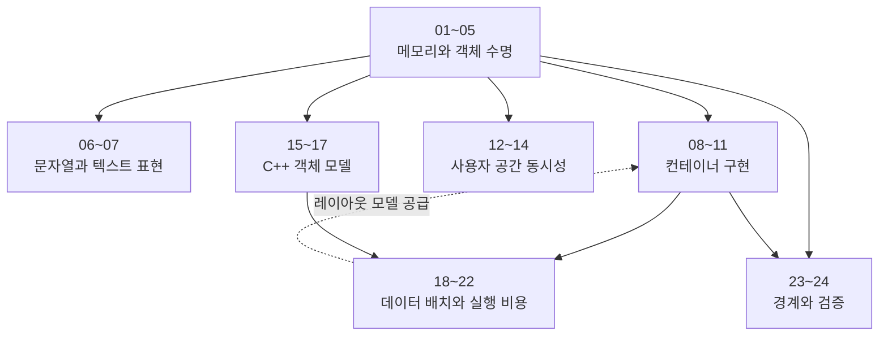

# 공통 부품 시리즈

`parts/`는 "C++ 문법 강좌"도 "표준 라이브러리 사용법"도 아니다. 프로그램이 **메모리 위에 상태를 어떻게 놓고, 그 배치가 CPU에서 어떤 비용으로 청구되는가**를 살펴본다. 각 장에서 같은 질문을 다른 구현에 적용한다. 이 자료구조·이 소유권 정책·이 실행 방식이 어떤 하드웨어 계약을 전제로 하며, 그 전제가 깨질 때 무엇이 먼저 무너지는가.

그래서 이 축의 완료 조건은 API를 외우는 것이 아니다. 같은 코드가 다른 배치·다른 스레드 수·다른 컴파일러 옵션에서 왜 다른 비용을 내는지 설명하고, 그 주장을 측정으로 확인할 수 있어야 한다.

---

## 1. 읽는 순서

### 파일명 숫자순은 읽는 순서인가

**그렇다. 번호순으로 읽으면 된다.** 메모리와 수명에서 컨테이너·동시성·객체 모델을 거쳐 배치와 검증으로 이어진다.

일부 개념은 뒤의 장에서 더 깊게 설명한다. 각 장에 필요한 최소 정의가 있으므로 번호순으로 읽을 수 있고, 유도 과정과 실패 조건이 궁금하면 아래 심화 장을 함께 읽는다. 전체 개념별 안내는 §2에서 찾을 수 있다.

| 개념 | 먼저 만나는 장 | 심화 장 | 심화 내용 |
|---|---|---|---|
| 캐시 라인과 일관성 단위 | 01 | 02 | set/way 구조, MESI 상태 전이, `perf c2c` 측정법 |
| AoS/SoA 레이아웃 | 11·19 | 18 | 캐시 라인 활용률의 수치 유도, AoSoA까지의 스펙트럼 |

01은 할당 간격이 라인 공유를 결정하는 지점까지, 11은 청크 단위 결정까지, 19는 lane 적재 비용까지만 다룬다. 관심이 그 범위 안이라면 번호순 그대로 읽어도 빠지는 것이 없다.

### 묶음과 전제 관계

실선은 전제, 점선은 번호 순서와 어긋나는 전제다.

#### 묶음 1 — 메모리와 객체 수명 (01~05)

할당된 바이트가 어디서 오고, 누가 그 수명을 책임지는가.

| # | 문서 | 다루는 모델 |
|---|---|---|
| 01 | [메모리 할당](part01_memory_allocation.md) | 청크 메타데이터·boundary tag, 정렬 계약, 디버그 패턴, 할당 지점 기록 |
| 02 | [메모리 아키텍처](part02_memory_architecture.md) | 계층 구조, set-associative 캐시, MESI, false sharing, TLB, NUMA |
| 03 | [메모리 할당자](part03_memory_allocator.md) | OS 가상 메모리 API에서 범용 할당자 구현체까지의 계층과 트레이드오프 |
| 04 | [커스텀 할당자](part04_custom_allocator.md) | Arena·Pool·Stack·Buddy·Slab의 제약과 `std::pmr` 통합 |
| 05 | [스마트 포인터](part05_smart_pointer.md) | RAII, move, 제어 블록과 참조 카운트의 실제 비용 |

02가 이 묶음 전체의 하드웨어 전제를 공급한다. 03은 범용 할당자가 왜 그 비용을 내는지 설명하고, 04는 그 범용성을 포기해서 무엇을 얻는지 보인다. 05는 04가 만든 저장소 위에 소유권을 얹는다.

#### 묶음 2 — 문자열과 텍스트 표현 (06~07)

같은 바이트열이 "몇 바이트를 어떻게 담는가"와 "그 바이트가 무엇을 뜻하는가"의 두 문제로 갈린다.

| # | 문서 | 다루는 모델 |
|---|---|---|
| 06 | [문자열](part06_string.md) | null-terminated와 length-prefix, SSO, COW의 실패, `string_view`의 수명 |
| 07 | [인코딩](part07_encoding.md) | 코드 포인트와 바이트열의 사상, UTF-8·UTF-16, 경계 변환, BOM |

06은 인코딩과 무관하게 읽을 수 있다. 06 §7이 length-prefix 표현의 실제 사례로 UTF-16 기반 타입을 다루지만, 필요한 것은 "코드 단위가 2바이트다"까지이므로 07이 전제는 아니다. 문자열 표현만 필요하면 06만, 외부 바이트열을 받는 코드를 쓴다면 07을 먼저 읽는다.

#### 묶음 3 — 컨테이너 구현 (08~11)

| # | 문서 | 다루는 모델 |
|---|---|---|
| 08 | [vector](part08_vector.md) | 연속 배열의 세 포인터 표현, 성장 인자, 무효화 규칙, SVO |
| 09 | [intrusive list](part09_intrusive_list.md) | 노드 소유권의 반전, `container_of`, colony/hive의 안정 참조 |
| 10 | [hash map](part10_hashmap.md) | 슬롯 배열의 probe 정책, Robin Hood PSL, 참조 안정성과 rehash |
| 11 | [게임 자료구조](part11_ecs.md) | Ring Buffer·Object Pool·Sparse Set·Slot Map·Archetype |

08이 이 묶음의 기준편이다. 연속 메모리·무효화·성장 정책의 모델을 세우면 09·10·11은 "같은 모델 위에서 어떤 제약을 다르게 그었는가"로 읽힌다. 04의 할당자가 09·11의 전제다.

#### 묶음 4 — 사용자 공간 동시성 (12~14)

| # | 문서 | 다루는 모델 |
|---|---|---|
| 12 | [동기화](part12_synchronization.md) | 락의 fast path 비용, 원자적 참조 카운팅, C++ 메모리 순서 |
| 13 | [lock-free](part13_lockfree.md) | 진행 보장 계층, CAS, ABA, 메모리 회수, 동시성 검증 |
| 14 | [코루틴과 Fiber](part14_coroutine_fiber.md) | 협력적 실행 전환, 스택 스위칭, C++20 코루틴 프레임 |

12 → 13은 강한 전제다. 메모리 순서를 세우지 않으면 lock-free 알고리즘의 정확성 논증이 성립하지 않는다. 14는 12·13과 독립적이다. 공유 상태 보호가 아니라 실행 흐름 전환이 주제이므로 어디서 읽어도 된다.

#### 묶음 5 — C++ 객체 모델 (15~17)

| # | 문서 | 다루는 모델 |
|---|---|---|
| 15 | [vptr과 다형성](part15_vptr_polymorphism.md) | vtable 레이아웃, 간접 호출 비용 분해, 다중 상속, RTTI, ABI 차이 |
| 16 | [컴파일러와 UB](part16_compiler_ub.md) | 추상 기계와 최적화 계약, strict aliasing, signed overflow, TU와 ODR |
| 17 | [타입 소거](part17_type_erasure.md) | `function`·`any`·`variant`의 표현, 명시적 vtable, 값 시맨틱 다형성 |

15 → 17이 전제다. 17은 "컴파일러가 만들어 주는 vtable"을 "프로그래머가 손으로 만드는 함수 포인터 테이블"로 바꿨을 때 무엇이 달라지는지를 다룬다. 16은 이 묶음에서 가장 독립적이며, 18~22의 최적화 논의에 앞서 읽으면 "컴파일러가 왜 그렇게 해도 되는가"의 근거가 선다.

#### 묶음 6 — 데이터 배치와 CPU 실행 비용 (18~22)

| # | 문서 | 다루는 모델 |
|---|---|---|
| 18 | [데이터 지향 설계](part18_dod.md) | AoS/SoA/AoSoA, hot/cold **데이터** 분리, 패딩, 프리페치 |
| 19 | [SIMD](part19_simd.md) | 벡터 lane과 처리량의 구분, 자동 벡터화의 실패 조건, 인트린직 비용 |
| 20 | [cache-oblivious](part20_cache_oblivious.md) | ideal-cache 모델, 재귀 분할, Morton·vEB 배치, tall cache 가정 |
| 21 | [분기 예측](part21_branch_prediction.md) | 예측기 구조, 오예측 비용 모델, PGO 워크플로, branchless 변환 |
| 22 | [hot/cold 분리](part22_hot_cold_splitting.md) | I-cache와 hot/cold **코드** 배치, 아웃라이닝, LTO·BOLT·Propeller |

18과 22의 이름이 비슷하지만 대상이 다르다. **18은 데이터 배치, 22는 명령어 배치**다. 18 → 19는 강한 전제다. SoA는 연속 적재를 쉽게 만드는 배치이므로, 레이아웃 모델을 알면 19 §6의 선택 근거를 이해하기 쉽다. AoS에서도 연산·명령 집합에 따라 벡터화할 수 있다. 21 → 22도 마찬가지로, 예측기 모델 없이 코드 배치 논의를 읽을 수 없다. 20은 이 묶음에서 가장 독립적이다.

#### 묶음 7 — 경계와 검증 (23~24)

| # | 문서 | 다루는 모델 |
|---|---|---|
| 23 | [직렬화](part23_serialization.md) | 메모리 표현과 바이트 스트림의 경계, 엔디안·정렬, 스키마 진화, zero-copy |
| 24 | [메모리 프로파일링](part24_memory_profiling.md) | 공간·시간 안전성 위반의 분류, shadow memory, 누수·단편화 진단 |

23은 01의 정렬과 08의 연속 배열을 전제로 "그 배치를 프로세스 밖으로 내보낼 때 무엇이 깨지는가"를 묻는다. 24는 01·03·04가 만든 계약이 실제로 지켜졌는지 검출하는 편이다.

### 먼저 세울 골격과 나중에 여는 참조

메모리·소유권·연속 배열·동기화·객체 모델·데이터 배치를 먼저 익히면 뒤의 구현을 비교하기 쉽다. 다음 표에서 필요한 선행 지식을 찾을 수 있다.

| 골격 | 이 편의 모델을 전제로 쓰는 곳 |
|---|---|
| 02 메모리 아키텍처 | 01·03·04·05·09·10·11·18·20·22 |
| 01 메모리 할당 | 03·04·23·24 |
| 04 커스텀 할당자 | 05·09·11 |
| 05 스마트 포인터 | 06·08·09 |
| 08 vector | 09·10·11·18 |
| 12 동기화 | 05·11·13 |
| 15 vptr과 다형성 | 17·18 |
| 18 데이터 지향 설계 | 11·19·22 |

다른 장은 구현을 비교하거나 특정 워크로드를 다룰 때 참고할 수 있다. 03(할당자 구현체 비교), 07(인코딩), 13(lock-free), 14(코루틴), 20(cache-oblivious), 22(코드 배치), 23(직렬화)이 대표적이다. 다만 **덜 중요하다는 뜻이 아니라 다른 편의 전제가 아니라는 뜻**이다. 서버를 만든다면 13이, 로컬라이제이션을 다룬다면 07이 골격보다 먼저 필요하다.

---

## 2. 개념별 찾아보기

정의와 유도 과정을 자세히 읽을 장과, 그 모델을 다른 구현에 적용하는 장을 함께 찾는다.

| 개념 | 자세히 읽을 장 | 주요 내용 | 함께 읽을 적용 사례 |
|---|---|---|---|
| 캐시 라인과 계층 | 02 | set/way 구조, 미스 전파, 라인 단위 일관성 | 18·20은 배치 결정, 22는 I-cache 쪽 차이만 |
| MESI와 false sharing | 02 | 라인 소유권 이동, 패딩·`hardware_destructive_interference_size`, `perf c2c` 측정 | 01은 할당자 size class가 라인 공유 확률을 바꾸는 부분만 |
| TLB·페이지 테이블 | 02 | 변환 캐시가 할당·첫 접근 지연에 나타나는 방식 | 03 §6은 large page를 할당자 옵션으로 적용 |
| NUMA | 02 | 노드 지역성과 원격 접근 비용 | 03은 arena-per-node 설계 결정으로 적용 |
| 정렬 계약 | 01 | 하드웨어 접근 경계, ABI 기본 정렬, 청크 플래그 비트 | 04는 할당자 정렬 계산, 19는 SIMD load 변종, 23은 이식성 |
| 할당 메타데이터 | 01 | `free`가 크기를 복구하는 경로, 헤더와 boundary tag | 03은 구현체별 실제 배치, 24는 그 메타데이터를 읽는 도구 |
| 범용 할당자 구현체 | 03 | ptmalloc2·jemalloc·tcmalloc·mimalloc의 설계 선택 | 02 §8은 하드웨어 변화에 대한 응답이라는 서사만 |
| 도메인 특화 할당자 | 04 | Arena·Pool·Stack·Buddy·Slab의 제약과 계약 | 01 §6은 bump 포인터와 string builder의 형태 유사성만 |
| RAII와 소유권 | 05 | 수명 계약, move, 제어 블록 비용, custom deleter | 08·09·11이 컨테이너 내부 수명 관리에 적용 |
| 문자열 표현과 수명 | 06 | null-terminated의 $O(n^2)$ 퇴화, SSO, COW의 실패, `string_view` dangling | 10 §6은 interning 저장소의 키 수명에 적용 |
| 인코딩과 경계 변환 | 07 | 코드 포인트↔바이트열 사상, UTF-8 검증, surrogate, A/W 경계 | 06은 그 결과로 정해진 바이트 폭만 사용 |
| 연속 배열과 무효화 | 08 | 세 포인터 표현, 성장 인자 유도, 반복자·참조 무효화 규칙 | 10은 rehash 무효화, 11은 dense 배열 swap-remove에 적용 |
| 노드 소유권 반전 | 09 | intrusive 링크, `container_of`, 안정 참조 컨테이너 | 11의 free list가 같은 원리를 슬롯 인덱스로 구현 |
| 슬롯 배열과 probe | 10 | open addressing, Robin Hood PSL, load factor와 tombstone | 11의 sparse set은 probe 없는 직접 인덱스로 대조 |
| 세대 핸들 | 11 | slot map의 generational index, stale handle 검출 | 04는 debug 빌드의 double free 검증에 적용 |
| 진행 보장 계층 | 13 | wait-free ⇒ lock-free ⇒ obstruction-free 포함 관계, blocking이 별도 범주인 이유 | 12는 락/비차단 선택 기준만 |
| C++ 메모리 순서 | 12 | SC·acquire-release·relaxed의 의미와 DCLP, 선택 가이드 | 13 §9는 lock-free 검증의 전제로 happens-before를 적용 |
| 원자적 참조 카운팅 | 12 | 증감의 순서 요구, weak 승격 경합, 분리된 포인터 | 05 §4·§6은 `shared_ptr`과 intrusive 변형의 비용에 적용 |
| 메모리 회수 | 13 | ABA, tagged pointer, hazard pointer, epoch | 05는 참조 카운트가 같은 문제를 다른 비용으로 푸는 사례 |
| 동시성 검증 | 13 | 오류 분류, 선형화, 결정적 scheduler, 모델 검사 | 24는 sanitizer 쪽 도구 계약만 |
| 실행 전환 | 14 | 스택 스위칭, stackful/stackless, 코루틴 프레임 | 12는 락 대기의 컨텍스트 스위치 비용에서 접점 |
| vtable과 간접 호출 | 15 | vptr 배치, 호출 비용 분해, 다중 상속, RTTI, ABI 차이 | 17은 명시적 함수 포인터 테이블과 대조, 18 §1은 회피 논거 |
| UB와 최적화 계약 | 16 | 추상 기계, 시간여행, strict aliasing, signed overflow | 19는 `restrict` 위반, 21은 branchless 변환의 안전 조건에서 사용 |
| TU와 ODR | 16 | 번역 단위, ODR 위반의 검출 불가능성, 플래그 전달 경로 | 15는 ABI 차이의 관측 지점으로만 |
| 타입 소거 | 17 | `function`·`any`·`variant`의 표현과 SBO, 값 시맨틱 다형성 | 05 §8의 custom deleter가 같은 기법의 축소판 |
| AoS/SoA/AoSoA | 18 | 레이아웃 정의, 캐시 라인 활용률 유도, 하이브리드의 근거 | 19 §6은 벡터화 가능성, 11 §5는 archetype 저장 결정에 적용 |
| hot/cold **데이터** | 18 | 접근 빈도별 분리, 구조체 패딩, 프리페치 | 11의 컴포넌트 분리가 같은 원리의 ECS 표현 |
| hot/cold **코드** | 22 | I-cache 지역성, 아웃라이닝, 링크·바이너리 재배치 | 21은 예측기 관점의 fall-through 배치만 |
| 벡터화 | 19 | lane 수와 처리량의 구분, 자동 벡터화 실패 조건, 인트린직 계약 | 18은 SoA가 왜 벡터화를 쉽게 하는지까지만 |
| 캐시 파라미터 비의존 배치 | 20 | ideal-cache 모델, 재귀 분할의 I/O bound, Morton·vEB | 08·10의 연속 배치와 대조군 |
| 분기 예측과 PGO | 21 | 예측기 구조, 오예측 비용 모델, `-fprofile-generate`/`-use` 3단계와 대표성 편향 | 22는 PGO가 제공하는 edge frequency를 배치 입력으로만 사용 |
| 바이트 표현 경계 | 23 | 엔디안·정렬 이식성, 스키마 진화, zero-copy의 정확한 의미 | 01의 정렬 계약과 08의 연속 배열을 전제로 사용 |
| 메모리 오류 검출 | 24 | 안전성 위반 분류, shadow memory 인코딩, redzone, 누수·단편화 진단 | 16은 UBSan이 잡는 UB 항목 대응만, 01 §5는 할당 지점 기록 매크로 |

### 비슷한 기법을 비교해서 읽기

같은 기법도 저장소의 수명과 접근 패턴에 따라 다른 계약을 가진다.

| 비교할 주제 | 읽을 장 | 차이를 볼 지점 |
|---|---|---|
| 인라인 저장(SSO·SVO·SBO) | 06 §4, 08 §4, 17 §1·§8 | 문자열의 길이·capacity 판별, 작은 vector의 인라인 용량과 자기 참조, 타입 소거의 nothrow-move와 manager dispatch를 비교한다. |
| Object Pool | 04 §2, 11 §2, 05 §7 | raw 블록의 free list·정렬, 타입 있는 객체의 생성·활성 상태, 소유 포인터의 풀 반환을 구분한다. |
| 할당자와 하드웨어 | 02 §8, 03 | 하드웨어 변화에 대한 설계의 흐름을 본 뒤 per-CPU cache·extent 등 구현체별 선택을 확인한다. |
| happens-before와 검증 | 12 §4, 13 §9 | release/acquire 관계를 먼저 익히고 선형화·모델 검사의 전제로 적용한다. |
| PGO와 코드 배치 | 21 §5, 22 §6 | 대표 workload로 profile을 수집·검증한 뒤 LTO·BOLT·Propeller가 배치에 사용하는 방식을 본다. |
| Sanitizer의 검출 범위 | 16 §7, 24 §3~5 | UB와 검출 도구를 연결한 뒤 shadow memory·redzone을 살펴본다. 일반 UBSan으로 잡히지 않는 strict aliasing 위반에는 TypeSanitizer 계열 등 별도 도구가 필요하다. |

---

## 3. 이 축의 범위와 비범위

### 범위

사용자 공간에서 **프로그램이 직접 통제할 수 있는 것**이다. 어떤 바이트를 어디에 놓을지, 누가 그 수명을 책임질지, 어떤 실행 흐름이 그것을 만질지, 그 결정이 CPU에서 어떤 비용으로 나타나는지.

### 인접 분야로 이어 읽기

| 인접 주제 | 이어 읽을 분야 | 관점의 차이 |
|---|---|---|
| 페이지 테이블 워크, 페이지 폴트 처리, `mmap`, 스왑 | `system` 가상 메모리 | 02는 변환 비용이 **할당과 첫 접근의 프레임 지연**으로 나타나는 지점까지만 다룬다. 커널의 `vm_area_struct`와 폴트 경로는 다른 실패 조건이다 |
| 커널 버디·SLUB, huge page 정책, memory cgroup | `system` 커널 할당 | 04의 Buddy·Slab은 **사용자 공간에서 직접 구현하고 계약을 정하는** 패턴이다. 커널 구현은 선점·인터럽트 문맥이라는 다른 제약 위에 있다 |
| futex, 커널 뮤텍스, RCU, per-CPU 변수, seqlock | `system` 커널 동기화 | 12~13은 사용자 공간 메모리 모델과 원자 연산의 계약을 다룬다. 락이 잠들 때 커널이 무엇을 하는지는 스케줄러의 문제다 |
| 해시 함수의 확률 모델, 충돌 해결의 일반 이론, 상각 분석 | `algorithms` 사전과 문자열 | 10은 **실제 슬롯 레이아웃과 참조 안정성**을 다룬다. 균등 분포·눈사태 효과·비둘기집 원리는 알고리즘 축의 자산이다 |
| 무손실 압축의 엔트로피 부호화와 LZ | `algorithms` 압축 | 23은 바이트 표현과 스키마 진화를 다루며, 그 바이트를 줄이는 부호화를 여기서 다루지 않는다 |
| GC, JIT, 리플렉션 메타데이터, 컴파일러 최적화 패스와 ABI | `languages` | GC·JIT·리플렉션은 실행 런타임의 관점에서 읽는다. 05는 **참조 카운트라는 결정적 회수 방식의 비용**을 다룬다. 16의 UB도 **C++ 추상 기계의 계약**이지 최적화 패스의 구현이 아니다 |
| Windows MBCS·NLS·콘솔 인코딩·TCHAR, COM 문자열 할당자와 RAII 래퍼 | `platform` Windows 텍스트 | 07은 인코딩 **자체의 원리**를, 06 §7은 **길이를 어디에 두는가라는 표현 선택**을 다룬다. 그 표현을 채택한 타입의 할당자 계약·소유권 규약·래퍼는 모듈 경계라는 다른 실패 조건에 속한다 |
| GPU 자원 배치·상주·전송·스트리밍 | graphics stage0 심화 | GPU 메모리는 셰이더 실행 계층과 함께 읽는다. 02의 계층 모델은 CPU 쪽 캐시·DRAM까지다 |
| 패킷 버퍼 풀, bounded queue, backpressure | `network` 소켓 서버 런타임 | 11의 Ring Buffer는 **단일 프로세스 안의 고정 크기 FIFO**를 다룬다. 커널 I/O 경계에서의 버퍼 소유권과 과부하 정책은 전송 경로의 문제다 |
| 프레임 단계와 작업 그래프 통합, 하위 시스템 스레드 경계 | `engine` 런타임 오케스트레이션 | 14는 실행 전환의 **메커니즘**(스택 스위칭, 코루틴 프레임)을 다룬다. 그 위에 프레임 예산과 의존성 그래프를 얹는 것은 엔진 통합이다 |
| 빌드 그래프, 증분·분산 빌드, CI 파이프라인, 아티팩트 | `tools` 빌드 | 16 §9는 **UB 검출에 필요한 만큼의** 번역 단위·ODR·플래그 전달 계약을 다룬다. 빌드 시스템 자체의 설계는 제작 파이프라인의 문제다 |
| 스키마 버전의 저장 계층 정책, 마이그레이션 운영 | `db` | 23은 바이트 수준의 **호환성 규칙**(필드 추가·제거가 왜 안전한가)을 설명하고, 그 규칙을 운영 중인 데이터에 적용하는 절차는 저장 분야에서 다룬다 |

### base에서 심화로

`base/`의 진입 계층에 같은 이름의 주제가 있지만 역할이 다르다. 진입 계층은 "이 분야가 무엇을 모델링하는가"를 묻고, 이 축은 정의·유도·실패 조건·검증까지 닫는다. 진입 계층에서 던진 질문이 이 축의 어느 편에서 답을 얻는지는 각 편의 도입부가 스스로 밝힌다.

---

## 4. 완료 기준

- `free`가 크기 인자 없이 동작하는 경로와, 그 메타데이터가 정렬 계약과 어떻게 얽히는지 설명할 수 있다.
- 캐시 미스·TLB 미스·false sharing·NUMA 원격 접근을 서로 구분해 측정하고, 어느 것이 병목인지 판별할 수 있다.
- 범용 할당자를 쓸 때와 도메인 할당자를 만들 때의 경계를, 측정 가능한 기준으로 그을 수 있다.
- 같은 데이터를 AoS와 SoA로 놓았을 때 바뀌는 것과 바뀌지 않는 것을 byte/element 단위로 계산할 수 있다.
- 컨테이너의 무효화 규칙을 알고, 그 규칙이 깨지는 최소 재현 코드를 쓸 수 있다.
- 원자 연산의 메모리 순서를 성능이 아니라 **의미**로 먼저 정당화할 수 있다.
- UB가 최적화를 바꾸는 실제 사례를 어셈블리로 확인하고, sanitizer로 검출할 수 있다.
- 성능 주장 하나를 골라 baseline·측정 방법·분포·환경을 밝힌 재현 가능한 실험으로 만들 수 있다.
