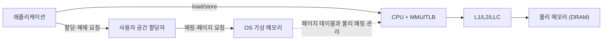
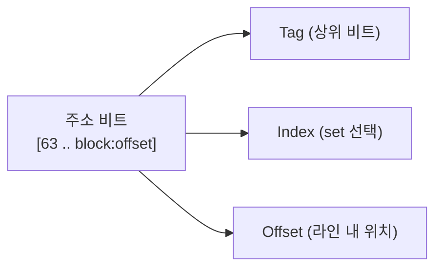
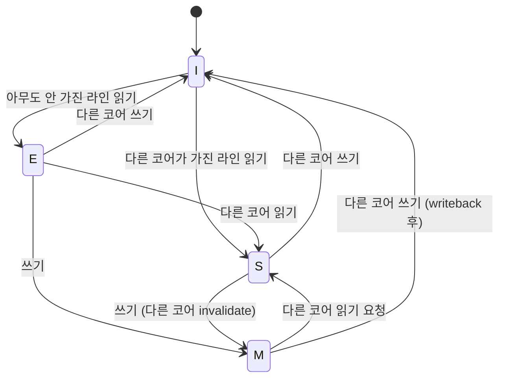
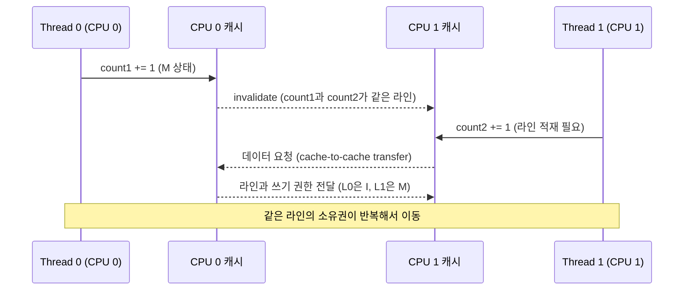
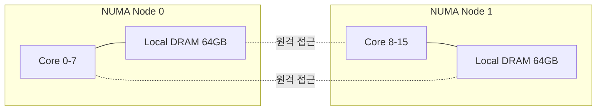

## 들어가며

"메모리"라는 단어는 한 글에서 여러 의미로 쓰인다. 어떤 맥락에서는 DRAM 칩, 다른 맥락에서는 운영체제의 가상 주소 공간, 또 다른 맥락에서는 CPU 안의 SRAM 캐시, 심지어 할당자가 들고 있는 thread-local 캐시까지 같은 단어로 부른다. "캐시"도 마찬가지다. CPU 캐시, TLS 캐시, allocator의 thread cache가 모두 "캐시"라는 같은 이름을 쓴다.

이 글은 메모리 계층 전체 구조를 정리하고, 각 층이 어떤 단위로 데이터를 다루는지, 한 층의 미스가 다음 층에 어떤 비용으로 전파되는지 본다. CPU 캐시의 set-associative 구조와 MESI 일관성 프로토콜, false sharing의 정확한 메커니즘, TLB와 페이지 테이블의 관계, NUMA 토폴로지, 그리고 멀티코어와 NUMA에 맞춰 진화한 할당자의 역사까지 한 흐름으로 다룬다.


---

## 목차
1. [메모리 계층 전체 구조](#1-메모리-계층-전체-구조)
2. ["캐시"의 세 가지 의미](#2-캐시의-세-가지-의미)
3. [CPU 캐시의 내부: 세트와 way](#3-cpu-캐시의-내부-세트와-way)
4. [캐시 일관성과 MESI 프로토콜](#4-캐시-일관성과-mesi-프로토콜)
5. [False Sharing: 같은 라인을 두고 벌어지는 경합](#5-false-sharing-같은-라인을-두고-벌어지는-경합)
6. [Virtual Memory: TLB와 페이지 테이블](#6-virtual-memory-tlb와-페이지-테이블)
7. [NUMA: 코어가 늘어난 이후의 메모리](#7-numa-코어가-늘어난-이후의-메모리)
8. [할당자 진화의 역사](#8-할당자-진화의-역사)
9. [모든 것의 연결: malloc(64)의 전체 경로](#9-모든-것의-연결-malloc64의-전체-경로)


---

## 1. 메모리 계층 전체 구조

### 하드웨어에서 애플리케이션까지

메모리 시스템은 다섯 개의 층으로 정리할 수 있다.



각 층은 같은 종류의 "접근 시간"으로 비교할 수 없다. `malloc`은 정책과 메타데이터를 다루는 소프트웨어 연산이고, TLB는 주소 변환 캐시이며, L1과 DRAM은 실제 load/store 경로에 있다. 따라서 고정 나노초 대신 관리 단위와 느려지는 조건을 구분해야 한다.

| 층 | 구성 요소 | 주된 관리 단위 | 비용이 커지는 조건 |
|:--:|----------|:--------------:|-------------------|
| 애플리케이션 | `new`, `malloc`, `std::vector` | 객체 | 생성자, 재할당, 복사·이동 |
| 사용자 공간 할당자 | tcache, arena, slab/span | 크기 클래스~페이지 묶음 | 캐시 미스, 락 경합, 중앙 풀 보충 |
| OS 가상 메모리 | VMA, 페이지 테이블, page fault | 페이지 | 매핑 변경, zero-fill, 파일 I/O, TLB shootdown |
| 주소 변환 | TLB, page walk cache | 페이지 변환 | TLB 미스, 다단계 page walk |
| 데이터 계층 | L1/L2/LLC, DRAM | 캐시 라인 | 캐시 미스, 일관성 통신, NUMA 원격 접근 |

구체적인 지연은 CPU 세대와 주파수, 캐시 상태, 페이지 테이블의 캐시 적중 여부, OS와 할당자 버전에 따라 달라진다. 안정적인 사실은 절대 시간이 아니라 **fast path에서 벗어날수록 더 많은 공유 상태와 하위 계층을 건드린다**는 비용 구조다.

### `int* p = new int;`의 전체 경로

| 단계 | 계층 | 동작 |
|:----:|------|------|
| 1 | 애플리케이션 | `new int` 호출 |
| 2 | 할당자 | 맞는 크기 클래스의 기존 빈 블록 탐색 |
| 3 | 할당자 | (로컬 캐시 미스 시) 중앙 풀이나 arena에서 묶음 보충 |
| 4 | 할당자 | (보유 영역 부족 시) OS에 새 가상 메모리 영역 요청 |
| 5 | OS | 매핑을 만들거나 기존 매핑을 확장 |
| 6 | 애플리케이션 | `*p = 42;` (첫 접근) |
| 7 | CPU/MMU | TLB와 캐시를 통해 주소 변환 및 데이터 접근 |
| 8 | OS | (페이지가 아직 매핑되지 않은 경우) minor page fault 처리와 zero-fill |
| 9 | CPU | 캐시 라인을 적재하고 쓰기 수행 |

중요한 점은 이 표가 매 할당마다 2번부터 9번까지 실행되는 직선 경로가 아니라는 것이다. 보통의 작은 할당은 이미 확보하고 접근했던 페이지의 빈 블록을 반환하므로 OS 요청도 page fault도 없다. 할당자가 새 익명 매핑을 받아 왔고 해당 페이지를 처음 건드릴 때만 demand paging 경로가 나타난다. 파일 매핑이나 메모리 압박이 관련되면 major fault와 I/O라는 전혀 다른 비용도 생길 수 있다.

```cpp
// 성공하면 큰 가상 주소 범위를 얻는다. 물리 페이지의 실제 배치는 OS 정책에 따른다.
void* p = mmap(NULL, 1ULL << 30, PROT_READ|PROT_WRITE,
               MAP_PRIVATE|MAP_ANONYMOUS, -1, 0);

// 일반적인 demand-zero 매핑에서는 이 페이지의 첫 쓰기가 minor fault를 일으킨다.
((char*)p)[0] = 42;
```

익명 매핑은 대개 필요한 페이지를 처음 접근할 때 물리 프레임과 연결한다. 따라서 큰 가상 주소 예약의 크기와 즉시 resident한 물리 메모리의 크기는 같지 않을 수 있다. 다만 OS의 overcommit, eager population, huge page, page locking 정책에 따라 실제 동작은 달라진다.


## 2. "캐시"의 세 가지 의미

같은 단어가 서로 다른 세 층에서 쓰인다.

### CPU 캐시 (하드웨어)

| 위치 | 캐시 | 일반적 역할 | 상대 지연 |
|------|------|-------------|:---------:|
| 코어별 | L1 | 가장 작은 작업 집합과 load/store 공급 | 가장 낮음 |
| 코어별 또는 코어 묶음 | L2 | L1 miss 흡수 | L1보다 높음 |
| 여러 코어 공유 | LLC(L3) | 코어 간 공유와 DRAM 트래픽 완화 | L2보다 높음 |
| 소켓/노드 | DRAM | 캐시가 놓친 데이터 공급 | 가장 높음 |

하드웨어가 자동으로 관리한다. 프로그래머는 일반 load/store로 캐시의 특정 레벨을 직접 선택하지 않으며, 캐시 친화적인 메모리 접근 패턴(spatial/temporal locality)으로 미스를 줄인다. 용량, associativity, 공유 범위, 지연은 CPU마다 다르고 캐시 라인도 아키텍처별로 확인해야 한다. 현대 x86-64의 데이터 라인은 보통 64바이트다.

### TLS (Thread Local Storage)

```cpp
thread_local int counter = 0;   // 각 스레드가 자신만의 사본을 가진다

void increment() {
    counter++;                  // 스레드 간 충돌 없음
}
```

| Thread 0 | Thread 1 | Thread 2 |
|----------|----------|----------|
| TLS 영역 | TLS 영역 | TLS 영역 |
| `counter: 5` | `counter: 3` | `counter: 8` |
| `errno: 0` | `errno: 2` | `errno: 0` |

x86-64에서 TLS는 FS/GS 세그먼트 레지스터를 통해 접근한다. OS와 컴파일러/런타임이 공동으로 관리한다.

### 할당자 캐시 (소프트웨어)

jemalloc의 Thread Cache, tcmalloc의 ThreadCache는 **TLS에 저장된 객체 풀**이다.

| Size Class | 상태 |
|------------|------|
| 8B | 2개 사용, 3개 여유 |
| 16B | 1개 사용 |
| 32B | 3개 사용 |
| 64B | 모두 여유 |

각 size class별로 작은 free list를 스레드 로컬에 유지해, 락 없이 빠르게 할당/해제한다.

### 세 가지 비교

| 구분 | CPU 캐시 | TLS | 할당자 캐시 |
|------|---------|-----|------------|
| 관리 주체 | 하드웨어 | OS/런타임 | 할당자 라이브러리 |
| 목적 | DRAM 지연 숨기기 | 스레드별 데이터 | 락 없는 할당 |
| 단위 | 64B 캐시 라인 | 변수 단위 | 객체 단위 |
| 제어 | 힌트만 가능 | 가능 | 가능 |
| 위치 | CPU 칩 내부 | 플랫폼별 TLS 영역(예: 스택 근처) | 힙 |

세 항목은 서로 다른 층에서 다른 목적으로 동작하며, 같은 이름을 쓰더라도 동일시하면 안 된다. 특히 TLS는 캐싱 정책이 아니라 변수마다 스레드별 저장 기간(thread storage duration)을 제공하는 저장소 메커니즘이고, 할당자 캐시는 그 TLS에 저장된 포인터가 가리키는 힙 구조이다. TLS 자체의 메모리 배치는 언어가 보장하는 위치가 아니라 플랫폼·런타임 구현에 달려 있다.


## 3. CPU 캐시의 내부: 세트와 way

캐시는 단순한 하나의 큰 배열이 아니다. 메모리 주소 공간이 캐시보다 훨씬 크기 때문에, 어떤 메모리 주소가 어디에 들어갈지 정하는 매핑 규칙이 필요하다.

### Direct-mapped, fully associative, set-associative

| 구조 | 매핑 규칙 | 단점 |
|------|----------|------|
| Direct-mapped | 한 주소가 한 슬롯에만 들어간다 | 충돌이 잦으면 thrashing |
| Fully associative | 어디든 들어갈 수 있다 | 검색 비용이 큼 |
| Set-associative | $N$개 슬롯(way)으로 묶인 set 안 어디든 | 절충 |

실제 CPU의 L1/L2 캐시는 흔히 8-way 또는 16-way set-associative이지만 구현에 따라 다르다. 논의를 위해 32KB L1 데이터 캐시에 64B 라인, 8-way라 가정하면 set 개수는 다음과 같다.

$$\text{sets} = \frac{32{,}768}{64 \times 8} = 64$$

### 주소 분해

캐시 접근에 쓰이는 주소는 세 부분으로 나뉜다. 위의 32KB·8-way 예에서는 index와 offset이 4KB 페이지 오프셋 안에 들어가므로, 그 비트로 set을 찾는 동안 tag를 물리 주소로 비교하는 VIPT 구조를 설명할 수 있다. 실제 index·tag 구성과 해싱은 대상 CPU의 캐시 구현을 확인해야 한다.



- Offset: 한 캐시 라인 안의 바이트 위치. 64B라면 6비트.
- Index: 어느 set에 들어갈지. 64 set이면 6비트.
- Tag: 같은 set 안의 8개 way 중 어느 것이 이 주소에 해당하는지 식별.

CPU가 주소를 보면 index로 set을 고르고, 그 set의 8개 way의 tag를 병렬로 비교한다. 일치하는 way가 있으면 히트, 없으면 미스다.

### Way conflict와 cache thrashing

배열을 큰 stride로 접근하면 같은 index가 반복적으로 부딪친다.

```c
// 32KB L1, 8-way, 64B 라인. set은 64개.
// stride 4096 = 64 set × 64B → 매 접근이 같은 set으로 떨어짐
for (int i = 0; i < N; i++) {
    sum += arr[i * 4096 / sizeof(int)];
}
```

이런 접근 패턴은 같은 set의 way를 번갈아 요구한다. 위의 8-way 가정에서 9개 라인을 반복 순회하면, 매 순회마다 하나의 way가 밀려나고 그 라인이 다음 순회에서 다시 필요해져 miss가 반복되는 thrashing이 발생한다. LRU는 가장 최근에 들어온 라인이 아니라 **가장 오래 사용하지 않은** way를 쫓아내므로, 교체 정책이 완벽한 LRU가 아니거나 접근 순서가 바뀌면 거동도 달라진다. 실제 교체 정책은 pseudo-LRU 등 구현별로 다르다. 이 패턴이 set-associative 캐시 설계의 약점이다.

해결책은 데이터 레이아웃을 다시 설계해 stride를 `set 개수 × 라인 크기`(이 예에서는 64 × 64 = 4096바이트)의 배수에서 멀어지게 하는 것이다.


## 4. 캐시 일관성과 MESI 프로토콜

각 코어가 자신의 L1/L2 캐시를 가지므로, 같은 메모리 주소가 여러 코어의 캐시에 동시에 존재할 수 있다. 한 코어가 그 주소를 수정하면 다른 코어의 사본은 stale이 된다. 이를 막는 하드웨어 프로토콜이 캐시 일관성(cache coherence)이다.

### MESI 4상태

각 캐시 라인은 다음 네 상태 중 하나다.

| 상태 | 의미 |
|------|------|
| Modified (M) | 이 캐시에서 수정됨, 다른 캐시는 가지지 않음, 메모리와 다름 |
| Exclusive (E) | 이 캐시만 가짐, 메모리와 같음 |
| Shared (S) | 다른 캐시에도 사본이 있을 수 있음, 메모리와 같음 |
| Invalid (I) | 무효 (사용 불가) |



### 쓰기의 비용

코어 0이 Shared 상태의 라인에 쓰려면 다른 캐시에 있는 공유 사본을 무효화하고 쓰기 권한을 얻어야 한다. 버스 snooping 구조는 요청을 넓게 관찰하게 할 수 있지만, 디렉터리·snoop filter가 있는 시스템은 실제 sharer를 추적해 대상 요청만 보낼 수도 있다. 따라서 항상 모든 코어에 브로드캐스트된다고 단정할 수 없다. 요청 코어는 필요한 권한이 도착하기 전까지 해당 쓰기를 완료할 수 없으며, 일부 독립 연산은 out-of-order 실행으로 겹칠 수 있다.

| 캐시 상태 | 필요한 동작 | 상대적 비용 |
|----------|-----------|-----------|
| M (Modified) | 현재 코어가 가진 라인에 쓰기 | 가장 짧은 경로 |
| E (Exclusive) | 로컬 상태를 M으로 전이한 뒤 쓰기 | 외부 데이터 전송 없이 처리 가능 |
| S (Shared) | 다른 사본의 무효화 권한 획득 | 코어 간 일관성 통신 필요 |
| I (Invalid) | 라인 데이터와 쓰기 권한 획득 | 캐시·인터커넥트 상태에 따라 가장 길어질 수 있음 |

이 비용 차이가 false sharing과 같은 멀티스레드 성능 문제의 근원이다.


## 5. False Sharing: 같은 라인을 두고 벌어지는 경합

False sharing은 적어도 한 스레드가 쓰고, 서로 다른 논리 데이터가 **같은 캐시 라인**을 공유할 때 발생한다. 변수는 다르지만 캐시 일관성은 라인 단위로 동작하기 때문에, 한 변수를 쓰는 것만으로 다른 변수의 캐시 사본이 무효화된다. 상대 스레드가 읽기만 해도 writer의 쓰기가 그 라인의 공유 사본을 무효화하므로, 두 스레드 모두 writer일 필요는 없다.

### 시나리오

```cpp
struct Counter {
    long count1;   // CPU 0의 스레드가 사용
    long count2;   // CPU 1의 스레드가 사용
};                 // 두 변수가 같은 64바이트 라인에 있음
```



두 코어가 번갈아 쓰면 라인의 쓰기 소유권이 인터커넥트를 통해 반복해서 이동한다. 실제 지연은 코어 배치, 소켓 경계, 저장 버퍼, 일관성 프로토콜 구현에 따라 크게 달라지지만, 단일 코어의 로컬 갱신보다 처리량이 급격히 떨어지는 원인은 이 소유권 이동이다.

### 측정

측정할 때는 같은 총 연산 수를 유지한 채 카운터를 한 라인에 모은 경우와 각 카운터를 `std::hardware_destructive_interference_size` 이상 떨어뜨린 경우를 비교한다. 수행 시간뿐 아니라 `perf c2c`, HITM 이벤트, cache-to-cache 전송량을 함께 보면 계산량이 아니라 일관성 트래픽이 병목인지 판별할 수 있다. 패딩의 배율은 시스템마다 다르므로 결과값 자체보다 코어 수에 따른 확장 곡선을 기록해야 한다.

### 해결: 패딩과 alignment

```cpp
struct PaddedCounter {
    long count1;
    char pad1[64 - sizeof(long)];
    long count2;
    char pad2[64 - sizeof(long)];
};
```

C++17은 이를 표준화했다.

```cpp
struct alignas(std::hardware_destructive_interference_size) Counter {
    long count;
};
```

`std::hardware_destructive_interference_size`는 구현이 제공하는 false-sharing 회피 기준값이다. 흔히 64바이트지만 구현과 대상 아키텍처에 따라 다를 수 있다. 128바이트를 반환하는 구현이 있다면 그것을 단순히 "프리페처가 인접 라인을 가져오기 때문"으로 일반화할 수는 없다. 실제 캐시 라인 또는 일관성 granule이 128바이트인 프로세서도 있고, 구현이 보수적인 간격을 선택할 수도 있으므로 측정과 플랫폼 문서를 함께 봐야 한다.

여기서 나오는 요구는 하나다. 서로 다른 코어가 쓰는 데이터는 라인 경계로 갈라 놓아야 한다. 그 데이터를 정적 배열로 잡든 힙에서 받아오든, 배치를 정하는 쪽이 이 요구를 만족시켜야 한다는 사실은 같다. 하드웨어가 강제하는 것은 "일관성은 라인 단위로 유지된다"까지이고, 그 단위에 맞춰 객체를 벌려 놓는 일은 전적으로 소프트웨어의 몫이다.


## 6. Virtual Memory: TLB와 페이지 테이블

### 가상 주소 공간이 필요한 이유

```text
프로그램 A: "주소 0x1000에 데이터를 저장한다"
프로그램 B: "나도 0x1000에 저장한다"
결과: 충돌
```

가상 메모리가 없던 시절에는 모든 프로그램이 물리 주소를 직접 다뤘다. 다음과 같은 문제가 있었다.

- 두 프로그램이 같은 주소를 쓰면 충돌
- 프로그램 크기가 물리 메모리보다 크면 실행 불가
- 메모리 보호가 없어 한 프로그램의 버그가 시스템 전체를 망가뜨림

가상 메모리는 각 프로세스에 독립된 가상 주소 공간을 주고, 페이지 테이블이 가상→물리 매핑을 담당한다.

| 가상 주소 | 프로세스 A | 프로세스 B | 물리 주소 |
|----------|-----------|-----------|----------|
| 0x1000 | A의 데이터 | - | 0x5000 |
| 0x1000 | - | B의 데이터 | 0x8000 |

같은 가상 주소가 다른 물리 주소로 매핑되어 충돌이 사라진다.

### Page Table Walk

x86-64는 4단계 페이지 테이블을 사용한다(최근 5단계로 확장).

| 단계 | 명칭 | 비트 |
|------|------|------|
| 1 | PML4 | 47:39 |
| 2 | PDPT | 38:30 |
| 3 | PD | 29:21 |
| 4 | PT | 20:12 |
| - | offset | 11:0 |

TLB miss에서 필요한 page-table walk는 최악에는 여러 레벨의 엔트리를 차례로 읽는다. 그러나 각 엔트리는 page-walk cache나 일반 캐시에 있을 수 있고, 하드웨어는 가능한 접근을 겹친다. 따라서 “모든 load마다 DRAM 네 번”으로 환산할 수는 없다. TLB는 이 주소 변환 결과를 캐시해 반복 walk를 피한다.

### TLB (Translation Lookaside Buffer)

TLB는 최근 변환된 가상→물리 매핑을 캐시하는 작은 하드웨어 캐시다.

| 구성 | 역할 | 비용을 좌우하는 조건 |
|------|------|---|
| TLB | 최근 가상→물리 매핑 캐시 | 계층, 페이지 크기, 동시 lookup 구조 |
| Page-walk cache | 상위 page-table 엔트리 재사용 | 마이크로아키텍처와 working set |
| Page table | 전체 매핑 저장 | 엔트리의 cache hit/miss, walk 레벨, NUMA |

TLB의 엔트리 수와 계층, 페이지 크기별 분할은 CPU마다 다르다. TLB 미스가 나면 하드웨어 또는 소프트웨어 page table walk가 일어나고, 성공한 변환이 TLB에 다시 채워진다.

### HugePage

4KB 페이지로 1GB 메모리를 매핑하려면 262,144개의 페이지 테이블 엔트리가 필요하다. TLB 미스가 잦아진다.

해결책은 더 큰 페이지를 쓰는 것이다.

| 페이지 크기 | 엔트리당 커버 |
|-------------|--------------|
| 4KB | 4KB |
| 2MB (Huge Page) | 2MB |
| 1GB (Gigantic Page) | 1GB |

같은 1GB 메모리를 2MB 페이지로 매핑하면 512개의 엔트리만 필요하다. tcmalloc의 `HugePageAwareAllocator`가 이를 활용한다.

### Demand Paging의 비용

페이지 폴트는 두 종류로 나뉜다.

| 종류 | 필요한 작업 | 지연을 지배하는 요소 |
|------|-----------|---------------------|
| Minor fault | 디스크 I/O 없이 페이지 테이블 매핑, demand-zero, COW 등 처리 | 페이지 할당, zero-fill, 락 경합, TLB 무효화 |
| Major fault | 파일이나 swap에서 페이지를 읽은 뒤 매핑 | 저장장치와 page cache 상태, I/O 큐 |

실시간 경로에서 사용할 메모리를 미리 접근하는 이유가 이것이다. lazy allocation에 맡기면 최초 접근의 fault가 프레임 tail latency에 섞일 수 있다. 다만 무조건 모든 예약 영역을 touch하면 시작 시간과 resident set이 늘어나므로 실제 working set만 준비해야 한다.


## 7. NUMA: 코어가 늘어난 이후의 메모리

메모리 컨트롤러와 코어 사이의 거리·대역폭이 모든 코어에 균일한 SMP 구조는 코어 수가 늘수록 한계에 부딪힌다. 모든 메모리 접근이 같은 경로를 타기 때문이다. 해결책은 메모리를 노드별로 분할해 접근 비용이 균일하지 않은 NUMA(Non-Uniform Memory Access)로 가는 것이다. 코어 수 하나를 전환 임계로 삼으면 단일 소켓 다수 코어와 다중 소켓 소수 코어를 모두 설명하지 못한다. 아래 그림의 8코어·64GB 구성은 예시일 뿐이다.

### NUMA 구조



| 접근 종류 | 경로 | 일반적 경향 |
|----------|------|-------------|
| Local | 현재 소켓/노드의 메모리 컨트롤러 | 기준 |
| Remote | 소켓·노드 간 인터커넥트를 거쳐 다른 메모리 컨트롤러 | 추가 홉과 대역폭 경쟁 |

코어가 다른 노드의 메모리에 접근하면 UPI나 Infinity Fabric 같은 노드 간 인터커넥트를 거친다. 지연 배율과 대역폭은 토폴로지와 부하에 따라 달라지므로 `numactl --hardware`, `lstopo`, 메모리 지연 벤치마크로 대상 장비를 측정해야 한다.

### NUMA-aware 할당자

jemalloc은 스레드가 올라간 CPU를 기준으로 arena를 나누는 `opt.percpu_arena` 모드를 제공하고(기본값은 비활성), tcmalloc은 빌드 옵션으로 NUMA 노드를 size class partition에 매핑한다. 어느 쪽도 노드별 arena를 기본 전략으로 두지는 않으므로, 노드 지역성은 first-touch 정책과 명시적 노드 지정으로 확보해야 한다.

| 전략 | 설명 |
|------|------|
| Arena per CPU/노드 | 노드별로 별도 arena, 스레드는 자기 노드 arena 사용 |
| First-touch policy | 페이지를 처음 touch한 스레드의 노드에 물리 페이지 할당 |
| numactl/`numa_alloc_onnode` | 명시적으로 특정 노드에서 할당 |

NUMA를 무시하면 멀티스레드 워크로드가 코어를 추가할수록 오히려 느려질 수 있다. 모든 스레드가 한 노드에서 시작했다가 나중에 다른 노드로 이주하면, 이미 할당된 메모리는 원격이 된다.


## 8. 할당자 진화의 역사

할당자의 진화는 하드웨어의 진화에 대한 응답이다.

### 1990년대: 단일 코어

| 항목 | 내용 |
|------|------|
| CPU | 단일 코어 |
| 메모리 | 수십 MB |
| malloc 구현 | 단순 free list |
| 락 경합 | 없음 |
| 주된 문제 | 단편화 |

```c
static struct block* free_list;
static pthread_mutex_t lock;     // 단일 코어라 거의 경합 없음

void* malloc(size_t size) {
    pthread_mutex_lock(&lock);
    /* free_list에서 적절한 블록 탐색 */
    pthread_mutex_unlock(&lock);
}
```

### 2000년대: 멀티코어

| 항목 | 내용 |
|------|------|
| CPU | 2~4 코어 |
| 메모리 | 수 GB |
| 새 문제 | 전역 락이 병목 |

```text
Thread 0: malloc → lock → 작업 → unlock
Thread 1: malloc → lock → [대기] → 작업
Thread 2: malloc → lock → [대기] → 작업
```

해결책 가운데 하나가 **tcmalloc**(Google, 2005)의 front-end cache다. 고전 구현은 스레드별 cache를 사용하고, 현대 TCMalloc은 빌드·설정에 따라 per-CPU front end도 제공한다. 빠른 경로는 로컬 size-class cache에서 처리하고, refill·release에는 middle end와의 동기화가 필요하다.

### 2010년대: NUMA와 대용량 메모리

| 항목 | 내용 |
|------|------|
| CPU | 8~16 코어, NUMA |
| 메모리 | 64~128GB, 노드 분리 |
| 새 문제 | 원격 접근, TLB 미스 |

jemalloc이 다음으로 대응했다.

- 선택적 per-CPU arena: arena 경합을 분산 (NUMA 물리 배치는 별도 정책 필요)
- Extent 기반 관리: 대용량 메모리 효율적 처리
- Decay 기반 반환: 해제된 dirty/muzzy 페이지의 보유량과 OS 반환 지연을 조절

### 2020년대: 수십 코어와 HugePage

| 항목 | 내용 |
|------|------|
| CPU | 64+ 코어 |
| 새 문제 | 스레드 캐시 메모리 낭비, 스레드 마이그레이션 |

| 방식 | 동작 |
|------|------|
| Per-thread | 스레드 수에 비례해 캐시가 늘고, 다른 스레드가 해제한 객체가 원래 캐시로 바로 돌아오지 않을 수 있음 |
| Per-CPU | 현재 CPU가 소유한 캐시를 사용해 메타데이터 경합과 캐시 라인 이동을 줄이지만, 선점·마이그레이션 중 정확한 CPU 소유권 처리가 필요 |

tcmalloc은 Per-CPU Cache로 전환했고, HugePageAwareAllocator로 TLB 효율을 높였다.

### 진화 요약

| 시대 | 하드웨어 변화 | 문제 | 해결책 |
|------|-------------|------|--------|
| 1990s | 단일 코어 | 단편화 | Best-fit, Buddy system |
| 2000s | 멀티코어 | 락 경합 | Thread Cache (tcmalloc) |
| 2010s | NUMA, 대용량 | 원격 접근, TLB 미스 | Arena per CPU, Extent |
| 2020s | 수십 코어 | 캐시 낭비, 스레드 이동 | Per-CPU Cache, HugePage |

할당자 진화는 하드웨어 변화에 대한 누적된 대응이다. 각 시대마다 새로 추가된 층이 이전 층의 약점을 보완하면서 전체 구조가 더 복잡해졌다.


## 9. 모든 것의 연결: malloc(64)의 전체 경로

`malloc(64)`의 지연 분포는 하나의 평균값보다 어느 경로를 탔는지로 설명하는 편이 정확하다.

| 경로 | 필요한 동작 | 관찰해야 할 지표 |
|------|-----------|-----------------|
| 로컬 fast path | 크기 클래스 계산, 로컬 free-list pop, 메타데이터 갱신 | 중앙값, 명령어 수 |
| 로컬 캐시 보충 | arena/central cache에서 여러 객체 이동 | p95/p99, 락·원자 연산 경합 |
| 새 extent/span | 보유 가상 영역 분할 또는 OS 매핑 요청 | 시스템 콜 수, VMA 변화 |
| 첫 접근 | 주소 변환, 필요하면 demand-zero fault, 캐시 라인 적재 | minor fault, dTLB miss, cache miss |
| 원격 해제/NUMA | 소유자 전달, 원격 메타데이터 또는 원격 DRAM 접근 | remote access, cache-to-cache 전송 |

일반적인 작은 객체 워크로드에서는 로컬 fast path의 비중이 높을 수 있지만 그 비율은 할당자 설정, 크기 분포, 스레드 간 소유권 이전, 메모리 압박에 따라 달라진다. 평균만 기록하면 드문 보충·fault 경로가 프레임의 긴 꼬리 지연을 만드는 사실을 놓친다. 게임 루프에서는 중앙값과 함께 p95/p99, 페이지 폴트 수, 프레임별 최대 할당 지연을 측정해야 한다.

### 용어 정리

| 용어 | 의미 | 위치 |
|------|------|------|
| CPU 캐시 | L1/L2/L3 SRAM | CPU 칩 내부 (하드웨어) |
| TLS | Thread Local Storage | 플랫폼별 스레드 저장 영역 (OS/런타임 관리) |
| Thread Cache | 할당자의 스레드별 객체 풀 | TLS에 저장된 소프트웨어 구조 |
| Arena | 할당자의 메모리 풀 | 힙 (여러 스레드 공유 가능) |
| Extent/Span | OS에서 받은 페이지 묶음 | 힙 (크기·정렬은 할당자와 페이지 크기에 따라 다름) |
| 가상 메모리 | 프로세스별 주소 공간 | OS가 관리하는 추상화 |
| 물리 메모리 | 실제 DRAM | 하드웨어 |
| Page Table | 가상→물리 매핑 테이블 | OS 커널 자료구조 |
| TLB | Page Table의 캐시 | CPU 내부 (하드웨어) |
| HugePage | 2MB 또는 1GB 페이지 | OS/하드웨어 기능 |


---

## 결론

메모리 계층은 다섯 개의 층으로 정리되지만, 그 각 층마다 자체적인 캐시와 자체적인 단위가 있다. CPU 캐시는 64B 라인을, OS는 4KB 페이지를, 할당자는 size class를, 애플리케이션은 객체 단위를 다룬다. 한 층의 미스는 다음 층의 비용으로 전파되지만, 그 배율은 캐시 상태·워크로드·구현에 따라 크게 달라지므로 고정된 차수로 일반화할 수 없다. 공통점은 fast path를 벗어날수록 더 많은 공유 상태와 하위 계층을 건드린다는 것이다. 이 사실이 메모리 친화적 코드 작성의 모든 출발점이다.

set-associative 캐시와 MESI 프로토콜은 캐시가 단순한 배열이 아니라 정교한 하드웨어 시스템이라는 점을 보여준다. False sharing, way conflict, NUMA 원격 접근은 모두 그 시스템의 빈틈에서 발생한다. 그 빈틈을 메우는 도구가 패딩, 정렬, NUMA-aware 할당자, HugePage이며, 이들 모두가 같은 압력에 대한 응답이다.

이 계층 구조는 단편적인 최적화 팁을 외우기 위한 것이 아니라, 어느 층의 어떤 미스와 공유 상태가 비용을 만들었는지 설명하는 골격이다.


## 더 읽을거리

- Ulrich Drepper, "What Every Programmer Should Know About Memory" (2007): <https://people.freebsd.org/~lstewart/articles/cpumemory.pdf>
- Intel 64 and IA-32 Architectures Optimization Reference Manual
- Linux Kernel Documentation, Memory Management: <https://www.kernel.org/doc/html/latest/admin-guide/mm/index.html>
- jemalloc 배경과 채택 사례: <https://github.com/jemalloc/jemalloc/wiki/Background> (내부 구조 요약은 jemalloc(3) 매뉴얼: <https://jemalloc.net/jemalloc.3.html>)
- tcmalloc design: <https://google.github.io/tcmalloc/design.html>
- Christoph Lameter, "NUMA (Non-Uniform Memory Access): An Overview", ACM Queue 2013
- Sutter, H., "Eliminate False Sharing", Dr. Dobb's Journal 2009
