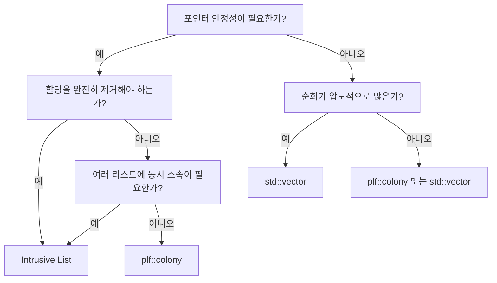

## 들어가며

`std::list`는 표준 라이브러리의 일급 시민이지만, 성능 민감 영역에서는 노드 단위 힙 할당과 캐시 미스가 그대로 비용으로 돌아온다. 게임 엔진, 운영체제 커널, 실시간 시스템처럼 프레임/응답 시간 변동을 허용할 수 없는 코드 베이스가 거의 예외 없이 *intrusive list* 패턴을 채택해온 이유다.

이 글은 `std::list`의 구조적 비용을 측정 가능한 단위로 분해한 뒤, intrusive list가 무엇을 어떻게 바꾸는지를 본다. `container_of` 매크로 같은 핵심 기법, Linux 커널의 `list.h`와 Doom 3의 `idLinkList` 같은 실제 사례, 그리고 현대적 대안인 `plf::colony`(C++26 `std::hive`)까지 다룬다.

마지막에는 `std::list`, intrusive list, `plf::colony`, `std::vector`를 비교할 때 확인해야 할 워크로드별 트레이드오프와 컨테이너 선택 기준을 정리한다.


---

## 목차
1. [std::list의 세 가지 치명적 문제](#1-stdlist의-세-가지-치명적-문제)
2. [Intrusive List: 패러다임의 전환](#2-intrusive-list-패러다임의-전환)
3. [구현의 핵심: container_of 매크로](#3-구현의-핵심-container_of-매크로)
4. [실전 사례: Doom 3와 Linux 커널](#4-실전-사례-doom-3와-linux-커널)
5. [현대적 대안: plf::colony와 std::hive](#5-현대적-대안-plfcolony와-stdhive)
6. [컨테이너 선택 가이드](#6-컨테이너-선택-가이드)
7. [실전 구현 예제](#7-실전-구현-예제)


---

## 1. std::list의 세 가지 치명적 문제

### 노드마다 힙 할당

`std::list`는 각 요소를 추가할 때마다 개별 노드를 동적 할당한다.

```cpp
std::list<int> myList;
myList.push_back(42);  // 힙 할당 발생!
```

내부적으로 `std::list`는 다음과 같은 구조를 사용한다:

```cpp
template<typename T>
struct ListNode {
    T data;           // 실제 데이터
    ListNode* prev;   // 이전 노드 포인터 (8바이트)
    ListNode* next;   // 다음 노드 포인터 (8바이트)
};
```

이는 여러 성능 오버헤드를 발생시킨다:

- **malloc/new 호출 비용**: 각 삽입마다 메모리 할당자를 호출한다. 시스템 콜까지 내려가지 않더라도, 할당자 내부의 락(lock) 획득과 메타데이터 관리는 상당한 비용이다.
- **메모리 단편화**: 작은 노드들이 힙 전체에 흩어져 배치되어 메모리가 비효율적으로 사용된다.
- **할당자 메타데이터**: 각 할당 블록에는 크기, 체크섬 등의 메타데이터가 추가된다. 일반적으로 8-16바이트의 오버헤드가 발생하는데, 4바이트 int를 저장하기 위해 32바이트 이상을 사용하는 셈이다.
- **해제 비용**: 리스트를 파괴할 때 각 노드마다 개별적인 `free/delete` 호출이 필요하다.

기본 allocator를 쓰는 `std::list`는 보통 노드마다 allocator를 호출한다. pool allocator를 주입하면 이 비용 구조도 달라진다. `vector`는 연속 저장과 재할당 시 이동을, intrusive list는 객체 수명과 link 필드를 외부에서 이미 관리한다는 전제를 부담하므로 삽입 시간 하나만으로 동등 비교할 수 없다.

### 다중 역참조의 함정

포인터를 저장하는 `std::list`에서는 더 심각한 문제가 발생한다:

```cpp
std::list<GameObject*> entities;

for (auto it = entities.begin(); it != entities.end(); ++it) {
    (*it)->Update();  // 몇 번의 역참조가 발생할까?
}
```

메모리 레이아웃을 따라가보면:

```text
Iterator -> ListNode -> GameObject* -> GameObject 실제 데이터
   ^           ^            ^              ^
   |           |            |              |
역참조 1    역참조 2    역참조 3       최종 데이터
```

실제로는 3단계의 역참조가 발생한다. 각 단계마다 잠재적인 캐시 미스가 발생할 수 있고, CPU의 프리페처(prefetcher)는 예측 불가능한 메모리 점프 패턴에서 무력화된다. 이는 파이프라인 스톨(pipeline stall)로 이어져 성능을 크게 저하시킨다.

### 캐시 미스의 폭발

근본적인 문제는 공간 지역성(spatial locality)의 파괴이다:

```text
메모리 주소:
[Node1: 0x1000] -> data at 0x5000
[Node2: 0x3000] -> data at 0x7000
[Node3: 0x2000] -> data at 0x4000
[Node4: 0x8000] -> data at 0x1000

각 노드가 무작위 주소에 배치 -> 순회 시 캐시라인 활용 불가
```

주요 x86-64 CPU의 캐시 라인은 보통 64바이트지만 표준 컨테이너의 실제 노드 크기와 allocator 배치는 구현에 따라 다르다. 노드가 서로 다른 페이지에 흩어지면 hardware prefetch가 어려워지고 한 라인에서 사용하는 바이트 비율이 낮아질 수 있다. 반대로 pool allocator가 노드를 밀집 배치하면 miss가 줄어든다. `perf stat`로 cycles, cache/TLB miss와 bandwidth를 직접 측정해 배치 효과를 확인해야 한다.

## 2. Intrusive List: 패러다임의 전환

Intrusive List는 발상을 완전히 뒤집는다. 컨테이너가 데이터를 소유하는 것이 아니라, 데이터가 링크 정보를 포함하도록 만든다.

### 전통적 방식 vs Intrusive 방식

전통적인 `std::list`:

```cpp
template<typename T>
class List {
    struct Node {
        T data;        // 데이터 복사 또는 포인터
        Node* prev;
        Node* next;
    };
    Node* head;
};
```

Intrusive List:

```cpp
// 링크 노드 구조체 - 데이터 없음!
struct ListNode {
    ListNode* prev;
    ListNode* next;
};

// 사용자 객체가 직접 링크 포함
class GameObject {
    int health;
    Vector3 position;
    // ... 게임 객체 데이터 ...

    ListNode updateListNode;    // Update 리스트용
    ListNode renderListNode;    // Render 리스트용

public:
    void Update() { /* ... */ }
    void Render() { /* ... */ }
};
```

메모리 레이아웃을 비교해보자:

```cpp
std::list<GameObject>:
Heap: [prev | next | GameObject] -> [prev | next | GameObject] -> ...
      하나의 node allocation       하나의 node allocation

Intrusive List:
Heap: [GameObject with embedded links] -> [GameObject with embedded links]
       별도 node allocation 없음          별도 node allocation 없음
```

`std::list<T>`는 일반적으로 링크와 `T`를 **같은 노드 할당 안에** 저장한다. 노드와 객체를 따로 두 번 할당하는 구조가 아니다. intrusive list의 차이는 이미 존재하는 객체 안의 링크를 사용해 별도 list node allocation을 없애고, 한 객체가 여러 자료구조의 수명 정책과 독립적으로 링크를 가질 수 있다는 데 있다.

### 할당 완전 제거

Intrusive List의 가장 큰 장점은 컨테이너 조작 시 힙 할당이 전혀 발생하지 않는다는 것이다:

```cpp
// 게임 엔티티 풀 사전 할당
GameObject entities[MAX_ENTITIES];  // 단 한 번의 할당

// member hook을 템플릿에서 쓰려면 필드가 public이거나 friend 접근이 허용되어야 한다.
IntrusiveList<GameObject, &GameObject::updateListNode> activeEntities;

// 리스트 추가 시 힙 할당 ZERO
for (int i = 0; i < 10; i++) {
    activeEntities.push_back(&entities[i]);  // 단순 포인터 연결
}
```

이는 다음과 같은 이점을 제공한다:

- **노드용 malloc/free 호출 제거**: 이미 살아 있는 객체의 link를 연결할 때 별도 노드를 할당하지 않는다.
- **수명 정책 분리**: 객체 저장소를 배열·풀·개별 할당 중에서 별도로 선택할 수 있다.
- **예측 가능한 link 연산**: 연결·해제 자체는 포인터 갱신으로 끝난다.

intrusive라는 사실만으로 객체가 연속 배치되거나 전체 프레임 시간이 결정적으로 변하지는 않는다. 객체 수명 관리와 backing store가 별도 할당을 한다면 그 비용은 그대로 남는다. 장점은 컨테이너 link의 할당 정책을 객체 수명 정책과 명시적으로 결합할 수 있다는 데 있다.

### 역참조 횟수 감소

Intrusive List에서는 역참조 횟수가 극적으로 감소한다:

```cpp
// std::list<GameObject*>
Iterator -> ListNode -> GameObject* -> GameObject members
   (1)         (2)          (3)

// Intrusive List
Iterator -> GameObject (links embedded) -> members
   (1)                                       (2)
```

x86-64 어셈블리 코드로 비교해보면 차이가 명확하다:

```nasm
; std::list<T*> 순회
mov rax, [rdi]        ; Iterator -> Node
mov rbx, [rax + 16]   ; Node -> T* (data offset)
mov rcx, [rbx + 8]    ; T* -> member
call [rcx]            ; virtual function call

; Intrusive list 순회
mov rax, [rdi]        ; Iterator -> Object
mov rcx, [rax + 8]    ; Object -> member (직접)
call [rcx]            ; virtual function call

명령어 1개 감소 + 메모리 접근 1회 감소
```

이 비교는 iterator가 별도 owner 필드 없이 객체 주소를 복원하는 base/member-offset hook을 가정한다. owner 포인터를 hook에 저장하는 구현(아래 실전 예제)은 `node->owner` 로드 한 번과 hook당 8바이트가 추가되므로, 위 역참조 횟수와 메모리 계산에서 그 비용을 따로 센다.

### 다중 리스트 멤버십

`std::list<T*>`도 같은 객체 포인터를 여러 리스트에 넣을 수 있다. Intrusive List의 차이는 각 소속마다 외부 노드를 새로 할당하지 않고 객체 내부 hook으로 연결해 할당과 관리 비용을 줄인다는 점이다:

```cpp
class Entity {
    // 예시를 위해 hook 필드가 public이거나 friend 접근이 허용된다고 가정한다.
    // 하나의 객체가 여러 리스트에 동시 소속
    ListNode spatialGridNode;   // 공간 분할 그리드용
    ListNode updateNode;        // 업데이트 리스트용
    ListNode renderNode;        // 렌더 리스트용
    ListNode collisionNode;     // 충돌 검사 리스트용

    Vector3 position;
    Mesh* mesh;
    // ... other data ...
};

// 각각 독립적으로 관리
IntrusiveList<Entity, &Entity::spatialGridNode> grid[GRID_SIZE];
IntrusiveList<Entity, &Entity::updateNode> activeEntities;
IntrusiveList<Entity, &Entity::renderNode> visibleEntities;
IntrusiveList<Entity, &Entity::collisionNode> collidableEntities;

// 하나의 엔티티를 여러 리스트에 추가
Entity* entity = &entityPool[i];
grid[GetGridIndex(entity->position)].push_back(entity);
activeEntities.push_back(entity);
visibleEntities.push_back(entity);
collidableEntities.push_back(entity);
```

`std::list`로는 이를 구현할 수 없다. 포인터를 여러 리스트에 추가할 수는 있지만, 각각 별도의 노드가 생성되므로 메모리 낭비와 관리 복잡도가 증가한다.

## 3. 구현의 핵심: container_of 매크로

### offsetof를 사용한 역계산

Intrusive List의 핵심 문제는 이것이다: 링크 노드 포인터에서 실제 객체 포인터를 어떻게 얻는가?

답은 `offsetof` 매크로에 있다:

```cpp
#include <stddef.h>

// offsetof(type, member) - 구조체 시작부터 멤버까지의 바이트 오프셋
size_t offset = offsetof(GameObject, updateListNode);
```

이를 이용한 Linux 커널 스타일의 `container_of` 매크로:

```cpp
#define container_of(ptr, type, member) \
    ((type *)((char *)(ptr) - offsetof(type, member)))
```

동작 원리를 메모리 레이아웃으로 이해해보자:

```cpp
struct GameObject {
    int health;        // offset: 0,  size: 4
    float x, y;        // offset: 4,  size: 8
    // 64비트 ABI에서는 ListNode의 8바이트 정렬을 위한 padding이 생길 수 있다.
    ListNode node;     // 예시 ABI의 offset: 16, size: 16
};

메모리 주소:
0x1000      health (4 bytes)
0x1004      x (4 bytes)
0x1008      y (4 bytes)
0x100C      padding (4 bytes)
0x1010      node.prev (8 bytes)
0x1018      node.next (8 bytes)

nodePtr = 0x1010
offsetof(GameObject, node) = 16 (0x10)
GameObject* obj = 0x1010 - 0x10 = 0x1000
```

C의 `container_of`와 같은 offset 역산은 커널·컴파일러가 정한 객체 레이아웃 계약 안에서는 유용하지만, 일반 C++ 템플릿에서 pointer-to-member로 offset을 구하는 휴대 가능한 연산은 없다. null 객체의 member 주소를 만든 것처럼 계산하거나 임의 pointer-to-member를 정수 offset으로 해석하는 관용 코드는 C++ 표준 계약이 아니므로 예제 구현의 기반으로 쓰지 않는다.

`offsetof(T, member)`도 `T`가 standard-layout일 때만 조건 없이 지원된다. 휴대 가능한 C++ intrusive container는 hook에 owner 포인터를 저장하거나, 서로 다른 tag의 base hook을 상속하고 `static_cast`로 객체를 복원하는 방식을 사용할 수 있다. owner 포인터는 hook마다 한 포인터를 더 쓰지만 객체 모델의 빈틈에 의존하지 않는다.

### 순환 이중 연결 리스트

효율적인 Intrusive List는 순환(circular) 이중 연결 구조를 사용한다:

```cpp
struct ListNode {
    ListNode* prev;
    ListNode* next;
};

// 순환: tail->next = head, head->prev = tail
```

순환 구조는 엣지 케이스 처리를 극적으로 단순화한다:

```cpp
// 비순환 리스트 - 조건 분기 필요
void insert(Node* pos, Node* newNode) {
    if (pos == nullptr) {
        // 빈 리스트 처리
    } else if (pos->next == nullptr) {
        // 끝에 삽입 처리
    } else {
        // 중간 삽입 처리
    }
}

// 순환 리스트 - 단일 코드 경로
void insert(Node* pos, Node* newNode) {
    newNode->next = pos->next;
    newNode->prev = pos;
    pos->next->prev = newNode;  // 순환이므로 항상 유효
    pos->next = newNode;
}
```

이중 연결의 이점도 명확하다:

```cpp
// 단일 연결 리스트 - 제거 시 O(n)
void remove(Node* node) {
    Node* prev = head;
    while (prev->next != node) prev = prev->next;  // O(n) 탐색!
    prev->next = node->next;
}

// 이중 연결 리스트 - 제거 시 O(1)
void remove(Node* node) {
    node->prev->next = node->next;
    node->next->prev = node->prev;
}
```

### 센티널 노드 패턴

센티널(sentinel) 노드는 데이터를 포함하지 않는 더미 노드로, 리스트의 시작과 끝을 표시한다:

```cpp
template<typename T, ListNode T::*NodePtr>
class IntrusiveList {
    ListNode sentinel;  // 더미 노드

public:
    IntrusiveList() {
        // 빈 리스트: 센티널이 자기 자신을 가리킴
        sentinel.next = &sentinel;
        sentinel.prev = &sentinel;
    }

    bool empty() const {
        return sentinel.next == &sentinel;
    }

    void push_back(T* obj) {
        ListNode* node = &(obj->*NodePtr);
        insert(&sentinel, node);  // 항상 센티널 앞에 삽입
    }

private:
    void insert(ListNode* pos, ListNode* newNode) {
        newNode->next = pos;
        newNode->prev = pos->prev;
        pos->prev->next = newNode;
        pos->prev = newNode;
    }
};
```

센티널의 이점:

1. **NULL 체크 제거**: 모든 연산에서 조건문이 사라진다.
2. **엣지 케이스 통합**: 빈 리스트, 단일 요소, 다중 요소 모두 동일한 코드로 처리된다.
3. **순회 종료 조건 명확**: 센티널을 만나면 자동 종료된다.

메모리 레이아웃:

```text
빈 리스트:
[sentinel] <-> (자기 자신)

1개 요소:
[sentinel] <-> [Node1] <-> [sentinel]

3개 요소:
[sentinel] <-> [Node1] <-> [Node2] <-> [Node3] <-> [sentinel]
    ^                                                    |
    |____________________________________________________|
```

Iterator 구현도 간결해진다:

```cpp
// 이 Iterator는 훅 타입이 OwnedListNode<T>인 변형을 전제한다.
// 즉 IntrusiveList의 인자도 `OwnedListNode<T> T::*NodePtr`가 되어야 한다.
// 훅이 위의 plain ListNode인 채로 아래 static_cast를 쓰면 UB다.
template<typename T>
struct OwnedListNode : ListNode {
    T* owner = nullptr;
};

template<typename T>
class Iterator {
    ListNode* current;

public:
    using iterator_category = std::bidirectional_iterator_tag;
    using value_type = T;
    using difference_type = ptrdiff_t;
    using pointer = T*;
    using reference = T&;

    Iterator(ListNode* node) : current(node) {}

    T& operator*() const {
        return *static_cast<OwnedListNode<T>*>(current)->owner;
    }

    T* operator->() const {
        return static_cast<OwnedListNode<T>*>(current)->owner;
    }

    Iterator& operator++() {
        current = current->next;
        return *this;
    }

    bool operator!=(const Iterator& other) const {
        return current != other.current;
    }
};

// 각 실제 노드는 삽입 전에 node.owner = this로 연결한다.
// sentinel은 역참조하지 않으므로 OwnedListNode일 필요가 없다.
for (auto it = list.begin(); it != list.end(); ++it) {
    it->Update();
}
// end()는 &sentinel을 반환
```

## 4. 실전 사례: Doom 3와 Linux 커널

### Doom 3의 idLinkList

id Software의 Doom 3 엔진은 높은 성능과 확정적 동작이 필요한 게임 엔진의 전형이다. 엔티티 시스템 전반이 intrusive list인 `idLinkList`로 구성되어 있어, 스폰 순서 리스트와 활성 엔티티 리스트 조작에 별도의 노드 할당이 전혀 없다. 공개된 [Doom 3 소스 코드](https://github.com/id-Software/DOOM-3)의 `idlib/containers/LinkList.h`에서 구현을 직접 확인할 수 있다.

idLinkList의 실제 구조(요약):

```cpp
// idlib/containers/LinkList.h (요약)
// 객체 자체가 노드이자 리스트 핸들이다.
template<class type>
class idLinkList {
    idLinkList* head;   // 소속 리스트의 헤드
    idLinkList* next;
    idLinkList* prev;
    type*       owner;  // 이 노드를 품은 객체

public:
    void SetOwner(type* object);
    void AddToEnd(idLinkList& node);
    void AddToFront(idLinkList& node);
    void Remove();
    type* Next() const;
};

// 엔티티가 직접 리스트 노드 포함
class idEntity {
public:
    idLinkList<idEntity>    spawnNode;    // 스폰 순서 리스트
    idLinkList<idEntity>    activeNode;   // 활성 엔티티 리스트
    // ...
};
```

`owner` 포인터를 노드에 직접 저장하므로 Linux 커널처럼 `container_of` 역산이 필요 없다. 포인터 8바이트를 더 쓰는 대신 매크로 트릭 없이 타입 안전하게 객체로 돌아간다.

### Linux 커널의 list.h

Linux 커널에서 intrusive list는 핵심 인프라다. 정확한 사용 횟수는 커널 버전과 검색 방식에 따라 달라지지만 프로세스 관리, 네트워크 스택, 파일 시스템 등 여러 subsystem에서 찾을 수 있다.

```c
// include/linux/list.h
struct list_head {
    struct list_head *next, *prev;
};

#define LIST_HEAD_INIT(name) { &(name), &(name) }

static inline void INIT_LIST_HEAD(struct list_head *list)
{
    list->next = list;
    list->prev = list;
}
```

삽입 함수는 극도로 최적화되어 있다:

```c
static inline void __list_add(struct list_head *new,
                              struct list_head *prev,
                              struct list_head *next)
{
    next->prev = new;
    new->next = next;
    new->prev = prev;
    prev->next = new;
}

static inline void list_add(struct list_head *new, struct list_head *head)
{
    __list_add(new, head, head->next);
}
```

`list_entry` 매크로는 앞서 본 `container_of`를 사용한다:

```c
#define list_entry(ptr, type, member) \
    container_of(ptr, type, member)

#define container_of(ptr, type, member) ({                      \
    const typeof( ((type *)0)->member ) *__mptr = (ptr);        \
    (type *)( (char *)__mptr - offsetof(type,member) );})
```

실제 사용 예:

```c
// 프로세스 구조체
struct task_struct {
    // ... 수백 개의 필드 ...
    struct list_head tasks;         // 전체 프로세스 리스트
    struct list_head children;      // 자식 프로세스 리스트
    struct list_head sibling;       // 형제 프로세스 리스트
    // ...
};

// 전역 프로세스 리스트
LIST_HEAD(task_list);

// 모든 프로세스 순회
void print_all_tasks(void) {
    struct task_struct *task;
    list_for_each_entry(task, &task_list, tasks) {
        printk("PID: %d, Name: %s\n", task->pid, task->comm);
    }
}
```

커널에서 Intrusive List를 사용하는 이유:

1. **할당 경로 제약**: 커널 할당은 호출 문맥에 따라 sleep 가능 여부와 허용 플래그가 달라지고 실패를 처리해야 한다. slab fast path 자체를 사용자 공간 `malloc`보다 항상 느리다고 단정할 수는 없다.
2. **할당 실패 처리 복잡**: 메모리 회수나 I/O를 허용하지 않는 문맥도 있으므로 기존 객체의 링크를 재사용하는 편이 예측 가능하다.
3. **극도의 성능 요구**: 스케줄러는 1초에 수천~수만 번 리스트를 조작한다.
4. **다중 리스트 멤버십**: 하나의 프로세스가 여러 리스트에 동시 소속된다.

### Boost.Intrusive

Boost.Intrusive는 C++에서 Intrusive 컨테이너를 사용하는 표준적인 방법을 제공한다:

```cpp
#include <boost/intrusive/list.hpp>

namespace bi = boost::intrusive;

// Option 1: Base hook (상속 방식)
class GameObject : public bi::list_base_hook<> {
    int health;
    Vector3 position;
public:
    void Update();
};

bi::list<GameObject> entities;
entities.push_back(*new GameObject());

// Option 2: Member hook (멤버 방식)
class GameObject {
    int health;
    bi::list_member_hook<> hook;
public:
    void Update();
};

typedef bi::list<
    GameObject,
    bi::member_hook<GameObject, bi::list_member_hook<>, &GameObject::hook>
> GameObjectList;
```

고급 기능으로는 auto-unlink hooks가 있다. auto-unlink hook은 상수 시간 `size()`와 양립하지 않으므로, 이를 쓰는 리스트는 `constant_time_size<false>`로 선언해야 한다:

```cpp
class GameObject : public bi::list_base_hook<
    bi::link_mode<bi::auto_unlink>  // 소멸 시 자동 제거
> {
    ~GameObject() {
        // 자동으로 리스트에서 제거됨
    }
};

// auto_unlink와 constant_time_size<true>는 함께 쓸 수 없다.
bi::list<GameObject, bi::constant_time_size<false>> entities;
```

일반 hook을 쓰는 목록은 destructor가 hook을 따라가므로, 연결된 객체는 unlink되거나 목록의 `clear()`가 실행될 때까지 살아 있어야 한다.

intrusive와 non-intrusive 컨테이너를 비교할 때는 객체 저장 비용, link 수, allocator를 같은 경계로 계산해야 한다. intrusive hook은 별도 노드 allocation을 없애지만 hook 필드를 모든 객체가 항상 부담한다. 객체가 여러 리스트에 속하면 hook도 여러 개 필요하다.

## 5. 현대적 대안: plf::colony와 std::hive

Intrusive List는 강력하지만 침투적(intrusive)이다. 데이터 구조를 수정해야 하고, 하나의 객체가 하나의 특정 리스트에만 속할 수 있다는 제약이 있다(여러 리스트에 속하려면 여러 링크 노드가 필요).

`plf::colony`(C++26 `std::hive`)는 다른 접근 방식을 취한다: 포인터 안정성과 빠른 순회를 모두 제공하되, 침투적이지 않다. `std::hive`는 C++26 표준이고 라이브러리 구현과 `plf::colony`의 API·버전이 완전히 같지는 않을 수 있으므로 사용하는 버전과 기능 검사 방법을 명시한다. 또한 이 컨테이너는 하나의 타입만 저장하므로, 아래 `colony<Entity>`에 `Bullet`을 넣는 예제는 `Entity` 생성자를 통과하거나 슬라이싱을 감수해야 한다.

### 버킷과 스킵필드

`plf::colony`의 핵심 아이디어는 연속 메모리 블록(버킷)을 사용하되, 스킵필드(skipfield)로 삭제된 요소를 표시하는 것이다:

```text
Elements:  [A][B][X][X][X][F]
Skipfield: [0][0][3][0][3][0]
                    ^     ^
              삭제 run의 양 끝에 길이 3

순회 코드:
for (size_t i = 0; i < size; ) {
    if (skipfield[i] == 0) {
        process(elements[i]);
        i++;
    } else {
        i += skipfield[i];  // run 시작에서 삭제된 영역 전체를 건너뛰기
    }
}
```

내부 구조:

```cpp
template<typename T>
class colony {
    struct Block {
        T* elements;               // 연속 메모리 블록
        skipfield_type* skipfield; // 삭제된 요소 정보
        size_t capacity;
        Block* next;
    };

    Block* first_block;
};
```

단순화된 구현:

```cpp
template<typename T>
class colony_outline {
    struct Block {
        RawSlot<T>* elements;
        skipfield_type* skipfield;
        FreeRunList free_runs;
        size_t live_count;
    };

public:
    template<typename... Args>
    T* emplace(Args&&... args) {
        auto [block, index] = take_slot_from_free_run_or_tail();
        T* value = std::construct_at(block->elements[index].address(),
                                     std::forward<Args>(args)...);
        mark_live_and_split_free_run(*block, index);
        ++block->live_count;
        return value;
    }

    void erase(T* ptr) {
        auto [block, index] = locate(ptr);
        std::destroy_at(ptr);
        mark_erased_and_merge_adjacent_runs(*block, index);
        --block->live_count;
    }
};
```

실제 skipfield 구현은 삭제 run의 양 끝 길이와 빈 run 목록을 함께 갱신해 앞뒤 run을 병합한다. 단순히 삭제 위치 한 칸에 `1`을 쓰는 것으로는 반복자가 연속 삭제 구간을 건너뛸 수도, 삽입이 빈 구간을 올바르게 분할할 수도 없다. 위 코드는 그 불변식을 연산 이름으로 드러낸 개요다.

### 포인터 안정성 보장

포인터 안정성이란 요소를 삽입/삭제해도 기존 요소의 메모리 주소가 변하지 않는 것이다:

```cpp
std::vector<GameObject> entities;
entities.emplace_back();        // 먼저 요소를 넣고
GameObject* player = &entities[0];

entities.reserve(entities.capacity() + 1);  // 재할당 발생
player->Update();  // dangling pointer
```

`plf::colony`는 이를 보장한다:

```cpp
plf::colony<GameObject> entities;
GameObject* player = &*entities.emplace(/*...*/);

for (int i = 0; i < 1000; i++) {
    entities.emplace(/*...*/);  // 새 요소 추가
}

player->Update();  // player 원소를 erase하지 않았고 컨테이너 수명이 유지되는 동안 유효

entities.erase(someOtherEntity);  // 다른 요소 삭제
player->Update();  // 여전히 안전
```

구현 원리:

```text
Block1: [A][B][C][D]  <- player는 여기
Block2: [E][F][G][H]  <- 새로 추가된 요소들
Block3: [I][J][K][L]

player 포인터는 다른 원소의 삽입·삭제로 이동하지 않음
```

### 비용 구조

`plf::colony`/`std::hive`는 고정되지 않은 크기의 block 안에 원소를 배치하고 삭제된 위치를 재사용한다. `vector`처럼 완전히 조밀한 순회를 보장하지는 않지만 node list보다 공간 지역성이 좋을 수 있고, 원소 삽입·삭제가 다른 원소의 주소를 바꾸지 않는 안정성을 제공한다. skipfield를 건너뛰는 비용과 빈 슬롯 비율은 workload에 따라 달라진다.

### 게임 엔티티 시스템 예제

```cpp
// 게임 엔티티 시스템
plf::colony<Entity> entities;

// 플레이어 포인터 저장
Entity* player = &*entities.emplace(/*player data*/);

// 게임 루프
while (running) {
    // 새 총알 생성
    for (auto& gun : guns) {
        entities.emplace(Bullet{/*...*/});
    }

    // 죽은 적 제거
    for (auto it = entities.begin(); it != entities.end(); ) {
        if (it->health <= 0) {
            it = entities.erase(it);
        } else {
            ++it;
        }
    }

    // player 자체를 erase하지 않았다는 불변식이 필요
    player->Update();

    // 모든 엔티티 순회 - 캐시 친화적
    for (auto& entity : entities) {
        entity.Update();
    }
}
```

C++26의 `std::hive`는 이 계열의 block-based 컨테이너를 표준 인터페이스로 제공한다:

```cpp
#include <hive>  // C++26

std::hive<GameObject> entities;  // plf::colony의 표준화 버전
```

## 6. 컨테이너 선택 가이드

### 비교할 지표

컨테이너 선택에서는 삽입·삭제 비율, 순회 빈도, 주소 안정성, 객체 크기, allocator와 최대 빈 슬롯 비율을 동일한 trace로 측정한다. 총 시간뿐 아니라 bytes/element, cache miss, 이동·소멸 횟수와 p99 연산 지연을 기록해야 한다.

### 언제 무엇을 사용할까?

**Intrusive List를 선택해야 할 때:**
- 할당을 완전히 제거해야 함 (실시간 시스템)
- 하나의 객체가 여러 컨테이너에 동시 소속
- 커널/시스템 프로그래밍
- 메모리 제약이 심한 환경 (임베디드)
- 프레임 시간 일관성이 중요 (게임 엔진)

**plf::colony를 선택해야 할 때:**
- 빈번한 삽입/삭제 + 빠른 순회
- 포인터 안정성 필요 (포인터를 외부에 저장)
- 캐시 성능 중요
- 범용 애플리케이션
- 데이터 구조 수정 불가능 (서드파티 라이브러리)

**std::list를 선택해야 할 때:**
- 표준 라이브러리만 사용 가능
- 요소가 많지 않음 (< 1,000)
- 빠른 프로토타이핑
- 성능이 중요하지 않음

**std::vector를 선택해야 할 때:**
- 순회가 압도적으로 많음 (읽기 위주)
- 삽입/삭제가 드묾
- 정렬된 순서 필요
- 최대 캐시 성능 필요

결정 플로우차트:



## 7. 실전 구현 예제

owner hook을 사용하는 단일 스레드용 Intrusive List 구현:

```cpp
#include <cstddef>
#include <cassert>
#include <iterator>

template<typename T>
struct ListNode {
    T* owner = nullptr;
    ListNode* prev = this;
    ListNode* next = this;
    const void* list_owner = nullptr;

    explicit ListNode(T* value = nullptr) : owner(value) {}
    ListNode(const ListNode&) = delete;
    ListNode& operator=(const ListNode&) = delete;
};

// Intrusive List 템플릿
template<typename T, ListNode<T> T::*NodePtr>
class IntrusiveList {
    using Node = ListNode<T>;
    Node sentinel{nullptr};

public:
    IntrusiveList() = default;
    IntrusiveList(const IntrusiveList&) = delete;
    IntrusiveList& operator=(const IntrusiveList&) = delete;
    ~IntrusiveList() { clear(); }

    static T* node_to_object(Node* node) {
        assert(node->owner != nullptr);  // end()는 역참조할 수 없다.
        return node->owner;
    }

    void push_back(T* obj) {
        Node* node = &(obj->*NodePtr);
        assert(node->owner == obj);
        assert(node->list_owner == nullptr);
        insert_before(&sentinel, node);
    }

    void push_front(T* obj) {
        Node* node = &(obj->*NodePtr);
        assert(node->owner == obj);
        assert(node->list_owner == nullptr);
        insert_after(&sentinel, node);
    }

    void remove(T* obj) {
        Node* node = &(obj->*NodePtr);
        assert(node->list_owner == this);
        node->prev->next = node->next;
        node->next->prev = node->prev;
        node->next = node;
        node->prev = node;
        node->list_owner = nullptr;
    }

    void clear() {
        while (!empty()) {
            Node* node = sentinel.next;
            node->prev->next = node->next;
            node->next->prev = node->prev;
            node->next = node;
            node->prev = node;
            node->list_owner = nullptr;
        }
    }

    bool empty() const {
        return sentinel.next == &sentinel;
    }

    // Iterator: range-for에 필요한 최소 기능만 제공한다.
    // 기본 생성자와 후위 ++/--가 없어 std::bidirectional_iterator concept은 만족하지 않는다.
    class iterator {
        Node* current;

    public:
        using iterator_category = std::bidirectional_iterator_tag;
        using value_type = T;
        using difference_type = ptrdiff_t;
        using pointer = T*;
        using reference = T&;

        explicit iterator(Node* node) : current(node) {}

        T& operator*() const {
            return *node_to_object(current);
        }

        T* operator->() const {
            return node_to_object(current);
        }

        iterator& operator++() {
            current = current->next;
            return *this;
        }

        iterator& operator--() {
            current = current->prev;
            return *this;
        }

        bool operator==(const iterator& other) const {
            return current == other.current;
        }

        bool operator!=(const iterator& other) const {
            return current != other.current;
        }
    };

    iterator begin() { return iterator(sentinel.next); }
    iterator end() { return iterator(&sentinel); }

private:
    void insert_before(Node* pos, Node* newNode) {
        newNode->next = pos;
        newNode->prev = pos->prev;
        pos->prev->next = newNode;
        pos->prev = newNode;
        newNode->list_owner = this;
    }

    void insert_after(Node* pos, Node* newNode) {
        insert_before(pos->next, newNode);
    }
};

// 사용 예제
#include <iostream>

struct GameObject {
    int id;
    ListNode<GameObject> activeNode;
    ListNode<GameObject> renderNode;

    explicit GameObject(int value)
        : id(value), activeNode(this), renderNode(this) {}
    GameObject(const GameObject&) = delete;
    GameObject& operator=(const GameObject&) = delete;

    void update() {
        std::cout << "Update GameObject " << id << "\n";
    }
};

int main() {
    // 객체 풀 (사전 할당)
    GameObject objects[] = {
        GameObject{1},
        GameObject{2},
        GameObject{3},
    };

    // 여러 리스트 생성
    IntrusiveList<GameObject, &GameObject::activeNode> activeList;
    IntrusiveList<GameObject, &GameObject::renderNode> renderList;

    // 동일 객체를 여러 리스트에 추가
    activeList.push_back(&objects[0]);
    activeList.push_back(&objects[1]);

    renderList.push_back(&objects[0]);
    renderList.push_back(&objects[2]);

    // 순회
    std::cout << "Active objects:\n";
    for (auto& obj : activeList) {
        obj.update();
    }

    std::cout << "Render objects:\n";
    for (auto& obj : renderList) {
        std::cout << "Render GameObject " << obj.id << "\n";
    }

    // 제거
    activeList.remove(&objects[0]);

    std::cout << "Active objects after removal:\n";
    for (auto& obj : activeList) {
        obj.update();
    }

    return 0;
}
```

이 구현은 객체 주소가 hook 수명 동안 바뀌지 않는다는 전제를 `GameObject`의 복사 금지로 드러낸다. 실제 컨테이너는 이동도 명시적으로 금지하거나 모든 hook의 `owner`를 갱신해야 한다. `assert`는 디버그 계약 검사이므로 신뢰할 수 없는 호출을 받는 API라면 중복 삽입·다른 리스트에서 제거를 오류 값으로 처리해야 한다. 리스트와 객체를 여러 스레드가 동시에 수정하려면 별도의 동기화도 필요하다.


---

## 결론

`std::list`의 비용은 노드 단위 할당과 간접 참조가 누적되는 구조적 비용이다. intrusive list는 링크를 객체 수명에 포함해 컨테이너 조작 시 별도 노드 할당을 없앤다. 객체 자체의 할당과 hook 저장 공간까지 0이 되는 것은 아니다. Linux 커널의 `list.h`, Doom 3의 `idLinkList`, Boost.Intrusive가 같은 골격을 공유하지만 객체 복원 방식과 지원하는 C++ 객체 모델의 범위는 서로 다르다.

침투를 피하면서도 포인터 안정성과 빠른 순회를 모두 가져가고 싶다면 `plf::colony`(C++26 `std::hive`)가 합리적인 절충점이다. 버킷과 스킵필드라는 단순한 표현으로 `std::vector`에 가까운 순회 성능과 `std::list`에 가까운 안정성을 같이 제공한다.

컨테이너 선택은 데이터 흐름과 수명, 참조 패턴에서 출발한다. 동일한 워크로드도 삽입·삭제 비율, 순회 빈도, 외부에 노출되는 포인터 수에 따라 답이 달라진다. 노드 연결이 본질인 리스트와 충돌·빈 슬롯이 본질인 해시 테이블은 서로 다른 불변식을 가지므로, 표면적인 복잡도 표만으로 같은 선택 규칙을 적용할 수 없다.


## 더 읽을거리

- Fabien Sanglard, "Doom 3 Source Code Review" — <https://fabiensanglard.net/doom3/>; idLinkList 구현: <https://github.com/id-Software/DOOM-3/blob/master/neo/idlib/containers/LinkList.h>
- Linux 커널 `list.h` — <https://github.com/torvalds/linux/blob/master/include/linux/list.h>
- [Boost.Intrusive 공식 문서](https://www.boost.org/doc/libs/release/doc/html/intrusive.html); Ion Gaztañaga, "Intrusive Containers"
- [plf::colony](https://github.com/mattreecebentley/plf_colony), 표준화 제안 P0447 (`std::hive`)
- John McCutchan, "In-Depth: Intrusive Lists" — <https://www.gamedeveloper.com/programming/in-depth-intrusive-lists>
- Richard Fabian, *Data-Oriented Design*; Jason Gregory, *Game Engine Architecture* 3판 6장 "Engine Support Systems"
- Chandler Carruth, "Efficiency with Algorithms, Performance with Data Structures" (CppCon 2014) — <https://www.youtube.com/watch?v=fHNmRkzxHWs>
