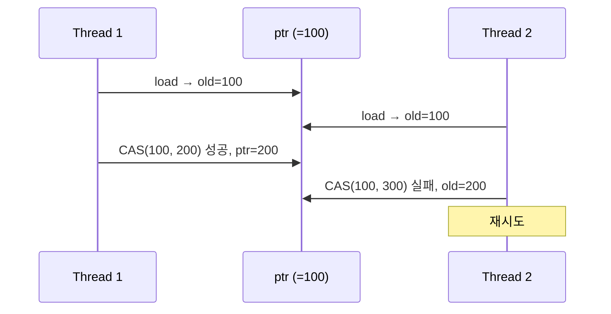
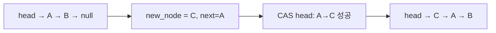

## 들어가며

공유 자료구조를 보호하려면 락을 걸어야 한다는 것이 일반적인 가정이다. 하지만 락은 본질적으로 대기를 강제한다. 한 스레드가 락을 잡고 있으면 다른 스레드는 무조건 기다려야 한다. 그 사이에 우선순위 역전, 데드락, 컨텍스트 스위치 비용이 발생한다.

CAS(Compare-And-Swap) 명령 하나로 스택과 큐를 만들 수 있다면, 그리고 ABA 문제라는 함정을 피할 수 있다면 락 없이도 안전한 자료구조를 구성할 수 있다. 이 글은 Lock-free의 정의에서 출발해 CAS, ABA 문제, Hazard Pointer, Michael-Scott Queue, Epoch-based Reclamation까지 짚는다.


---

## 목차

1. Lock-free란 무엇인가
2. CAS: 모든 것의 기초
3. Lock-free Stack 구현
4. ABA 문제
5. Lock-free Queue: Michael-Scott Algorithm
6. Hazard Pointers와 메모리 회수
7. 실전 벤치마크
8. 동시성 오류의 종류
9. Happens-before와 메모리 순서
10. 선형화 가능성
11. 동시성 테스트 전략
12. 결정적 Scheduler
13. 모델 검사
14. 실무 검증 절차

---

## 1. Lock-free란 무엇인가

### 정의의 계층

동시성 알고리즘은 진행 보장(progress guarantee) 수준에 따라 분류된다.

- **Wait-free**: 각 연산이 다른 스레드의 실행과 무관하게 유한 단계 안에 완료된다. 이론상 개별 연산의 starvation을 배제한다.
- **Lock-free**: 유한한 전체 실행 구간에서 시스템 차원의 연산 완료가 계속 발생한다. 특정 스레드는 반복해서 실패할 수 있다.
- **Obstruction-free**: 한 스레드가 충분한 시간 동안 간섭 없이 실행되면 연산을 완료한다.
- **Blocking (Mutex 기반)**: 위 세 비차단 진행 보장과 같은 계층의 하위 항목이 아니다. 소유자가 정지하면 다른 스레드도 기다릴 수 있는 별도 설계 범주다.

비차단 진행 보장 사이에는 `wait-free ⇒ lock-free ⇒ obstruction-free`의 포함 관계가 있다. Lock-free는 시스템 전체의 진행을 보장하지만 개별 스레드는 재시도와 starvation을 겪을 수 있다. 실제 보장은 알고리즘과 사용한 원자 타입이 대상 플랫폼에서 정말 lock-free인지까지 확인해야 성립한다.

### 왜 Lock-free인가

세 가지 문제가 락 기반 동기화의 약점이다.

**문제 1: Priority Inversion**

고우선순위 스레드가 저우선순위 스레드의 락을 기다리는 상황은 실시간 시스템에서 치명적이다. 1997년 Mars Pathfinder의 시스템 리셋이 대표적 사례다.

**문제 2: Deadlock 가능성**

```text
Thread A: lock(m1) → lock(m2)
Thread B: lock(m2) → lock(m1)
→ 서로 대기
```

**문제 3: Context Switch 비용**

경합한 락이 스핀 후 잠들면 스케줄러 개입과 컨텍스트 스위치가 발생할 수 있다. 비용은 OS, CPU, 캐시 작업 집합에 따라 달라지며, 짧은 무경합 락에는 이 경로가 나타나지 않는다.

Lock-free 알고리즘은 락 소유자 중단에 따른 시스템 전체 정지와 lock-order deadlock을 피할 수 있다. 그러나 우선순위 역전과 지연 변동을 모두 없애지는 않는다. 높은 우선순위 스레드가 CAS 경쟁에서 계속 실패하거나, 메모리 회수와 allocator 내부 락을 기다릴 수 있기 때문이다.

## 2. CAS: 모든 것의 기초

### CAS의 동작 원리

CAS는 하드웨어가 제공하는 원자적 read-modify-write 연산이다.

```cpp
bool compare_exchange_strong(T* ptr, T& expected, T desired) {
    // 이 세 동작이 원자적으로 실행됨
    if (*ptr == expected) {
        *ptr = desired;
        return true;
    } else {
        expected = *ptr;  // 실패 시 현재 값 로드
        return false;
    }
}
```

두 스레드가 동시에 같은 변수에 CAS를 시도하면, 한 스레드만 성공한다.



### compare_exchange_weak vs strong

```cpp
// strong: spurious failure 없음 (보장됨)
while (!value.compare_exchange_strong(old, new_val,
       std::memory_order_acq_rel)) {
    // old는 실패 시 자동 갱신
}

// weak: spurious failure 가능 (LL/SC 아키텍처에서 빠름)
while (!value.compare_exchange_weak(old, new_val,
       std::memory_order_acq_rel)) {
    // 루프 내에서 사용 권장
}
```

언제 weak를 쓰는가는 다음 기준으로 정한다.

- 루프 안에서 재시도하는 경우
- ARM/PowerPC 같은 LL/SC 아키텍처에서는 weak가 추가 재시도를 호출자 루프로 넘겨 더 효율적일 수 있음
- x86에서는 두 형태가 흔히 같은 원자 명령으로 내려가지만, 이는 C++ 언어 보장이 아니므로 생성 코드를 확인해야 함

## 3. Lock-free Stack 구현

### 기본 구조 (안전하지 않은 예제)

가장 간단한 lock-free 자료구조는 스택이다. 다음 코드는 CAS 기반 push/pop 골격을 보여주는 교육용 예제이며, **노드 메모리를 안전한 규약 없이 회수하면 use-after-free와 ABA 문제가 발생한다**. 이 문서의 메모리 회수 절에서 설명하는 Hazard Pointer, Epoch-based reclamation 같은 기법을 결합하기 전에는 동작 원리를 보여주는 골격일 뿐 실제 노드를 즉시 해제하면 안 된다.

```cpp
template<typename T>
class LockFreeStack {
    struct Node {
        T data;
        Node* next;
        Node(T const& d) : data(d), next(nullptr) {}
    };

    std::atomic<Node*> head{nullptr};

public:
    void push(T const& data) {
        Node* new_node = new Node(data);
        new_node->next = head.load(std::memory_order_relaxed);

        // head가 변경되지 않았으면 new_node로 교체
        while (!head.compare_exchange_weak(
            new_node->next, new_node,
            std::memory_order_release,      // 성공 시
            std::memory_order_relaxed)) {   // 실패 시
            // new_node->next는 자동으로 현재 head로 갱신됨
        }
    }

    // 반환값은 노드 자체. 호출자가 회수 책임을 진다.
    // 단, 실전에서는 hazard pointer 등 reclamation 기법 없이는
    // 다른 스레드가 보고 있는 메모리를 해제할 수 없다.
    Node* pop() {
        Node* old_head = head.load(std::memory_order_relaxed);

        while (old_head &&
               !head.compare_exchange_weak(
                   old_head, old_head->next,
                   std::memory_order_acquire,
                   std::memory_order_acquire)) {
            // old_head는 실패 시 자동 갱신되고 다음 반복에서 다시 역참조된다
        }

        return old_head;  // 실제 시스템에서는 즉시 delete가 안전하지 않다.
    }
};
```

push의 흐름은 다음과 같다.



두 스레드가 동시에 push하면 한쪽이 CAS에 실패하고 자동으로 갱신된 head로 재시도한다.

### Memory Order 선택

push에서 새 노드의 데이터는 다른 스레드가 노드 포인터를 acquire로 읽기 전에 가시화되어야 한다. 따라서 성공 경로는 `release`다. 이전의 모든 메모리 쓰기(노드 생성 시점의 데이터 쓰기)가 이 store보다 먼저 다른 스레드에서 관찰된다.

pop의 성공 경로는 `acquire`다. 이 load 이후 노드의 데이터를 읽으면, 다른 스레드의 push가 release한 시점의 데이터가 보인다.

pop의 실패 경로도 갱신된 `old_head`를 다시 역참조하므로 `acquire`여야 한다. 반면 push의 실패 경로는 얻은 포인터를 역참조하지 않으므로 `relaxed`로 충분하다.

## 4. ABA 문제

### 문제 시나리오

Lock-free 자료구조의 가장 악명 높은 버그가 ABA 문제다.

```cpp
// Thread 1: pop 시도
Node* old_head = head.load();  // A
Node* next = old_head->next;   // B

// === Context Switch ===

// Thread 2: pop A, pop B, push A (재사용)
pop();  // A 제거
pop();  // B 제거
push(new_data);  // A 주소 재사용

// === Thread 1 재개 ===
CAS(head, old_head, next);  // 성공! (주소가 같음)
// 하지만 A는 이미 다른 데이터
```

시간축으로 풀면 다음과 같다.

```text
T0: head → [A:100] → [B:200] → [C:300]
    Thread 1: old = A, next = B

T1: (Thread 1 sleep)
    Thread 2: pop A, pop B
    head → [C:300]

T2: Thread 2: delete A, delete B
    free(0x100)
    free(0x200)

T3: Thread 2: push(D)
    new Node가 0x100 주소 재사용
    head → [D:100] → [C:300]
           ^^^^^^
           A와 같은 주소

T4: Thread 1 재개
    CAS(head, A:100, B:200)
    성공 (주소 비교만 함)
    head → [B:200] (이미 해제된 메모리)
```

### 해결책 1: Tagged Pointer

포인터에 버전 카운터를 추가한다.

```cpp
struct TaggedPointer {
    Node* ptr;
    uintptr_t tag;  // 카운터
};

std::atomic<TaggedPointer> head;

void push(T const& data) {
    Node* new_node = new Node(data);
    TaggedPointer old_head = head.load();
    TaggedPointer new_head;

    do {
        new_node->next = old_head.ptr;
        new_head = {new_node, old_head.tag + 1};
    } while (!head.compare_exchange_weak(old_head, new_head));
}
```

128비트 CAS가 필요하다(x86-64: `cmpxchg16b`, ARM: `CASP`).

```cpp
// 플랫폼 체크
static_assert(sizeof(TaggedPointer) == 16);
// is_lock_free()는 비정적·비constexpr 멤버 함수라 static_assert에 쓸 수 없다.
// 컴파일 타임 보장은 C++17의 정적 constexpr 멤버 is_always_lock_free를 쓴다.
static_assert(std::atomic<TaggedPointer>::is_always_lock_free);
```

### 해결책 2: Hazard Pointers

Maged Michael(2004)의 우아한 해결책이다.

```cpp
class HazardPointer {
    std::atomic<Node*>* hp;  // 각 스레드가 보호 중인 포인터

public:
    Node* protect(std::atomic<Node*>& src) {
        Node* ptr = src.load();
        do {
            hp->store(ptr);  // "이 포인터 사용 중"
            Node* ptr2 = src.load();
            if (ptr == ptr2) return ptr;
            ptr = ptr2;
        } while (true);
    }

    void retire(Node* ptr) {
        // 어떤 HP도 가리키지 않으면 삭제
        if (!is_protected(ptr)) {
            delete ptr;
        } else {
            retired_list.push(ptr);  // 나중에 재시도
        }
    }
};
```

원리는 "사용 중인 포인터는 삭제 금지"다.

- 각 스레드가 접근 중인 포인터를 공개
- 삭제 전에 HP 리스트 확인
- 누군가 사용 중이면 연기

## 5. Lock-free Queue: Michael-Scott Algorithm

### 왜 Queue는 어려운가

스택은 head 하나만 관리하면 되지만 큐는 두 개의 포인터를 다룬다.

```text
head (dequeue)          tail (enqueue)
  ↓                        ↓
[A] → [B] → [C] → [D] → [E]
```

두 포인터를 단일 원자 연산으로 동시에 업데이트할 수 없다.

### Michael-Scott Queue (1996)

핵심 아이디어는 dummy node + 2단계 enqueue다.

```cpp
template<typename T>
class LockFreeQueue {
    struct Node {
        std::atomic<T*> data;
        std::atomic<Node*> next;
        Node() : data(nullptr), next(nullptr) {}
    };

    std::atomic<Node*> head;
    std::atomic<Node*> tail;

public:
    LockFreeQueue() {
        Node* dummy = new Node();
        head.store(dummy);
        tail.store(dummy);
    }

    void enqueue(T const& value) {
        Node* new_node = new Node();
        new_node->data.store(new T(value));

        while (true) {
            Node* last = tail.load();
            Node* next = last->next.load();

            // Case 1: tail이 실제 마지막 노드
            if (next == nullptr) {
                if (last->next.compare_exchange_weak(next, new_node)) {
                    // 성공: tail 업데이트 시도 (실패해도 OK)
                    tail.compare_exchange_weak(last, new_node);
                    return;
                }
            }
            // Case 2: tail이 뒤처짐 → 도와주기
            else {
                tail.compare_exchange_weak(last, next);
            }
        }
    }

    T* dequeue() {
        while (true) {
            Node* first = head.load();
            Node* last = tail.load();
            Node* next = first->next.load();

            if (first == head.load()) {  // 재확인
                // Case 1: 큐가 비어있음
                if (first == last) {
                    if (next == nullptr) {
                        return nullptr;
                    }
                    // tail이 뒤처짐 → 도와주기
                    tail.compare_exchange_weak(last, next);
                }
                // Case 2: 데이터 추출
                else {
                    T* data = next->data.load();
                    if (head.compare_exchange_weak(first, next)) {
                        delete first;  // ABA 주의
                        return data;
                    }
                }
            }
        }
    }
};
```

enqueue 과정의 흐름은 다음과 같다.

```text
초기 (dummy node):
head, tail → [D] → nullptr

Thread 1: enqueue(A)
new_node → [A]

Step 1: CAS(last->next, nullptr, A)
head → [D] → [A]
tail ---↑
        (뒤처짐)

Step 2: CAS(tail, D, A)
head → [D] → [A]
tail ------------↑

Thread 2: enqueue(B) (동시)
last = tail (D, 뒤처진 상태)
next = D->next (A, not null)

→ "도와주기" 로직 실행
CAS(tail, D, A)
tail ------------↑

이후 B 추가...
```

이 시점의 store/load는 acquire-release 시멘틱이 필요하다. 노드의 데이터 필드 쓰기는 next 포인터의 store보다 먼저 가시화되어야 하고, 다른 스레드가 next를 acquire로 읽으면 데이터까지 일관되게 본다.

### 도와주기 메커니즘의 중요성

```cpp
// Case 2: tail이 뒤처짐 → 도와주기
else {
    tail.compare_exchange_weak(last, next);
}
```

도와주기가 필요한 이유는 다음과 같다.

- Thread A가 enqueue 중간에 멈출 수 있다(context switch, crash 등).
- tail이 실제 끝을 가리키지 않으면 다른 스레드도 막힌다.
- 다른 스레드가 뒤처진 tail을 진행시킬 수 있어 한 스레드의 일시 정지가 queue 전체의 필수 lock 소유권 정지로 이어지지 않는다.

Lock-free의 진행 조건은 충분히 오래 실행되는 연산들 사이에서 시스템 전체로는 어떤 연산이 유한 단계 안에 완료된다는 뜻이다. 각 스레드가 starvation 없이 완료되는 wait-free 보장과 다르고, scheduler fairness·memory reclamation·allocator가 별도 blocking을 도입하는지도 확인해야 한다.

## 6. Hazard Pointers와 메모리 회수

### Safe Memory Reclamation

Lock-free에서 delete는 위험하다.

```cpp
// Thread 1
Node* node = head.load();
// === Context Switch ===

// Thread 2
pop();  // node 삭제

// Thread 1
node->data;  // 댕글링 포인터
```

### Hazard Pointer 전체 구현

```cpp
class HazardPointerManager {
    static constexpr size_t MAX_THREADS = 128;
    static constexpr size_t HP_PER_THREAD = 2;  // Queue는 2개 필요

    struct HPRecord {
        std::atomic<void*> hazards[HP_PER_THREAD];
        std::atomic<bool> active{false};
    };

    HPRecord records[MAX_THREADS];

public:
    // 스레드는 자신의 record를 먼저 등록해야 한다. active를 세우지 않으면
    // 아래 스캔이 그 슬롯을 건너뛰어 보호 중인 노드까지 회수한다.
    HPRecord& acquire_record() {
        for (auto& rec : records) {
            bool expected = false;
            if (rec.active.compare_exchange_strong(
                    expected, true, std::memory_order_seq_cst)) {
                return rec;
            }
        }
        throw std::runtime_error("HP record 고갈");
    }

    void release_record(HPRecord& rec) {
        for (auto& hp : rec.hazards) {
            hp.store(nullptr, std::memory_order_seq_cst);
        }
        rec.active.store(false, std::memory_order_seq_cst);
    }

    class HPGuard {
        HPRecord* rec;
        size_t index;

    public:
        HPGuard(HPRecord& record, size_t slot)
            : rec(&record), index(slot) {}

        template<typename T>
        T* protect(std::atomic<T*>& src) {
            T* ptr;
            do {
                ptr = src.load(std::memory_order_seq_cst);
                rec->hazards[index].store(ptr, std::memory_order_seq_cst);
                // 공개 전에 제거되었다면 재검사에서 반드시 감지한다.
            } while (ptr != src.load(std::memory_order_seq_cst));
            return ptr;
        }

        ~HPGuard() {
            rec->hazards[index].store(nullptr, std::memory_order_seq_cst);
        }
    };

    template<typename T>
    void retire(T* ptr) {
        thread_local std::vector<T*> retired_list;
        retired_list.push_back(ptr);
        if (retired_list.size() < 64) return;

        // 모든 HP 스캔
        std::vector<void*> protected_ptrs;
        for (auto& rec : records) {
            if (rec.active.load(std::memory_order_seq_cst)) {
                for (auto& hp : rec.hazards) {
                    void* p = hp.load(std::memory_order_seq_cst);
                    if (p) protected_ptrs.push_back(p);
                }
            }
        }

        // 이번 스캔에서 보호되지 않은 retired node만 회수한다.
        auto first_kept = std::remove_if(
            retired_list.begin(), retired_list.end(),
            [&](T* candidate) {
                const bool protected_now =
                    std::find(protected_ptrs.begin(), protected_ptrs.end(), candidate)
                    != protected_ptrs.end();
                if (!protected_now) delete candidate;
                return !protected_now;
            });
        retired_list.erase(first_kept, retired_list.end());
    }
};
```

hazard pointer의 핵심은 단순한 release/acquire message passing이 아니다. 보호 슬롯 공개와 source 재검사, 회수 스레드의 source 제거와 hazard 스캔 사이에 필요한 Store→Load 순서를 세워야 한다. 위 교육용 구현은 이 관계를 명확히 하려고 해당 원자 연산에 `seq_cst`를 사용한다. 그러면 전역 순서에서 회수 스레드가 hazard를 보거나, 독자 스레드가 source 변경을 재검사에서 보게 된다. 실제 라이브러리가 더 약한 순서를 쓰려면 그 플랫폼과 C++ 메모리 모델에서 같은 성질을 별도로 증명해야 한다. Guard는 자신이 소유한 슬롯 하나만 지우며, record 등록·해제 시에는 모든 슬롯이 비어 있다는 별도 불변식이 필요하다.

### Epoch-Based Reclamation

Hazard Pointer보다 빠른 방법이다.

```cpp
class EpochManager {
public:
    struct Retired {
        void* ptr;
        uint64_t epoch;
        void (*deleter)(void*);
    };

    struct ThreadRecord {
        std::atomic<bool> active{false};
        std::atomic<uint64_t> announced{0};
        std::vector<Retired> retired;  // 이 record의 소유 스레드만 수정
    };

    class EpochGuard {
        EpochManager& manager;
        ThreadRecord& record;

    public:
        EpochGuard(EpochManager& m, ThreadRecord& r)
            : manager(m), record(r) {
            for (;;) {
                uint64_t e = manager.global_epoch.load(std::memory_order_seq_cst);
                record.announced.store(e, std::memory_order_seq_cst);
                record.active.store(true, std::memory_order_seq_cst);
                if (manager.global_epoch.load(std::memory_order_seq_cst) == e)
                    break;
                record.active.store(false, std::memory_order_seq_cst);
            }
        }

        ~EpochGuard() {
            record.active.store(false, std::memory_order_seq_cst);
        }
    };

    template<class T>
    void retire(ThreadRecord& record, T* ptr) {
        record.retired.push_back({
            ptr,
            global_epoch.load(std::memory_order_seq_cst),
            [](void* p) { delete static_cast<T*>(p); }
        });
    }

    bool try_advance() {
        uint64_t current = global_epoch.load(std::memory_order_seq_cst);
        for (ThreadRecord* record : registered_records) {
            if (record->active.load(std::memory_order_seq_cst) &&
                record->announced.load(std::memory_order_seq_cst) != current) {
                return false;
            }
        }
        return global_epoch.compare_exchange_strong(
            current, current + 1, std::memory_order_seq_cst);
    }

    void reclaim(ThreadRecord& owner) {
        uint64_t current = global_epoch.load(std::memory_order_seq_cst);
        auto first_kept = std::remove_if(
            owner.retired.begin(), owner.retired.end(),
            [current](const Retired& item) {
                if (item.epoch + 2 > current) return false;
                item.deleter(item.ptr);
                return true;
            });
        owner.retired.erase(first_kept, owner.retired.end());
    }

private:
    std::atomic<uint64_t> global_epoch{0};
    std::vector<ThreadRecord*> registered_records;
};
```

Guard를 만든 뒤에만 공유 포인터를 읽고, 파괴하면 quiescent state에 들어간다. Epoch는 모든 active record가 현재 epoch를 발표했을 때만 전진한다. 그러므로 두 epoch 이전에 retire된 노드는 그 노드를 볼 수 있었던 임계 구역이 모두 끝난 뒤에만 회수된다. 실제 구현에는 record 등록·해제 동기화, 종료 스레드의 retired list 인계, epoch wraparound, 장시간 멈춘 스레드가 회수를 막는 문제까지 포함해야 한다.

트레이드오프는 다음과 같다.

- Hazard Pointer: 개별 포인터 단위, 정확함
- Epoch-based: 배치 삭제, 빠름 (메모리 사용량 증가)

## 7. 실전 벤치마크

### 테스트 코드

```cpp
#include <benchmark/benchmark.h>

// 1. Mutex-based Queue
template<typename T>
class MutexQueue {
    std::queue<T> q;
    std::mutex m;
public:
    void push(T v) {
        std::lock_guard lock(m);
        q.push(v);
    }
    bool pop(T& v) {
        std::lock_guard lock(m);
        if (q.empty()) return false;
        v = q.front();
        q.pop();
        return true;
    }
};

// 2. Lock-free Queue (Michael-Scott)
// (위 구현 사용)

static void BM_MutexQueue(benchmark::State& state) {
    MutexQueue<int> q;
    for (auto _ : state) {
        q.push(42);
        int v;
        q.pop(v);
    }
}

static void BM_LockFreeQueue(benchmark::State& state) {
    LockFreeQueue<int> q;
    for (auto _ : state) {
        q.enqueue(42);
        q.dequeue();
    }
}

BENCHMARK(BM_MutexQueue)->Threads(1)->Threads(4)->Threads(16);
BENCHMARK(BM_LockFreeQueue)->Threads(1)->Threads(4)->Threads(16);
```

### 이 코드가 측정하지 못하는 것

위 Google Benchmark 함수의 `q`는 함수 지역 변수다. `Threads(16)`으로 실행하면 열여섯 스레드가 각자 다른 큐를 사용하므로 공유 큐의 경합을 측정하지 않는다. 이 결과로 mutex와 lock-free MPMC 큐의 확장성을 비교해서는 안 된다.

유효한 비교에서는 하나의 공유 큐에 생산자와 소비자를 붙이고 아래 조건을 명시한다.

| 조건 | 이유 |
|---|---|
| 생산자:소비자 비율 | MPSC, SPMC, MPMC는 cache-line 이동 패턴이 다름 |
| bounded/unbounded와 가득 참 | backpressure와 할당 비용이 결과를 바꿈 |
| payload 크기·이동 비용 | 큐 메타데이터보다 복사가 지배할 수 있음 |
| CPU pinning·NUMA | 같은 코어/소켓과 원격 소켓의 coherency 비용이 다름 |
| 성공/빈 큐 재시도 정책 | spin, yield, park와 backoff가 CPU·tail latency를 바꿈 |
| 메모리 회수 | hazard pointer·epoch·reference count 비용을 포함해야 함 |

처리량뿐 아니라 enqueue/dequeue p99, 소비 CPU 시간, 공정성, 포화 시 손실·대기 정책을 측정한다. 경합이 커질수록 lock-free가 더 빨라진다는 단조 법칙은 없다. 하나의 atomic cache line이 병목이 되거나 재시도가 폭증할 수 있다.

### 실제 사용 시 고려사항

Lock-free가 유리한 경우는 다음과 같다.

- 락 소유자 정지가 전체 자료구조를 멈추게 해서는 안 되는 경우
- 상태 전이를 소수 원자 연산으로 표현하고 진행 보장을 증명할 수 있는 경우
- 실제 생산자·소비자 trace에서 tail latency와 처리량 이득이 확인된 경우

Mutex가 나은 경우는 다음과 같다.

- 경합이 낮거나 임계 영역이 충분히 짧은 경우
- 복잡한 불변식 (여러 변수 동시 업데이트)
- 메모리 회수 문제 회피
- 디버깅 용이성

### 산업 사례

Folly (Facebook):

```cpp
#include <folly/ProducerConsumerQueue.h>  // Lock-free SPSC
#include <folly/MPMCQueue.h>               // MPMC (folly 문서 기준 lock-free는 아님; 대기 시 futex로 블로킹)
```

Boost.Lockfree:

```cpp
#include <boost/lockfree/queue.hpp>
boost::lockfree::queue<int> q(128);  // 가변 크기(freelist 초기 노드 128개), 메모리 회수 불필요
```

Linux Kernel:

```c
// RCU (Read-Copy-Update) - Epoch-based reclamation의 조상
rcu_read_lock();
ptr = rcu_dereference(global_ptr);
// use ptr
rcu_read_unlock();
```


## 8. 동시성 오류의 종류

동시성 오류를 한 종류로 보면 도구 선택이 틀어진다.

| 오류 | 예 | 주요 검증 |
|---|---|---|
| 데이터 경쟁 | 동기화 없이 같은 메모리 읽기·쓰기 | ThreadSanitizer |
| 원자성 위반 | check 후 update 사이에 다른 thread 개입 | 불변식·선형화 검사 |
| 순서 위반 | 준비 플래그보다 payload가 늦게 보임 | 메모리 모델·litmus test |
| 교착 | 서로 반대 순서로 락 획득 | lock graph·timeout·모델 검사 |
| 기아 | 특정 작업이 영원히 실행되지 않음 | 공정성·장기 스케줄 테스트 |
| 비결정성 | 같은 입력에서 상태가 갈라짐 | replay·상태 hash |

데이터 경쟁이 없다고 논리적으로 정확한 것은 아니다. 모든 접근을 mutex로 보호해도 락을 여러 번 나누어 잡는 사이에 상태가 바뀌면 원자성 위반이 생길 수 있다.

## 9. Happens-before와 메모리 순서

C++ 메모리 모델에서 동기화되지 않은 동일 메모리의 동시 접근 중 하나가 쓰기면 데이터 경쟁이며 동작은 미정의다. CPU가 실제로 원자적으로 읽어 주는 것처럼 보여도 컴파일러는 데이터 경쟁이 없다고 가정하고 코드를 변환할 수 있다.

메모리 가시성을 이해하는 핵심은 happens-before 관계다.

```cpp
Payload payload;
std::atomic<bool> ready = false;

// producer
payload = BuildPayload();
ready.store(true, std::memory_order_release);

// consumer
if (ready.load(std::memory_order_acquire)) {
    Consume(payload);
}
```

consumer의 acquire load가 producer의 release store 값을 관측하면, release 이전의 payload 쓰기가 acquire 이후의 읽기보다 happens-before가 된다.

`memory_order_relaxed`는 해당 atomic 변수의 원자적 수정 순서만 제공하고 주변 일반 메모리를 공개하지 않는다. 통계 카운터에는 적합할 수 있지만 payload 공개 플래그에 사용하면 플래그는 보여도 payload가 준비되지 않은 실행을 허용할 수 있다.

강한 순서를 약하게 바꾸는 최적화는 성능 측정 전에 의미 증명이 먼저다. “이 하드웨어에서는 된다”는 언어와 다른 CPU의 계약이 아니다.

## 10. 선형화 가능성

동시 자료구조가 순차 자료구조와 같은 의미를 제공하는지 판단하는 대표 기준이 선형화 가능성이다. 각 연산이 호출과 반환 사이의 어느 한 순간에 원자적으로 일어난 것처럼 전체 실행을 설명할 수 있어야 한다.

두 thread가 queue에 push하고 pop한 history를 보자.

```text
T1: Push(A)  [call -------- return]
T2: Pop()          [call -------- return] => A
```

Pop의 선형화 지점이 Push의 선형화 지점 뒤라면 순차 명세와 일치한다.

반면 Pop이 A를 반환했는데 어떤 가능한 순차 순서에서도 Push(A)가 먼저 올 수 없다면 구현이 잘못되었다.

선형화 검사는 동시 실행 history를 기록하고, 실시간 선후 관계를 보존하는 순차 순서 중 명세를 만족하는 것이 있는지 탐색한다. 연산 수가 커지면 조합이 폭발하므로 작은 history를 반복 생성한다.

모든 시스템이 선형화 가능성을 요구하는 것은 아니다. Eventually consistent 구조나 snapshot 읽기는 더 약한 의미를 사용할 수 있다. 중요한 것은 제공하려는 의미를 명시하고 그 의미에 맞춰 검증하는 것이다.

## 11. 동시성 테스트 전략

### Stress

많은 thread와 반복, 무작위 yield, 작은 지연, 높은 부하를 주어 드문 순서를 자주 만든다.

```cpp
for (int run = 0; run < 10000; ++run) {
    Queue q;
    RunConcurrentProducersConsumers(q, Seed(run));
    CHECK(q.InvariantHolds());
}
```

Stress 통과는 증명이 아니지만 실제 구현의 캐시·allocator·scheduler 상호작용을 포함한다는 장점이 있다. 실패 seed와 연산 로그를 남겨야 한다.

### Sanitizer

ThreadSanitizer는 동기화 관계를 추적해 데이터 경쟁을 찾는다. 실행 비용이 크고 모든 플랫폼을 지원하지 않을 수 있다. 논리적 deadlock과 atomic protocol 오류를 모두 찾지는 못한다.

### Schedule Perturbation

락 전후, atomic 연산, 작업 큐 경계에 선택적으로 yield를 넣으면 순서 공간을 넓힐 수 있다. 모든 지점에 sleep을 넣으면 테스트가 지나치게 느리고 현실과 다른 스케줄만 만들 수 있다.

### Invariant Monitoring

동시 연산 중간에 외부에 공개되지 않는 일시 상태와, 공개 경계에서 반드시 참이어야 하는 불변식을 구분한다. 검증 시점이 잘못되면 정상 구현을 실패로 판단한다.

## 12. 결정적 Scheduler

동시성 실패를 재현하려면 scheduler 선택을 기록하거나 통제해야 한다. 작업이 명시적 yield point에서만 전환되도록 만들면 같은 seed로 같은 순서를 재생할 수 있다.

```text
step 1: T1 after load(head)
step 2: T2 after load(head)
step 3: T1 before CAS
step 4: T2 before CAS
```

결정적 scheduler는 실제 OS의 모든 선점 지점을 모델링하지 않는다. 검증하려는 공유 상태 경계에 yield point를 두고 중요한 순서를 체계적으로 탐색한다.

탐색 전략은 다음과 같다.

- 무작위 schedule: 넓은 공간을 빠르게 표본화
- bounded exhaustive: 전환 횟수를 제한해 가능한 순서를 전수 탐색
- partial-order reduction: 서로 독립적인 연산 순서의 중복 탐색 제거

결정적 scheduler가 찾아낸 실패 schedule은 일반 stress test의 회귀 케이스로도 보존한다.

## 13. 모델 검사

모델 검사는 작은 상태 모델의 가능한 전이를 체계적으로 탐색한다. 실제 코드를 모두 복사하지 않고 검증 속성에 영향을 주는 상태만 남긴다.

두 작업자가 하나의 슬롯을 획득하는 프로토콜이라면 다음 상태만으로 시작할 수 있다.

```text
owner ∈ {none, A, B}
requestA ∈ {idle, pending}
requestB ∈ {idle, pending}
```

검증할 안전성은 `owner`가 동시에 A와 B일 수 없다는 것이고, 활성은 pending 요청이 환경 전제 아래 결국 획득하거나 취소된다는 것이다.

상태 수는 빠르게 폭발한다. 작은 모델이 실제 프로토콜의 해당 상태 전이를 충실히 보존한다면, 모델에서 찾은 순서 버그는 실제 시스템에서도 재현 가능한 결함 후보가 된다. 반대로 모델이 생략한 상태와 환경 가정은 검사 결과의 범위 밖이다.

반례 trace는 큰 가치가 있다.

```text
A reads owner=none
B reads owner=none
A writes owner=A
B writes owner=B
assert exclusive_owner violated
```

이 trace를 코드의 결정적 scheduler 테스트로 옮기면 모델과 구현 사이 연결이 생긴다.

## 14. 실무 검증 절차

1. 제공하려는 동시성 의미를 정한다.
2. 공유 상태와 happens-before 관계를 문서화한다.
3. 데이터 경쟁은 sanitizer로 찾는다.
4. 자료구조 의미는 작은 history의 선형화 검사로 검증한다.
5. 결정적 scheduler로 중요한 순서를 재현한다.
6. 실제 workload의 stress·soak test를 실행한다.
7. 시뮬레이션 입력과 상태 hash로 divergence를 추적한다.
8. 위험한 프로토콜은 작은 모델과 반례 trace로 보완한다.

도구 하나로 모든 동시성 오류를 찾을 수 없다. 각각 다른 오류 공간을 본다.

---

## 결론

Lock-free 자료구조는 CAS 하나로 시작하지만 ABA 문제라는 함정을 만난다. Hazard Pointer와 Epoch-based reclamation은 그 함정을 우회하는 두 가지 길이다.

Michael-Scott Queue의 도와주기 메커니즘은 lock-free 진행 조건을 만드는 대표적인 방법이다. 중단된 스레드가 소유한 mutex 해제를 기다리는 대신 다른 스레드가 불완전한 pointer 상태를 완결할 수 있다. 다만 이는 모든 스레드의 완료나 시간 상한을 보장하지 않는다.

다만 lock-free는 은탄환이 아니다. 복잡성, 메모리 오버헤드, 디버깅 어려움을 감수할 가치가 있는지 신중히 판단해야 한다. 잘 설계된 mutex가 더 나은 선택일 때도 많다. 실측 없이 lock-free를 선택하지 말 것, ABA 문제는 메모리 재사용에서 발생하며 Hazard Pointer로 해결할 수 있다는 것이 핵심이다.


## 더 읽을거리

- Maurice Herlihy, "Wait-free synchronization", *ACM TOPLAS*, 1991: https://dl.acm.org/doi/10.1145/114005.102808
- Maged M. Michael, Michael L. Scott, "Simple, Fast, and Practical Non-Blocking and Blocking Concurrent Queue Algorithms", *PODC*, 1996: https://www.cs.rochester.edu/~scott/papers/1996_PODC_queues.pdf
- Maged M. Michael, "Hazard Pointers: Safe Memory Reclamation for Lock-Free Objects", *IEEE TPDS*, 2004: https://ieeexplore.ieee.org/document/1291819
- Anthony Williams, *C++ Concurrency in Action*, 2nd Edition, Manning, 2019 (Chapter 7: Lock-free data structures)
- Maurice Herlihy, Nir Shavit, *The Art of Multiprocessor Programming*, Morgan Kaufmann, 2012
- Herb Sutter, "atomic Weapons: The C++ Memory Model and Modern Hardware", C++ and Beyond 2012: https://www.youtube.com/watch?v=A8eCGOqgvH4
- Fedor Pikus, "C++ atomics, from basic to advanced", CppCon 2017: https://www.youtube.com/watch?v=ZQFzMfHIxng
- Folly: https://github.com/facebook/folly
- Boost.Lockfree: https://www.boost.org/doc/libs/release/doc/html/lockfree.html
- libcds: https://github.com/khizmax/libcds
- Keir Fraser, "Practical lock-freedom", PhD thesis, Cambridge, 2004 (Epoch-based reclamation)
- Alex Kogan, Erez Petrank, "Wait-free queues with multiple enqueuers and dequeuers", *PPoPP*, 2011
