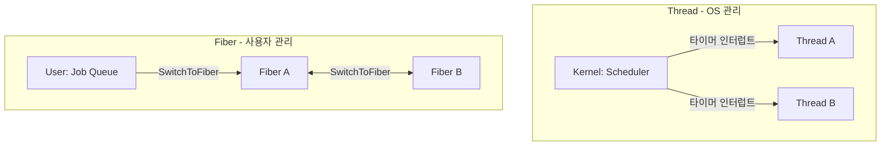

## 들어가며

함수 호출은 스택에서 이루어진다. 예를 들어 x86-64에서는 `call` 명령어가 리턴 주소를 스택에 push하고 함수가 끝나면 `ret`로 돌아온다. ARM64처럼 복귀 주소를 링크 레지스터(`LR`)에 두는 아키텍처도 있다. 이것이 프로그래밍의 기본이다.

그런데 함수가 중간에 멈췄다가 나중에 재개할 수 있다면 어떨까. 실행 상태를 보존한 뒤 호출자에게 제어권을 돌려주고, 나중에 정확히 그 지점에서 계속할 수 있다면. 이것이 코루틴(Coroutine)과 Fiber가 제공하는 제어 흐름이다. Stackful Fiber는 호출 스택 전체를 보존하고, C++20의 stackless coroutine은 중단 뒤에도 필요한 상태를 별도 코루틴 프레임에 저장한다.

이 글은 협력적 멀티태스킹의 동기를 짚고, Fiber와 코루틴의 메커니즘, 스택풀과 스택리스의 차이, 게임 엔진의 Job System과 C++20 코루틴의 내부까지 다룬다.


---

## 목차

1. [협력적 멀티태스킹](#1-협력적-멀티태스킹)
2. [Fiber: 사용자 수준 스레드](#2-fiber-사용자-수준-스레드)
3. [스택 스위칭의 메커니즘](#3-스택-스위칭의-메커니즘)
4. [Stackful과 Stackless 코루틴](#4-stackful과-stackless-코루틴)
5. [C++20 코루틴: co_await의 내부](#5-c20-코루틴-co_await의-내부)
6. [게임 엔진의 Job System](#6-게임-엔진의-job-system)
7. [Windows Fiber API 심화](#7-windows-fiber-api-심화)
8. [실전: 비동기 I/O와 게임 로직](#8-실전-비동기-io와-게임-로직)


---

## 1. 협력적 멀티태스킹

### 멀티태스킹의 두 가지 철학

**선점형 멀티태스킹(Preemptive)**

OS 스케줄러가 타이머 인터럽트로 강제 전환한다.

```text
Thread A 실행 중 → [TICK] → 컨텍스트 저장 → Thread B 실행
```

**협력적 멀티태스킹(Cooperative)**

프로그램이 명시적으로 제어권을 양보한다.

```text
Task A 실행 → yield() 호출 → Task B 실행
```

Windows 3.1 시대의 협력적 멀티태스킹은 악명 높았다. 한 프로그램이 `yield`를 안 하면 시스템 전체가 멈췄다. 그래서 Windows 95는 32비트 응용 프로그램에 선점형 스케줄링을 도입했다(16비트 호환 응용 프로그램은 협력적 스케줄링이 유지되었다).

하지만 게임 엔진과 서버는 OS 선점형 스케줄러 위에 사용자 수준의 협력적 job/fiber 계층을 다시 얹었다.

### 왜 다시 협력적인가

선점형의 문제는 다음과 같다.

```cpp
// Thread 1
player.health -= damage;  // ← 여기서 인터럽트

// Thread 2
if (player.health > 0) {  // 불완전한 상태 읽음
    player.move();
}
```

스레드 전환 자체가 데이터 레이스를 만드는 것은 아니다. 둘 이상의 스레드가 같은 메모리에 동기화 없이 접근하고 그중 하나 이상이 쓰기를 수행할 때 데이터 레이스가 발생한다. 프레임 작업을 여러 worker에 병렬 배치한다면 mutex, atomic, 소유권 분할, barrier 같은 동기화가 여전히 필요하다.

협력적의 장점은 다음과 같다.

```cpp
void update_game() {
    update_physics();     // 물리 업데이트
    yield();              // 여기서만 전환
    update_rendering();   // 렌더링 업데이트
    yield();
}
```

같은 OS 스레드 안에서 실행되는 Fiber끼리는 명시한 `yield` 지점에서만 서로 전환되므로, 그 Fiber들 사이의 재진입 지점은 예측할 수 있다. 그러나 여러 worker thread의 Fiber가 공유 데이터에 동시에 접근한다면 협력적 스케줄링이어도 동기화가 필요하다. 안전성을 만드는 핵심은 `yield` 자체가 아니라 작업별 쓰기 집합을 분리하고, 의존 관계 사이에 명시적인 동기화 경계를 두는 것이다.

Naughty Dog의 Christian Gyrling이 GDC 2015 발표 "Parallelizing the Naughty Dog Engine Using Fibers"에서 보여준 핵심도 이것이다. Fiber 기반 job system은 블로킹처럼 읽히는 순차 코드를 그대로 두면서, OS 스레드 오버헤드 없이 비동기로 실행하게 해준다.

## 2. Fiber: 사용자 수준 스레드

### Thread vs Fiber

| 측면 | Thread | Fiber |
|------|--------|-------|
| 스케줄링 | OS 커널 | 사용자 코드 |
| 컨텍스트 스위치 | 스케줄러 진입과 주소 공간·캐시 상태의 영향을 받음 | 같은 스레드에서 사용자 문맥을 저장·복원 |
| 스택 | 런타임/OS 설정에 따른 reserve·commit 정책 | Fiber 구현과 생성 옵션에 따른 독립 스택 |
| 생성 비용 | 커널 스레드와 런타임 자료구조 생성 | Fiber 제어 블록과 스택 주소 공간 준비 |
| 동기화 | 공유 상태에는 필요 | 다른 스레드와 공유하는 상태에는 여전히 필요 |

구조 비교는 다음과 같다.



### 스택의 독립성

Thread와 Fiber 모두 독립적인 스택을 가진다.

```text
Thread의 스택 (스레드 런타임과 OS가 협력해 준비):
0x7F000000 ┌──────────────┐
           │ Thread A     │ 1MB
           │ Stack        │
0x7F100000 ├──────────────┤
           │ Thread B     │ 1MB
           │ Stack        │
0x7F200000 └──────────────┘

Fiber의 스택 (Fiber 런타임이 준비):
0x01000000 ┌──────────────┐
           │ Fiber 1      │ 64KB
           │ Stack        │
0x01010000 ├──────────────┤
           │ Fiber 2      │ 64KB
           │ Stack        │
0x01020000 └──────────────┘
```

핵심 차이는 스케줄링과 문맥 관리의 주체다. POSIX 스레드 라이브러리는 보통 사용자 주소 공간에 스택 매핑을 준비한 뒤 `clone` 계열 시스템 콜로 커널 태스크를 만든다. 커널이 단순히 스택 메모리를 대신 할당하는 구조가 아니다. Fiber 스택도 반드시 `malloc`으로 만드는 것은 아니다. Windows Fiber API는 스택의 reserve/commit을 관리하고, 사용자 Fiber 라이브러리는 `mmap`, `VirtualAlloc`, 전용 스택 풀 등을 사용할 수 있다.

### Windows Fiber API

```cpp
#include <windows.h>

VOID WINAPI FiberFunc(LPVOID param) {
    for (int i = 0; i < 5; i++) {
        printf("Fiber: %d\n", i);
        SwitchToFiber(param);  // 메인으로 돌아감
    }
}

int main() {
    // 현재 스레드를 Fiber로 변환
    LPVOID main_fiber = ConvertThreadToFiber(nullptr);

    // 새 Fiber 생성 (스택 크기: 0 = 기본값)
    LPVOID worker_fiber = CreateFiber(0, FiberFunc, main_fiber);

    for (int i = 0; i < 5; i++) {
        printf("Main: %d\n", i);
        SwitchToFiber(worker_fiber);  // Worker로 전환
    }

    DeleteFiber(worker_fiber);
    return 0;
}
```

출력은 다음과 같다.

```text
Main: 0
Fiber: 0
Main: 1
Fiber: 1
...
```

개념적으로 `SwitchToFiber`는 다음 상태를 전환한다.

1. 현재 스택 포인터(RSP) 저장
2. ABI와 구현이 요구하는 비휘발성 레지스터 및 Fiber별 상태 저장
3. 대상 Fiber의 상태 복원
4. 대상 스택으로 점프

일반적인 Fiber 전환 경로는 사용자 모드에서 끝나며 OS 스레드 스케줄러 전환을 요구하지 않는다. 정확히 어떤 레지스터와 부가 상태를 저장하는지는 아키텍처, ABI, Windows 버전의 구현 세부사항이다.

## 3. 스택 스위칭의 메커니즘

### setjmp/longjmp의 한계

C 표준 라이브러리는 `setjmp/longjmp`를 제공한다.

```c
#include <setjmp.h>

jmp_buf env;

void function() {
    printf("Before longjmp\n");
    longjmp(env, 1);  // setjmp 지점으로 돌아감
    printf("Never printed\n");
}

int main() {
    if (setjmp(env) == 0) {
        printf("First call\n");
        function();
    } else {
        printf("Returned from longjmp\n");
    }
}
```

출력은 다음과 같다.

```text
First call
Before longjmp
Returned from longjmp
```

`setjmp`는 CPU 레지스터를 저장한다.

```c
// glibc 구현 (개념적)
struct __jmp_buf {
    long rbx, rbp, r12, r13, r14, r15;
    long rsp;  // 스택 포인터
    long rip;  // 명령어 포인터
};
```

표준이 보장하는 핵심 제약은 저장한 환경의 함수 호출이 아직 끝나지 않아야 한다는 점이다.

```text
main의 스택:
┌────────────┐ ← RSP
│ env        │
│ ...        │
│ function() │ setjmp 시점의 RSP 저장
└────────────┘

longjmp는 활성 상태인 setjmp 호출 환경으로만 복귀 가능
별도 스택을 만들고 전환하는 이식 가능한 API는 아님
```

`setjmp/longjmp`만으로 별도 스택의 생성과 수명을 이식 가능하게 관리할 수는 없다. 구현 종속 어셈블리나 별도의 문맥 API와 결합해 Fiber를 만들 수는 있지만, C 표준이 그러한 스택 전환을 보장하지 않는다. 또한 `setjmp`를 실행한 함수가 반환한 뒤 그 환경으로 `longjmp`하면 동작이 정의되지 않는다. C++에서는 비자명 소멸자를 가진 자동 객체가 살아 있는 함수를 `longjmp`로 벗어나면 소멸자가 호출되지 않아 동작이 정의되지 않으며, `setjmp` 이후 변경된 non-volatile 자동 지역 변수의 값도 보존된다고 가정할 수 없다. 따라서 `longjmp`를 C++ 예외나 fiber 취소의 대체재로 쓰지 않는다.

### Boost.Context의 fcontext_t

Boost.Context는 지원하는 플랫폼별 어셈블리 구현 뒤에 이식 가능한 C++ 인터페이스를 제공한다.

```cpp
#include <boost/context/fiber.hpp>
#include <iostream>

namespace ctx = boost::context;

ctx::fiber source;

ctx::fiber worker(ctx::fiber&& sink) {
    std::cout << "Worker 1\n";
    sink = std::move(sink).resume();  // Main으로 돌아감

    std::cout << "Worker 2\n";
    return std::move(sink);
}

int main() {
    source = ctx::fiber(worker);

    std::cout << "Main 1\n";
    source = std::move(source).resume();  // Worker로 전환

    std::cout << "Main 2\n";
    source = std::move(source).resume();

    std::cout << "Done\n";
}
```

출력:

```text
Main 1
Worker 1
Main 2
Worker 2
Done
```

현재 Boost.Context 공개 헤더에서 `fcontext_t`는 불투명한 포인터 형식이다. 그 포인터가 가리키는 문맥의 정확한 레이아웃과 저장 위치는 아키텍처별 구현 세부사항이며 공개 계약이 아니다.

```cpp
// boost/context/detail/fcontext.hpp (실제 정의)
typedef void* fcontext_t;
// 실제 문맥 레이아웃은 아키텍처별 구현 세부사항
```

아래는 원리를 설명하기 위한 x86-64 의사 어셈블리다. 실제 Boost.Context 코드는 ABI에 따라 SIMD·제어 상태와 unwind 메타데이터까지 다르게 처리할 수 있다.

```asm
; 현재 컨텍스트 저장
push rbp
push rbx
push r12
push r13
push r14
push r15

; 현재 RSP를 fcontext_t에 저장
mov [old_context.fc_stack_ptr], rsp

; 대상 컨텍스트의 RSP 로드
mov rsp, [new_context.fc_stack_ptr]

; 레지스터 복원
pop r15
pop r14
pop r13
pop r12
pop rbx
pop rbp

; 점프 (ret를 통해)
ret
```

핵심은 `mov rsp, [new_context.fc_stack_ptr]`다. 스택 포인터 자체를 교체하는 것이다.

### 스택 메모리 할당

Fiber는 독립적인 스택이 필요하다.

```cpp
// Boost.Context 스택 할당
#include <boost/context/protected_fixedsize_stack.hpp>

ctx::protected_fixedsize_stack stack_alloc(64 * 1024);  // 64KB
ctx::fiber f(std::allocator_arg, stack_alloc, worker);
```

보호 스택 할당기는 사용 불가능한 guard page를 스택 경계에 둔다. 다음은 개념도이며 guard page의 개수와 위치, reserve·commit 방식은 구현과 플랫폼에 따라 달라진다.

```text
High Address
┌────────────┐ ← stack_base (0x01010000)
│            │
│  64KB      │ ← 실제 스택 영역
│  Stack     │
│            │
├────────────┤ ← stack_limit (0x01000000)
│ Guard Page │ 보호 페이지
├────────────┤
│ Allocator  │ 인접 매핑 또는 미매핑 영역
└────────────┘
Low Address
```

POSIX 구현은 `mprotect(PROT_NONE)`, Windows 구현은 페이지 보호와 guard 메커니즘을 사용할 수 있다. guard page는 그 경계를 실제로 침범한 접근을 fault로 바꾸지만, 큰 폭의 stack jump가 보호 페이지를 건너뛰는 상황까지 모든 구현에서 자동 검출한다고 일반화할 수는 없다.

## 4. Stackful과 Stackless 코루틴

### 정의의 차이

**Stackful Coroutine**

- 독립적인 스택 보유
- 함수 호출 체인 중간에서 suspend 가능
- 예: Fiber, Boost.Coroutine2, Lua coroutine

**Stackless Coroutine**

- 컴파일러가 상태를 객체로 변환
- 코루틴으로 변환된 각 함수의 본문에서만 직접 suspend 가능
- 예: C++20 coroutine, Python generator, JavaScript async/await

```text
Stackful (Fiber):
┌────────────────┐
│  main()        │
│    ├─ a()      │ ← suspend 가능
│    │   ├─ b()  │ ← suspend 가능
│    │   │   c() │ ← suspend 가능 (깊은 호출에서도)
└────────────────┘
     독립 스택

Stackless (C++20):
┌────────────────┐
│  main()        │
│    ├─ coro()   │ ← co_await 가능
│        └─ a()  │ ← 일반 함수라면 호출자의 실행을 직접 suspend할 수 없음
└────────────────┘
  상태 객체로 변환
```

### 실제 예시로 비교

**Stackful (Boost.Coroutine2)**

```cpp
#include <boost/coroutine2/all.hpp>

using coro_t = boost::coroutines2::coroutine<int>;

void helper(int n, coro_t::push_type& yield);

void generator(coro_t::push_type& yield) {
    for (int i = 0; i < 5; i++) {
        helper(i, yield);  // 중첩 호출
    }
}

void helper(int n, coro_t::push_type& yield) {
    yield(n * n);  // 깊은 호출 스택에서 yield 가능
}

int main() {
    coro_t::pull_type gen(generator);

    for (auto v : gen) {
        std::cout << v << " ";  // 0 1 4 9 16
    }
}
```

`helper`에서 `yield`를 호출해도 문제없다. 전체 호출 스택이 보존되기 때문이다.

**Stackless (C++20)**

```cpp
#include <coroutine>
#include <iostream>
#include <utility>

struct Generator {
    struct promise_type {
        int current_value;

        auto get_return_object() {
            return Generator{
                std::coroutine_handle<promise_type>::from_promise(*this)
            };
        }
        auto initial_suspend() { return std::suspend_always{}; }
        auto final_suspend() noexcept { return std::suspend_always{}; }
        void return_void() {}
        void unhandled_exception() { std::terminate(); }

        auto yield_value(int value) {
            current_value = value;
            return std::suspend_always{};
        }
    };

    std::coroutine_handle<promise_type> handle;

    explicit Generator(std::coroutine_handle<promise_type> h) : handle(h) {}
    Generator(const Generator&) = delete;
    Generator& operator=(const Generator&) = delete;
    Generator(Generator&& other) noexcept
        : handle(std::exchange(other.handle, {})) {}
    Generator& operator=(Generator&& other) noexcept {
        if (this != &other) {
            if (handle) handle.destroy();
            handle = std::exchange(other.handle, {});
        }
        return *this;
    }
    ~Generator() { if (handle) handle.destroy(); }

    bool next() {
        if (!handle || handle.done()) return false;
        handle.resume();
        return !handle.done();
    }

    int value() const {
        return handle.promise().current_value;
    }
};

Generator generator() {
    for (int i = 0; i < 5; i++) {
        // 일반 helper가 호출자 generator를 직접 suspend할 수는 없다.
        co_yield i * i;
    }
}

int main() {
    auto gen = generator();
    while (gen.next()) {
        std::cout << gen.value() << " ";
    }
}
```

`co_yield`는 코루틴 함수 본문에서만 사용할 수 있다. 그렇다고 계층화가 불가능한 것은 아니다. helper 자체를 코루틴이나 awaitable을 반환하는 함수로 만들고 호출자가 `co_await`하면 비동기 제어 흐름을 조합할 수 있다. 일반 함수가 아무 표시 없이 호출자의 코루틴을 중단시킬 수 없다는 점이 stackful 방식과의 차이다.

### 메모리 오버헤드 비교

Stackful은 다음과 같다.

```text
Fiber 1개당 스택: 구현에서 정한 reserve와 실제 commit
총 가상 주소 공간: reserve × Fiber 수
실제 물리 메모리: 접근해 commit된 페이지와 OS 정책에 좌우

장점: 깊은 호출에서도 suspend 가능
단점: 메모리 사용량이 큼
```

Stackless는 다음과 같다.

```text
Coroutine frame: 중단을 넘어 살아야 하는 지역 변수, 파라미터 복사본,
promise, bookkeeping과 정렬을 합친 구현별 크기

장점: 메모리 효율적
단점: 제한적인 suspend 지점
```

Stackful 방식은 기존의 깊은 동기 호출 구조를 유지한 채 임의의 호출 깊이에서 양보해야 할 때 유리하다. Stackless 방식은 중단 가능성을 함수 형식과 `co_await` 경계에 드러내고, 필요한 상태만 프레임에 저장하고 싶을 때 유리하다. 게임 엔진과 서버 모두 두 방식을 사용할 수 있으며, 선택은 호출 구조, 디버깅 도구, 취소·수명 모델, 스택 주소 공간 예산에 달려 있다.

## 5. C++20 코루틴: co_await의 내부

### 코루틴의 3가지 키워드

C++20은 세 가지 키워드를 추가했다.

```cpp
co_await expr   // 중단할 수 있는 지점. await_ready에 따라 중단하지 않을 수도 있다
co_yield value  // 값을 반환하고 일시 중단 (generator)
co_return value // 코루틴 종료
```

이 중 하나라도 있으면 컴파일러는 함수를 코루틴으로 변환한다.

### 컴파일러의 마법: 상태 기계 변환

```cpp
Generator fibonacci() {
    int a = 0, b = 1;
    while (true) {
        co_yield a;
        if (a > INT_MAX - b) co_return;  // signed overflow 전에 종료
        int next = a + b;
        a = b;
        b = next;
    }
}
```

컴파일러는 이를 다음처럼 변환한다(개념적).

```cpp
struct fibonacci_state {
    int suspend_point = 0;  // 재개 지점
    int a, b;               // 지역 변수
    int next;
    int current_value;      // promise에 노출할 yield 값

    void resume() {
        switch (suspend_point) {
        case 0: goto LABEL_0;
        case 1: goto LABEL_1;
        }

    LABEL_0:
        a = 0; b = 1;
        while (true) {
            // co_yield a 구현
            current_value = a;
            suspend_point = 1;
            return;  // 호출자에게 돌아감

    LABEL_1:
            next = a + b;
            a = b;
            b = next;
        }
    }
};
```

`co_yield`마다 suspend point가 생긴다. `resume` 호출 시 `switch`로 정확한 위치로 점프한다.

### promise_type과 coroutine_handle

모든 C++20 코루틴은 `promise_type`을 정의해야 한다.

```cpp
struct Task {
    struct promise_type {
        // 코루틴 객체 생성
        Task get_return_object() {
            return Task{
                std::coroutine_handle<promise_type>::from_promise(*this)
            };
        }

        // 시작 시 동작 (suspend vs 즉시 실행)
        std::suspend_never initial_suspend() { return {}; }

        // 종료 시 동작
        std::suspend_always final_suspend() noexcept { return {}; }

        // 예외 처리
        void unhandled_exception() { std::terminate(); }

        // co_return 처리
        void return_void() {}
    };

    std::coroutine_handle<promise_type> handle;

    explicit Task(std::coroutine_handle<promise_type> h) : handle(h) {}
    Task(const Task&) = delete;
    Task& operator=(const Task&) = delete;
    Task(Task&& other) noexcept
        : handle(std::exchange(other.handle, {})) {}
    Task& operator=(Task&& other) noexcept {
        if (this != &other) {
            if (handle) handle.destroy();
            handle = std::exchange(other.handle, {});
        }
        return *this;
    }
    ~Task() {
        // executor가 재개 권한을 보유하거나 resume 중이면 destroy하면 안 된다.
        if (handle) handle.destroy();  // 메모리 해제
    }

    void resume() {
        if (handle && !handle.done()) {
            handle.resume();
        }
    }
};
```

코루틴 객체의 메모리 레이아웃은 다음과 같다(컴파일러가 자동 생성).

```text
논리적인 coroutine state:
┌────────────────────────┐
│ promise_type           │
├────────────────────────┤
│ 지역 변수들             │
│ - int a                │
│ - int b                │
├────────────────────────┤
│ suspend point (int)    │
├────────────────────────┤
│ 함수 파라미터 복사본     │
└────────────────────────┘
      ↑
coroutine_handle이 가리킴
```

`coroutine_handle`은 이 상태를 참조하는 비소유 포인터형 핸들이다. 일반적으로 coroutine state는 코루틴의 할당 함수로 동적 할당되지만, 표준이 허용하는 조건에서는 컴파일러가 할당을 생략하고 호출자의 저장 공간에 포함할 수도 있다. `final_suspend`가 실제로 중단하는 소유형 래퍼라면 마지막 소유자가 `destroy`를 호출해야 한다. 복사를 허용하면 같은 프레임을 두 번 파괴할 수 있으므로 위 예제는 복사를 금지하고 이동 시 소유권을 넘긴다.

### Awaitable과 co_await

```cpp
struct Awaitable {
    bool await_ready() {
        return false;  // true면 suspend 안 함
    }

    void await_suspend(std::coroutine_handle<> h) {
        // suspend 시 호출 (다른 작업 스케줄 등)
        scheduler.enqueue(h);
    }

    int await_resume() {
        return 42;  // co_await의 반환값
    }
};

Task example() {
    int value = co_await Awaitable{};
    std::cout << value;  // 42
}
```

`co_await expr`의 동작은 다음과 같다.

1. awaiter를 얻고 `await_ready()`를 호출한다.
2. 준비되지 않았다면 코루틴을 중단한 뒤 `await_suspend(handle)`을 호출한다.
3. awaiter와 scheduler의 계약에 따라 현재 코루틴을 재개할 주체를 정한다.
4. 재개되면 `await_resume()`의 결과가 `co_await` 표현식의 값이 된다.

`await_suspend`가 다른 스레드의 큐에 handle을 게시한다면 큐의 mutex 또는 release/acquire 원자 연산처럼 올바른 happens-before 경계가 필요하다. 게시 직후 다른 스레드가 즉시 재개하고 코루틴을 끝낼 수도 있으므로, 게시 이후에는 awaiter나 프레임을 다시 만지지 않는 소유권 규약도 필요하다. 같은 코루틴을 동시에 두 번 재개하면 데이터 레이스가 될 수 있고, `final_suspend`에 도달한 핸들을 다시 `resume`하는 것은 허용되지 않는다.

## 6. 게임 엔진의 Job System

### 전통적인 Thread Pool의 문제

```cpp
// 설명을 위한 가정: texture 100ms, mesh 200ms, physics 50ms
// 나쁜 예: 서로 독립인 작업까지 한 job 안에서 직렬 실행
void load_level() {
    Texture* tex = load_texture("terrain.png");
    Mesh* mesh = load_mesh("tree.obj");
    Physics* phys = init_physics(mesh);
}
```

이 함수를 job 하나로 thread pool에 제출하면 그 worker는 동기 I/O 동안 다른 CPU 작업을 실행하지 못하고, texture와 mesh의 독립성도 활용하지 못한다. 이것은 thread pool 자체의 한계가 아니라 job 분해와 I/O 방식의 문제다. 일반 thread pool도 작업을 DAG로 쪼개고 continuation을 사용하면 병렬화할 수 있다.

fiber의 이점은 stackful job이 의존성을 기다릴 때 worker OS thread를 점유하지 않고 다른 runnable fiber를 실행할 수 있다는 데 있다. 동기 `read`를 fiber 안에서 호출하면 OS thread는 여전히 블로킹된다. 진짜 비동기 I/O나 I/O 전용 thread가 완료 이벤트로 fiber를 깨워야 한다.

### Fiber 기반 Job System

Naughty Dog의 접근법이다.

```cpp
struct Job {
    void (*func)(void*);
    void* data;
    std::atomic<int>* completion;  // 여러 job이 공유하는 완료 카운터
};

struct JobSystem {
    ConcurrentQueue<Job*> job_queue;  // 실제 구현은 동기화된 큐
    std::vector<LPVOID> free_fibers;  // 대기 시 전환해 갈 여유 fiber 풀

    // scheduler가 counter 주소를 키로 대기 fiber 목록을 관리한다(구현 생략)
    void park_current_fiber_on(std::atomic<int>& counter);
    void wake_fibers_waiting_on(std::atomic<int>* counter);
    LPVOID acquire_free_fiber();

    void run_job(Job* job) {
        job->func(job->data);
        // 완료 게시 뒤에는 job을 다시 읽지 않도록 카운터 주소를 먼저 확보한다.
        std::atomic<int>* completion = job->completion;
        // 마지막 감소가 카운터를 0으로 만들면 대기 fiber를 다시 runnable로 만든다
        if (completion->fetch_sub(1, std::memory_order_release) == 1)
            wake_fibers_waiting_on(completion);
    }

    void wait_for_counter(std::atomic<int>& counter) {
        while (counter.load(std::memory_order_acquire) > 0) {
            // 현재 fiber를 counter의 대기 목록에 넣고 여유 fiber로 전환한다.
            // worker OS thread는 그 fiber 위에서 계속 다른 job을 실행한다.
            park_current_fiber_on(counter);
            SwitchToFiber(acquire_free_fiber());
            // counter가 0이 되면 scheduler가 이 fiber를 다시 runnable로 만들고
            // 여기서 재개된다. 재개된 스레드는 park 직전의 스레드와 다를 수 있다.
        }
    }
};
```

마지막 job의 release 감소와 완료를 관측한 acquire load 사이의 동기화로 job 결과가 대기자에게 보인다. 단순화한 코드에는 fiber 수명, cancellation, queue shutdown과 counter 주소의 수명 보장이 추가로 필요하다. `park_current_fiber_on`은 대기 등록과 counter 재검사를 `wake_fibers_waiting_on`과 같은 프로토콜로 묶어야 한다. 그렇지 않으면 check와 park 사이에 마지막 감소와 wake가 끝나 fiber가 영원히 대기하는 lost wakeup이 생긴다. 또한 마지막 감소가 완료를 게시한 뒤에도 wake가 counter 주소를 사용하므로, 대기자가 접근을 마치기 전에 counter를 파괴해서는 안 된다.

fiber는 서로 다른 worker 스레드에서 재개될 수 있으므로 `thread_local` 값은 fiber를 따라가지 않고 현재 OS 스레드의 값을 본다. 락을 보유한 채 yield하거나 스레드 귀속 API(예: FLS, 그래픽스·COM)에 의존하는 fiber는 고정 worker에서만 재개되도록 하거나 yield 전에 락을 놓는 규약을 지켜야 한다.

사용 예시는 다음과 같다.

```cpp
void load_level_async() {
    // texture와 mesh는 독립, physics는 mesh에 의존한다.
    std::atomic<int> io_counter{2};

    Job tex_job = { load_texture_impl, &tex_data, &io_counter };
    Job mesh_job = { load_mesh_impl, &mesh_data, &io_counter };

    submit_job(&tex_job);
    submit_job(&mesh_job);
    wait_for_counter(io_counter);

    std::atomic<int> physics_counter{1};
    PhysicsInput input{mesh_data, &phys_data};
    Job phys_job = { init_physics_impl, &input, &physics_counter };
    submit_job(&phys_job);
    wait_for_counter(physics_counter);

    // texture, mesh와 이를 소비한 physics 초기화가 모두 완료됨
}
```

아래 숫자는 구조를 설명하기 위한 가정값이다. 같은 DAG와 동일한 비동기 I/O를 사용하면 callback/future 기반 thread pool도 같은 critical path를 달성할 수 있다.

```text
하나의 직렬 job:
Worker 1: [load_texture 100ms][load_mesh 200ms][init_physics 50ms]
Worker 2: [idle..........................................]
Total: 350ms

DAG로 분해:
Worker 1: [load_texture 100ms][다른 runnable jobs.............]
Worker 2: [load_mesh 200ms][init_physics 50ms]
Critical path: max(100ms, 200ms) + 50ms = 250ms
```

### 실전 구현: Work Stealing

```cpp
struct WorkStealingJobSystem {
    struct WorkerQueue {
        std::deque<Job*> jobs;
        std::mutex mutex;

        // LIFO push (캐시 친화적)
        void push(Job* job) {
            std::lock_guard lock(mutex);
            jobs.push_back(job);
        }

        // LIFO pop (로컬 작업)
        Job* pop() {
            std::lock_guard lock(mutex);
            if (jobs.empty()) return nullptr;
            Job* job = jobs.back();
            jobs.pop_back();
            return job;
        }

        // FIFO steal (다른 워커가 훔침)
        Job* steal() {
            std::lock_guard lock(mutex);
            if (jobs.empty()) return nullptr;
            Job* job = jobs.front();
            jobs.pop_front();
            return job;
        }
    };

    std::vector<std::unique_ptr<WorkerQueue>> queues;
    int num_workers;

    void worker_thread(int worker_id) {
        while (true) {
            Job* job = queues[worker_id]->pop();

            if (!job) {
                // 다른 워커에게서 훔침
                for (int i = 0; i < num_workers; i++) {
                    if (i != worker_id) {
                        job = queues[i]->steal();
                        if (job) break;
                    }
                }
            }

            if (job) {
                run_job(job);
            } else {
                std::this_thread::yield();
            }
        }
    }
};
```

LIFO pop과 FIFO steal은 work-stealing deque에서 흔히 쓰는 정책이다.

- 소유 worker의 LIFO: 방금 만든 자식 작업을 먼저 처리해 작업 집합의 시간적 지역성을 활용한다.
- 도둑 worker의 반대쪽 steal: 소유자와 같은 끝을 두고 경쟁하지 않고, 비교적 큰 오래된 하위 작업을 가져가 부하를 분산한다.

예제는 알고리즘의 방향만 보이는 mutex 기반 모형이다. 종료 조건, sleep/wakeup, 큐 초기화, Job 수명, 예외 처리까지 갖춘 완성 scheduler는 아니며 `queues`에는 worker 수만큼 `WorkerQueue`를 생성해 넣어야 한다.

## 7. Windows Fiber API 심화

### Fiber 생성과 스위칭 상세

```cpp
#include <windows.h>

struct FiberData {
    int id;
    LPVOID return_fiber;
    bool finished;
};

VOID WINAPI FiberProc(LPVOID param) {
    FiberData* data = (FiberData*)param;

    for (int i = 0; i < 3; i++) {
        printf("Fiber %d: iteration %d\n", data->id, i);
        SwitchToFiber(data->return_fiber);
    }

    data->finished = true;
    SwitchToFiber(data->return_fiber);
    std::terminate();  // 완료된 Fiber를 다시 재개한 scheduler 오류
}

int main() {
    // 메인 스레드를 Fiber로 변환
    LPVOID main_fiber = ConvertThreadToFiber(nullptr);

    FiberData data1 = { 1, main_fiber, false };
    FiberData data2 = { 2, main_fiber, false };

    // 초기 commit 16KB, reserve 64KB인 예시
    LPVOID fiber1 = CreateFiberEx(16 * 1024, 64 * 1024, 0, FiberProc, &data1);
    LPVOID fiber2 = CreateFiberEx(16 * 1024, 64 * 1024, 0, FiberProc, &data2);

    // 각 fiber가 for 루프를 끝내고 finished=true를 세팅할 때까지 재개한다.
    while (!data1.finished || !data2.finished) {
        if (!data1.finished) {
            printf("Main: switching to fiber 1\n");
            SwitchToFiber(fiber1);
        }

        if (!data2.finished) {
            printf("Main: switching to fiber 2\n");
            SwitchToFiber(fiber2);
        }
    }

    DeleteFiber(fiber1);
    DeleteFiber(fiber2);
    ConvertFiberToThread();
}
```

`CreateFiber`의 `dwStackSize`는 “Fiber 전체 스택의 정확한 크기”가 아니라 초기 commit 크기다. reserve와 commit을 각각 제어하려면 `CreateFiberEx`를 사용한다. 또한 Windows 문서상 Fiber 시작 함수가 반환하면 그 Fiber를 실행한 스레드가 종료되므로, 예제는 완료 플래그를 남기고 원래 Fiber로 전환한 채 정지한다. `DeleteFiber`는 fiber 스택을 회수할 뿐 C++ 자동 객체의 소멸자를 정상적으로 unwind하지 않으므로, 실제 job에서는 fiber가 종료되기 전에 필요한 자원 정리를 완료해야 한다.

출력:

```text
Main: switching to fiber 1
Fiber 1: iteration 0
Main: switching to fiber 2
Fiber 2: iteration 0
Main: switching to fiber 1
Fiber 1: iteration 1
...
```

### Fiber Local Storage (FLS)

Thread Local Storage(TLS)처럼 Fiber도 전용 저장소가 있다.

```cpp
DWORD fls_index = FlsAlloc(nullptr);

VOID WINAPI FiberProc(LPVOID param) {
    // Fiber마다 독립적인 값
    FlsSetValue(fls_index, reinterpret_cast<void*>(static_cast<intptr_t>(42)));

    int value = static_cast<int>(
        reinterpret_cast<intptr_t>(FlsGetValue(fls_index)));
    printf("Fiber local value: %d\n", value);
}

// 메인
FlsFree(fls_index);
```

TLS는 스레드당 하나지만 FLS는 Fiber마다 다르다. 같은 스레드에서 Fiber를 스위칭하면 FLS도 교체된다.

### Fiber와 SEH

```cpp
VOID WINAPI FiberProc(LPVOID param) {
    __try {
        int* p = nullptr;
        *p = 42;  // Access violation
    }
    __except (EXCEPTION_EXECUTE_HANDLER) {
        printf("Exception caught in fiber\n");
    }
}
```

Fiber마다 별도 스택이 있어 각 job 경계에서 예외를 잡고 상태로 변환할 수 있다. 하지만 처리되지 않은 C++ 예외가 fiber 진입 함수를 벗어나면 thread 또는 process 종료로 이어질 수 있고, 임의의 fiber 전환 경계를 가로질러 unwind해서는 안 된다. scheduler가 각 job의 최상위에서 예외를 포착해 completion과 오류 결과를 반드시 완료해야 대기자가 영원히 잠들지 않는다.

## 8. 실전: 비동기 I/O와 게임 로직

### 문제 상황

```cpp
void update_game_object(GameObject* obj) {
    if (obj->needs_new_texture) {
        // 가정 예시: 저장장치·캐시 상태에 따라 프레임 예산을 넘길 수 있음
        obj->texture = load_from_disk("new_texture.png");
    }

    obj->update_physics();
    obj->render();
}
```

60fps의 표시 주기는 약 16.67ms다. 프레임 thread가 100ms 동안 실제로 멈춘 가정에서는 여러 표시 기회를 놓치지만, 정확한 누락 프레임 수는 정지 시작 시각과 present queue에 따라 달라진다. 핵심은 저장장치 I/O를 frame critical path에 동기적으로 넣지 않는 것이다.

### Fiber를 이용한 해법

```cpp
struct AsyncLoadContext {
    const char* filename;
    Texture** result;
    std::atomic<bool> done{false};
};

// 백그라운드 스레드에서 실행
void async_load_worker(AsyncLoadContext* ctx) {
    *ctx->result = load_from_disk(ctx->filename);
    ctx->done.store(true);
}

// 게임 로직 (Fiber)
void update_game_object_async(GameObject* obj) {
    if (obj->needs_new_texture) {
        AsyncLoadContext ctx;
        ctx.filename = "new_texture.png";
        ctx.result = &obj->texture;

        // 백그라운드 스레드에 작업 제출
        submit_to_thread_pool(async_load_worker, &ctx);

        // 완료될 때까지 yield
        while (!ctx.done.load()) {
            yield_fiber();  // 다른 게임 오브젝트 업데이트
        }
    }

    obj->update_physics();
    obj->render();
}
```

`done` 플래그의 store는 release, load는 acquire여야 한다. 텍스처 포인터의 쓰기가 done 가시화 이전에 다른 스레드에서 관찰되어야 한다. 이 예제는 `GameObject`와 `ctx`가 로드가 끝날 때까지 살아 있어야 하며, 로드 실패나 예외에도 `done`을 게시해 fiber가 영원히 대기하지 않도록 해야 한다. 완료 후 `needs_new_texture`를 해제하는 것도 이 경로의 책임이다.

타임라인은 다음과 같다.

```text
Frame 1:
Fiber A: [load 시작] → yield
Fiber B: [update_physics][render]
Fiber C: [update_physics][render]
Background: [load_from_disk..........]

Frame 2:
Fiber B: [update_physics][render]
Fiber C: [update_physics][render]
Fiber A: still waiting... yield
Background: [load_from_disk..........]

Frame 3:
Fiber B: [update_physics][render]
Background: [완료]
Fiber A: [resume] → [update_physics][render]
```

이 타임라인에서는 디스크 대기를 작업 스레드가 맡고 메인 스레드의 fiber는 완료 이벤트까지 양보하므로 메인 스레드가 디스크 I/O에서 직접 기다리지 않는다. 이것은 fiber 자체의 자동 보장이 아니다. 동기 I/O를 메인 스레드에서 호출하거나, 준비되지 않은 작업을 busy-wait하거나, fiber scheduler가 블로킹 작업을 같은 실행 스레드에서 돌리면 다시 멈춘다.

### C++20 코루틴 버전

```cpp
#include <coroutine>

struct LoadTask {
    struct promise_type {
        Texture* result = nullptr;

        LoadTask get_return_object() {
            return LoadTask{
                std::coroutine_handle<promise_type>::from_promise(*this)
            };
        }

        std::suspend_never initial_suspend() { return {}; }
        std::suspend_always final_suspend() noexcept { return {}; }
        void unhandled_exception() { std::terminate(); }

        void return_value(Texture* tex) {
            result = tex;
        }
    };

    // 실제 구현에서는 executor가 프레임의 유일한 재개 권한을 갖고,
    // resume()이 반환한 뒤 owner thread에 completion을 게시한다.
    std::coroutine_handle<promise_type> handle{};

    LoadTask() = default;
    explicit LoadTask(std::coroutine_handle<promise_type> h) : handle(h) {}
    LoadTask(const LoadTask&) = delete;
    LoadTask& operator=(const LoadTask&) = delete;
    LoadTask(LoadTask&& other) noexcept
        : handle(std::exchange(other.handle, {})) {}
    LoadTask& operator=(LoadTask&& other) noexcept {
        if (this != &other) {
            if (handle) handle.destroy();
            handle = std::exchange(other.handle, {});
        }
        return *this;
    }
    ~LoadTask() { if (handle) handle.destroy(); }

    bool valid() const { return static_cast<bool>(handle); }
    Texture* result_after_completion() const {
        return handle.promise().result;
    }
};

LoadTask async_load_texture(const char* filename) {
    // 백그라운드 스레드에서 실행되도록 스케줄
    co_await schedule_on_thread_pool();

    Texture* tex = load_from_disk(filename);
    co_return tex;
}

// 사용: executor의 completion queue는 worker의 resume() 반환 이후
// owner thread에서 이 callback을 실행한다.
void update_game_object(GameObject* obj) {
    if (obj->needs_new_texture) {
        if (!obj->load_task.valid()) {
            obj->load_task = async_load_texture("new_texture.png");
        }
        return;
    }

    obj->update_physics();
    obj->render();
}

void on_texture_load_completed(GameObject* obj) {
    obj->texture = obj->load_task.result_after_completion();
    obj->load_task = {};
    obj->needs_new_texture = false;
}
```

이 코드는 executor와 owner-thread completion queue의 인터페이스를 생략한 구조 예시다. worker가 코루틴을 재개하는 동안 main thread가 `handle.done()`을 폴링하거나 프레임을 파괴하면 경쟁이 생길 수 있다. 따라서 재개 권한은 executor 하나가 소유하고, `resume()`이 반환한 뒤 completion event를 owner thread에 게시하며, owner가 결과를 소비한 뒤 프레임을 파괴해야 한다. 취소도 같은 수명 프로토콜 안에서 처리해야 한다.


---

## 결론

코루틴과 Fiber는 단순한 문법 설탕이 아니라 제어 흐름과 수명 관리의 재구성이다. OS thread는 선점형으로 스케줄되고, Fiber는 한 thread 안에서 협력적으로 전환된다. 어느 방식을 쓰더라도 여러 thread가 공유 상태에 접근하면 동기화가 필요하다. Stackful 코루틴은 깊은 호출에서도 suspend할 수 있는 대신 독립 스택의 reserve·commit 비용을 관리해야 한다. Stackless 코루틴은 컴파일러가 살아 있는 상태를 프레임으로 변환하지만, 핸들 소유권과 재개 주체, 취소와 파괴 시점을 라이브러리 계약으로 완성해야 한다.

게임 엔진과 서버는 문제에 따라 Fiber, C++20 코루틴, callback, future를 조합한다. 이 도구들은 대기 중인 논리 작업이 worker thread를 점유하지 않게 만들 수 있지만, 동기 I/O를 비동기로 바꾸거나 데이터 레이스를 자동으로 제거하지는 않는다.

Melvin Conway가 1958년에 고안하고 1963년 논문으로 처음 발표한 코루틴은 60여 년이 지나 마침내 주류 언어의 일부가 되었다. 그리고 그 핵심 아이디어는 여전히 같다.

> "함수는 반드시 끝까지 실행되어야 한다는 법은 없다."


## 더 읽을거리

- Melvin E. Conway, "Design of a Separable Transition-Diagram Compiler", *Communications of the ACM*, 1963: https://www.melconway.com/Home/pdf/compiler.pdf
- Ole-Johan Dahl, Bjørn Myhrhaug, Kristen Nygaard, "SIMULA 67 Common Base Language", 1968
- Gor Nishanov, "Coroutines TS", ISO C++ 표준 위원회, 2017: https://wg21.link/N4680
- Lewis Baker, "Coroutine Theory", 2017: https://lewissbaker.github.io/2017/09/25/coroutine-theory
- Christian Gyrling, "Parallelizing the Naughty Dog Engine Using Fibers", GDC 2015: https://www.gdcvault.com/play/1022186/Parallelizing-the-Naughty-Dog-Engine
- Noel Llopis, "Pitfalls of Object Oriented Programming", GCAP 2009: https://harmful.cat-v.org/software/OO_programming/_pdf/Pitfalls_of_Object_Oriented_Programming_GCAP_09.pdf
- Boost.Context: https://www.boost.org/doc/libs/1_84_0/libs/context/doc/html/index.html
- Boost.Coroutine2: https://www.boost.org/doc/libs/1_84_0/libs/coroutine2/doc/html/index.html
- cppcoro: https://github.com/lewissbaker/cppcoro
- Microsoft Learn, "Fibers (Windows)": https://learn.microsoft.com/en-us/windows/win32/procthread/fibers
- Daan Leijen, "Structured Asynchrony with Algebraic Effects", MSR Technical Report, 2017
- TaskFlow: https://github.com/taskflow/taskflow
- marl (Google): https://github.com/google/marl
- Dale Weiler, "Fibers, Oh My!", 2020: https://graphitemaster.github.io/fibers/
