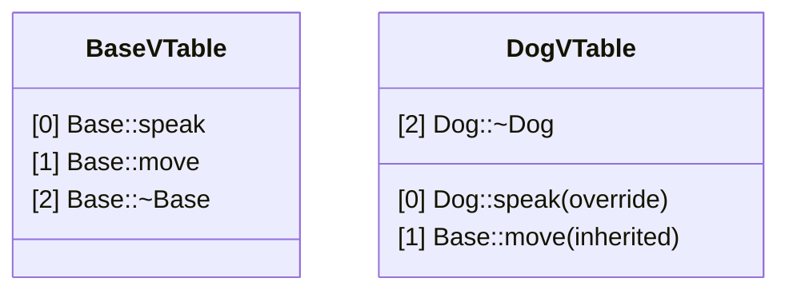
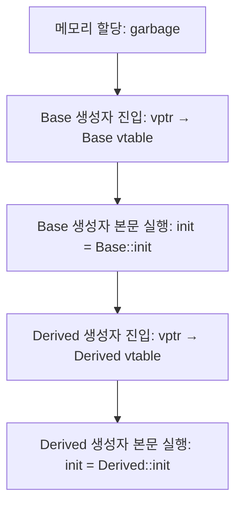
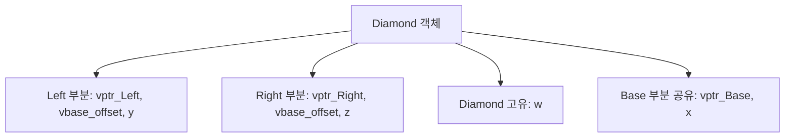

## 들어가며

`virtual`은 일반적인 ABI에서 객체에 vptr을 추가하고 호출 지점을 간접 분기로 만들 수 있다. 그러나 객체 크기 증가는 기존 정렬·상속 레이아웃에 따라 달라지고, 호출은 devirtualization되거나 정확히 예측될 수도 있어 고정된 "8바이트·10배" 비용은 없다. 가상 함수는 매일 사용하는 도구이지만, 컴파일러와 CPU가 런타임 다형성을 어떻게 처리하는지 들여다보지 않으면 실제 비용 구조가 보이지 않는다.

답은 **간접 호출**에 있다. 1967년 Ole-Johan Dahl과 Kristen Nygaard가 Simula 67에서 처음 도입한 가상 메서드 개념은, Bjarne Stroustrup이 C++로 가져오면서 현대적인 vtable 메커니즘으로 진화했다. 이 글에서는 가상 함수의 내부 구조를 하드웨어 레벨부터 살펴보고, 성능이 중요한 시스템에서 이를 최적화하거나 대체하는 전략을 정리한다.


---

## 목차
1. [컴파일러는 어떻게 올바른 함수를 찾는가](#1-컴파일러는-어떻게-올바른-함수를-찾는가)
2. [vptr의 메모리 레이아웃](#2-vptr의-메모리-레이아웃)
3. [가상 함수 호출은 왜 느린가](#3-가상-함수-호출은-왜-느린가)
4. [생성자와 소멸자에서의 가상 함수](#4-생성자와-소멸자에서의-가상-함수)
5. [다중 상속의 복잡성](#5-다중-상속의-복잡성)
6. [RTTI는 어디에 저장되는가](#6-rtti는-어디에-저장되는가)
7. [가상 함수를 피해야 할 때](#7-가상-함수를-피해야-할-때)
8. [컴파일러마다 다른 ABI](#8-컴파일러마다-다른-abi)
9. [디버깅: vtable을 보는 방법](#9-디버깅-vtable을-보는-방법)


---

## 1. 컴파일러는 어떻게 올바른 함수를 찾는가

### 컴파일 타임과 런타임의 간극

```cpp
class Animal {
public:
    void speak() { std::cout << "..."; }
};

class Dog : public Animal {
public:
    void speak() { std::cout << "Woof!"; }
};

Animal* a = new Dog();
a->speak();  // 출력: "..." - 왜 Dog::speak()가 아닌가?
```

비가상 함수는 컴파일 타임에 호출 대상이 결정된다. 컴파일러는 `a`의 타입(`Animal*`)만 보고, `Animal::speak`로의 직접 호출 코드를 생성한다. 실제 객체가 `Dog`라는 사실은 런타임에만 알 수 있는 정보이므로 무시된다.

```cpp
class Animal {
public:
    virtual void speak() { std::cout << "..."; }
};

Animal* a = new Dog();
a->speak();  // 출력: "Woof!"
```

`virtual` 키워드 하나로 동작이 바뀐다. `a->speak`는 런타임에 실제 객체의 타입을 확인하고 올바른 함수를 호출한다.

### vtable과 vptr

Stroustrup은 *The Design and Evolution of C++*에서 가상 함수 메커니즘이 충분히 효율적이어야 실무에서 채택될 수 있다는 점이 vtable 설계의 동기였다고 회고한다. Simula의 방식을 계승하되, 호출 비용을 배열 인덱싱 + 간접 호출 수준으로 묶은 것이다.

컴파일러는 가상 함수를 지원하기 위해 두 가지 구조를 생성한다.

**vtable (Virtual Table)**: 클래스당 하나의 함수 포인터 배열.



**vptr (Virtual Pointer)**: 객체당 하나의 vtable 포인터.

```cpp
struct Animal {
    void** vptr;        // 컴파일러가 자동 삽입한다
    // ... 사용자 정의 멤버
};
```

이제 `a->speak` 호출은 다음과 같이 변환된다.

```cpp
// 의사 코드 (실제로는 어셈블리)
void** vtable = a->vptr;           // 1. vptr 로드
void (*func)(Animal*) = vtable[0]; // 2. vtable에서 함수 포인터 읽기
func(a);                           // 3. 간접 호출
```

이것이 간접 호출(`indirect call`)의 본질이다. 직접 `Animal::speak`를 호출하는 대신, 두 번의 메모리 접근과 하나의 간접 점프를 수행한다.

## 2. vptr의 메모리 레이아웃

### sizeof의 변화

```cpp
class Empty { };
class WithVirtual { virtual void f(); };
class WithData { int x; };
class Both { virtual void f(); int x; };

std::cout << sizeof(Empty)       << "\n";  // 1
std::cout << sizeof(WithVirtual) << "\n";  // 8
std::cout << sizeof(WithData)    << "\n";  // 4
std::cout << sizeof(Both)        << "\n";  // 16
```

이 예시 ABI에서는 첫 가상 함수를 추가하면서 8바이트 vptr이 생긴다. 64비트 시스템의 포인터가 흔히 8바이트이기 때문이다. 다만 기반 클래스에서 vptr을 이미 상속하거나 기존 tail padding을 재사용하는 레이아웃에서는 `virtual` 하나가 객체마다 정확히 8바이트를 더한다는 식으로 일반화할 수 없다.

| 클래스 | 레이아웃 | 크기 |
|--------|---------|------|
| `Empty` | 1바이트 패딩(크기 0은 불가) | 1 |
| `WithVirtual` | vptr 8바이트 | 8 |
| `WithData` | int 4바이트 | 4 |
| `Both` | vptr 8 + int 4 + 패딩 4 | 16 |

### vptr의 위치

대부분의 컴파일러는 vptr을 객체의 시작 위치에 배치한다. Itanium C++ ABI(GCC, Clang이 따르는 사실상의 표준)는 다음과 같이 명시한다.

> "If C has no primary base class, allocate the virtual table pointer for C at offset zero..."

```cpp
class Base {
public:
    virtual void func1() { }
    virtual void func2() { }
    int data_;
};

Base b;
```

메모리 레이아웃:

| 오프셋 | 내용 | 크기 |
|--------|------|------|
| 0x00 | vptr → Base vtable | 8 |
| 0x08 | data_ (int) | 4 |
| 0x0C | padding | 4 |
| 합계 | | 16 |

크기가 16이 되는 이유는 정렬이다. vptr(8바이트) 때문에 클래스의 정렬 요구가 8이 되고, 구조체 크기는 정렬의 배수로 패딩되므로 8 + 4 = 12가 16으로 올림된다.

### 단일 상속에서의 vtable 내용

```cpp
class Base {
public:
    virtual void func1() { std::cout << "Base::func1\n"; }
    virtual void func2() { std::cout << "Base::func2\n"; }
    int data_;
};

class Derived : public Base {
public:
    void func1() override { std::cout << "Derived::func1\n"; }
    virtual void func3() { std::cout << "Derived::func3\n"; }
    int derived_data_;
};
```

| 슬롯 | Base vtable | Derived vtable |
|------|-------------|----------------|
| [0] | `&Base::func1` | `&Derived::func1` (오버라이드) |
| [1] | `&Base::func2` | `&Base::func2` (상속) |
| [2] | - | `&Derived::func3` (새 함수) |

Stan Lippman의 *Inside the C++ Object Model*이 정리하는 규칙 그대로다. 가상 함수를 가진 클래스마다 vtable이 하나씩 생기고, 파생 클래스는 기반 클래스의 vtable을 복제한 뒤 오버라이드한 슬롯만 교체한다.

### vptr은 표준인가, 구현 디테일인가

C++ 표준은 vptr의 존재, 위치, 이름을 명시하지 않는다. 표준이 요구하는 것은 동작뿐이다.

- 가상 함수 호출은 실제 객체의 타입에 따라 결정되어야 한다.
- `dynamic_cast`와 `typeid`가 작동해야 한다.

다만 모든 주요 컴파일러(GCC, Clang, MSVC, ICC)가 vtable/vptr 메커니즘을 사용한다. 다른 방법으로 구현하는 것이 사실상 불가능하기 때문이다.

## 3. 가상 함수 호출은 왜 느린가

### 어셈블리로 보는 차이

```cpp
struct Base {
    virtual void foo() { }
};

void call_foo(Base* b) {
    b->foo();
}
```

GCC `-O2`로 컴파일한 어셈블리:

```asm
call_foo(Base*):
    mov     rax, QWORD PTR [rdi]    ; vptr 로드 (메모리 접근 1)
    mov     rax, QWORD PTR [rax]    ; vtable[0] 로드 (메모리 접근 2)
    jmp     rax                     ; 간접 점프
```

비가상 함수와 비교:

```cpp
struct Base {
    void foo() { }  // 비가상
};

void call_foo_direct(Base* b) {
    b->foo();
}
```

```asm
call_foo_direct(Base*):
    jmp     Base::foo()             ; 직접 점프 (1 명령어)
```

개념적인 차이는 직접 호출의 대상이 명령어에 들어 있는 반면, 가상 호출은 객체에서 vptr과 함수 주소를 읽어 간접 호출한다는 점이다. 실제 명령어 수와 메모리 접근 수는 ABI, 최적화, 인라이닝, 레지스터에 남은 값에 따라 달라진다. 컴파일러가 동적 타입을 증명하면 가상 호출도 devirtualization과 인라이닝으로 사라질 수 있다.

### 하드웨어 관점: 간접 분기의 비용

직접 호출은 대상 주소가 명령어에 인코딩되어 있어 프런트엔드가 대상을 일찍 알 수 있다. 그래도 호출 비용 전체가 0이 되는 것은 아니며 명령어 캐시, 디코드, 반환 주소 예측, 인라이닝 여부가 영향을 준다.

간접 호출은 대상이 런타임 값이지만 현대 CPU의 간접 분기 예측기는 반복되는 대상 패턴을 학습한다. 호출 지점이 사실상 한 타입만 보는 monomorphic 패턴이면 잘 예측될 수 있고, 여러 타입이 불규칙하게 섞이면 오예측이 늘 수 있다.

```cpp
std::vector<Animal*> animals = { new Dog(), new Cat(), new Bird() };

for (auto* a : animals) {
    a->speak();  // 매번 다른 주소로 점프
}
```

간접 분기는 목적지가 데이터에 의존하므로 직접 분기보다 예측이 어렵고, 예측 실패 한 번에 현대 프로세서에서 수십 사이클(파이프라인 플러시)을 잃는다(Intel Optimization Reference Manual, Agner Fog의 microarchitecture 자료 참조).

### 성능 비용 분해

각 latency를 단순 합산하면 out-of-order 실행, cache hit 수준, 다른 독립 연산과의 겹침을 무시하게 된다. 가상 호출은 다음 의존 사슬과 최적화 기회를 기준으로 분석한다.

| 요소 | 비용이 커지는 조건 | 확인 방법 |
|------|-------------------|----------|
| 객체에서 vptr load | 객체가 cache/TLB에 없고 pointer chasing이 길 때 | cache·TLB miss counter |
| vtable에서 대상 load | vtable이 cold하거나 종속 load가 병목일 때 | 생성 어셈블리, load latency |
| 간접 분기 | 한 call site에 불규칙한 대상이 많이 섞일 때 | indirect branch miss |
| 인라이닝 상실 | 호출 본문이 작고 주변 루프 최적화 기회가 클 때 | devirtualization report, 어셈블리 |
| 객체 배치 | 포인터 컨테이너가 서로 먼 객체를 가리킬 때 | data layout을 고정한 A/B benchmark |

비교에서는 같은 함수 본문과 데이터 배치를 유지하고 direct, virtual, devirtualized 빌드를 나눈다. CPU·컴파일러·옵션과 타입 순서를 기록해야 간접 호출 자체와 객체 locality 비용을 구분할 수 있다.

## 4. 생성자와 소멸자에서의 가상 함수

### 초보자의 함정

```cpp
class Base {
public:
    Base() {
        init();  // 위험
    }
    virtual void init() {
        std::cout << "Base::init\n";
    }
};

class Derived : public Base {
public:
    Derived() : Base() { }
    void init() override {
        std::cout << "Derived::init\n";
    }
};

Derived d;
// 출력: "Base::init" - Derived::init()가 아니다
```

`Derived::init`이 호출되지 않는 이유는 vptr 초기화 순서에 있다.

### vptr이 단계적으로 변하는 이유

Scott Meyers는 "Effective C++" Item 9에서 다음과 같이 경고한다.

> "During base class construction, virtual functions never go down into derived classes."

생성 과정을 단계별로 보면 다음과 같다.



만약 Base 생성자에서 `Derived::init`이 호출된다면 다음과 같은 상황이 발생한다.

```cpp
class Derived : public Base {
    std::string name_;
public:
    Derived() : name_("object") { }

    void init() override {
        std::cout << name_.size();  // name_이 아직 초기화되지 않음
    }
};
```

`name_`은 `Derived` 생성자에서 초기화되는데, 그 전에 `init`이 호출되면 초기화되지 않은 멤버 접근이 발생한다. C++는 이를 방지하기 위해 vptr을 단계적으로 변경한다.

### 소멸자에서의 역순

소멸자는 생성자의 정확한 역순으로 vptr을 변경한다.

```cpp
class Base {
public:
    virtual ~Base() {
        cleanup();  // Base::cleanup() 호출
    }
    virtual void cleanup() { std::cout << "Base::cleanup\n"; }
};

class Derived : public Base {
public:
    ~Derived() override {
        cleanup();  // Derived::cleanup() 호출
    }
    void cleanup() override { std::cout << "Derived::cleanup\n"; }
};

{
    Derived d;
}
// 출력:
// Derived::cleanup  ← Derived 소멸자
// Base::cleanup     ← Base 소멸자 (vptr이 Base로 복원됨)
```

| 단계 | vptr 상태 | 가상 함수 호출 결과 |
|------|-----------|---------------------|
| 1. Derived 소멸자 진입 | → Derived vtable | Derived:: 버전 |
| 2. Derived 소멸자 종료 | → Base vtable | Base:: 버전 |
| 3. Base 소멸자 본문 | Base vtable | Base:: 버전 |
| 4. 메모리 해제 | - | - |

### 가상 소멸자의 필수성

```cpp
class Base {
public:
    ~Base() { std::cout << "~Base\n"; }  // 비가상
};

class Derived : public Base {
    int* data_;
public:
    Derived() : data_(new int[1000]) { }
    ~Derived() {
        delete[] data_;
        std::cout << "~Derived\n";
    }
};

Base* b = new Derived();
delete b;
// 정의되지 않은 동작(undefined behavior).
// 표준상 이 시점부터 프로그램의 동작은 어떤 것도 보장되지 않는다.
// 실제로는 보통 ~Base()만 실행되고 ~Derived()가 누락되어
// data_ 메모리 누수로 관찰된다.
```

표준 [expr.delete]는 "if the static type of the object to be deleted is different from its dynamic type, the static type shall be a base class of the dynamic type... and the static type shall have a virtual destructor or the behavior is undefined"라고 규정한다. 즉 base의 소멸자가 virtual이 아닐 때 base 포인터로 derived를 delete하는 것 자체가 UB다. 자주 관찰되는 결과가 "Base 소멸자만 호출"일 뿐, 컴파일러나 최적화 옵션에 따라 다른 형태의 손상이 나타날 수 있다.

해결책:

```cpp
class Base {
public:
    virtual ~Base() { std::cout << "~Base\n"; }
};

delete b;
// 이제 vptr을 통해 올바른 소멸자 호출
// 출력:
// ~Derived
// ~Base
```

이 원칙은 [C++ Core Guidelines C.35](https://isocpp.github.io/CppCoreGuidelines/CppCoreGuidelines#Rc-dtor-virtual)에 다음과 같이 정리되어 있다.

> "A base class destructor should be either public and virtual, or protected and non-virtual."

## 5. 다중 상속의 복잡성

### 두 개의 기반 클래스

```cpp
class A {
public:
    virtual void a_func() { }
    int a_data;
};

class B {
public:
    virtual void b_func() { }
    int b_data;
};

class C : public A, public B {
public:
    void a_func() override { }
    void b_func() override { }
    int c_data;
};
```

`C` 객체는 두 개의 vptr을 가진다.

### 메모리 레이아웃

`C` 객체 (sizeof = 32 bytes, 64비트, Itanium ABI 기준):

| 오프셋 | 내용 | 설명 |
|--------|------|------|
| 0x00 | vptr_A | C's vtable for A (8) |
| 0x08 | a_data | A's data member (4) |
| 0x0C | padding | 4 bytes |
| 0x10 | vptr_B | C's vtable for B (8) |
| 0x18 | b_data | B's data member (4) |
| 0x1C | c_data | C's data member (4) |

vptr이 두 개인 이유는 단순하다. 각 기반 클래스의 포인터로 객체를 참조할 때, 그 포인터가 가리키는 위치에서 곧바로 유효한 vptr을 찾을 수 있어야 하기 때문이다.

```cpp
C* c = new C();
A* a = c;  // a는 c와 같은 주소 (0x00)
B* b = c;  // b는 c + 16 (0x10) ← 포인터 조정
```

### Thunk: 보이지 않는 조정자

`B*`로 `b_func`을 호출하면 어떻게 되는가?

```cpp
B* b = new C();
b->b_func();  // this 포인터가 C의 시작이 아니라 B 부분을 가리킴
```

`C::b_func`은 `this`가 C 객체의 시작 주소를 가리킨다고 가정한다. 하지만 `b`는 B 부분(offset 0x10)을 가리킨다. 컴파일러는 thunk를 생성한다.

```asm
; C::b_func의 thunk
C::b_func_thunk:
    sub     rdi, 16        ; this 포인터를 16 바이트 뒤로 (C의 시작으로)
    jmp     C::b_func      ; 실제 함수로 점프
```

vtable 구조:

| C's vtable for A | C's vtable for B |
|------------------|------------------|
| `&C::a_func` | `&C::b_func_thunk` (thunk) |

[Itanium C++ ABI](https://itanium-cxx-abi.github.io/cxx-abi/abi.html)가 이 메커니즘을 명세한다. 비주(non-primary) 기반 클래스의 vtable 슬롯에는 실제 함수 대신 this 포인터를 조정하고 점프하는 thunk가 들어간다.

### 가상 상속: 다이아몬드 문제

```cpp
class Base {
public:
    virtual void f();
    int x;
};

class Left : virtual public Base {
    int y;
};

class Right : virtual public Base {
    int z;
};

class Diamond : public Left, public Right {
    int w;
};
```

가상 상속은 Base가 한 번만 존재하도록 보장한다. Diamond 객체 레이아웃(개념적):



가상 기반 부분의 주소가 정적으로 확정되지 않는 접근에서는 ABI가 vtable/vbtable의 vbase offset을 읽어 위치를 계산할 수 있다. 컴파일러가 구체 타입과 오프셋을 알면 이 계산을 상수로 접을 수도 있으므로 모든 멤버 접근에 추가 메모리 읽기가 생긴다고 일반화하지 않는다.

## 6. RTTI는 어디에 저장되는가

### type_info의 위치

`typeid`와 `dynamic_cast`는 RTTI(Run-Time Type Information)를 필요로 한다. 이 정보는 vtable 앞에 있다.

Itanium C++ ABI 명세:

| 오프셋 | 내용 |
|--------|------|
| -16 | offset_to_top |
| -8 | type_info* (RTTI) |
| 0 | &vfunc1 (vptr이 가리키는 위치) |
| +8 | &vfunc2 |
| +16 | &vfunc3 |

vptr은 offset 0을 가리키지만, `-8` 위치에 `type_info` 포인터가 있다.

```cpp
#include <typeinfo>

class Base {
public:
    virtual ~Base() = default;
};

class Derived : public Base { };

Base* b = new Derived();
const std::type_info& ti = typeid(*b);
std::cout << ti.name();  // "Derived" (컴파일러마다 다름)
```

### dynamic_cast의 비용

```cpp
Derived* d = dynamic_cast<Derived*>(b);
```

`dynamic_cast`가 수행해야 할 논리적 작업은 다음과 같다:

1. 소스 객체의 동적 타입 정보를 찾는다.
2. 목표 타입과의 public·unambiguous 관계를 검사한다.
3. 필요하면 상속 그래프를 탐색한다.
4. 다중·가상 상속 레이아웃에 맞게 결과 포인터를 조정한다.

RTTI 메타데이터의 위치와 탐색 알고리즘은 ABI와 컴파일러 구현에 속한다. 예를 들어 Itanium C++ ABI 계열과 MSVC ABI는 vtable 주변 레이아웃이 다르므로 `type_info`가 항상 vptr의 고정 오프셋에 있다는 식으로 이식 가능한 코드를 만들 수 없다. 비용도 성공 방향, 계층의 모양, 캐시 상태와 구현에 따라 달라지므로 hot loop에서는 실제 대상 ABI로 측정한다.

### RTTI를 끄는 빌드가 있는 이유

일부 C++ 엔진과 모듈은 표준 C++ RTTI를 기본적으로 끄거나 제한한다. 반대로 RTTI를 사용하는 엔진·플러그인·도구도 있고, C# 런타임의 타입 정보까지 같은 정책으로 묶을 수 없다. 따라서 엔진 이름만으로 판단하지 말고 대상 모듈의 컴파일 옵션과 ABI 경계를 확인해야 한다.

```bash
# GCC/Clang
-fno-rtti

# MSVC
/GR-
```

RTTI를 제한하는 대표적인 이유:

1. **바이너리와 메타데이터**: 타입 정보와 cast 지원 코드의 크기를 줄일 수 있다.
2. **정책 통일**: 모듈마다 다른 RTTI 설정으로 생기는 ABI 문제를 피한다.
3. **런타임 계약**: reflection, serialization, object lifetime까지 연결된 자체 타입 시스템을 일관되게 사용한다.
4. **hot-path 제어**: 계층 탐색 cast를 빈번한 dispatch 수단으로 쓰지 못하게 한다.

Unreal의 대안:

```cpp
UCLASS()
class AMyActor : public AActor {
    GENERATED_BODY()
};

// 표준 dynamic_cast 대신 엔진 타입 시스템 사용
if (Actor->IsA<AMyActor>()) {
    AMyActor* MyActor = Cast<AMyActor>(Actor);
}
```

`IsA`나 `Cast`의 정확한 자료구조와 복잡도 역시 엔진 버전에 속한다. 중요한 점은 표준 RTTI를 단순히 제거하는 것이 아니라, reflection과 객체 수명 규칙을 소유하는 다른 타입 계약으로 교체한다는 것이다.

## 7. 가상 함수를 피해야 할 때

### 잘못된 조언과 올바른 질문

"가상 함수는 느리니 쓰지 마라"는 잘못된 조언이다. 올바른 질문은 다음과 같다.

> 런타임 다형성이 정말 필요한가?

Mike Acton의 [CppCon 2014 발표](https://www.youtube.com/watch?v=rX0ItVEVjHc)가 던지는 질문도 같다. "어떻게 다형적으로 만들까"가 아니라 "다형성이 애초에 필요한가"를 먼저 물어야 한다.

### Case 1: CRTP (타입이 컴파일 타임에 알려진 경우)

```cpp
// 가상 함수 버전
class Animal {
public:
    virtual void speak() = 0;
};

class Dog : public Animal {
    void speak() override { std::cout << "Woof"; }
};

void make_speak(Animal& a) {
    a.speak();  // 간접 호출
}
```

```cpp
// CRTP 버전
template<typename Derived>
class Animal {
public:
    void speak() {
        static_cast<Derived*>(this)->speak_impl();
    }
};

class Dog : public Animal<Dog> {
public:
    void speak_impl() { std::cout << "Woof"; }
};

template<typename T>
void make_speak(Animal<T>& a) {
    a.speak();  // 컴파일 타임에 인라인
}
```

| 항목 | 가상 함수 | CRTP |
|------|-----------|------|
| vptr 오버헤드 | 일반 ABI에서 포인터 크기 필드 | 없음 |
| 호출 형태 | 간접 호출 가능 | 직접 호출·인라인 가능 |
| 런타임 다형성 | O | X |
| 컨테이너 혼합 저장 | O | X |
| 코드 복잡도 | 낮음 | 중간 |

타입 집합이 컴파일 타임에 고정되고, 인라인 최적화가 중요할 때 적합하다.

### Case 2: 타입 태그 (타입이 적고 고정된 경우)

```cpp
enum class EntityType : uint8_t {
    Player,
    Enemy,
    Projectile
};

struct Entity {
    EntityType type;  // 1 byte (vptr 8 bytes 대비)

    void update() {
        switch (type) {
            case EntityType::Player:
                update_player(this);
                break;
            case EntityType::Enemy:
                update_enemy(this);
                break;
            case EntityType::Projectile:
                update_projectile(this);
                break;
        }
    }
};
```

장점:

- 메모리: enum 1바이트 vs vptr 8바이트.
- 분기 예측: 패턴이 일정하면 CPU가 학습.
- 캐시: 타입 정보가 데이터와 인접.

단점:

- 확장성: 새 타입 추가 시 switch 수정 필요.
- OOP 원칙 위배.

Chandler Carruth(Google)의 ["Efficiency with Algorithms, Performance with Data Structures"](https://www.youtube.com/watch?v=fHNmRkzxHWs)가 정리하는 원칙도 같은 방향이다. 데이터에는 상속을 쓰지 말고, 상속은 인터페이스에만 쓴다.

### Case 3: 명시적 vtable (C 인터페이스가 필요한 경우)

COM(Component Object Model)은 명시적 vtable을 사용한다.

```cpp
struct IUnknownVTable {
    HRESULT (*QueryInterface)(void* this, REFIID riid, void** ppv);
    ULONG (*AddRef)(void* this);
    ULONG (*Release)(void* this);
};

struct IUnknown {
    IUnknownVTable* vtable;
};

// 사용
IUnknown* obj = ...;
obj->vtable->AddRef(obj);
```

이유:

- C 호환성(DLL 경계 넘어 안전).
- ABI 안정성(컴파일러 독립).
- 명시적 제어.

Windows API는 이 패턴으로 DirectX, COM 등을 구현한다.

### Case 4: 데이터 지향 설계 (타입별 배열)

```cpp
// 나쁨: 포인터 배열
std::vector<Entity*> entities;  // 메모리 곳곳에 흩어짐

for (auto* e : entities) {
    e->update();  // 캐시 미스, 간접 호출
}
```

```cpp
// 좋음: 타입별 배열
struct GameState {
    std::vector<Player> players;
    std::vector<Enemy> enemies;
    std::vector<Projectile> projectiles;
};

void update_all(GameState& state) {
    for (auto& p : state.players)     p.update();  // 연속 메모리, 비가상
    for (auto& e : state.enemies)     e.update();
    for (auto& proj : state.projectiles) proj.update();
}
```

가상 호출 자체와 데이터 배치를 분리해 측정해야 한다.

| 실험 | 분리되는 비용 |
|---|---|
| 연속 객체, 동일 타입, virtual/direct 비교 | 간접 호출과 devirtualization |
| 연속 포인터, pointee도 연속 | 포인터 load와 호출 대상 예측 |
| 무작위 pointee, 동일 타입 | 데이터 cache/TLB miss |
| 무작위 pointee, 혼합 타입 | locality와 간접 분기 대상 변화 |

컴파일러의 LTO·PGO와 devirtualization 보고서를 함께 기록한다. 흔히 큰 차이는 virtual 한 명령보다 흩어진 pointee와 타입 혼합에서 나오지만, 실제 비율은 객체 작업량과 배치에 따라 달라진다.

## 8. 컴파일러마다 다른 ABI

### Itanium C++ ABI vs MSVC ABI

C++ 표준은 객체 레이아웃을 의도적으로 명세하지 않는다. 구현이 각자의 최적화 전략을 선택할 수 있게 하기 위해서다. 그 결과 두 갈래의 사실상 표준이 공존한다.

Itanium C++ ABI(GCC, Clang, ICC):

| 오프셋 | 내용 |
|--------|------|
| -16 | offset_to_top |
| -8 | type_info* |
| 0 | &vfunc1 (vptr 위치) |
| +8 | &vfunc2 |

MSVC ABI:

| 오프셋 | 내용 |
|--------|------|
| 0 | &vfunc1 (vptr 위치) |
| +8 | &vfunc2 |

(type_info는 별도 구조)

### 다중 상속에서의 차이

- Itanium: 단일 vtable에 모든 정보 + thunk.
- MSVC: 기반 클래스별로 별도 vftable(virtual function table).

```cpp
class C : public A, public B { };
```

| 방식 | 구조 |
|------|------|
| Itanium | C's vtable: [A's functions][B's functions with thunks] |
| MSVC | C's vftable for A: [A's functions], C's vftable for B: [B's functions with adjustors] |

### 가상 상속의 차이

| 항목 | Itanium ABI | MSVC |
|------|-------------|------|
| vbase offset 저장 | vtable 앞 | 별도 vbtable |
| 추가 포인터 | 없음 | vbptr (8 bytes) |
| 접근 방식 | vtable[-16] 읽기 | vbtable 참조 |

### 실무적 함정

```cpp
// LibA.dll (MSVC로 컴파일)
class DLLEXPORT Base {
public:
    virtual void f();
};

// App.exe (GCC로 컴파일)
#include "LibA.h"

Base* b = CreateObject();  // DLL에서 반환
b->f();  // 크래시
```

GCC는 vptr이 offset 0을 가리킨다고 가정하지만, MSVC는 다른 레이아웃을 사용한다. 해결책:

1. 같은 컴파일러 사용.
2. C 인터페이스로 경계 노출.
 ```cpp
 extern "C" DLLEXPORT void Base_f(void* obj);
 ```
3. 순수 가상 인터페이스 + 팩토리.
 ```cpp
 struct IBase {
 virtual void f() = 0;
 virtual ~IBase() = default;
 };

 extern "C" DLLEXPORT IBase* CreateBase();
 ```

## 9. 디버깅: vtable을 보는 방법

### 컴파일러 플래그

```bash
# GCC
g++ -fdump-class-hierarchy myclass.cpp

# Clang
clang++ -Xclang -fdump-vtable-layouts myclass.cpp

# MSVC
cl /d1reportAllClassLayout myclass.cpp
```

GCC 출력 예시:

```text
Vtable for Base
Base::_ZTV4Base: 4 entries
0     (int (*)(...))0
8     (int (*)(...))(& _ZTI4Base)
16    (int (*)(...))Base::func1
24    (int (*)(...))Base::func2
```

이 출력은 위 예제처럼 가상 소멸자가 없는 `Base`를 기준으로 한 개념적 형태다. Itanium ABI에서 가상 소멸자를 선언하면 일반적으로 complete-object destructor(D1)와 deleting destructor(D0)용 함수 슬롯이 따로 나타난다. 정확한 기호 이름과 출력 형식은 compiler version에서 직접 확인한다.

### 런타임 vtable 덤프

```cpp
void print_vtable(void* obj, int num_entries = 5) {
    void** vptr = *(void***)obj;
    std::cout << "vtable at: " << vptr << "\n";

    for (int i = 0; i < num_entries; i++) {
        std::cout << "  [" << i << "]: " << vptr[i];

        // 심볼 이름 얻기 (Linux)
        Dl_info info;
        if (dladdr(vptr[i], &info) && info.dli_sname) {
            int status;
            char* demangled = abi::__cxa_demangle(
                info.dli_sname, nullptr, nullptr, &status
            );
            if (demangled) {
                std::cout << " -> " << demangled;
                free(demangled);
            }
        }
        std::cout << "\n";
    }
}
```

### vptr 손상 감지

메모리 손상이나 use-after-free는 종종 vptr을 파괴한다.

```cpp
class Base {
    uint32_t vptr_guard_ = 0xDEADBEEF;  // vptr 직후
public:
    virtual void check_integrity() {
        if (vptr_guard_ != 0xDEADBEEF) {
            throw std::runtime_error("vptr corruption detected!");
        }
    }
};
```

AddressSanitizer는 use-after-free나 buffer overflow처럼 vptr을 망가뜨린 **메모리 오류**를 탐지할 수 있지만, vptr의 동적 타입 계약 자체를 검사하는 sanitizer는 아니다. Clang/GCC의 UBSan `vptr` 검사는 잘못된 downcast와 멤버 호출 등 vptr 기반 타입 오류를 추가로 진단한다.

```bash
clang++ -fsanitize=address,undefined,vptr -g program.cpp
```


---

## 결론

C++의 가상 함수는 우아한 추상화이지만, 공짜가 아니다. 핵심 정리:

1. vtable/vptr 메커니즘으로 간접 호출을 통해 런타임 다형성을 구현한다.
2. 일반 ABI는 다형 객체에 포인터 크기의 vptr을 두지만 C++ 표준은 객체 레이아웃을 규정하지 않는다.
3. 간접 호출 비용은 devirtualization, 대상 예측, 코드·데이터 locality에 따라 달라진다.
4. 생성·소멸 중 가상 호출은 현재 생성·소멸 중인 클래스의 final overrider 규칙을 따른다.
5. 다중 상속의 vptr 수와 this 조정 thunk는 ABI와 계층에 따라 달라진다.
6. RTTI 메타데이터 배치는 ABI별이다. RTTI 비활성화는 기능·바이너리 크기 선택이지 가상 호출 성능의 보편 처방이 아니다.
7. 대안 패턴으로 CRTP, 타입 태그, 명시적 vtable, 타입별 배열이 있다.
8. ABI는 컴파일러마다 다르므로 경계에서 주의가 필요하다.

가상 함수를 무조건 피하라는 것이 아니다. 언제 쓰고 언제 대안을 선택할지 아는 것이 중요하다. Bjarne Stroustrup의 표현을 빌리면, C++는 추상화 비용을 선택할 수 있는 언어다. 가상 함수는 도구의 하나일 뿐이다.

## 더 읽을거리

- [Itanium C++ ABI](https://itanium-cxx-abi.github.io/cxx-abi/abi.html) - vtable 레이아웃의 사실상 표준
- [C++ Standard (ISO/IEC 14882)](https://isocpp.org/std/the-standard) - 가상 함수 명세 (§9.3.2, §11.7)
- [MSVC x64 Calling Convention](https://learn.microsoft.com/en-us/cpp/build/x64-calling-convention) - Microsoft ABI 중 호출 규약 부분; C++ 객체 레이아웃 전체 명세는 아님
- [cppreference: virtual function specifier](https://en.cppreference.com/w/cpp/language/virtual)
- Stan Lippman, "Inside the C++ Object Model", Addison-Wesley, 1996 - vtable/vptr의 바이블
- Bjarne Stroustrup, "The Design and Evolution of C++", Addison-Wesley, 1994
- Scott Meyers, "Effective C++", 3rd Edition, Addison-Wesley, 2005
- [C++ Core Guidelines C.35: base class destructor contract](https://isocpp.github.io/CppCoreGuidelines/CppCoreGuidelines#Rc-dtor-virtual)
- Agner Fog, ["Optimizing software in C++"](https://www.agner.org/optimize/optimizing_cpp.pdf)
- Mike Acton, ["Data-Oriented Design and C++"](https://www.youtube.com/watch?v=rX0ItVEVjHc), CppCon 2014
- Chandler Carruth, ["Efficiency with Algorithms, Performance with Data Structures"](https://www.youtube.com/watch?v=fHNmRkzxHWs), CppCon 2014
- Stoyan Nikolov, ["OOP Is Dead, Long Live Data-oriented Design"](https://www.youtube.com/watch?v=yy8jQgmhbAU), CppCon 2018
- [Compiler Explorer](https://godbolt.org/) - vtable 레이아웃 확인
- [Red Hat: C++ ABI for Itanium](https://refspecs.linuxfoundation.org/cxxabi-1.86.html) - 공식 명세
- Qt, "Binary Compatibility Issues" - ABI 안정성 가이드
