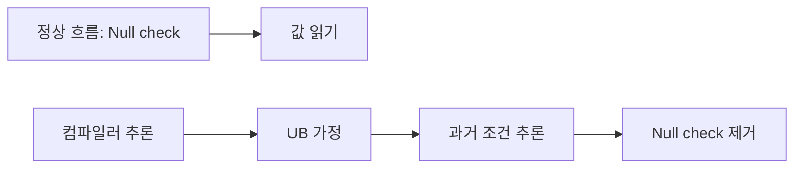
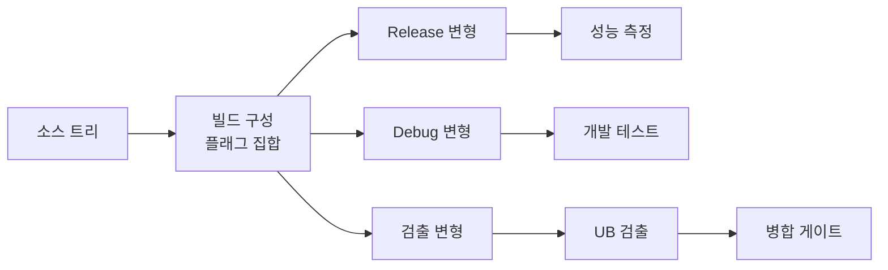

## 들어가며

"컴파일러는 코드가 UB를 포함하지 않는다고 가정한다." 이 문장은 단순한 안내가 아니다. Undefined Behavior(UB)는 표준이 어떤 요구사항도 두지 않는 영역이며, 컴파일러는 정의된 실행만 보존하면 된다는 전제 아래 "UB를 포함하는 경로는 도달하지 않는다"는 추론에 이를 활용할 수 있다. 이때 컴파일러가 모든 UB 경로를 알고 있거나 진단할 의무가 있는 것은 아니다. 컴파일러는 이 추론을 이용해 직관을 뛰어넘는 최적화를 수행한다.

UB가 과거로 거슬러 올라가 null check를 제거하고, 무한 루프를 단 몇 줄로 압축하며, 멀쩡히 보이는 코드를 완전히 삭제하는 메커니즘을 살펴본다. 그다음 시야를 파일 하나에서 번역 단위 여러 개로 넓힌다. 한 파일 안에서는 성립하던 계약이 번역 단위 경계에서 어떻게 깨지는지, 그리고 그 위반을 검출하는 빌드를 어떻게 구성하는지까지 연결한다.


---

## 목차
1. [UB란 무엇인가](#1-ub란-무엇인가)
2. [컴파일러는 UB를 어떻게 활용하는가](#2-컴파일러는-ub를-어떻게-활용하는가)
3. [시간여행: UB가 과거를 바꾸는 이유](#3-시간여행-ub가-과거를-바꾸는-이유)
4. [흔한 UB 목록과 최적화 결과](#4-흔한-ub-목록과-최적화-결과)
5. [Strict Aliasing](#5-strict-aliasing)
6. [Signed Overflow](#6-signed-overflow)
7. [UB를 런타임에 잡기: UBSan](#7-ub를-런타임에-잡기-ubsan)
8. [방어적 프로그래밍](#8-방어적-프로그래밍)
9. [번역 단위와 UB 검출 빌드](#9-번역-단위와-ub-검출-빌드)


---

## 1. UB란 무엇인가

### UB의 역사적 배경

C 언어가 1972년 Dennis Ritchie에 의해 만들어졌을 때, 설계 목표는 명확했다. "이식 가능한 어셈블리어." 다양한 하드웨어에서 동작하되, 각 플랫폼의 성능을 최대한 활용해야 했다.

문제는 플랫폼마다 동작이 달랐다는 점이다.

- **정수 표현**: PDP-11은 2의 보수, 일부 메인프레임은 1의 보수 또는 sign-magnitude.
- **포인터 크기**: 16비트, 32비트, 64비트, 세그먼트 방식.
- **Shift 연산**: 음수를 우측 시프트하면? 산술 시프트 vs 논리 시프트.
- **정렬 요구사항**: x86은 unaligned access 허용, SPARC/MIPS는 하드웨어 예외.

모든 플랫폼에서 동일한 동작을 강제하면 어떤 플랫폼에서는 불필요한 오버헤드가 발생한다. 따라서 C 표준 위원회는 의도적으로 특정 동작을 정의하지 않기로 결정했다.

### 표준이 나누는 동작의 범주

C11 표준(ISO/IEC 9899:2011) §3.4는 표준이 완전히 규정하지 않는 동작을 네 범주로 나눈다.

1. **Implementation-Defined Behavior**: 구현체가 선택하되 문서화해야 함(예: `sizeof(int)`).
2. **Unspecified Behavior**: 표준이 둘 이상의 가능성을 허용하되 어느 쪽인지 규정하지 않음(예: 함수 인자의 평가 순서). implementation-defined는 그 선택을 문서화하도록 요구한 특수 경우다.
3. **Locale-Specific Behavior**: 현재 로케일에 따라 달라짐.
4. **Undefined Behavior**: 표준이 어떤 요구사항도 하지 않음.

UB에 대한 표준의 공식 설명:

> "Behavior, upon use of a nonportable or erroneous program construct or of erroneous data, for which this International Standard imposes no requirements."

"no requirements"가 핵심이다. 컴파일러는 무엇을 해도 표준을 위반하지 않는다.

### UB의 세 가지 가능한 결과

John Regehr(University of Utah)의 ["A Guide to Undefined Behavior in C and C++"](https://blog.regehr.org/archives/213)에서 설명한 UB의 가능한 결과:

1. **예상대로 동작**: 우연히 또는 컴파일러가 그렇게 구현했을 수도.
2. **명백한 충돌**: Segmentation fault, 접근 위반.
3. **무엇이든**: 하드디스크 포맷, 코에서 악마가 나오는 것(comp.std.c의 유명한 "nasal demons" 농담), 또는 시간 여행.

세 번째가 가장 위험하다. 프로그램이 충돌하면 버그를 발견할 수 있지만, 일견 정상 동작하면서 논리 오류를 일으키면 디버깅이 거의 불가능하다.

### 왜 UB를 허용하는가

Chris Lattner(LLVM 창시자)의 ["What Every C Programmer Should Know About Undefined Behavior"](https://blog.llvm.org/2011/05/what-every-c-programmer-should-know.html)에서 제시한 이유:

```c
// 예: Signed overflow가 UB인 이유
for (int i = 0; i <= N; i++) {
    array[i] = 0;
}
```

만약 `i++`에서 오버플로우가 발생하면? 2의 보수 시스템에서 `INT_MAX + 1 = INT_MIN`이므로 루프가 영원히 돌 수 있다.

그러나 signed overflow를 UB로 정의하면 컴파일러는 "오버플로우는 발생하지 않는다"고 가정하고, 루프를 다음과 같이 최적화할 수 있다.

```c
// 컴파일러가 생성한 코드 (개념적)
if (N >= 0) {
    memset(array, 0, (N + 1) * sizeof(int));
}
```

UB가 없다면 이런 최적화는 불가능하다. 성능과 안전성의 트레이드오프다.

## 2. 컴파일러는 UB를 어떻게 활용하는가

### 기본 가정: UB는 발생하지 않는다

컴파일러의 기본 추론 규칙은 다음과 같다.

```text
IF (코드가 UB를 유발한다)
THEN (해당 코드 경로는 실행되지 않는다)
THEREFORE (그 경로로 이어지는 조건은 항상 거짓이다)
```

이는 논리학의 modus tollens(부정 논법)를 그대로 적용한 것이다.

### 예제 1: Null Check 제거

```c
int process(int* ptr) {
    int value = *ptr;  // (1) Null이면 UB 발생

    if (ptr == NULL) { // (2) Null check
        return 0;
    }

    return value;      // ptr 사용
}
```

컴파일러의 추론:

1. 라인 (1)에서 `*ptr`를 역참조 → Null이면 UB.
2. UB는 발생하지 않는다고 가정 → ptr은 Null이 아니다.
3. 라인 (2)의 조건은 항상 거짓 → 전체 if 블록 삭제.

GCC 11.2 `-O2`에서 실제 최적화된 어셈블리:

```asm
process:
    mov eax, DWORD PTR [rdi]  ; *ptr 역참조
    ; if (ptr == NULL) 코드가 완전히 사라짐
```

### 예제 2: Out-of-Bounds 접근과 루프 제거

```c
int table[4];

void fill(int index) {
    for (int i = 0; i <= index; i++) {
        table[i] = i;  // index >= 4이면 UB
    }
}

fill(100);
```

컴파일러의 추론:

1. `table[i]`는 `i < 4`일 때만 정의된 동작.
2. `i >= 4`가 되면 UB 발생.
3. UB는 발생하지 않으므로 `index < 4`.
4. 따라서 `fill(100)` 호출은 UB를 포함하는 코드.

Clang은 이 함수를 다음과 같이 최적화할 수 있다.

```c
// 최적화 후 (개념적): index < 4가 보장되므로 반복 횟수 상한이 상수로 고정되고
// 루프와 경계 검사가 사라진다. 저장 자체는 index에 따라 그대로 남는다.
void fill(int index) {
    if (index >= 0) table[0] = 0;
    if (index >= 1) table[1] = 1;
    if (index >= 2) table[2] = 2;
    if (index >= 3) table[3] = 3;
}
```

### 예제 3: 함수 호출 제거

```c
void may_do_something(int* p) {
    *p = 42;  // NULL이면 UB
}

void caller() {
    may_do_something(NULL);  // 이 호출 자체가 UB
    printf("Done\n");
}
```

GCC `-O2`는 `printf` 호출을 통째로 지우고 `caller`를 트랩으로 끝낸다.

```asm
caller:
    mov DWORD PTR ds:0, 0  ; null store만 남기고
    ud2                    ; 도달하면 트랩
```

`may_do_something(NULL)`은 UB이므로 그 뒤가 도달 불가능하다고 가정 → `printf` 호출이 삭제된다. GCC는 이 경로를 조용히 지우는 대신 `-fisolate-erroneous-paths-dereference`(`-O2` 기본값)로 트랩 명령을 심는다.

## 3. 시간여행: UB가 과거를 바꾸는 이유

### 시간여행의 메커니즘

UB는 미래의 동작이 아니라 과거의 추론을 바꾼다. 이것이 "시간여행"이라 불리는 이유다.

```c
int process(int* ptr) {
    if (ptr) {                // (1) 현재: Null check 수행
        printf("Valid\n");
    }

    int value = *ptr;         // (2) 미래: Null이면 UB

    return value;
}
```



1. 라인 (2)에서 `*ptr` → ptr이 NULL이면 UB.
2. UB는 발생하지 않음 → ptr은 NULL이 아님.
3. 라인 (1)의 조건 `if (ptr)`은 항상 참 → 분기 제거.

최적화된 코드:

```c
int process(int* ptr) {
    printf("Valid\n");        // 무조건 실행
    int value = *ptr;
    return value;
}
```

### 실제 Linux 커널 버그 사례

2009년 Linux 커널 [CVE-2009-1897](https://nvd.nist.gov/vuln/detail/CVE-2009-1897). tun 드라이버에서 다음 패턴이 문제였다.

```c
// drivers/net/tun.c (simplified)
struct sock* sk = tun->sk;     // (1) tun 역참조 (dereference)

if (!tun)                       // (2) NULL 검사 — 너무 늦음
    return POLLERR;

// sk를 사용 ...
```

순서가 잘못되었다. (1)이 `tun->sk`로 `tun`을 역참조한다. 컴파일러는 "역참조가 일어났으므로 `tun`은 NULL이 아니다"라고 추론하고, 그 결론으로 (2)의 NULL 검사를 죽은 코드로 판단해 제거한다. 결과적으로 NULL 포인터로 호출되어도 (2)가 막아주지 못해 보안 검사가 우회된다.

컴파일러 입장에서는 완전히 올바른 추론이다. `tun`이 NULL이면 역참조 시점에 이미 UB이므로, 컴파일러는 NULL이 아니라고 가정할 권리가 있다. 이 사건 이후 커널은 `-fno-delete-null-pointer-checks` 플래그를 추가해 이 부류의 최적화를 차단했다.

수정은 NULL 검사를 첫 역참조 앞으로 옮기는 것이다.

```c
if (!tun)                       // 검사를 먼저
    return POLLERR;

struct sock* sk = tun->sk;     // 그 다음에 역참조
```

`unlikely` 같은 분기 예측 힌트는 도움이 되지 않는다. 그것은 컴파일러에게 "이 분기가 자주 발생하지 않는다"고만 알려줄 뿐, 이미 UB로부터 추론된 결론을 뒤집지 못한다. 검사 자체의 위치가 틀린 것이 문제이므로, 위치를 옮기는 것 외에는 해결책이 없다.

### UB 이후에는 source 순서도 관찰을 보장하지 않는다

다음은 단일 스레드 예제이므로 핵심 용어는 스레드 간 `happens-before`가 아니라 같은 스레드 평가 사이의 **sequenced-before**와 as-if rule이다.

```c
int* ptr = ...;

A: int x = *ptr;       // ptr == NULL이면 UB
B: if (ptr == NULL)
       return;
```

source에서는 A가 B보다 먼저다. 그러나 `ptr == NULL`인 실행에는 언어가 동작을 요구하지 않고, 정의된 실행만 고려하면 `ptr`은 null이 아니다. 따라서 컴파일러는 B를 제거할 수 있다. 이것은 평가 순서가 실제로 역전되었다는 뜻이 아니라, UB가 가능한 경로를 제외한 **정의된 실행의 observable behavior**만 보존한 결과다. `happens-before`는 원자 연산과 스레드 간 가시성을 설명할 때 별도로 사용한다.

- A가 정의되려면 `ptr`은 null이 아니어야 한다.
- 정의된 실행에서 B의 조건은 항상 거짓이다.
- 따라서 B 삭제는 허용된다.

## 4. 흔한 UB 목록과 최적화 결과

### C/C++ 표준이 명시한 주요 UB

ISO C11 Annex J.2 "Undefined behavior"에 나열된 항목(약 200개 중 일부. C99에서 191개였고 C11에서 더 늘었다):

| UB 유형 | 예제 | 최적화 결과 |
|---------|------|------------|
| Null pointer dereference | `*ptr` when `ptr == NULL` | Null check 제거 |
| Out-of-bounds access | `array[10]` when size is 10 | 루프 경계 가정 |
| Signed integer overflow | `INT_MAX + 1` | 오버플로우 없다고 가정 |
| Division by zero | `x / 0` | 분모 검사 제거 |
| Uninitialized value use | `int x; return x;` | 임의 값 반환 |
| Use-after-free | `free(p); *p = 0;` | 메모리 재사용 |
| Data race | 동기화 없이 공유 변수 수정 | 모든 추론 무효화 |
| Shift by negative/large value | `1 << -1`, `1 << 32` | 임의 결과 |
| Invalid pointer arithmetic | `ptr + huge_offset` | 주소 계산 생략 |
| Strict aliasing violation | Type punning via pointer cast | 재정렬, 캐싱 |

### 컴파일러별 UB 처리

| 컴파일러 | UB 최적화 수준 | 특징 |
|----------|---------------|------|
| GCC | 매우 공격적 | `-fno-strict-aliasing`, `-fwrapv` 등 플래그 제공 |
| Clang | 가장 공격적 | LLVM IR 레벨에서 UB 활용 |
| MSVC | 보수적 | 일부 UB를 implementation-defined로 처리 |
| ICC (Intel) | 매우 공격적 | 벡터화와 결합 시 예측 불가 |

이 순위는 컴파일러 버전, 최적화 수준, 대상 코드에 따라 달라지므로 고정된 근거로 쓰지 않는다. UB 최적화 여부는 현상별 어셈블리와 그 빌드 조건으로 확인한다.

## 5. Strict Aliasing

### Strict Aliasing Rule이란

C99 표준 6.5/7:

> "An object shall have its stored value accessed only by an lvalue expression that has one of the following types:
> - a type compatible with the effective type of the object,
> - a qualified version of a type compatible with the effective type of the object,
> - ... (an aggregate or union type that includes one of the aforementioned types ...),
> - **a character type.**"

간단히 말해, 다른 타입의 포인터로 같은 메모리를 접근하면 UB다. 다만 마지막 항목 "a character type"이 결정적이다. 문자 타입을 통한 접근은 언제나 허용되며, 이것이 뒤에서 다룰 바이트 단위 직렬화의 근거가 된다. 위 인용과 아래 예제는 C(C99/C11) 기준이다. C++20에는 대응하는 [basic.lval]과 객체 수명 규칙이 있고 문자 타입은 `char`, `unsigned char`, `std::byte`에 해당한다. union punning 허용 여부, `uint8_t`와 `unsigned char`의 동일성, `memcpy`의 `sizeof` 전제는 언어·표준 버전별로 다르므로 각 예제가 어느 언어의 것인지 구분해 읽는다.

### 허용되는 경우

```c
int x = 42;

int* p1 = &x;         // OK: 같은 타입
const int* p2 = &x;   // OK: qualified 버전
signed int* p3 = &x;  // OK: compatible 타입
```

### 금지되는 경우

```c
int x = 42;
float* p = (float*)&x;  // UB
*p = 3.14f;
printf("%d\n", x);      // 결과는 정의되지 않음
```

컴파일러는 `int*`와 `float*`가 같은 객체를 가리킬 수 없다고 가정 → 재정렬 가능:

```c
// 원본 코드
int x = 42;
float* p = (float*)&x;
*p = 3.14f;              // (A)
int y = x;               // (B)

// 컴파일러의 재정렬
int x = 42;
int y = x;               // (B)를 먼저 실행 - x는 42
float* p = (float*)&x;
*p = 3.14f;              // (A) - x를 float로 덮어씀
```

결과: `y`는 42, 하지만 `x`는 3.14f의 비트 패턴.

### 문자 타입은 예외다

허용 목록의 마지막 항목 "a character type" 덕분에, 어떤 객체든 그 바이트를 `char`/`unsigned char`(C++의 `std::byte` 포함)로 읽고 쓰는 것은 strict aliasing 위반이 **아니다**. `uint8_t`는 거의 모든 구현에서 `unsigned char`의 별칭이므로 다음 바이트 단위 접근은 합법이고 잘 정의되어 있다.

```c
// 합법: 문자 타입을 통한 바이트 접근은 strict aliasing 예외
// 아래는 호스트 객체 표현의 바이트를 big-endian 정수로 해석한다.
// little-endian에서는 바이트스왑이, big-endian에서는 원값이 된다.
uint32_t load_be32(uint32_t x) {
    uint8_t* bytes = (uint8_t*)&x;   // OK (uint8_t == unsigned char)
    return ((uint32_t)bytes[0] << 24) |
           ((uint32_t)bytes[1] << 16) |
           ((uint32_t)bytes[2] << 8)  |
            (uint32_t)bytes[3];
}
```

위반은 그 반대 방향, 즉 한 객체를 **다른 산술 타입의 lvalue**로 접근할 때 발생한다.

### 실제 버그: 산술 타입 간 Type Punning

```c
// float의 비트 패턴을 정수로 읽으려는 흔한 시도
uint32_t float_bits_broken(float f) {
    return *(uint32_t*)&f;   // float 객체를 uint32_t lvalue로 접근 → UB
}
```

`float`와 `uint32_t`는 호환 타입도 문자 타입도 아니므로 strict aliasing 위반이다. 컴파일러는 두 포인터가 같은 객체를 가리킬 수 없다고 가정하여 로드를 재배치하거나 캐싱할 수 있고, 그 결과가 어긋난다.

### 해결책 1: union 사용

```c
uint32_t float_bits_union(float f) {
    union {
        float f;
        uint32_t u;
    } u;

    u.f = f;
    return u.u;
}
```

C에서는 C99 TC3의 각주로 union을 통한 type punning이 허용됨이 명확화되었다(값은 재해석되고, trap representation 가능성만 남는다). 단 **C++에서는 union punning이 여전히 UB**다(많은 컴파일러가 확장으로 지원하긴 한다). C++에서는 `memcpy` 또는 C++20의 `std::bit_cast`를 사용한다.

### 해결책 2: memcpy

```c
uint32_t float_bits_portable(float f) {
    uint32_t u;
    memcpy(&u, &f, sizeof(u));
    return u;
}
```

`memcpy`는 바이트 복사이므로 strict aliasing 위반이 아니다. 최신 컴파일러는 이를 레지스터 이동 한 번으로 최적화하여 오버헤드가 없다. C++20이라면 `std::bit_cast<uint32_t>(f)`가 같은 일을 컴파일 타임 상수식으로도 수행한다.

### 해결책 3: -fno-strict-aliasing

```bash
gcc -O2 -fno-strict-aliasing code.c
```

strict aliasing 기반 최적화를 비활성화한다. Linux kernel build는 GCC/Clang의 strict-aliasing 가정에 의존하지 않도록 이 계열 flag를 전역 build 정책에 포함해 왔지만, 정확한 flag 조합은 대상 kernel tree와 toolchain에서 확인한다.

```make
# Makefile (커널 트리 최상위)
KBUILD_CFLAGS += -fno-strict-aliasing
```

커널 코드는 의도적인 type punning이 도처에 있어 strict aliasing 가정과 양립할 수 없다는 것이 커널 개발진의 일관된 입장이다(Torvalds가 메일링 리스트에서 여러 차례 강하게 밝힌 바 있다).

## 6. Signed Overflow

### Unsigned vs Signed의 차이

```c
unsigned int u = UINT_MAX;
u++;  // 정의된 동작: 0으로 wrap

int i = INT_MAX;
i++;  // UB
```

C11 표준 6.5/5:

> "If an exceptional condition occurs during the evaluation of an expression (that is, if the result is not mathematically defined or not in the range of representable values for its type), the behavior is undefined."

### 왜 Unsigned는 정의되고 Signed는 아닌가

1. **역사적 이유**: 1의 보수, 2의 보수, sign-magnitude 표현 모두 지원.
2. **최적화 기회**: 컴파일러가 "오버플로우 없음"을 가정하고 변환 수행.

### 루프 최적화 예제

```c
for (int i = 0; i < N; i++) {
    array[i] = i * 2;
}
```

`i * 2`에서 오버플로우 가능성이 있지만, 컴파일러는 이를 무시한다.

```c
// 최적화 후 (개념적)
for (int i = 0; i + 3 < N; i += 4) {  // 4개 묶음이 범위 안일 때만 Unroll
    array[i]   = i * 2;
    array[i+1] = (i+1) * 2;
    array[i+2] = (i+2) * 2;
    array[i+3] = (i+3) * 2;
}
// 남은 원소는 tail 루프에서 처리
```

루프 언롤 자체는 각 반복의 연산 순서를 보존해 signed·unsigned 어느 의미에서도 가능하다. signed overflow가 없다는 가정이 특히 유용한 곳은 induction variable 확대, 식의 대수적 단순화, 루프 종료와 반복 횟수 증명이다. unsigned wrap은 정의되어 있으므로 컴파일러가 그 modular arithmetic 의미를 보존해야 하지만, 그것만으로 언롤이 금지되지는 않는다.

### 루프 종료 조건 제거

```c
int i;
for (i = 1; i > 0; i++) {
    // 작업
}
```

의도: `i`가 오버플로우하여 음수가 되면 종료.

컴파일러의 추론:
- `i++`에서 오버플로우는 UB.
- UB는 발생하지 않음 → `i`는 절대 오버플로우하지 않음.
- 무한 루프로 최적화 가능.

Chandler Carruth가 CppCon 2016 발표 "Garbage In, Garbage Out"에서 다룬 패턴 그대로다. 컴파일러는 `i++`에서 오버플로우가 없다고 가정하므로 `i > 0`은 영원히 참이고, 루프는 무한 루프로 컴파일된다.

### -fwrapv: Signed Overflow를 정의하기

```bash
gcc -O2 -fwrapv code.c
```

Signed overflow를 2의 보수 wrap으로 정의한다. 일부 최적화 기회를 잃는다.

## 7. UB를 런타임에 잡기: UBSan

지금까지 본 UB는 컴파일 시점에 진단되지 않는다. 진단할 수 있었다면 표준이 UB로 남겨 둘 이유가 없었다. 남은 방법은 **실행 중에 그 연산이 정말로 계약을 어기는지 확인하는 코드를 심는 것**이다. UndefinedBehaviorSanitizer가 그 일을 한다.

```bash
clang -fsanitize=undefined -g code.c -o code
```

컴파일러는 UB가 될 수 있는 연산마다 조건 검사와 보고 호출을 IR 생성 단계에서 끼워 넣는다.

```c
int overflow(int x) {
    return x + 1;  // x == INT_MAX이면 UB
}
```

```text
code.c:2:12: runtime error: signed integer overflow:
2147483647 + 1 cannot be represented in type 'int'
```

### 이 글에서 다룬 UB와의 대응

UBSan은 하나의 검사기가 아니라 여러 검사의 묶음이다. 이 글이 앞에서 다룬 항목이 각각 어느 검사에 대응하는지 확인해 두면, 검출되지 않은 UB를 검출된 것으로 착각하지 않는다.

| 이 글에서 다룬 UB | 대응하는 검사 | 검출 여부 |
|---|---|---|
| Signed overflow | `signed-integer-overflow` | 연산이 실행되면 검출 |
| 0으로 나누기 | `integer-divide-by-zero` | 검출 |
| Null 역참조 | `null` | 역참조 시점에 검출 |
| 잘못된 시프트 양 | `shift` | 검출 |
| 정렬 위반 포인터 접근 | `alignment` | 검출 |
| 다형 객체의 타입 불일치 | `vptr` | 검출 |
| 배열 범위 초과 | `bounds` | 크기를 컴파일 시점에 아는 경우만 |
| **Strict aliasing 위반** | 없음 | **검출하지 못한다** |

마지막 줄이 중요하다. 타입 기반 앨리어싱 규칙 위반은 런타임에 관찰 가능한 사건이 아니다. `float*`로 `int` 객체를 읽는 순간에 잘못된 값이 나오는 것이 아니라, 컴파일러가 두 접근이 겹치지 않는다고 가정해 순서를 바꾸거나 로드를 없앤 **결과**로 값이 어긋난다. 그 가정은 UBSan이 검사할 대상이 아니라 최적화기의 전제다. 이 종류의 UB는 `-fno-strict-aliasing`으로 전제 자체를 끄거나, `memcpy`·`union`으로 규칙을 지키는 코드로 바꾸는 것이 일반적인 대응이다. 다만 타입 메타데이터를 추적하는 실험적 Clang TypeSanitizer(`-fsanitize=type`)는 이 위반 일부를 검출할 수 있으므로, 사용하는 Clang 버전의 지원 여부와 별도 빌드 필요성을 확인한다.

### 최적화 수준에 따라 결과가 달라진다

UBSan 검사는 최적화 전에 삽입되므로 `-O2`에서도 남아 있다. 다만 두 방향의 상호작용이 생긴다.

- 최적화기가 "이 검사는 절대 발동하지 않는다"를 증명하면 검사를 지운다. 실제로 그 경로가 실행되지 않는다면 올바른 제거다.
- 반대로 검사가 삽입된 탓에 그 지점 이후의 코드가 도달 불가능으로 판정되지 않아, 최적화 빌드에서 사라졌을 코드가 남기도 한다.

그래서 `-O0`과 최적화 빌드의 UBSan 결과가 다를 수 있다. 앞에서 본 시간여행 사례는 최적화 빌드에서만 증상이 나타나므로, **검출은 최적화 빌드에서도 한 번 돌려야 한다.** 기본 동작은 위반을 보고하고 실행을 계속하는 것인데, 첫 위반에서 멈추고 싶으면 복구를 끄고 필요하면 트랩으로 바꾼다.

```bash
# 첫 위반에서 종료
clang -fsanitize=undefined -fno-sanitize-recover=undefined code.c

# 런타임 라이브러리 없이 즉시 트랩 (임베디드·커널 등)
clang -fsanitize=undefined -fsanitize-trap=undefined code.c
```

### 다른 종류의 오류는 다른 계측이 잡는다

UBSan이 검사하는 것은 **연산 하나가 표준 계약을 어기는지**다. 메모리 블록의 수명이나 경계, 스레드 사이의 접근 순서, 초기화 여부는 연산 하나만 봐서는 판단할 수 없고 프로그램의 상태를 별도로 추적해야 알 수 있다. 그래서 공간·시간 안전성 위반, 데이터 레이스, 초기화되지 않은 읽기는 각각 다른 계측 기법을 쓰는 별도 도구가 맡는다. 그 도구들이 상태를 어떤 자료구조로 들고 있는지는 UB와 최적화의 계약이라는 이 글의 논지 밖이다.

빌드 관점에서 알아 둘 조합 규칙만 정리한다.

| 조합 | 가능 여부 |
|---|---|
| UBSan + 주소 계측 | 가능. 같은 빌드에서 함께 켠다 |
| 주소 계측 + 초기화 계측 | 불가능. 같은 shadow 영역을 요구한다 |
| UBSan + 스레드 계측 | 가능하지만 실행 시간이 크게 늘어난다 |

UB 검출만 놓고 보면 UBSan은 다른 계측과 충돌하지 않는 편이므로, 지원 플랫폼과 vptr 등 세부 검사 조합 조건을 확인한 뒤 가능한 변형 빌드에 함께 켜 두는 것이 이득이다.

## 8. 방어적 프로그래밍

### 규칙 1: Null Check는 역참조 전에

```c
// 잘못됨
void bad(int* ptr) {
    int x = *ptr;
    if (!ptr) return;  // 너무 늦음
}

// 올바름
void good(int* ptr) {
    if (!ptr) return;
    int x = *ptr;
}
```

### 규칙 2: Unsigned를 사용하여 Wrap 명시

```c
// 위험
for (int i = 0; i < N; i++) {
    // i가 매우 크면 i * 2 오버플로우
}

// 안전
for (size_t i = 0; i < N; i++) {
    // unsigned wrap은 정의되어 있지만, 범위 검증 없이 index 산술에
    // 사용하면 여전히 out-of-bounds 접근을 만들 수 있다.
}
```

`size_t`는 객체 크기와 인덱스를 표현하는 올바른 타입이지만 "wrap이 정의되어 있으니 안전하다"는 뜻은 아니다. `i + count`, `size * stride`처럼 할당·경계 검사에 쓰는 식은 연산 전에 상한을 검사하거나 checked arithmetic을 사용한다.

### 규칙 3: 경계 검사 먼저

```c
// 위험
int get(int index) {
    int value = array[index];  // Out-of-bounds면 UB
    if (index >= SIZE) return -1;
}

// 안전
int get(int index) {
    if (index < 0 || index >= SIZE) return -1;
    return array[index];
}
```

### 규칙 4: Type Punning은 union 또는 memcpy

```c
// 위험
float to_float(uint32_t x) {
    return *(float*)&x;  // Strict aliasing violation
}

// 안전
float to_float(uint32_t x) {
    float f;
    memcpy(&f, &x, sizeof(f));
    return f;
}
```

### 규칙 5: 컴파일러 경고 활성화

```bash
# GCC/Clang
gcc -Wall -Wextra -Wpedantic -Werror code.c

# MSVC
cl /W4 /WX code.c
```

유용한 경고:
- `-Wstrict-aliasing`: Aliasing 위반 경고.
- `-Wsign-compare`: Signed/unsigned 비교.
- `-Wconversion`: 암묵적 형변환.
- `-Wnull-dereference`: Null 역참조 가능성.

### 규칙 6: Static Analysis 도구 사용

- [Clang Static Analyzer](https://clang-analyzer.llvm.org/): `scan-build make`.
- Coverity: 상업용, 고급 분석.
- PVS-Studio: 상업용, C/C++/C# 지원.
- [Cppcheck](http://cppcheck.sourceforge.net/): 오픈소스.

### 규칙 7: 정의된 동작으로 대체

```c
// UB: Signed overflow
int add(int a, int b) {
    return a + b;  // 오버플로우 시 UB
}

// 정의된 동작: 명시적 검사
int safe_add(int a, int b, int* result) {
    if (a > 0 && b > INT_MAX - a) return 0;  // Overflow
    if (a < 0 && b < INT_MIN - a) return 0;  // Underflow
    *result = a + b;
    return 1;
}

// 또는 컴파일러 내장 함수 사용 (GCC/Clang)
bool safe_add_builtin(int a, int b, int* result) {
    return !__builtin_add_overflow(a, b, result);  // true == 성공
}
```

## 9. 번역 단위와 UB 검출 빌드

지금까지의 UB는 모두 한 번역 단위 안에서 성립하는 이야기였다. 컴파일러는 자기가 보는 범위 안에서 계약을 가정하고 최적화한다. 그런데 프로그램은 번역 단위 여러 개를 링크해 만들어지고, **컴파일러가 보지 못하는 경계에서 생기는 UB가 하나 있다.** 그것이 ODR 위반이다. 이 절은 그 경계를 정리하고, 앞 절의 검사를 실제 빌드에 어떻게 얹는지를 정한다.

### 컴파일 단위와 ODR

C++의 빌드 단위는 **번역 단위**(`translation unit`, TU)다. `#include`가 펼쳐진 후의 한 `.cpp` 파일이 곧 한 TU다. 각 TU는 독립적으로 컴파일되어 객체 파일(`.o`/`.obj`)이 되고, 링커가 이들을 모은다.

이 모델 위에 **One Definition Rule**(ODR)이 얹혀 있다.

- 함수와 변수는 프로그램 전체에서 하나의 정의를 가진다. `inline` 함수·변수와 템플릿은 예외다.
- 클래스·enum·템플릿 같은 타입은 여러 TU에 같은 토큰과 동일한 이름 lookup·linkage 조건을 만족하는 정의가 있으면 중복 정의가 허용된다.
- 같은 철자의 이름이라도 internal linkage나 다른 namespace에 속하면 서로 다른 실체다.
- 이 조건을 어기면 대개 ill-formed, no diagnostic required이며, 컴파일러와 링커가 보통 발견하지 못한다.

ODR 위반의 흔한 형태:

```cpp
// a.cpp
struct Config {
    int x;
    int y;
};

// b.cpp
struct Config {
    int x;
    int y;
    int z;  // 다른 정의: ODR 위반
};
```

두 TU가 같은 `Config`를 다르게 본다. 한쪽에서 `sizeof(Config)`는 8, 다른 쪽에서는 12. 링커는 이름만 보지 정의 본체를 비교하지 않으므로 통과한다. 런타임에 메모리 레이아웃이 어긋나 임의의 동작이 발생한다.

ODR을 안전하게 유지하는 방법:

- 타입 정의는 헤더 한 곳에 둔다. 모든 TU가 같은 헤더를 본다.
- 헤더 안의 비-`inline` 함수 정의는 피한다. `inline` 또는 템플릿이어야 한다.
- 매크로로 헤더 내용이 TU마다 다르게 펼쳐지지 않도록 주의한다.

마지막 항목이 가장 자주 사고를 낸다. 같은 헤더라도 TU마다 다른 매크로 정의 아래에서 펼쳐지면 서로 다른 정의가 된다.

```cpp
// a.cpp
#define ENABLE_STATS 1
#include "config.hpp"   // struct Config에 통계 필드가 생긴다

// b.cpp
#include "config.hpp"   // 같은 헤더, 다른 레이아웃
```

`NDEBUG`, 최적화 수준에 따라 달라지는 표준 라이브러리의 디버그 모드 매크로, 구조체 패킹 프래그마가 모두 같은 방식으로 레이아웃을 갈라놓는다. 그래서 **번역 단위마다 다른 플래그로 컴파일한 객체 파일을 링크하는 것 자체가 위험한 행위**다.

### ODR 위반은 왜 잡히지 않는가

ODR 위반은 이 글에서 다룬 다른 UB와 검출 가능성이 다르다.

| 검출 계층 | ODR 위반을 잡는가 |
|---|---|
| 컴파일러 진단 | 못 잡는다. 각 TU 안에서는 정의가 하나뿐이라 모순이 없다 |
| 링커 | 대개 못 잡는다. 이름만 맞으면 통과한다 |
| 런타임 검사 | 못 잡는다. 어긋난 레이아웃으로 읽고 쓰는 것 자체가 정상 접근으로 보인다 |
| LTO | 부분적으로 잡는다. 전체 프로그램의 타입 정보를 한자리에 모으기 때문이다 |

마지막 줄은 가장 넓게 쓰는 방어다. 링크 시점 최적화를 켜면 컴파일러가 모든 TU의 타입 정보를 함께 보게 되고, GCC의 `-Wodr` 같은 경고가 어긋난 정의를 보고할 수 있다. 모든 위반을 잡지는 못하지만, 링커의 duplicate symbol 오류나 ASan의 global ODR 검사 같은 보조 수단도 일부만 검출하므로 켜 둘 가치가 있다.

```bash
# 모든 TU를 같은 플래그로 컴파일하고, LTO에서 타입 불일치를 본다
g++ -flto -Wodr -O2 a.cpp b.cpp -o app
```

플래그가 정의를 바꾼다는 사실은 검출용 빌드의 구성 방식을 그대로 규정한다. 검출 플래그를 일부 파일에만 적용하면 그 자체가 ODR 위반을 만든다. 프로그램 전체를 같은 플래그로 다시 빌드해야 한다.

### Sanitizer 플래그와 UB 검출

이 글에서 다룬 UB는 표준이 "no requirements"라고 선언한 영역이다. 정적 분석으로 잡히지 않는 UB는 런타임 검사로 잡는 것이 가장 확실하다. 그런데 검사 플래그는 코드 생성과 레이아웃을 바꾸므로, 검출용 빌드는 일반 빌드에 얹는 옵션이 아니라 **처음부터 끝까지 별개인 빌드 변형**이어야 한다. 같은 소스 트리에서 별도 빌드 디렉토리를 만드는 형태가 된다.

```bash
# Debug 빌드 + ASan + UBSan
cmake -B build-asan \
    -DCMAKE_BUILD_TYPE=Debug \
    -DCMAKE_CXX_FLAGS="-fsanitize=address,undefined -fno-omit-frame-pointer -g" \
    -DCMAKE_EXE_LINKER_FLAGS="-fsanitize=address,undefined"

cmake --build build-asan
ctest --test-dir build-asan
```

CI는 보통 다음 변형을 함께 돌린다.

| 변형 | 목적 | 추가 플래그 |
|------|------|-------------|
| Release | 배포용 성능 측정 | `-O3 -DNDEBUG` |
| Debug | 개발 빌드 | `-O0 -g` |
| ASan + UBSan | 메모리 오류, UB 검출 | `-fsanitize=address,undefined` |
| TSan | 데이터 레이스 검출 | `-fsanitize=thread` |
| MSan | 초기화되지 않은 읽기 | `-fsanitize=memory`(Clang only) |

각 변형은 서로 다른 오류 집합과 실행 경로를 검사한다. sanitizer 빌드의 slowdown은 고정 배수가 아니며, 테스트 스위트가 통과해도 실행되지 않은 경로의 UB가 없다는 보장은 없다. 재현된 위반은 가능한 한 최초의 잘못된 접근 가까이에서 보고되지만, 최적화와 비동기 실행 때문에 증상 위치가 원인과 다를 수도 있다.

하나의 소스 트리에서 갈라져 나오는 빌드 변형의 관계는 다음과 같다.



변형이 갈라지는 지점은 플래그 집합 하나다. 플래그가 다르다고 항상 정의가 바뀌는 것은 아니지만, `-DNDEBUG`·구조체 패킹·표준 라이브러리 디버그 매크로·sanitizer 계측처럼 inline 정의나 레이아웃을 바꾸는 옵션이 갈리면 ODR 위반이 생긴다. 그래서 검출 변형은 일반 빌드와 별도 디렉토리에서 같은 플래그로 처음부터 끝까지 빌드한다. UB는 무작위로 보이는 증상을 만들기 때문에, 증상을 만난 뒤 한 번 디버깅하는 것보다 변경마다 검출 변형을 통과시키는 쪽이 비용이 훨씬 적다.


---

## 결론

Undefined Behavior는 C/C++의 가장 날카로운 양날의 검이다. 컴파일러에게 강력한 최적화 기회를 제공하지만, 잘못 다루면 디버깅 불가능한 버그를 만든다.

핵심 정리:

1. UB는 "정의되지 않음"이 아니라 "제약 없음"이다. 컴파일러는 무엇을 해도 표준 위반이 아니다.
2. UB는 미래에서 과거로 거슬러 올라가 조건을 변경한다.
3. 컴파일러는 "UB는 발생하지 않는다"를 axiom으로 사용한다.
4. 이식성을 얻기 위해 안전성을 희생한 결과다.
5. 경계 검사를 먼저, Null check를 먼저, sanitizer를 항상 사용하는 방어적 프로그래밍이 필요하다.
6. ODR 위반은 번역 단위 경계에서 생겨 단일 TU만 보는 진단과 런타임 검사가 잡지 못하는 UB이며, 모든 번역 단위를 같은 플래그로 빌드하고 LTO의 `-Wodr`로 관측하는 것이 실질적인 방어다.

John Regehr의 표현을 빌리면, UB는 시간 기계와 같다. 컴파일러는 나중에 발견할 UB를 근거로 코드의 의미를 거슬러 변경할 수 있다. 컴파일러를 적이 아니라 동맹으로 삼으려면, 이 시간 기계가 어디서 어떻게 발동되는지 알아야 한다.

## 더 읽을거리

- [ISO/IEC 9899:2011 - C11 Standard](https://www.iso.org/standard/57853.html) - Annex J.2 "Undefined behavior"
- [ISO/IEC 14882:2020 - C++20 Standard (N4861)](https://www.open-std.org/jtc1/sc22/wg21/docs/papers/2020/n4861.pdf) - [defns.undefined], [intro.execution], [intro.races], [expr] (Annex C는 Compatibility다)
- [Clang UndefinedBehaviorSanitizer Documentation](https://clang.llvm.org/docs/UndefinedBehaviorSanitizer.html)
- [AddressSanitizer Algorithm](https://github.com/google/sanitizers/wiki/AddressSanitizerAlgorithm)
- Chris Lattner, ["What Every C Programmer Should Know About Undefined Behavior"](https://blog.llvm.org/2011/05/what-every-c-programmer-should-know.html), LLVM Blog, 2011
- John Regehr, ["A Guide to Undefined Behavior in C and C++"](https://blog.regehr.org/archives/213), 2010
- Pascal Cuoq, John Regehr, ["Undefined Behavior in 2017"](https://blog.regehr.org/archives/1520), 2017
- Raymond Chen, ["Undefined behavior can result in time travel (among other things, but time travel is the funkiest)"](https://devblogs.microsoft.com/oldnewthing/20140627-00/?p=633), 2014
- Wang Xi et al., ["Towards Optimization-Safe Systems"](https://css.csail.mit.edu/stack/), SOSP 2013
- Chandler Carruth, ["Garbage In, Garbage Out: Arguing about Undefined Behavior"](https://www.youtube.com/watch?v=yG1OZ69H_-o), CppCon 2016
- [GCC: Optimize Options](https://gcc.gnu.org/onlinedocs/gcc/Optimize-Options.html) - `-flto`, `-Wodr`, `-fstrict-aliasing`, `-fwrapv`
- [Compiler Explorer (Godbolt)](https://godbolt.org/) - 다양한 최적화 레벨에서 어셈블리 비교
- [Cppcheck](http://cppcheck.sourceforge.net/) - 정적 분석
- [Valgrind](https://valgrind.org/) - 메모리 오류 검출
- Robert C. Seacord, "Secure Coding in C and C++", 2nd Edition - Chapter 5: Integer Security
