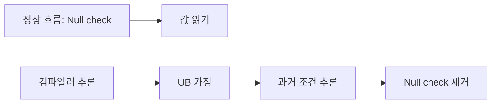
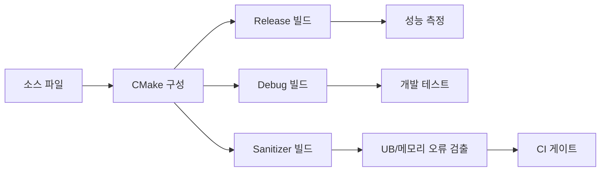

## 들어가며

"컴파일러는 코드가 UB를 포함하지 않는다고 가정한다." 이 문장은 단순한 안내가 아니다. Undefined Behavior(UB)는 "정의되지 않은 동작"이 아니라, 컴파일러에게 "이 코드 경로는 절대 실행되지 않는다"고 선언하는 것과 같다. 컴파일러는 이 정보를 이용해 직관을 뛰어넘는 최적화를 수행한다.

UB가 과거로 거슬러 올라가 null check를 제거하고, 무한 루프를 단 몇 줄로 압축하며, 멀쩡히 보이는 코드를 완전히 삭제하는 메커니즘을 살펴본다. 동시에 C++ 빌드 시스템의 기초와 컴파일러 옵션을 정리해, UB를 일으키지 않게 코드를 빌드하고 검증하는 흐름까지 연결한다.


---

## 목차
1. [UB란 무엇인가](#1-ub란-무엇인가)
2. [컴파일러는 UB를 어떻게 활용하는가](#2-컴파일러는-ub를-어떻게-활용하는가)
3. [시간여행: UB가 과거를 바꾸는 이유](#3-시간여행-ub가-과거를-바꾸는-이유)
4. [흔한 UB 목록과 최적화 결과](#4-흔한-ub-목록과-최적화-결과)
5. [Strict Aliasing](#5-strict-aliasing)
6. [Signed Overflow](#6-signed-overflow)
7. [UB 탐지 도구: Sanitizer](#7-ub-탐지-도구-sanitizer)
8. [방어적 프로그래밍](#8-방어적-프로그래밍)
9. [C++ 빌드 시스템과 컴파일러 옵션](#9-c-빌드-시스템과-컴파일러-옵션)


---

## 1. UB란 무엇인가

### UB의 역사적 배경

C 언어가 1972년 Dennis Ritchie에 의해 만들어졌을 때, 설계 목표는 명확했다. "이식 가능한 어셈블리어." 다양한 하드웨어에서 동작하되, 각 플랫폼의 성능을 최대한 활용해야 했다.

문제는 플랫폼마다 동작이 달랐다는 점이다.

- **정수 표현**: PDP-11은 2의 보수, 일부 메인프레임은 1의 보수 또는 sign-magnitude.
- **포인터 크기**: 16비트, 32비트, 64비트, 세그먼트 방식.
- **Shift 연산**: 음수를 우측 시프트하면? 산술 시프트 vs 논리 시프트.
- **정렬 요구사항**: x86은 unaligned access 허용, SPARC/MIPS는 하드웨어 예외.

모든 플랫폼에서 동일한 동작을 강제하면 어떤 플랫폼에서는 불필요한 오버헤드가 발생한다. 따라서 C 표준 위원회는 의도적으로 특정 동작을 정의하지 않기로 결정했다.

### UB의 세 가지 유형

C11 표준(ISO/IEC 9899:2011)은 세 가지 범주로 동작을 분류한다.

1. **Defined Behavior**: 표준이 정확히 규정함.
2. **Implementation-Defined Behavior**: 구현체가 선택하되 문서화해야 함(예: `sizeof(int)`).
3. **Undefined Behavior**: 표준이 어떤 요구사항도 하지 않음.

UB에 대한 표준의 공식 설명:

> "Behavior, upon use of a nonportable or erroneous program construct or of erroneous data, for which this International Standard imposes no requirements."

"no requirements"가 핵심이다. 컴파일러는 무엇을 해도 표준을 위반하지 않는다.

### UB의 세 가지 가능한 결과

John Regehr(University of Utah)의 ["A Guide to Undefined Behavior in C and C++"](https://blog.regehr.org/archives/213)에서 설명한 UB의 가능한 결과:

1. **예상대로 동작**: 우연히 또는 컴파일러가 그렇게 구현했을 수도.
2. **명백한 충돌**: Segmentation fault, 접근 위반.
3. **무엇이든**: 하드디스크 포맷, 코에서 악마가 나오는 것(comp.std.c의 유명한 "nasal demons" 농담), 또는 시간 여행.

세 번째가 가장 위험하다. 프로그램이 충돌하면 버그를 발견할 수 있지만, 일견 정상 동작하면서 논리 오류를 일으키면 디버깅이 거의 불가능하다.

### 왜 UB를 허용하는가

Chris Lattner(LLVM 창시자)의 ["What Every C Programmer Should Know About Undefined Behavior"](https://blog.llvm.org/2011/05/what-every-c-programmer-should-know.html)에서 제시한 이유:

```c
// 예: Signed overflow가 UB인 이유
for (int i = 0; i <= N; i++) {
    array[i] = 0;
}
```

만약 `i++`에서 오버플로우가 발생하면? 2의 보수 시스템에서 `INT_MAX + 1 = INT_MIN`이므로 루프가 영원히 돌 수 있다.

그러나 signed overflow를 UB로 정의하면 컴파일러는 "오버플로우는 발생하지 않는다"고 가정하고, 루프를 다음과 같이 최적화할 수 있다.

```c
// 컴파일러가 생성한 코드 (개념적)
if (N >= 0) {
    memset(array, 0, (N + 1) * sizeof(int));
}
```

UB가 없다면 이런 최적화는 불가능하다. 성능과 안전성의 트레이드오프다.

## 2. 컴파일러는 UB를 어떻게 활용하는가

### 기본 가정: UB는 발생하지 않는다

컴파일러의 기본 추론 규칙은 다음과 같다.

```text
IF (코드가 UB를 유발한다)
THEN (해당 코드 경로는 실행되지 않는다)
THEREFORE (그 경로로 이어지는 조건은 항상 거짓이다)
```

이는 논리학의 modus tollens(부정 논법)를 역으로 적용한 것이다.

### 예제 1: Null Check 제거

```c
void process(int* ptr) {
    int value = *ptr;  // (1) Null이면 UB 발생

    if (ptr == NULL) { // (2) Null check
        return;
    }

    // ptr 사용
}
```

컴파일러의 추론:

1. 라인 (1)에서 `*ptr`를 역참조 → Null이면 UB.
2. UB는 발생하지 않는다고 가정 → ptr은 Null이 아니다.
3. 라인 (2)의 조건은 항상 거짓 → 전체 if 블록 삭제.

GCC 11.2 `-O2`에서 실제 최적화된 어셈블리:

```asm
process:
    mov eax, DWORD PTR [rdi]  ; *ptr 역참조
    ; if (ptr == NULL) 코드가 완전히 사라짐
```

### 예제 2: Out-of-Bounds 접근과 루프 제거

```c
int table[4];

void fill(int index) {
    for (int i = 0; i <= index; i++) {
        table[i] = i;  // index >= 4이면 UB
    }
}

fill(100);
```

컴파일러의 추론:

1. `table[i]`는 `i < 4`일 때만 정의된 동작.
2. `i >= 4`가 되면 UB 발생.
3. UB는 발생하지 않으므로 `index < 4`.
4. 따라서 `fill(100)` 호출은 UB를 포함하는 코드.

Clang은 이 함수를 다음과 같이 최적화할 수 있다.

```c
// 최적화 후 (개념적)
void fill(int index) {
    table[0] = 0;
    table[1] = 1;
    table[2] = 2;
    table[3] = 3;
}
```

### 예제 3: 함수 호출 제거

```c
void may_do_something(int* p) {
    *p = 42;  // NULL이면 UB
}

void caller() {
    may_do_something(NULL);  // 이 호출 자체가 UB
    printf("Done\n");
}
```

GCC `-O2`는 `caller` 전체를 빈 함수로 만들 수 있다.

```asm
caller:
    ret  ; 아무것도 하지 않음
```

`may_do_something(NULL)`은 UB이므로 실행되지 않는다고 가정 → 이후 코드도 도달 불가능 → 전부 삭제.

## 3. 시간여행: UB가 과거를 바꾸는 이유

### 시간여행의 메커니즘

UB는 미래의 동작이 아니라 과거의 추론을 바꾼다. 이것이 "시간여행"이라 불리는 이유다.

```c
int process(int* ptr) {
    if (ptr) {                // (1) 현재: Null check 수행
        printf("Valid\n");
    }

    int value = *ptr;         // (2) 미래: Null이면 UB

    return value;
}
```



1. 라인 (2)에서 `*ptr` → ptr이 NULL이면 UB.
2. UB는 발생하지 않음 → ptr은 NULL이 아님.
3. 라인 (1)의 조건 `if (ptr)`은 항상 참 → 분기 제거.

최적화된 코드:

```c
int process(int* ptr) {
    printf("Valid\n");        // 무조건 실행
    int value = *ptr;
    return value;
}
```

### 실제 Linux 커널 버그 사례

2009년 Linux 커널 [CVE-2009-1897](https://nvd.nist.gov/vuln/detail/CVE-2009-1897). tun 드라이버에서 다음 패턴이 문제였다.

```c
// drivers/net/tun.c (simplified)
struct sock* sk = tun->sk;     // (1) tun 역참조 (dereference)

if (!tun)                       // (2) NULL 검사 — 너무 늦음
    return POLLERR;

// sk를 사용 ...
```

순서가 잘못되었다. (1)이 `tun->sk`로 `tun`을 역참조한다. 컴파일러는 "역참조가 일어났으므로 `tun`은 NULL이 아니다"라고 추론하고, 그 결론으로 (2)의 NULL 검사를 죽은 코드로 판단해 제거한다. 결과적으로 NULL 포인터로 호출되어도 (2)가 막아주지 못해 보안 검사가 우회된다.

컴파일러 입장에서는 완전히 올바른 추론이다. `tun`이 NULL이면 역참조 시점에 이미 UB이므로, 컴파일러는 NULL이 아니라고 가정할 권리가 있다. 이 사건 이후 커널은 `-fno-delete-null-pointer-checks` 플래그를 추가해 이 부류의 최적화를 차단했다.

수정은 NULL 검사를 첫 역참조 앞으로 옮기는 것이다.

```c
if (!tun)                       // 검사를 먼저
    return POLLERR;

struct sock* sk = tun->sk;     // 그 다음에 역참조
```

`unlikely` 같은 분기 예측 힌트는 도움이 되지 않는다. 그것은 컴파일러에게 "이 분기가 자주 발생하지 않는다"고만 알려줄 뿐, 이미 UB로부터 추론된 결론을 뒤집지 못한다. 검사 자체의 위치가 틀린 것이 문제이므로, 위치를 옮기는 것 외에는 해결책이 없다.

### UB 이후에는 source 순서도 관찰을 보장하지 않는다

다음은 단일 스레드 예제이므로 핵심 용어는 스레드 간 `happens-before`가 아니라 같은 스레드 평가 사이의 **sequenced-before**와 as-if rule이다.

```c
int* ptr = ...;

A: int x = *ptr;       // ptr == NULL이면 UB
B: if (ptr == NULL)
       return;
```

source에서는 A가 B보다 먼저다. 그러나 `ptr == NULL`인 실행에는 언어가 동작을 요구하지 않고, 정의된 실행만 고려하면 `ptr`은 null이 아니다. 따라서 컴파일러는 B를 제거할 수 있다. 이것은 평가 순서가 실제로 역전되었다는 뜻이 아니라, UB가 가능한 경로를 제외한 **정의된 실행의 observable behavior**만 보존한 결과다. `happens-before`는 원자 연산과 스레드 간 가시성을 설명할 때 별도로 사용한다.

- A가 정의되려면 `ptr`은 null이 아니어야 한다.
- 정의된 실행에서 B의 조건은 항상 거짓이다.
- 따라서 B 삭제는 허용된다.

## 4. 흔한 UB 목록과 최적화 결과

### C/C++ 표준이 명시한 주요 UB

ISO C11 Annex J.2 "Undefined behavior"에 나열된 항목(약 200개 중 일부. C99에서 191개였고 C11에서 더 늘었다):

| UB 유형 | 예제 | 최적화 결과 |
|---------|------|------------|
| Null pointer dereference | `*ptr` when `ptr == NULL` | Null check 제거 |
| Out-of-bounds access | `array[10]` when size is 10 | 루프 경계 가정 |
| Signed integer overflow | `INT_MAX + 1` | 오버플로우 없다고 가정 |
| Division by zero | `x / 0` | 분모 검사 제거 |
| Uninitialized value use | `int x; return x;` | 임의 값 반환 |
| Use-after-free | `free(p); *p = 0;` | 메모리 재사용 |
| Data race | 동기화 없이 공유 변수 수정 | 모든 추론 무효화 |
| Shift by negative/large value | `1 << -1`, `1 << 32` | 임의 결과 |
| Invalid pointer arithmetic | `ptr + huge_offset` | 주소 계산 생략 |
| Strict aliasing violation | Type punning via pointer cast | 재정렬, 캐싱 |

### 컴파일러별 UB 처리

| 컴파일러 | UB 최적화 수준 | 특징 |
|----------|---------------|------|
| GCC | 매우 공격적 | `-fno-strict-aliasing`, `-fwrapv` 등 플래그 제공 |
| Clang | 가장 공격적 | LLVM IR 레벨에서 UB 활용 |
| MSVC | 보수적 | 일부 UB를 implementation-defined로 처리 |
| ICC (Intel) | 매우 공격적 | 벡터화와 결합 시 예측 불가 |

## 5. Strict Aliasing

### Strict Aliasing Rule이란

C99 표준 6.5/7:

> "An object shall have its stored value accessed only by an lvalue expression that has one of the following types:
> - a type compatible with the effective type of the object,
> - a qualified version of a type compatible with the effective type of the object,
> - ... (an aggregate or union type that includes one of the aforementioned types ...),
> - **a character type.**"

간단히 말해, 다른 타입의 포인터로 같은 메모리를 접근하면 UB다. 다만 마지막 항목 "a character type"이 결정적이다. 문자 타입을 통한 접근은 언제나 허용되며, 이것이 뒤에서 다룰 바이트 단위 직렬화의 근거가 된다.

### 허용되는 경우

```c
int x = 42;

int* p1 = &x;         // OK: 같은 타입
const int* p2 = &x;   // OK: qualified 버전
signed int* p3 = &x;  // OK: compatible 타입
```

### 금지되는 경우

```c
int x = 42;
float* p = (float*)&x;  // UB
*p = 3.14f;
printf("%d\n", x);      // 결과는 정의되지 않음
```

컴파일러는 `int*`와 `float*`가 같은 객체를 가리킬 수 없다고 가정 → 재정렬 가능:

```c
// 원본 코드
int x = 42;
float* p = (float*)&x;
*p = 3.14f;              // (A)
int y = x;               // (B)

// 컴파일러의 재정렬
int x = 42;
int y = x;               // (B)를 먼저 실행 - x는 42
float* p = (float*)&x;
*p = 3.14f;              // (A) - x를 float로 덮어씀
```

결과: `y`는 42, 하지만 `x`는 3.14f의 비트 패턴.

### 문자 타입은 예외다

허용 목록의 마지막 항목 "a character type" 덕분에, 어떤 객체든 그 바이트를 `char`/`unsigned char`(C++의 `std::byte` 포함)로 읽고 쓰는 것은 strict aliasing 위반이 **아니다**. `uint8_t`는 거의 모든 구현에서 `unsigned char`의 별칭이므로 다음 바이트 단위 접근은 합법이고 잘 정의되어 있다.

```c
// 합법: 문자 타입을 통한 바이트 접근은 strict aliasing 예외
uint32_t to_be_bytes(uint32_t x) {
    uint8_t* bytes = (uint8_t*)&x;   // OK (uint8_t == unsigned char)
    return ((uint32_t)bytes[0] << 24) |
           ((uint32_t)bytes[1] << 16) |
           ((uint32_t)bytes[2] << 8)  |
            (uint32_t)bytes[3];
}
```

위반은 그 반대 방향, 즉 한 객체를 **다른 산술 타입의 lvalue**로 접근할 때 발생한다.

### 실제 버그: 산술 타입 간 Type Punning

```c
// float의 비트 패턴을 정수로 읽으려는 흔한 시도
uint32_t float_bits_broken(float f) {
    return *(uint32_t*)&f;   // float 객체를 uint32_t lvalue로 접근 → UB
}
```

`float`와 `uint32_t`는 호환 타입도 문자 타입도 아니므로 strict aliasing 위반이다. 컴파일러는 두 포인터가 같은 객체를 가리킬 수 없다고 가정하여 로드를 재배치하거나 캐싱할 수 있고, 그 결과가 어긋난다.

### 해결책 1: union 사용

```c
uint32_t float_bits_union(float f) {
    union {
        float f;
        uint32_t u;
    } u;

    u.f = f;
    return u.u;
}
```

C에서는 C99 TC3의 각주로 union을 통한 type punning이 허용됨이 명확화되었다(값은 재해석되고, trap representation 가능성만 남는다). 단 **C++에서는 union punning이 여전히 UB**다(많은 컴파일러가 확장으로 지원하긴 한다). C++에서는 `memcpy` 또는 C++20의 `std::bit_cast`를 사용한다.

### 해결책 2: memcpy

```c
uint32_t float_bits_portable(float f) {
    uint32_t u;
    memcpy(&u, &f, sizeof(u));
    return u;
}
```

`memcpy`는 바이트 복사이므로 strict aliasing 위반이 아니다. 최신 컴파일러는 이를 레지스터 이동 한 번으로 최적화하여 오버헤드가 없다. C++20이라면 `std::bit_cast<uint32_t>(f)`가 같은 일을 컴파일 타임 상수식으로도 수행한다.

### 해결책 3: -fno-strict-aliasing

```bash
gcc -O2 -fno-strict-aliasing code.c
```

strict aliasing 기반 최적화를 비활성화한다. Linux kernel build는 GCC/Clang의 strict-aliasing 가정에 의존하지 않도록 이 계열 flag를 전역 build 정책에 포함해 왔지만, 정확한 flag 조합은 대상 kernel tree와 toolchain에서 확인한다.

```make
# arch/x86/Makefile
KBUILD_CFLAGS += -fno-strict-aliasing
```

커널 코드는 의도적인 type punning이 도처에 있어 strict aliasing 가정과 양립할 수 없다는 것이 커널 개발진의 일관된 입장이다(Torvalds가 메일링 리스트에서 여러 차례 강하게 밝힌 바 있다).

## 6. Signed Overflow

### Unsigned vs Signed의 차이

```c
unsigned int u = UINT_MAX;
u++;  // 정의된 동작: 0으로 wrap

int i = INT_MAX;
i++;  // UB
```

C11 표준 6.5/5:

> "If an exceptional condition occurs during the evaluation of an expression (..., overflow during signed integer arithmetic), the behavior is undefined."

### 왜 Unsigned는 정의되고 Signed는 아닌가

1. **역사적 이유**: 1의 보수, 2의 보수, sign-magnitude 표현 모두 지원.
2. **최적화 기회**: 컴파일러가 "오버플로우 없음"을 가정하고 변환 수행.

### 루프 최적화 예제

```c
for (int i = 0; i < N; i++) {
    array[i] = i * 2;
}
```

`i * 2`에서 오버플로우 가능성이 있지만, 컴파일러는 이를 무시한다.

```c
// 최적화 후 (개념적)
for (int i = 0; i < N; i += 4) {  // Unroll
    array[i]   = i * 2;
    array[i+1] = (i+1) * 2;
    array[i+2] = (i+2) * 2;
    array[i+3] = (i+3) * 2;
}
```

루프 언롤 자체는 각 반복의 연산 순서를 보존해 signed·unsigned 어느 의미에서도 가능하다. signed overflow가 없다는 가정이 특히 유용한 곳은 induction variable 확대, 식의 대수적 단순화, 루프 종료와 반복 횟수 증명이다. unsigned wrap은 정의되어 있으므로 컴파일러가 그 modular arithmetic 의미를 보존해야 하지만, 그것만으로 언롤이 금지되지는 않는다.

### 루프 종료 조건 제거

```c
int i;
for (i = 1; i > 0; i++) {
    // 작업
}
```

의도: `i`가 오버플로우하여 음수가 되면 종료.

컴파일러의 추론:
- `i++`에서 오버플로우는 UB.
- UB는 발생하지 않음 → `i`는 절대 오버플로우하지 않음.
- 무한 루프로 최적화 가능.

Chandler Carruth가 CppCon 2016 발표 "Garbage In, Garbage Out"에서 다룬 패턴 그대로다. 컴파일러는 `i++`에서 오버플로우가 없다고 가정하므로 `i > 0`은 영원히 참이고, 루프는 무한 루프로 컴파일된다.

### -fwrapv: Signed Overflow를 정의하기

```bash
gcc -O2 -fwrapv code.c
```

Signed overflow를 2의 보수 wrap으로 정의한다. 일부 최적화 기회를 잃는다.

## 7. UB 탐지 도구: Sanitizer

### AddressSanitizer (ASan)

Google이 개발한 메모리 오류 탐지기. LLVM과 GCC에 통합되어 있다.

```bash
clang -fsanitize=address -g code.c -o code
./code
```

#### 작동 원리: Shadow Memory

메모리의 8바이트마다 1바이트의 shadow 메모리로 상태를 추적한다.

```text
실제 메모리:    [8 bytes of data]
Shadow memory:  [1 byte: 0 = OK, 양수 = 부분적 접근 가능, 음수 = 불가]
```

모든 메모리 접근 전에 shadow memory를 검사하는 코드를 삽입한다.

```c
// 원본
int x = array[i];

// ASan instrumentation (개념적)
if (shadow_check(&array[i], sizeof(int)) != 0) {
    report_error(__FILE__, __LINE__, &array[i]);
}
int x = array[i];
```

#### Heap Poisoning

할당된 메모리 주변에 red zone을 생성한다.

```text
malloc(16):
[red zone][16 bytes of user data][red zone]
 ↑ poison                          ↑ poison
```

Red zone 접근 시 즉시 보고.

#### 성능 오버헤드

ASan의 shadow 자체는 대표 구현에서 애플리케이션 주소 공간의 1/8 규모 매핑을 사용하지만, 실제 resident memory에는 red zone, quarantine, allocator metadata와 호출 스택 기록이 더해진다. 실행 시간과 peak RSS는 allocation 패턴, 계측된 load/store 수와 옵션에 따라 달라진다. 공식 안내나 논문 수치는 용량 계획의 출발점으로만 쓰고 대상 테스트 suite에서 직접 측정한다.

### UndefinedBehaviorSanitizer (UBSan)

UB 탐지에 특화되어 있다.

```bash
clang -fsanitize=undefined -g code.c -o code
```

탐지 항목:
- Signed integer overflow
- Division by zero
- Null pointer dereference
- Out-of-bounds array access (일부)
- Shift by invalid amount
- Unaligned pointer access
- Type mismatch (vptr corruption)

예제:

```c
int overflow(int x) {
    return x + 1;  // x == INT_MAX이면 UB
}

int main() {
    overflow(INT_MAX);
}
```

UBSan 출력:

```text
code.c:2:12: runtime error: signed integer overflow:
2147483647 + 1 cannot be represented in type 'int'
```

### MemorySanitizer (MSan)

초기화되지 않은 메모리 읽기를 탐지한다.

```bash
clang -fsanitize=memory -g code.c -o code
```

Shadow memory로 각 바이트가 초기화되었는지 추적한다.

```c
int x;
if (x > 0) {  // MSan: uninitialized value 경고
    // ...
}
```

### ThreadSanitizer (TSan)

Data race를 탐지한다.

```bash
clang -fsanitize=thread -g code.c -o code
```

모든 메모리 접근과 동기화 이벤트를 기록하여 happens-before 관계 위반을 찾는다.

### Sanitizer 조합

```bash
# ASan + UBSan
clang -fsanitize=address,undefined code.c

# ASan + LSan (LeakSanitizer)
clang -fsanitize=address code.c  # LSan 자동 포함
```

주의: MSan과 ASan은 동시 사용 불가(shadow memory 충돌).

## 8. 방어적 프로그래밍

### 규칙 1: Null Check는 역참조 전에

```c
// 잘못됨
void bad(int* ptr) {
    int x = *ptr;
    if (!ptr) return;  // 너무 늦음
}

// 올바름
void good(int* ptr) {
    if (!ptr) return;
    int x = *ptr;
}
```

### 규칙 2: Unsigned를 사용하여 Wrap 명시

```c
// 위험
for (int i = 0; i < N; i++) {
    // i가 매우 크면 i * 2 오버플로우
}

// 안전
for (size_t i = 0; i < N; i++) {
    // unsigned wrap은 정의되어 있지만, 범위 검증 없이 index 산술에
    // 사용하면 여전히 out-of-bounds 접근을 만들 수 있다.
}
```

`size_t`는 객체 크기와 인덱스를 표현하는 올바른 타입이지만 "wrap이 정의되어 있으니 안전하다"는 뜻은 아니다. `i + count`, `size * stride`처럼 할당·경계 검사에 쓰는 식은 연산 전에 상한을 검사하거나 checked arithmetic을 사용한다.

### 규칙 3: 경계 검사 먼저

```c
// 위험
int get(int index) {
    int value = array[index];  // Out-of-bounds면 UB
    if (index >= SIZE) return -1;
}

// 안전
int get(int index) {
    if (index >= SIZE) return -1;
    return array[index];
}
```

### 규칙 4: Type Punning은 union 또는 memcpy

```c
// 위험
float to_float(uint32_t x) {
    return *(float*)&x;  // Strict aliasing violation
}

// 안전
float to_float(uint32_t x) {
    float f;
    memcpy(&f, &x, sizeof(f));
    return f;
}
```

### 규칙 5: 컴파일러 경고 활성화

```bash
# GCC/Clang
gcc -Wall -Wextra -Wpedantic -Werror code.c

# MSVC
cl /W4 /WX code.c
```

유용한 경고:
- `-Wstrict-aliasing`: Aliasing 위반 경고.
- `-Wsign-compare`: Signed/unsigned 비교.
- `-Wconversion`: 암묵적 형변환.
- `-Wnull-dereference`: Null 역참조 가능성.

### 규칙 6: Static Analysis 도구 사용

- [Clang Static Analyzer](https://clang-analyzer.llvm.org/): `scan-build make`.
- Coverity: 상업용, 고급 분석.
- PVS-Studio: 상업용, C/C++/C# 지원.
- [Cppcheck](http://cppcheck.sourceforge.net/): 오픈소스.

### 규칙 7: 정의된 동작으로 대체

```c
// UB: Signed overflow
int add(int a, int b) {
    return a + b;  // 오버플로우 시 UB
}

// 정의된 동작: 명시적 검사
int safe_add(int a, int b, int* result) {
    if (a > 0 && b > INT_MAX - a) return 0;  // Overflow
    if (a < 0 && b < INT_MIN - a) return 0;  // Underflow
    *result = a + b;
    return 1;
}

// 또는 컴파일러 내장 함수 사용 (GCC/Clang)
bool safe_add_builtin(int a, int b, int* result) {
    return !__builtin_add_overflow(a, b, result);  // true == 성공
}
```

## 9. C++ 빌드 시스템과 컴파일러 옵션

UB 검출은 컴파일러와 빌드 시스템 위에서 돌아간다. 어떤 플래그를 어떤 타깃에 어떻게 전달하는지가 결과를 결정한다. 단일 파일 컴파일을 넘어서면 타깃별 옵션, sanitizer 런타임, 링크 방식, CI 환경이 모두 검출 결과에 영향을 준다.

### 컴파일 단위와 ODR

C++의 빌드 단위는 **번역 단위**(`translation unit`, TU)다. `#include`가 펼쳐진 후의 한 `.cpp` 파일이 곧 한 TU다. 각 TU는 독립적으로 컴파일되어 객체 파일(`.o`/`.obj`)이 되고, 링커가 이들을 모은다.

이 모델 위에 **One Definition Rule**(ODR)이 얹혀 있다.

- 각 함수, 변수, 타입은 프로그램 전체에서 정확히 하나의 정의를 가진다(`inline`, 템플릿, `inline` 변수 등은 예외).
- 같은 이름의 정의가 두 TU에서 다르면 UB다. 컴파일러는 이를 잡지 못하고, 링커도 보통 발견하지 못한다.

ODR 위반의 흔한 형태:

```cpp
// a.cpp
struct Config {
    int x;
    int y;
};

// b.cpp
struct Config {
    int x;
    int y;
    int z;  // 다른 정의: ODR 위반
};
```

두 TU가 같은 `Config`를 다르게 본다. 한쪽에서 `sizeof(Config)`는 8, 다른 쪽에서는 12. 링커는 이름만 보지 정의 본체를 비교하지 않으므로 통과한다. 런타임에 메모리 레이아웃이 어긋나 임의의 동작이 발생한다.

ODR을 안전하게 유지하는 방법:

- 타입 정의는 헤더 한 곳에 둔다. 모든 TU가 같은 헤더를 본다.
- 헤더 안의 비-`inline` 함수 정의는 피한다. `inline` 또는 템플릿이어야 한다.
- 매크로로 헤더 내용이 TU마다 다르게 펼쳐지지 않도록 주의한다.

### CMake 기초

소스 파일이 늘어나면 직접 컴파일러를 호출하는 일이 한계에 부딪힌다. 플랫폼별 플래그, 의존성 그래프, 멀티 컴파일러 지원이 필요해진다. CMake는 이런 메타 빌드 시스템 중 사실상의 표준이다.

CMake가 해결하는 문제:

- 플랫폼별 컴파일러 검출(GCC/Clang/MSVC).
- 헤더 의존성 추적(어떤 `.cpp`를 다시 빌드할지).
- 외부 라이브러리 탐색(`find_package`).
- 한 소스 트리에서 여러 빌드 디렉토리(Debug/Release/UBSan 등) 운용.

최소 골격:

```cmake
cmake_minimum_required(VERSION 3.20)
project(myapp CXX)

set(CMAKE_CXX_STANDARD 20)
set(CMAKE_CXX_STANDARD_REQUIRED ON)

add_executable(myapp
    src/main.cpp
    src/util.cpp
)

target_include_directories(myapp PRIVATE include)
```

`target_compile_options`로 타깃 단위로 플래그를 묶는다. 이것이 권장되는 방식이다. 전역 `add_compile_options`는 의존성을 흐리게 만든다.

```cmake
target_compile_options(myapp PRIVATE
    $<$<CXX_COMPILER_ID:GNU,Clang>:-Wall -Wextra -Wpedantic>
    $<$<CXX_COMPILER_ID:MSVC>:/W4>
)

# UB 검출용 빌드 변형
option(ENABLE_UBSAN "Enable UndefinedBehaviorSanitizer" OFF)
if(ENABLE_UBSAN)
    target_compile_options(myapp PRIVATE
        -fsanitize=address,undefined -fno-omit-frame-pointer)
    target_link_options(myapp PRIVATE
        -fsanitize=address,undefined)
endif()
```

`PRIVATE`/`PUBLIC`/`INTERFACE`는 사용 영역을 나눈다. `PUBLIC`은 이 타깃에 의존하는 다른 타깃에도 전파되고, `INTERFACE`는 자신은 안 쓰지만 의존자에만 전파된다.

### C++ Modules

전통적 `#include` 모델은 헤더의 텍스트를 매번 펼친다. 같은 헤더가 수백 TU에서 다시 파싱되어 빌드 시간을 잡아먹고, 매크로 누수를 만든다. C++20의 **Modules**는 이 흐름을 끊는다.

모듈 인터페이스 단위:

```cpp
// math.cppm (모듈 인터페이스)
export module math;

export int add(int a, int b) {
    return a + b;
}
```

소비 측:

```cpp
// main.cpp
import math;

int main() {
    return add(1, 2);
}
```

모듈은 한 번 컴파일되어 BMI(Built Module Interface) 형태로 캐시된다. 이후의 `import`는 BMI를 직접 읽으므로 텍스트 재파싱이 없다.

핵심 차이:

| 항목 | 헤더 + #include | 모듈 |
|------|-----------------|------|
| 처리 단위 | 텍스트 치환 | 미리 처리된 BMI |
| 매크로 누수 | 발생 가능 | 차단 |
| ODR 위험 | 높음 | 낮음 |
| 빌드 시간 | 헤더 크기에 비례 | 한 번만 처리 |
| 도구 지원 | 성숙 | 발전 중 |

빌드 시스템 지원이 아직 완전하지 않다. CMake는 3.28부터 모듈을 일급으로 지원하고, GCC/Clang/MSVC 모두 구현 단계가 다르다. 새 프로젝트라면 시도해 볼 만하지만, 대규모 코드 베이스는 단계적 도입이 현실적이다.

### 빌드 시간 최적화

대규모 C++ 빌드는 길다. 클린 빌드 30분은 흔하다. 줄이는 방법은 몇 가지가 있다.

**Precompiled Headers(PCH)**: 자주 쓰이고 거의 변하지 않는 헤더(`<vector>`, `<string>`, 프로젝트 공통 헤더)를 미리 파싱해 둔다.

```cmake
target_precompile_headers(myapp PRIVATE
    <vector>
    <string>
    <unordered_map>
    "common/log.hpp"
)
```

PCH는 헤더 파싱 시간을 크게 줄이지만, PCH 헤더가 바뀌면 의존하는 모든 TU가 다시 빌드된다. 변동성이 낮은 헤더만 모아 둔다.

**Unity Build**: 여러 `.cpp` 파일을 하나의 큰 TU로 합쳐 컴파일한다.

```cmake
set_target_properties(myapp PROPERTIES
    UNITY_BUILD ON
    UNITY_BUILD_BATCH_SIZE 8)
```

각 TU의 컴파일 고정 비용(헤더 처리 등)이 한 번으로 줄어든다. Unreal Engine이 이 방식을 적극적으로 쓴다. 단점은 `static` 심볼 충돌, 익명 네임스페이스 가시성, 매크로 간섭 등의 의외의 결합 효과가 생길 수 있다는 점이다.

**ccache**: 같은 입력(소스 + 플래그 + 컴파일러 버전)으로 같은 출력을 내야 한다는 컴파일러 결정성을 이용한 캐시.

```bash
export CC="ccache gcc"
export CXX="ccache g++"
```

CMake와 같이 쓰려면:

```cmake
find_program(CCACHE ccache)
if(CCACHE)
    set(CMAKE_CXX_COMPILER_LAUNCHER ${CCACHE})
endif()
```

CI에서 빌드 캐시를 영속화하면 변경된 파일만 다시 컴파일된다. clean 빌드 시간이 절반 이하로 떨어지는 경우가 흔하다.

세 기법은 직교한다. PCH로 헤더 파싱을, Unity Build로 TU 고정 비용을, ccache로 재빌드 비용을 각각 줄인다.

### Sanitizer 플래그와 UB 검출

이 글에서 다룬 UB는 표준이 "no requirements"라고 선언한 영역이다. 정적 분석으로 잡히지 않는 UB는 런타임 sanitizer로 잡는 것이 가장 확실하다. 빌드 시스템 관점에서는 sanitizer를 일반 빌드와 별도 빌드 변형으로 운용한다.

```bash
# Debug 빌드 + ASan + UBSan
cmake -B build-asan \
    -DCMAKE_BUILD_TYPE=Debug \
    -DCMAKE_CXX_FLAGS="-fsanitize=address,undefined -fno-omit-frame-pointer -g" \
    -DCMAKE_EXE_LINKER_FLAGS="-fsanitize=address,undefined"

cmake --build build-asan
ctest --test-dir build-asan
```

CI는 보통 다음 변형을 함께 돌린다.

| 변형 | 목적 | 추가 플래그 |
|------|------|-------------|
| Release | 배포용 성능 측정 | `-O3 -DNDEBUG` |
| Debug | 개발 빌드 | `-O0 -g` |
| ASan + UBSan | 메모리 오류, UB 검출 | `-fsanitize=address,undefined` |
| TSan | 데이터 레이스 검출 | `-fsanitize=thread` |
| MSan | 초기화되지 않은 읽기 | `-fsanitize=memory`(Clang only) |

각 변형은 서로 다른 오류 집합과 실행 경로를 검사한다. sanitizer 빌드의 slowdown은 고정 배수가 아니며, 테스트 스위트가 통과해도 실행되지 않은 경로의 UB가 없다는 보장은 없다. 재현된 위반은 가능한 한 최초의 잘못된 접근 가까이에서 보고되지만, 최적화와 비동기 실행 때문에 증상 위치가 원인과 다를 수도 있다.

빌드 시스템과 sanitizer를 결합하면 흐름은 명확해진다.



UB 자체가 무작위적으로 보이는 동작을 만들기 때문에, 한 번의 디버깅보다 매 PR에서 sanitizer 빌드를 통과시키는 쪽이 비용이 훨씬 적다. 빌드 시스템을 잘 갖추는 일과 UB를 막는 일은 같은 작업의 양면이다.


---

## 결론

Undefined Behavior는 C/C++의 가장 날카로운 양날의 검이다. 컴파일러에게 강력한 최적화 기회를 제공하지만, 잘못 다루면 디버깅 불가능한 버그를 만든다.

핵심 정리:

1. UB는 "정의되지 않음"이 아니라 "제약 없음"이다. 컴파일러는 무엇을 해도 표준 위반이 아니다.
2. UB는 미래에서 과거로 거슬러 올라가 조건을 변경한다.
3. 컴파일러는 "UB는 발생하지 않는다"를 axiom으로 사용한다.
4. 이식성을 얻기 위해 안전성을 희생한 결과다.
5. 경계 검사를 먼저, Null check를 먼저, sanitizer를 항상 사용하는 방어적 프로그래밍이 필요하다.
6. 빌드 시스템은 ODR을 강제하고, sanitizer 변형 빌드를 운용해 UB를 잡는 그물을 만든다.

John Regehr의 표현을 빌리면, UB는 시간 기계와 같다. 컴파일러는 나중에 발견할 UB를 근거로 코드의 의미를 거슬러 변경할 수 있다. 컴파일러를 적이 아니라 동맹으로 삼으려면, 이 시간 기계가 어디서 어떻게 발동되는지 알아야 한다.

## 더 읽을거리

- [ISO/IEC 9899:2011 - C11 Standard](https://www.iso.org/standard/57853.html) - Annex J.2 "Undefined behavior"
- [ISO/IEC 14882:2020 - C++20 Standard](https://www.iso.org/standard/79358.html) - Annex C "Undefined behavior"
- [Clang UndefinedBehaviorSanitizer Documentation](https://clang.llvm.org/docs/UndefinedBehaviorSanitizer.html)
- [AddressSanitizer Algorithm](https://github.com/google/sanitizers/wiki/AddressSanitizerAlgorithm)
- Chris Lattner, ["What Every C Programmer Should Know About Undefined Behavior"](https://blog.llvm.org/2011/05/what-every-c-programmer-should-know.html), LLVM Blog, 2011
- John Regehr, ["A Guide to Undefined Behavior in C and C++"](https://blog.regehr.org/archives/213), 2010
- John Regehr, ["Undefined Behavior in 2017"](https://blog.regehr.org/archives/1520), 2017
- Raymond Chen, ["Undefined behavior can result in time travel (among other things, but time travel is the funkiest)"](https://devblogs.microsoft.com/oldnewthing/20140627-00/?p=633), 2014
- Wang Xi et al., ["Towards Optimization-Safe Systems"](https://css.csail.mit.edu/stack/), SOSP 2013
- Chandler Carruth, ["Garbage In, Garbage Out: Arguing about Undefined Behavior"](https://www.youtube.com/watch?v=yG1OZ69H_-o), CppCon 2016
- [CMake Documentation](https://cmake.org/cmake/help/latest/) - 공식 문서
- Craig Scott, "Professional CMake: A Practical Guide" - 모던 CMake의 표준 참고서
- [C++ Modules in CMake](https://www.kitware.com/import-cmake-c20-modules/)
- [ccache](https://ccache.dev/) - 컴파일러 캐시
- [Compiler Explorer (Godbolt)](https://godbolt.org/) - 다양한 최적화 레벨에서 어셈블리 비교
- [Cppcheck](http://cppcheck.sourceforge.net/) - 정적 분석
- [Valgrind](https://valgrind.org/) - 메모리 오류 검출
- Robert C. Seacord, "Secure Coding in C and C++", 2nd Edition - Chapter 5: Integer Security
