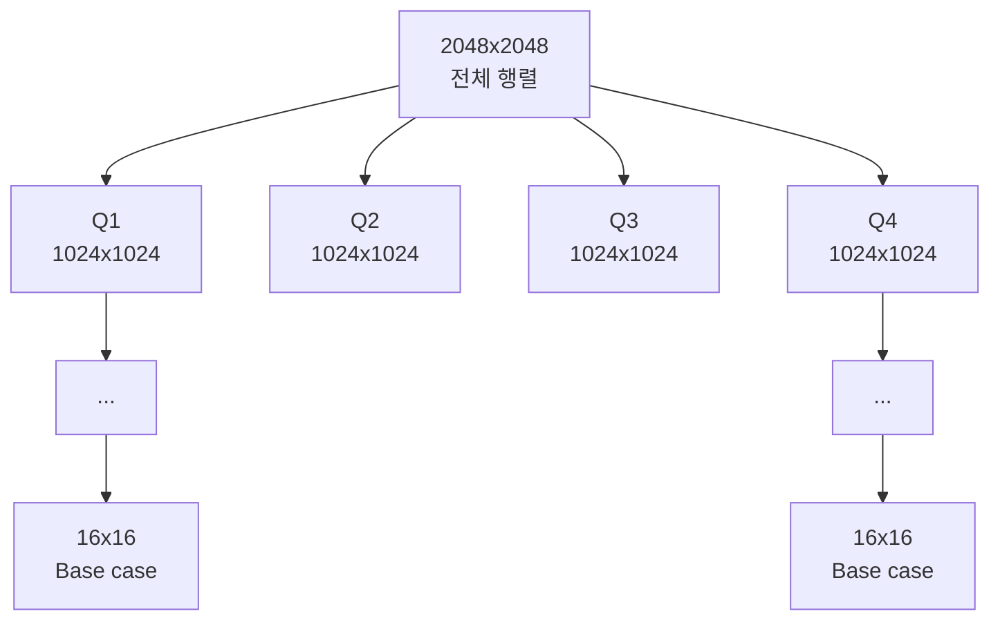
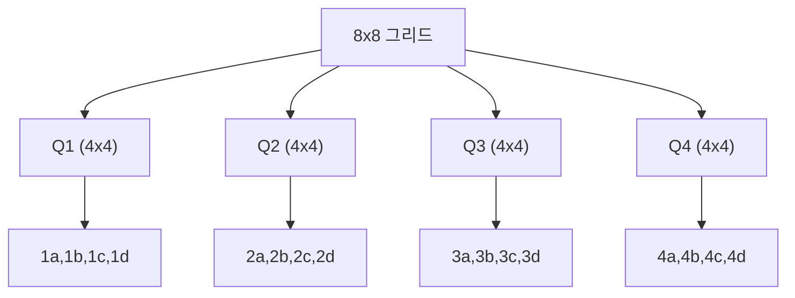
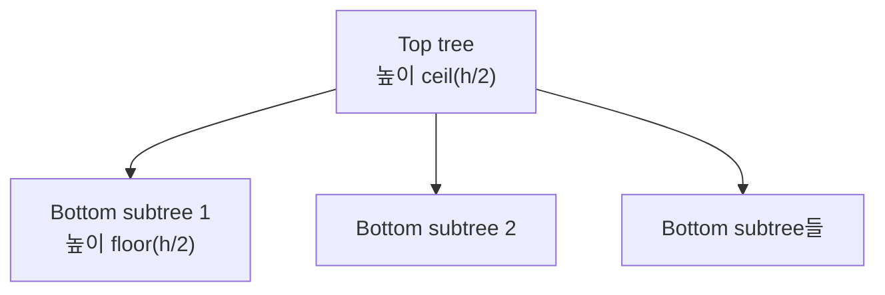
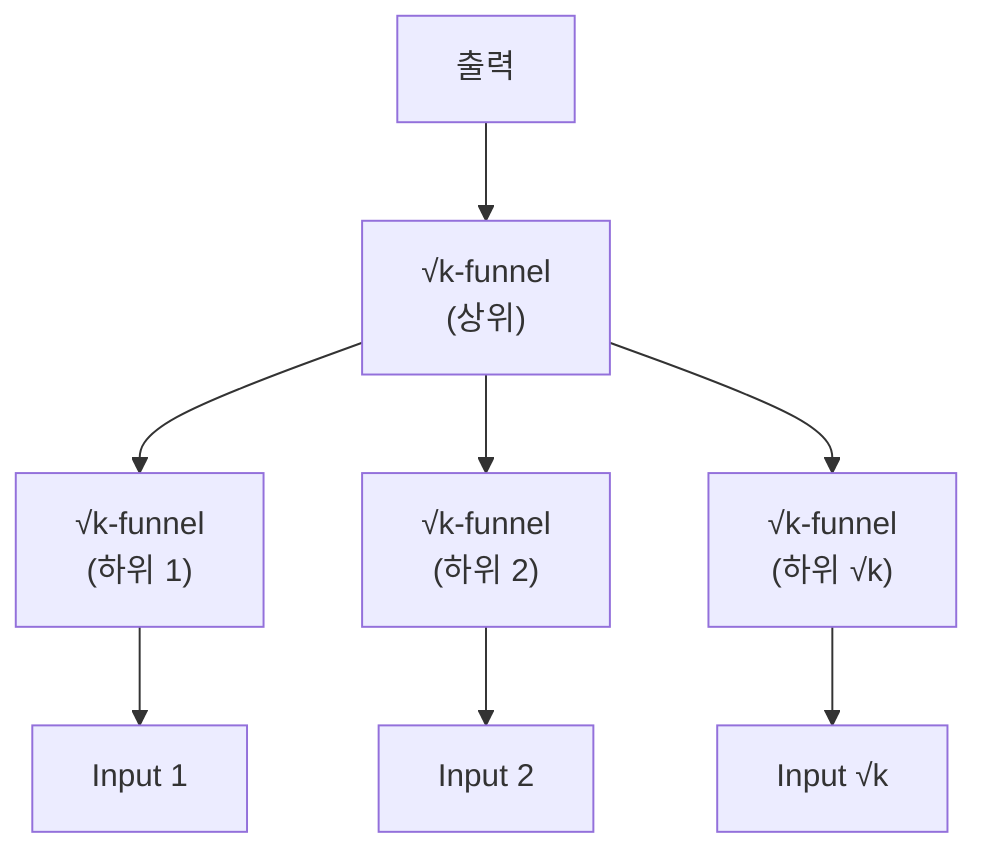

## 들어가며

캐시 크기를 모르고도 최적화할 수 있는가?

2048x2048 행렬을 전치(transpose)하는 알고리즘을 작성한다고 상상해보자. 캐시 효율을 높이려면 블록 크기를 얼마로 잡아야 할까? 어느 캐시 레벨에 맞춰야 할까? 다른 CPU에서 실행되면? 이 모든 것을 프로그래머가 수동으로 튜닝해야 한다면?

1999년, Matteo Frigo, Charles Leiserson, Harald Prokop, Sridhar Ramachandran은 캐시 용량과 블록 크기를 알고리즘에 넣지 않고도 ideal-cache 모델에서 점근적으로 최적인 block transfer를 달성하는 기법을 정리했다. 같은 접근을 다층 계층의 인접 레벨마다 적용할 수 있다는 것이 cache-oblivious 알고리즘의 이론적 장점이다. 실제 CPU에서 모든 계층이 자동으로 최적화된다는 무조건 보장은 아니며, 완전 결합·최적 교체를 가정한 모델과 실제 set associativity, prefetcher, TLB, 병렬 실행의 차이를 측정해야 한다.

이 글은 cache-oblivious의 핵심 아이디어부터, 실전 알고리즘(행렬 곱셈, B-tree, funnel sort), 그리고 실제 성능까지 다룬다.


---

## 목차
1. [Cache-Aware vs Cache-Oblivious](#1-cache-aware-vs-cache-oblivious)
2. [Cache-Oblivious 행렬 전치](#2-cache-oblivious-행렬-전치)
3. [Cache-Oblivious 행렬 곱셈](#3-cache-oblivious-행렬-곱셈)
4. [재귀 사분면 배치와 Morton order](#4-재귀-사분면-배치와-morton-order)
5. [정적 탐색 트리의 vEB layout](#5-정적-탐색-트리의-veb-layout)
6. [Funnel Sort](#6-funnel-sort)
7. [실전 적용: 언제 Cache-Oblivious를 쓸 것인가](#7-실전-적용-언제-cache-oblivious를-쓸-것인가)
8. [성능 측정과 검증](#8-성능-측정과-검증)
9. [이론적 배경: Ideal Cache Model](#9-이론적-배경-ideal-cache-model)
10. [고급 주제](#10-고급-주제)


---

## 1. Cache-Aware vs Cache-Oblivious

현대 CPU는 다층 캐시(L1, L2, L3)를 가지며 각 레벨의 크기와 라인 크기가 다르다. 캐시-friendly 알고리즘은 이 메모리 계층을 활용하지만, "어느 레벨에 맞출 것인가"가 항상 문제가 된다.

### Cache-Aware 알고리즘의 딜레마

전통적인 캐시 최적화는 명시적 블로킹(blocking)에 의존한다. 행렬 곱셈을 예로 들어보자.

```c
// Naive 행렬 곱셈: O(n³) 연산, 캐시 비효율적
void matmul_naive(double* C, double* A, double* B, int n) {
    for (int i = 0; i < n; i++) {
        for (int j = 0; j < n; j++) {
            for (int k = 0; k < n; k++) {
                C[i*n + j] += A[i*n + k] * B[k*n + j];
            }
        }
    }
}
```

이 코드의 문제는 `B`의 접근 패턴이다. `B[k*n + j]`는 열 단위로 접근하는데, C의 행 우선(row-major) 레이아웃에서는 캐시 라인을 낭비한다.

**Cache-Aware 최적화: 타일링**

```c
// 블록 크기 B를 명시적으로 지정
#define BLOCK_SIZE 64  // L1 캐시에 맞춤

void matmul_blocked(double* C, double* A, double* B, int n) {
    for (int ii = 0; ii < n; ii += BLOCK_SIZE) {
        for (int jj = 0; jj < n; jj += BLOCK_SIZE) {
            for (int kk = 0; kk < n; kk += BLOCK_SIZE) {
                for (int i = ii; i < min(ii + BLOCK_SIZE, n); i++) {
                    for (int j = jj; j < min(jj + BLOCK_SIZE, n); j++) {
                        for (int k = kk; k < min(kk + BLOCK_SIZE, n); k++) {
                            C[i*n + j] += A[i*n + k] * B[k*n + j];
                        }
                    }
                }
            }
        }
    }
}
```

블록 크기는 캐시 레벨에 따라 다르게 잡아야 한다. L1 캐시(32KB)를 노릴지, L2(256KB)를 노릴지, L3(수 MB)를 노릴지에 따라 최적값이 바뀐다. 문제는 이식성이다. 다른 CPU에서는 캐시 크기가 다르고, 각 하드웨어마다 재튜닝해야 한다.

### Cache-Oblivious의 통찰

Cache-oblivious 알고리즘은 다음 두 가지 전제에서 출발한다.

1. **재귀적 분할**: 문제를 절반씩 쪼개면, 어느 순간 캐시에 맞는다.
2. **파라미터 비의존성**: 분석식은 각 계층의 $M$, $B$에 대해 성립하지만 코드가 그 값을 직접 읽지 않는다.

핵심 아이디어는 **tall cache assumption**이다.

```text
캐시 크기: M bytes
캐시 라인: B bytes
Tall cache: M = Ω(B²)
```

이 가정 하에서, 재귀를 충분히 깊게 하면 작업 세트(working set)가 캐시에 완전히 들어간다. 그 순간부터 캐시 미스가 급격히 줄어든다.

Cache-aware는 특정 계층에 맞춘 tile을 직접 선택한다. Cache-oblivious 재귀는 여러 크기의 부분 문제를 만들기 때문에, 각 인접 계층이 ideal-cache 모델로 근사되는 범위에서는 같은 코드에 계층별 I/O bound를 적용할 수 있다.

## 2. Cache-Oblivious 행렬 전치

가장 단순한 예시로 시작하자. 행렬 전치(transpose).

### Naive 버전의 문제

```c
// Naive transpose: 캐시 비효율적
void transpose_naive(double* A, double* B, int n) {
    for (int i = 0; i < n; i++) {
        for (int j = 0; j < n; j++) {
            B[j*n + i] = A[i*n + j];
        }
    }
}
```

캐시 미스 분석:

- `A[i*n + j]`: 행 단위 순차 접근 → 캐시 친화적
- `B[j*n + i]`: 열 단위 스트라이드 접근 → 캐시 라인당 1개만 사용

n = 2048, 캐시 라인 64 bytes(8 doubles)이고 행렬이 cache보다 충분히 크며 write-allocate를 단순화해 가정하면:

```text
A의 캐시 미스: n² / 8 = 524,288 미스
B의 캐시 미스: n² = 4,194,304 미스
총 compulsory/useful line 수보다 B의 strided store miss가 훨씬 많아짐
```

이 숫자는 이상화한 상한 감각이다. 실제 store buffer, write combining, non-temporal store, cache associativity와 측정 이벤트 정의에 따라 카운터 값은 달라진다.

### Cache-Oblivious 재귀 전치

```c
// N은 행렬 전체의 행 stride. 재귀가 부분 영역을 다뤄도 전체 stride로 인덱싱한다.
void transpose_rec(double* A, double* B, int n, int N,
                   int rowA, int colA, int rowB, int colB) {
    if (n <= 16) {
        // Base case: 작은 블록은 직접 전치
        for (int i = 0; i < n; i++) {
            for (int j = 0; j < n; j++) {
                B[(rowB+j)*N + (colB+i)] = A[(rowA+i)*N + (colA+j)];
            }
        }
    } else {
        // 4개 사분면으로 분할
        int half = n / 2;

        transpose_rec(A, B, half, N, rowA, colA, rowB, colB);
        transpose_rec(A, B, half, N, rowA, colA+half, rowB+half, colB);
        transpose_rec(A, B, half, N, rowA+half, colA, rowB, colB+half);
        transpose_rec(A, B, half, N, rowA+half, colA+half,
                      rowB+half, colB+half);
    }
}

void transpose_oblivious(double* A, double* B, int n) {
    transpose_rec(A, B, n, n, 0, 0, 0, 0);  // N=n: 정사각 전체 행렬
}
```

이 축약 구현은 `n`이 2의 거듭제곱이라는 전제를 둔다. 임의 크기를 지원하려면 행과 열을 각각 `floor/ceil`로 나누고 각 부분 직사각형의 실제 크기를 전달해야 한다. 홀수 `n`에 단순히 `n / 2`를 네 번 적용하면 마지막 행과 열을 빠뜨린다.

**메모리 레이아웃 시각화:**



### 왜 작동하는가

재귀가 진행되면 부분 문제의 두 블록 working set이 점점 작아진다. 어떤 깊이에서는 특정 cache에 들어가고 그 아래 재귀 호출들이 같은 블록을 재사용한다. 알고리즘은 그 cache의 정확한 크기를 분기 조건에 넣지 않지만, 실제 적중은 set associativity, 다른 실행 데이터와 replacement policy에도 영향을 받는다. `n <= 16` 같은 base case는 cache 용량을 맞추기 위한 블록 크기라기보다 함수 호출·분기 오버헤드를 줄이는 공학적 cutoff이며 별도 튜닝 대상이다.

### 캐시 미스 분석

Ideal cache 모델 (캐시 크기 M, 라인 크기 B)에서:

행 우선 A를 읽고 열 방향 B에 쓰는 naive 루프에서 행 길이가 cache보다 크면 B의 각 원소가 별도 line miss를 유발할 수 있어 I/O는 $\Theta(n^2)$까지 간다. 재귀 전치는 두 부분 블록이 cache에 들어가는 깊이에서 line을 끝까지 재사용하므로, tall-cache 가정 아래 입력·출력을 한 번씩 훑는 하한과 같은 $\Theta(n^2/B)$ block transfer를 달성한다.

실측 비교에는 naive, 명시적 blocked, 재귀 버전을 같은 행렬·alignment로 실행하고 wall time과 cache miss, writeback을 기록한다. 재귀 버전이 tuned block보다 항상 빠르다는 보장은 없다. 함수 호출, cutoff, 컴파일러 최적화와 행렬 크기에 따라 상수 비용이 달라진다.

## 3. Cache-Oblivious 행렬 곱셈

행렬 곱셈은 cache-oblivious의 진가를 보여주는 문제다.

### 재귀 분할

C = A × B를 계산할 때, 행렬을 2x2 블록으로 분할한다.

```text
[ C11  C12 ]   [ A11  A12 ]   [ B11  B12 ]
[           ] = [           ] × [           ]
[ C21  C22 ]   [ A21  A22 ]   [ B21  B22 ]

C11 = A11×B11 + A12×B21
C12 = A11×B12 + A12×B22
C21 = A21×B11 + A22×B21
C22 = A21×B12 + A22×B22
```

각 곱셈을 재귀적으로 수행한다.

```c
void matmul_rec(double* C, double* A, double* B, int n,
                int rowC, int colC, int rowA, int colA,
                int rowB, int colB, int N) {
    if (n <= 64) {
        // Base case: 작은 블록은 naive 곱셈
        for (int i = 0; i < n; i++) {
            for (int j = 0; j < n; j++) {
                double sum = 0.0;
                for (int k = 0; k < n; k++) {
                    sum += A[(rowA+i)*N + (colA+k)] *
                           B[(rowB+k)*N + (colB+j)];
                }
                C[(rowC+i)*N + (colC+j)] += sum;
            }
        }
    } else {
        int half = n / 2;

        // C11 = A11×B11 + A12×B21
        matmul_rec(C, A, B, half, rowC, colC, rowA, colA,
                   rowB, colB, N);
        matmul_rec(C, A, B, half, rowC, colC, rowA, colA+half,
                   rowB+half, colB, N);

        // C12 = A11×B12 + A12×B22
        matmul_rec(C, A, B, half, rowC, colC+half, rowA, colA,
                   rowB, colB+half, N);
        matmul_rec(C, A, B, half, rowC, colC+half, rowA, colA+half,
                   rowB+half, colB+half, N);

        // C21 = A21×B11 + A22×B21
        matmul_rec(C, A, B, half, rowC+half, colC, rowA+half, colA,
                   rowB, colB, N);
        matmul_rec(C, A, B, half, rowC+half, colC, rowA+half, colA+half,
                   rowB+half, colB, N);

        // C22 = A21×B12 + A22×B22
        matmul_rec(C, A, B, half, rowC+half, colC+half,
                   rowA+half, colA, rowB, colB+half, N);
        matmul_rec(C, A, B, half, rowC+half, colC+half,
                   rowA+half, colA+half, rowB+half, colB+half, N);
    }
}
```

### 캐시 효율 분석

**작업 세트 계산:**

n×n 행렬 3개(A, B, C)가 캐시에 들어갈 때:

$$3n^2 \times 8 \text{ bytes} \leq M$$
$$n \leq \sqrt{M / 24}$$

$M=32\,\mathrm{KiB}=32768$바이트라면 $\sqrt{32768/24}\approx36.95$이므로 정수 $n$은 최대 36이다. 이 계산도 세 행렬 데이터만 센 이상화된 상한이며 stack, metadata, 다른 live data와 associativity를 고려하면 실제 cutoff는 더 작을 수 있다.

**캐시 미스 점근 분석:**

Ideal-cache 모델에서 $M=\Omega(B^2)$인 tall-cache 가정과 적절한 재귀 분할 아래 cache-oblivious 행렬 곱셈의 block transfer는:

$$Q(n, M, B) = O(n^3 / B\sqrt{M} + n^2/B)$$

비교:

- **단순 삼중 루프**: loop order와 저장 layout에 따라 한 피연산자의 stride가 비용을 지배
- **Optimal blocked**: Θ(n³/B√M + n²/B)
- **Cache-oblivious**: Θ(n³/B√M + n²/B)

이 전제 안에서는 cache-oblivious 재귀와 cache-aware blocking이 같은 점근 I/O bound를 달성한다.

### 실측 비교의 경계

$n=1024$의 고전 행렬 곱은 약 $2n^3$ FLOP이므로 측정 시간에서 처리량을 계산할 수 있다. 하지만 위 재귀 코드와 vendor BLAS를 한 숫자로 비교하면 cache locality 외에 SIMD, packing, register blocking, prefetch, thread 수, FMA 의미가 모두 달라진다.

학습용 비교는 먼저 세 단일 스레드 스칼라 구현의 loop order와 block transfer 차이를 본다. 그 뒤 최적화 라이브러리는 별도 production baseline으로 두고 thread 수와 수치 의미를 맞춘다. cache-oblivious의 점근 I/O 최적성이 특정 CPU에서 vendor BLAS와 비슷한 실행 시간을 보장하지는 않는다.

## 4. 재귀 사분면 배치와 Morton order

재귀적 분할의 또 다른 응용은 메모리 레이아웃 자체를 재귀적으로 구성하는 것이다.

### 문제: 2D 배열의 캐시 비효율

2D 그리드를 1D 배열에 저장하는 전통적 방법:

```c
// Row-major layout
int grid[N][N];
// 메모리: [row0][row1][row2]...[rowN-1]
```

타일맵 게임에서 플레이어 주변 3x3 타일에 접근한다면:

```text
Player at (x, y):
[x-1,y-1] [x,y-1] [x+1,y-1]
[x-1,y  ] [x,y  ] [x+1,y  ]
[x-1,y+1] [x,y+1] [x+1,y+1]
```

Row-major에서는 3개 행이 캐시 라인을 공유하지 못한다. N = 4096일 때 행 사이 stride가 너무 크다.

### Morton order

2D 배열을 네 사분면으로 재귀 분할해 `[Q1 전체][Q2 전체][Q3 전체][Q4 전체]` 순서로 두면 좌표 비트를 교차 배치한 Morton(Z-order) 순서가 된다. Van Emde Boas layout이라는 이름은 보통 트리의 높이를 재귀 분할하는 배치에 사용하므로 2D bit interleaving과 구분한다.

8×8 그리드의 Morton layout 예시:



메모리 순서: `[1a, 1b, 1c, 1d, 2a, 2b, 2c, 2d, 3a, 3b, 3c, 3d, 4a, 4b, 4c, 4d]`

### 좌표 → 인덱스 변환

Morton 인덱스를 계산하는 재귀 함수:

```c
// n은 2의 거듭제곱 (정사각형)
int morton_index_recursive(int x, int y, int n) {
    if (n == 1) return 0;

    int half = n / 2;
    int quadrant_size = half * half;

    // 어느 사분면인가?
    int qx = (x >= half) ? 1 : 0;
    int qy = (y >= half) ? 1 : 0;
    int quadrant = qy * 2 + qx;

    // 사분면 내 로컬 좌표
    int local_x = x % half;
    int local_y = y % half;

    return quadrant * quadrant_size +
           morton_index_recursive(local_x, local_y, half);
}
```

**비재귀 비트 트릭 버전 (Z-order curve, Morton order):**

```c
uint32_t morton_index(uint16_t x, uint16_t y) {
    uint32_t z = 0;
    for (int i = 0; i < 16; i++) {
        z |= (x & (1u << i)) << i | (y & (1u << i)) << (i + 1);
    }
    return z;
}
```

### 캐시 효율 비교

Row-major는 수평 스캔과 직사각형 행 처리에 최적이며 3×3 이웃도 보통 세 개의 짧은 행 구간으로 읽을 수 있다. Morton order의 장점은 여러 크기의 정사각형 이웃이 1차원 주소에서도 비교적 가까이 모인다는 점이다. 반대로 index bit interleaving과 비연속 행 때문에 단순 렌더 스캔은 느려질 수 있다.

비교할 때는 단일 3×3 패턴만 쓰지 말고 수평 scan, 무작위 점, 다양한 반경의 사각 query, quadtree traversal을 각각 측정한다. cache-line utilization은 element 크기, 정렬, query가 line 경계를 가로지르는 위치에 따라 달라진다.

### 단점과 트레이드오프

**장점:**
- 다중 스케일 정사각형 이웃의 공간 지역성 개선 가능
- cache 크기를 파라미터로 쓰지 않는 재귀 배치

**단점:**
- 인덱스 계산 오버헤드
- 순차 접근에서는 row-major보다 느림
- 구현 복잡도

**언제 사용할까:**
- 2D/3D 공간 쿼리가 많은 경우 (게임, 시뮬레이션)
- 타일 기반 렌더링
- Quadtree/Octree의 메모리 표현

## 5. 정적 탐색 트리의 vEB layout

B-tree는 디스크 I/O 최적화를 위해 설계되었지만, 캐시에도 적용할 수 있다.

### 전통적 B-Tree의 문제

B-tree의 노드 크기는 디스크 블록 크기(4KB)에 맞춰 고정된다.

```c
#define B 256  // 노드당 최대 키 개수

struct BTreeNode {
    int keys[B];
    BTreeNode* children[B+1];
    int num_keys;
    bool is_leaf;
};
```

문제는 메모리 계층이 다양함(L1, L2, L3, 메모리, 디스크)에도 하나의 B로는 모든 레벨을 최적화할 수 없다는 점이다.

### 높이를 재귀적으로 자른다

완전 이진 탐색 트리의 높이 $h$를 위쪽 약 $h/2$레벨의 top tree와, 그 아래에 매달린 여러 bottom subtree로 나눈다. top tree를 먼저 연속 배치하고 각 bottom subtree를 재귀적으로 같은 방식으로 배치하는 것이 tree에 대한 van Emde Boas layout이다. 노드 수를 단순히 $\sqrt n$개씩 자르는 것이 아니라 *트리 높이* 를 나누는 정의가 핵심이다.



노드 크기가 상수이고 한 cache block에 $b=\Theta(B/\text{node size})$개 노드가 들어간다고 하자. 재귀 깊이 중 하나에는 높이 $\Theta(\log b)$인 subtree가 연속된 상수 개 block에 들어간다. 루트-리프 경로는 이런 조각을 $O(\log_b N)$개 지나므로 정적 검색의 block transfer가 $O(\log_B N)$으로 흔히 표기된다. 이 표기에서는 원소 크기를 상수로 흡수한다.

검색 비교 자체는 일반 이진 탐색 트리와 같고, 달라지는 것은 노드의 물리적 배열 인덱스다. layout 생성 시 논리 노드 ID와 vEB 배열 위치의 매핑을 만들거나, 완전 트리의 높이 정보로 자식 위치를 계산한다. 위 bound는 정적이고 균형 잡힌 트리와 ideal-cache 모델에 대한 것이다.

### 실제 구현의 어려움

Cache-oblivious B-tree의 이론은 아름답지만, 실제 구현은 복잡하다.

1. **동적 업데이트**: 삽입/삭제로 균형과 연속 layout을 함께 유지하기 어려움
2. **재배치 비용**: 노드 분할 시 대량의 메모리 이동
3. **포인터 오버헤드**: 묵시적 레이아웃에서 부모/자식 찾기가 복잡

동적 cache-oblivious B-tree는 이 정적 배열에 삽입 함수 하나를 붙인 구조가 아니다. packed-memory array, 빈 공간 밀도 불변식과 재배치 같은 별도 자료구조가 필요하다. 읽기 위주의 고정 인덱스에는 정적 vEB layout을 고려할 수 있고, 갱신이 많은 저장 인덱스에는 tuned B-tree/B+tree가 더 단순하고 예측 가능할 수 있다.

## 6. Funnel Sort

Cache-oblivious 정렬의 걸작은 **funnel sort**다.

### 병합 정렬의 캐시 문제

전통적 2-way 병합 정렬:

```c
void merge_sort(int* arr, int n) {
    if (n <= 1) return;

    int mid = n / 2;
    merge_sort(arr, mid);
    merge_sort(arr + mid, n - mid);
    merge(arr, mid, arr + mid, n - mid);
}
```

각 merge 자체는 두 입력과 출력을 순차 스캔하므로 line을 잘 사용한다. 차이는 cache보다 큰 재귀 레벨마다 전체 데이터를 다시 스캔한다는 데 있다. 2-way merge sort의 block transfer는 모델과 cutoff에 따라 대략 $(N/B)$에 cache 밖의 병합 레벨 수를 곱한 형태가 되고, comparison sorting의 I/O 하한은

$$
\Theta\left(\frac{N}{B}\log_{M/B}\frac{N}{B}\right)
$$

이다. 다중 병합은 한 번의 pass에서 더 많은 run을 합쳐 pass 수를 줄인다.

### K-way 병합의 아이디어

Cache-aware external merge는 입력 run마다 buffer를 두므로 일반적으로 메모리에 들어가는 범위에서 최대 $\Theta(M/B)$ fan-in을 고려할 수 있다. 정확한 fan-in은 출력 buffer와 metadata, seek·comparison 비용에도 좌우된다. Funnel sort의 $\sqrt{k}$는 cache parameter에서 $K=\sqrt{M/B}$를 고른 결과가 아니라, **k개의 입력을 합치는 k-funnel을 재귀적으로 구성하는 내부 fan-out**이다.

### Funnel의 재귀 구조

Funnel은 **재귀적 병합 장치**다. k-funnel은 k개의 정렬된 스트림을 받아 1개의 병합된 스트림을 출력한다.



재귀 정의:
- k=2: 단순 2-way merge
- k>2: √k개의 √k-funnel을 √k-funnel로 병합

### Funnel Sort 알고리즘

```c
void funnel_sort(int* arr, int n) {
    if (n <= BASE_SIZE) {
        insertion_sort(arr, n);
        return;
    }

    // 원 논문(Frigo et al.)은 n^(1/3)개 블록(각 n^(2/3) 크기)으로 분할한다
    int k = (int)cbrt((double)n);
    int block_size = n / k;

    for (int i = 0; i < k; i++) {
        funnel_sort(arr + i * block_size, block_size);
    }

    funnel_merge(arr, k, block_size);
}
```

### 캐시 미스 분석

Ideal-cache와 tall-cache 가정에서 완전한 funnel sort는

$$
O\left(\frac{N}{B}\log_{M/B}\frac{N}{B}\right)
$$

block transfer로 comparison sorting의 점근적 I/O 하한을 달성한다. 위 코드는 분할 구조만 보이는 의사 코드이며 `funnel_merge`의 재귀 버퍼 불변식, 나머지 블록과 작은 입력 처리가 빠져 있으므로 그 자체로 이 bound를 달성하는 구현은 아니다.

실전 비교에서는 `std::sort`, tuned merge/radix sort, 완전한 funnel 구현에 같은 key·payload와 분포를 사용한다. 비교 횟수, 이동 bytes, cache/TLB miss, 임시 메모리를 함께 기록한다. 이론적 I/O 최적성은 branch·buffer 관리·index 계산의 상수 비용을 없애지 않으므로 작은 데이터나 메모리 내 정렬에서는 산업용 tuned sort가 더 빠를 수 있다.

## 7. 실전 적용: 언제 Cache-Oblivious를 쓸 것인가

### 장점

1. **이식성**: 같은 코드가 다양한 하드웨어에서 합리적으로 작동
2. **계층 독립성**: ideal-cache 가정에서 여러 cache 크기에 같은 분할 논리를 적용
3. **튜닝 축 감소**: 용량별 block 크기를 알고리즘 입력으로 요구하지 않음

### 단점

1. **재귀 오버헤드**: 함수 호출 비용
2. **상수 계수**: 이론적 최적이지만 실전 상수가 클 수 있음
3. **복잡한 구현**: 일부 알고리즘(funnel sort)은 구현이 까다로움

### 권장 사용 사례

**좋은 경우:**
- **행렬 연산**: 전치, 곱셈 (Strassen 알고리즘과 결합)
- **공간 데이터 구조**: Quadtree, R-tree의 메모리 레이아웃
- **임베디드 시스템**: 캐시 크기가 다양한 플랫폼 타겟팅
- **라이브러리**: 범용 수학 라이브러리 (BLAS 대안)

**피해야 할 경우:**
- **단일 플랫폼**: 캐시 크기를 알고 있고 튜닝 가능
- **극한 성능**: 상수 계수가 중요 (게임, HFT)
- **간단한 연산**: 벡터 덧셈 같은 단순 작업
- **SIMD 중심**: Cache-oblivious는 SIMD와 조합이 까다로움

### 하이브리드 전략

실전에서는 cache-aware의 base case를 두는 것이 일반적이다.

```c
void matmul_hybrid(double* C, double* A, double* B, int n) {
    if (n <= 128) {
        // Cache-aware base case (L2 캐시 타겟)
        matmul_blocked_128(C, A, B, n);
    } else {
        // Cache-oblivious 재귀
        matmul_rec(C, A, B, n, ...);
    }
}
```

이렇게 하면 재귀 오버헤드 감소, base case에서 SIMD 최적화 가능, 여전히 대부분의 이식성 유지라는 이점을 얻는다.

## 8. 성능 측정과 검증

### 캐시 미스 측정

Linux `perf`로 실제 캐시 미스를 측정한다.

```bash
# L1 데이터 캐시 미스
perf stat -e L1-dcache-load-misses,L1-dcache-loads ./program

# L2, L3 캐시 미스
perf stat -e LLC-load-misses,LLC-loads ./program
```

결과는 실행해서 채운다. 다음처럼 원시 counter와 정규화한 비율을 함께 기록한다.

```text
variant, n, cutoff, elapsed_ns,
L1-dcache-loads, L1-dcache-load-misses, LLC-loads, LLC-load-misses
naive, ...
recursive, ...
```

`perf`의 generic event가 실제 어떤 hardware event로 매핑되는지는 CPU와 커널에 따라 다르다. `perf list`와 `perf stat -d`를 확인하고, 여러 번 반복해 평균뿐 아니라 분산을 기록한다.

### Ideal Cache Model vs 실제 하드웨어

Ideal cache 가정:
- 완전 연관 캐시 (fully associative)
- LRU 교체 정책
- 무한 캐시 레벨

실제 CPU:
- Set-associative (보통 8-way)
- Pseudo-LRU 또는 랜덤 교체
- 3-4 레벨 캐시

Cache associativity 때문에 conflict miss가 발생할 수 있다. 캐시에 $S$개 set과 $B$바이트 line이 있다면 단순한 modulo indexing에서 $S\times B$의 배수 stride는 같은 set을 반복해서 칠 수 있다. 예를 들어 32KiB, 8-way, 64B line 캐시는 $32768/(8\times64)=64$ sets이므로 4096B의 배수 stride가 대표적인 충돌 후보다. 실제 index hash와 물리·가상 주소 사용 방식은 CPU마다 다르다. Cache-oblivious 재귀는 working set을 줄여 이런 문제를 완화할 수 있지만 conflict-free를 보장하지는 않는다.

### 벤치마크 주의사항

**워밍업:**

```c
// warm-cache 분포를 재려면 별도 warm-up을 수행한다.
transpose(A, B, n);

// 이후 실행 측정
for (int i = 0; i < 100; i++) {
    auto start = now();
    transpose(A, B, n);
    auto end = now();
    times[i] = end - start;
}
```

warm-cache와 cold-cache는 다른 질문이다. cold 결과가 필요하면 반복 사이에 입력보다 큰 eviction buffer를 접근하거나 별도 프로세스로 실행하고 그 절차를 기록한다.

**TLB 효과:**

큰 배열에서는 TLB miss도 측정한다. Morton·vEB 같은 재귀 배치가 현재 query의 페이지 working set을 줄이면 TLB miss도 줄 수 있지만, 페이지 수와 접근 순서에 따라 반대일 수도 있다.

```bash
perf stat -e dTLB-load-misses ./program
```

## 9. 이론적 배경: Ideal Cache Model

### 모델 정의

**파라미터:**
- M: 캐시 크기 (bytes)
- B: 캐시 라인 크기 (bytes)
- Tall cache 가정: M = Ω(B²)

**비용 측정:**
- Work W(n): 총 연산 횟수
- Cache misses Q(n, M, B): 캐시 미스 횟수

목표는 Q(n, M, B)를 M, B에 대해 최소화하는 것이다.

### I/O 복잡도 하한

Comparison-based sorting:

$$Q(n) = \Omega\left(\frac{n}{B}\max\left\{1,\log_{M/B}\frac{n}{B}\right\}\right)$$

이 하한은 내부 비교 횟수만 세는 결정 트리 하한을 `B`로 나누어 얻을 수 없다. 한 번의 I/O가 $B$개 원소를 옮기고, 내부 메모리의 $M/B$개 block과 새 block을 섞어 만들 수 있는 순열 수를 세는 external-memory 결정 트리 논증이 필요하다. 그 결과 비교 기반 정렬은 scan 항을 포함해

$$
\Omega\left(\frac{n}{B}\max\left\{1,\log_{M/B}\frac{n}{B}\right\}\right)
$$

의 block transfer를 요구한다. 로그 항은 $n/B$가 충분히 클 때 지배적이며, 작은 입력에서는 선형 scan 항을 버리면 안 된다.

### 최적 알고리즘의 조건

알고리즘이 cache-optimal이려면:

$$Q(n, M, B) = O(\text{OPT}(n, M, B) + n/B)$$

여기서 `OPT`는 동일한 모델과 문제에 대한 하한이다. 모든 cache-oblivious 알고리즘이 자동으로 최적인 것이 아니라, funnel sort나 재귀 전치처럼 별도로 증명된 알고리즘이 필요한 가정 아래 그 하한을 달성한다.

## 10. 고급 주제

### Strassen + Cache-Oblivious

Strassen 알고리즘은 $O(n^{2.807})$ 곱셈으로 행렬 곱셈을 한다. Cache-oblivious와 결합하면:

```c
void matmul_strassen_co(double* C, double* A, double* B, int n) {
    if (n <= 64) {
        matmul_oblivious(C, A, B, n);  // Base
    } else {
        // Strassen의 7개 재귀 곱셈
        strassen_recursive(C, A, B, n);
    }
}
```

Strassen 재귀의 I/O bound는 고전 $O(n^3)$ 곱셈의 식에 지수만 대입한
`n^{2.807} / (B\sqrt M)`가 아니다. $\omega=\log_2 7$일 때 적절한 구현과 tall-cache 가정 아래 대표적인 형태는

$$
Q(n)=O\left(\frac{n^\omega}
{B M^{\omega/2-1}}+\frac{n^2}{B}\right)
$$

이다. 실제 miss 감소율은 cutoff, 임시 행렬 배치, 덧셈 트래픽과 비교 대상에 따라 달라지므로 특정 `n`에서의 고정 백분율은 측정 없이 제시할 수 없다.

### 병렬화와 Cache-Oblivious

재귀 구조는 task graph를 만들기 쉽지만, 같은 $C$ block에 누적하는 두 곱셈을 그대로 병렬 실행하면 데이터 레이스가 난다.

```c
void matmul_parallel(double* C, double* A, double* B, int n) {
    if (n <= 128) {
        matmul_oblivious(C, A, B, n);
    } else {
        int half = n / 2;

        // 각 독립 곱을 별도 임시 block에 계산한다.
        parallel_invoke(
            [&] { matmul_rec(T0, A11, B11, half); },
            [&] { matmul_rec(T1, A12, B21, half); },
            /* 나머지 여섯 곱 */
        );

        // task join 뒤 소유권이 겹치지 않는 C block별로 reduction한다.
        parallel_invoke(
            [&] { add(C11, T0, T1, half); },
            /* C12, C21, C22 */
        );
    }
}
```

임시 block은 추가 메모리와 대역폭을 소비한다. 대안은 각 `Cij`의 두 누적 곱을 같은 task가 순차 실행하고 서로 다른 `Cij` 네 개만 병렬화하는 것이다. 어느 분해가 나은지는 산술 강도, task grain, NUMA 배치와 메모리 예산에 달려 있다.

각 스레드가 독립적인 블록을 처리하므로 false sharing이 적다.

### GPU에서의 Cache-Oblivious

GPU의 메모리 계층:

```text
레지스터 (thread-local)
  ↓
Shared memory (block/workgroup-local, 용량은 GPU와 설정에 따라 다름)
  ↓
L2 캐시 (global, 수 MB)
  ↓
Global memory (수 GB)
```

GPU에서는 workgroup 크기와 shared-memory tile을 launch configuration에 명시하므로 cache-aware tiling이 특히 중요하다. shared memory는 48KiB로 고정된 자원이 아니며 GPU 세대, compute capability와 L1/shared partition 설정에 따라 가용량과 블록당 한도가 달라진다.


---

## 결론

Cache-oblivious 알고리즘은 "하드웨어를 모르면서도 최적화한다"는 역설을 현실로 만들었다. 재귀적 분할이라는 단순한 아이디어가, 다층 캐시 계층에서 자동으로 작동하는 알고리즘을 가능케 한다.

핵심 통찰은 네 가지다. 재귀가 캐시를 본다(문제를 쪼개다 보면 어느 순간 캐시에 맞는다). 모든 레벨에서 최적이다(L1, L2, L3, 메모리 모두에서 동시에 효율적). 이식성의 승리(같은 코드가 ARM, x86, RISC-V에서 작동). 이론과 실전의 간극(점근적 최적이지만 상수 계수는 도전 과제).

실전 조언으로는 캐시 미스를 실제로 측정하고 비교하기, cache-oblivious 구조와 cache-aware base case의 하이브리드 사용, 프로파일 주도로 병목을 찾고 선택적 적용, `perf`/VTune으로 캐시 동작 분석이 있다.

가장 좋은 최적화는 할 필요가 없는 최적화다. 캐시 크기를 모르는 것이 약점이 아니라 강점이 될 수 있다.

## 더 읽을거리

- Frigo, Leiserson, Prokop, Ramachandran. "Cache-Oblivious Algorithms" (FOCS 1999).
- Prokop. ["Cache-Oblivious Algorithms"](https://hdl.handle.net/1721.1/43811) (MIT Master's Thesis, 1999).
- Bender, Demaine, Farach-Colton. "Cache-Oblivious B-Trees" (FOCS 2000).
- Frigo, Strumpen. "Cache Oblivious Stencil Computations" (ICS 2005).
- Demaine. "Cache-Oblivious Algorithms and Data Structures" (2002). http://erikdemaine.org/papers/BRICS2002/
- Brodal, Fagerberg. "Cache-Oblivious Data Structures" (2004).
- [FFTW (Fastest Fourier Transform in the West)](http://www.fftw.org/) - Cache-oblivious FFT의 실제 구현
- [ATLAS (Automatically Tuned Linear Algebra Software)](http://math-atlas.sourceforge.net/)
- Goto, van de Geijn. "Anatomy of High-Performance Matrix Multiplication" (2008).
- Agner Fog. "Optimizing software in C++" (2023). https://www.agner.org/optimize/
- Ulrich Drepper. "What Every Programmer Should Know About Memory" (2007).
- Intel VTune Profiler. https://www.intel.com/content/www/us/en/developer/tools/oneapi/vtune-profiler.html
- Cachegrind. https://valgrind.org/docs/manual/cg-manual.html
- perf (Linux). https://perf.wiki.kernel.org/
- [MIT OpenCourseWare: Performance Engineering](https://ocw.mit.edu/courses/6-172-performance-engineering-of-software-systems-fall-2018/)
- [Erik Demaine의 고급 데이터 구조 강의](http://courses.csail.mit.edu/6.851/)
