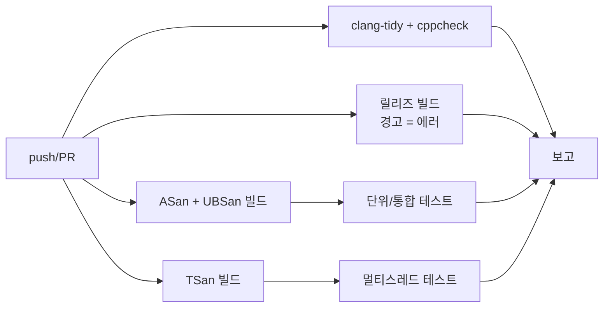

## 들어가며

프로그램이 크래시했을 때 가장 곤란한 상황은 "재현이 안 됩니다"라는 말이다. 메모리 버그는 특히 교활하다. Buffer overflow는 한참 뒤에야 터지고, use-after-free는 릴리즈 빌드에서만 나타나며, 메모리 누수는 며칠간 서버를 돌려야 드러난다.

2012년 AddressSanitizer 논문은 당시 SPEC CPU2006 실험에서 평균 73% 실행 시간 오버헤드를 보고했다(Serebryany et al., USENIX ATC 2012). 이는 해당 도구·버전·벤치마크의 결과이지 현재 모든 프로그램의 고정 배수가 아니다. ASan은 compiler instrumentation과 **shadow memory**로 addressability 오류를 빠르게 찾는 데 초점을 두고, Valgrind Memcheck는 uninitialized-value 추적처럼 다른 검사를 제공한다. 한 도구가 다른 도구의 완전한 상위 집합은 아니다.

이 글에서는 메모리 프로파일링 도구들이 어떻게 보이지 않는 버그를 가시화하는지를, 하드웨어 레벨의 동작 원리부터 sanitizer 계열 도구의 운영 환경 적용까지 단계적으로 살펴본다. 후반부에서는 정적 분석과 sanitizer를 어떻게 결합해 CI 파이프라인에 통합할 수 있는지도 함께 다룬다.


---

## 목차
1. [메모리 버그의 종류: 무엇을 찾는가](#1-메모리-버그의-종류-무엇을-찾는가)
2. [Valgrind: 바이너리 계측의 시작](#2-valgrind-바이너리-계측의-시작)
3. [AddressSanitizer: 컴파일러 계측의 혁신](#3-addresssanitizer-컴파일러-계측의-혁신)
4. [Shadow Memory: ASan의 핵심 메커니즘](#4-shadow-memory-asan의-핵심-메커니즘)
5. [다른 Sanitizers: MSan, TSan, UBSan](#5-다른-sanitizers-msan-tsan-ubsan)
6. [힙 프로파일링: 누수와 단편화](#6-힙-프로파일링-누수와-단편화)
7. [운영 환경 프로파일링: 성능 영향 최소화](#7-운영-환경-프로파일링-성능-영향-최소화)
8. [실전: 게임과 서버의 메모리 디버깅](#8-실전-게임과-서버의-메모리-디버깅)
9. [Sanitizer와 정적 분석](#9-sanitizer와-정적-분석)


---

## 1. 메모리 버그의 종류: 무엇을 찾는가?

### 공간적 안전성(Spatial Safety) 위반

**Buffer overflow/underflow**는 가장 흔한 메모리 버그다:

```c
int arr[10];
arr[15] = 42;  // 경계 초과: 미정의 동작
```

스택이나 힙의 경계를 넘어서는 순간 모든 것이 무너질 수 있다. 2014년 Heartbleed 버그가 대표적 사례다. OpenSSL의 heartbeat 확장에서 길이 검증 없이 `memcpy`를 호출하여 64KB의 메모리를 노출시켰다:

```c
// 취약한 코드 (CVE-2014-0160)
memcpy(bp, pl, payload);  // payload 길이를 신뢰함!
```

공격자는 실제로는 1바이트만 보냈지만 "64KB를 보냈다"고 거짓 선언하여, 서버 메모리의 민감한 데이터(비밀키, 비밀번호)를 읽어낼 수 있었다.

### 시간적 안전성(Temporal Safety) 위반

**Use-after-free**는 해제된 메모리를 접근하는 버그다:

```c
char* p = malloc(100);
free(p);
strcpy(p, "hello");  // 위험: 이미 해제된 메모리
```

이 코드가 항상 크래시하는 것은 아니다. 메모리가 재할당되기 전까지는 "운 좋게" 동작할 수 있다. 하지만 릴리즈 빌드나 다른 스레드가 개입하면 갑자기 터진다.

더 교활한 것은 **double-free**다:

```c
free(p);
free(p);  // 두 번째 해제: 힙 메타데이터 손상
```

`free`는 내부적으로 free list를 조작한다. 같은 포인터를 두 번 해제하면 free list에 순환 구조가 생기고, 다음 `malloc`이 같은 주소를 두 번 반환할 수 있다. 이는 보안 취약점으로 이어진다.

### 초기화되지 않은 메모리 읽기

```c
int x;
if (x == 0) {  // x는 스택의 쓰레기 값
    // 예측 불가능한 분기
}
```

MSVC 디버그 빌드는 스택을 `0xCC`로 채우지만, 릴리즈 빌드는 그렇지 않다. 이전 함수 호출의 잔재가 남아 있어 재현성 없는 버그를 만든다.

### 메모리 누수(Memory Leak)

```c
void process_request() {
    char* buffer = malloc(4096);
    // free() 호출을 잊음
}
```

한 번의 요청당 4KB씩, 백만 번 호출되면 4GB가 증발한다. 게임 서버나 웹 서버에서 며칠간 돌리다가 OOM(Out Of Memory) 킬러에게 죽는 경험은 누구나 한 번쯤 있을 것이다.

## 2. Valgrind: 바이너리 계측의 시작

### Dynamic Binary Instrumentation

Valgrind는 2002년 Julian Seward가 개발한 메모리 디버거다. 핵심 아이디어는 **dynamic binary instrumentation**(DBI)이다. 프로그램을 소스 수정 없이, 실행 중에 분석하는 것이다.

작동 원리는 이렇다:

1. **프로그램 바이너리를 디스어셈블**: x86-64 기계어를 중간 표현(IR)으로 변환
2. **IR을 계측**: 모든 메모리 접근 앞뒤에 검증 코드 삽입
3. **다시 기계어로 컴파일**: 계측된 IR을 실행 가능한 코드로 변환
4. **가상 CPU에서 실행**: Valgrind가 제공하는 샌드박스 환경에서 실행

```text
원본 바이너리:        계측된 코드:
mov [rax], 42        if (!is_valid(rax)) report_error();
                     if (!is_addressable(rax, 4)) report_error();
                     mov [rax], 42
                     mark_initialized(rax, 4);
```

### Memcheck 도구의 메커니즘

Valgrind의 Memcheck 도구는 모든 바이트를 추적한다:

- **Addressability**: 이 주소에 접근할 권한이 있는가?
- **Definedness**: 이 값은 초기화되었는가?

각 메모리 바이트마다 A 비트 1개와, 데이터 비트마다 하나씩 붙는 V 비트 8개를 유지한다:

```text
A bit (Addressable):  바이트당 1개. 0 = 접근 금지, 1 = 접근 가능
V bit (Valid/Defined): 데이터 비트당 1개(바이트당 8개). 0 = 미초기화, 1 = 초기화됨
```

```c
int* p = malloc(4);
// Valgrind 상태:
//   p[0..3]: A=1 (할당됨), V=0 (미초기화)

*p = 42;
// 상태 업데이트:
//   p[0..3]: A=1, V=1 (초기화됨)

free(p);
// 상태 업데이트:
//   p[0..3]: A=0 (해제됨), V=don't care

int x = *p;  // ERROR: Invalid read (A=0)
```

### Valgrind의 한계: 느린 속도

Memcheck는 실행 코드를 VEX IR로 동적 변환하고 각 메모리 연산에 정의 여부·주소 가능 여부 검사를 붙인다. 이 정밀 추적과 shadow state 때문에 slowdown과 메모리 증폭이 크지만 배수는 명령 혼합, allocator, Valgrind 버전과 옵션에 따라 달라진다. 대형 게임의 실시간 플레이에는 부담이 클 수 있어 작은 재현 테스트나 headless 서버 경로로 범위를 줄이는 방식이 일반적이다. 실제 도입 판단에는 자신의 테스트에서 wall time과 peak RSS를 기록한다.

## 3. AddressSanitizer: 컴파일러 계측의 혁신

### 컴파일 타임 계측의 장점

2012년, Google의 Konstantin Serebryany와 동료들은 USENIX ATC에 "AddressSanitizer: A Fast Address Sanity Checker"를 발표했다. 핵심 통찰은 간단하지만 강력했다:

> "런타임에 바이너리를 분석하지 말고, 컴파일 타임에 검증 코드를 삽입하라."

ASan은 Clang/GCC의 컴파일러 패스로 구현된다. `-fsanitize=address` 플래그를 켜면:

```c
// 원본 코드:
int arr[10];
arr[5] = 42;

// 컴파일러가 생성하는 코드 (의사 코드):
int arr[10];
__asan_check_store(&arr[5], 4);  // 4바이트 쓰기 검증
arr[5] = 42;
```

컴파일 타임에 계측하면:

- **최적화 가능**: 인라이닝, 상수 폴딩 등 컴파일러 최적화 적용
- **정적 정보 활용**: 변수 타입, 크기 정보를 컴파일러가 알고 있음
- **네이티브 코드**: IR 변환 없이 직접 기계어로 컴파일

ASan은 컴파일러가 계측을 최적화하고 native code로 실행할 수 있어 dynamic binary instrumentation 기반 Memcheck보다 낮은 overhead를 보이는 경우가 많다. 정확한 배수 비교는 같은 버그 검사 집합이 아니므로 도구 선택 기준 하나로 쓸 수 없다. ASan/LSan, Memcheck, 정적 분석이 각각 탐지하는 오류와 CI 시간 예산을 함께 본다.

### 컴파일러 통합: LLVM의 역할

ASan은 LLVM의 IR(Intermediate Representation) 레벨에서 작동한다:

```text
C/C++ 소스
    ↓ (Clang Frontend)
LLVM IR
    ↓ (AddressSanitizerPass)
계측된 LLVM IR
    ↓ (Backend)
기계어
```

LLVM IR은 SSA(Static Single Assignment) 형태라서 데이터 흐름 분석이 쉽다. 예를 들어:

```llvm
; 원본 IR
%arrayidx = getelementptr inbounds [10 x i32], [10 x i32]* %arr, i64 0, i64 5
store i32 42, i32* %arrayidx

; 계측된 IR
%1 = ptrtoint i32* %arrayidx to i64
call void @__asan_store4(i64 %1)  ; 4바이트 쓰기 검증
store i32 42, i32* %arrayidx
```

`@__asan_store4`는 런타임 라이브러리 함수로, shadow memory를 검사한다.

## 4. Shadow Memory: ASan의 핵심 메커니즘

### 1:8 매핑 스킴

ASan의 가장 기발한 아이디어는 **shadow memory**다. 메인 메모리의 모든 8바이트당 1바이트의 shadow byte를 할당하여 상태를 추적한다:

```text
Main Memory:   [8 bytes][8 bytes][8 bytes]...
Shadow Memory:   [1 byte] [1 byte] [1 byte]...
```

64비트 주소 공간에서 shadow memory는 고정된 오프셋에 배치된다:

```c
// ASan 매핑 공식
shadow_addr = (addr >> 3) + kShadowOffset;

// 일부 x86-64 Linux ASan 매핑의 예시. 실제 offset은 runtime/PIE/플랫폼에 따라 다름:
// kShadowOffset = 0x00007fff8000
// Main:   0x0000000000000000 - 0x00007fffffffffff (128TB)
// Shadow: 0x00007fff8000      - 0x000010007fff7fff (16TB)
```

우측 시프트 3비트(`>> 3`)는 8로 나누는 것과 같다. 즉, 8바이트마다 1바이트로 압축한다.

### Shadow Byte 인코딩

각 shadow byte는 대응하는 8바이트의 상태를 인코딩한다:

- **0**: 8바이트 모두 접근 가능
- **1-7**: 처음 N바이트만 접근 가능 (부분 addressability)
- **음수**: 접근 불가 (다양한 이유)

```text
Shadow Value     int8 부호값   Meaning
-------------    -----------   ----------------------------
  0x00              0          8바이트 모두 유효
  0x01..0x07        1..7       앞쪽 N바이트만 주소 지정 가능 (partially addressable)
  0xF1            -15          Stack left redzone
  0xF2            -14          Stack mid redzone
  0xF3            -13          Stack right redzone
  0xF5            -11          Stack use-after-return
  0xF8             -8          Stack use-after-scope
  0xFA             -6          Heap left redzone (힙 우측 redzone도 같은 값을 쓴다)
  0xFD             -3          Heap freed memory (use-after-free)
```

(0xFx 패턴은 모두 음수로 해석되므로 빠른 검증 코드는 "shadow byte가 음수면 접근 불가"라는 단일 비교로 처리한다.)

예를 들어, 다음 구조체는 자연 정렬에 따라 보통 8바이트가 된다(`char a` 1바이트 + 패딩 3바이트 + `int b` 4바이트). 그래서 8바이트 정렬 단위 1개에 그대로 매핑된다.

```c
struct Foo {
    char a;
    int b;
} foo;  // sizeof(Foo) == 8 (1바이트 char + 3바이트 패딩 + 4바이트 int)

// Shadow memory: 8바이트 단위 하나에 한 byte 매핑
// Shadow: 0       (8바이트 전체가 객체 영역, 모두 유효로 표시)
```

만약 5바이트 차원에서만 의미 있는 데이터라면(예: `struct __attribute__((packed)) { char a; int b; }`로 패딩이 제거된 5바이트 구조체) shadow 값은 5가 되어 첫 5바이트만 유효임을 표시한다. 즉 패딩 유무가 shadow 값을 결정한다.

### 빠른 검증 로직

메모리 접근을 검증하는 함수는 놀랍도록 간단하다:

```c
bool is_addressable(uintptr_t addr, size_t size) {
    // Shadow byte 위치 계산
    int8_t* shadow = (int8_t*)((addr >> 3) + kShadowOffset);
    int8_t k = *shadow;

    // k == 0: 8바이트 전부 OK
    if (k == 0) return true;

    // k < 0: 접근 금지 영역
    if (k < 0) return false;

    // k > 0: 8바이트 granule의 앞 k바이트만 addressable
    // 마지막 바이트 오프셋 확인
    int last_byte = (addr & 7) + size - 1;
    return last_byte < k;
}
```

이 함수는 **인라인되고 최적화**되어 수 사이클 내에 실행된다. 비트 시프트와 메모리 읽기 한 번, 조건 분기 몇 개면 끝이다.

x86-64 어셈블리로 보면:

```asm
; addr in %rdi, size in %rsi
mov %rdi, %rax
shr $3, %rax              ; addr >> 3
add $kShadowOffset, %rax  ; shadow 주소 계산
movzbl (%rax), %edx       ; shadow byte 읽기
test %dl, %dl
je .L_ok                  ; k == 0이면 OK
js .L_error               ; k < 0이면 에러
; k > 0인 경우 추가 검증...
```

### Redzones: 버퍼의 경계 표시

ASan의 또 다른 핵심은 **redzone**이다. 모든 할당 전후에 접근 금지 영역을 삽입하여 overflow를 즉시 탐지한다.

**스택 변수:**

```c
void func() {
    char buf[10];
    // ASan이 생성하는 실제 레이아웃:
    // [Left RZ: 32B][buf: 10B][Padding: 6B][Right RZ: 32B]
}
```

컴파일러는 스택 프레임을 재배치한다:

```text
Before ASan:          After ASan:
+------------+        +------------------+
| buf[10]    |        | Left RZ (32B)    |  shadow: 0xF1
| other vars |        | buf[10]          |  shadow: 2 (10 mod 8)
| ret addr   |        | Padding (6B)     |  shadow: 2 (buf의 마지막 granule 공유)
+------------+        | Right RZ (32B)   |  shadow: 0xF3
                      | other vars       |
                      | ret addr         |
                      +------------------+
```

`buf[20] = 'x'`를 시도하면:

1. `__asan_store1(buf+20)` 호출
2. `shadow[buf+20]` 확인 → `0xF3` (right redzone)
3. 즉시 에러 리포트

**힙 할당:**

```c
char* p = malloc(10);
// 실제 할당:
// [Left RZ: 16-32B][10B][Right RZ: 16-32B]
```

Redzone 크기는 `malloc` 크기에 따라 동적으로 조정되며, 최소 16바이트다. 작은 할당일수록 상대적 오버헤드가 크지만, 버그 탐지율도 높아진다.

## 5. 다른 Sanitizers: MSan, TSan, UBSan

### MemorySanitizer (MSan): 초기화 검증

MSan은 **초기화되지 않은 메모리 읽기**를 탐지한다. Valgrind의 V bit과 유사하지만 더 빠르다.

```c
int x;
if (x == 0) {  // MSan: uninitialized value used
    // ...
}
```

MSan도 shadow memory를 사용하지만, 비트 단위로 추적한다:

```text
Main Memory:  [8 bytes]
Shadow:       [8 bytes]  (1:1 매핑, 비트마스크)

초기화됨:   shadow = 0x00
미초기화:   shadow = 0xFF
```

각 shadow 비트가 대응하는 데이터 **비트**의 초기화 여부를 나타낸다 (비트 단위 정밀도). 산술 연산 시 shadow도 함께 전파된다:

```c
int x;        // shadow(x) = 0xFF
int y = 42;   // shadow(y) = 0x00
int z = x + y; // shadow(z) = 0xFF (오염 전파)
```

MSan의 한계는 **전체 프로그램 재컴파일**이 필요하다는 점이다. C 표준 라이브러리까지 계측해야 하므로, 특수 빌드된 libc를 사용해야 한다.

### ThreadSanitizer (TSan): 데이터 레이스 탐지

TSan은 **멀티스레드 프로그램의 데이터 레이스**를 찾는다. 동기화 없이 같은 메모리에 접근하는 경우를 탐지한다.

```c
int global = 0;

void thread1() { global = 1; }
void thread2() { global = 2; }
// TSan: WARNING: data race on global
```

TSan은 Lamport의 **happens-before** 관계를 추적한다. 각 메모리 접근마다 타임스탬프를 기록하고, 동기화 이벤트(mutex, atomic)를 분석하여 레이스를 찾는다.

Shadow memory는 더 복잡하다:

```text
Main Memory: [8 bytes]
Shadow:      [32 bytes]  (8바이트 셀 4개, 4:1 확장)
```

각 8바이트당 4개의 접근 기록(shadow cell)을 저장한다:

```c
struct ShadowCell {
    uint64_t tid:16;     // 스레드 ID
    uint64_t epoch:42;   // 논리적 시간
    uint64_t is_write:1;
    uint64_t size:3;
};
```

Clang ThreadSanitizer 문서는 전형적인 실행 시간 5~15배, 메모리 5~10배 수준을 안내하지만 이는 계획용 범위다. 동기화 빈도, thread 수, history 설정과 allocator에 따라 달라지므로 테스트 샤드의 실제 p95 시간과 peak RSS로 용량을 잡는다.

### UndefinedBehaviorSanitizer (UBSan): UB 탐지

UBSan은 C/C++의 **미정의 동작**(Undefined Behavior)을 런타임에 잡는다.

- **정수 오버플로우**:

```c
int x = INT_MAX;
x = x + 1;  // UBSan: signed integer overflow
```

- **널 포인터 역참조**:

```c
int* p = nullptr;
int x = *p;  // UBSan: null pointer dereference
```

- **잘못된 시프트**:

```c
int x = 1 << 32;  // UBSan: shift exponent 32 is too large
```

- **타입 캐스팅 위반**:

```c
class Base { virtual void f(); };
class Derived : public Base {};

Base* b = new Base();
Derived* d = static_cast<Derived*>(b);  // UBSan: downcast of address which does not point to object of type 'Derived'
```

UBSan 비용은 활성화한 검사, recovery mode, 코드 성격과 compiler에 따라 달라진다. 일부 검사를 제한한 canary 빌드를 운영할 수는 있지만 `-fsanitize=undefined` 전체를 모든 production 인스턴스에 켜도 된다는 보편 결론은 아니다. 테스트·fuzz·canary 각각에서 CPU, binary 크기와 오류 처리 정책(`recover` 또는 trap)을 측정한다.

## 6. 힙 프로파일링: 누수와 단편화

### 누수 탐지: Reachability Analysis

LeakSanitizer(LSan)는 스택·레지스터·전역·TLS를 root로 보수적 reachability를 계산해, allocator가 아는 allocation 중 어디에서도 도달할 수 없는 것을 보고한다. 일부 플랫폼에서는 ASan 빌드에 통합되어 종료 시 실행되지만 지원·기본 활성화 여부는 플랫폼과 runtime 옵션에 따라 다르다. ASan의 경계 검출과 LSan의 누수 검출은 구분해야 한다.

```c
void leak_example() {
    char* p = malloc(100);
    p = nullptr;  // 포인터를 잃음
}  // ASan: detected memory leaks (100 bytes)
```

누수 탐지(LSan)는 Linux x86-64에서는 기본 활성화되어 있고, macOS 등 일부 플랫폼에서는 꺼져 있다. 명시적으로 제어하려면:

```bash
ASAN_OPTIONS=detect_leaks=1 ./program   # (또는 0으로 비활성화)
```

시간 축에 따른 힙 사용 분석에는 **Valgrind Massif**나 **Heaptrack** 같은 힙 프로파일러를 사용한다.

### Heaptrack: 시간에 따른 힙 사용량

Heaptrack은 **시각화**에 중점을 둔 힙 프로파일러다. `malloc`/`free` 호출을 가로채어 시간에 따른 힙 사용량을 그래프로 보여준다.

```bash
heaptrack ./my_game
heaptrack_gui heaptrack.my_game.12345.gz
```

GUI는 다음을 제공한다:

- **Flamegraph**: 어느 함수가 메모리를 많이 할당했는가?
- **시간대별 그래프**: 메모리 사용량이 증가하는 시점은?
- **Temporary allocations**: 짧은 수명의 할당이 많은가?

게임 개발에서 "로딩 시 1GB 할당, 게임플레이 중 점진적 증가"를 시각적으로 확인할 수 있다.

### gperftools: tcmalloc + Heap Profiler

Google의 gperftools는 두 가지를 제공한다:

1. **tcmalloc**: 빠른 메모리 할당자
2. **Heap profiler**: 샘플링 기반 프로파일링

샘플링 프로파일러는 **모든** 할당을 추적하지 않고, 일정 간격(예: 512KB마다)으로 스택 트레이스를 기록한다. 오버헤드가 낮아 프로덕션 환경에서도 사용 가능하다.

```c
#include <gperftools/heap-profiler.h>

int main() {
    HeapProfilerStart("myapp");

    // 프로그램 실행
    for (int i = 0; i < 1000000; i++) {
        some_operation();
    }

    HeapProfilerStop();
}
```

`pprof` 도구로 결과를 분석한다:

```bash
pprof --text ./myapp myapp.0001.heap
# 출력:
# Total: 500 MB
#  200 MB  40.0%  load_textures
#  150 MB  30.0%  parse_level_data
#  100 MB  20.0%  create_entities
```

### 단편화 측정

힙 단편화는 측정하기 어렵다. tcmalloc은 내부 통계를 제공한다.

```c
#include <gperftools/malloc_extension.h>

size_t allocated = 0, heap_size = 0;
MallocExtension::instance()->GetNumericProperty(
    "generic.current_allocated_bytes", &allocated);
MallocExtension::instance()->GetNumericProperty(
    "generic.heap_size", &heap_size);

double fragmentation = heap_size == 0
    ? 0.0 : 1.0 - (double)allocated / heap_size;
printf("Fragmentation: %.2f%%\n", fragmentation * 100);
```

jemalloc은 `malloc_stats_print`로 더 상세한 정보를 제공한다.

## 7. 운영 환경 프로파일링: 성능 영향 최소화

### Sanitizer는 프로덕션에 쓸 수 없는가?

전체 계측 빌드는 지연·메모리 예산을 크게 바꾸므로 일반 사용자 전체에 그대로 배포하기 어렵다. 대신 내부 플레이테스트, 소수 canary 인스턴스, 특정 서비스 shard처럼 실패 영향을 제한한 운영 환경에서 사용할 수 있다. 허용 여부는 sanitizer 종류와 서비스 SLO에 따라 결정한다.

**HWAddressSanitizer (HWASan)**: AArch64의 TBI(Top Byte Ignore)를 이용해 포인터 태그와 메모리 태그를 비교한다. 전통 ASan보다 작은 shadow 비율을 사용할 수 있지만 실행 시간·메모리 overhead와 지원 범위는 compiler/runtime·플랫폼에 따라 달라진다. Android 같은 지원 환경의 공식 수치와 대상 앱 측정을 기준으로 배포 범위를 정한다.

```text
64-bit pointer:
[8-bit tag][56-bit address]
```

포인터를 역참조할 때 하드웨어가 상위 8비트를 무시하므로, 여기에 메타데이터를 저장할 수 있다. 메모리 접근 시 태그를 shadow memory와 비교한다.

Google은 Android 11부터 일부 시스템 컴포넌트에 HWASan을 적용하고 있다.

**GWP-ASan (샘플링 기반)**: 모든 할당을 검증하지 않고 일부 할당을 확률적으로 guarded slot에 배치한다. 샘플링률과 reserved slot 수를 낮추면 전체 ASan보다 훨씬 작은 비용으로 운영 빌드에 적용할 수 있지만, 비용이 0은 아니며 비표본 할당의 오류는 검출하지 못한다. 제품 적용 여부와 설정은 플랫폼·프로세스별 정책이다.

### 프로덕션 크래시 분석

운영 크래시를 분석해야 하는 팀은 다음과 같이 역할이 다른 빌드와 심볼 보존 정책을 둘 수 있다:

1. **Shipping build**: 최적화 + Sanitizer 없음
2. **Debug-shipping build**: 최적화 + ASan/UBSan

크래시 리포트가 오면 같은 입력으로 debug-shipping을 돌려 상세한 에러를 얻는다. 콘솔 SDK들도 크래시 덤프 수집과 디버그 빌드 재실행을 전제로 한 워크플로를 지원한다.

### Custom Allocator와 Sanitizer 통합

게임 엔진은 대부분 커스텀 할당자를 사용한다. ASan과 통합하려면 **수동 계측**이 필요하다.

```c
#include <sanitizer/asan_interface.h>

void* my_allocator::allocate(size_t size) {
    size_t redzone_size = 32;
    void* p = system_malloc(size + 2 * redzone_size);

    // 왼쪽 redzone 설정
    ASAN_POISON_MEMORY_REGION(p, redzone_size);

    // 사용자 영역
    void* user_ptr = (char*)p + redzone_size;
    ASAN_UNPOISON_MEMORY_REGION(user_ptr, size);

    // 오른쪽 redzone 설정
    ASAN_POISON_MEMORY_REGION((char*)user_ptr + size, redzone_size);

    return user_ptr;
}

void my_allocator::deallocate(void* user_ptr, size_t size) {
    // 전체 영역을 poison
    void* p = (char*)user_ptr - 32;
    ASAN_POISON_MEMORY_REGION(p, size + 64);

    // Quarantine에 넣기 (즉시 해제하지 않음)
    quarantine.push(p);
}
```

`ASAN_POISON_MEMORY_REGION`은 shadow memory를 업데이트하여 해당 영역을 접근 금지로 표시한다. 이렇게 하면 커스텀 할당자도 ASan의 보호를 받는다.

## 8. 실전: 게임과 서버의 메모리 디버깅

아래 사례들은 실제로 흔히 발생하는 버그 패턴(use-after-free, 누수, out-of-bounds, 단편화)을 각 도구의 워크플로에 맞춰 재구성한 예시다. 특정 버전·날짜의 실화로 읽지 않길 바란다.

### 사례 1: 언리얼 엔진류 코드의 use-after-free

언리얼 엔진 기반 프로젝트에서 전형적으로 겪는 시나리오다. 특정 맵을 로드한 후 몇 분 뒤에 터지는데, 재현율이 10%도 안 된다.

```text
Unhandled exception: Access violation reading address 0x00000008
```

널 포인터 역참조처럼 보이지만, 스택 트레이스가 매번 달랐다. ASan으로 돌려보니:

```text
==12345==ERROR: AddressSanitizer: heap-use-after-free
READ of size 8 at 0x60300000eff0
    #0 USkeletalMeshComponent::TickAnimation()
    #1 AActor::Tick()

0x60300000eff0 is located 0 bytes inside of 256-byte region
freed by thread T0 here:
    #0 operator delete
    #1 FAnimInstanceProxy::~FAnimInstanceProxy()
    #2 UWorld::CleanupActors()

previously allocated by thread T0 here:
    #0 operator new
    #1 UAnimInstance::Initialize()
```

애니메이션 인스턴스가 해제된 후, `SkeletalMeshComponent`가 여전히 참조하고 있었다. 수명 관리 버그였다.

해결책은 **weak pointer**였다:

```cpp
// Before:
FAnimInstanceProxy* Proxy;

// After: TWeakObjectPtr는 UObject 파생 타입에만 사용한다.
TWeakObjectPtr<UAnimInstance> AnimInstance;

void TickAnimation() {
    if (UAnimInstance* instance = AnimInstance.Get()) {
        ConsumeAnimationState(*instance);  // 프로젝트 함수
    }
}
```

`FAnimInstanceProxy`는 `UObject`가 아니므로 `TWeakObjectPtr<FAnimInstanceProxy>`의 대상이 될 수 없다. UObject 소유자인 `UAnimInstance`나 `USkeletalMeshComponent`를 weak pointer로 추적하고, proxy가 필요하면 엔진이 정한 game-thread/worker-thread proxy 접근 계약 안에서 유효한 owner를 통해 얻어야 한다. 실제 애니메이션 업데이트 함수와 호출 스레드는 Unreal 버전에 맞춰야 하며, 위 코드는 수명 소유자를 weak하게 잡는 원리만 보인다.

이런 수명 오류는 일반 crash log만으로 재현 지점을 찾기 어렵지만, ASan 보고서는 할당·해제·잘못된 접근의 stack을 함께 제공해 원인 추적 범위를 크게 줄인다.

### 사례 2: 인메모리 데이터베이스의 메모리 누수

Redis 같은 인메모리 데이터베이스는 메모리 관리가 생명이다. 특정 명령어 조합 시 메모리가 계속 증가하는 누수를 가정해보자.

Valgrind Massif로 프로파일링한 결과:

```text
--------------------------------------------------------------------------------
  n        time(i)         total(B)   useful-heap(B) extra-heap(B)
--------------------------------------------------------------------------------
 10      1,000,000        1,024,000      1,000,000        24,000
 20      2,000,000        2,048,000      2,000,000        48,000
 30      3,000,000        3,072,000      3,000,000        72,000
```

선형적으로 증가하고 있었다. 스택 트레이스를 보니 `listTypePush`에서 할당된 메모리였다:

```c
void listTypePush(robj *subject, robj *value, int where) {
    if (subject->encoding == OBJ_ENCODING_QUICKLIST) {
        quicklistPush(subject->ptr, value->ptr, ...);
        // value를 해제하지 않음!
    }
}
```

`quicklistPush`는 내부적으로 복사하는데, 원본 `value`를 해제하지 않았다. 수정:

```c
void listTypePush(robj *subject, robj *value, int where) {
    if (subject->encoding == OBJ_ENCODING_QUICKLIST) {
        quicklistPush(subject->ptr, value->ptr, ...);
        decrRefCount(value);  // 참조 카운트 감소
    }
}
```

이 버그는 특정 명령어 조합(`LPUSH` + `LTRIM`)에서만 발생했기 때문에 일반 테스트로는 찾기 어려웠다.

### 사례 3: PDF 렌더러의 out-of-bounds write

Chromium류 브라우저의 PDF 렌더링에서 반복적으로 보고되어 온 패턴이다. 특정 PDF 파일을 열면 브라우저가 죽는다.

ASan 리포트:

```text
==23456==ERROR: AddressSanitizer: heap-buffer-overflow
WRITE of size 4 at 0x60b0000001f0
    #0 SkCanvas::drawRect()
    #1 PDFiumEngine::Paint()

0x60b0000001f0 is located 0 bytes to the right of 496-byte region
allocated by thread T0 here:
    #0 malloc
    #1 SkBitmap::allocPixels()
```

비트맵 버퍼의 경계를 1픽셀 넘어서 쓰고 있었다. 잘못된 크기 계산이 원인이었다:

```cpp
// Before:
size_t buffer_size = rect.width() * rect.height() * 4;  // 정렬 전 width로 할당
// 하지만 그리기는 4바이트 정렬된 stride를 쓴다...

// After:
int stride = (rect.width() + 3) / 4 * 4;
size_t buffer_size = stride * rect.height();  // 올바른 크기
```

이 버그는 대부분의 PDF에서는 문제없었지만, 특정 크기(width가 4의 배수가 아닌 경우)에서만 터졌다. ASan의 redzone이 없었다면 힙 메타데이터를 덮어쓰고 훨씬 나중에 원인 불명의 크래시로 나타났을 것이다.

### 단편화 진단 시나리오

다음은 수치를 해석하는 가상 예다. allocator 통계가 아래처럼 보인다고 하자.

```text
Total:    8.5 GB
  Allocated: 5.6 GB
  Heap:      8.5 GB
Fragmentation: 34%
```

`(Heap-Allocated)/Heap ≈ 34%`는 allocator가 확보한 메모리 중 사용자에게 활성 할당되지 않은 비율을 보여 주지만, 이것만으로 외부 단편화가 원인이라고 확정할 수는 없다. thread cache, size-class 내부 단편화, 아직 OS에 반환하지 않은 free page와 metadata도 포함될 수 있다. 작은 장수 객체와 큰 단명 버퍼가 섞인 allocation trace를 replay하고 size class·age·RSS·mapped/retained를 함께 분해한다.

**segregated free list** 패턴으로 해결했다.

```cpp
// 작은 객체용 풀
ObjectPool<PlayerState, 100000> player_pool;

// 큰 버퍼용 별도 할당자
class ReplayBuffer {
    static void* operator new(size_t size) {
        return mmap(nullptr, size, ...);  // OS에서 직접 할당
    }
    static void operator delete(void* p, size_t size) {
        munmap(p, size);
    }
};
```

큰 버퍼를 별도 arena나 direct mapping으로 격리하면 수명이 다른 객체가 같은 span을 공유하는 문제를 줄일 수 있다. 그러나 mapping syscall, page rounding, VMA 수와 TLB 비용이 늘 수 있다. 변경 전후 동일 trace에서 peak RSS, active/retained 비율, allocation latency와 장기 안정성을 측정해야 한다.

## 9. Sanitizer와 정적 분석

여기까지의 내용은 동적 분석 도구, 즉 프로그램을 실제로 실행하면서 메모리 상태를 관찰하는 방식에 집중했다. 메모리 프로파일링의 다른 한 축은 정적 분석이다. 두 접근은 서로를 대체하지 않고, 거의 항상 짝으로 쓰인다. 이 절에서는 sanitizer 계열 전체를 다시 한번 정리하고, 정적 분석기와의 차이, 그리고 실제 CI 파이프라인에 어떻게 끼워 넣을지를 다룬다.

### Sanitizer 계열 한눈에 보기

LLVM/Clang과 GCC가 제공하는 sanitizer 군은 모두 컴파일러 계측에 기반한다. 같은 인프라를 공유하지만 검출 대상이 다르다.

| Sanitizer | 검출 대상 | 대표 검출 사례 | 런타임 오버헤드 | 메모리 오버헤드 |
|---|---|---|---|---|
| AddressSanitizer (ASan) | 공간/시간 안전성 | use-after-free, heap/stack/global buffer overflow, double free | 약 2배 | 약 2~3배 |
| LeakSanitizer (LSan) | 메모리 누수 | reachability 기반 누수 | 종료 시 한 번 | 거의 없음 |
| UndefinedBehaviorSanitizer (UBSan) | 미정의 동작 | signed integer overflow, null deref, 잘못된 시프트, 잘못된 정렬, 잘못된 enum 값 | 검사 집합·복구 정책 의존 | 검사 집합 의존 |
| ThreadSanitizer (TSan) | 데이터 레이스 | 동기화 없이 같은 메모리에 접근 | 약 5~15배 | 약 5~10배 |
| MemorySanitizer (MSan) | 초기화되지 않은 읽기 | uninitialized read, 오염 전파 | 약 3배 | 약 2~3배 |

ASan은 spatial과 일부 temporal 안전성 위반을 함께 잡고, 그 안에 LSan이 통합되어 종료 시 누수까지 보고한다. UBSan은 비교적 가벼워 릴리즈 직전 빌드까지 유지하기 좋다. TSan은 멀티스레드 코드에서 동기화 누락을 찾고, MSan은 uninitialized read만을 전담한다. ASan과 MSan, ASan과 TSan은 동시 활성화가 불가능하므로 빌드를 분리해야 한다.

### AddressSanitizer가 잡는 것들

ASan이 검출하는 대표 사례는 다음 세 가지다.

```cpp
// use-after-free
char* p = new char[16];
delete[] p;
p[0] = 'x';            // ASan: heap-use-after-free

// heap-buffer-overflow
char* q = new char[16];
q[16] = 'y';           // ASan: heap-buffer-overflow

// double free
char* r = new char[16];
delete[] r;
delete[] r;            // ASan: attempting double-free
```

힙뿐 아니라 스택과 전역 변수의 buffer overflow도 잡는다. 함수 진입에서 stack object 둘레에 redzone을 배치하고 use-after-scope를 계측할 수 있다. **Stack use-after-return 검출은 compiler/runtime의 선택 기능**이며 플랫폼과 모드에 따라 기본 활성화 여부와 구현(fake stack 등)이 다르므로, 필요한 테스트에서는 `-fsanitize-address-use-after-return`과 `ASAN_OPTIONS=detect_stack_use_after_return=1` 같은 대상 도구의 옵션을 확인한다.

### UndefinedBehaviorSanitizer가 잡는 것들

UBSan은 작은 검출기들의 모음이다. 각 검출기는 별도로 켜고 끌 수 있다.

```cpp
// signed integer overflow
int x = INT_MAX;
x += 1;                // UBSan: signed-integer-overflow

// null pointer dereference
int* p = nullptr;
int v = *p;            // UBSan: null pointer dereference

// alignment 위반
char buf[8];
int* ip = reinterpret_cast<int*>(buf + 1);
*ip = 0;               // UBSan: misaligned access

// 잘못된 enum 값
enum Color { Red, Green, Blue };
Color c = static_cast<Color>(7);  // UBSan: load of invalid value
```

UBSan은 ASan·TSan보다 가벼운 구성이 가능해 통합 테스트나 fuzz 빌드에 함께 켜기 좋지만 비용은 검사 집합별로 측정한다. `-fsanitize=undefined`는 자주 쓰는 검출기를 묶으며, 세부 검출기는 `-fsanitize=signed-integer-overflow,null,alignment` 같이 명시적으로 고를 수 있다.

### ThreadSanitizer가 잡는 것들

TSan은 happens-before 관계를 추적해 데이터 레이스를 찾는다.

```cpp
int counter = 0;

void worker() {
    for (int i = 0; i < 1000; ++i) {
        counter++;        // TSan: data race on counter
    }
}

std::thread t1(worker), t2(worker);
```

이 코드는 잠금이나 atomic 없이 두 스레드가 동시에 `counter`를 수정하므로 데이터 레이스다. TSan은 첫 번째 충돌하는 접근 쌍을 스택 트레이스와 함께 보고한다. 검출은 실행된 경로에 한정되므로, 같은 코드라도 충돌 경로를 한 번도 밟지 않으면 TSan 역시 잡지 못한다. 이 한계는 정적 분석과 결합해야 메우기 쉽다.

### MemorySanitizer가 잡는 것들

MSan은 초기화되지 않은 메모리의 읽기를 잡는다. 비트 단위 shadow를 두고, 산술 연산이 일어나면 오염 비트를 함께 전파한다.

```cpp
int x;                 // shadow(x) = 모두 오염
int y = x + 1;         // shadow(y)도 오염
if (y == 0) { /* */ }  // MSan: use of uninitialized value
```

검출이 가능하려면 프로그램이 사용하는 모든 코드가 MSan으로 계측되어 있어야 한다. 표준 라이브러리, 제삼자 라이브러리까지 모두 다시 빌드해야 하므로 도입 비용이 크다.

### LeakSanitizer

LSan은 ASan에 통합되어 동작하거나, 단독 라이브러리(`-fsanitize=leak`)로 동작한다. 프로세스 종료 시점에 스택, 레지스터, 전역에서 도달 가능한 포인터 그래프를 따라가, 어디에서도 닿지 않는 할당 블록을 누수로 보고한다. 짧은 수명의 프로세스(테스트 케이스, CLI 도구)에서는 종료 시 보고만으로도 충분히 유용하다. 데몬이나 게임 서버처럼 수명이 긴 프로세스는 별도 heap profiler(heaptrack, gperftools heap profiler 등)와 함께 쓰는 편이 낫다.

### 정적 분석기와의 차이

clang-tidy, cppcheck, PVS-Studio, Coverity 같은 정적 분석기는 코드를 실행하지 않고 소스 트리를 분석한다. sanitizer 계열과는 다음과 같이 다르다.

| 축 | Sanitizer (동적) | 정적 분석기 |
|---|---|---|
| 분석 시점 | 실행 중 | 컴파일 전/후 |
| 입력 | 실제 실행 경로 | 가능한 모든 경로의 추상 해석 |
| 검출률 | 실행된 경로 안에서는 정확 | 실행되지 않는 경로도 잡지만 false positive 발생 |
| 비용 | 런타임 오버헤드 | CI에서 수 분~수십 분의 분석 시간 |
| 강점 | 실제 발생 가능한 버그 확인 | 작성 직후 즉시 피드백, 커버되지 않은 코드 검사 |

정적 분석기는 테스트가 닿지 않는 코드 경로의 의심스러운 패턴을 잡는다. sanitizer는 실행된 경로에 한해 정확한 진단을 낸다. 두 도구는 보완 관계이며, "정적 분석 → 단위 테스트 + sanitizer → fuzzer + sanitizer" 순으로 깊이 있는 검출을 쌓아 올리는 것이 일반적이다.

clang-tidy는 sanitizer와 같은 LLVM 인프라 위에서 동작하면서도 정적 분석 쪽에 위치한다. `bugprone-*`, `cert-*`, `cppcoreguidelines-*` 그룹의 체크는 sanitizer가 잡지 못하는 디자인 수준 결함(잘못된 캐스팅, RAII 누락, 위험한 매크로)을 잡는다.

### CI 파이프라인 통합

sanitizer는 CI에서 별도의 빌드 매트릭스로 운용한다. 일반 빌드 한 줄에 모두 켜면 충돌하므로, 빌드 종류를 나누는 편이 안전하다. 권장 구성은 다음과 같다.



각 빌드의 컴파일러 플래그는 다음과 같이 분리한다.

```bash
# ASan + UBSan + LSan 통합 (LSan은 ASan에 포함)
-fsanitize=address,undefined -fno-omit-frame-pointer -O1 -g

# TSan (별도 빌드 필요)
-fsanitize=thread -fno-omit-frame-pointer -O1 -g

# MSan (전체 의존성 재빌드 필요, 도입 비용 큼)
-fsanitize=memory -fsanitize-memory-track-origins -fno-omit-frame-pointer -O1 -g
```

런타임 동작을 조정하는 환경 변수는 `ASAN_OPTIONS`, `TSAN_OPTIONS`, `UBSAN_OPTIONS`로 따로 둔다. 자주 쓰는 옵션은 다음과 같다.

```bash
ASAN_OPTIONS=detect_leaks=1:abort_on_error=1:symbolize=1:halt_on_error=1
UBSAN_OPTIONS=print_stacktrace=1:halt_on_error=1
TSAN_OPTIONS=halt_on_error=1:second_deadlock_stack=1
```

`abort_on_error`와 `halt_on_error`를 켜면 첫 번째 에러에서 즉시 종료하여 CI가 실패 케이스를 빠르게 보고할 수 있다.

### 운영 시 고려사항

sanitizer는 디버깅 도구이지 보안 메커니즘이 아니다. 릴리즈 빌드에 포함하면 메모리 오버헤드가 수 배로 늘고, 일부 환경에서는 최적화가 비활성화된다. 다만 HWASan처럼 오버헤드가 작은 변종은 일부 안드로이드 시스템 컴포넌트에서 실제 운영 환경까지 적용되고 있다.

서드파티 라이브러리와 sanitizer가 충돌하는 경우도 흔하다. 직접 `mmap`/`mprotect`를 사용하는 JIT, 자체 stack switching을 하는 코루틴 라이브러리, 커스텀 할당자가 대표적이다. 이 경우 `__sanitizer_*` 인터페이스로 명시적으로 메모리 영역을 등록하거나, 해당 코드 경로를 `__attribute__((no_sanitize("address")))`로 빼야 한다.

마지막으로, sanitizer는 버그를 *찾는* 도구이지 *막는* 도구가 아니다. 막는 일은 설계가 한다. RAII로 자원 수명을 객체 수명에 묶고, 소유권을 명시하고, 공유 데이터는 가능한 불변으로 두고, 수명이 예측 가능한 객체는 풀에서 할당한다. 이런 설계 위에서 sanitizer는 적은 비용으로 큰 안전망 역할을 한다.

### Fuzzer와의 결합

sanitizer 단독으로는 실행된 경로 안에서만 버그를 찾을 수 있다. 입력 공간이 큰 라이브러리(파서, 직렬화 코드, 압축 해제 코드)는 단위 테스트만으로 의미 있는 커버리지를 얻기 어렵다. 이때 fuzzer가 들어간다. libFuzzer, AFL++, honggfuzz 같은 fuzzer는 입력을 무작위로 변형하면서 실행 경로 커버리지를 늘린다. sanitizer를 함께 켜두면, fuzzer가 새 경로를 발견할 때마다 sanitizer가 메모리 위반을 즉시 보고한다.

```bash
# libFuzzer + ASan + UBSan
clang++ -fsanitize=fuzzer,address,undefined \
    -O1 -g target_fuzz.cc -o target_fuzz
./target_fuzz corpus/ -max_total_time=600
```

OSS-Fuzz는 이 조합을 대규모로 운영하는 사례다. 수백 개 오픈소스 프로젝트를 fuzz 빌드 + sanitizer 조합으로 24시간 돌리고, 새 버그가 발견되면 자동으로 이슈를 발행한다. 라이브러리 신뢰도를 높이는 가장 효율적인 패턴 중 하나다.

### Windows 환경

지금까지 다룬 도구들은 대부분 Linux 또는 Clang/GCC 기반이다. Windows에서는 약간 다른 도구 셋이 쓰인다.

- **Application Verifier (AppVerif)**: heap, handle, lock에 대한 동적 검증 도구. `HEAP_TAIL_CHECKING_ENABLED`는 `HeapAlloc`에 넘기는 플래그가 아니라 GFlags/Application Verifier가 프로세스 heap 검증을 위해 활성화하는 모드다. `HeapValidate`와 PageHeap 같은 진단 기능과 조합한다.
- **PageHeap**: Windows의 디버그 힙 모드. 모든 할당을 페이지 경계에 정렬하고 가드 페이지를 두어 overflow를 즉시 segfault로 만든다. 메모리 사용량이 폭증하므로 짧은 재현용 빌드에 한정해 켠다.
- **MSVC의 `/fsanitize=address`**: Visual Studio 2019 16.9부터 ASan을 공식 지원한다. Linux의 ASan과 같은 compiler-rt 인프라를 쓰지만 검출 범위가 같지는 않다. 누수 검출(LSan)이 없고, stack-use-after-return은 별도 컴파일러 옵션을 요구하며, initialization order fiasco·intra-object overflow·container overflow 같은 검사는 포함되지 않는다.
- **clang-tidy on Windows**: clang-cl 툴체인 위에서 동작한다. Visual Studio가 직접 통합한다.

게임 콘솔은 공개 범위가 제한된 SDK별 메모리·GPU 진단 도구를 제공할 수 있다. 기능과 지원 이름은 SDK 버전에 따라 달라지므로 공개 PC 도구와 같은 검출 범위를 가정하지 말고 해당 플랫폼 문서에서 heap guard, allocation trace와 GPU residency 기능을 확인한다.

### 권장 도입 순서

처음 도입하는 프로젝트라면 다음 순서가 무난하다.

1. UBSan을 단위 테스트 빌드에 켠다. 비용이 가장 작고, 미정의 동작은 어떤 코드에도 잠재해 있다.
2. ASan + LSan을 지원되는 테스트와 fuzz 빌드에 추가한다. 검출하지 못하는 custom allocator, intra-object overwrite, uninstrumented library와 논리적 lifetime 오류를 별도 테스트로 보완한다.
3. clang-tidy를 PR 단위로 돌린다. `bugprone-*`, `cert-*`, `cppcoreguidelines-*` 그룹부터 시작한다.
4. 멀티스레드 코드가 있다면 TSan 빌드를 별도로 추가한다. 데이터 레이스는 평소에는 보이지 않다가 부하 상황에서만 폭발한다.
5. 보안에 민감한 코드가 있다면 MSan을 도입한다. 표준 라이브러리까지 재빌드해야 하므로 도입 비용이 있지만, uninitialized read는 정보 노출의 흔한 원인이다.

각 단계는 독립적으로 도입할 수 있고, 각 단계마다 잡히는 버그의 종류가 다르다. 한꺼번에 모두 켜려 하기보다, 한 단계씩 안정화하면서 CI에 추가하는 편이 유지보수에 유리하다.


---

## 결론

메모리 버그는 재현이 어렵고 원인과 증상이 멀리 떨어지며 보안 취약점으로 이어질 수 있다. Valgrind Memcheck는 동적 binary instrumentation을, AddressSanitizer는 compiler instrumentation과 shadow memory를 사용한다. HWASan은 주로 AArch64의 top-byte-ignore를 이용한 software memory tagging과 compiler instrumentation을 사용하며, ARM MTE 기반 검사는 별도의 hardware-assisted 경로다. ASan, LSan, UBSan, TSan, MSan은 서로 다른 오류 모델을 다루므로 한 도구가 전체 메모리 정확성을 보장하지 않는다.

도구만으로는 부족하다. RAII, 명시적 소유권, 가능한 한 불변, 풀 할당으로 압축되는 설계 원칙이 메모리 안전의 1차 방어선이고, sanitizer와 정적 분석은 그 위에 얹는 안전망이다. clang-tidy 같은 정적 분석기는 실행되지 않은 경로까지 검사하고, sanitizer는 실행된 경로에서 정확한 진단을 내린다. CI 파이프라인은 ASan+UBSan, TSan, 정적 분석을 별도 빌드로 분리해 운영하는 것이 일반적이다.

여기까지의 도구들은 결국 한 가지 목적을 위해 존재한다. 미래의 어느 시점에 발생할 크래시를 지금 잡는 것이다. ASan을 켠 채 테스트 한 번을 돌리는 것만으로도, 몇 년간 잠복하던 버그가 드러나는 경우가 흔하다.

## 더 읽을거리

### 논문

- Serebryany et al., "AddressSanitizer: A Fast Address Sanity Checker", USENIX ATC 2012
 - ASan의 원조 논문. Shadow memory 매핑, redzone 설계, 성능 평가
- Nethercote & Seward, "Valgrind: A Framework for Heavyweight Dynamic Binary Instrumentation", PLDI 2007
 - DBI의 고전. IR 설계, 최적화 기법
- Stepanov & Serebryany, "MemorySanitizer: fast detector of uninitialized memory use in C++", CGO 2015
 - MSan의 비트 단위 추적, TLS(Thread Local Storage) 최적화
- Serebryany & Iskhodzhanov, "ThreadSanitizer: data race detection in practice", WBIA 2009
 - Happens-before 그래프, epoch 압축 기법

### 도구 문서

- **AddressSanitizer**: https://github.com/google/sanitizers/wiki/AddressSanitizer
 - 플래그, 런타임 옵션, 커스텀 할당자 통합
- **Valgrind**: https://valgrind.org/docs/manual/manual.html
 - Memcheck, Massif, Cachegrind 사용법
- **Heaptrack**: https://github.com/KDE/heaptrack
 - 힙 프로파일링, GUI 분석
- **gperftools**: https://github.com/gperftools/gperftools
 - tcmalloc, heap profiler, CPU profiler
- **jemalloc**: http://jemalloc.net/
 - 통계, 프로파일링 옵션

### 온라인 자료

- Google sanitizers wiki, "AddressSanitizerAlgorithm"
 https://github.com/google/sanitizers/wiki/AddressSanitizerAlgorithm
 - shadow 매핑과 계측 코드의 공식 설명
- Microsoft Learn, "AddressSanitizer" (MSVC `/fsanitize=address`)
 https://learn.microsoft.com/en-us/cpp/sanitizers/asan
 - Windows/MSVC 환경의 ASan 사용법
- GWP-ASan 문서
 https://llvm.org/docs/GwpAsan.html
 - 샘플링 기반 프로덕션 메모리 오류 탐지

### 책

- "The Garbage Collection Handbook", Jones et al., 2011
 - Reachability analysis, 마킹 알고리즘
- "Computer Systems: A Programmer's Perspective", Bryant & O'Hallaron, 3rd ed.
 - Chapter 9: Virtual Memory - 주소 변환, shadow memory의 하드웨어 기반

### 관찰 자료

- **Google's OSS-Fuzz**: https://github.com/google/oss-fuzz
 - 오픈소스 프로젝트를 fuzzing + sanitizer로 지속적 테스트
- **Compiler Explorer**: https://godbolt.org/
 - `-fsanitize=address` 플래그로 컴파일된 어셈블리 확인
- **ASan 예제 리포트 모음**: https://github.com/google/sanitizers/wiki (AddressSanitizerExample* 페이지들)
 - 예제 버그로 ASan 리포트 읽는 법 학습
