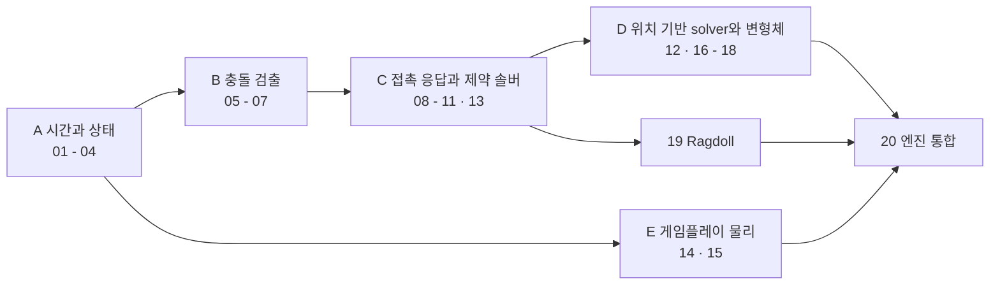

# 게임 물리 시리즈 지도

`physics/`는 *시간을 이산화한 상태 갱신*, *접촉이라는 불연속 사건*, *제약을 만족시키는 반복 해법*을 연결한다. 각 모델이 언제 발산·진동·터널링·비결정으로 실패하는지 살펴보고, 시뮬레이션이 이상하게 보일 때 *어느 계층의 어떤 가정이 깨졌는지* 짚는 것이 목표다.

기하 정리와 선형대수의 유도는 [수학 시리즈](../math/README.md)와 함께 읽는다. 이 시리즈에서는 그 결과를 *solver 입력 계약*으로 바꾸고, *한 프레임 예산 안에서 푸는 대가*를 살핀다.

## 읽는 순서

파일 번호는 대체로 의존 순서지만 그대로 직진하는 사슬은 아니다.

번호순이 읽는 순서와 **어긋나는 지점**은 넷이다.

- **06과 07은 전후 관계가 아니다.** 같은 자리(narrow phase)의 두 대안이다. 볼록 다면체 위주면 06, support mapping 기반 범용 detector가 필요하면 07. 한쪽만 읽어도 C 트랙으로 넘어갈 수 있다.
- **12는 11에서 갈라지는 대안 solver 계열이다.** 11까지 읽고 13(joint)으로 직진해도 되고, 12로 빠져 D 트랙(16~18)으로 가도 된다. 13은 12를 전제하지 않는다.
- **14와 15는 곁가지다.** 캐릭터 컨트롤러와 발사체는 강체 접촉 솔버를 거치지 않고 게임 코드가 직접 적분·sweep한다. 01~02와 sweep 질의만 있으면 08~13 없이 읽힌다. 게임을 만들면서 가장 먼저 필요한 두 편이기도 하다.
- **16~18은 자기들끼리 사슬을 이룬다.** 16(입자·grid hash) → 18(SPH), 12+16 → 17(soft body). 08~11의 강체 접촉 솔버를 전제하지 않는다.

| # | 문서 | 다루는 모델 |
|---|---|---|
| 01 | [운동학](part01_kinematics.md) | $x/v/a$의 이산화, 고정 dt를 쓰는 근거, dt clamp와 프레임 카운트 기반 시간, NaN·Inf 방어 |
| 02 | [적분기](part02_integrators.md) | Euler·semi-implicit·Verlet·RK4의 유도와 에너지 거동, symplectic의 의미, 상황별 선택, 통일된 한 step 인터페이스 |
| 03 | [강체 동역학](part03_rigid_body_dynamics.md) | 강체 가정, 질량중심, 운동량·충격량, König 자유도 분리, invMass 관례와 motion type, force accumulator, hot/cold 상태 레이아웃 |
| 04 | [회전 동역학](part04_rotational_dynamics.md) | 관성 모멘트·텐서, 평행축 정리, $\omega/L/\tau$, 2D 각도 적분, 쿼터니언 적분·정규화·frame 함정 |
| 05 | [Broad phase](part05_broad_phase.md) | AABB와 fat AABB, brute force·SAP·spatial hash·dynamic AABB tree, 갱신 비용과 캐시 동작, 정적·동적 집합 분리 |
| 06 | [Narrow phase — SAT](part06_narrow_phase_sat.md) | narrow phase 출력 계약, shape adapter, containment MTV, reference·incident feature, clipping, feature ID와 persistent manifold, 실패 상태 |
| 07 | [Narrow phase — GJK/EPA](part07_narrow_phase_gjk.md) | support 계약과 feature 보존, 종료 조건, witness point 복원, EPA polytope topology, simplex cache와 contact cache의 구분, fallback |
| 08 | [충돌 응답](part08_collision_response.md) | penalty의 한계, 임펄스 모델, normal impulse의 유도, 회복 계수의 정의, position correction, Baumgarte bias, 접촉점이 질량중심 밖일 때의 유효 질량 |
| 09 | [마찰과 회복](part09_friction_restitution.md) | Coulomb 모델, 정·동마찰, tangential impulse, friction cone과 pyramid, resting contact의 jitter, 재질의 $(\mu, e)$ 쌍 |
| 10 | [제약과 Lagrangian](part10_constraints_lagrangian.md) | 제약의 분류, 속도 제약과 Jacobian, 미정승수와 $J^T\lambda$, effective mass, LCP·MLCP, 제약 인터페이스 추상 |
| 11 | [Sequential Impulse](part11_sequential_impulse.md) | Gauss-Seidel 반복, velocity·position iteration, 누적 임펄스와 warm start, 수렴 조건과 질량비, iteration 예산, island 분할 |
| 12 | [PBD와 XPBD](part12_pbd.md) | predict-project-correct, 위치 제약 투영, stiffness의 iteration·dt 의존성, compliance, substep과 iteration의 교환 |
| 13 | [Joint](part13_joints.md) | distance·ball·hinge·slider의 제약식과 Jacobian, motor, inequality limit의 상태 분기, soft constraint |
| 14 | [캐릭터 컨트롤러](part14_character_controller.md) | kinematic 캡슐, 컨트롤러가 캐스트에 거는 계약, move-and-slide, step height, slope limit과 ground snap, push out, 점프의 수직 운동 분리 |
| 15 | [발사체와 궤적](part15_projectile_trajectory.md) | 포물선과 항력 모델, 움직이는 표적 예측, 발사각 역산, 발사체 ToI와 sweep, 궤적 시각화, 발사체 수명 관리 |
| 16 | [입자 물리](part16_particle_physics.md) | 입자 SoA 배치, Verlet의 분기 없는 갱신, GPU compute 경계, grid hash 이웃 검색, cloth의 입자·제약 구성, self-collision의 비용 |
| 17 | [Soft body](part17_soft_body.md) | 모델 선택(입자격자·tet mesh·FEM), 거리와 부피 제약의 경합, shape matching, 시뮬 mesh와 렌더 mesh의 결합, 성능 계약 |
| 18 | [유체와 SPH](part18_fluids_sph.md) | smoothing kernel, 밀도와 압력, 점성·표면장력, CFL 시간 제약, PCISPH·IISPH·PBF, 표현 방식 선택 |
| 19 | [Ragdoll](part19_ragdoll.md) | 본 계층과 인체 비례, 본별 형상·관성, 부위별 joint 배치와 해부학적 limit, 본 사이 충돌 그룹, 애니메이션과의 blend, articulation 비교 |
| 20 | [엔진 통합](part20_engine_integration.md) | backend 적합성 계약, 통합 아키텍처, 물리와 렌더의 시간 정합, 물리와 게임 로직의 이벤트·질의, 결정론의 범위, 멀티스레드, 디버그 도구 |

## 주제를 연결해서 읽기

### 한 개념을 여러 편이 쓰는 경우

한 편에서 배운 모델이 다른 실패 조건에 어떻게 쓰이는지 연결해 읽는다.

| 개념 | 먼저 읽기 | 이어서 적용하기 |
|---|---|---|
| 접촉점 속도 $\vec{v}_p=\vec{v}+\vec{\omega}\times\vec{r}$ | 04 | 08은 normal impulse의 입력으로, 09는 접선 방향 결정의 입력으로 쓴다 |
| 적분기 선택 | 02 | 01은 한 줄 식만 훑고, 03은 강체 step 안의 적용 순서, 16은 SIMD 친화성, 18은 CFL이 dt에 거는 상한을 각자의 선택 근거로 삼는다 |
| Effective mass $(JM^{-1}J^T)^{-1}$ | 10 | 08은 normal 방향, 13은 joint 방향, 11은 pre-step 캐싱 대상으로 쓴다 |
| Warm start | 11(솔버 λ 재사용) | 06은 feature ID로 manifold를 매칭하고, 07은 GJK simplex cache로 질의 반복을 줄인다. 07이 simplex cache와 contact cache의 구분을 본문에서 이미 선언한다 |
| 공간 해시 | 05(페어 열거) · 16(반경 이웃 질의) | 질의 형태가 달라 셀 크기 결론도 다르다. 05는 평균 객체 크기, 16은 상호작용 반지름 기준. 18은 16의 구현을 호출만 한다 |
| AoS와 SoA | 16(SIMD·대역폭) | 03은 handle API와 swap-remove라는 별개 실패 조건을 다룬다 |
| Substep과 iteration의 교환 | 12 | 11은 solver 예산 조정, 18은 CFL 하에서의 sub-step으로 적용한다 |
| 결정론 | 20 | 01(고정 dt), 06(접촉점 정렬), 09(마찰 해의 비유일성), 18(adaptive dt), 19(시뮬 결과의 권위 경계)가 각자 계층의 파괴 요인을 다룬다 |
| Self-collision | 16(천) · 17(부피체) · 19(본 그룹) | 세 곳의 회피 메커니즘이 서로 다르다(인접 무시 · 표면 근사 · bit mask) |

### 같은 식이 다른 결과를 내는 조건

- 같은 임펄스 J를 질량중심에서 떨어진 곳에 적용해도 병진 변화 Δv=J/m은 같다. 달라지는 것은 r×J에 따른 회전이다. 반면 같은 접촉 속도 변화를 만들도록 임펄스를 *풀어 구하면* 유효 질량 때문에 J 자체가 달라질 수 있다(04·08).
- GJK의 simplex cache는 기하 질의 반복을 줄이고, manifold의 feature ID와 solver warm start는 접촉 대응과 누적 임펄스를 재사용한다. 셋을 같은 캐시로 취급하지 않는다(06·07·11).
- body sleep 조건을 이해한 뒤 island 전체의 활성화·재우기와 스레드 분배로 확장한다(03·11·20).
- 회복 계수는 normal 응답의 입력이고, 혼합 규칙과 저속 threshold는 접촉 jitter를 제어하는 정책이다(08·09).

## 함께 읽을 인접 주제

### 선수 지식과 적용 경계

| 인접 주제 | 함께 읽기 | 물리에서 적용할 내용 |
|---|---|---|
| 벡터·행렬·쿼터니언 대수, 부동소수점 오차 모델 | `math` | 회전 적분의 정규화 빈도, 솔버의 에너지·안정성 |
| 분리축 정리의 축 후보 완전성, GJK·EPA의 기하 유도 | `math` | narrow phase의 출력 계약, containment, manifold, 실패 상태 |
| 공간 분할 자료구조, BVH, 광선 교차 판정 | `math` | 동적 갱신 정책, 페어 추출, 워크로드별 전환점 |
| 형상 캐스트(sweep)의 계약, ToI의 수렴과 종료, conservative advancement | `math` | 캐스트를 몇 번 어떤 순서로 부를지, ToI 이벤트를 solver 예산 안에서 어떻게 처리할지 |
| 프레임 루프 오케스트레이션, 애니메이션 blend, 카메라 | `engine` | 물리 dt의 고정 근거, 물리 상태와 렌더 pose의 경계 |
| AoS/SoA와 SIMD의 일반 비용 모델, 할당·컨테이너 | `parts` | 입자·강체 워크로드에서 그 선택이 바뀌는 조건 |
| GPU 실행 모델, 표면 렌더링(marching cubes, screen-space) | `graphics` | 유체 표현 방식을 고르는 기준과 시뮬 쪽 비용 |
| lockstep·rollback·상태 복제 | `network` | 시뮬레이션이 결정적이기 위한 조건과 그 범위 |
| 경로 탐색, 로컬 회피, 군집 | `ai` | 캐릭터 이동의 충돌 해소와 접지 판정 |

### 심화 탐구

기본 solver를 연결한 뒤에는 다음 질문으로 확장할 수 있다.

- 일반 강체의 ToI 이벤트를 어떤 순서와 재진입 상한으로 처리할까? speculative contact의 양의 간격 제약은 warm start·회복 계수와 어떻게 상호작용할까?
- 3D 관절의 swing-twist 분해와 cone-twist limit는 특이점에서 어떻게 연속성을 유지할까?
- layer·mask 필터는 broad phase 후보 생성과 narrow phase 질의 중 어디에 적용하며, ragdoll의 인접 본 예외는 어떻게 표현할까?
- raycast vehicle의 바퀴 접촉·서스펜션·하중 이동은 단순 joint 차량과 어떤 가정이 다를까?

## 완료 조건

- 시뮬레이션이 발산할 때 적분기·dt·제약 solver·질량비 중 어디가 원인인지 측정으로 좁힐 수 있다.
- 접촉이 흔들릴 때 narrow phase의 manifold, warm start 캐시, position 보정, sleep 임계 중 무엇을 볼지 안다.
- 반복 수와 sub-step 수를 장르 이름이 아니라 최대 침투·잔차·프레임 예산으로 정한다.
- 강체·PBD·kinematic 중 어떤 표현을 쓸지 게임 오브젝트별로 근거를 대고 고른다.
- "결정적"이라는 말의 범위(같은 빌드·같은 thread 수·같은 ISA·직렬화 이후)를 구분해 말한다.
