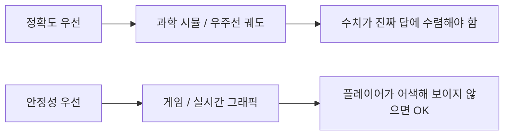
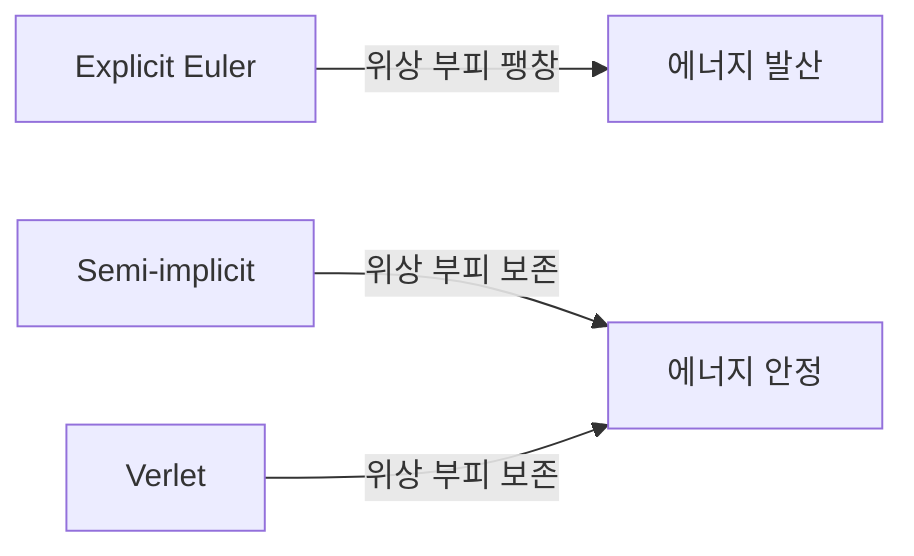

## 들어가며

게임 물리의 출발점. 모든 동역학 (힘·충돌·관절) 이 *운동학 (Kinematics)* 위에 올라간다. 운동학은 *힘은 다루지 않고 운동만 기술* — *위치 $\vec{x}$, 속도 $\vec{v}$, 가속도 $\vec{a}$* 라는 세 양과 시간 적분의 관계.

이 단계가 가볍게 보이지만, 실제 게임 엔진의 *많은 안정성 문제* 가 여기서 결정된다. *Explicit Euler* 와 *Semi-implicit Euler* 의 코드 차이는 한 줄이지만 *시뮬레이션이 발산하는가 vs 안정한가* 가 갈린다. *가변 dt* 와 *고정 dt* 의 차이는 *프레임 드랍 시 캐릭터가 벽을 통과하는가 안 하는가* 를 결정한다.

이 글의 목표.

1. **운동학의 정의** — 힘이 없는 운동 기술.
2. **미적분 관계** — $\vec{v} = d\vec{x}/dt$, $\vec{a} = d\vec{v}/dt$ 의 *이산화*.
3. **시간 적분 종류** — Explicit / Semi-implicit / Verlet / RK4 의 *맛보기* — 한 줄 식과 안정성 특성만.
4. **고정 timestep + accumulator** — Glenn Fiedler 의 표준 패턴.
5. **정확도 vs 안정성** — *게임이 추구하는 것* 은 정확이 아니라 *안정적이고 그럴듯한* 시뮬레이션.
6. **NaN / Inf 방어** — 운동학 변수의 누적 함정.
7. **운동학 적분의 검증 신호** — 같은 식이 *맞게 구현되었는지* 어떤 양으로 확인할 수 있는가.

이 글의 결과물은 *한 입자의 위치 / 속도 / 가속도 갱신 모델 + 고정 timestep + accumulator 의 시간 관리*.


---

## 목차
1. [운동학의 정의](#1-운동학의-정의)
2. [속도와 가속도의 미적분 관계](#2-속도와-가속도의-미적분-관계)
3. [시간 적분의 종류 (맛보기)](#3-시간-적분의-종류-맛보기)
4. [고정 timestep과 accumulator](#4-고정-timestep과-accumulator)
5. [정확도 vs 안정성](#5-정확도-vs-안정성)
6. [NaN / Inf 방어](#6-nan--inf-방어)
7. [운동학 적분의 검증 신호](#7-운동학-적분의-검증-신호)


---

## 1. 운동학의 정의

*힘 (force) 을 다루지 않고* 운동을 기술하는 분야. *어떤 원인이 그 운동을 만들었는지* 와 무관하게 *어떻게 움직이는가* 만 본다.

### 1.1 동역학과의 차이

```mermaid
flowchart LR
    Forces[힘 F] -->|F = ma| Acc[가속도 a]
    Acc -->|적분| Vel[속도 v]
    Vel -->|적분| Pos[위치 x]
    Forces -.->|동역학 (Dynamics)| All[F → x]
    Acc -.->|운동학 (Kinematics)| Motion[a → v → x]
```

*동역학 (Dynamics)*: 힘 → 가속도 → 운동.
*운동학 (Kinematics)*: 가속도 (또는 속도) → 운동. *힘이 어디서 왔는지 모름*.

게임에서 운동학만으로 충분한 케이스도 많다.

- 발사체 (총알·화살): 발사 시점의 *초기 속도 + 중력 가속도* 만 알면 궤적 그대로.
- 캐릭터 컨트롤러: 입력 → *직접 속도 설정* → 위치 갱신. 힘 거치지 않음.
- 카메라 follow: 목표 위치 + 보간 속도.

*동역학이 필요한 케이스* 는 *외력이 모이는 시스템* — 강체 (rigidbody) 충돌, 관절, 폭발 등.

### 1.2 세 양: 위치 / 속도 / 가속도

게임의 한 입자 (point particle) 가 가진 *상태 (state)*.

| 양 | 단위 | 의미 |
|---|---|---|
| 위치 $\vec{x}$ | m (게임 단위) | 어디에 있는가 |
| 속도 $\vec{v}$ | m/s | 위치가 얼마나 빨리 변하는가 |
| 가속도 $\vec{a}$ | m/s² | 속도가 얼마나 빨리 변하는가 |

```cpp
struct Particle {
    vec3 position;
    vec3 velocity;
    vec3 acceleration;
};
```

대부분 게임 엔진의 *Rigidbody / CharacterController* 가 이 세 양 + 회전 변수.

### 1.3 더 높은 차수의 도함수는 게임에서 안 쓰는가

이론상 *jerk (가속도의 변화율, m/s³)*, *snap (m/s⁴)* 도 있다. 우주선 궤적 분석 같은 *정밀 시뮬레이션* 엔 활용. 게임은 보통 *가속도까지*. 그 이상은 *시각적 차이 무시 가능 + 계산 비용 무가치*.

예외: *카메라 motion blur* 가 *jerk 를 곱한 항* 을 활용할 수 있다. 일반적이지 않다.

### 1.4 좌표계와 단위

게임 단위 (보통 1 unit = 1 m). 좌표계는 엔진의 표준 (Y-up vs Z-up, 오른손 vs 왼손) 을 따른다. 단위가 *일관* 하면 운동학은 *좌표계 무관*. 그 *일관성* 이 깨질 때 (mm 단위 vs m 단위 객체 혼용) 충돌·중력이 *수치적으로 폭주*.

### 1.5 게임 운동학의 *결정론* 요구

리플레이·멀티플레이가 *같은 입력 → 같은 출력* 을 요구하면 운동학 코드가 *재현 가능* 해야 한다. *고정 dt* 와 *프레임 카운트 기반의 시간 계산* 이 그 토대 — 본 글의 4절. 다만 fixed timestep 만으로 결정론이 *완전히* 보장되지는 않는다. 플랫폼·컴파일러·SIMD/FMA 활성화·연산 순서·컨테이너 순회 순서까지 통제해야 *bit-exact* 가 가능 — fixed timestep 은 *결정론의 토대 중 하나*.

## 2. 속도와 가속도의 미적분 관계

수학적 정의 + 이산화.

### 2.1 연속 시간

$$
\vec{v}(t) = \frac{d\vec{x}}{dt}, \quad \vec{a}(t) = \frac{d\vec{v}}{dt} = \frac{d^2\vec{x}}{dt^2}
$$

속도 = 위치의 시간 도함수. 가속도 = 속도의 시간 도함수 (= 위치의 2차 도함수).

역방향 — *적분*.

$$
\vec{x}(t) = \vec{x}_0 + \int_0^t \vec{v}(\tau) d\tau, \quad \vec{v}(t) = \vec{v}_0 + \int_0^t \vec{a}(\tau) d\tau
$$

### 2.2 이산 시간

게임은 *프레임 단위* 로 시간을 쪼갠다. $\Delta t = t_{n+1} - t_n$. 가장 단순한 이산화:

$$
\vec{v}_{n+1} \approx \vec{v}_n + \vec{a}_n \cdot \Delta t
$$
$$
\vec{x}_{n+1} \approx \vec{x}_n + \vec{v}_n \cdot \Delta t
$$

이 두 줄이 *모든 적분기의 출발점*. 어떤 *순서* 로 갱신하느냐 + 어떤 *시점의 값* 을 쓰느냐로 적분기가 갈린다.

### 2.3 Taylor 전개로 보는 오차

$\vec{x}(t + \Delta t)$ 의 Taylor 전개:

$$
\vec{x}(t + \Delta t) = \vec{x}(t) + \vec{v}(t) \Delta t + \frac{1}{2} \vec{a}(t) \Delta t^2 + O(\Delta t^3)
$$

위 이산화 ($\vec{x}_{n+1} = \vec{x}_n + \vec{v}_n \Delta t$) 는 *$\frac{1}{2} \vec{a}(t) \Delta t^2$ 항을 무시*. 한 step 의 *local error* 가 $O(\Delta t^2)$. 시뮬레이션 시간 $T$ 동안 누적 (*global error*) 은 $O(\Delta t)$ — *1차 적분기*.

| 적분기 | local error | global error |
|---|---|---|
| Explicit Euler | $O(\Delta t^2)$ | $O(\Delta t)$ |
| Semi-implicit Euler | $O(\Delta t^2)$ | $O(\Delta t)$ |
| Verlet | $O(\Delta t^3)$ | $O(\Delta t^2)$ |
| RK4 | $O(\Delta t^5)$ | $O(\Delta t^4)$ |

차수가 높을수록 *작은 dt 에서 빠른 정확도 향상*. 하지만 *발산 안정성* 은 다른 이야기 (3.5절).

### 2.4 운동학 vs 다른 적분 패턴

위 식은 *constant acceleration 가정* 하의 정확한 식이 아니다. 등가속도면:

$$
\vec{x}(t + \Delta t) = \vec{x}_n + \vec{v}_n \Delta t + \frac{1}{2} \vec{a}_n \Delta t^2
$$

이 *닫힌 형식 (kinematic equation)* 이 *물리 교과서의 등가속도 공식*. 게임도 *가속도 일정* 인 한 step 동안 *Verlet 같은* 적분기가 *이 정확한 식* 을 활용. 일반 케이스 (가속도 변화) 는 *수치 적분*.

### 2.5 충돌과 즉시 변화

운동학의 *연속 모델* 이 깨지는 게 충돌. 두 물체가 *순간적으로* 속도를 바꾼다 (impulse). 이 *순간 변화* 는 *위 미분 가능 모델* 에 안 맞아 *별도 처리* — 이 글의 운동학 적분 모델 밖에서 다룬다.

## 3. 시간 적분의 종류 (맛보기)

여기선 각 적분기의 *식과 안정성 특성* 만 짧게 정리한다. 정량 비교는 에너지 곡선과 닫힌 해 오차를 함께 봐야 한다.

### 3.1 Explicit (Forward) Euler

가장 단순한 적분기. 위 식 그대로.

```cpp
void StepExplicitEuler(Particle& p, vec3 force, float mass, float dt) {
    vec3 acc      = force / mass;
    p.position   += p.velocity * dt;     // 이전 v 로 x 갱신
    p.velocity   += acc * dt;             // 이후 v 갱신
}
```

문제: *진동 시스템* (spring) 에서 *에너지 발산*. 작은 dt 라도 시간이 길어지면 *진폭이 점점 커짐*. *공중에 떠 있는 공이 점점 튀어 오르는* 비현실적 현상.

### 3.2 Semi-implicit (Symplectic) Euler

순서를 바꿈 — *속도를 먼저 갱신*, *새 속도로 위치 갱신*.

```cpp
void StepSemiImplicitEuler(Particle& p, vec3 force, float mass, float dt) {
    vec3 acc      = force / mass;
    p.velocity   += acc * dt;             // 먼저 v 갱신
    p.position   += p.velocity * dt;     // 새 v 로 x 갱신
}
```

코드 차이는 *두 줄 순서 바꿈*. 하지만 *진동 시스템에서 발산 없이 평균적으로 bounded* — *symplectic integrator*. Box2D, Bullet, Unity 모두 *semi-implicit Euler* 를 기본 채택. 이유는 5절.

### 3.3 Velocity Verlet

위치는 *현재 속도 + 절반 가속도*, 속도는 *현재 가속도 + 다음 가속도의 평균*.

```cpp
void StepVerlet(Particle& p, vec3 forceFn(vec3 pos), float mass, float dt) {
    vec3 acc      = forceFn(p.position) / mass;
    p.position   += p.velocity * dt + acc * dt * dt * 0.5f;
    vec3 newAcc   = forceFn(p.position) / mass;
    p.velocity   += (acc + newAcc) * 0.5f * dt;
}
```

*힘이 위치의 함수* (예: 중력, 스프링) 일 때 자연스러움. *분자 동역학* 의 표준. 게임 엔진의 *spring / cloth 시뮬레이션* 에 종종.

### 3.4 RK4 (Runge-Kutta 4)

4 회 가속도 평가 후 가중 평균. 정확도 $O(\Delta t^4)$.

```cpp
// 의사 코드
void StepRK4(Particle& p, /* ... */, float dt) {
    Derivative k1 = Evaluate(p, 0,        Derivative{});
    Derivative k2 = Evaluate(p, dt * 0.5, k1);
    Derivative k3 = Evaluate(p, dt * 0.5, k2);
    Derivative k4 = Evaluate(p, dt,        k3);
    // 가중 평균으로 새 상태
}
```

*정확하지만 비쌈* + *복잡*. 게임의 실시간 시뮬레이션은 거의 *RK4 안 씀*. *우주선 궤도 시뮬*, *공학 시뮬레이션* 에는 표준.

### 3.5 정확도 vs 안정성의 분리

자주 혼동되는 두 개념.

| 개념 | 의미 |
|---|---|
| **정확도** (accuracy) | 한 step 의 오차가 작음. 작은 dt 에서 진짜 답에 수렴. |
| **안정성** (stability) | 큰 dt 에서도 *발산 안 함*. 진동 시스템의 *에너지 손익* 통제. |

Explicit Euler 는 *정확도는 1차, 안정성 매우 약함* — 큰 dt 에서 발산.
Semi-implicit Euler 는 *정확도 1차 같은데 안정성 우수* — 게임의 *기본 선택* 이유.

정량 분석은 닫힌 해 오차와 에너지 곡선을 함께 봐야 한다.

## 4. 고정 timestep과 accumulator

게임 루프의 *시간 모델*. Glenn Fiedler 의 *"Fix Your Timestep!"* (2004) 가 표준 참조.

### 4.1 가변 dt 의 함정

가장 단순한 게임 루프.

```cpp
float prevTime = GetTime();
while (running) {
    float now    = GetTime();
    float dt     = now - prevTime;
    prevTime     = now;
    Update(dt);     // dt 가 매 프레임 변함
    Render();
}
```

함정.

- *프레임 드랍 시 dt 가 큼* → 적분기가 *큰 step* 으로 폭주. 캐릭터가 벽 뚫고, 발사체가 워프.
- *결정론 깨짐* — 같은 입력이라도 *프레임 타이밍에 따라 다른 결과*. 리플레이·멀티플레이 동기화 불가.
- *진동 / 진폭이 dt 변동에 민감*. 스프링이 *프레임률에 따라 다른 강도* 로 보임.

### 4.2 고정 dt + accumulator

표준 패턴.

```cpp
const float kFixedDt         = 1.0f / 60.0f;
const int   kMaxStepsPerFrame = 8;
float accumulator             = 0.0f;
float prevTime                = GetTime();

while (running) {
    float now       = GetTime();
    float frameTime = now - prevTime;
    prevTime        = now;
    frameTime = std::min(frameTime, 0.25f);  // 긴 정지 시간을 버리는 명시적 정책

    accumulator += frameTime;
    int steps = 0;
    while (accumulator >= kFixedDt && steps < kMaxStepsPerFrame) {
        Step(kFixedDt);          // 항상 같은 dt 로 시뮬레이션
        accumulator -= kFixedDt;
        ++steps;
    }
    if (steps == kMaxStepsPerFrame && accumulator >= kFixedDt) {
        // 과부하 정책: 남은 시간 부채를 버린다.
        // 서버처럼 시간을 버릴 수 없다면 부하 제한이나 품질 저하가 필요하다.
        accumulator = std::fmod(accumulator, kFixedDt);
    }

    float alpha = accumulator / kFixedDt;
    Render(alpha);                // 부분 보간으로 부드럽게
}
```

- *프레임 드랍* 시 한 프레임에 *여러 Step* 호출하되, 최대 횟수로 spiral of death를 막는다.
- *시뮬레이션이 항상 같은 dt* — 입력 시간 이산화와 적분기의 안정성 분석이 일정해진다. 이것만으로 bit-exact 결정론이 생기지는 않는다.
- *큰 dt clamp (0.25s)* 와 최대 step 초과 시 부채 폐기 — 디버깅 일시정지·알트탭·지속 과부하에서 게임 시간이 느려지는 것을 택한 정책이다. 서버처럼 시간을 버릴 수 없는 시스템은 입장 제한, 시뮬레이션 품질 저하, 작업 분산 같은 별도 정책이 필요하다.
- *Render 보간* — 60fps 시뮬레이션 + 120fps 렌더가 *부드럽게* 가능.

### 4.3 보간 렌더 (interpolation)

`alpha = accumulator / kFixedDt` 가 *현재 프레임이 다음 시뮬 step 의 어느 비율* 인지. 그 값으로 *previous state 와 current state 를 보간*.

```cpp
void Render(float alpha) {
    vec3 displayPos = previousState.position * (1 - alpha)
                     + currentState.position * alpha;
    DrawObject(displayPos);
}
```

물체가 60fps 시뮬 + 더 빠른 렌더에서 *jerky 안 보임*. *VSync 가 시뮬과 다른 모니터 주사율* 일 때 특히 유용.

### 4.4 시뮬 dt 의 선택

- *60 Hz (1/60s)*: PC 게임의 표준. CPU 충분.
- *30 Hz (1/30s)*: 모바일·저사양. 시뮬 정확도 약화 (큰 dt).
- *120 Hz / 240 Hz*: VR / 정밀 시뮬. CPU 부담.
- *240 Hz physics + 60 Hz render*: 일부 racing / fighting 게임. 충돌 정밀도가 중요.

dt 가 작을수록 *정확*. 하지만 *과도하게 작으면 CPU 낭비* + *수치 정밀도 문제* — 작은 dt 가 *float ULP 한도 안에서 누적* 되면 *시간이 안 흐름*.

### 4.5 frame × fixedDt 로 시간 계산

시간 변수를 *시뮬 step 마다 +dt 누적* 하면 *오차 누적*. 매 step ULP 단위 반올림이 모이면 *수 시간 후 시간 자체가 흔들림*. 대안: *시간을 직접 누적하지 않고 step 수에서 매번 곱셈으로 계산*.

```cpp
int64_t frameCount = 0;
double  time       = 0.0;

while (running) {
    // ... accumulator + step loop ...
    while (accumulator >= kFixedDt) {
        ++frameCount;
        time = (double)frameCount * (double)kFixedDt;   // 누적 X
        Step(kFixedDt, time);
        accumulator -= kFixedDt;
    }
}
```

*정수 frameCount 가 권위 있는 시간*. 표시·쿼리용 time 은 *한 번의 곱셈*. 누적 덧셈 오차 회피. 단, 이것만으로 *완전한 bit-exact 결정론* 이 보장되지는 않는다 — 컴파일러 옵션, SIMD/FMA, 부동소수점 환경 설정, 다른 스레드의 연산 순서까지 통제해야 한다.

## 5. 정확도 vs 안정성

게임 물리의 핵심 트레이드오프.

### 5.1 게임의 우선순위

게임은 *정확한 시뮬레이션* 이 아니다. *그럴듯하게 보이고 폭발하지 않는* 시뮬레이션을 추구.



플레이어가 *공이 spring 위에서 천천히 멈추는* 모습을 *진짜 감쇠와 다르게* 봐도 OK — *발산 안 하고 자연스러우면 됨*. 그래서 게임 엔진은 *2차 정확도 적분기 대신 1차 + 안정성* 을 선택.

### 5.2 Explicit Euler 의 spring 발산

간단한 1D spring: $F = -k x$, $m = 1$. 해는 *$\cos(\sqrt{k} t)$* 진동.

```cpp
float x = 1.0f, v = 0.0f;
const float k = 100.0f, dt = 0.01f;
for (int i = 0; i < 1000; ++i) {
    float a = -k * x;
    x += v * dt;        // explicit Euler
    v += a * dt;
}
```

이 코드의 *에너지* $E = \frac{1}{2} v² + \frac{1}{2} k x²$ 가 *매 step 미세하게 증가*. 시간 흐를수록 *진폭이 커지는 발산*. dt 작아도 *시간 ↑ 누적*.

Semi-implicit 으로 바꾸면:

```cpp
v += a * dt;        // 먼저 v
x += v * dt;        // 새 v 로 x
```

*에너지가 거의 보존*. 진동이 *진폭 일정*. *정확하게는 진짜 해와 살짝 다른 주기* 지만 *발산 안 함*.

### 5.3 Symplectic Integrator 의 직관

Semi-implicit Euler 는 *수학적으로 symplectic* — 위상 공간 (phase space) 의 *부피를 보존*. 진동 시스템의 *에너지가 평균적으로 보존* 되는 토대.



분자 동역학·천체 시뮬레이션의 *수십억 년 시뮬레이션* 이 *Verlet* 또는 *symplectic integrator* 로 안정한 이유.

### 5.4 implicit Euler 도 있음 (참고)

*Implicit (backward) Euler*:

$$
\vec{v}_{n+1} = \vec{v}_n + \vec{a}(\vec{x}_{n+1}) \Delta t
$$

*미래 상태의 가속도* 를 사용. *방정식을 풀어야 함* (한 step 마다 Newton 반복) — 비쌈. 하지만 *큰 dt 에서도 안정 영역이 넓음* — 특히 선형 stiff 시스템에서 발산을 강하게 억제.

게임 엔진의 *cloth, soft body* 일부에서 *Implicit Euler* 또는 *Newmark-Beta* 사용. 일반 강체 시뮬은 *semi-implicit* 가 표준.

### 5.5 트레이드오프 요약

| 적분기 | 정확도 | 안정성 | 비용 | 게임 활용 |
|---|---|---|---|---|
| Explicit Euler | 1차 | 약함 | 매우 낮음 | 거의 안 씀 |
| Semi-implicit Euler | 1차 | 강함 | 매우 낮음 | 강체 표준 |
| Verlet | 2차 | 강함 | 낮음 | cloth, particle |
| RK4 | 4차 | 약함 (큰 dt) | 4x | 거의 안 씀 |
| Implicit Euler | 1차 | 매우 강함 | 매우 높음 | soft body |

대부분의 실시간 게임 엔진이 *semi-implicit Euler 또는 Verlet 변형*. 정확도가 더 필요하면 *작은 dt + 같은 적분기*.

## 6. NaN / Inf 방어

운동학 변수의 *누적 함정*. 한 번 NaN 이 끼면 *모든 후속 연산이 NaN*.

### 6.1 흔한 NaN 원인

- *0 으로 나누기*: `force / mass` 에서 `mass == 0`.
- *sqrt(음수)*: `sqrt(b² - 4ac)` 에서 판별식 음수.
- *0 벡터 normalize*: `normalize({0, 0, 0})` → NaN.
- *과도한 dt*: 큰 dt + 큰 가속도 → 위치 좌표 overflow (Inf) → 후속 NaN.

### 6.2 입력 가드

```cpp
struct Particle {
    vec3  position    = {0, 0, 0};
    vec3  velocity    = {0, 0, 0};
    float invMass     = 1.0f;       // 1/mass — 0 이면 immovable
};

void Step(Particle& p, vec3 force, float dt) {
    if (p.invMass <= 0.0f) return;     // immovable
    if (!std::isfinite(force.x) || !std::isfinite(force.y) || !std::isfinite(force.z))
        return;                          // 입력 NaN 차단
    vec3 acc = force * p.invMass;
    p.velocity += acc * dt;
    p.position += p.velocity * dt;
}
```

`invMass` 패턴 (1/m 저장) 이 게임 엔진 표준 — *immovable (mass = ∞)* 객체를 `invMass = 0` 으로 표현. 나눗셈 회피.

### 6.3 속도 cap

발사체가 *너무 빠르게* 가속되면 *한 프레임에 충돌 검사 영역을 통과* (tunneling). 또는 *float overflow* 위험.

```cpp
const float kMaxSpeed = 1000.0f;
float speedSq = dot(p.velocity, p.velocity);
if (speedSq > kMaxSpeed * kMaxSpeed) {
    p.velocity *= kMaxSpeed / std::sqrt(speedSq);
}
```

게임 엔진의 *Rigidbody.maxLinearVelocity* 같은 설정.

### 6.4 dt clamp (재강조)

4.2 절의 `frameTime > 0.25f → 0.25f`. 디버깅 일시정지 / 알트탭 후 큰 dt 가 들어와도 *시뮬레이션 폭주 회피*.

### 6.5 디버그 assert

```cpp
inline void AssertFinite(vec3 v) {
    assert(std::isfinite(v.x) && std::isfinite(v.y) && std::isfinite(v.z));
}

void Step(Particle& p, vec3 force, float dt) {
    AssertFinite(p.position);
    AssertFinite(p.velocity);
    AssertFinite(force);
    // ...
}
```

Debug 빌드에 *NaN 진입 즉시 break*. NaN 이 *멀리 전파된 후 발견* 하면 원인 추적 어려움. *최초 진입점에서* 잡는 게 표준.

## 7. 운동학 적분의 검증 신호

이 글의 식들이 *맞게 구현되었는가* 를 *수학적·물리적 양* 으로 확인하는 방법.

### 7.1 등가속도의 닫힌 해와의 일치

가속도가 일정한 경우의 정확한 해.

$$
\vec{x}(t) = \vec{x}_0 + \vec{v}_0 t + \tfrac{1}{2} \vec{a} t^2, \quad
\vec{v}(t) = \vec{v}_0 + \vec{a} t
$$

수치 적분의 결과를 *같은 t* 에서 비교. Explicit Euler 는 *위치에 dt 에 비례한 오차 (one-sided bias)*, Semi-implicit Euler 는 *반대 부호 오차*, Verlet 은 *2차 정확도로 거의 정확*. 발사체처럼 *가속도가 거의 일정* 한 시나리오에서 *모든 적분기가 같은 포물선* 으로 수렴.

### 7.2 진동 시스템의 에너지 추적

1D 스프링 ($m \ddot{x} = -k x$) 의 *총 에너지*:

$$
E(t) = \tfrac{1}{2} m \vec{v}^2 + \tfrac{1}{2} k x^2
$$

연속 시간에서 *상수*. 이산 적분에서:

- *Explicit Euler*: 매 step $E_{n+1} \approx E_n (1 + \tfrac{k}{m} \Delta t^2)$ — 지수 증가.
- *Semi-implicit Euler / Verlet*: 평균적으로 일정, 미세 진동.

긴 시뮬에서 *E(t) 곡선* 이 적분기의 안정성을 *정량적으로 드러내는* 신호. 곡선이 *상승* 하면 발산, *bounded* 면 symplectic 동작.

### 7.3 가변 dt vs 고정 dt 의 행동 차이

같은 초기 상태에서 *프레임 dt 가 불규칙* 한 경우와 *고정 + accumulator* 가 catch-up 하는 경우의 *최종 위치 비교*.

- 가변 dt: 큰 dt 한 번이 *시뮬을 멀리 보냄*. 같은 시각에 *다른 결과*. 결정론 불가.
- 고정 dt + accumulator: 큰 frame time 이 와도 *여러 step 으로 분할*. 같은 누적 시간에 *같은 결과*.

이 차이가 *재현성 (reproducibility)* 의 기본 신호. 같은 시드·같은 입력 시퀀스를 두 번 돌렸을 때 *위치가 같은가* 가 검증의 핵심.

### 7.4 NaN / Inf 진입의 흔적

운동학 변수가 NaN 이 되면 *후속 모든 적분이 NaN*. 시각적으로는 *객체 사라짐*. 디버그 신호.

- $\vec{x}$ 또는 $\vec{v}$ 의 임의 성분이 `std::isfinite` 가 false.
- *속도가 한 step 에 비현실적으로 큼* (예: $10^9$) → 다음 step 에 위치 overflow → NaN.

진입 시점에서 즉시 break 하는 assert 가 *원인 추적의 표준*. NaN 이 *전파된 후 발견* 하면 시점 추적 불가.

이 네 신호 (등가속도 닫힌 해 일치, 에너지 곡선, 가변 vs 고정 dt 의 재현성, NaN 진입 검사) 가 *운동학 적분 모델이 맞게 동작하는가* 의 *증거 집합*.


---

## 결론

게임 물리의 *첫 단계*. 위치 / 속도 / 가속도의 *이산 적분* 한 줄이 모든 동역학의 출발점.

이 글에서 정리한 핵심.

1. **운동학 vs 동역학** — 힘이 없는 운동 / 힘이 있는 운동. 게임의 많은 케이스가 운동학만으로 충분.
2. **미적분 관계의 이산화** — $\vec{x}_{n+1} = \vec{x}_n + \vec{v}_n \Delta t$ + $\vec{v}_{n+1} = \vec{v}_n + \vec{a}_n \Delta t$ — *순서* 가 적분기를 가른다.
3. **시간 적분 종류** — Explicit / Semi-implicit / Verlet / RK4. 게임은 *semi-implicit Euler* 가 표준.
4. **고정 timestep + accumulator** — Glenn Fiedler 의 표준 패턴. 안정성과 결정론의 토대.
5. **정확도 vs 안정성** — 게임은 *안정* 우선. Symplectic integrator 의 위상 공간 부피 보존.
6. **NaN 방어** — invMass 패턴, 속도 cap, dt clamp, 디버그 assert.
7. **검증 신호** — 등가속도 닫힌 해 일치, 에너지 곡선, 가변 vs 고정 dt 재현성, NaN 진입 검사.

이 토대는 *적분기 비교, 강체 동역학, 회전, broad / narrow phase 충돌, 충돌 응답, 제약 시스템* 이 공유하는 공통 언어다.

## 더 읽을거리

- Glenn Fiedler, "Fix Your Timestep!" (https://gafferongames.com/post/fix_your_timestep/) — 고정 timestep + accumulator 의 표준 참조.
- Ian Millington, *Game Physics Engine Development*, 2nd ed., Ch. 1~3 — 게임 물리의 운동학 기초.
- Erin Catto, "Understanding Constraints" (GDC 2014) — Box2D 의 적분기 선택 배경.
- Christer Ericson, *Real-Time Collision Detection*, Ch. 1 — 게임 시뮬레이션 루프 구조.
- David Baraff, "Physically Based Modeling" (SIGGRAPH course notes) — 적분기 비교의 학술 표준.
- Hairer et al., *Geometric Numerical Integration* — Symplectic integrator 의 수학적 토대.
- Box2D 소스 (`b2World::Step`) — 산업 표준 시뮬 루프.
- Bullet Physics 의 *btDiscreteDynamicsWorld* — multi-substepping 패턴.
