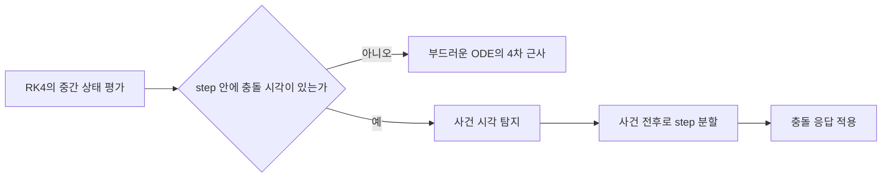

## 들어가며

고정 timestep 시뮬레이션은 미분 방정식을 매 frame 이산화한다. 이 글은 *대표 적분기 4종* 을 *같은 시스템* (조화진동자 / 진자) 에 돌려 *에너지 보존 곡선* 으로 차이를 정량 비교하고, 그 차이를 *symplectic 관점* 으로 해석한다.

같은 미분 방정식이 *어떻게 이산화되는가* 에 따라 시뮬레이션 결과가 갈린다.

- **Explicit Euler**: 단순. 진동 시스템에서 *에너지 발산* — 시간 흐르면 진폭이 커짐.
- **Semi-implicit Euler**: 두 줄 순서만 바꿔 Hamiltonian 진동 문제의 위상 구조를 더 잘 보존한다.
- **Velocity Verlet**: 위치 의존 힘에서 2차 정확도와 시간 대칭성을 제공한다.
- **RK4**: 부드러운 상태 방정식에서는 4차 정확도지만, 충돌·클램프 같은 불연속을 한 step 안에서 별도 처리해야 한다.
- **Symplectic 관점**: Semi-implicit Euler 와 Verlet 이 장기 안정성을 갖는 수학적 이유.

이 글의 결과물.

1. 같은 가속도 계약 아래 4종 적분기를 *한 step 인터페이스* 로 비교한다.
2. *조화진동자* 시뮬에서 step별 에너지 증가를 표로 비교.
3. *상황별 선택 가이드* — 강체 / 발사체 / cloth / 캐릭터 컨트롤러.

이 글의 결론은 명확하다. 실시간 게임 물리의 기본 선택은 *semi-implicit Euler*, 위치 기반 입자·천 시뮬레이션은 *Verlet 계열*, 부드러운 공학 시뮬레이션은 *RK4 계열* 이다.


---

## 목차
1. [Explicit Euler — 발산하는 1차 적분기](#1-explicit-euler--발산하는-1차-적분기)
2. [Semi-implicit Euler — 게임의 기본](#2-semi-implicit-euler--게임의-기본)
3. [Velocity Verlet — 위치 기반의 토대](#3-velocity-verlet--위치-기반의-토대)
4. [RK4 — 부드러운 상태 방정식의 4차 적분기](#4-rk4--부드러운-상태-방정식의-4차-적분기)
5. [Symplectic 의 의미와 위상 공간](#5-symplectic-의-의미와-위상-공간)
6. [에너지 보존 비교 실험](#6-에너지-보존-비교-실험)
7. [상황별 적합 선택](#7-상황별-적합-선택)
8. [통일된 적분기 인터페이스](#8-통일된-적분기-인터페이스)


---

## 1. Explicit Euler — 발산하는 1차 적분기

가장 단순한 적분기. 모든 *이산화 교과서* 의 출발점.

### 1.1 식

```math
\vec{x}_{n+1} = \vec{x}_n + \vec{v}_n \Delta t
\vec{v}_{n+1} = \vec{v}_n + \vec{a}_n \Delta t
```

*현재 시점 (n) 의 속도와 가속도* 만으로 다음 step. 직관적, 코드 두 줄.

```cpp
void StepExplicitEuler(Particle& p, vec3 acc, float dt) {
    p.position += p.velocity * dt;
    p.velocity += acc * dt;
}
```

### 1.2 정확도 분석

Taylor 전개로 한 step 의 *local error*:

$$
\vec{x}(t + \Delta t) - \vec{x}_{n+1}
 = \frac{1}{2} \vec{a}(t) \Delta t^2 + O(\Delta t^3)
$$

*$O(\Delta t^2)$ local*, *$O(\Delta t)$ global*. *1차 적분기*.

### 1.3 진동 시스템에서의 발산

1D 단순 조화진동자: $m \ddot{x} = -k x$. $m = 1, k = 1$ 일 때 *정확한 해* 는 $x(t) = \cos(t)$ — 진폭 1, 주기 $2\pi$.

```cpp
float x = 1.0f, v = 0.0f;
const float dt = 0.1f;
for (int step = 0; step < 1000; ++step) {
    float a = -x;             // F = -kx, m = 1
    x += v * dt;              // explicit Euler
    v += a * dt;
}
// step 1000 후 진폭 ≈ 145 (!) — E 가 매 step ×1.01, 1000 step 에 약 21,000배
```

진폭이 *발산*. 큰 dt 일수록 빨리 발산. 작은 dt 라도 *시간 충분히 길면* 결국 발산.

### 1.4 에너지 분석

에너지 $E = \frac{1}{2} v^2 + \frac{1}{2} k x^2$. 한 step 후:

$$
E_{n+1} = E_n + \frac{1}{2} k \Delta t^2 (\vec{v}_n^2 + k \vec{x}_n^2)
 = E_n (1 + k \Delta t^2)
$$

매 step 마다 *$(1 + k \Delta t^2)$ 배 증가*. 지수 발산.

이게 *Explicit Euler 가 게임 물리의 강체 / 스프링 시뮬에 부적합* 한 핵심 이유.

### 1.5 그럼 어디 쓰는가

- 가속도가 *시간만의 함수* (위치·속도와 무관) 일 때 — 등가속 발사체 등. 발산 없음.
- *비-진동 시스템* — drag-only motion 등. 정확도 더 필요하면 작은 dt.
- 학습용 / 시각화 용 — 발산을 *보여주는* 목적으로.

대부분 게임 엔진의 *기본 적분기* 가 *Explicit 아님*.

## 2. Semi-implicit Euler — 게임의 기본

코드 두 줄의 *순서* 만 바꾼 변형. 안정성 비약적 향상.

### 2.1 식

```math
\vec{v}_{n+1} = \vec{v}_n + \vec{a}_n \Delta t
\vec{x}_{n+1} = \vec{x}_n + \vec{v}_{n+1} \Delta t
```

*속도를 먼저 갱신* + *새 속도로 위치 갱신*. 둘째 줄의 $\vec{v}_{n+1}$ 이 핵심.

```cpp
void StepSemiImplicitEuler(Particle& p, vec3 acc, float dt) {
    p.velocity += acc * dt;
    p.position += p.velocity * dt;
}
```

### 2.2 에너지 분석

같은 조화진동자에서:

$$
E_{n+1} = E_n + \frac{1}{2} k \Delta t^2 (\vec{v}_n^2 - k \vec{x}_n^2) + O(\Delta t^3)
$$

*에너지가 거의 보존* — 평균적으로 일정, 작은 진동 (oscillation) 만. 진폭 발산 없다. 1.4절의 explicit Euler 와 선행항의 차수는 같고 *부호* 만 다르다: $(v_n^2 - k x_n^2)$ 는 진동 주기마다 부호가 바뀌므로 누적되지 않고, 장기 에너지 편차는 $O(\Delta t)$ 범위 ($\Delta t = 0.1$ 에서 상대 약 $\pm 5\%$) 에 갇힌다.

### 2.3 정확도 vs 안정성

| | Explicit | Semi-implicit |
|---|---|---|
| Local error | $O(\Delta t^2)$ | $O(\Delta t^2)$ |
| Global error | $O(\Delta t)$ | $O(\Delta t)$ |
| 진동 안정 | 발산 | 안정 |
| 게임 활용 | 거의 안 씀 | 표준 |

*정확도는 같은 1차*. 하지만 *안정성* 이 완전히 다르다.

### 2.4 산업 채택

- **Box2D** (Erin Catto): semi-implicit Euler.
- **Bullet** (Erwin Coumans): semi-implicit Euler.
- **PhysX** (NVIDIA): semi-implicit + 일부 implicit 변형.
- **Jolt** (Jorrit Rouwé, Horizon Forbidden West): semi-implicit + symplectic 변형.
- **Unity**: semi-implicit (Rigidbody.Velocity, Force).
- **Unreal Chaos**: semi-implicit.

실시간 강체 엔진에서 이 계열이 흔한 이유는 *한 step당 힘 평가 비용이 낮고*, 속도 제약·접촉 임펄스를 적용한 뒤 위치를 전진시키는 파이프라인과 잘 맞기 때문이다. 실제 엔진은 substep, 감쇠, 수면, 위치 보정과 제약 솔버를 결합하므로 전체 동작을 적분기 이름 하나로 설명할 수는 없다.

### 2.5 충돌과의 호환성

충돌이 *순간 속도 변화 (impulse)* 를 만든다. semi-implicit Euler 의 *속도 → 위치* 순서가 *충돌 후 새 속도로 위치 갱신* 의 자연스러운 흐름과 일치.

Explicit Euler 였으면 *이전 속도로 위치 갱신 후 충돌* → *비일관 상태*.

## 3. Velocity Verlet — 위치 기반의 토대

위치는 *현재 가속도* 로, 속도는 *현재 가속도와 다음 가속도의 평균* 으로 갱신. 2차 정확도.

### 3.1 식

```math
\vec{x}_{n+1} = \vec{x}_n + \vec{v}_n \Delta t + \frac{1}{2} \vec{a}_n \Delta t^2
\vec{a}_{n+1} = \vec{F}(\vec{x}_{n+1}) / m
\vec{v}_{n+1} = \vec{v}_n + \frac{1}{2} (\vec{a}_n + \vec{a}_{n+1}) \Delta t
```

*힘이 위치의 함수* 라 가정. 아래 무상태 구현은 한 step 에 *가속도 2회 평가* — $\vec{a}_{n+1}$ 을 다음 step 의 $\vec{a}_n$ 으로 보관하면 step 당 1회로 줄어든다.

```cpp
void StepVelocityVerlet(Particle& p,
                         vec3 (*forceFn)(vec3),
                         float invMass, float dt) {
    vec3 acc0    = forceFn(p.position) * invMass;
    p.position  += p.velocity * dt + acc0 * dt * dt * 0.5f;
    vec3 acc1    = forceFn(p.position) * invMass;
    p.velocity  += (acc0 + acc1) * 0.5f * dt;
}
```

### 3.2 Position Verlet (속도 없음)

원형 Verlet — 속도를 *명시적으로 저장 안 함*. 두 *이전 위치* 만 보관.

```math
\vec{x}_{n+1} = 2 \vec{x}_n - \vec{x}_{n-1} + \vec{a}_n \Delta t^2
```

속도가 *위치의 차분* 으로 암묵적 정의:

$$
\vec{v}_n \approx \frac{\vec{x}_{n+1} - \vec{x}_{n-1}}{2 \Delta t}
$$

*위치 자체를 상태로 두고 제약 (constraint) 으로 직접 조작* 한다는 발상이 *Position-Based Dynamics (PBD)* 의 토대. 단 PBD 는 이 발상만 물려받았고 속도는 상태로 보관한다 (position Verlet 의 '속도 저장 안 함' 은 물려받지 않는다).

### 3.3 특성

- *2차 정확도* — Local $O(\Delta t^3)$, Global $O(\Delta t^2)$.
- *Symplectic* — 진동 시스템에서 에너지 거의 일정.
- *시간 역행 가능* (time-reversal symmetric).
- *가속도가 위치의 함수* 가정 — 속도 의존 force (drag, magnetic) 에 *직접 안 맞음*.

### 3.4 게임 활용

- **Cloth simulation** — *수천 입자의 위치 + 제약 (거리 / 굽힘)* 에 position Verlet 또는 PBD 계열을 결합할 수 있다. Jakobsen의 고전적인 게임 구현이 대표 사례다.
- **Rope / hair** — 같은 패턴.
- **Particle 시스템** — 부드러운 simulation.
- **Soft body** — mass-spring 모델의 정밀 시뮬.

cloth / soft body에는 PBD·XPBD, implicit 계열, 유한요소법 등 여러 선택지가 있다. Verlet 계열은 구현 단순성과 위치 제약 결합이 중요한 경우의 한 선택이다.

### 3.5 분자 동역학과의 공유

Velocity Verlet 은 *molecular dynamics 의 표준* — 분자 시뮬레이션의 수십만 step 안정성이 *Verlet 의 symplectic 특성* 덕분.

두 분야 모두 다수 입자와 장시간 적분을 다루지만 목표는 다르다. 분자 동역학은 통계·보존량 정확성을 중시하고, 게임 cloth는 제약 만족·시각적 안정·프레임 예산을 중시한다. 같은 계열 적분기를 쓰더라도 감쇠와 제약 처리 때문에 수치 계약은 같지 않다.

## 4. RK4 — 부드러운 상태 방정식의 4차 적분기

고전적인 4차 Runge-Kutta는 위치만 따로 적분하지 않는다. 2차 운동 방정식을 먼저 1차 상태 방정식으로 바꾼다.

$$
\vec{y} =
\begin{bmatrix}
\vec{x}\\
\vec{v}
\end{bmatrix},
\qquad
\dot{\vec{y}} = f(t,\vec{y}) =
\begin{bmatrix}
\vec{v}\\
\vec{a}(t,\vec{x},\vec{v})
\end{bmatrix}
$$

### 4.1 식

한 step 안의 네 상태에서 *전체 도함수* 를 평가한다.

```math
\vec{k}_1 = f(t_n, \vec{y}_n)
\vec{k}_2 = f(t_n + h/2, \vec{y}_n + h\vec{k}_1/2)
\vec{k}_3 = f(t_n + h/2, \vec{y}_n + h\vec{k}_2/2)
\vec{k}_4 = f(t_n + h,   \vec{y}_n + h\vec{k}_3)

\vec{y}_{n+1}
= \vec{y}_n + \frac{h}{6}
  (\vec{k}_1 + 2\vec{k}_2 + 2\vec{k}_3 + \vec{k}_4)
```

따라서 `k`의 위치 성분은 속도이고 속도 성분은 가속도다. 중간 위치와 중간 속도에서 힘을 다시 평가하지 않고 최초 가속도 하나를 네 번 재사용하면 RK4가 아니다. 충분히 매끄러운 $f$와 고정된 유한 시간 구간에서 local truncation error는 $O(h^5)$, global error는 $O(h^4)$ 다.

### 4.2 충돌 불연속성과 사건 처리

RK4의 차수 보장은 step 내부에서 $f$가 충분히 매끄럽다는 가정에 의존한다. 접촉 시작, 임펄스, 포화 clamp와 상태 기계 전이는 그 가정을 깬다.



충돌 시각을 찾지 않고 step 양 끝에서만 판정하면 중간 평가가 실제 궤적의 서로 다른 면을 섞는다. 대응은 continuous collision detection으로 사건 시각을 찾고 step을 분할하거나, 강체 파이프라인에서 작은 substep과 제약·임펄스 솔버를 사용하는 것이다. 이는 RK4가 게임에 금지된다는 뜻이 아니라 *불연속 강체 문제에 적분기만 교체해서는 4차 이득을 얻지 못한다* 는 뜻이다.

### 4.3 활용처

- 부드러운 공력·추진·조향 모델처럼 한 step 안에서 연속인 ODE
- 짧은 구간의 탄도 미리보기와 오프라인 기준 해
- 수치 방법의 오차를 비교하는 reference integration

장기 궤도처럼 보존 구조가 중요한 문제에서는 높은 단기 정확도만으로 선택하지 않는다. 일반 RK4는 symplectic이 아니므로 긴 시간의 위상·에너지 거동을 symplectic 방법과 따로 비교해야 한다.

### 4.4 비용

RK4는 step마다 네 번의 도함수 평가와 여러 임시 상태 조합이 필요하다. semi-implicit Euler는 보통 한 번의 힘 평가를 사용한다. 그러나 비용 비율을 `4배`나 고정 FLOP 수로 환산할 수는 없다. 힘 평가가 BVH 쿼리·유체 샘플·다체 상호작용을 포함하면 네 번의 평가가 지배하고, 단순한 해석식이면 벡터화와 메모리 트래픽이 지배할 수 있다. 비교 지표는 *같은 허용오차를 달성하는 총 force 평가 수와 wall time* 이다.

## 5. Symplectic 의 의미와 위상 공간

semi-implicit Euler 와 Verlet 이 *왜* 진동 안정한가의 *수학적 이유*.

### 5.1 Hamiltonian 시스템

물리의 *보존 시스템* — 외력이 시간 의존 없음, 마찰 없음. 위치 $\vec{q}$ + 운동량 $\vec{p}$ 의 *Hamilton 방정식*:

$$
\dot{\vec{q}} = \frac{\partial H}{\partial \vec{p}}, \quad \dot{\vec{p}} = -\frac{\partial H}{\partial \vec{q}}
$$

전체 에너지 $H = T + V$ (운동 + 위치 에너지) 가 *보존*.

### 5.2 위상 공간 (phase space)

상태를 *(위치, 운동량)* 평면에 점으로 표시. 시간에 따라 *위상 공간의 궤적*. Hamiltonian 시스템은 *위상 공간 부피* 가 보존됨 (*Liouville 정리*).


### 5.3 Symplectic Integrator

Symplectic 적분기는 이산 step map이 Hamiltonian 계의 *symplectic form* 을 보존한다. 그 결과 exact arithmetic에서는 위상 공간 부피도 보존된다. 분리 가능한 Hamiltonian에 적용한 semi-implicit Euler와 velocity Verlet은 symplectic이고, 고전적 explicit Euler와 표준 RK4는 그렇지 않다. 부동소수점 반올림, 비보존력, 충돌 clamp와 반복 제약 솔버까지 포함한 엔진 전체가 정확한 symplectic map이라는 뜻은 아니다.

| 적분기 | Symplectic? | 에너지 |
|---|---|---|
| Explicit Euler | × | 발산 |
| Semi-implicit Euler | ○ | 평균 보존, 작은 진동 |
| Velocity Verlet | ○ | 평균 보존, 작은 진동 |
| RK4 | × | 문제와 step 크기에 따라 장기 drift |
| Implicit Euler | × | 감쇠 |

### 5.4 에너지가 *정확히* 보존되지 않는 이유

Symplectic 이라도 원래 에너지를 *정확히 보존* 하는 것은 아니다. 충분히 매끄러운 Hamiltonian 문제와 안정 영역 안에서는 backward error analysis로 원래 계에 가까운 *수정된 Hamiltonian* 을 매우 긴 시간 동안 따라간다고 해석할 수 있다. 그래서 에너지 오차가 흔히 작은 범위에서 진동하지만, step 크기·공명·유한 정밀도에 따라 drift가 생길 수 있어 “절대 발산하거나 감쇠하지 않는다”는 보장은 아니다.

긴 보존계 시뮬레이션에서는 이 구조적 성질이 높은 단기 차수와 별개의 중요한 선택 기준이다.

### 5.5 게임의 실용 의미

수십 분 ~ 수 시간의 게임 세션에서 *물리 시스템이 시각적으로 안정* 해야 한다. *진동하는 객체 (펜듈럼, 흔들리는 천)* 가 *시간 지나며 진폭 변함* 같은 *부자연스러운 모습* 회피.

Symplectic 적분기는 장기 에너지 drift 를 작은 범위에 묶는 수학적 근거를 제공한다.

## 6. 에너지 보존 비교 실험

이론 설명만으로 부족. 실제 측정.

### 6.1 실험 설계

조화진동자 $m \ddot{x} = -k x$. $m = 1, k = 1$, 초기 $x = 1, v = 0$. 정확한 해 $x(t) = \cos(t)$, 에너지 $E = 0.5$.

```cpp
struct ScalarState { double x, v; };
using AccelFn = double (*)(double x, double t);
using StepFn = ScalarState (*)(ScalarState, AccelFn, double t, double h);

double HarmonicAccel(double x, double) { return -x; }
double Energy(ScalarState s) { return 0.5 * (s.x * s.x + s.v * s.v); }

ScalarState StepExplicit(ScalarState s, AccelFn a, double t, double h) {
    return {s.x + h * s.v, s.v + h * a(s.x, t)};
}

ScalarState StepSemiImplicit(ScalarState s, AccelFn a, double t, double h) {
    s.v += h * a(s.x, t);
    s.x += h * s.v;
    return s;
}

ScalarState StepVelocityVerlet(ScalarState s, AccelFn a, double t, double h) {
    const double a0 = a(s.x, t);
    const double x1 = s.x + h * s.v + 0.5 * h * h * a0;
    const double a1 = a(x1, t + h);
    return {x1, s.v + 0.5 * h * (a0 + a1)};
}

struct Derivative { double dx, dv; };

Derivative Evaluate(ScalarState s, AccelFn a, double t) {
    return {s.v, a(s.x, t)};
}

ScalarState AddScaled(ScalarState s, Derivative k, double scale) {
    return {s.x + scale * k.dx, s.v + scale * k.dv};
}

ScalarState StepRK4(ScalarState s, AccelFn a, double t, double h) {
    const Derivative k1 = Evaluate(s, a, t);
    const Derivative k2 = Evaluate(AddScaled(s, k1, h * 0.5), a, t + h * 0.5);
    const Derivative k3 = Evaluate(AddScaled(s, k2, h * 0.5), a, t + h * 0.5);
    const Derivative k4 = Evaluate(AddScaled(s, k3, h),       a, t + h);
    return {
        s.x + h * (k1.dx + 2*k2.dx + 2*k3.dx + k4.dx) / 6.0,
        s.v + h * (k1.dv + 2*k2.dv + 2*k3.dv + k4.dv) / 6.0
    };
}

void RunExperiment(StepFn step, int steps, double h) {
    ScalarState s{1.0, 0.0};
    for (int i = 0; i <= steps; ++i) {
        printf("%d %.9f %.9f %.9f\n", i, s.x, s.v, Energy(s));
        if (i < steps) s = step(s, HarmonicAccel, i * h, h);
    }
}
```

`double`, $h=0.1$초, 1000 step으로 실행한다. 표는 위 코드를 각 `StepFn`에 대해 실행한 값을 반올림한 것이다.

### 6.2 재현 결과

| Step | Explicit E | Semi-impl E | Verlet E | RK4 E |
|---|---|---|---|---|
| 0 | 0.500000 | 0.500000 | 0.500000 | 0.500000 |
| 100 | 1.352407 | 0.477815 | 0.499625 | 0.499999 |
| 500 | 72.386386 | 0.511911 | 0.499927 | 0.499997 |
| 1000 | 10,479.577819 | 0.521321 | 0.499724 | 0.499993 |

(Explicit 열은 $E_n = 0.5 \cdot (1 + k\Delta t^2)^n = 0.5 \cdot 1.01^n$ 의 정확한 값.)

- **Explicit**: 지수 발산. 1000 step 후 에너지는 초기값의 약 20,959배이고, 위상 공간 반지름 $\sqrt{x^2+v^2}$ 는 약 145가 된다.
- **Semi-implicit**: 한 값에 고정되지 않고 진짜 에너지 주변에서 제한된 진동을 보인다. 표의 관측 시점마다 위상이 달라 값도 다르다.
- **Velocity Verlet**: 이 조화진동자와 step 크기에서는 에너지 오차가 약 $10^{-3}$ 규모 ($E_0 h^2 / 4 = 1.25 \times 10^{-3}$) 로 제한된다. 표의 값이 더 작아 보이는 것은 관측 시점의 위상 탓이다. 다른 힘과 더 큰 step에도 같은 정확도가 보장되는 것은 아니다.
- **RK4**: 이 100초 구간에서는 매우 작지만 단조로운 에너지 감소가 보인다. 비-symplectic 방법의 장기 거동은 문제와 step 크기에 따라 달라진다.

### 6.3 dt 변화의 영향

dt가 작아지면 같은 물리 시간에서 각 방법의 global error는 해당 차수에 따라 줄어든다. Explicit Euler의 조화진동자 에너지는 어떤 양의 고정 dt에서도 결국 증가하지만, 성장률이 작아져 눈에 띄는 시점이 늦어진다.

하지만 *충분히 긴 시뮬레이션* 에서는 *symplectic 만 안정*. 게임이 *60 fps × 10 분 = 36,000 step* 이라면 dt = 1/60 ≈ 0.017 에서 *Explicit 은 명확한 발산*, *Semi-impl 은 안정*.

### 6.4 dt 임계점 (stability boundary)

각 적분기는 *dt 가 어느 값 이하일 때 안정* 한가의 한계를 갖는다. 조화진동자 ($\omega = \sqrt{k/m}$) 의 경우:

- *Explicit Euler*: 어떤 dt 에서도 *발산* (지수 증가). 작아도 시간 누적이 충분히 길면 발산.
- *Semi-implicit Euler*: $\omega \Delta t < 2$ 까지 안정 — 즉 dt 가 *주기의 $1/\pi$ 보다 작으면* bounded.
- *Velocity Verlet*: 같은 한계, 더 정확.
- *RK4*: 작은 dt 에서는 매우 정확하지만 안정 영역은 유한하다. Symplectic 이 아니므로 장기 에너지 drift 가 생길 수 있다.

이 한계가 *큰 spring 강도, 즉 큰 $\omega$일수록 dt를 작게 잡아야 하는* 이유다. 실제 cloth의 step 크기는 가장 높은 고유진동수뿐 아니라 제약 솔버, 감쇠, 충돌, substep 예산으로 결정되며 `1/240s` 같은 하나의 보편값은 없다.

### 6.5 비-진동 시스템에서도 오차 구조는 다르다

*등가속도 발사체* (중력만): Explicit / Semi-impl 은 위치에 서로 반대 부호의 $O(\Delta t)$ bias 가 남고, Velocity Verlet 은 등가속도 닫힌 해와 일치한다. 다만 진동이 없으므로 *에너지 발산 메커니즘 자체* 는 없다.

차이가 보이는 건 *진동 / 스프링 / 회전* 같은 *주기적 시스템*. 게임의 *대부분 강체 충돌* 이 충돌 후 *진동 같은 동작* 을 만들어 *발산 안정성* 이 결정적.

## 7. 상황별 적합 선택

게임 도메인별 권장.

### 7.1 권장 표

| 상황 | 권장 적분기 | 이유 |
|---|---|---|
| 강체 동역학 (Box2D 류) | Semi-implicit Euler | 표준 + 충돌과 호환 |
| 발사체 / 등가속 | Semi-implicit Euler | 모든 적분기 OK, 단순함 우선 |
| 캐릭터 컨트롤러 | Semi-implicit Euler | 단순 + 입력 → 속도 → 위치 흐름 |
| Cloth / Hair / Rope | Velocity Verlet 또는 PBD | 위치 기반 자연스러움 |
| Soft body | Verlet + 제약 또는 Implicit Euler | 진동 안정 + 큰 dt 가능 |
| Particle 시스템 | Verlet 또는 Semi-impl | 수천 입자, 비용 우선 |
| 행성 궤도 / 우주 게임 | 고차 symplectic 또는 적응형 고차법 | 보존량·위상과 국소 오차를 별도 관리 |
| 항공 시뮬레이션 | RK 계열 또는 문제별 solver | 공력 모델의 매끄러움·강성·실시간 비용에 따라 선택 |

### 7.2 *어떻게 다르게 보이는가*

- *강체 충돌 응답 (semi-impl + impulse)*: 자연스러운 튕김. 멈추는 게 정상.
- *Cloth (Verlet + 제약)*: 부드럽게 흔들림. 모서리가 *진동하는 동영상* 표준.
- *우주선*: 짧은 구간의 위치 오차와 장기 에너지·위상 오차가 서로 다른 선택을 요구한다. 기준 해와 보존량을 함께 비교한다.

### 7.3 *함께 쓰기*

게임 엔진은 종종 *여러 적분기 공존*.

- 강체: semi-implicit.
- Cloth (서브 시스템): Verlet.
- 파티클: Semi-implicit (단순) 또는 Verlet (예술적 효과).

각 서브 시스템이 *자기 적분기* 로 *자기 dt* 에 도는 패턴. *결합 (coupling) 이 필요* 한 케이스 (cloth 가 강체에 매달림) 에서는 *시간 동기화* 가 함정.

### 7.4 회전의 적분은 별도 전개

지금까지 *위치만* 다뤘다. 회전 (orientation) 도 적분 필요하다. 단순 Euler 식의 *쿼터니언 버전* 이 직접 적용 가능하지만, *쿼터니언 도함수* 가 *각속도 × 쿼터니언* 의 곱 형태라 정규화 / 단위 보존 처리가 추가된다. 이 글의 인터페이스는 병진 상태 적분에 한정한다.

## 8. 통일된 적분기 인터페이스

여러 적분기를 *같은 코드 경로* 에서 비교할 수 있는 최소 추상화다. 여기서는 velocity Verlet의 전제를 지키기 위해 가속도가 위치와 시간에만 의존한다고 제한한다.

### 8.1 공통 시그니처

```cpp
struct State {
    vec3 position;
    vec3 velocity;
};

using AccelerationFn = vec3 (*)(vec3 position, float t);
using StepFn = void (*)(State& s, AccelerationFn acceleration,
                        float t, float dt);

void StepExplicit(State& s, AccelerationFn a, float t, float dt) {
    vec3 acc = a(s.position, t);
    s.position += s.velocity * dt;
    s.velocity += acc * dt;
}

void StepSemiImpl(State& s, AccelerationFn a, float t, float dt) {
    vec3 acc = a(s.position, t);
    s.velocity += acc * dt;
    s.position += s.velocity * dt;
}

void StepVerlet(State& s, AccelerationFn a, float t, float dt) {
    vec3 acc0 = a(s.position, t);
    s.position += s.velocity * dt + acc0 * dt * dt * 0.5f;
    vec3 acc1 = a(s.position, t + dt);
    s.velocity += (acc0 + acc1) * 0.5f * dt;
}

struct Derivative {
    vec3 dPosition;
    vec3 dVelocity;
};

Derivative Evaluate(const State& s, AccelerationFn a, float t) {
    return {s.velocity, a(s.position, t)};
}

State AddScaled(const State& s, const Derivative& k, float scale) {
    return {
        s.position + k.dPosition * scale,
        s.velocity + k.dVelocity * scale
    };
}

void StepRK4(State& s, AccelerationFn a, float t, float dt) {
    Derivative k1 = Evaluate(s, a, t);
    Derivative k2 = Evaluate(AddScaled(s, k1, dt * 0.5f), a, t + dt * 0.5f);
    Derivative k3 = Evaluate(AddScaled(s, k2, dt * 0.5f), a, t + dt * 0.5f);
    Derivative k4 = Evaluate(AddScaled(s, k3, dt),        a, t + dt);

    s.position += dt * (k1.dPosition + 2*k2.dPosition
                       + 2*k3.dPosition + k4.dPosition) / 6.0f;
    s.velocity += dt * (k1.dVelocity + 2*k2.dVelocity
                       + 2*k3.dVelocity + k4.dVelocity) / 6.0f;
}
```

각 함수가 같은 `StepFn` 시그니처를 만족한다. RK4도 중간의 위치·속도 전체 상태를 만들지만, 이 예제의 가속도 계약은 위치와 시간만 받는다.

### 8.2 Force function 의 한계

속도 의존 항력 $\vec{a}(\vec{x},\vec{v},t)$ 을 허용하면 RK4의 `Evaluate`에는 전체 상태를 전달할 수 있지만, 위의 고전적 velocity Verlet 식은 그대로 적용할 수 없다. 다체 시스템에서는 한 객체의 가속도가 다른 모든 상태에도 의존하므로 `WorldState -> Derivative[]` 형태로 전체 stage를 평가해야 한다. 충돌과 관절은 매끄러운 force callback이 아니라 사건 탐지와 제약 솔버 단계로 분리하는 것이 보통이다. 즉 “같은 함수 포인터”는 비교용 경계이지 모든 물리 문제를 숨기는 보편 추상화가 아니다.

### 8.3 적분기 비교의 검증 신호

같은 인터페이스에 4종 적분기를 끼워 *같은 시스템* 을 시뮬할 때 비교할 양.

| 신호 | 의미 |
|---|---|
| 시간 vs 진폭 | 진동 시스템의 진폭 변화 — Explicit 만 발산 |
| 에너지·위상 오차 | 장기 구조 보존을 관찰하는 신호; 이것만으로 symplectic임을 증명하지는 않음 |
| dt 임계점 | 어느 dt 부터 적분기가 망가지는가 |
| step 비용 | 가속도 평가 1회, 2회, 4회와 목표 오차까지의 총 비용 |

이 네 신호가 *같은 시스템에서 적분기를 바꿨을 때 무엇이 달라지는가* 를 모두 드러낸다. 진동 없는 등가속 시스템에서는 Euler 계열의 위치 bias 가 작게 보이고, 차이는 *주기적 시스템* 에서 훨씬 선명하게 드러난다.


---

## 결론

대표 적분기 4종의 *같은 시스템 비교*. 정확도와 안정성이 *별개 개념* 임을 측정으로 확인.

이 글에서 정리한 핵심.

1. **Explicit Euler의 발산** — 조화진동자에서 에너지가 매 step $(1+h^2)$배 증가한다.
2. **Semi-implicit Euler의 구조** — 분리 가능한 Hamiltonian에 적용하면 1차 symplectic 방법이며, 안정 영역에서 에너지 오차가 제한된 진동을 보인다.
3. **Velocity Verlet의 전제** — 위치 의존 힘에서 2차·시간 대칭·symplectic 성질을 갖는다. 속도 의존 힘에는 그대로 적용할 수 없다.
4. **RK4의 상태 stage** — 위치와 속도를 묶은 도함수를 네 중간 상태에서 평가한다. 매끄러운 ODE에서 global 4차다.
5. **불연속 사건** — 충돌 시각 탐지와 step 분할 없이 RK4 차수를 기대할 수 없다.
6. **재현 실험** — $h=0.1$, 1000 step에서 Explicit 에너지는 약 10,479.58, Semi-implicit은 관측 위상에 따라 진동, Verlet과 RK4는 서로 다른 작은 오차 패턴을 보인다.
7. **선택 기준** — force 평가 비용, 안정 영역, 보존 구조, 불연속 처리와 목표 오차를 함께 본다.
8. **인터페이스의 경계** — 같은 시그니처는 공정한 비교를 돕지만 적분기마다 다른 수학적 전제를 지우지는 않는다.

이 글의 핵심은 적분기를 *정확도 순위* 로만 고르지 않는다는 점이다. 실시간 물리에서는 비용, 충돌 불연속성, 장기 안정성, 에너지 drift 를 함께 보고 선택한다.

## 더 읽을거리

- Glenn Fiedler, "Integration Basics" (https://gafferongames.com/post/integration_basics/) — 적분기 비교의 게임 친화적 시각.
- Hairer, Lubich, Wanner, *Geometric Numerical Integration* — symplectic integrator 의 수학적 표준.
- David Eberly, *Game Physics*, 2nd ed., Ch. 11, 13 — 미분방정식과 수치 적분.
- Erin Catto, "Numerical Methods" (GDC 2015) — Box2D 의 적분기 선택 배경.
- Jakobsen, "Advanced Character Physics" (GDC 2001) — Verlet + 제약 기반 cloth 의 원전.
- Müller, Heidelberger, Hennix, Ratcliff, "Position Based Dynamics" (2007) — PBD 의 토대.
- Wisdom & Holman, "Symplectic maps for the n-body problem" (Astron. J. 102, 1528, 1991) — 행성 시뮬에서 비symplectic 적분기의 장기 에너지 표류를 피하는 원전.
- Box2D 소스 `b2Island::Solve` — 산업 semi-implicit + 임펄스 구현.
