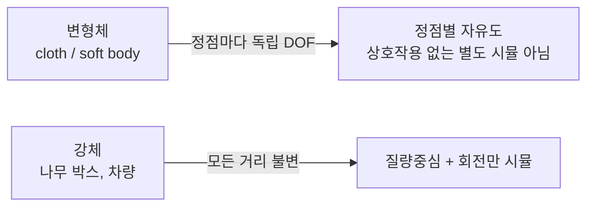

## 들어가며

입자(point particle)는 위치 / 속도 / 가속도 세 양으로 충분하다. *강체 (rigid body)* 는 *유한한 크기와 모양* 을 가진 객체라서 자유도가 늘어난다.

- *2D*: 위치 2 + 회전 1 = *3 자유도*.
- *3D*: 위치 3 + 회전 3 = *6 자유도*.

강체의 핵심 가정: *형상이 변하지 않는다*. 모든 두 점 사이의 거리가 시간에 불변. 이 가정이 *변형체 (soft body, cloth)* 와 강체를 구분짓고, 강체 시뮬레이션을 *질량중심의 병진 운동 + 질량중심 주위 회전* 으로 분해해 계산할 수 있게 한다.

이 글의 목표.

1. **강체의 가정** — 모든 두 점 거리 불변. 이 가정이 가능하게 하는 것.
2. **질량중심** — 어떤 점 주위로 회전하는가의 표준 선택.
3. **선형 운동량과 충격량** — $\vec{p} = M \vec{v}_{cm}$, $\vec{J} = \int \vec{F} dt = \Delta \vec{p}$.
4. **자유도 분리** — 병진과 회전의 분해.
5. **`RigidBody` 자료구조** — 수학적 상태와 구현 불변식.
6. **힘 누적과 적분 루프** — accumulator 패턴.
7. **invMass 관례와 정적 / 동적 / kinematic** — 게임 엔진의 표준 분류.
8. **상태 레이아웃** — hot/cold 분리, 객체 타입과 snapshot 경계.

이 글은 *선형 (병진) 운동* 을 중심으로 정리한다. 회전 변수는 강체 자료구조 안에 필요한 필드로만 둔다.


---

## 목차
1. [강체의 가정](#1-강체의-가정)
2. [질량중심](#2-질량중심)
3. [선형 운동량과 충격량](#3-선형-운동량과-충격량)
4. [자유도 분리: 병진 vs 회전](#4-자유도-분리-병진-vs-회전)
5. [RigidBody 자료구조](#5-rigidbody-자료구조)
6. [힘 누적과 적분 루프](#6-힘-누적과-적분-루프)
7. [invMass 관례와 객체 타입](#7-invmass-관례와-객체-타입)
8. [상태 레이아웃](#8-상태-레이아웃)


---

## 1. 강체의 가정

강체 (rigid body) 의 정의와 함의.

### 1.1 거리 불변 가정

수학적 정의: 강체 $S$ 안의 *임의의 두 점* $\vec{p}, \vec{q}$ 에 대해

$$
\| \vec{p}(t) - \vec{q}(t) \| = \text{const}, \quad \forall t.
$$

즉 *어떤 점도 다른 점과의 거리* 가 *시간에 따라 변하지 않는다*. 형상의 *변형 0*.



### 1.2 무엇이 단순해지는가

거리 불변 가정 덕분에:

1. *모든 입자를 따로 시뮬* 하지 않아도 됨. *질량중심의 위치 + 회전* 만 알면 모든 점의 위치 복구 가능.
2. 저장하는 *pose 성분* 은 *2D 에서 3 개* (x, y, θ), *3D 에서 7 개* (x, y, z, qx, qy, qz, qw) 다. 단 quaternion 4 성분은 *단위 구속* 을 받으므로 3D configuration 자유도는 *6* 이고, 선속도 3 + 각속도 3 을 포함한 *1차 동역학 상태 자유도* 는 *12* (2D 는 6) 다. *저장 성분 수와 자유도를 혼동하지 않는다*.
3. *외력의 총합* + *총 토크* 만 추적. 점별 force 분포는 *적분 시점* 에 필요 없음.
4. *부피 / 면적이 보존* → 충돌 도형이 *시뮬 도중 모양 변하지 않음*. 충돌 알고리즘이 *형상을 한 번 정의 후 평생 사용*.

### 1.3 강체가 깨지는 케이스

게임에 *순수한 강체* 만 있는 건 아니다.

- *Cloth / Hair / Rope*: 변형 — 입자 + 제약 (constraint) 모델.
- *Soft body*: 부드러운 변형 — finite element 또는 mass-spring.
- *Fluid*: 형상 자체가 없음 — SPH 등.
- *Destruction*: 강체가 *부서지면* 여러 강체로 분리. 각각은 다시 강체.

게임 물리의 많은 상호작용이 강체 시뮬레이션으로 표현된다. 나머지는 특수 시스템이다.

### 1.4 강체 vs Kinematic vs Static

게임 엔진의 *세 객체 타입*.

| 타입 | 시뮬 | 충돌 영향 | 예시 |
|---|---|---|---|
| **Static** | 안 함 (고정) | 다른 객체에 영향 줌 | 벽, 바닥, 환경 콜라이더 |
| **Kinematic** | 사용자 제어 — *힘에 의한 동역학 적분은 안 함* | 다른 객체에 영향 줌 | 플랫폼, 엘리베이터, 캐릭터 |
| **Dynamic** (강체) | 물리 적분 | 양방향 영향 | 박스, 잔해, 발사체 |

`Static` 과 `Kinematic` 도 *형상 고정* 이라 *기술적으로 강체*. *동역학 시뮬* 만 다르다.

Kinematic 제어에는 *prescribed velocity 를 적분* 하는 방식과 *다음 target pose 에서 속도를 계산* 하는 방식이 있다. 둘 다 *힘에 의한 동역학 적분을 하지 않는다* 는 점은 같지만 *pose 전진을 하지 않는다는 뜻은 아니다*. solver 는 kinematic 접촉점의 *당시 속도* 를 읽어 dynamic body 에 반영해야 하며, kinematic body 의 transform 을 직접 대입하는 것과 충돌 응답은 별개 단계다. Static transform 변경도 엔진 API 별로 허용 여부와 비용이 다르다 — 일반적으로 broad-phase·sleep 상태 갱신이 따라온다.

### 1.5 이 글의 범위

이 글은 *Dynamic 강체의 병진 (translation) 운동* 을 중심으로 다룬다. 회전·관성·토크는 식의 분해와 자료구조 필드 수준에서만 사용한다.

## 2. 질량중심

회전의 *중심* 으로 표준 선택되는 점.

### 2.1 정의

이산 입자 시스템:

$$
\vec{r}_{cm} = \frac{1}{M} \sum_i m_i \vec{r}_i, \quad M = \sum_i m_i
$$

연속 분포:

$$
\vec{r}_{cm} = \frac{1}{M} \int \rho(\vec{r}) \vec{r} \, dV, \quad M = \int \rho(\vec{r}) \, dV
$$

각 점의 *질량 가중 평균*. 균일 밀도면 *부피의 기하 중심 (centroid)* 과 일치.

### 2.2 균일 밀도 형상

게임에서 가장 흔한 가정. 형상의 *centroid 가 곧 질량중심*.

| 형상 | Centroid |
|---|---|
| 원 / 구 | 중심 |
| 사각형 / 박스 | 두 대각선 교점 |
| 삼각형 | $(\vec{a} + \vec{b} + \vec{c}) / 3$ |
| 임의 다각형 | shoelace 변형으로 계산 |

다각형 centroid (균일 밀도):

$$
C_x = \frac{1}{6 A} \sum_{i=0}^{n-1} (x_i + x_{i+1})(x_i y_{i+1} - x_{i+1} y_i)
$$
$$
C_y = \frac{1}{6 A} \sum_{i=0}^{n-1} (y_i + y_{i+1})(x_i y_{i+1} - x_{i+1} y_i)
$$

여기서 $A$ 는 signed area (shoelace 합 / 2)이고 마지막 정점 뒤에는 첫 정점이 온다. 식은 자기교차가 없는 균일 밀도 면적 다각형과 A≠0을 전제한다.

### 2.3 비균일 밀도

게임에서 드물지만 *복합 강체* (속이 비어 있거나 한쪽이 무거움) 에 필요. *각 부분의 centroid + 질량* 가중 평균.

```cpp
vec2 ComputeCenterOfMass(const std::vector<Part>& parts) {
    vec2 sum   = {0, 0};
    float total = 0;
    for (auto& p : parts) {
        sum   += p.centroid * p.mass;
        total += p.mass;
    }
    return sum / total;
}
```

### 2.4 질량중심 좌표계

물리 적분이 *질량중심을 원점* 으로 설정한 좌표계에서 수행. *이 시리즈는 `body.position` 이 world 좌표계의 질량중심 (COM) 을 가리킨다고 선언한다*. 강체의 *로컬 (body) 좌표계* 도 질량중심 원점이다.

이 선택이 *회전 동역학* 에서 결정적 — 토크가 질량중심 주위로 정의될 때 *병진과 회전이 독립*.

엔진에 따라 *body/shape authoring 원점* 이 COM과 다를 수 있다. 그런 경우 transform 원점 $O_b$ 와 body 좌표계의 COM offset $\vec{c}_{body}$ 사이의 변환 $\vec{x}_{COM,world} = \vec{x}_{O_b,world} + R \, \vec{c}_{body}$ 를 별도로 유지해야 한다. 뒤의 `ApplyForceAtPoint` 가 $\vec{r} = \vec{p} - \vec{x}_{COM,world}$ 로 지렛대를 계산하는 것은 `position` 이 world COM일 때만 맞는다.

### 2.5 질량중심 외부 점

강체에 *질량중심이 아닌 점* 에서 힘이 작용하면 *병진 + 회전* 둘 다 발생. *지렛대 효과*. 이 분해는 4 절의 자유도 분리 토픽.

## 3. 선형 운동량과 충격량

병진 운동의 *상태 변수* 와 *변화 메커니즘*.

### 3.1 선형 운동량

$$
\vec{p} = M \vec{v}_{cm}
$$

강체의 *총 운동량* 은 *모든 입자의 운동량 합* 이지만, 질량이 일정한 계의 질량중심 정의로 *질량 × 질량중심 속도* 로 단순화.

증명. $\vec{r}_i(t) = \vec{r}_{cm}(t) + \vec{s}_i(t)$ (질량중심 + world 축으로 표시한 COM 상대 위치).

$$
\sum_i m_i \vec{v}_i = M \vec{v}_{cm} + \sum_i m_i \dot{\vec{s}}_i = M \vec{v}_{cm}
$$

(둘째 항 = 0 — 질량중심 정의에 의해 $\sum_i m_i \vec{s}_i = 0$.)

### 3.2 뉴턴 제2법칙 (병진)

$$
\vec{F}_{net} = M \vec{a}_{cm} = \frac{d \vec{p}}{dt}
$$

*외력의 총합* 이 *질량 × 질량중심 가속도*. 강체의 *어디에 힘이 작용하든* 병진 운동은 *총합으로만* 결정 — 회전은 별도 (4절).

### 3.3 충격량 (impulse)

$$
\vec{J} = \int_{t_1}^{t_2} \vec{F} \, dt = \Delta \vec{p}
$$

*짧은 시간 큰 힘* 의 효과. 충돌 응답의 *기본 단위*. 직접 속도 변화로 변환:

$$
\Delta \vec{v}_{cm} = \frac{\vec{J}}{M}
$$

게임 코드:

```cpp
void ApplyImpulse(RigidBody& body, vec2 impulse) {
    body.linearVelocity += impulse * body.invMass;
}
```

### 3.4 운동량 보존

외력 없는 닫힌 시스템에서 *총 운동량 보존*.

$$
\sum_i \vec{p}_i = \text{const}
$$

게임의 *두 강체 충돌* 에서 *상호 작용 (action-reaction)* 으로 *서로 반대 충격량* — 시스템 전체 운동량 *불변*. 충돌 응답 알고리즘의 *수학적 토대*.

### 3.5 게임의 흔한 적용

| 상황 | 적용 |
|---|---|
| 폭발 | 중심에서 *방사형 impulse* 분포, $\vec{J}_i = \hat{r}_i \cdot \text{strength} / r_i^2$ 같은 거리 감쇠 |
| 점프 | *위 방향 instant velocity* 또는 *큰 위 방향 impulse* (한 프레임) |
| 총알 hit | *광선 방향 × 운동량* 의 impulse 를 hit 객체에 |
| 캐릭터 이동 | *지속 force* 보다 *직접 속도 설정* — kinematic 제어 |

`ApplyForce` vs `ApplyImpulse` 의 의미가 다르다. force 는 *지속*, impulse 는 *순간*. 게임 엔진의 *Rigidbody.AddForce(F, ForceMode.Impulse)* 같은 옵션이 이 둘을 구분.

## 4. 자유도 분리: 병진 vs 회전

강체의 *총 운동* 이 *질량중심 병진* + *질량중심 주위 회전* 의 *독립적 합* 으로 분해된다.

### 4.1 König 의 정리

강체의 운동에너지 분해:

$$
T = \tfrac{1}{2} M |\vec{v}_{cm}|^2 + T_{rot}
$$

총 운동에너지 = *질량중심의 병진 운동에너지* + *질량중심 주위 회전 운동에너지*. 두 항이 *분리됨* — 어느 항도 다른 항을 *섞지 않음*.

### 4.2 운동 방정식의 분해

병진:

$$
M \dot{\vec{v}}_{cm} = \vec{F}_{net}
$$

회전 (2D, $I$ = 질량중심 주위 관성):

$$
I \dot{\omega} = \tau_{net}
$$

*$\vec{F}_{net}$ 과 $\tau_{net}$ 이 독립적으로 적분*. 코드도 두 줄이 따로.

```cpp
body.linearVelocity   += (forceAccum  * body.invMass)    * dt;
body.angularVelocity  += (torqueAccum * body.invInertia) * dt;
body.position += body.linearVelocity  * dt;
body.angle    += body.angularVelocity * dt;
```

### 4.3 토크의 계산

질량중심 외부 점 $\vec{r}$ 에 힘 $\vec{F}$ 가 작용하면:

$$
\tau = (\vec{r} - \vec{r}_{cm}) \times \vec{F}
$$

(2D 에서는 *스칼라 z 성분*: $\tau = (r_x - r_{cm,x}) F_y - (r_y - r_{cm,y}) F_x$.)

병진은 *총 힘만*, 회전은 *힘 × 팔길이*. 같은 외력 입력이 *두 시스템에 각각 기여*.

### 4.4 분리의 함의

자유도 분리 덕분에:

- 강체 라이브러리가 *병진 코드 + 회전 코드* 를 *별도 모듈* 로 작성 가능.
- 충돌 응답은 병진·회전 효과가 *하나의 접촉 유효질량 (effective mass)* 으로 결합된다. 법선·회전 임펄스를 *독립적인 scalar 두 개로 따로 풀면* 접촉점의 속도 제약이 맞지 않는다 (Part08 의 coupled effective mass 참조).
- *순수 병진 객체* (캐릭터 컨트롤러) 는 *회전 시뮬레이션 건너뜀* 가능.

병진 부분만 먼저 보아도 강체의 선형 운동량, 힘 누적, invMass 관례를 독립적으로 이해할 수 있다. 이 분해 덕분에 회전 항은 같은 자료구조 안에서도 별도 식으로 관리된다.

### 4.5 분리가 깨지는 케이스

König 에너지·운동량 분해는 *회전 방정식 안에 gyroscopic 같은 비선형 항이 있어도 유지* 된다. 그 항은 *회전 내부의 축 간 결합* 이지 병진·회전 분해를 깨뜨리는 것이 아니다. 회전 방정식 자체에서 *생략할 수 없는 항* 이 있다는 뜻이다 (Part04 Euler 방정식).

- *Gyroscopic precession* (회전축이 도는 효과): 회전 운동 자체가 *비선형*. 작은 시뮬은 무시할 수 있지만, 생략한 모델은 *비등방 자유회전에서 각운동량 보존을 체계적으로 어긋나게* 한다. 게임에서 시각적으로 미미해 *대부분 무시*.
- *Variable mass system* (로켓): 질량이 시간에 따라 변함. 표준 강체 가정 벗어남.

variable mass 는 특수 시스템이다.

## 5. RigidBody 자료구조

게임 엔진의 *공통 구조*. Box2D / Bullet / PhysX / Jolt 모두 비슷한 필드.

### 5.1 2D 강체

```cpp
struct RigidBody2D {
    // 상태
    vec2  position;
    float angle;
    vec2  linearVelocity;
    float angularVelocity;

    // 누적 외력 (한 step 동안 모이고, 적분 후 0으로 리셋)
    vec2  forceAccum;
    float torqueAccum;

    // 역질량 / 역관성 — 0 이면 정적
    float invMass;
    float invInertia;

    // 감쇠 (선택)
    float linearDamping  = 0.0f;
    float angularDamping = 0.0f;
};
```

### 5.2 왜 inverse mass

`invMass = 1/m` 형태. 두 가지 이유.

1. *적분식에 곱셈만 등장* — `acc = force * invMass` 한 줄. 나눗셈 회피 (CPU 사이클 절감).
2. *정적 객체 (immovable) 를 invMass = 0 으로 표현* — `mass = ∞` 의 자연스러운 한계. 나눗셈으로 표현 불가.

```cpp
struct RigidBody2D {
    float invMass = 1.0f;     // mass = 1
    // ...
};

// 정적으로 만들기
body.invMass = 0.0f;          // → 모든 force / impulse 가 효과 0
```

### 5.3 3D 강체

```cpp
struct RigidBody3D {
    vec3        position;
    Quaternion  orientation;        // 단위 쿼터니언
    vec3        linearVelocity;
    vec3        angularVelocity;    // body frame? world frame? — 엔진 관례 따름

    vec3        forceAccum;
    vec3        torqueAccum;

    float       invMass;
    mat3        invInertiaTensor;   // 3x3, body frame

    // ...
};
```

2D 의 *float angle / angularVelocity / invInertia* 가 3D 에서는 *Quaternion / vec3 / mat3* 로 확장. 병진 항은 동일하지만 회전 항은 3D 에서 훨씬 복잡해진다.

### 5.4 메모리 레이아웃

대규모 시뮬 (수천 강체) 에선 *SoA (Structure of Arrays)* 가 캐시 친화. 한 필드를 *모든 강체에 대해 연속 메모리* 로.

```cpp
struct RigidBodyArray {
    std::vector<vec2>  positions;
    std::vector<float> angles;
    std::vector<vec2>  linearVelocities;
    // ...
};
```

Jolt physics 는 `Body` 한 객체에 상태를 인라인으로 두고 동적 body 에만 붙는 `MotionProperties` 를 포인터로 분리한 hot/cold 분리 구조. Box2D / Bullet 은 *AoS (각 강체가 한 객체)* — 더 단순. 다만 이런 비교는 *버전에 따라 달라진다* — 여기서의 Box2D 서술은 *2.4.1 의 C++ API (`b2Body`/`b2World`/`b2Island`/`b2ContactSolver`)* 기준이고, 최신 3.x C API 는 자료 구조와 소유권이 다르다. 소스 링크에는 태그 (예: Box2D `v2.4.1`) 를 붙여 버전을 고정한다.

### 5.5 객체와 형상의 분리

`RigidBody` 가 *물리 상태 만* 보관. *충돌 형상 (Shape)* 은 별도.

```cpp
struct CollisionShape {
    enum Kind { Circle, Box, Polygon };
    // ... 형상 데이터 ...
};

struct RigidBody2D {
    // ... 물리 상태 ...
    CollisionShape* shape;          // 형상에 대한 포인터
    Transform        shapeOffset;   // 본체 기준 형상의 위치 + 회전
};
```

한 본체에 *여러 형상 (compound)* 도 가능. 형상은 *immutable* (변형 안 함) 이라 *공유 가능* — 같은 박스 형상 1000 개 → 형상 데이터는 1 개.

## 6. 힘 누적과 적분 루프

매 step 의 *힘 처리 흐름*.

### 6.1 Step 의 구조

```cpp
void Step(RigidBody2D& body, float dt) {
    if (body.invMass <= 0.0f) {
        body.forceAccum  = {0, 0};
        body.torqueAccum = 0;
        return;
    }

    // 1. 외력 적용 (사용자 코드 / 충돌 응답 / gravity)
    float mass = 1.0f / body.invMass;
    body.forceAccum  += gravity * mass;
    // 사용자 힘·토크는 호출자가 ApplyForce / ApplyTorque 로 accumulator 에 이미 더해 두었다

    // 2. 적분 — semi-implicit Euler
    body.linearVelocity  += body.forceAccum  * body.invMass    * dt;
    body.angularVelocity += body.torqueAccum * body.invInertia * dt;
    body.position += body.linearVelocity  * dt;
    body.angle    += body.angularVelocity * dt;

    // 3. 감쇠 (선택)
    body.linearVelocity  *= std::exp(-body.linearDamping  * dt);
    body.angularVelocity *= std::exp(-body.angularDamping * dt);

    // 4. accumulator 리셋 — 다음 step 을 위해
    body.forceAccum  = {0, 0};
    body.torqueAccum = 0;
}
```

핵심: *외력은 매 step 동안 누적, 적분 후 리셋*.

### 6.2 왜 accumulator

게임 코드의 *여러 곳에서* 한 강체에 force 를 줄 수 있다.

```cpp
// 사용자 입력
if (jumpPressed) body.forceAccum += jumpForce;

// 바람 효과
body.forceAccum += windForce;

// penalty 기반 접촉 보정 force
body.forceAccum += contactNormal * penetrationDepth * k;

// 마지막에 Step 호출 → 모두 한 번에 적분
Step(body, dt);
```

각 *force 적용 코드* 가 *적분기를 모른 채* 자기 일만 함. accumulator 가 *분리된 force 들을 한 곳에 모음*.

### 6.3 Force vs Impulse 의 코드 차이

```cpp
// Force — 한 step 동안 지속. accumulator 에 더함.
void ApplyForce(RigidBody2D& body, vec2 force) {
    body.forceAccum += force;
}

// Impulse — 순간 속도 변화. 직접 속도 수정.
void ApplyImpulse(RigidBody2D& body, vec2 impulse) {
    body.linearVelocity += impulse * body.invMass;
}

// 토크 / 회전 impulse
void ApplyTorque(RigidBody2D& body, float torque) {
    body.torqueAccum += torque;
}

void ApplyAngularImpulse(RigidBody2D& body, float angImpulse) {
    body.angularVelocity += angImpulse * body.invInertia;
}

// 외부 점에 적용된 force/impulse → 병진 + 회전 모두 영향
void ApplyForceAtPoint(RigidBody2D& body, vec2 force, vec2 point) {
    body.forceAccum  += force;
    vec2 r = point - body.position;
    body.torqueAccum += r.x * force.y - r.y * force.x;
}
```

`ApplyForceAtPoint` 가 *지렛대 효과* 를 자동 계산.

### 6.4 감쇠 (damping)

물리에서 *공기 저항 / 마찰* 등으로 속도가 *점진적 감소*. 강체 시뮬에서 *시각적 안정* + *수치적 폭주 방지* 둘 다.

```cpp
body.linearVelocity *= std::exp(-damping * dt);
```

지수 감쇠. 감쇠계수 일정·다른 힘 없음이면 같은 총 시간에 같은 감쇠량이다. 다른 힘·접촉과 교대로 적용한 전체 적분 결과까지 dt와 무관한 것은 아니다. 단순 곱셈 (`v *= 0.99`) 은 dt 의존이라 *프레임률 따라 다른 결과*.

### 6.5 적분기 선택

결론대로 *semi-implicit Euler*. 위치 의존 보존력의 조화진동자에서는 hω<2의 안정 영역 안에서 에너지 오차가 bounded다. 충돌·제약을 포함한 전체 solver는 별도로 검증한다.

```cpp
// explicit 순서 (이번 예제에서 선택하지 않은 방법):
body.position += body.linearVelocity * dt;
body.linearVelocity += acc * dt;

// 이번 예제의 semi-implicit 순서:
body.linearVelocity += acc * dt;
body.position += body.linearVelocity * dt;
```

회전도 같은 순서 — *각속도 먼저, 각도 나중*.

## 7. invMass 관례와 객체 타입

`invMass = 1/m` 표현이 *정적 객체 + 동역학 객체* 를 *통일된 코드* 로 다루게 한다.

### 7.1 세 가지 값

| invMass | 의미 |
|---|---|
| > 0 | 정상 동역학 객체. mass = 1 / invMass. |
| = 0 | 정적 객체 (immovable). 모든 force / impulse 효과 0. |
| 음수 | 사용 안 됨 (의미 없음). |

```cpp
struct RigidBody2D {
    float invMass = 1.0f;       // 기본: mass = 1, 동역학
    // ...
};

void MakeStatic(RigidBody2D& body) {
    body.type = BodyType::Static; // §7.2의 motion type도 함께 변경
    body.invMass    = 0.0f;
    body.invInertia = 0.0f;
    body.linearVelocity = {0, 0};
    body.angularVelocity = 0;
}
```

`invMass == 0` 인 객체에 force / impulse 를 줘도 *속도 변화 0* — 자연스럽게 무시.

### 7.2 정적 vs Kinematic 의 차이

| 타입 | invMass | 외력 영향 | 사용자 제어 |
|---|---|---|---|
| Static | 0 | 무시 | 위치 변경 안 됨 |
| Kinematic | 0 + 타입 플래그 | 무시 | 위치 직접 설정 가능 |
| Dynamic | > 0 | 적용됨 | force / impulse 로 |

둘 다 *invMass = 0* 이지만 *kinematic 은 사용자 코드가 position 을 직접 갱신*. Static은 통상 적분하지 않는 고정 형상으로 취급한다. API가 정적 transform 변경을 지원하더라도 broad-phase 갱신·접촉 무효화 등 비용과 규칙을 따라야 한다.

엔진에 따라 *별도 플래그* 로 구분 (`isStatic`, `isKinematic`) 또는 *type enum* 으로.

```cpp
enum class BodyType { Static, Kinematic, Dynamic };

struct RigidBody2D {
    BodyType type    = BodyType::Dynamic;
    float    invMass = 1.0f;
    // ...
};
```

### 7.3 충돌의 비대칭 처리

`invMass = 0` 객체와 *dynamic 객체* 가 충돌하면 *dynamic 만 반응*. 정적 객체는 *무한 질량* 처럼 동작.

```cpp
// 충돌 응답에서 운동량 분배
float totalInvMass = a.invMass + b.invMass;
if (totalInvMass <= 0) return;     // 둘 다 정적 — 아무 변화 없음
vec2 deltaVelA = -normal * impulseMag * a.invMass;   // 충격량 -J → Δv = -J / m_A
vec2 deltaVelB =  normal * impulseMag * b.invMass;   // 충격량 +J → Δv = +J / m_B, 정적이면 0
```

자연스럽게 *정적 객체가 무한 질량* 처럼 동작. dynamic 만 *전체 충격량* 받음.

### 7.4 sleep / wake 정책

오랫동안 *움직이지 않는* 동역학 객체를 *Sleep* 으로 분류한다. 적분과 island solve를 건너뛰어 비용을 줄이되 broad-phase proxy, 접촉 캐시, wake-up 검사는 유지한다.

```cpp
struct RigidBody2D {
    bool  isSleeping = false;
    float sleepTimer = 0.0f;          // 정적인 상태로 머문 시간
    // ...
};

// 매 step 마지막에 sleep 검사
if (length(body.linearVelocity) < kLinearSleepEpsilon &&
    std::fabs(body.angularVelocity) < kAngularSleepEpsilon) {
    body.sleepTimer += dt;
    if (body.sleepTimer > 0.5f) body.isSleeping = true;
} else {
    body.sleepTimer = 0;
    body.isSleeping = false;
}
```

선속도와 각속도는 단위가 다르므로 별도 임계값을 쓰고, 일정 시간 연속으로 조건을 만족할 때 잠재운다 (위 스케치는 body 단위, 실제 엔진은 island 단위로 게이팅한다). 외력, kinematic body 이동, 깨어 있는 body와의 접촉, joint 연결은 wake-up 조건이 된다. 임계값을 너무 높이면 눈에 보이는 운동이 사라지고 너무 낮으면 접촉 잡음 때문에 잠들지 못한다.

### 7.5 mass 와 invMass 의 동기화

API 가 *mass 를 받아 invMass 를 자동 계산*.

```cpp
// 질량만 조정한다. motion type, 관성, COM 은 바꾸지 않는다.
void SetMass(RigidBody2D& body, float mass) {
    body.invMass = (mass > 0) ? 1.0f / mass : 0.0f;
}

float GetMass(const RigidBody2D& body) {
    return (body.invMass > 0) ? 1.0f / body.invMass : INFINITY;
}
```

저장은 *invMass 만*, 외부 API 는 *mass 도 노출*. 두 형식을 *동기화 함수* 로.

`SetMass` 는 *질량 accessor 만* 변경한다. `mass = 0` 으로 호출해도 기존 `invInertia` 가 남으므로 그 상태에 angular impulse 를 주면 회전하며 `type` 도 Dynamic 으로 남는다. 즉 `SetMass(0)` 은 `MakeStatic` 과 동치가 아니다. *질량 분포가 바뀌는* 경우에는 관성과 COM 을 함께 재계산해야 하고, *정적 전환* 이 목적이면 §7.1 의 `MakeStatic` 경로를 쓴다.

## 8. 상태 레이아웃

강체의 수학적 상태와 메모리 레이아웃은 구분한다.

### 8.1 Hot state와 cold metadata

적분과 solver가 반복 접근하는 transform, velocity, inverse mass·inertia, sleep flag는 hot state다. 이름, editor tag, asset 경로, material authoring 정보는 cold metadata다. 둘을 분리하면 solver loop의 cache line에 불필요한 문자열과 포인터가 들어오지 않는다.

### 8.2 객체 타입별 저장

static body에는 velocity, force accumulator와 inverse inertia가 필요하지 않다. dynamic 전용 motion state를 별도 pool에 두고 body handle이 선택적으로 참조하면 정적 월드의 메모리를 줄일 수 있다. 반대로 모든 타입을 한 배열에 두면 접근은 단순하지만 분기와 빈 필드가 생긴다.

### 8.3 AoS와 SoA

body 하나를 생성·조회하는 API에는 AoS가 편리하고, 많은 body의 위치·속도를 적분하는 loop에는 SoA가 SIMD와 prefetch에 유리하다. 외부 handle API와 내부 packed arrays를 분리하면 두 요구를 함께 만족시킬 수 있다. 삭제 시 swap-remove를 쓴다면 handle의 generation과 dense-index 역매핑이 필요하다.

### 8.4 Simulation pose와 render pose

physics pose는 고정 step의 권위 상태다. renderer는 이전·현재 physics snapshot을 보간한 별도 pose를 소비한다. 렌더 보간값을 다시 physics state에 쓰면 에너지와 접촉 cache가 깨진다. kinematic target 역시 render transform을 직접 복사하기보다 다음 physics step의 명령으로 전달한다.

### 8.5 상태 불변식

- dynamic body는 유한한 양의 mass와 양의 준정부호 inertia를 가진다.
- static·kinematic body는 solver의 inverse mass가 0이지만 motion type은 서로 다르다.
- force·torque accumulator는 정의된 step 경계에서 한 번만 비운다.
- transform, velocity와 broad-phase proxy 갱신 순서를 고정한다.
- NaN·무한대가 들어오면 월드 전체로 전파되기 전에 body를 격리하고 원인을 기록한다.


---

## 결론

강체의 *병진 (translation)* 운동. 입자에서 강체로 확장하면서 *형상 + 질량 + 질량중심* 이라는 추가 개념이 들어왔지만, *질량중심의 운동만 본다면 입자 시뮬과 거의 같다*.

이 글에서 정리한 핵심.

1. **강체의 거리 불변 가정** — 변형 없음 → *질량중심 + 회전* 의 단순 분해.
2. **질량중심** — 질량 가중 평균. 균일 밀도면 centroid.
3. **선형 운동량과 충격량** — $\vec{p} = M \vec{v}_{cm}$, $\vec{J} = \Delta \vec{p}$.
4. **자유도 분리** — König 정리. 병진과 회전이 독립.
5. **`RigidBody2D` 자료구조** — position / velocity / forceAccum / invMass 의 표준 패턴.
6. **accumulator 적분 루프** — 매 step 외력 누적 후 적분, 리셋. semi-implicit Euler.
7. **invMass 관례와 객체 타입** — Static / Kinematic / Dynamic, 0/0/>0.
8. **상태 레이아웃** — hot/cold 분리, 객체 타입별 저장과 render snapshot.

강체 시뮬레이션은 이 글의 세 요소로 출발한다. *질량중심*, *운동량 / 충격량*, *invMass 기반 자료구조*. 여기에 회전 항, 충돌 검출, 충돌 응답, 제약 풀이가 같은 상태 구조 위에서 결합된다.

## 더 읽을거리

- Ian Millington, *Game Physics Engine Development*, 2nd ed., Ch. 9~11 — 강체 시뮬레이션의 표준 입문. (Ch. 5~6 은 일반 힘 생성기·스프링의 배경 읽기.)
- David Baraff, "Rigid Body Simulation" (SIGGRAPH Course Notes) — 학술적 정밀한 유도.
- Erin Catto, "Box2D Manual" + v2.4.1 소스 (`b2_body.h`, `b2_body.cpp`, tag `v2.4.1`) — 2D 강체의 reference 구현.
- Bullet Physics SDK Manual, "Rigid Body Dynamics" — 3D 강체의 산업 구현.
- PhysX 5 SDK Guide, "Rigid Body Dynamics" — PhysX 의 API 모델.
- Jorrit Rouwé, Jolt physics 소스 (`Body.h`, `MotionProperties.h`) — Body 와 MotionProperties 를 분리한 hot/cold 레이아웃의 모던 구현.
- *Real-Time Collision Detection* (Christer Ericson), Ch. 3 — 강체 표현에 필요한 행렬·좌표계·벡터 기초.
- Glenn Fiedler, "Physics in 3D" 시리즈 — 게임 친화적 강체 설명.
