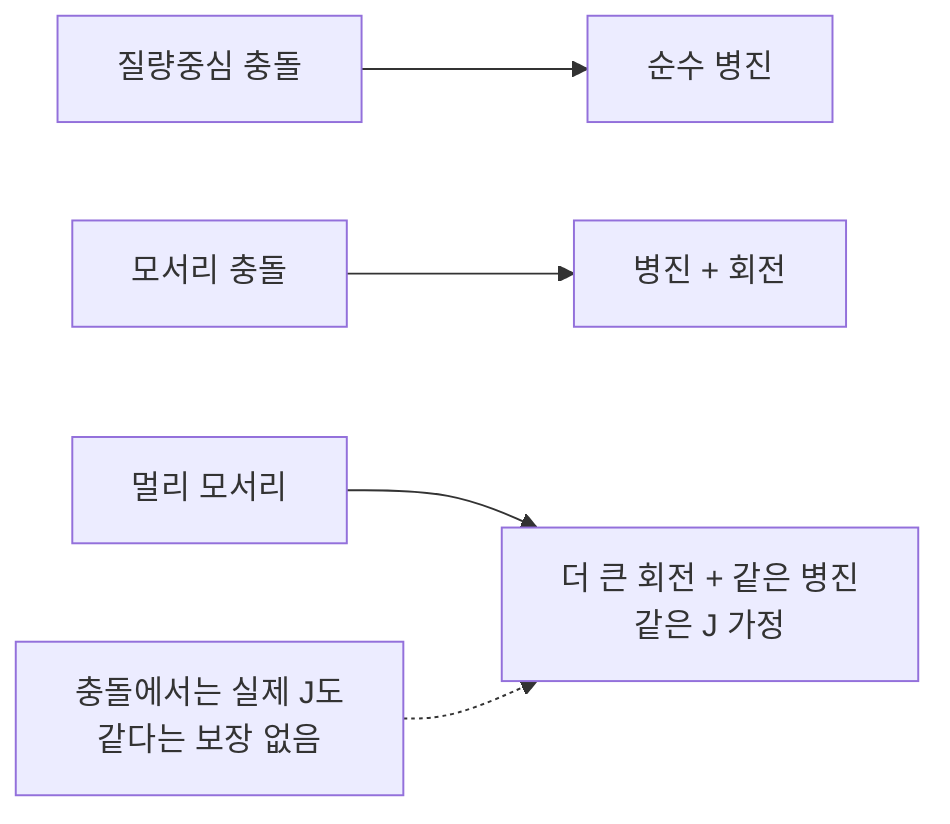

## 들어가며

강체 운동은 질량중심의 *병진(translation)* 과 질량중심 주위의 *회전(rotation)* 으로 분리할 수 있다. 자유도 분리(König 정리)를 이용하면 두 운동의 에너지를 나누어 다룰 수 있으며, 이 글은 그중 회전 동역학에 집중한다.

병진에서 *질량* 이 한 역할을, 회전에서는 *관성 모멘트 (Moment of Inertia)* 가 한다. 2D 에서는 스칼라 한 개로 충분하지만, 3D 에서는 *3×3 관성 텐서* 가 필요하다. 또 3D 회전 자체가 *쿼터니언이라는 비-Euclidean 공간* 의 객체라 *단순 Euler 적분이 그대로 적용 안 됨*.

이 글의 목표.

1. **관성 모멘트와 관성 텐서** — 회전에서의 *질량 대응물*.
2. **기본 형상의 관성** — 원·박스·다각형의 공식.
3. **평행축 정리** — 질량중심 외 축으로 이동시키는 표준 도구.
4. **각속도·각운동량·토크** — 회전의 *상태 + 변화 메커니즘*.
5. **2D 회전 적분** — 스칼라로 단순.
6. **3D 회전 적분의 함정** — 쿼터니언 미분 + 정규화 + 텐서 변환.
7. **각운동량 보존과 토크 응답** — 충돌의 회전 분배.

3D 회전 동역학은 *수치적으로 까다로움* — 작은 dt 라도 *쿼터니언 norm 이 1 에서 벗어나는 누적*, *각속도가 body 좌표인가 world 좌표인가* 같은 함정이 많다. 이 글 끝부분에서 이 함정들을 정리한다.


---

## 목차
1. [관성 모멘트와 관성 텐서](#1-관성-모멘트와-관성-텐서)
2. [기본 형상의 관성](#2-기본-형상의-관성)
3. [평행축 정리](#3-평행축-정리)
4. [각속도, 각운동량, 토크](#4-각속도-각운동량-토크)
5. [2D 회전 적분](#5-2d-회전-적분)
6. [3D 쿼터니언 적분](#6-3d-쿼터니언-적분)
7. [3D 회전 적분의 함정](#7-3d-회전-적분의-함정)
8. [각운동량 보존과 충돌 시 분배](#8-각운동량-보존과-충돌-시-분배)


---

## 1. 관성 모멘트와 관성 텐서

병진의 *질량 $M$* 이 *외력에 대한 저항*. 회전에서는 *질량 분포와 거리* 가 결정한다.

### 1.1 1D 직관

질량 $m$ 의 점이 *축에서 거리 $r$* 떨어진 경우의 *회전 관성*:

$$
I = m r^2
$$

같은 질량이 *축에서 멀수록 회전이 어려움*. 멀리 있는 같은 토크가 *작은 가속도* 를 만든다.

### 1.2 2D 강체의 관성 모멘트

연속 분포에서 (질량중심 주위 축에 대해):

$$
I_{cm} = \int r^2 \, dm = \int \rho(\vec{r}) \, |\vec{r}|^2 \, dA
$$

여기서 $\vec{r}$ 은 *질량중심 기준* 의 위치, $r = |\vec{r}|$ 은 *축으로부터 거리*.

2D 는 *회전축이 평면에 수직 (z 축) 한 개* 이므로 *스칼라 하나* 로 충분.

### 1.3 3D 관성 텐서

3D 는 *임의 축에 대한 회전* 이 가능. 한 스칼라로 표현 불가 — *3×3 대칭 행렬 (관성 텐서)*:

$$
I_{ij} = \int \rho(\vec{r}) (\delta_{ij} |\vec{r}|^2 - r_i r_j) \, dV
$$

대각 성분 $I_{xx}, I_{yy}, I_{zz}$ = *각 축에 대한 관성 모멘트*.
비대각 성분 $I_{xy}, I_{xz}, I_{yz}$ = *축 사이 결합항*. 관례적으로 product of inertia 를
$P_{xy} = \int \rho xy \, dV$ 로 두면 관성 텐서의 비대각 원소는 $I_{xy} = -P_{xy}$ 다.
즉 아래 행렬의 $I_{xy}$ 는 이미 부호가 포함된 *텐서 원소* 다.

```math
\mathbf{I} = \begin{pmatrix}
I_{xx} & I_{xy} & I_{xz} \\
I_{xy} & I_{yy} & I_{yz} \\
I_{xz} & I_{yz} & I_{zz}
\end{pmatrix}
```

대칭 행렬 — 6 개 독립 성분.

### 1.4 주축 (principal axes)

관성 텐서는 *대칭* 이라 *직교 대각화 가능*. 적당한 *body 좌표계* 를 선택하면 *비대각 성분 = 0*, *대각 성분만* 남는 *주축 (principal axes)*.

$$
\mathbf{I}_{principal} = \text{diag}(I_1, I_2, I_3)
$$

주축은 *형상의 대칭성* 을 따른다 — 박스의 *축, 원기둥의 회전축, 구의 임의 축*. 게임 엔진은 *형상 import 시 주축을 자동 계산* 해 *body 좌표계의 자연스러운 정렬*.

### 1.5 관성 텐서의 좌표 변환

같은 강체라도 *어느 좌표계* 에서 보느냐에 따라 텐서 값이 다르다.

$$
\mathbf{I}_{world} = R \, \mathbf{I}_{body} \, R^T
$$

여기서 $R$ 은 *body → world 회전 행렬*. body 좌표계의 텐서는 *불변 (강체라서)*, world 좌표계는 *매 step 회전 변환* 필요.

게임 엔진은 보통 *body 좌표계의 inverse inertia* 를 저장하고, 회전 시 *world 좌표계의 inverse inertia* 로 변환.

```cpp
mat3 GetInvInertiaWorld(const RigidBody3D& body) {
    mat3 R = QuaternionToMatrix(body.orientation);
    return R * body.invInertiaBody * transpose(R);
}
```

## 2. 기본 형상의 관성

자주 쓰이는 *균일 밀도* 형상의 관성 공식.

### 2.1 2D 표

| 형상 | 매개변수 | $I_{cm}$ |
|---|---|---|
| 원판 | 반지름 $r$, 질량 $m$ | $\tfrac{1}{2} m r^2$ |
| 사각형 | 가로 $w$, 세로 $h$ | $\tfrac{1}{12} m (w^2 + h^2)$ |
| 정삼각형 | 변 $a$ | $\tfrac{1}{12} m a^2$ |
| 점 (입자) | — | 0 |

### 2.2 3D 표

대각 성분 (질량중심·주축 기준).

| 형상 | 매개변수 | $I_{xx}$, $I_{yy}$, $I_{zz}$ |
|---|---|---|
| 구 | 반지름 $r$ | $\tfrac{2}{5} m r^2$ (모든 축 같음) |
| 박스 | 가로 / 세로 / 깊이 $w / h / d$ | $\tfrac{1}{12} m (h^2 + d^2)$, $\tfrac{1}{12} m (w^2 + d^2)$, $\tfrac{1}{12} m (w^2 + h^2)$ |
| 원기둥 (y 축 회전) | 반지름 $r$, 높이 $h$ | $\tfrac{1}{12} m (3 r^2 + h^2)$, $\tfrac{1}{2} m r^2$, $\tfrac{1}{12} m (3 r^2 + h^2)$ |
| 캡슐 | 반지름 $r$, 선분 길이 $L$ | 합성 (실린더 + 두 반구) |

### 2.3 임의 다각형 (2D)

균일 밀도 다각형의 *질량중심 주위 관성*. 삼각형 분할 후 합.

$$
I = \frac{\rho}{12} \sum_{i=0}^{n-1} (\vec{v}_i \times \vec{v}_{i+1}) (|\vec{v}_i|^2 + \vec{v}_i \cdot \vec{v}_{i+1} + |\vec{v}_{i+1}|^2)
$$

(좌표는 질량중심 원점. $\rho$ = 면 밀도 = $m / A$.)

```cpp
float ComputePolygonInertia(const std::vector<vec2>& verts, float mass) {
    float A = 0;       // signed area
    for (int i = 0; i < verts.size(); ++i) {
        int j = (i + 1) % verts.size();
        A += verts[i].x * verts[j].y - verts[j].x * verts[i].y;
    }
    A = std::fabs(A) * 0.5f;

    float numerator = 0;
    for (int i = 0; i < verts.size(); ++i) {
        int j = (i + 1) % verts.size();
        float crossZ = verts[i].x * verts[j].y - verts[j].x * verts[i].y;
        float term   = dot(verts[i], verts[i])
                     + dot(verts[i], verts[j])
                     + dot(verts[j], verts[j]);
        numerator += crossZ * term;
    }
    return (mass / (6.0f * A * 2.0f)) * std::fabs(numerator);
}
```

Box2D 의 `b2PolygonShape::ComputeMass` 가 거의 같은 식.

### 2.4 복합 형상

여러 부분이 합쳐진 형상은 각 부분의 질량중심 기준 관성을 전체 질량중심으로 평행 이동한 뒤 합한다. 이때 평행축 정리의 거리 항이 각 부분의 배치 효과를 더한다.

### 2.5 thin shell vs solid

같은 형상이라도 *질량 분포* 가 다르면 관성 다르다.

- *Solid sphere* (균일): $I = \tfrac{2}{5} m r^2$.
- *Thin spherical shell* (표면만): $I = \tfrac{2}{3} m r^2$.

게임은 보통 *Solid* 가정. 표면 모델 (속이 빈 박스 등) 은 *별도 계산*.

## 3. 평행축 정리

질량중심을 지나는 축의 관성에서 *임의 평행축* 의 관성을 즉시 계산.

### 3.1 정리

질량중심을 지나는 축에 대한 관성 $I_{cm}$, 그 축에서 *거리 $d$ 만큼 떨어진 평행축*:

$$
I = I_{cm} + M d^2
$$

증명. 평행축 기준 위치 = 질량중심 기준 위치 + 거리 벡터. 적분 풀면 $M d^2$ 항만 추가.

### 3.2 3D 일반화

3D 의 평행축 정리. 질량중심에서 거리 $\vec{d}$ 만큼 떨어진 평행축의 관성 텐서:

$$
\mathbf{I}' = \mathbf{I}_{cm} + M (|\vec{d}|^2 \mathbf{1} - \vec{d} \vec{d}^T)
$$

(대각: $|\vec{d}|^2 - d_i^2$, 비대각: $-d_i d_j$.)

### 3.3 복합 형상 합성

n 개 부분으로 구성된 형상. 각 부분의 *자기 질량중심 관성* + *전체 질량중심까지 거리 항*.

```cpp
struct Part {
    float mass;
    float inertiaCm;     // 자기 질량중심 주위 관성
    vec2  centroid;      // 자기 질량중심 위치 (전체 좌표)
};

float CompositeInertia(const std::vector<Part>& parts, vec2 globalCm) {
    float I = 0;
    for (auto& p : parts) {
        vec2  d  = p.centroid - globalCm;
        float d2 = dot(d, d);
        I += p.inertiaCm + p.mass * d2;
    }
    return I;
}
```

복잡한 강체 (인간형 캐릭터, 차량) 가 *수십 개 단순 형상의 합성* 으로 모델링. 평행축 정리로 *전체 관성* 계산.

### 3.4 게임 엔진에서

`Box2D b2Body::ResetMassData` 가 *모든 fixture (형상) 의 관성을 평행축 정리로 합성*. 사용자가 *형상 추가/제거 시 자동 호출*.

### 3.5 흔한 함정

`I_cm` 이 *자기 질량중심* 기준인지 *전체 질량중심* 기준인지 혼동. 공식의 `I_cm` 은 *자기* — *자기 형상의 자기 centroid* 주위 관성. 그 다음 *거리 항* 으로 전체 centroid 로 이동.

## 4. 각속도, 각운동량, 토크

회전의 *상태 변수* 와 *변화 메커니즘*.

### 4.1 각속도 $\vec{\omega}$

순간 회전 속도. *방향 = 회전축*, *크기 = 회전 각속도 (rad/s)*. 오른손 법칙으로 방향 결정.

2D 에서는 *스칼라* (z 축 회전 한 가지) — 양수면 CCW, 음수면 CW.

### 4.2 각운동량 $\vec{L}$

선형 운동량 $\vec{p} = M \vec{v}$ 의 회전 버전.

$$
\vec{L} = \mathbf{I} \vec{\omega}
$$

3D 에서 $\mathbf{I}$ 가 텐서, $\vec{\omega}$ 가 벡터 → $\vec{L}$ 도 벡터. *일반적으로 $\vec{L}$ 과 $\vec{\omega}$ 가 평행하지 않다*. 비대각 관성 성분뿐 아니라 *주축 좌표계에서 관성이 대각이어도* 주관성모멘트가 서로 다르고 $\vec{\omega}$ 가 여러 주축 성분을 가지면 $\mathbf{I}\vec{\omega}$ 와 $\vec{\omega}$ 는 평행하지 않다. 예: $\mathbf{I} = \mathrm{diag}(1,2,3)$, $\vec{\omega} = (1,1,0)$ 이면 $\vec{L} = (1,2,0)$ 이고 $\vec{L} \times \vec{\omega} = (0,0,1) \ne 0$ 이다. $\vec{L} \parallel \vec{\omega}$ 인 경우는 *등방성* ($\mathbf{I} = c\mathbf{1}$) 이거나 $\vec{\omega}$ 가 *단일 고유축 방향* 일 때뿐이다.

2D 에서 $L = I \omega$ — 스칼라 곱.

### 4.3 토크 $\vec{\tau}$

힘이 *질량중심 외부 점* 에 작용할 때 발생하는 *회전 변화량*.

$$
\vec{\tau} = \vec{r} \times \vec{F}
$$

$\vec{r}$ = 질량중심에서 force 작용점까지 벡터. 외적 — 3D 에서 벡터, 2D 에서 *스칼라 (z 성분)*.

```cpp
// 2D
float Torque2D(vec2 r, vec2 force) {
    return r.x * force.y - r.y * force.x;
}

// 3D
vec3 Torque3D(vec3 r, vec3 force) {
    return cross(r, force);
}
```

### 4.4 회전판 Newton 제2법칙

$$
\vec{\tau} = \frac{d \vec{L}}{dt}
$$

토크가 각운동량의 시간 변화율. body 좌표계의 *관성 텐서가 불변* 인 경우 (3D 일반적 가정) world 좌표계에서:

$$
\vec{\tau} = \mathbf{I}_{world} \dot{\vec{\omega}} + \vec{\omega} \times (\mathbf{I}_{world} \vec{\omega})
$$

둘째 항이 *Euler 방정식의 비선형 항* — 비대칭 강체의 *gyroscopic precession*. 게임은 보통 이 항 *무시* (작은 영향).

근사 식:

$$
\dot{\vec{\omega}} \approx \mathbf{I}_{world}^{-1} \vec{\tau}
$$

### 4.5 회전 운동 에너지

$$
T_{rot} = \tfrac{1}{2} \vec{\omega}^T \mathbf{I} \vec{\omega}
$$

병진의 $\tfrac{1}{2} M |\vec{v}|^2$ 의 회전 버전. 충돌 응답에서 *에너지 보존 / 손실* 추적에 활용.

## 5. 2D 회전 적분

2D 는 *스칼라 한 개로 표현* 되어 단순.

### 5.1 상태와 적분

```cpp
struct RigidBody2D {
    float angle;           // radian
    float angularVelocity;
    float torqueAccum;
    float invInertia;      // 1 / I, 정적이면 0
    // ...
};

void StepRotation2D(RigidBody2D& body, float dt) {
    body.angularVelocity += body.torqueAccum * body.invInertia * dt;
    body.angle           += body.angularVelocity * dt;
    body.torqueAccum      = 0;
}
```

병진 코드와 거의 같은 패턴. semi-implicit Euler.

### 5.2 angle wrap

`angle` 이 *무한정 증가 가능*. $\sin$, $\cos$ 등의 인자로 *float 정밀도* 가 큰 값에서 떨어진다.

```cpp
void WrapAngle(RigidBody2D& body) {
    constexpr float kTwoPi = 6.283185307f;
    body.angle = std::fmod(body.angle, kTwoPi);
    if (body.angle < 0) body.angle += kTwoPi;
}
```

매 step 마지막에 *[0, 2π) 로 wrap*. 주기적이라 *시각적 차이 없음*. 정밀도 안정.

### 5.3 변환 행렬

`angle` 에서 *2D 회전 행렬*:

```cpp
mat2 Rotation2D(float angle) {
    float c = std::cos(angle);
    float s = std::sin(angle);
    return mat2{c, -s, s, c};
}
```

매 step *body 좌표계 → world 좌표계* 변환. 캐싱 가능 (angle 안 바뀌면 행렬 안 다시 계산).

### 5.4 토크 적용

```cpp
void ApplyTorque(RigidBody2D& body, float torque) {
    body.torqueAccum += torque;
}

// 외부 점에 force — 토크도 자동 계산
void ApplyForceAtPoint(RigidBody2D& body, vec2 force, vec2 worldPoint) {
    body.forceAccum  += force;
    vec2 r = worldPoint - body.position;
    body.torqueAccum += r.x * force.y - r.y * force.x;
}
```

## 6. 3D 쿼터니언 적분

3D 회전은 *비-Euclidean* 공간 객체. 단순 Euler 식이 직접 안 통한다.

### 6.1 쿼터니언 도함수

각속도 $\vec{\omega}$ 가 *world frame* 일 때 단위 쿼터니언 $q$ 의 시간 도함수:

$$
\dot{q} = \tfrac{1}{2} \omega_q \, q
$$

여기서 $\omega_q = (0, \omega_x, \omega_y, \omega_z)$ 는 *순허수 쿼터니언*. Hamilton 곱.

각속도가 *body frame* 이면:

$$
\dot{q} = \tfrac{1}{2} q \, \omega_q
$$

순서가 반대. *어느 frame 인가* 가 코드 정확성의 결정적. 이 글의 규약을 한 곳에 고정한다.

| 항목 | 이 글의 규약 |
|---|---|
| 수식 성분 순서 | scalar-first $\omega_q = (0, \omega_x, \omega_y, \omega_z)$ |
| 코드 생성자 | `Quaternion(x, y, z, w)` — scalar-last |
| 곱 | Hamilton product |
| $q$ 의 의미 | body → world (local → world) |
| $\vec{\omega}$ | world frame |
| 도함수 | $\dot{q} = \tfrac{1}{2}\omega_q q$ → `Multiply(omega_q, q)` |
| 반대 라이브러리 | scalar-first 생성자면 `omega_q` 성분을 `(0, \omega_x, \omega_y, \omega_z)` 로 배치한다. $q$ 가 world → body 이거나 $\vec{\omega}$ 가 body frame 이면 곱셈 순서를 뒤집어 `Multiply(q, omega_q)` 를 쓴다. |

### 6.2 이산 적분

semi-implicit Euler 의 회전 버전.

```cpp
void StepRotation3D(RigidBody3D& body, float dt) {
    // 각속도 갱신 (관성 텐서 변환 필요)
    mat3 Iworld_inv = GetInvInertiaWorld(body);
    body.angularVelocity += Iworld_inv * body.torqueAccum * dt;

    // 쿼터니언 적분 — 명시적 Euler
    Quaternion omega_q = {body.angularVelocity.x,
                          body.angularVelocity.y,
                          body.angularVelocity.z,
                          0};
    // Hamilton 곱, world ω * (body→world) q 규약 (6.1 표)
    Quaternion dq = QuaternionScale(QuaternionMultiply(omega_q, body.orientation),
                                      0.5f * dt);
    body.orientation = QuaternionAdd(body.orientation, dq);
    body.orientation = QuaternionNormalize(body.orientation);

    body.torqueAccum = {0, 0, 0};
}
```

이 코드는 $\dot{\vec{\omega}} \approx \mathbf{I}_{world}^{-1}\vec{\tau}$ 근사를 사용하므로 *자이로 항 $\vec{\omega} \times (\mathbf{I}\vec{\omega})$ 을 생략* 한 모델이다. 토크를 주는 상황에서는 자연스럽지만, *무토크 비등방 강체의 자유회전* 에서는 각운동량 보존이 *dt 를 줄여도 사라지지 않는 체계적 모델 오차* 로 어긋난다 (적분 오차와 구분). 정확히 대조하려면 *L 을 먼저 적분한 뒤 $\vec{\omega} = \mathbf{I}_{world}^{-1}\vec{L}$ 로 재구성* 하거나 *자이로 항을 포함한 적분* 을 별도 경로로 둔다.

### 6.3 정규화 필수

쿼터니언이 *단위 길이* 가정. 매 step 곱셈·덧셈으로 *norm 이 1 에서 미세하게 벗어남* — 누적되면 *회전이 변형 (shear 효과)* 처럼 보임.

```cpp
body.orientation = QuaternionNormalize(body.orientation);
```

매 step 정규화. 비용 작음 (1 sqrt + 4 division).

### 6.4 지수 사상 (exponential map) 방법

더 정확한 적분 — *각속도 적분량을 회전 쿼터니언으로 변환 후 곱*.

```cpp
void StepRotation3DExp(RigidBody3D& body, float dt) {
    // ... 각속도 갱신 ...
    vec3 omega = body.angularVelocity;
    float angle = length(omega) * dt;
    if (angle > 1e-8f) {
        vec3 axis = omega / length(omega);
        Quaternion dq = QuaternionFromAxisAngle(axis, angle);
        body.orientation = QuaternionMultiply(dq, body.orientation);
        body.orientation = QuaternionNormalize(body.orientation);
    }
}
```

작은 dt 에서 둘 다 비슷한 결과. 큰 dt + 큰 $\omega$ 일 때 exp map 이 *더 정확*. Bullet / PhysX 등이 이 방식.

### 6.5 토크 적용 (3D)

```cpp
void ApplyTorque3D(RigidBody3D& body, vec3 torque) {
    body.torqueAccum += torque;
}

void ApplyForceAtPoint3D(RigidBody3D& body, vec3 force, vec3 worldPoint) {
    body.forceAccum  += force;
    vec3 r = worldPoint - body.position;
    body.torqueAccum += cross(r, force);
}
```

## 7. 3D 회전 적분의 함정

3D 회전 동역학의 *수치적 함정* 들. 게임 엔진 디버깅의 가장 흔한 원인.

### 7.1 World frame vs Body frame

각속도가 *어느 frame* 인가에 따라 쿼터니언 적분 식의 곱 순서가 다르다.

| Frame | 도함수 |
|---|---|
| World frame | $\dot{q} = \tfrac{1}{2} \omega_q q$ |
| Body frame | $\dot{q} = \tfrac{1}{2} q \omega_q$ |

게임 엔진의 *내부 표현 관례* 를 *문서로 명확히 두지 않으면* 충돌 응답 / 관절 제약 코드가 *반쪽만 동작*. 엔진마다 각속도 저장 좌표계와 적분 convention 이 다를 수 있으므로 API 문서 기준으로 통일해야 한다.

### 7.2 관성 텐서 변환 누락

body frame 의 관성 텐서를 *그대로 world frame 토크에 곱* 하면 *틀린 각가속도*. 매 step *world 변환* 해야 한다.

```cpp
// 잘못된 코드
body.angularVelocity += body.invInertiaBody * torque * dt;

// 올바른 코드
mat3 R = QuaternionToMatrix(body.orientation);
mat3 Iworld_inv = R * body.invInertiaBody * transpose(R);
body.angularVelocity += Iworld_inv * torque * dt;
```

### 7.3 비대칭 강체의 Euler 방정식 항

$\vec{\omega} \times (\mathbf{I} \vec{\omega})$ 항. 게임은 보통 *무시* — *작은 영향* + *복잡*. 단, 길고 얇은 강체 (스틱) 의 *tumbling* 현상이 이 항 때문 — 무시하면 *비현실적으로 안정한 회전*.

게임은 *시각적 차이를 무시할 수 있는 경우* 이 항을 기본적으로 생략하기도 하지만, Bullet과 PhysX 같은 엔진은 긴 물체의 tumbling이나 큰 각속도를 다루기 위해 자이로스코픽 항을 옵션으로 제공한다.

이 생략은 *모델 근사* 이므로, 무토크 비등방 자유회전에서는 §7.7·§8 의 각운동량 보존 검사와 함께 쓰면 불일치가 나타난다. 그 불일치는 dt 를 줄여 줄일 수 있는 적분 오차가 아니라 *모델에서 항을 뺀 체계적 오차* 다. 대조 실험에서는 L 을 적분 후 ω 를 재구성하는 방식 또는 자이로 항 포함 적분과 비교한다.

### 7.4 쿼터니언 정규화 빈도

매 step 정규화 권장. 일부 엔진은 *N step 마다* 정규화로 성능 절감 — 하지만 *N 이 크면 누적된 비단위가 회전 왜곡*. *매 step* 이 안전.

### 7.5 작은 각속도의 zero division

`exp map` 방식에서 $|\omega|$ 가 0 에 가까우면 *axis 가 NaN*.

```cpp
float w_mag = length(omega);
if (w_mag < 1e-8f) {
    // 각속도 거의 0 — 회전 변경 없음
    return;
}
vec3 axis = omega / w_mag;
```

### 7.6 각속도 cap

큰 각속도가 *한 step 에 큰 회전* → 시각적 jitter + 충돌 검사 영역 통과. cap 권장.

```cpp
const float kMaxAngularSpeed = 50.0f;     // rad/s
float w_sq = dot(body.angularVelocity, body.angularVelocity);
if (w_sq > kMaxAngularSpeed * kMaxAngularSpeed) {
    body.angularVelocity *= kMaxAngularSpeed / std::sqrt(w_sq);
}
```

병진의 *최대 속도 cap* 과 같은 패턴.

### 7.7 디버깅 신호

회전 동역학이 *맞게 동작* 하는지 검증할 양.

- *쿼터니언 norm*: 이상적으로 1이다. 허용오차는 `float`/`double`, 적분기, step 크기와 정규화 주기에 맞춰 정하고 정규화 전후 오차를 기록한다.
- *각운동량 보존*: 단일 body 의 질량중심 주위 *spin* $\vec{L} = \mathbf{I}_{world}\vec{\omega}$ 와, 공통 고정 원점 $O$ 에 대한 *시스템 총각운동량* $\sum_i [(\vec{x}_{COM,i} - O) \times m_i \vec{v}_i + \mathbf{I}_{world,i}\vec{\omega}_i]$ 를 구분한다. 외부 힘·외부 토크·구속이 없는 고립계에서 총각운동량이 이론상 일정하다. 이산 적분과 반올림 때문에 수치 결과에는 오차가 남는다.
- *회전 에너지*: $\tfrac{1}{2} \vec{\omega}^T \mathbf{I} \vec{\omega}$ — 외부 일, 감쇠, 마찰, 비탄성 충돌과 구동 제약이 없는 이상계에서 보존 대상이다.

이 양들의 *시간 그래프* 가 *bounded vs 발산* 으로 적분기의 정확성을 드러낸다.

## 8. 각운동량 보존과 충돌 시 분배

회전이 *충돌 응답* 에 들어가는 메커니즘.

### 8.1 보존 법칙

외부 토크 없는 닫힌 시스템에서 *공통 고정 원점 $O$ 에 대한 총 각운동량 보존*.

$$
\vec{L}_{total} = \sum_i \left[ (\vec{x}_{COM,i} - O) \times m_i \vec{v}_i + \mathbf{I}_{world,i} \vec{\omega}_i \right] = \text{const}
$$

첫 항이 *궤도 (orbital)* 각운동량, 둘째 항이 질량중심 주위 *spin* 이다. 앞에서 정의한 $\vec{L} = \mathbf{I}\vec{\omega}$ 는 각 body 의 spin 이므로, *여러 body 의 총량을 검증할 때는 orbital 항을 반드시 더해야 한다*. 같은 접촉점의 $\pm \vec{J}$ 가 만드는 전체 토크는 상쇄되지만 *spin 부분만의 합은 일반적으로 보존되지 않는다*. 두 강체만을 포함한 고립계를 *같은 기준점* 에서 보면 접촉 임펄스의 작용·반작용으로 총 각운동량이 보존된다. 외부 힘·외부 제약, 정적 월드, 마찰 모델, 비탄성 충돌과 솔버 오차가 있으면 시뮬레이션이 추적하는 부분계의 값은 달라질 수 있다.

### 8.2 비대칭 회전과 보존

비대칭 강체가 회전하면 *각속도 방향이 시간에 따라 변함* — 하지만 *각운동량은 일정*. 회전축이 *세차 (precession)* 한다.


게임의 *던진 책 / 라켓* 이 *공중에서 안정 회전 안 함* 의 이유. 시각적 효과지만 *대부분 게임이 무시*.

### 8.3 충돌에서의 회전 임펄스

두 강체 A, B 가 한 점 $\vec{p}$ 에서 충돌. 충격량 $\vec{J}$ 가 *그 점에 작용*.

병진:
$$
\Delta \vec{v}_A = -\vec{J} / M_A, \quad \Delta \vec{v}_B = +\vec{J} / M_B
$$

회전:
$$
\Delta \vec{\omega}_A = -\mathbf{I}_A^{-1} (\vec{r}_A \times \vec{J}), \quad
\Delta \vec{\omega}_B = +\mathbf{I}_B^{-1} (\vec{r}_B \times \vec{J})
$$

여기서 $\vec{r}_{A,B}$ = 각 강체 질량중심에서 충돌점까지 벡터.

### 8.4 접촉점의 속도

회전이 있는 강체의 *임의 점 속도*:

$$
\vec{v}_p = \vec{v}_{cm} + \vec{\omega} \times \vec{r}
$$

병진 속도 + 회전에 의한 *접선 속도*. 충돌 응답 / 마찰 계산의 입력.

```cpp
vec3 GetVelocityAtPoint(const RigidBody3D& body, vec3 worldPoint) {
    vec3 r = worldPoint - body.position;
    return body.linearVelocity + cross(body.angularVelocity, r);
}
```

### 8.5 회전 운동량의 시각적 결과

같은 충격량 $\vec{J}$ 라도 *충돌점이 질량중심에 가까운가 / 먼가* 에 따라 결과가 다르다.



당구공이 *센터 vs 모서리에 맞을 때* 의 차이. 게임의 *물리 시뮬이 사실적으로 보이는* 결정적 요소.

### 8.6 운동량의 두 측면

- *선형 운동량 $\vec{p}$* — 질량 × 질량중심 속도. 외력 없으면 보존.
- *각운동량 $\vec{L}$* — (단일 body 의 질량중심 spin) 관성 × 각속도. 외토크 없으면 보존. 시스템 총량은 공통 원점에 대한 orbital 항 $\sum_i (\vec{x}_{COM,i} - O) \times m_i \vec{v}_i$ 를 더한 값이다.

게임 충돌 시스템이 *두 보존 법칙을 자연스럽게 만족* 하도록 임펄스를 *대칭 분배* — 한 객체에 +J 면 다른 객체에 -J, 한 객체에 +τ 면 다른 객체에 대응 -τ.


---

## 결론

강체의 *회전* 동역학. 병진의 *질량* 자리에 *관성 모멘트 / 텐서* 가 들어가는 동일 구조 + 3D 의 *비-Euclidean 회전 공간* 함정.

이 글에서 정리한 핵심.

1. **관성 모멘트** — 2D 스칼라, 3D 3×3 대칭 텐서. 주축 분해.
2. **기본 형상 관성** — 원·박스·다각형·구의 표준 공식.
3. **평행축 정리** — 질량중심 외 축으로 이동. 복합 형상의 토대.
4. **각속도·각운동량·토크** — 회전의 상태 + 변화. $\vec{\tau} = d\vec{L}/dt$.
5. **2D 회전 적분** — 스칼라 한 줄. semi-implicit Euler.
6. **3D 쿼터니언 적분** — $\dot{q} = \tfrac{1}{2} \omega_q q$, 매 step 정규화.
7. **3D 함정** — frame 관례, 텐서 변환, Euler 방정식 항, 작은 ω 가드.
8. **각운동량 보존과 충돌 분배** — 충돌점 임펄스가 병진 + 회전 동시 갱신.

이 글로 강체의 *병진 + 회전 상태 모델* 이 완성된다. 질량, 관성, 속도, 각속도, 힘, 토크가 하나의 상태 업데이트 안에서 연결된다.

## 더 읽을거리

- Ian Millington, *Game Physics Engine Development*, 2nd ed., Ch. 9~10 — 회전 동역학 종합.
- David Eberly, *Game Physics*, 2nd ed., Ch. 2 — 강체 운동의 학술적 정리.
- Goldstein, Poole, Safko, *Classical Mechanics*, Ch. 5 — Euler 방정식의 표준.
- David Baraff, "Rigid Body Simulation" (SIGGRAPH Course Notes) — 쿼터니언 적분의 게임 친화적 유도.
- PhysX SDK Guide, "Mass Properties" — 산업의 inertia 계산 API.
- Box2D v2.4 소스 (`b2PolygonShape::ComputeMass`) — 2D 다각형 관성 계산.
- Bullet `btRigidBody::integrateVelocities` — 3D 회전 적분 산업 구현.
- Erwin Coumans, Bullet Physics SDK Manual — btQuaternion / btMatrix3x3 방향 표현 선택과 강체 API 의 개관 (적분식·frame 관례는 소스 쪽).
