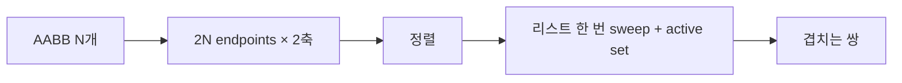

## 들어가며

들에서 *강체의 6 자유도 동역학* 을 완성했다. 입자에서 강체로, 병진에서 회전까지. 이제 *여러 강체가 한 월드에 함께 있을 때* 의 토픽으로 옮겨간다. *충돌 (collision)*.

N 개 강체의 *모든 쌍* 을 검사하면 *naive $O(N^2)$*. 100 개 강체 = 5000 쌍, 1000 개 = 50만 쌍, 1만 개 = 5천만 쌍. 한 프레임 16.6ms 안에 *수천만 충돌 검사 + 응답* 은 불가능. *대부분의 쌍이 멀리 떨어져* 있어 사실상 검사 자체가 *낭비*.

해결: *두 단계 충돌 검사*.


- **Broad phase**: *충돌 가능성 있는 쌍* 만 추리기. AABB 같은 *빠른 검사* 로 *대부분 쌍 제거*.
- **Narrow phase**: 후보 쌍에 정밀한 충돌 알고리즘을 적용해 실제 충돌 여부, 법선, 침투 깊이, 접촉점을 계산하는 단계.

이 글의 토픽이 *broad phase*. 후보 추리기.

이 글의 목표.

1. **AABB의 정의** — 6번 비교의 겹침 검사.
2. **Brute force** — 작은 N 에서 의외로 빠른 이유.
3. **Sweep and Prune (SAP)** — 축 정렬 endpoint 정렬의 frame-to-frame coherence 활용.
4. **Spatial Hash** — 균일 그리드의 단순함과 한계.
5. **Dynamic AABB Tree (DBVT)** — Box2D / Bullet 의 표준 선택.
6. **복잡도와 캐시 동작 비교** — 빌드 / 쿼리 / 갱신 / 캐시.
7. **혼합 broad phase** — 정적·동적·다중 규모 집합 분리.
8. **통일된 인터페이스** — 여러 알고리즘을 같은 코드 경로에서.

이 글은 *2D 위주* (AABB 만 다룸). 3D 도 같은 원리 — 박스 차원만 늘림.


---

## 목차
1. [AABB의 정의](#1-aabb의-정의)
2. [Brute force](#2-brute-force)
3. [Sweep and Prune](#3-sweep-and-prune)
4. [Spatial Hash](#4-spatial-hash)
5. [Dynamic AABB Tree](#5-dynamic-aabb-tree)
6. [복잡도와 캐시 동작 비교](#6-복잡도와-캐시-동작-비교)
7. [혼합 broad phase](#7-혼합-broad-phase)
8. [통일된 broad phase 인터페이스](#8-통일된-broad-phase-인터페이스)


---

## 1. AABB의 정의

*Axis-Aligned Bounding Box*. broad phase 의 *기본 단위 도형*.

### 1.1 정의

각 축에 *정렬된* 직사각형 / 직육면체. 2D 의 경우:

```cpp
struct AABB2D {
    vec2 min;        // 좌하단
    vec2 max;        // 우상단
};
```

객체의 *충돌 형상이 무엇이든* — 원, 박스, 다각형, 캡슐 — *그 형상을 감싸는* AABB 를 *모든 객체에 적용*. 형상별 충돌 검사보다 *훨씬 빠른* 단순 검사.

### 1.2 두 AABB 의 겹침 검사

```cpp
bool AABBOverlap(AABB2D a, AABB2D b) {
    if (a.max.x < b.min.x || a.min.x > b.max.x) return false;
    if (a.max.y < b.min.y || a.min.y > b.max.y) return false;
    return true;
}
```

*분리축이 어느 한 축에라도 있으면* 분리. 코드는 *4번 비교 + early-out* (2D), *6번 비교* (3D).

AABB 교차는 비교 수가 작지만 실제 비용은 데이터 로드, 분기 예측과 후보 출력에 좌우된다. SoA 배치에서는 SSE/AVX2 레지스터로 각각 4개/8개의 float lane을 비교할 수 있다. 한 페어 전체가 한 명령에 끝난다는 뜻은 아니며 각 축의 여러 비교, mask 결합과 결과 기록이 필요하다.

### 1.3 AABB 의 trade-off

- *장점*: 빠른 검사, 단순한 자료구조, 회전 무관 (객체가 회전해도 AABB 만 갱신).
- *단점*: 객체 회전 시 *원본 형상보다 훨씬 큰* 영역 — false positive 발생. 충돌 후보가 *실제 충돌 못 함* 케이스 늘어남.

정사각형을 45도 회전하면 AABB 의 한 변은 *√2 배*, 면적은 *2 배* 가 된다. 직사각형은 종횡비와 각도에 따라 증가량이 달라진다. 그래도 *narrow phase 가 거른다* — broad phase 는 *후보 추리기* 까지가 역할.

### 1.4 AABB 의 갱신

객체가 움직이면 AABB 도 *함께 이동*. 회전하면 *형상의 AABB 다시 계산*.

```cpp
AABB2D ComputeAABB(const ShapeBox& box, vec2 pos, float angle) {
    float c = std::fabs(std::cos(angle));
    float s = std::fabs(std::sin(angle));
    vec2 extent = {box.halfX * c + box.halfY * s,
                    box.halfX * s + box.halfY * c};
    return {pos - extent, pos + extent};
}
```

매 step 이 갱신을 수행. broad phase 알고리즘이 *갱신된 AABB 들* 을 입력으로 받는다.

### 1.5 두꺼운 AABB (fat AABB)

자주 움직이는 객체의 AABB 를 *조금 키워서 (fat)* 미리 등록 — *작은 이동마다 자료구조 갱신 안 함*. 객체가 fat AABB 밖으로 *벗어났을 때만* 갱신.

```cpp
constexpr float kFatExtension = 0.1f;        // 게임 단위
AABB2D fatAABB = {tightAABB.min - vec2{kFatExtension, kFatExtension},
                    tightAABB.max + vec2{kFatExtension, kFatExtension}};
```

Box2D 의 `b2DynamicTree::CreateProxy` 가 *AABB 를 fat 으로 확장* 후 등록. 갱신 비용 절감의 표준 트릭.

## 2. Brute force

가장 단순한 broad phase. *모든 쌍 검사*.

### 2.1 알고리즘

```cpp
std::vector<std::pair<int, int>> BruteForcePairs(
        const std::vector<AABB2D>& boxes) {
    std::vector<std::pair<int, int>> pairs;
    int n = boxes.size();
    for (int i = 0; i < n; ++i) {
        for (int j = i + 1; j < n; ++j) {
            if (AABBOverlap(boxes[i], boxes[j])) {
                pairs.emplace_back(i, j);
            }
        }
    }
    return pairs;
}
```

복잡도는 $O(N^2)$ 이고 N=100이면 4,950쌍이다. 이 정도가 충분히 빠른지는 AABB 배치, 실제 overlap 비율, 후보 vector 할당과 이후 narrow phase 비용에 달려 있으므로 장면 trace로 측정한다.

### 2.2 작은 N 에서 가장 빠른 이유

큰 N 알고리즘들이 *자료구조 유지·갱신 오버헤드* 를 가진다. 작은 N 에서 그 오버헤드가 *실제 비교 비용보다 큼*.

브레이크 이븐은 고정된 객체 수가 아니다. 정적·동적 비율, 공간 밀도, false positive, 트리 갱신량과 후보 출력량에 따라 바뀐다. `N`을 늘리는 synthetic test와 실제 frame trace를 모두 사용해 brute force의 pair loop, DBVT update, query, narrow-phase candidate 수를 따로 기록한다. 작은 N에서 brute force가 유리할 수 있는 이유는 코드가 단순하고 연속 배열을 순회하며 별도 구조 갱신이 없기 때문이다.

### 2.3 SIMD brute force

AABB 검사를 *8쌍 동시* 로 묶으면 더 큰 N 까지 brute force 가 경쟁력. AABB 데이터를 SoA 로 packed.

```cpp
// 의사 코드: AVX2 로 8 페어 동시 검사
__m256 a_max_x = _mm256_load_ps(&aabb_max_x[i]);   // 8 floats
__m256 b_min_x = _mm256_load_ps(&aabb_min_x[j]);   // 8 floats
__m256 sep_x   = _mm256_cmp_ps(a_max_x, b_min_x, _CMP_LT_OQ);
// ... y 축도 ...
```

SIMD와 연속 배치는 브레이크 이븐을 뒤로 미룰 수 있지만 `N=200~500` 같은 보편 경계는 없다. 밀도와 출력 후보 수를 포함한 측정으로 결정한다.

### 2.4 게임 사용 패턴

- *작은 시뮬 영역* (좁은 방, 1 화면): brute force.
- *적이 수십 마리 + 발사체 수십 개*: brute force 충분.
- *수백 객체부터* 다른 알고리즘 검토.

복잡한 알고리즘 도입은 *측정 후*. naive 가 문제 안 되면 그대로.

### 2.5 Sleeping 객체와 후보 쌍

Sleep 상태 객체의 proxy도 broad phase에 남겨야 움직이는 객체와의 접촉으로 깨울 수 있다. 다만 *양쪽 모두 sleeping*인 쌍은 건너뛸 수 있어 실제 검사량을 줄인다.

```cpp
std::vector<int> active;
for (int i = 0; i < bodies.size(); ++i) {
    if (!bodies[i].isSleeping) active.push_back(i);
}

for (int i : active) {
    for (int j = 0; j < bodies.size(); ++j) {
        if (i == j) continue;
        if (!bodies[j].isSleeping && j < i) continue; // active-active 중복 제거
        TestPair(i, j);  // active-active와 active-sleeping 모두 생성
    }
}
```

active가 수십~수백 개라면 비용은 대략 $O(N_{active}N)$이며, 두 sleeping 객체 쌍을 제외하는 것만으로도 크게 줄어든다.

## 3. Sweep and Prune

축 정렬 endpoint 리스트의 정렬 활용. *frame-to-frame coherence* — 객체가 한 프레임에 *조금만 이동* 한다는 가정.

### 3.1 알고리즘 개요

각 축 (x, y) 마다 *모든 AABB 의 min·max endpoint* 를 *정렬된 리스트* 로 유지.



매 step 정렬을 *다시* 안 함. 이전 정렬에서 *insertion sort 로 swap 처리* — 객체가 조금만 이동했으면 *몇 번의 swap* 으로 충분.

### 3.2 첫 정렬

```cpp
struct Endpoint {
    int   bodyId;
    float value;       // min 또는 max 의 x 또는 y
    bool  isMin;
};

std::vector<Endpoint> endpointsX;
// 모든 AABB 에 대해 min·max endpoint 2개씩 push
std::sort(endpointsX.begin(), endpointsX.end(),
           [](auto& a, auto& b) { return a.value < b.value; });
```

$O(N \log N)$. 한 번만.

### 3.3 매 step 갱신

```cpp
void UpdateSweep(std::vector<Endpoint>& list, int bodyId, float newValue, bool isMin) {
    // 해당 bodyId 의 endpoint 찾기
    int idx = FindEndpoint(list, bodyId, isMin);
    list[idx].value = newValue;
    // 정렬 유지를 위해 swap (insertion sort)
    while (idx > 0 && list[idx].value < list[idx - 1].value) {
        std::swap(list[idx], list[idx - 1]);
        --idx;
        // swap 시 충돌 후보 추가/제거 가능
    }
    while (idx < list.size() - 1 && list[idx].value > list[idx + 1].value) {
        std::swap(list[idx], list[idx + 1]);
        ++idx;
    }
}
```

객체가 *조금 이동* 하면 *작은 수의 swap* 만. 한 step 전체 (swap 갱신 + sweep 페어 추출) 비용이 평균 $O(N + K)$ — $K$ 는 추출된 겹침 쌍 수 (6.1절의 기호 규약).

### 3.4 겹침 추출

x 축과 y 축 *둘 다 겹치는 쌍* 만 후보.

```cpp
// x 축 sweep — active set 으로 후보 추출
std::set<int> active;
std::set<std::pair<int, int>> candidates;
for (auto& ep : endpointsX) {
    if (ep.isMin) {
        for (int other : active) {
            int a = std::min(ep.bodyId, other);
            int b = std::max(ep.bodyId, other);
            candidates.emplace(a, b);
        }
        active.insert(ep.bodyId);
    } else {
        active.erase(ep.bodyId);
    }
}
// 같은 방식으로 y 축 sweep → 두 set 의 교집합이 최종 후보
```

산업 구현은 *active set 을 incremental* 로 유지해 매 step 재구축 회피.

### 3.5 한계

- *큰 점프 (텔레포트)*: insertion sort 가 *최악 $O(N)$* swap. 한 프레임에 큰 비용.
- *축 정렬 분포 의존*: x 분산이 좋아야 효율적. *모든 객체가 한 줄에 모이면* x 후보가 폭발.
- *3D 추가 비용*: 축 한 개 더 — 동일 알고리즘 한 번 더.

frame-to-frame coherence 가 *유효한 가정* 인 게임 (RTS 의 유닛, FPS 의 캐릭터) 에서 좋은 선택.

### 3.6 산업 채택

Bullet 의 *btAxisSweep3* — 이 알고리즘의 산업 reference 구현. Box2D 는 dynamic tree 계열을 쓰고, PhysX 는 scene 특성에 따라 SAP / grid 계열 broad phase 를 조합한다.

## 4. Spatial Hash

월드를 *균일 격자* 로 나눠 각 셀에 객체 등록. 가장 단순한 *공간 분할*.

### 4.1 알고리즘

```cpp
struct SpatialHash {
    float cellSize;
    std::unordered_map<int64_t, std::vector<int>> cells;
};

int64_t HashCell(int cx, int cy) {
    return ((int64_t)(uint32_t)cx << 32) | (uint32_t)cy;
}

void Insert(SpatialHash& h, int bodyId, AABB2D aabb) {
    int x0 = (int)std::floor(aabb.min.x / h.cellSize);
    int y0 = (int)std::floor(aabb.min.y / h.cellSize);
    int x1 = (int)std::floor(aabb.max.x / h.cellSize);
    int y1 = (int)std::floor(aabb.max.y / h.cellSize);
    for (int cy = y0; cy <= y1; ++cy) {
        for (int cx = x0; cx <= x1; ++cx) {
            h.cells[HashCell(cx, cy)].push_back(bodyId);
        }
    }
}
```

AABB 가 *걸치는 모든 셀* 에 등록. 객체가 셀보다 크면 *여러 셀에 중복*.

### 4.2 쿼리

```cpp
std::vector<std::pair<int, int>> SpatialHashPairs(
        const SpatialHash& h, const std::vector<AABB2D>& boxes) {
    std::set<std::pair<int, int>> pairs;
    for (auto& [key, cellBodies] : h.cells) {
        for (int i = 0; i < cellBodies.size(); ++i) {
            for (int j = i + 1; j < cellBodies.size(); ++j) {
                int a = std::min(cellBodies[i], cellBodies[j]);
                int b = std::max(cellBodies[i], cellBodies[j]);
                if (AABBOverlap(boxes[a], boxes[b])) {
                    pairs.emplace(a, b);
                }
            }
        }
    }
    return std::vector<std::pair<int, int>>(pairs.begin(), pairs.end());
}
```

*같은 셀의 객체들끼리만* AABB 검사. 중복 제거 (set) 필요.

### 4.3 셀 크기 결정

가장 중요한 튜닝.

| 셀 크기 | 효과 |
|---|---|
| 너무 작음 | 객체가 여러 셀에 등록 → 메모리·등록 비용 폭증 |
| 적정 (≈ 평균 객체 크기) | 균형 |
| 너무 큼 | 한 셀에 많은 객체 → 셀 안 검사가 다시 brute force |

경험칙: *셀 크기 = 평균 객체 크기 × 1~2* 또는 *가장 흔한 쿼리 반경*.

### 4.4 한계

- *균일 크기 가정*: 객체 크기 분포가 *균일해야* 효율적. 큰 객체 + 작은 객체가 섞이면 셀 크기 선택 어려움.
- *희박 분포의 메모리 낭비*: 빈 셀이 많으면 해시 테이블 오버헤드.
- *해시 충돌*: 흔하진 않지만 같은 해시 버킷에 다른 셀이 떨어지는 함정.

### 4.5 변형

- *Loose hash grid*: 셀 크기를 객체 크기에 맞춰 *adaptive*.
- *Multi-level grid*: 큰 객체와 작은 객체를 *별도 레벨* 의 그리드에. *fine-grained + coarse-grained*.
- *Sparse hashing*: 활성 셀만 저장.

게임의 *수많은 작은 객체 + 균일 분포* (탄막 슈터, 입자 시스템) 에 적합. *큰 환경 + 객체 다양* 한 일반 케이스는 *DBVT* 가 더 안정적.

## 5. Dynamic AABB Tree

이진 트리 구조의 broad phase. 내부 노드의 AABB 가 *자식들의 AABB 합집합*. 게임 엔진의 표준.

### 5.1 자료구조

```cpp
struct DbvtNode {
    AABB2D bounds;
    int    parent      = -1;
    int    children[2] = {-1, -1};
    int    bodyId      = -1;    // -1 이면 inner node
    int    height      = 0;
};

class DynamicAabbTree {
public:
    int   CreateProxy(AABB2D aabb, int bodyId);
    void  MoveProxy(int proxyId, AABB2D aabb);
    void  Query(AABB2D queryAabb, std::function<void(int)> cb) const;
    // ...
private:
    std::vector<DbvtNode> nodes_;
    int                   rootIdx_ = -1;
};
```

각 객체 = *leaf node*. 내부 노드는 *자식들의 AABB 합*. 트리 위로 갈수록 큰 AABB.

### 5.2 삽입과 SAH

새 leaf 삽입 시 *어느 위치에 끼울지* 결정. *Surface Area Heuristic (SAH)* — 트리의 *총 표면적 합* 이 최소가 되도록.


비용 모델:

$$
C(\text{node}) = SA(\text{node}) + \sum \text{children cost}
$$

표면적이 작은 트리가 *광선 / 영역 쿼리가 빨리 가지치기됨*. Box2D 의 `b2DynamicTree` 가 SAH 기반 삽입.

### 5.3 쿼리

```cpp
void DynamicAabbTree::Query(AABB2D q, std::function<void(int)> cb) const {
    if (rootIdx_ < 0) return;
    std::vector<int> stack;
    stack.push_back(rootIdx_);
    while (!stack.empty()) {
        int idx = stack.back();
        stack.pop_back();
        const DbvtNode& n = nodes_[idx];
        if (!AABBOverlap(n.bounds, q)) continue;
        if (n.bodyId >= 0) {
            cb(n.bodyId);              // leaf — 후보로 보고
        } else {
            stack.push_back(n.children[0]);
            stack.push_back(n.children[1]);
        }
    }
}
```

*기각된 가지의 모든 객체* 가 *한 번에 무시*. 균형 잡힌 트리와 국소 쿼리에서는 평균적으로 $O(\log N + k)$ 에 가깝지만, 실제 비용은 트리 품질과 객체 분포에 의존한다. 여기서 $k$ 는 반환 후보 수.

### 5.4 갱신

객체가 *fat AABB 밖으로 벗어남* → leaf 의 fat AABB 갱신. 갱신이 *큰 차이* 면 leaf 를 *트리에서 제거 후 재삽입*.

```cpp
void DynamicAabbTree::MoveProxy(int proxyId, AABB2D newAabb) {
    if (Contains(nodes_[proxyId].bounds, newAabb)) {
        return;                   // fat AABB 안 — 갱신 불필요
    }
    Remove(proxyId);
    nodes_[proxyId].bounds = FattenAabb(newAabb);
    Insert(proxyId);
}
```

대부분 프레임에 *재삽입 안 함*. 객체가 *fat AABB 밖으로 큰 이동* 만 트리 변경.

### 5.5 페어 추출 — Tree vs Tree 또는 Self

두 트리의 *동시 트래버설* 로 페어 추출.

```cpp
void CollectPairs(int aIdx, int bIdx,
                   std::vector<std::pair<int,int>>& pairs) {
    const DbvtNode& a = nodes_[aIdx];
    const DbvtNode& b = nodes_[bIdx];
    if (!AABBOverlap(a.bounds, b.bounds)) return;
    if (a.bodyId >= 0 && b.bodyId >= 0) {
        if (a.bodyId != b.bodyId) {
            pairs.emplace_back(std::min(a.bodyId, b.bodyId),
                                std::max(a.bodyId, b.bodyId));
        }
        return;
    }
    // 큰 노드 자식으로 재귀 ...
}
```

*Self-collision* (한 트리 안의 모든 쌍) 의 변형도 비슷 — 좌·우 자식이 *둘 다 같은 트리* 인 경우.

### 5.6 산업 채택

- **Box2D**: `b2DynamicTree` — 2D broad phase 의 reference.
- **Bullet**: `btDbvtBroadphase` — 3D dynamic AABB tree 계열 broad phase.
- **PhysX**: SAP, MBP, ABP/PABP, GPU broad phase를 scene 특성에 맞게 선택. AABB tree는 scene query 가속 구조에서 사용한다.

게임 엔진의 *큰 환경 + 다양한 객체 크기* 에서 가장 안정적인 선택.

## 6. 복잡도와 캐시 동작 비교

알고리즘별 *세 비용* (빌드, 쿼리, 갱신) + *캐시 친화성*.

### 6.1 점근 복잡도

| 알고리즘 | 빌드 | 쿼리 / 페어 추출 | 갱신 (per body) |
|---|---|---|---|
| Brute force | $O(1)$ | $O(N^2)$ 페어 추출 | $O(1)$ |
| SAP | $O(N \log N)$ 첫 빌드 | 축 정렬성이 좋으면 $O(N + K)$ 페어 추출 | 이동량만큼 swap |
| Spatial Hash | $O(N + \text{entries})$ | 인접 셀의 객체 수 + $k$ | 걸친 셀 수 |
| DBVT | $O(N \log N)$ bulk / incremental | 평균 $O(\log N + k)$, 분포 의존 | 평균 $O(\log N)$ |

여기서 $K$ 는 broad phase 가 만든 후보 페어 수, $k$ 는 단일 쿼리의 반환 후보 수. 점근식보다 중요한 것은 *객체 분포, 이동량, 후보 페어 수*.

### 6.2 캐시 동작

| 알고리즘 | 캐시 친화성 |
|---|---|
| Brute force | 매우 좋음 (선형 순회) |
| SAP | 좋음 (정렬 배열) |
| Spatial Hash | 보통 (해시 룩업) |
| DBVT | 나쁨 (트리 노드 분산) |

DBVT 가 *이론 복잡도는 좋지만* 캐시 미스 빈도가 *상대적* 으로 높다. 작은 N 에선 brute force 가 *실측에서 더 빠른* 이유.

### 6.3 동적 갱신 비용

매 step 객체가 *얼마나 자주 큰 이동* 하는가에 비용 의존.

- *대부분 정적*: brute force / spatial hash / DBVT 모두 비용 작음.
- *대부분 동적 (작은 이동)*: SAP 의 insertion sort 가 빠름. DBVT 의 fat AABB 도 효과적.
- *빈번한 큰 이동 (텔레포트)*: DBVT 의 재삽입이 *예측 가능한 $O(\log N)$*. SAP 는 최악 $O(N)$.

### 6.4 전환점 측정

객체 수만으로 알고리즘을 선택할 수 없다. brute force의 전환점은 후보 pair의 실제 중첩률, AABB 갱신률, 메모리 배치와 query 종류에 따라 달라진다. 동일한 이동 trace를 재생하며 update 시간, 생성된 후보 수, false-positive 비율, 최대 frame 시간을 측정한다.

### 6.5 게임 도메인별

- 균일한 크기와 제한된 상호작용 반경 → uniform grid 후보.
- 프레임 간 축 정렬 순서가 거의 유지됨 → SAP 후보.
- 크기·분포가 불균일하고 AABB query가 다양함 → dynamic tree 후보.
- 거대 정적 환경과 동적 객체가 섞임 → 정적 가속 구조와 동적 broad phase 분리 후보.

## 7. 혼합 broad phase

하나의 자료구조에 모든 객체를 넣을 필요는 없다.

### 7.1 정적·동적 분리

변하지 않는 triangle mesh와 terrain은 offline BVH 같은 정적 구조에 넣고, 움직이는 body는 dynamic tree·SAP·grid에 둔다. dynamic proxy를 query할 때 동적 구조와 정적 구조를 모두 탐색하고 pair key로 중복을 제거한다.

### 7.2 이동 집합 추적

fat AABB 안에 머문 proxy는 재삽입하지 않고, 실제 AABB가 fat bounds를 벗어난 proxy만 이동 목록에 넣는다. pair 갱신도 이동 목록에서 시작하면 매 step 전체 객체를 다시 query하지 않아도 된다. fat margin이 크면 update는 줄지만 false positive가 늘어난다.

### 7.3 다중 규모 분리

크기 차이가 큰 객체를 하나의 uniform grid에 넣으면 큰 객체가 많은 셀을 차지하거나 작은 객체가 과밀 셀에 몰린다. 크기 계층별 grid, loose hierarchy, 별도 giant-object 목록을 두고 cross-group pair를 생성할 수 있다. 혼합 구조의 가치는 제품 이름이 아니라 각 집합의 update/query 분포가 다를 때 생긴다.

## 8. 통일된 broad phase 인터페이스

여러 알고리즘을 *같은 코드 경로* 에서 다루는 추상화.

### 8.1 인터페이스

```cpp
class IBroadPhase {
public:
    virtual ~IBroadPhase() = default;

    // 객체 등록 / 제거
    virtual int   CreateProxy(AABB2D aabb, int bodyId) = 0;
    virtual void  DestroyProxy(int proxyId)             = 0;

    // AABB 갱신
    virtual void  MoveProxy(int proxyId, AABB2D newAabb) = 0;

    // 모든 충돌 후보 페어 추출
    virtual void  ComputePairs(
        std::vector<std::pair<int, int>>& outPairs) = 0;

    // 단일 영역 쿼리 (광선·박스 검사용)
    virtual void  Query(AABB2D queryAabb,
                         std::function<void(int)> cb) const = 0;
};

class BruteForceBroadPhase   : public IBroadPhase { /* ... */ };
class SapBroadPhase           : public IBroadPhase { /* ... */ };
class SpatialHashBroadPhase   : public IBroadPhase { /* ... */ };
class DbvtBroadPhase          : public IBroadPhase { /* ... */ };
```

물리 엔진의 *모든 충돌 코드* 가 *IBroadPhase* 만 의존. 알고리즘 교체가 *생성 시점 1 줄*.

### 8.2 사용

```cpp
auto broadPhase = std::make_unique<DbvtBroadPhase>();
for (auto& body : world.bodies) {
    body.broadPhaseId = broadPhase->CreateProxy(body.aabb, body.id);
}

// 매 step
for (auto& body : world.bodies) {
    if (body.aabbChanged) {
        broadPhase->MoveProxy(body.broadPhaseId, body.aabb);
    }
}
std::vector<std::pair<int, int>> pairs;
broadPhase->ComputePairs(pairs);

// 페어들을 narrow phase 로 전달
for (auto& [a, b] : pairs) {
    NarrowPhaseCheck(world.bodies[a], world.bodies[b]);
}
```

### 8.3 알고리즘 비교의 검증 신호

같은 시뮬레이션을 *4 broad phase* 로 돌려 비교할 양.

| 신호 | 의미 |
|---|---|
| 페어 수 | 4 알고리즘 모두 같아야 함 (정확성 검증) |
| ComputePairs 시간 | 알고리즘별 비용 차이 |
| 갱신 시간 (per frame) | 동적 객체 비용 |
| 메모리 | 자료구조 크기 |
| 페어 false positive 비율 | 후보 / 실제 충돌 비율 |

페어 수가 다르면 *알고리즘 중 하나가 정확성 버그* — 디버깅의 핵심 신호.

### 8.4 좋은 추상화의 디자인

- *알고리즘 무관 인터페이스* — 사용자 코드가 알고리즘 모름.
- *생성 시점 교체 가능* — 게임 옵션 / 디버그.
- *측정 hook* — 페어 수, 시간을 외부에서 관찰 가능.
- *fat AABB 정책 통일* — 인터페이스 안에서 처리, 사용자는 *tight AABB* 만 입력.

### 8.5 통합과 분리

큰 시뮬레이션은 *여러 broad phase 동시* — 정적 환경용 + 동적 객체용 + 트리거 영역용. 각각 *다른 알고리즘* 도 가능.

```cpp
class World {
    std::unique_ptr<IBroadPhase> staticBP;       // DBVT, 빌드 1번
    std::unique_ptr<IBroadPhase> dynamicBP;      // SAP, 매 step 갱신
    std::unique_ptr<IBroadPhase> triggerBP;      // Spatial Hash, 큰 trigger 영역
};
```

PhysX 의 SAP + grid hybrid 가 이 패턴.


---

## 결론

broad phase 는 *충돌 시스템의 성능 결정자*. naive $O(N^2)$ 가 *수천 객체에서 무너지는 환경* 에서, 적절한 자료구조가 *수만 객체* 도 *프레임 예산 안* 처리 가능하게 한다.

이 글에서 정리한 핵심.

1. **AABB** — 빠른 검사의 기본 단위. fat AABB 로 갱신 비용 절감.
2. **Brute force** — 작은 N 에서 의외로 최적. *측정 후 알고리즘 선택*.
3. **Sweep and Prune** — frame-to-frame coherence 활용. insertion sort 갱신.
4. **Spatial Hash** — 균일 그리드. 객체 크기 분포에 민감.
5. **Dynamic AABB Tree** — SAH 계열 삽입 비용과 fat AABB를 이용한 incremental 갱신.
6. **복잡도와 캐시** — 점근 복잡도와 실측 성능이 다른 이유. 작은 N 의 brute force 가 빠른 이유.
7. **혼합 구조** — 정적·동적·크기 계층을 서로 다른 구조로 관리.
8. **통일 인터페이스** — 같은 코드 경로에 여러 알고리즘.

Broad phase 의 출력은 *후보 쌍* 이다. 이 후보 쌍은 정밀 충돌 판정과 응답 시스템의 입력으로 사용된다.

## 더 읽을거리

- Christer Ericson, *Real-Time Collision Detection*, Ch. 7~8 — broad phase 종합 정리.
- Erin Catto, "Dynamic Trees" (GDC 2019) — Box2D 의 DBVT 설계 디테일.
- Bullet Physics manual, "Broadphase Collision Detection" — Bullet 의 두 broad phase 비교.
- Box2D 소스 (`b2DynamicTree.cpp`, `b2BroadPhase.cpp`) — 산업 reference 구현.
- Bullet 소스 (`btAxisSweep3.cpp`, `btDbvtBroadphase.cpp`) — SAP 와 DBVT 비교 가능한 두 구현.
- Karras, "Maximizing Parallelism in the Construction of BVHs, Octrees, and k-d Trees" (HPG 2012) — GPU broad phase 빌드.
- Tomas Akenine-Möller et al., *Real-Time Rendering*, Ch. 19 — frustum culling 의 broad phase 와의 공통점.
- Erwin Coumans, "Continuous Collision Detection in Bullet" — broad phase 가 CCD 와 결합되는 패턴.
